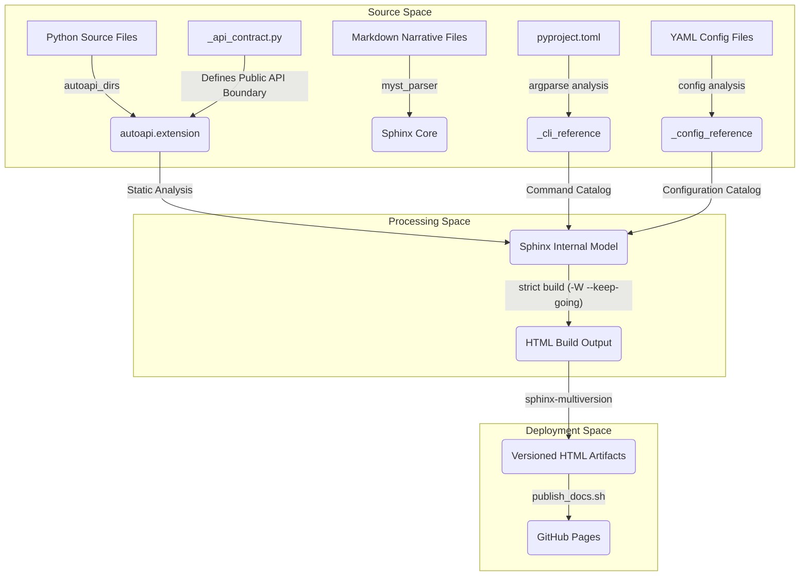

<!-- source: DeepWiki mcp.deepwiki.com · repo NVIDIA/xr-ai · page 5.1 Documentation System · fetched 2026-10-26 -->

# Documentation System

<details>
<summary>Relevant source files</summary>

The following files were used as context for generating this wiki page:

- [.github/actions/deploy-docs-site/action.yaml](.github/actions/deploy-docs-site/action.yaml)
- [.github/scripts/docs_release_policy.py](.github/scripts/docs_release_policy.py)
- [.github/scripts/publish_docs.sh](.github/scripts/publish_docs.sh)
- [.github/scripts/remove_docs_preview.sh](.github/scripts/remove_docs_preview.sh)
- [.github/scripts/select_latest_docs_release.py](.github/scripts/select_latest_docs_release.py)
- [.github/workflows/docs-preview-cleanup.yaml](.github/workflows/docs-preview-cleanup.yaml)
- [.github/workflows/docs-preview-sweep.yaml](.github/workflows/docs-preview-sweep.yaml)
- [.github/workflows/docs.yaml](.github/workflows/docs.yaml)
- [agent-sdk/xr-ai-runtime/xr_ai_runtime/events.py](agent-sdk/xr-ai-runtime/xr_ai_runtime/events.py)
- [docs/Makefile](docs/Makefile)
- [docs/requirements.txt](docs/requirements.txt)
- [docs/source/_api_contract.py](docs/source/_api_contract.py)
- [docs/source/_api_reference_check.py](docs/source/_api_reference_check.py)
- [docs/source/_cli_reference.py](docs/source/_cli_reference.py)
- [docs/source/_config_reference.py](docs/source/_config_reference.py)
- [docs/source/_static/css/custom.css](docs/source/_static/css/custom.css)
- [docs/source/_static/root-redirect.html](docs/source/_static/root-redirect.html)
- [docs/source/_templates/versioning.html](docs/source/_templates/versioning.html)
- [docs/source/conf.py](docs/source/conf.py)
- [docs/source/guides/index.md](docs/source/guides/index.md)
- [docs/source/reference/command-line.rst](docs/source/reference/command-line.rst)
- [docs/source/reference/configuration.rst](docs/source/reference/configuration.rst)
- [docs/source/reference/index.md](docs/source/reference/index.md)
- [tests/test_api_documentation.py](tests/test_api_documentation.py)
- [tests/test_docs_versions.py](tests/test_docs_versions.py)
- [tests/test_xr_ai_vad.py](tests/test_xr_ai_vad.py)
- [utils/xr-ai-launcher/xr_ai_launcher/_cloudxr_env.py](utils/xr-ai-launcher/xr_ai_launcher/_cloudxr_env.py)
- [utils/xr-ai-launcher/xr_ai_launcher/_models.py](utils/xr-ai-launcher/xr_ai_launcher/_models.py)
- [utils/xr-ai-vad/xr_ai_vad/detector.py](utils/xr-ai-vad/xr_ai_vad/detector.py)

</details>


The XR-AI documentation system is a multi-layered pipeline designed to ensure that technical references remain in sync with the codebase. It utilizes **Sphinx** for narrative content, **Sphinx-AutoAPI** for static analysis of Python source code, and a custom **GitHub Actions** workflow to manage versioned deployments and pull request previews.

## Architecture and Pipeline

The documentation pipeline is triggered by changes to source code or narrative files. It enforces a "strict build" policy where warnings are treated as errors to prevent broken links or undocumented public exports.

### Documentation Build Data Flow

The following diagram illustrates how source code and configuration files are transformed into the versioned documentation site.

**Documentation Assembly Pipeline**

Sources: [.github/workflows/docs.yaml:100-127](), [docs/Makefile:30-41](), [docs/source/conf.py:115-124]()

## Static Analysis and API Contracts

Unlike traditional documentation systems that import code to inspect it, XR-AI uses **static analysis** via `sphinx-autoapi`. This allows the documentation to be built in an environment without installing heavy dependencies like CUDA or specific model runtimes [docs/source/conf.py:127-130]().

### Public API Enforcement
The system defines a strict boundary for what constitutes "public" API. This is governed by `docs/source/_api_contract.py`.
*   **Boundary Definition**: Only modules listed in `PUBLIC_API_MODULES` and members explicitly included in a package's `__all__` list are documented [docs/source/_api_contract.py:17-25](), [docs/source/_api_contract.py:79-93](). The `API_PACKAGE_DIRS` variable specifies the root directories for Python packages to be scanned [docs/source/_api_contract.py:14-25]().
*   **Validation**: The `_literal_exports` function extracts the `__all__` list from `__init__.py` files [docs/source/_api_contract.py:79-93](). The `_resolve_name` function recursively resolves imported names to their definitions [docs/source/_api_contract.py:158-193](). The `_following_docstring` function checks for docstrings immediately following a definition [docs/source/_api_contract.py:96-109]().
*   **Type Canonicalization**: A custom Sphinx hook, `_canonicalize_public_type_references` (defined in `docs/source/conf.py`), rewrites internal module paths to their public-facing aliases (e.g., shortening `xr_ai_hub.endpoint.ProcessorEndpoint` to `xr_ai_hub.ProcessorEndpoint`) [docs/source/conf.py:73-84](). This is applied during `autoapi_prepare_jinja_env` and `_canonicalize_api_annotations` [docs/source/conf.py:87-90](), [docs/source/conf.py:91-105]().

### CLI Reference Generation
The `_cli_reference` directive statically parses `argparse` declarations in sample projects. It extracts flags, help text, and default values directly from the AST (Abstract Syntax Tree) to generate a consistent command-line reference without executing the scripts [docs/source/_cli_reference.py:117-172](). The `_extract_arguments` function performs this AST traversal and argument extraction [docs/source/_cli_reference.py:117-172](). The `CliArgument` and `CliCommand` dataclasses represent the parsed CLI structure [docs/source/_cli_reference.py:27-106]().

### Configuration Reference Generation
The `_config_reference` directive is designed to generate documentation for YAML configuration files. It extracts schema information and descriptions to provide a structured reference for various service configurations. This ensures that configuration options are well-documented and easily discoverable.

Sources: [docs/source/_api_contract.py:13-25](), [docs/source/conf.py:88-105](), [docs/source/_cli_reference.py:4-25](), [tests/test_api_documentation.py:59-82]()

## Versioning and Deployment

The documentation site supports multiple versions, allowing users to view docs for specific releases or the development `main` branch.

### Version Selection Logic
The system uses `sphinx-multiversion` to select release tags from the Git history.
*   **Stable Releases**: Tags matching semantic versioning (e.g., `v1.0.0`) are whitelisted by `smv_tag_whitelist` [docs/source/conf.py:160](), which is populated by `docs_release_policy.py` [docs/source/conf.py:20-21]().
*   **Latest Redirect**: A script, `select_latest_docs_release.py`, identifies the highest stable version to serve as the site root redirect [tests/test_docs_versions.py:53-65](). This script uses `_SEMVER` regex to parse version tags and `_Version` dataclass for precedence comparison [select_latest_docs_release.py:16-40](). The `docs.yaml` workflow then copies the selected latest version to `docs/_build/latest` and creates `index.html` with a redirect [docs/source/_static/root-redirect.html](), [docs/Makefile:18](), [.github/workflows/docs.yaml:146-150]().
*   **Development Docs**: The `main` branch is always available and labeled as "development" in the version switcher [docs/source/conf.py:161]().

### PR Previews
For every documentation-related Pull Request, the CI pipeline builds a "current" version of the docs and deploys it to a unique sub-directory on GitHub Pages: `/preview/pr-<N>/` [.github/workflows/docs.yaml:17](). This allows reviewers to verify formatting and link integrity before merging. The `docs.yaml` workflow checks out the PR's head SHA and builds it as `current` [docs/Makefile:16](), [.github/workflows/docs.yaml:121-125](). A separate workflow, `docs-preview-cleanup.yaml`, removes the preview directory when a PR is closed.

**Version Management Components**
```mermaid
graph LR
    Git_Tags[Git Tags (e.g., v1.0.0, v2.0.0-rc.1)] --> Select_Latest_Script[.github/scripts/select_latest_docs_release.py]
    Select_Latest_Script --> Latest_Version_Env[XR_AI_DOCS_LATEST_VERSION (env var)]
    Latest_Version_Env --> SMV_Latest_Version[smv_latest_version in conf.py]
    
    Git_History[Git History (branches, tags)] --> Sphinx_Multiversion(sphinx-multiversion)
    SMV_Tag_Whitelist[smv_tag_whitelist in conf.py] --> Sphinx_Multiversion
    SMV_Branch_Whitelist[smv_branch_whitelist in conf.py] --> Sphinx_Multiversion
    
    Sphinx_Multiversion --> Versioned_Build_Output[docs/_build/{version}/]
    
    Docs_Workflow[.github/workflows/docs.yaml] --> Build_Job[Build Job]
    Build_Job --> Publish_Job[Publish Job]
    
    Build_Job -- "Copies to docs/_build/latest/" --> Latest_Docs_Dir[docs/_build/latest/]
    Build_Job -- "Creates root-redirect.html" --> Root_Redirect[docs/_build/index.html]
    
    Publish_Job -- "Deploys to gh-pages branch" --> GitHub_Pages_Site[GitHub Pages Site]
    
    PR_Event[Pull Request Event] --> Build_Job -- "Builds 'current' version" --> PR_Preview_Dir[docs/_build/current/]
    PR_Preview_Dir -- "Deployed to /preview/pr-<N>/" --> GitHub_Pages_Site
    
    Cleanup_Workflow[.github/workflows/docs-preview-cleanup.yaml] --> Remove_Preview_Script[.github/scripts/remove_docs_preview.sh]
    Remove_Preview_Script -- "Removes /preview/pr-<N>/" --> GitHub_Pages_Site
```
Sources: [.github/workflows/docs.yaml:95-117](), [docs/source/conf.py:157-163](), [docs/source/_templates/versioning.html](), [tests/test_docs_versions.py:27-42](), [.github/scripts/select_latest_docs_release.py:16-40]()

## Strict Enforcement and Quality

To maintain documentation quality, the system integrates into the standard test suite:
1.  **SPDX Header Checks**: All new source files must include the standard NVIDIA copyright and Apache-2.0 license header. This is enforced by CI checks.
2.  **Docstring Requirements**: The `api-check` target in the `Makefile` runs `_api_contract.py` to ensure no public member is missing documentation [docs/Makefile:29](), [tests/test_api_documentation.py:85-111]().
3.  **Link Integrity**: GitHub Actions uses `-W --keep-going` during Sphinx builds to ensure all internal cross-references and image paths are valid [.github/workflows/docs.yaml:125](). The `check_latest_docs_links.py` script further validates links in the `/latest/` build [docs/Makefile:18](), [.github/workflows/docs.yaml:137-140]().
4.  **Custom CSS**: The `docs/source/_static/css/custom.css` file allows for custom styling of the documentation site [docs/source/conf.py:173]().

Sources: [docs/Makefile:36-41](), [docs/source/guides/contributing-and-conventions.md:24-29](), [tests/test_api_documentation.py:237-242](), [.github/workflows/docs.yaml:125](), [docs/source/conf.py:173]()

---

