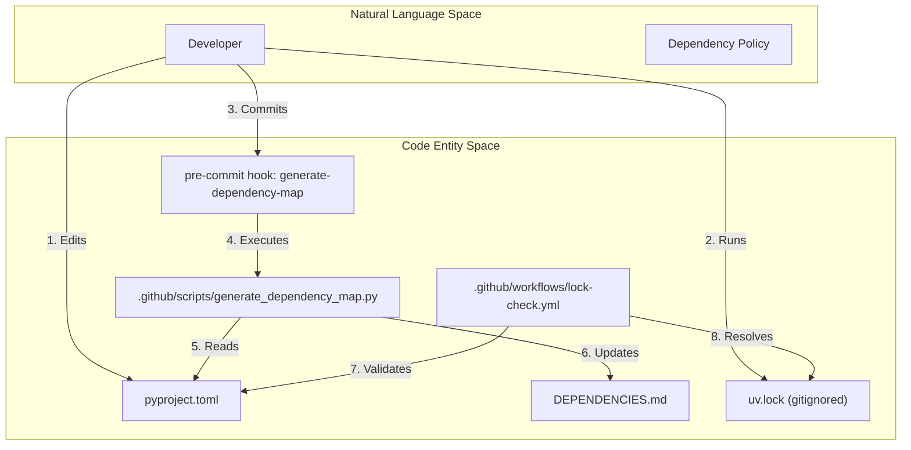
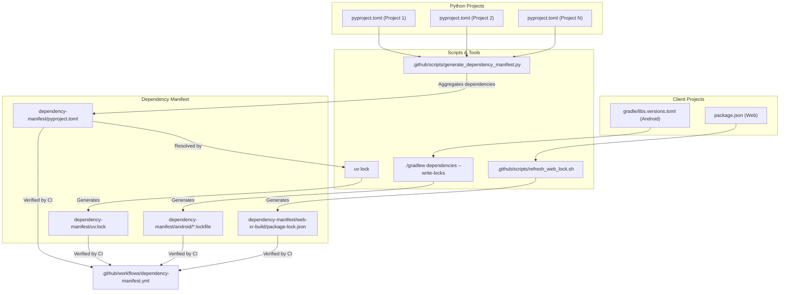
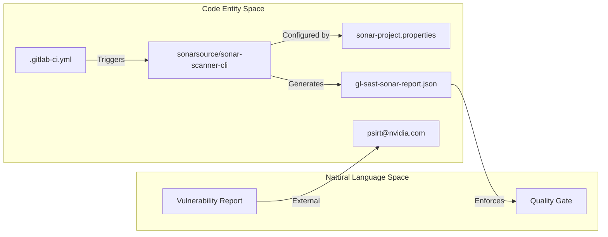

<!-- source: DeepWiki mcp.deepwiki.com · repo NVIDIA/xr-ai · page 5.3 Dependency Management and Security · fetched 2026-10-26 -->

# Dependency Management and Security

Relevant source files

The following files were used as context for generating this wiki page:

- [.gitattributes](.gitattributes)
- [.github/scripts/check_spdx_headers.py](.github/scripts/check_spdx_headers.py)
- [.github/scripts/generate_dependency_manifest.py](.github/scripts/generate_dependency_manifest.py)
- [.github/scripts/generate_dependency_map.py](.github/scripts/generate_dependency_map.py)
- [.github/scripts/refresh_web_lock.sh](.github/scripts/refresh_web_lock.sh)
- [.github/workflows/dependency-manifest.yml](.github/workflows/dependency-manifest.yml)
- [.github/workflows/lock-check.yml](.github/workflows/lock-check.yml)
- [.gitignore](.gitignore)
- [.pre-commit-config.yaml](.pre-commit-config.yaml)
- [AGENTS.md](AGENTS.md)
- [CODE_OF_CONDUCT.md](CODE_OF_CONDUCT.md)
- [CONTRIBUTING.md](CONTRIBUTING.md)
- [DEPENDENCIES.md](DEPENDENCIES.md)
- [README.md](README.md)
- [SECURITY.md](SECURITY.md)
- [THIRD_PARTY_NOTICES.md](THIRD_PARTY_NOTICES.md)
- [agent-samples/tea-making-sample/main.py](agent-samples/tea-making-sample/main.py)
- [client-samples/android/.gitignore](client-samples/android/.gitignore)
- [dependency-manifest/.gitignore](dependency-manifest/.gitignore)
- [dependency-manifest/android/buildscript-gradle.lockfile](dependency-manifest/android/buildscript-gradle.lockfile)
- [dependency-manifest/android/gradle.lockfile](dependency-manifest/android/gradle.lockfile)
- [dependency-manifest/pyproject.toml](dependency-manifest/pyproject.toml)
- [dependency-manifest/uv.lock](dependency-manifest/uv.lock)
- [dependency-manifest/web-xr-build/package-lock.json](dependency-manifest/web-xr-build/package-lock.json)
- [dependency-manifest/web-xr-build/package.json](dependency-manifest/web-xr-build/package.json)
- [docs/source/guides/contributing-and-conventions.md](docs/source/guides/contributing-and-conventions.md)
- [tests/pyproject.toml](tests/pyproject.toml)
- [tests/test_dependency_manifest.py](tests/test_dependency_manifest.py)
- [tests/test_dependency_map.py](tests/test_dependency_map.py)
- [uv.toml](uv.toml)

This section details the automated systems and policies used to maintain the `xr-ai` repository's security posture, license compliance, and dependency integrity. The repository employs a multi-layered approach combining local git hooks, CI/CD enforcement, and static analysis to ensure that all internal and external dependencies are tracked and secure.

## Dependency Inventory and Mapping

The `xr-ai` repository utilizes a distributed Python project structure where multiple sub-packages (e.g., `agent-sdk/`, `services/`, `utils/`) own their respective environments and metadata [CONTRIBUTING.md:28-29](). To maintain a global view of these relationships, the repository generates a `DEPENDENCIES.md` file that maps every internal and external dependency.

### Dependency Map Generation
The `generate_dependency_map.py` script is the core utility for this process. It performs the following functions:
1.  **Discovery**: Scans the repository for all `pyproject.toml` files, excluding build artifacts and virtual environments [.github/scripts/generate_dependency_map.py:96-102]().
2.  **Validation**: Ensures that internal dependencies (local paths) are correctly declared in `tool.uv.sources` and that they do not escape the repository root [.github/scripts/generate_dependency_map.py:182-198]().
3.  **Synchronization**: Updates the `DEPENDENCIES.md` file by replacing the content between `START_MARKER` and `END_MARKER` with a rendered inventory of projects and their requirements [.github/scripts/generate_dependency_map.py:22-23]().

### Automated Enforcement
The dependency map is enforced through two primary mechanisms:
*   **Pre-commit Hook**: A local hook `generate-dependency-map` runs the script during the commit process. If the generated inventory drifts from the `pyproject.toml` files, the commit is aborted so the operator can review and stage the changes [.pre-commit-config.yaml:38-47]().
*   **CI Lock-Check**: The `lock-check.yml` workflow runs `uv lock` on every project to verify that all declared dependencies are jointly satisfiable across the entire `requires-python` range [.github/workflows/lock-check.yml:6-14]().

### Dependency Resolution Flow
The following diagram illustrates how a change to a project's dependencies propagates through the system.

**Dependency Update Lifecycle**

**Sources:** [.github/scripts/generate_dependency_map.py:9-23](), [.pre-commit-config.yaml:38-47](), [.github/workflows/lock-check.yml:6-14](), [CONTRIBUTING.md:62-65]().

## Aggregate Dependency Manifest and Lockfiles

Beyond individual project lockfiles, the repository maintains an aggregate dependency manifest within the `dependency-manifest/` directory. This manifest serves as a single source of truth for the complete resolved runtime dependency set across the entire repository.

### `dependency-manifest/pyproject.toml`
This file is generated by the `generate_dependency_manifest.py` script and lists every Python project in the repository as an optional dependency, categorized into `repository` and `vllm` extras [dependency-manifest/pyproject.toml:4-61]().
*   **Purpose**: It allows `uv` to resolve all dependencies for all projects simultaneously, ensuring compatibility and identifying conflicts.
*   **Exclusivity**: The `repository` and `vllm` extras are mutually exclusive due to incompatible constraints (e.g., `PyNvVideoCodec` and `protobuf`) [DEPENDENCIES.md:73-77](). This ensures the universal lock inventories both environments without overriding either.
*   **Local Paths**: All internal projects are referenced via editable local paths in `[tool.uv.sources]` [dependency-manifest/pyproject.toml:67-108]().

### `dependency-manifest/uv.lock`
This is the *only* `uv.lock` file committed to the repository [dependency-manifest/uv.lock:1-3](), while individual project `uv.lock` files are gitignored [.gitignore:131-132]().
*   **Generation**: It is generated by `uv run --script .github/scripts/generate_dependency_manifest.py` [DEPENDENCIES.md:70-72](). This script uses a pinned `uv` version to ensure consistent output across releases.
*   **Content**: It records the complete resolved runtime dependency set at the qualification cutoff [DEPENDENCIES.md:60-64]().
*   **`requires-python`**: The manifest's `requires-python` range is the intersection of all projects' declared Python ranges [DEPENDENCIES.md:77-78]().
*   **Pre-commit Hook**: The `generate-dependency-manifest` pre-commit hook runs when `uv.toml` or `dependency-manifest/` files are staged, regenerating both `pyproject.toml` and `uv.lock` [pre-commit-config.yaml:25-36]().
*   **CI Verification**: The `dependency-manifest` workflow verifies these files with `--check` on relevant changes [.github/workflows/dependency-manifest.yml:20-21]().

### Client Lockfiles
The `dependency-manifest/` directory also holds client lockfiles for Android and Web platforms [DEPENDENCIES.md:83-84]().
*   **Android**: `dependency-manifest/android/*.lockfile` are generated by `./gradlew dependencies :app:dependencies --write-locks` from `client-samples/android/` [DEPENDENCIES.md:86-91](). Gradle merges into existing lockfiles and does not have a publish-date bound. The CI workflow regenerates these from scratch and fails on drift.
*   **Web**: `dependency-manifest/web-xr-build/package-lock.json` is generated by `.github/scripts/refresh_web_lock.sh` [DEPENDENCIES.md:94-95](). This script resolves dependencies at the `uv.toml` cutoff with a pinned `npm` version.

### Dependency Manifest Generation Flow

**Sources:** [dependency-manifest/pyproject.toml:4-108](), [dependency-manifest/uv.lock:1-3](), [DEPENDENCIES.md:60-98](), [.github/scripts/generate_dependency_manifest.py](), [.github/scripts/refresh_web_lock.sh](), [.pre-commit-config.yaml:25-36](), [.github/workflows/dependency-manifest.yml:20-21]().

## `uv.toml` and `exclude-newer` Cutoffs

The root `uv.toml` file plays a critical role in dependency qualification by limiting package-index candidates to artifacts uploaded before a specific timestamp [DEPENDENCIES.md:35-37]().

*   **`exclude-newer`**: This global setting in `uv.toml` specifies a UTC timestamp (`YYYY-MM-DDTHH:MM:SSZ`). `uv` will only consider package versions published *before* this timestamp, ensuring that fresh CI runs resolve the same qualified package set [DEPENDENCIES.md:37-41]().
    *   **Advancing the Cutoff**: The timestamp is advanced only in a dedicated dependency refresh. This involves setting `exclude-newer` to the current UTC time, resolving every project with `uv --config-file uv.toml lock --upgrade --project <directory>`, inspecting changes, auditing licenses, updating `THIRD_PARTY_NOTICES.md`, and running full test suites [DEPENDENCIES.md:43-51]().
    *   **Explicit Config**: `uv` stops upward config discovery at the nearest `[tool.uv]` table. Therefore, the root `uv.toml` must be explicitly passed to `uv` commands using `--config-file uv.toml` for nested projects [DEPENDENCIES.md:50-51](), [AGENTS.md:129-130]().
*   **`exclude-newer-package`**: For targeted security refreshes, specific packages can have their own `exclude-newer` timestamps. This allows qualifying a fix for a single package without advancing the global cutoff [dependency-manifest/uv.lock:25-26](), [docs/source/guides/contributing-and-conventions.md:72-78]().

### `lock-check` Workflow
The `.github/workflows/lock-check.yml` workflow enforces the `exclude-newer` policy:
*   **Cutoff Validation**: It checks that the `exclude-newer` timestamp in `uv.toml` is valid and not in the future [.github/workflows/lock-check.yml:56-65]().
*   **Project Resolution**: It iterates through every `pyproject.toml` file (excluding `apps/` and `dependency-manifest/`) and runs `uv lock --project <directory>` to ensure each project's dependencies resolve successfully under the global `uv.toml` constraints [.github/workflows/lock-check.yml:78-100](). This proves that the declared `requires-python` range and dependencies remain jointly satisfiable.

**Sources:** [DEPENDENCIES.md:35-51](), [AGENTS.md:129-130](), [dependency-manifest/uv.lock:25-26](), [docs/source/guides/contributing-and-conventions.md:72-78](), [.github/workflows/lock-check.yml:56-100]().

## SPDX Header and DCO Enforcement

To ensure legal compliance and proper attribution, the repository enforces SPDX headers and Developer Certificate of Origin (DCO) sign-offs.

### SPDX Header Enforcement
Every source file in the repository must begin with the NVIDIA SPDX header in the comment syntax appropriate for its language [CONTRIBUTING.md:66-67]().
*   **Script**: The `.github/scripts/check_spdx_headers.py` script is responsible for verifying and, if necessary, auto-inserting these headers [.pre-commit-config.yaml:56-57]().
*   **Pre-commit Hook**: The `check-spdx-headers` pre-commit hook runs on a wide range of file types (Python, YAML, TOML, Shell, Swift, Kotlin, JavaScript, etc.) and aborts the commit if headers are missing and auto-inserted, requiring the developer to review and re-stage the changes [.pre-commit-config.yaml:49-74]().
*   **Exclusions**: Certain files like `LICENSE` and `gradlew` are explicitly excluded from this check [.pre-commit-config.yaml:75-79]().

### Developer Certificate of Origin (DCO)
All contributions must be signed off with a `Signed-off-by` trailer, adhering to DCO v1.1 [CONTRIBUTING.md:72-76]().
*   **Pre-commit Hook**: The `dco-sign-off` hook is configured as a `commit-msg` hook, meaning it runs before the commit message is finalized. It uses `bash .github/scripts/check_dco.sh` to verify the presence and format of the `Signed-off-by` line. If absent, the commit is rejected, prompting the developer to use `git commit --amend -s` [.pre-commit-config.yaml:81-90]().
*   **CI Enforcement**: The CI pipeline also includes checks to ensure DCO compliance for all commits in a pull request.

**Sources:** [CONTRIBUTING.md:66-76](), [.pre-commit-config.yaml:49-90](), [.github/scripts/check_spdx_headers.py](), [.github/scripts/check_dco.sh]().

## CodeQL and SonarQube Scanning

The repository integrates static application security testing (SAST) tools to identify vulnerabilities and maintain code quality.

### CodeQL
CodeQL is used for semantic analysis to find known vulnerability patterns. Its configuration is typically found in `.github/workflows/codeql.yml`.

### SonarQube
SonarQube is integrated into the CI/CD pipeline (e.g., via `.gitlab-ci.yml`) and configured through `sonar-project.properties`.
*   **Quality Gate**: SonarQube enforces a Quality Gate, failing the build if predefined quality metrics are not met [sonar-project.properties:5]().
*   **Exclusions**:
    *   **JavaScript Sensors**: For resource-constrained environments (like QEMU), specific JavaScript sensors are excluded for web samples to prevent CI failures [sonar-project.properties:7-12]().
    *   **Duplicate Code Detection (CPD)**: The configuration for CPD is tuned to accommodate the "sample-as-template" pattern, where different LLM/TTS backends share structural similarities, allowing for some duplication without failing the build [sonar-project.properties:14-25]().

### Security Scanning Data Flow

**Sources:** [SECURITY.md:14-17](), [.gitlab-ci.yml:4-10](), [sonar-project.properties:1-25]().

## `THIRD_PARTY_NOTICES.md`

The `THIRD_PARTY_NOTICES.md` file serves as the canonical record of all open-source software distributed with or required by `xr-ai` [THIRD_PARTY_NOTICES.md:8-11](). It lists the upstream project, version, SPDX license identifier, and a link to the upstream source repository for each third-party component. Complete license and attribution texts for reciprocal-license dependencies are bundled under `third_party_licenses/` [THIRD_PARTY_NOTICES.md:11-12]().

| Category | Primary Manifest | Notice Location |
| :--- | :--- | :--- |
| **Python** | `pyproject.toml` | [THIRD_PARTY_NOTICES.md:15-36]() |
| **Swift** | `Package.swift` | [THIRD_PARTY_NOTICES.md:38-48]() |
| **Android** | `gradle/libs.versions.toml` | [THIRD_PARTY_NOTICES.md:49-64]() |

When updating dependencies, developers are required to update the manifest, the `DEPENDENCIES.md` map, and the `THIRD_PARTY_NOTICES.md` file in a single commit [THIRD_PARTY_NOTICES.md:85-95](). This ensures that all license and attribution information is kept current and accurate.

**Sources:** [THIRD_PARTY_NOTICES.md:8-12](), [THIRD_PARTY_NOTICES.md:15-64](), [THIRD_PARTY_NOTICES.md:85-95]().

---

