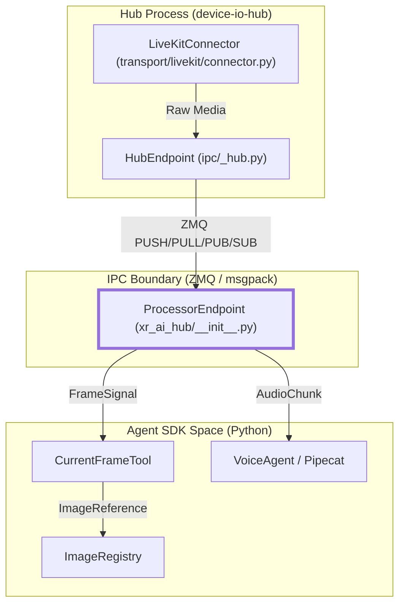
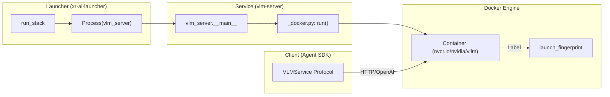

<!-- source: DeepWiki mcp.deepwiki.com · repo NVIDIA/xr-ai · page 6 Glossary · fetched 2026-10-26 -->

# Glossary

Relevant source files

The following files were used as context for generating this wiki page:

- [AGENTS.md](AGENTS.md)
- [DEPENDENCIES.md](DEPENDENCIES.md)
- [README.md](README.md)
- [docs/source/components/ai-services.md](docs/source/components/ai-services.md)
- [docs/source/components/server-runtime.md](docs/source/components/server-runtime.md)
- [docs/source/getting_started/quickstart.md](docs/source/getting_started/quickstart.md)
- [docs/source/getting_started/requirements.md](docs/source/getting_started/requirements.md)
- [docs/source/guides/troubleshooting.md](docs/source/guides/troubleshooting.md)
- [docs/source/reference/migrations.md](docs/source/reference/migrations.md)
- [services/device-io-hub/device_io_hub/__main__.py](services/device-io-hub/device_io_hub/__main__.py)
- [services/device-io-hub/device_io_hub/ipc/_connector.py](services/device-io-hub/device_io_hub/ipc/_connector.py)
- [services/device-io-hub/device_io_hub/ipc/_hub.py](services/device-io-hub/device_io_hub/ipc/_hub.py)
- [services/device-io-hub/device_io_hub/transport/livekit/_room_client.py](services/device-io-hub/device_io_hub/transport/livekit/_room_client.py)
- [services/device-io-hub/device_io_hub/transport/livekit/connector.py](services/device-io-hub/device_io_hub/transport/livekit/connector.py)
- [tests/pyproject.toml](tests/pyproject.toml)
- [tests/test_device_io_hub_startup.py](tests/test_device_io_hub_startup.py)
- [tests/test_model_servers.py](tests/test_model_servers.py)
- [tests/test_participant_events.py](tests/test_participant_events.py)
- [tests/test_vlm_server_config.py](tests/test_vlm_server_config.py)

This page defines codebase-specific terms, abbreviations, and domain concepts used throughout the XR-AI repository. It serves as a technical reference for onboarding engineers to map natural language concepts to specific code entities and architectural boundaries.

## Core Concepts and Terms

### Agent
An autonomous or semi-autonomous software entity that processes multimodal inputs (audio, video, data) and performs actions via tools.
*   **Implementation:** An `Agent` owns its state, resources, and concurrency policy [AGENTS.md:55-57]().
*   **Base Class:** `xr_ai_runtime.Agent` [DEPENDENCIES.md:133-133]().
*   **Voice Variant:** `VoiceAgent` manages a private media pipeline and participant lifecycle [AGENTS.md:99-100]().

### Hub (DeviceIOHub)
The central media router and signaling service. It bridges clients (via LiveKit) to agents (via ZMQ/msgpack IPC). Formerly known as XR-Media-Hub.
*   **Role:** Fans inbound messages to `ProcessorEndpoint`s and routes return traffic to specific clients [AGENTS.md:33-35]().
*   **Service:** `services/device-io-hub/` [docs/source/components/server-runtime.md:8-8]().
*   **Rename:** The service was renamed from `xr-media-hub` to `device-io-hub` [docs/source/reference/migrations.md:17-22]().

### Participant
A unique entity (typically a user or another agent) connected to a Hub session.
*   **Scoping:** The `AgentRuntime` provides participant-scoped fan-out, ensuring data is routed correctly within a multi-user environment [AGENTS.md:55-57]().
*   **Lifecycle:** `VoiceAgent` publishes lifecycle events (join/leave) for participant state management [tests/test_participant_events.py:46-47]().

### Tool / AsyncTool
A native Python function wrapped in a Pydantic interface for execution by an Agent or an LLM.
*   **Base Classes:** `Tool` or `AsyncTool` instances from `xr_ai_tools` [AGENTS.md:44-45]().
*   **Execution:** Every execution passes through NeMo Relay [AGENTS.md:45-46]().

### Model Service Protocol
A set of typed Python protocols defining how agents interact with AI inference services (LLM, VLM, STT, TTS).
*   **Implementation:** Defined in `xr_ai_models` [DEPENDENCIES.md:119-119]().
*   **Factories:** `make_llm`, `make_vlm`, `make_stt`, `make_tts`, and `make_embedding` are used to construct service clients [docs/source/components/ai-services.md:121-123]().

---

## Mapping: Natural Language to Code Entities

The following diagrams bridge high-level system concepts to the specific classes and files that implement them.

### Media and IPC Data Flow
This diagram maps the path of a video frame or audio chunk from the Hub to an Agent's logic.

**Sources:** [AGENTS.md:33-35](), [docs/source/components/server-runtime.md:113-123](), [services/device-io-hub/device_io_hub/ipc/_hub.py](), [services/device-io-hub/device_io_hub/transport/livekit/connector.py](), [DEPENDENCIES.md:108-117]().

### Inference Service Orchestration
This diagram maps the relationship between the Launcher, Docker, and the vLLM-backed services.

**Sources:** [docs/source/components/ai-services.md:21-30](), [AGENTS.md:80-81](), [utils/xr-ai-vllm/xr_ai_vllm/_docker.py:62-75]().

---

## Technical Glossary Table

| Term | Definition | Code Pointer |
| :--- | :--- | :--- |
| **DataMessage** | A typed msgpack payload sent over the ZMQ data channel for non-media events. | [DEPENDENCIES.md:114-115]() |
| **Fingerprint** | A SHA256 digest of a container's launch contract (image, port, GPU, etc.) used to determine if a persisted container can be reused. | [utils/xr-ai-vllm/xr_ai_vllm/_docker.py:62-75]() |
| **ImageRegistry** | A bounded in-memory store for image bytes that provides opaque handles to keep tool results small. | [AGENTS.md:60-61]() |
| **LiveKit** | The underlying WebRTC transport used by the Hub for client-to-server media streaming. | [docs/source/components/server-runtime.md:86-87]() |
| **ProcessorEndpoint** | The agent-side IPC interface for receiving media signals and sending data back to the Hub. | [AGENTS.md:34-35]() |
| **Quick-Ack** | A low-latency LLM call (typically <40 tokens) used to acknowledge a user request before full reasoning begins. | [docs/source/reference/migrations.md:50-50]() |
| **Ready-File** | A sentinel file touched by a process to signal to the launcher that it has finished initialization. | [docs/source/components/server-runtime.md:42-43]() |
| **Relay (NeMo Relay)** | A middleware that manages tool execution, ensuring inputs/outputs conform to the agent's schema. | [AGENTS.md:45-46]() |
| **ShmRingBuffer** | A shared-memory circular buffer used to transfer high-bandwidth video frames between processes. | [docs/source/components/server-runtime.md:98-99]() |
| **StreamKit** | The cross-platform client library (C++, Swift, JS) used to connect to the DeviceIOHub. | [docs/source/reference/migrations.md:9-13]() |
| **ToolSet** | A collection of `Tool` instances that can be exposed to an LLM in a single turn. | [AGENTS.md:44-45]() |
| **VoiceGate** | A processor that determines if a user's transcribed speech is intended for the agent or should be ignored. | [docs/source/reference/migrations.md:84-85]() |

**Sources:** [AGENTS.md](), [docs/source/components/server-runtime.md](), [utils/xr-ai-vllm/xr_ai_vllm/_docker.py](), [docs/source/reference/migrations.md](), [DEPENDENCIES.md](), [tests/test_participant_events.py]().