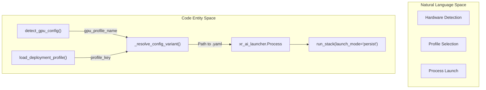
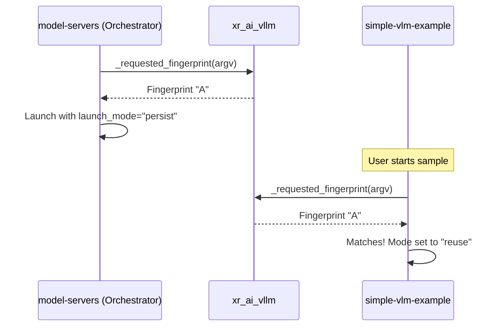
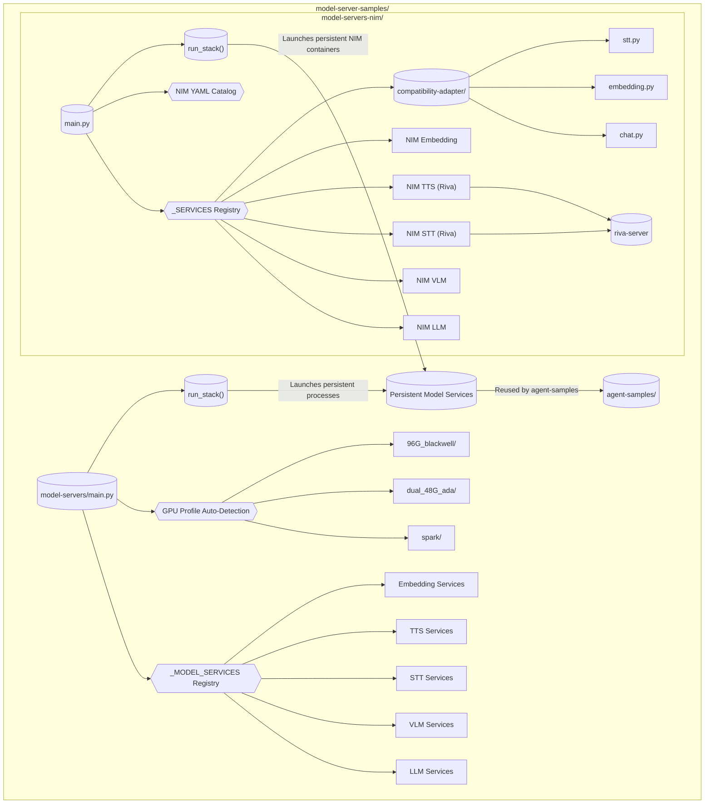

<!-- source: DeepWiki mcp.deepwiki.com · repo NVIDIA/xr-ai · extra page Model Server Samples and GPU Profiles · fetched 2026-10-26 -->

# Model Server Samples and GPU Profiles

Relevant source files

The following files were used as context for generating this wiki page:

- [.gitlab-ci.yml](.gitlab-ci.yml)
- [docs/source/components/ai-services.md](docs/source/components/ai-services.md)
- [docs/source/getting_started/quickstart.md](docs/source/getting_started/quickstart.md)
- [docs/source/getting_started/requirements.md](docs/source/getting_started/requirements.md)
- [docs/source/guides/troubleshooting.md](docs/source/guides/troubleshooting.md)
- [docs/source/reference/model-servers-nim.md](docs/source/reference/model-servers-nim.md)
- [model-server-samples/model-servers-nim/.gitignore](model-server-samples/model-servers-nim/.gitignore)
- [model-server-samples/model-servers-nim/README.md](model-server-samples/model-servers-nim/README.md)
- [model-server-samples/model-servers-nim/compatibility-adapter/nim_model_adapter/__init__.py](model-server-samples/model-servers-nim/compatibility-adapter/nim_model_adapter/__init__.py)
- [model-server-samples/model-servers-nim/compatibility-adapter/nim_model_adapter/__main__.py](model-server-samples/model-servers-nim/compatibility-adapter/nim_model_adapter/__main__.py)
- [model-server-samples/model-servers-nim/compatibility-adapter/nim_model_adapter/chat.py](model-server-samples/model-servers-nim/compatibility-adapter/nim_model_adapter/chat.py)
- [model-server-samples/model-servers-nim/compatibility-adapter/nim_model_adapter/common.py](model-server-samples/model-servers-nim/compatibility-adapter/nim_model_adapter/common.py)
- [model-server-samples/model-servers-nim/compatibility-adapter/nim_model_adapter/embedding.py](model-server-samples/model-servers-nim/compatibility-adapter/nim_model_adapter/embedding.py)
- [model-server-samples/model-servers-nim/compatibility-adapter/nim_model_adapter/stt.py](model-server-samples/model-servers-nim/compatibility-adapter/nim_model_adapter/stt.py)
- [model-server-samples/model-servers-nim/main.py](model-server-samples/model-servers-nim/main.py)
- [model-server-samples/model-servers/README.md](model-server-samples/model-servers/README.md)
- [model-server-samples/model-servers/yaml/96G_blackwell/embedding_server.yaml](model-server-samples/model-servers/yaml/96G_blackwell/embedding_server.yaml)
- [model-server-samples/model-servers/yaml/96G_blackwell/nemotron_omni_llm_server.yaml](model-server-samples/model-servers/yaml/96G_blackwell/nemotron_omni_llm_server.yaml)
- [model-server-samples/model-servers/yaml/96G_blackwell/vlm_server.yaml](model-server-samples/model-servers/yaml/96G_blackwell/vlm_server.yaml)
- [model-server-samples/model-servers/yaml/dual_48G_ada/embedding_server.yaml](model-server-samples/model-servers/yaml/dual_48G_ada/embedding_server.yaml)
- [model-server-samples/model-servers/yaml/dual_48G_ada/nemotron_omni_llm_server.yaml](model-server-samples/model-servers/yaml/dual_48G_ada/nemotron_omni_llm_server.yaml)
- [model-server-samples/model-servers/yaml/dual_48G_ada/vlm_server.yaml](model-server-samples/model-servers/yaml/dual_48G_ada/vlm_server.yaml)
- [model-server-samples/model-servers/yaml/spark/embedding_server.yaml](model-server-samples/model-servers/yaml/spark/embedding_server.yaml)
- [model-server-samples/model-servers/yaml/spark/nemotron_omni_llm_server.yaml](model-server-samples/model-servers/yaml/spark/nemotron_omni_llm_server.yaml)
- [model-server-samples/model-servers/yaml/spark/vlm_server.yaml](model-server-samples/model-servers/yaml/spark/vlm_server.yaml)
- [sonar-project.properties](sonar-project.properties)
- [tests/test_model_servers.py](tests/test_model_servers.py)
- [tests/test_vlm_server_config.py](tests/test_vlm_server_config.py)

This page details the `model-server-samples/` directory, focusing on the `model-servers` orchestrator and `model-servers-nim`. It covers deployment profiles, GPU profile auto-detection, the `_MODEL_SERVICES` registry, conflict resolution, and the `persist` launch mode. It also describes `model-servers-nim`, including its NIM YAML catalog, compatibility adapters for chat, embedding, and STT, and the Riva server integration.

## Model Servers Orchestrator (`model-server-samples/model-servers`)

The `model-servers` orchestrator is a specialized utility designed to manage a shared AI inference stack. It allows developers to launch a suite of model services (LLM, VLM, STT, TTS, Embedding) that remain resident in memory across different agent sessions. This "warm" state is achieved through the `persist` launch mode, which ensures model weights and KV caches stay loaded even after the orchestrator process exits [model-server-samples/model-servers/main.py:4-9]().

### System Architecture and Registry

The orchestrator manages a central registry of services, mapping them to their respective source projects and configuration baselines.

#### `_MODEL_SERVICES` Registry
The `_MODEL_SERVICES` dictionary defines the available stack components. The order of this dictionary dictates the launch sequence, ensuring that memory-intensive NIM containers or MoE (Mixture of Experts) JIT compilations occur in an optimal order to manage VRAM allocation [model-server-samples/model-servers/main.py:79-106]().

| Service Key | Project Path | Command | Config Baseline |
|:---|:---|:---|:---|
| `stt` | `../../services/stt-server` | `stt_server` | `stt_server.yaml` |
| `tts` | `../../services/pocket-tts` | `pocket_tts_server` | `pocket_tts_server.yaml` |
| `agent-llm` | `../../services/nemotron3-nano-llm` | `nemotron3_nano_llm_server` | `nemotron3_nano_llm_server.yaml` |
| `omni` | `../../services/nemotron-omni-llm` | `nemotron_omni_llm_server` | `nemotron_omni_llm_server.yaml` |
| `vlm` | `../../services/vlm-server` | `vlm_server` | `vlm_server.yaml` |
| `embedding`| `../../services/embedding-server` | `embedding_server` | `embedding_server.yaml` |

Sources: [model-server-samples/model-servers/main.py:79-106]()

#### Deployment Profile Logic
The orchestrator uses deployment profiles (JSON files) to determine which services should be "managed" (launched locally) versus "external" (hosted elsewhere).

1.  **Selection**: Profiles are loaded from `model-server-samples/model-servers/yaml/<gpu_profile>/models.json` [model-server-samples/model-servers/main.py:109-112]().
2.  **Filtering**: The `_build_processes` function iterates through `_MODEL_SERVICES` and only includes services where the profile specifies a `managed` deployment [model-server-samples/model-servers/main.py:129-158]().
3.  **Port Discovery**: Ports are extracted from YAML configurations using `_read_service_port` to ensure the launcher can track the health of the persistent process [model-server-samples/model-servers/main.py:115-127]().

Sources: [model-server-samples/model-servers/main.py:109-158]()

### GPU Profile Auto-Detection

To handle varying hardware capabilities (e.g., `dual_48G_ada`, `spark`, `96G_blackwell`), the orchestrator utilizes a profile-based configuration system. The `detect_gpu_config` function attempts to identify the GPU configuration and select the appropriate profile [model-server-samples/model-servers/main.py:138](). If a specific GPU profile is provided via the command line, it bypasses auto-detection [tests/test_model_servers.py:70-78]().

#### Configuration Resolution
The function `_resolve_config_variant` is used to select the most specific configuration file available for a given hardware profile and deployment key [model-server-samples/model-servers/main.py:146]().

**Search Priority:**
1.  `yaml/<gpu_profile>/<config_base>_<profile_key>.yaml` (e.g., `embedding_server_omni.yaml`)
2.  `yaml/<gpu_profile>/<config_base>.yaml` (e.g., `embedding_server.yaml`)

This allows the stack to automatically adjust `gpu_memory_utilization`, `cuda_visible_devices`, and `tensor_parallel_size` based on the detected GPU [model-server-samples/model-servers/yaml/dual_48G_ada/nemotron_omni_llm_server.yaml:12-16](), [model-server-samples/model-servers/yaml/spark/nemotron_omni_llm_server.yaml:16](). For example, the `dual_48G_ada` profile configures Nemotron Omni on `cuda_visible_devices: "1"` with `gpu_memory_utilization: 0.78` [model-server-samples/model-servers/yaml/dual_48G_ada/nemotron_omni_llm_server.yaml:12,19](), while the `spark` profile sets `gpu_memory_utilization: 0.25` [model-server-samples/model-servers/yaml/spark/nemotron_omni_llm_server.yaml:22]().

#### Code Entity Space: GPU Configuration Flow
The following diagram illustrates how the system moves from hardware detection to specific process arguments.

Title: GPU Configuration and Process Generation

Sources: [model-server-samples/model-servers/main.py:138-157]()

### Fingerprint Parity

A critical feature of the `model-servers` stack is **Fingerprint Parity**. This ensures that if an agent sample (like `simple-vlm-example`) is launched, it can detect if a compatible model server is already running and "reuse" it instead of starting a new one.

#### Verification Mechanism
The system generates a unique fingerprint for every service based on its launch arguments (Docker image, model cache, environment variables, and vLLM arguments).

*   **Shared Configs**: On supported hardware, agent samples are programmed to resolve their local service configurations to the same YAML files used by the `model-servers` orchestrator [docs/source/getting_started/quickstart.md:113-116]().
*   **Testing**: Unit tests verify that the `_requested_fingerprint` generated by `xr_ai_vllm` matches between the shared stack and the sample workers [tests/test_model_servers.py:53-67]().

Title: Fingerprint Parity Check

Sources: [tests/test_model_servers.py:53-67](), [docs/source/getting_started/quickstart.md:113-116]()

### Conflict Resolution and Cleanup

Since servers run in `persist` mode, they do not die when the orchestrator finishes. The orchestrator provides mechanisms to manage this lifecycle.

#### `_stop_unselected_services`
When starting a specific profile (e.g., `vlm_llm_nim`), the orchestrator identifies which services in the registry are *not* part of that profile. It then calls `_stop_unselected_services` to shut down any persistent containers or processes that might conflict with the new stack's VRAM or port requirements [model-server-samples/model-servers/main.py:181-193]().

#### Global Stop
The `--stop` flag triggers `_stop_models`, which uses a broad discovery mechanism to find all possible service ports defined across all GPU profiles and shuts them down [model-server-samples/model-servers/main.py:161-179]().

| Function | Role | Implementation |
|:---|:---|:---|
| `_known_service_ports` | Discovery | Scans `yaml/` subdirectories for all `port` or `http_port` values [model-server-samples/model-servers/main.py:161-171](). |
| `stop_persistent_servers` | Execution | Signals processes and stops Docker containers mapped to those ports [model-server-samples/model-servers/main.py:177](). |

Sources: [model-server-samples/model-servers/main.py:161-193]()

## NIM Model Servers (`model-server-samples/model-servers-nim`)

The `model-server-samples/model-servers-nim` directory provides an orchestrator specifically designed to launch NVIDIA NIM (NVIDIA Inference Microservices) models, often alongside local fallbacks. This allows for flexible deployment where some services might run as NIM containers and others as local processes.

### `_SERVICES` Registry for NIM

Similar to the main `model-servers` orchestrator, `model-servers-nim` uses a `_SERVICES` dictionary to define its components. This registry includes NIM-specific services and compatibility adapters.

| Service Key | Project Path | Command | Config Baseline |
|:---|:---|:---|:---|
| `stt` | `../../services/stt-server` | `stt_server` | `stt_server.yaml` |
| `stt-nim` | `riva-server` | `nim_riva_server` | `nim_stt_server.yaml` |
| `stt-adapter` | `compatibility-adapter` | `nim_model_adapter` | `stt_adapter.yaml` |
| `tts-nim` | `riva-server` | `nim_riva_server` | `nim_tts_server.yaml` |
| `tts-adapter` | `../../services/magpie-nim-tts` | `magpie_nim_tts` | `tts_adapter.yaml` |
| `embedding-nim` | `../../services/nim-server` | `nim_server` | `nim_embedding_server.yaml` |
| `embedding` | `compatibility-adapter` | `nim_model_adapter` | `embedding_adapter.yaml` |
| `llm-nim` | `../../services/nim-server` | `nim_server` | `nim_llm_server.yaml` |
| `llm-adapter` | `compatibility-adapter` | `nim_model_adapter` | `llm_adapter.yaml` |
| `vlm-nim` | `../../services/nim-server` | `nim_server` | `nim_vlm_server.yaml` |
| `vlm-adapter` | `compatibility-adapter` | `nim_model_adapter` | `vlm_adapter.yaml` |

Sources: [model-server-samples/model-servers-nim/main.py:29-43]()

### NIM YAML Catalog

The `model-servers-nim` orchestrator uses YAML files within `model-server-samples/model-servers-nim/yaml/<gpu_profile>/` to configure NIM services. These YAMLs specify the Docker image, environment variables, and other parameters for launching NIM containers.

For example, the `nim_vlm_server.yaml` files across different GPU profiles (e.g., `dual_48G_ada`, `spark`, `96G_blackwell`) consistently specify `nvcr.io/nim/nvidia/cosmos3-reasoner:1.7.0` as the image and `NIM_MODEL_SIZE: nano` [tests/test_model_servers.py:144-158](). Similarly, `nim_llm_server.yaml` files configure Nemotron-3-Nano-Omni with specific `gpu-memory-utilization` budgets and reasoning parsers [tests/test_model_servers.py:160-189]().

### Compatibility Adapters

The `compatibility-adapter` project within `model-server-samples/model-servers-nim` provides a `nim_model_adapter` that acts as a proxy for NIM services. This adapter ensures that NIM endpoints can be consumed by clients expecting a specific API format (e.g., OpenAI-compatible).

*   **Chat Adapter**: `nim_model_adapter/chat.py` handles chat-specific requests.
*   **Embedding Adapter**: `nim_model_adapter/embedding.py` processes embedding requests.
*   **STT Adapter**: `nim_model_adapter/stt.py` manages speech-to-text requests.

These adapters allow the `model-servers-nim` stack to seamlessly integrate NIM services into the existing `xr-ai` ecosystem.

### Riva Server Integration

The `model-servers-nim` orchestrator also supports launching Riva servers for STT and TTS. The `riva-server` project is referenced in the `_SERVICES` registry for `stt-nim` and `tts-nim` [model-server-samples/model-servers-nim/main.py:30-31](). This allows for streaming speech services via gRPC, with the `magpie_nim_tts` service acting as an HTTP adapter over Riva gRPC [docs/source/components/ai-services.md:25]().

Title: Model Server Samples Architecture

Sources: [model-server-samples/model-servers/main.py:79-106](), [model-server-samples/model-servers/main.py:138](), [model-server-samples/model-servers-nim/main.py:29-43](), [tests/test_model_servers.py:144-189](), [model-server-samples/model-servers-nim/compatibility-adapter/nim_model_adapter/chat.py](), [model-server-samples/model-servers-nim/compatibility-adapter/nim_model_adapter/embedding.py](), [model-server-samples/model-servers-nim/compatibility-adapter/nim_model_adapter/stt.py](), [docs/source/components/ai-services.md:25]()

---

