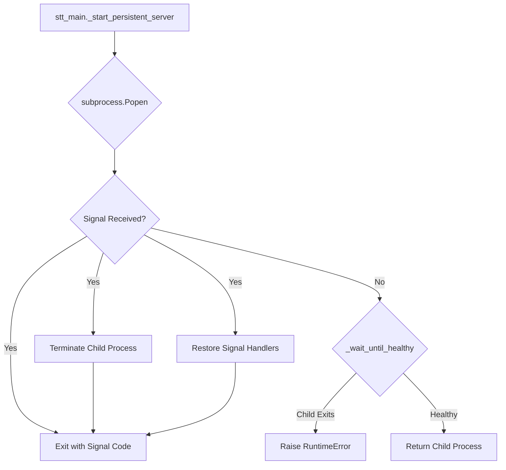
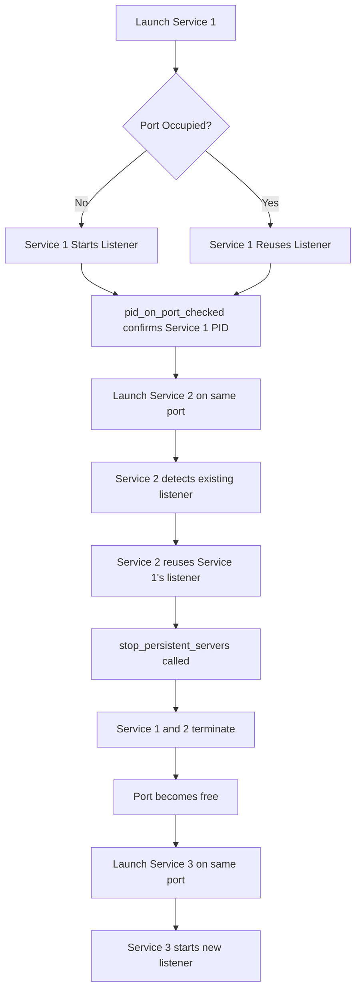

<!-- source: DeepWiki mcp.deepwiki.com · repo NVIDIA/xr-ai · extra page Speech Services (STT / TTS) · fetched 2026-10-26 -->

# Speech Services (STT / TTS)

<details>
<summary>Relevant source files</summary>

The following files were used as context for generating this wiki page:

- [services/magpie-nim-tts/magpie_nim_tts/speech.py](services/magpie-nim-tts/magpie_nim_tts/speech.py)
- [services/magpie-nim-tts/magpie_nim_tts/streaming_speech.py](services/magpie-nim-tts/magpie_nim_tts/streaming_speech.py)
- [services/magpie-nim-tts/pyproject.toml](services/magpie-nim-tts/pyproject.toml)
- [tests/test_magpie_nim_lifecycle.py](tests/test_magpie_nim_lifecycle.py)
- [tests/test_magpie_nim_speech.py](tests/test_magpie_nim_speech.py)
- [tests/test_stt_server_endpoint.py](tests/test_stt_server_endpoint.py)

</details>


This page details the Speech-to-Text (STT) and Text-to-Speech (TTS) services within the XR-AI ecosystem. It covers `stt-server` (based on Parakeet), `magpie-tts`, `pocket-tts`, and `magpie-nim-tts` (which leverages Riva gRPC for streaming speech). We will explore their YAML configurations, exposed API endpoints, and the lifecycle tests that ensure their robustness and proper integration.

## STT Server (Parakeet)

The `stt-server` provides Speech-to-Text capabilities, primarily using NVIDIA's Parakeet models. It exposes an HTTP API for transcribing audio.

### Configuration

The `stt-server` is configured via a YAML file. Key configuration parameters include the model to use and the `startup_timeout_s` which dictates how long the server waits for the model to load and become healthy.

```yaml
# Example stt-server.yaml configuration
model: "nvidia/parakeet-rnnt-1.1b"
startup_timeout_s: 600
```
The `startup_timeout_s` is consistently set to `_DEFAULT_STARTUP_TIMEOUT_S` (600 seconds) across various deployment profiles to accommodate cold downloads of models [tests/test_stt_server_endpoint.py:76-84](). This value must be a finite number greater than zero [tests/test_stt_server_endpoint.py:86-93]().

Sources:
* [tests/test_stt_server_endpoint.py:76-84]()
* [tests/test_stt_server_endpoint.py:86-93]()

### Endpoints

The primary endpoint for `stt-server` is `/v1/audio/transcriptions`.

#### `POST /v1/audio/transcriptions`

This endpoint accepts audio files for transcription.

**Request:**
*   `files`: An audio file (e.g., `audio/wav`).
*   `data`: Optional form data, including `response_format` (e.g., "text" for plain text output).

**Response:**
*   **Success (200 OK):**
    *   `application/json`: `{"text": "transcribed text"}` (default)
    *   `text/plain`: `"transcribed text"` (if `response_format` is "text")
*   **Error (500 Internal Server Error):** `{"detail": "transcription failed"}`. Internal backend errors are not leaked to the client [tests/test_stt_server_endpoint.py:46-60]().

### Lifecycle and Error Handling

The `stt-server` manages its lifecycle, including starting and stopping persistent child processes.

#### Process Management

The `_start_persistent_server` function [tests/test_stt_server_endpoint.py:102]() is responsible for launching the STT server as a child process. It monitors the child process and waits for it to become healthy. If a signal (like `SIGINT` or `SIGTERM`) is received during startup, the child process is terminated, and the original signal handlers are restored [tests/test_stt_server_endpoint.py:111-141](). If the child process exits prematurely, a `RuntimeError` is raised [tests/test_stt_server_endpoint.py:176-185]().


**Diagram: STT Server Persistent Process Startup Flow**

Sources:
* [tests/test_stt_server_endpoint.py:46-60]()
* [tests/test_stt_server_endpoint.py:102]()
* [tests/test_stt_server_endpoint.py:111-141]()
* [tests/test_stt_server_endpoint.py:176-185]()

## Magpie-TTS and Pocket-TTS

`magpie-tts` and `pocket-tts` are TTS services that provide HTTP APIs for synthesizing speech. `magpie-nim-tts` is a specific implementation of `magpie-tts` that uses NVIDIA Riva gRPC for streaming speech.

### Magpie-NIM-TTS

The `magpie-nim-tts` service exposes a Pocket-compatible HTTP speech API, leveraging the typed Riva client for speech synthesis [services/magpie-nim-tts/magpie_nim_tts/speech.py:4]().

#### Configuration

The `magpie-nim-tts` service is configured via a dictionary, which includes parameters like `sample_rate`, `language`, `voice`, `base_url` (for the Riva gRPC endpoint), and `post_synthesis_pause_ms`.

```python
# Example configuration snippet from build_app
config = {
    "sample_rate": 44100,
    "language": "en-US",
    "voice": "Magpie-Multilingual.EN-US.Aria",
    "base_url": "grpc_backend_url",
    "post_synthesis_pause_ms": 300
}
```
The `build_app` function [services/magpie-nim-tts/magpie_nim_tts/speech.py:54]() constructs the FastAPI application. It initializes a `TTSSpec` using an `AdapterSpec` of kind `riva_grpc` and an `EndpointSpec` with the provided `base_url` [services/magpie-nim-tts/magpie_nim_tts/speech.py:57-59](). A `generation_lock` (an `asyncio.Lock`) is used to prevent overlapping RPCs, especially during client disconnects [services/magpie-nim-tts/magpie_nim_tts/speech.py:62](). A `trailing_silence` is added to the audio output based on `post_synthesis_pause_ms` [services/magpie-nim-tts/magpie_nim_tts/speech.py:64-67]().

Sources:
* [services/magpie-nim-tts/magpie_nim_tts/speech.py:4]()
* [services/magpie-nim-tts/magpie_nim_tts/speech.py:54]()
* [services/magpie-nim-tts/magpie_nim_tts/speech.py:57-59]()
* [services/magpie-nim-tts/magpie_nim_tts/speech.py:62]()
* [services/magpie-nim-tts/magpie_nim_tts/speech.py:64-67]()

#### Endpoints

The `magpie-nim-tts` service exposes a single primary endpoint: `/v1/audio/speech`.

#### `POST /v1/audio/speech`

This endpoint synthesizes speech from text.

**Request:**
*   `input`: The text to synthesize.
*   `response_format`: "wav" or "pcm" (default "wav").
*   `stream`: Boolean, `True` for streaming response, `False` for buffered.

**Response:**
*   **Streaming (200 OK, `stream=True`):**
    *   `audio/pcm`: Raw PCM audio chunks. Headers include `X-Audio-Sample-Rate` and `X-Audio-Channels`.
    *   If the client disconnects, the ASGI request finishes without generating audio, returning a 204 No Content [services/magpie-nim-tts/magpie_nim_tts/speech.py:77-79]().
    *   Errors during streaming (e.g., gRPC `RpcError`, `TimeoutError`) are handled, returning appropriate HTTP status codes (504 for timeout, 502 for other failures) [services/magpie-nim-tts/magpie_nim_tts/streaming_speech.py:41-50](). If an error occurs after audio has started streaming, a `RuntimeError` is raised to abort the transport [services/magpie-nim-tts/magpie_nim_tts/streaming_speech.py:61-64]().
*   **Buffered (200 OK, `stream=False`):**
    *   `audio/wav` or `audio/pcm`: The complete audio data.
    *   If the client disconnects, a 204 No Content is returned [services/magpie-nim-tts/magpie_nim_tts/speech.py:77-79]().

### Streaming Implementation (`SpeechStreamResponse`)

The `SpeechStreamResponse` class [services/magpie-nim-tts/magpie_nim_tts/streaming_speech.py:15]() handles the streaming of PCM audio from the Riva backend. It ensures that the `generation_lock` is held throughout the RPC call, including during cancellation and worker cleanup, to prevent overlapping requests from disconnected clients [services/magpie-nim-tts/magpie_nim_tts/streaming_speech.py:19-21]().

The `audio()` asynchronous generator [services/magpie-nim-tts/magpie_nim_tts/streaming_speech.py:17]() yields audio chunks from `backend.stream(text)`. It also appends `trailing_silence` if audio was successfully generated [services/magpie-nim-tts/magpie_nim_tts/streaming_speech.py:29-30]().

The `stream_response` method [services/magpie-nim-tts/magpie_nim_tts/streaming_speech.py:37]() fetches the first audio chunk before sending HTTP 200 headers, allowing initial NIM failures to return their useful status codes [services/magpie-nim-tts/magpie_nim_tts/streaming_speech.py:39-40](). It also handles client disconnects by listening for `http.disconnect` events [services/magpie-nim-tts/magpie_nim_tts/streaming_speech.py:68-72]().

```mermaid
graph TD
    A[Client POST /v1/audio/speech] --> B{SpeechRequest.stream?};
    B -- Yes --> C[SpeechStreamResponse];
    C --> D{Acquire generation_lock};
    D --> E[backend.stream(text)];
    E -- Chunks --> F[Yield audio chunks];
    F -- Last Chunk --> G[Append trailing_silence];
    G --> H[Send HTTP 200 OK];
    H --> I[Stream audio to client];
    I -- Client Disconnects --> J[Cancel RPC, Release lock];
    E -- Error --> K[Handle gRPC/Timeout Error];
    K -- Before HTTP 200 --> L[Return 504/502];
    K -- After HTTP 200 --> M[Raise RuntimeError];
    B -- No --> N[_buffered_audio];
    N --> O{Acquire generation_lock};
    O --> P[backend.synthesize(text)];
    P -- Audio --> Q[Append trailing_silence];
    Q --> R{response_format?};
    R -- "wav" --> S[Wrap in WAV header];
    R -- "pcm" --> T[Return raw PCM];
    S --> U[Return HTTP 200 OK];
    T --> U;
    O -- Client Disconnects --> V[Return 204 No Content];
```
**Diagram: Magpie-NIM-TTS Speech Synthesis Flow**

Sources:
* [services/magpie-nim-tts/magpie_nim_tts/speech.py:77-79]()
* [services/magpie-nim-tts/magpie_nim_tts/streaming_speech.py:15]()
* [services/magpie-nim-tts/magpie_nim_tts/streaming_speech.py:19-21]()
* [services/magpie-nim-tts/magpie_nim_tts/streaming_speech.py:17]()
* [services/magpie-nim-tts/magpie_nim_tts/streaming_speech.py:29-30]()
* [services/magpie-nim-tts/magpie_nim_tts/streaming_speech.py:37]()
* [services/magpie-nim-tts/magpie_nim_tts/streaming_speech.py:39-40]()
* [services/magpie-nim-tts/magpie_nim_tts/streaming_speech.py:68-72]()
* [services/magpie-nim-tts/magpie_nim_tts/streaming_speech.py:41-50]()
* [services/magpie-nim-tts/magpie_nim_tts/streaming_speech.py:61-64]()

### Lifecycle Tests

The `magpie-nim-tts` service undergoes rigorous lifecycle tests to ensure correct behavior, especially concerning port ownership, process reuse, and graceful shutdown.

#### `test_magpie_nim_lifecycle.py`

This test suite [tests/test_magpie_nim_lifecycle.py:1]() verifies:
*   **Port Ownership and Reuse:** Multiple launches of the `magpie-nim-tts` service on the same port will reuse the existing listener process [tests/test_magpie_nim_lifecycle.py:150-151](). The `pid_on_port_checked` utility [tests/test_magpie_nim_lifecycle.py:153]() is used to confirm the PID owning the port.
*   **`--stop` Functionality:** The `stop_persistent_servers` function [tests/test_magpie_nim_lifecycle.py:166]() correctly terminates the running service, freeing the port for a new launch [tests/test_magpie_nim_lifecycle.py:173-174]().
*   **Ownership Markers:** The `has_xr_ai_ownership_marker` function [tests/test_magpie_nim_lifecycle.py:160]() checks for specific environment variables (`XR_AI_VLLM_MANAGED`, `XR_AI_VLLM_PORT`) that indicate a process is managed by the XR-AI system [tests/test_magpie_nim_lifecycle.py:91-92]().


**Diagram: Magpie-NIM-TTS Lifecycle Test Flow**

Sources:
* [tests/test_magpie_nim_lifecycle.py:1]()
* [tests/test_magpie_nim_lifecycle.py:150-151]()
* [tests/test_magpie_nim_lifecycle.py:153]()
* [tests/test_magpie_nim_lifecycle.py:166]()
* [tests/test_magpie_nim_lifecycle.py:173-174]()
* [tests/test_magpie_nim_lifecycle.py:160]()
* [tests/test_magpie_nim_lifecycle.py:91-92]()

#### `test_magpie_nim_speech.py`

This test suite [tests/test_magpie_nim_speech.py:1]() focuses on the HTTP streaming behavior against a controlled local Riva gRPC server.
*   **First PCM Chunk Delivery:** Verifies that the first PCM audio chunk reaches the HTTP client before the gRPC synthesis completes, ensuring low latency for streaming [tests/test_magpie_nim_speech.py:102-116]().
*   **Disconnect Cancellation:** Tests that client disconnects correctly cancel the underlying gRPC RPC and do not block subsequent requests, ensuring resource release and responsiveness [tests/test_magpie_nim_speech.py:123-149]().
*   **Buffered WAV/PCM:** Confirms that buffered requests (non-streaming) correctly wait for the full audio stream and preserve audio integrity [tests/test_magpie_nim_speech.py:153-158]().
*   **Error Handling:** Validates that gRPC errors (e.g., `UNAVAILABLE`, `INTERNAL`) are translated into appropriate HTTP status codes (504 for timeout, 502 for other failures) [services/magpie-nim-tts/magpie_nim_tts/streaming_speech.py:41-50]().

The `ControlledSpeech` class [tests/test_magpie_nim_speech.py:29]() is a mock gRPC servicer that allows precise control over the timing and content of synthesized speech, including introducing delays and failures, to thoroughly test the streaming logic.

Sources:
* [tests/test_magpie_nim_speech.py:1]()
* [tests/test_magpie_nim_speech.py:102-116]()
* [tests/test_magpie_nim_speech.py:123-149]()
* [tests/test_magpie_nim_speech.py:153-158]()
* [services/magpie-nim-tts/magpie_nim_tts/streaming_speech.py:41-50]()
* [tests/test_magpie_nim_speech.py:29]()

---

