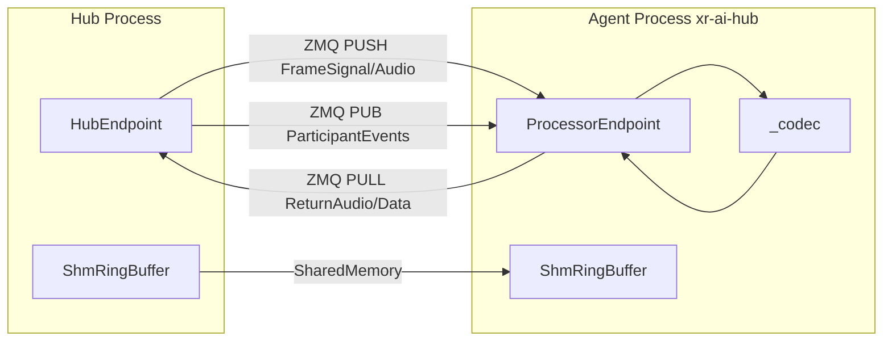
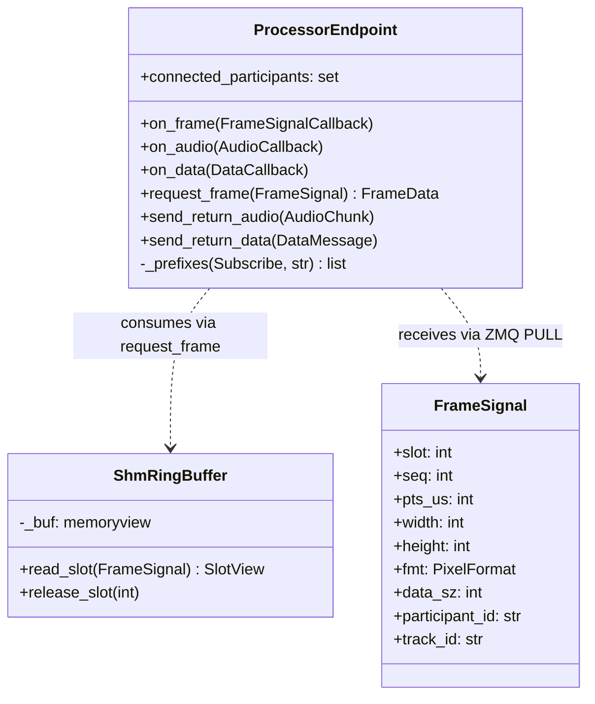

<!-- source: DeepWiki mcp.deepwiki.com · repo NVIDIA/xr-ai · extra page xr-ai-hub: IPC Client · fetched 2026-10-26 -->

# xr-ai-hub: IPC Client

Relevant source files

The following files were used as context for generating this wiki page:

- [agent-sdk/xr-ai-hub/xr_ai_hub/__init__.py](agent-sdk/xr-ai-hub/xr_ai_hub/__init__.py)
- [agent-sdk/xr-ai-hub/xr_ai_hub/_codec.py](agent-sdk/xr-ai-hub/xr_ai_hub/_codec.py)
- [agent-sdk/xr-ai-hub/xr_ai_hub/_processor.py](agent-sdk/xr-ai-hub/xr_ai_hub/_processor.py)
- [agent-sdk/xr-ai-hub/xr_ai_hub/_shm.py](agent-sdk/xr-ai-hub/xr_ai_hub/_shm.py)
- [agent-sdk/xr-ai-hub/xr_ai_hub/_types.py](agent-sdk/xr-ai-hub/xr_ai_hub/_types.py)
- [client-samples/ios-visionos/StreamKit/Sources/StreamKit/StreamError.swift](client-samples/ios-visionos/StreamKit/Sources/StreamKit/StreamError.swift)
- [services/device-io-hub/device_io_hub/ipc/__init__.py](services/device-io-hub/device_io_hub/ipc/__init__.py)
- [services/device-io-hub/device_io_hub/ipc/_registration.py](services/device-io-hub/device_io_hub/ipc/_registration.py)
- [tests/conftest.py](tests/conftest.py)
- [tests/test_agent_codec.py](tests/test_agent_codec.py)
- [tests/test_connector_registration.py](tests/test_connector_registration.py)
- [tests/test_shm_ring_buffer.py](tests/test_shm_ring_buffer.py)

The `xr-ai-hub` package provides the core agent-facing IPC (Inter-Process Communication) boundary for the `xr-ai` system. It facilitates high-throughput media and data exchange between agents and the `device-io-hub` service using a combination of ZeroMQ for signaling/control and Shared Memory (SHM) for zero-copy raw video frames.

Sources: `agent-sdk/xr-ai-hub/xr_ai_hub/__init__.py:4-19` []

---

## Architecture Overview

The IPC client is designed around a single-producer/multi-consumer model for media, and a bi-directional messaging model for data and control. The boundary is strictly isolated by participant identity to ensure that agents only receive traffic for participants they are authorized to process.

### ZMQ Socket Topology
The `ProcessorEndpoint` utilizes several ZMQ socket types to communicate with the hub:
*   **PULL (Inbound):** Receives `FrameSignal`, `AudioChunk`, `DataMessage`, and other real-time messages from the hub.
*   **PUSH (Outbound):** Sends `ReturnAudio`, `ReturnData`, and `FrameRequest` objects back to the hub.
*   **SUB (Broadcast):** Subscribes to `ParticipantEvent` (join/leave) and `ControlMessage` topics.

### Data Flow Diagram

The following diagram illustrates the relationship between code entities and the physical IPC mechanisms.

**Diagram: IPC Boundary and Data Flow**

Sources: `agent-sdk/xr-ai-hub/xr_ai_hub/_processor.py:40-50` [], `agent-sdk/xr-ai-hub/xr_ai_hub/_shm.py:88-117` []

---

## Shared Memory Ring Buffer

The `ShmRingBuffer` class in `xr_ai_hub._shm` is a fixed-slot shared-memory segment used exclusively for raw video frames to avoid the serialization overhead of ZMQ for large payloads.

### Memory Layout
The segment is partitioned into a global header followed by $N$ fixed-capacity slots:
1.  **GlobalHeader (24 bytes):** Packed with struct format `=IIQQ` containing magic bytes `0xC0FFEE01`, slot count, max frame size, and slot stride.
2.  **SlotHeader (64 bytes):** Packed with struct format `=IBBHQqIII28x` containing slot magic `0xF4A3E501`, state, pixel format, sequence number, presentation timestamp (`pts_us`), dimensions, and data size.
3.  **Frame Data:** Raw pixel bytes up to `max_frame_bytes`.

### Slot Lifecycle
Slots move through three explicit states managed by the producer and consumer:
*   `_STATE_FREE` (0): Available for writing.
*   `_STATE_WRITING` (1): Producer is currently copying pixels into the slot.
*   `_STATE_READY` (2): Pixels are fully written and ready for the consumer.

Agents access these frames via `read_slot()`, which returns a `SlotView` wrapping a zero-copy `memoryview` into the shared memory segment. Consumers **must** call `release_slot()` once processing is complete so the slot state returns to `_STATE_FREE`.

Sources: `agent-sdk/xr-ai-hub/xr_ai_hub/_shm.py:7-55` [], `agent-sdk/xr-ai-hub/xr_ai_hub/_shm.py:79-117` []

---

## Codec Layer

The `_codec` module provides a minimal extensible wire codec for serialization and deserialization. Every message on the wire is formatted as a 1-byte `MsgType` identifier followed by a `msgpack` payload.

### Primary Data Types

| Class | Description | Fields |
| :--- | :--- | :--- |
| `FrameSignal` | Metadata for a frame in shared memory | `slot`, `seq`, `pts_us`, `width`, `height`, `fmt`, `data_sz`, `participant_id`, `track_id` |
| `AudioChunk` | Inbound/Outbound PCM audio | `pts_us`, `sample_rate`, `channels`, `samples`, `data` (bytes), `participant_id`, `track_id` |
| `DataMessage` | Generic application data payload | `participant_id`, `topic`, `pts_us`, `data` (bytes) |
| `FileMessage` | Completed file or byte transfer | `participant_id`, `topic`, `pts_us`, `transfer_id`, `name`, `mime_type`, `attributes`, `data` |
| `ParticipantEvent` | Roster updates | `participant_id`, `joined` (bool), `pts_us`, `connector_id`, `participant_session_id` |

Sources: `agent-sdk/xr-ai-hub/xr_ai_hub/_codec.py:4-11` [], `agent-sdk/xr-ai-hub/xr_ai_hub/_types.py:31-180` []

---

## ProcessorEndpoint Implementation

`ProcessorEndpoint` manages the subscriber and publisher sockets connecting the agent to the hub.

### Participant Scoping and Subscription
Participants are the primary unit of subscription. By default, `ProcessorEndpoint` automatically subscribes to all participants who join and unsubscribes when they leave. Subscription categories can be filtered using the `Subscribe` flag enum (`Subscribe.DATA`, `Subscribe.AUDIO`, `Subscribe.VIDEO`, `Subscribe.FILE`).

### Key Functions and Callbacks
*   `on_frame(callback)`: Registers an asynchronous handler for `FrameSignal` metadata.
*   `on_audio(callback)`: Registers a handler for incoming `AudioChunk` audio.
*   `on_data(callback)`: Registers a handler for incoming `DataMessage` application payloads.
*   `request_frame(signal)`: Pulls pixel data on demand for a given frame signal if it remains cached by the hub.
*   `send_return_audio(chunk)`: Pushes generated audio back to the hub.
*   `send_return_data(msg)`: Pushes text or binary responses back to the hub.

### Code Entity Mapping

**Diagram: Code Entity Mapping**

Sources: `agent-sdk/xr-ai-hub/xr_ai_hub/_processor.py:40-143` [], `agent-sdk/xr-ai-hub/xr_ai_hub/_shm.py:88-152` [], `agent-sdk/xr-ai-hub/xr_ai_hub/_types.py:102-132` []

---

## Error Handling and Lifecycle

The IPC client incorporates several robustness and safety guarantees:
1.  **Strict Size and Layout Validation:** When attaching to shared memory segments or decoding messages, strict validations ensure header magic numbers (`_MAGIC_GLOBAL`, `_MAGIC_SLOT`) and strides match expected layouts.
2.  **Back-pressure Handling:** If a consumer is too slow to process frames, ring slots fill up, causing the producer to block or drop frames according to ring capacity limits.
3.  **Roster Replays:** Endpoints initialized mid-session dispatch a `RosterRequest` to receive replayed join events for currently active participants.

Sources: `agent-sdk/xr-ai-hub/xr_ai_hub/_shm.py:153-191` [], `tests/test_shm_ring_buffer.py:68-107` []

---

