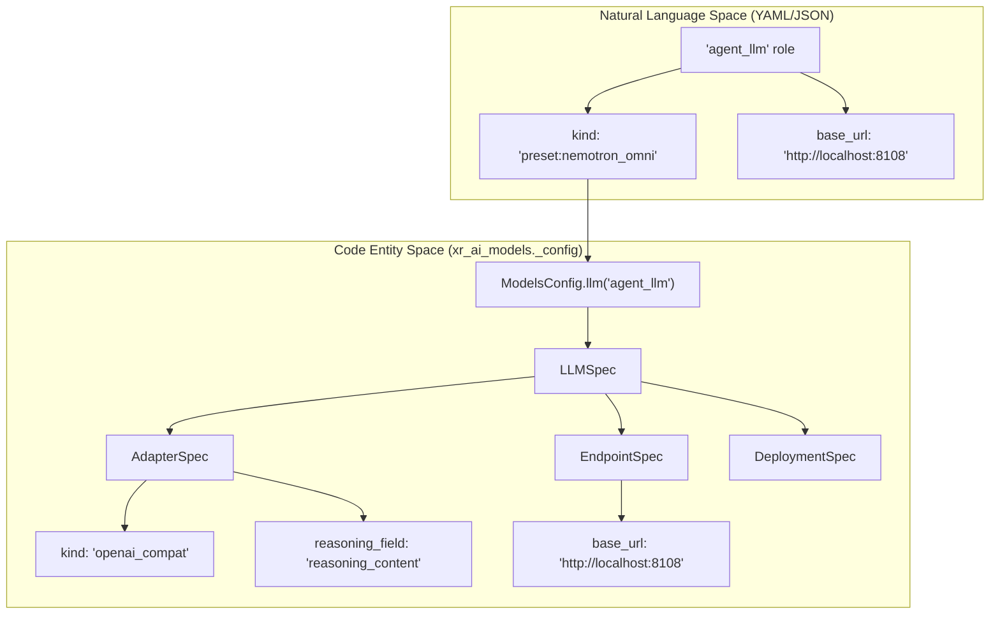
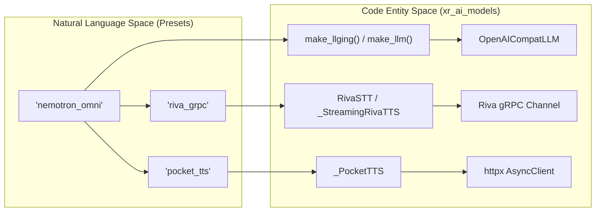
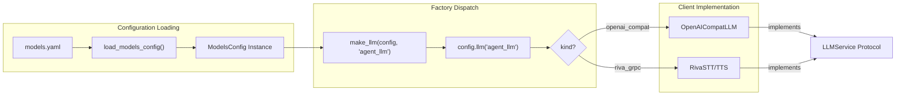

<!-- source: DeepWiki mcp.deepwiki.com · repo NVIDIA/xr-ai · extra page xr-ai-models: Model Service Protocols · fetched 2026-10-26 -->

# xr-ai-models: Model Service Protocols

Relevant source files

The following files were used as context for generating this wiki page:

- [agent-sdk/xr-ai-models/README.md](agent-sdk/xr-ai-models/README.md)
- [agent-sdk/xr-ai-models/xr_ai_models/_factory.py](agent-sdk/xr-ai-models/xr_ai_models/_factory.py)
- [agent-sdk/xr-ai-models/xr_ai_models/_openai_compat.py](agent-sdk/xr-ai-models/xr_ai_models/_openai_compat.py)
- [agent-sdk/xr-ai-models/xr_ai_models/_protocols.py](agent-sdk/xr-ai-models/xr_ai_models/_protocols.py)
- [agent-sdk/xr-ai-models/xr_ai_models/_riva_grpc.py](agent-sdk/xr-ai-models/xr_ai_models/_riva_grpc.py)
- [agent-sdk/xr-ai-models/xr_ai_models/presets/pocket_tts.py](agent-sdk/xr-ai-models/xr_ai_models/presets/pocket_tts.py)
- [docs/source/reference/agent-sdk-models.md](docs/source/reference/agent-sdk-models.md)
- [docs/source/reference/magpie-nim-tts.md](docs/source/reference/magpie-nim-tts.md)
- [services/README.md](services/README.md)
- [services/magpie-nim-tts/README.md](services/magpie-nim-tts/README.md)
- [services/magpie-nim-tts/magpie_nim_tts.yaml](services/magpie-nim-tts/magpie_nim_tts.yaml)
- [services/magpie-nim-tts/magpie_nim_tts/__init__.py](services/magpie-nim-tts/magpie_nim_tts/__init__.py)
- [services/magpie-nim-tts/magpie_nim_tts/__main__.py](services/magpie-nim-tts/magpie_nim_tts/__main__.py)
- [services/magpie-nim-tts/magpie_nim_tts/common.py](services/magpie-nim-tts/magpie_nim_tts/common.py)
- [services/pocket-tts/pocket_tts_server.yaml](services/pocket-tts/pocket_tts_server.yaml)
- [services/pocket-tts/pocket_tts_server/__main__.py](services/pocket-tts/pocket_tts_server/__main__.py)
- [tests/test_models_config.py](tests/test_models_config.py)
- [tests/test_models_openai_compat.py](tests/test_models_openai_compat.py)
- [tests/test_models_riva.py](tests/test_models_riva.py)

The `xr-ai-models` package provides a unified abstraction layer for interacting with AI inference services. It defines typed protocols for Large Language Models (LLM), Vision-Language Models (VLM), Speech-to-Text (STT), Text-to-Speech (TTS), and Embedding services. By using these protocols, agent code remains decoupled from specific backend implementations, model-specific wire quirks, and HTTP client details [agent-sdk/xr-ai-models/README.md:8-12]().

Sources: [agent-sdk/xr-ai-models/README.md:1-21]()

## Service Protocols

All model interactions in the XR-AI SDK are governed by structural protocols defined in `xr_ai_models._protocols`. These protocols ensure that worker code depends on interfaces rather than concrete implementations [agent-sdk/xr-ai-models/_protocols.py:6-11]().

### LLMService, VLMService, and EmbeddingService
These protocols handle text, multimodal chat interactions, and vector representations. They share a common `Capabilities` object that describes supported features like streaming, tool calling, and reasoning [agent-sdk/xr-ai-models/_protocols.py:141-158]().

*   **LLMService**: Focuses on text-based chat completions via `chat()` and `stream()` methods [agent-sdk/xr-ai-models/_protocols.py:161-208]().
*   **VLMService**: Extends capabilities to visual inputs. It provides convenience wrappers like `ask_image()` and `ask_images()` which wrap the underlying multimodal chat logic [agent-sdk/xr-ai-models/_protocols.py:211-285]().
*   **EmbeddingService**: Provides `embed()` for generating vector representations of text strings, supporting batching [agent-sdk/xr-ai-models/_protocols.py:340-363]().

### STTService and TTSService
*   **STTService**: Provides `transcribe()` for converting audio bytes into text [agent-sdk/xr-ai-models/_protocols.py:288-311]().
*   **TTSService**: Provides `synthesize()` and `stream()` for converting text into audio streams [agent-sdk/xr-ai-models/_protocols.py:314-337]().

### Data Structures
The protocols utilize standardized dataclasses for message passing:
*   `ChatMessage`: Represents a single turn with a role (`user`, `assistant`, `system`, `tool`) and content [agent-sdk/xr-ai-models/_protocols.py:104-118]().
*   `ContentPart`: A union of `TextPart`, `ImagePart`, and `VideoPart` for multimodal messages [agent-sdk/xr-ai-models/_protocols.py:59-60]().
*   `ChatResponse`: A normalized response containing generated text, tool calls, and model reasoning [agent-sdk/xr-ai-models/_protocols.py:121-138]().

Sources: [agent-sdk/xr-ai-models/_protocols.py:1-363](), [agent-sdk/xr-ai-models/README.md:1-21]()

## Model Profiles and Configuration

Model behavior is controlled via model profiles (JSON or YAML). A profile separates the model's logic (`AdapterSpec`), connectivity (`EndpointSpec`), and process lifecycle (`DeploymentSpec`) [agent-sdk/xr-ai-models/README.md:8-12]().

### Configuration Structure
| Component | Description | Code Entity |
| :--- | :--- | :--- |
| **Adapter** | Dialect (OpenAI vs Riva), model name, and reasoning field mapping. | `AdapterSpec` [tests/test_models_config.py:12-31]() |
| **Endpoint** | URL, API keys, timeouts, and readiness check paths. | `EndpointSpec` [tests/test_models_config.py:12-31]() |
| **Deployment** | Launch mode (`managed`, `reused`, `external`) for the orchestrator. | `DeploymentSpec` [tests/test_models_config.py:12-31]() |

### Model Logic to Code Mapping
The following diagram illustrates how a logical model role defined in a configuration file is mapped to the internal `ModelsConfig` and its constituent specifications, bridging natural language spaces to code entities.

**Model Configuration Entity Space**

Sources: [tests/test_models_config.py:1-224](), [agent-sdk/xr-ai-models/README.md:1-21]()

## Adapter Presets

To simplify configuration, `xr-ai-models` includes presets for common NVIDIA NIM and in-tree services. Presets encapsulate model-specific quirks like reasoning field names and default parameters [tests/test_models_config.py:35-58]().

### Key Presets
*   `nemotron_omni`: Default LLM; uses `reasoning_content` field; thinking disabled by default [tests/test_models_config.py:66-71]().
*   `cosmos3_nano_reasoner`: VLM configuration preset supporting image and video reasoning [tests/test_models_config.py:45-56]().
*   `riva_grpc`: Specialized adapter for Riva/NIM speech containers using gRPC instead of OpenAI HTTP [tests/test_models_riva.py:104-125]().
*   `pocket_tts`: Pocket TTS service preset for HTTP-based streaming text-to-speech [tests/test_models_openai_compat.py:34-58]().

### Preset Resolution to Code Mapping
The following diagram maps preset identifiers in configuration manifests to their respective instantiation pathways in the factory module.

**Preset Resolution Entity Space**

Sources: [tests/test_models_config.py:35-78](), [agent-sdk/xr-ai-models/xr_ai_models/_factory.py:1-162]()

## Concrete Implementations

### OpenAI-Compatible HTTP Client
The `OpenAICompat*` classes (e.g., `OpenAICompatLLM`, `OpenAICompatVLM`, `OpenAICompatSTT`, `OpenAICompatTTS`, `OpenAICompatEmbedding`) implement the protocols using `httpx`. They handle:
*   **Credential Security**: Bearer tokens are restricted to HTTPS or loopback HTTP [agent-sdk/xr-ai-models/xr_ai_models/_openai_compat.py:47-58]().
*   **Payload Normalization**: Merging `default_extras` from presets with per-call parameters like `enable_thinking` [agent-sdk/xr-ai-models/xr_ai_models/_openai_compat.py:6-10]().
*   **Reasoning Parsing**: Extracting reasoning from model-specific fields (e.g., `reasoning` vs `reasoning_content`) into the standard `ChatResponse.reasoning` field [agent-sdk/xr-ai-models/xr_ai_models/_openai_compat.py:147-150]().
*   **Multimodal Encoding**: Converting `ImageInput` (bytes, paths, or URLs) into base64 data URLs for the OpenAI wire format [agent-sdk/xr-ai-models/xr_ai_models/_openai_compat.py:200-213]().

### Riva gRPC Client
The `RivaSTT` and `_StreamingRivaTTS` classes provide specialized implementations for Riva-based speech services, supporting BCP-47 language codes and custom voice selection over gRPC [agent-sdk/xr-ai-models/xr_ai_models/_riva_grpc.py:100-204]().

Sources: [agent-sdk/xr-ai-models/xr_ai_models/_openai_compat.py:1-213](), [agent-sdk/xr-ai-models/xr_ai_models/_riva_grpc.py:1-204]()

## Factory Functions

The package provides factory functions to instantiate services from a `ModelsConfig` object. These functions resolve the `kind` (e.g., `openai_compat` vs `riva_grpc`) and return the appropriate protocol implementation [agent-sdk/xr-ai-models/xr_ai_models/_factory.py:4-17]().

*   `make_embedding(config, name)` [agent-sdk/xr-ai-models/xr_ai_models/_factory.py:19-37]()
*   `make_llm(config, name)` [agent-sdk/xr-ai-models/xr_ai_models/_factory.py:40-63]()
*   `make_vlm(config, name)` [agent-sdk/xr-ai-models/xr_ai_models/_factory.py:66-88]()
*   `make_stt(config, name)` [agent-sdk/xr-ai-models/xr_ai_models/_factory.py:91-122]()
*   `make_tts(config, name)` [agent-sdk/xr-ai-models/xr_ai_models/_factory.py:125-162]()

### Data Flow: Config to Service
The following diagram shows the data flow from a configuration file through the factory functions to a functional service client.

**Service Instantiation Flow**

Sources: [agent-sdk/xr-ai-models/xr_ai_models/_factory.py:1-162]()

---

