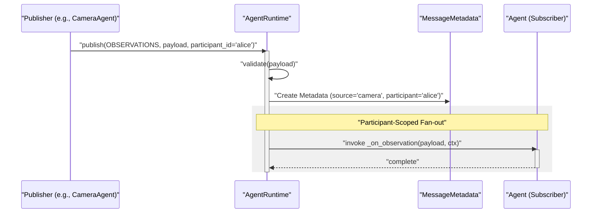

<!-- source: DeepWiki mcp.deepwiki.com · repo NVIDIA/xr-ai · extra page xr-ai-runtime: Agent Runtime and Topics · fetched 2026-10-26 -->

# xr-ai-runtime: Agent Runtime and Topics

<details>
<summary>Relevant source files</summary>

The following files were used as context for generating this wiki page:

- [.github/scripts/docs_release_policy.py](.github/scripts/docs_release_policy.py)
- [.github/scripts/select_latest_docs_release.py](.github/scripts/select_latest_docs_release.py)
- [.github/workflows/docs.yaml](.github/workflows/docs.yaml)
- [agent-samples/simple-vlm-example/yaml/device_io_hub.yaml](agent-samples/simple-vlm-example/yaml/device_io_hub.yaml)
- [agent-sdk/xr-ai-hub/README.md](agent-sdk/xr-ai-hub/README.md)
- [agent-sdk/xr-ai-runtime/README.md](agent-sdk/xr-ai-runtime/README.md)
- [agent-sdk/xr-ai-runtime/xr_ai_runtime/events.py](agent-sdk/xr-ai-runtime/xr_ai_runtime/events.py)
- [docs/Makefile](docs/Makefile)
- [docs/requirements.txt](docs/requirements.txt)
- [docs/source/_static/root-redirect.html](docs/source/_static/root-redirect.html)
- [docs/source/conf.py](docs/source/conf.py)
- [docs/source/reference/index.md](docs/source/reference/index.md)
- [services/video-memory-service/README.md](services/video-memory-service/README.md)
- [tests/test_docs_versions.py](tests/test_docs_versions.py)
- [tests/test_subscriptions.py](tests/test_subscriptions.py)

</details>


The `xr-ai-runtime` package provides the execution environment for agents within the XR-AI ecosystem. It defines the `Agent` base class, manages the `AgentRuntime` lifecycle, and implements a typed, participant-scoped event system based on `Topic` and `MessageMetadata`.

Sources: [agent-sdk/xr-ai-runtime/README.md:1-13]()

## Core Components

### Agent and Runtime
The `Agent` class serves as the fundamental building block for logic. It encapsulates a collection of tools and defines event handlers using the `@subscribe` decorator [agent-sdk/xr-ai-runtime/xr_ai_runtime/agent.py:15-18](). The `AgentRuntime` acts as the orchestrator, managing the registration of agents and the delivery of messages across the system [agent-sdk/xr-ai-runtime/xr_ai_runtime/runtime.py:25-30]().

Sources: [agent-sdk/xr-ai-runtime/xr_ai_runtime/agent.py:15-18](), [agent-sdk/xr-ai-runtime/xr_ai_runtime/runtime.py:25-30]()

### Typed Event System
Communication between agents is governed by the `Topic` class. A `Topic` pairs a stable string name with a Pydantic `BaseModel` to ensure type safety and validation during message exchange [agent-sdk/xr-ai-runtime/xr_ai_runtime/events.py:18-25]().

#### Message Metadata
Every published event is accompanied by `MessageMetadata`, which provides routing and trace context:
*   `message_id`: Unique identifier for the specific publication.
*   `correlation_id`: Shared ID for tracking logical operations across multiple events.
*   `participant_id`: The routing key used to scope events to specific XR users.
*   `source`: The name of the publishing agent or service.
*   `timestamp_us`: Unix microsecond timestamp of the publication.
[agent-sdk/xr-ai-runtime/xr_ai_runtime/events.py:44-65]()

Sources: [agent-sdk/xr-ai-runtime/xr_ai_runtime/events.py:18-65]()

## Implementation Detail: Fan-out and Scoping

The `AgentRuntime` implements a participant-scoped fan-out mechanism. When a message is published to a `Topic`, the runtime identifies all registered agents with methods decorated by `@subscribe(topic)` [agent-sdk/xr-ai-runtime/xr_ai_runtime/runtime.py:90-105]().

### Data Flow: Event Publication
The following diagram illustrates the path from a raw event to an agent's subscriber method.

Title: Event Routing and Execution Flow

Sources: [agent-sdk/xr-ai-runtime/xr_ai_runtime/runtime.py:82-120](), [agent-sdk/xr-ai-runtime/xr_ai_runtime/events.py:67-78]()

## Code Entity Mapping

The runtime bridges high-level agent concepts to specific code entities and Pydantic models. Below are two mapping diagrams linking natural language abstractions to exact code symbols.

Title: Architectural Concept to Code Entity Mapping
```mermaid
graph TD
    subgraph "Natural Language Space"
        Event[""Observation Event""]
        AgentLogic[""Agent Logic""]
        Routing[""Routing Context""]
    end

    subgraph "Code Entity Space"
        T[""Topic[ObservationModel]""]
        AC[""Agent Class""]
        RT[""AgentRuntime""]
        MM[""MessageMetadata""]
        SUB[""@subscribe decorator""]
    end

    Event -.-> T
    AgentLogic -.-> AC
    AgentLogic -.-> SUB
    Routing -.-> MM
    
    RT -- "manages" --> AC
    AC -- "uses" --> SUB
    SUB -- "references" --> T
    RT -- "injects" --> MM
```
Sources: [agent-sdk/xr-ai-runtime/xr_ai_runtime/agent.py:15-35](), [agent-sdk/xr-ai-runtime/xr_ai_runtime/events.py:18-43]()

Title: Event Bus and Subscription Mapping
```mermaid
graph TD
    subgraph "Domain Concept"
        PubSub[""Publish/Subscribe Bus""]
        Handlers[""Event Handlers""]
    end

    subgraph "Code Implementation"
        RuntimePub[""AgentRuntime.publish()""]
        RuntimeReg[""AgentRuntime.register()""]
        SubDecorator[""@subscribe""]
    end

    PubSub -.-> RuntimePub
    Handlers -.-> SubDecorator
    RuntimeReg -- "scans" --> SubDecorator
    RuntimePub -- "dispatches" --> RuntimeReg
```
Sources: [agent-sdk/xr-ai-runtime/xr_ai_runtime/runtime.py:58-95](), [agent-sdk/xr-ai-runtime/xr_ai_runtime/agent.py:15-18]()

## Key Classes and Functions

### AgentRuntime
The central registry and message bus.
*   `register(name, agent)`: Adds an agent to the runtime and scans for `@subscribe` handlers [agent-sdk/xr-ai-runtime/xr_ai_runtime/runtime.py:58-75]().
*   `publish(topic, message, ...)`: Validates the message against the `Topic` model and dispatches it to subscribers [agent-sdk/xr-ai-runtime/xr_ai_runtime/runtime.py:82-95]().
*   `__aenter__ / __aexit__`: Manages the lifecycle of all registered agents [agent-sdk/xr-ai-runtime/xr_ai_runtime/runtime.py:46-56]().

### Agent
The base class for all AI logic units.
*   `tools`: A tuple of `Tool` objects exposed by this agent [agent-sdk/xr-ai-runtime/xr_ai_runtime/agent.py:22-24]().
*   `on_start() / on_stop()`: Lifecycle hooks for initialization and cleanup [agent-sdk/xr-ai-runtime/xr_ai_runtime/agent.py:37]().

### Topic
Defines the contract for an event.
*   `validate(message)`: Uses Pydantic to ensure the payload matches the expected schema [agent-sdk/xr-ai-runtime/xr_ai_runtime/events.py:38-41]().

Sources: [agent-sdk/xr-ai-runtime/xr_ai_runtime/runtime.py:46-95](), [agent-sdk/xr-ai-runtime/xr_ai_runtime/agent.py:22-37](), [agent-sdk/xr-ai-runtime/xr_ai_runtime/events.py:38-41]()

## Example: Subscriber Implementation
Agents subscribe to topics by decorating methods. The runtime automatically injects a `RuntimeContext` containing the `MessageMetadata`.

```python
class VoiceOutputAgent(Agent):
    @subscribe(OBSERVATIONS)
    async def observe(self, event: ObservationModel, ctx: RuntimeContext) -> None:
        # Access participant info via metadata
        p_id = ctx.metadata.participant_id
        logger.info(f"Received observation for {p_id}: {event.labels}")
```
Sources: [tests/test_agent_runtime.py:165-178]()

## Telemetry and Tracing
The runtime integrates with tracing layers to provide observability. If a `Topic` is configured with `telemetry="full"`, the `AgentRuntime` automatically creates spans for both the publication and each individual agent delivery [agent-sdk/xr-ai-runtime/xr_ai_runtime/events.py:27-28](). This allows developers to trace the latency of a message from the source agent through the runtime to every subscriber [tests/test_agent_runtime.py:202-235]().

Sources: [agent-sdk/xr-ai-runtime/xr_ai_runtime/events.py:27-28](), [tests/test_agent_runtime.py:202-235]()

---

