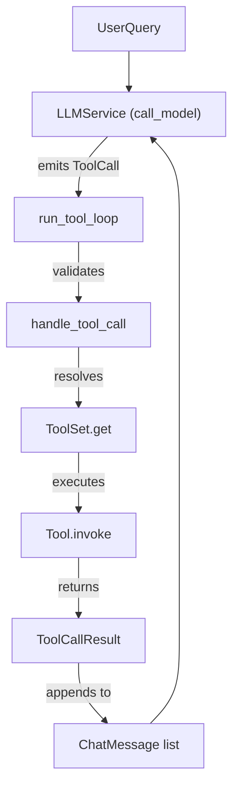
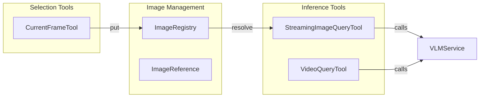

<!-- source: DeepWiki mcp.deepwiki.com · repo NVIDIA/xr-ai · extra page xr-ai-tools: Native Tool Framework · fetched 2026-10-26 -->

# xr-ai-tools: Native Tool Framework

Relevant source files

The following files were used as context for generating this wiki page:

- [agent-samples/simple-vlm-example/yaml/media_capture.yaml](agent-samples/simple-vlm-example/yaml/media_capture.yaml)
- [agent-samples/xr-render-demo/yaml/media_capture.yaml](agent-samples/xr-render-demo/yaml/media_capture.yaml)
- [agent-sdk/xr-ai-hub/xr_ai_hub/_capture.py](agent-sdk/xr-ai-hub/xr_ai_hub/_capture.py)
- [agent-sdk/xr-ai-tools/README.md](agent-sdk/xr-ai-tools/README.md)
- [agent-sdk/xr-ai-tools/pyproject.toml](agent-sdk/xr-ai-tools/pyproject.toml)
- [agent-sdk/xr-ai-tools/xr_ai_tools/_vision.py](agent-sdk/xr-ai-tools/xr_ai_tools/_vision.py)
- [agent-sdk/xr-ai-tools/xr_ai_tools/capture.py](agent-sdk/xr-ai-tools/xr_ai_tools/capture.py)
- [agent-sdk/xr-ai-tools/xr_ai_tools/current_frame.py](agent-sdk/xr-ai-tools/xr_ai_tools/current_frame.py)
- [agent-sdk/xr-ai-tools/xr_ai_tools/image.py](agent-sdk/xr-ai-tools/xr_ai_tools/image.py)
- [agent-sdk/xr-ai-tools/xr_ai_tools/image_polygon.py](agent-sdk/xr-ai-tools/xr_ai_tools/image_polygon.py)
- [agent-sdk/xr-ai-tools/xr_ai_tools/marker_tracking.py](agent-sdk/xr-ai-tools/xr_ai_tools/marker_tracking.py)
- [agent-sdk/xr-ai-tools/xr_ai_tools/tool_calling.py](agent-sdk/xr-ai-tools/xr_ai_tools/tool_calling.py)
- [agent-sdk/xr-ai-tools/xr_ai_tools/tools.py](agent-sdk/xr-ai-tools/xr_ai_tools/tools.py)
- [agent-sdk/xr-ai-tools/xr_ai_tools/utilities/generate_marker.py](agent-sdk/xr-ai-tools/xr_ai_tools/utilities/generate_marker.py)
- [agent-sdk/xr-ai-tools/xr_ai_tools/vision.py](agent-sdk/xr-ai-tools/xr_ai_tools/vision.py)
- [tests/test_generate_marker_utility.py](tests/test_generate_marker_utility.py)
- [tests/test_image_polygon_tool.py](tests/test_image_polygon_tool.py)
- [tests/test_image_tools.py](tests/test_image_tools.py)
- [tests/test_marker_tracking_tool.py](tests/test_marker_tracking_tool.py)
- [tests/test_native_tools.py](tests/test_native_tools.py)
- [tests/test_tool_calling.py](tests/test_tool_calling.py)

`xr-ai-tools` provides a toolkit-independent native layer for defining and executing tools within the XR-AI ecosystem [agent-sdk/xr-ai-tools/README.md:8-11](). It offers a unified Pydantic-based interface for voice agents, background triggers, and model-driven loops, ensuring that all tool executions are managed by NeMo Relay for consistent telemetry and security [agent-sdk/xr-ai-tools/README.md:9-12]().

Sources: [agent-sdk/xr-ai-tools/README.md:1-18]()

---

## Core Tool Abstractions

The framework differentiates between finite, immediate-return tools and long-running streaming tools.

### Tool and AsyncTool
- **`Tool`**: Represents a finite operation that takes a typed `BaseModel` request and returns a typed `BaseModel` result (or `None` for side-effect-only tools) [agent-sdk/xr-ai-tools/README.md:15-16](), [agent-sdk/xr-ai-tools/xr_ai_tools/tools.py:15-20]().
- **`AsyncTool`**: Designed for streaming operations, yielding typed chunks via an `AsyncIterator`. This is typically used for operations like incremental VLM queries [agent-sdk/xr-ai-tools/README.md:18](), [agent-sdk/xr-ai-tools/xr_ai_tools/async_tools.py:16-22]().

### ToolSet and Namespacing
A `ToolSet` is a collection of finite `Tool` instances. It supports namespacing to prevent collision when composing tools from different domains [agent-sdk/xr-ai-tools/README.md:18]().

| Class | Purpose | Implementation Detail |
| :--- | :--- | :--- |
| `Tool` | Unary execution | Uses `execute()` for direct calls and `invoke()` for model strings [agent-sdk/xr-ai-tools/xr_ai_tools/tools.py:53-85](). |
| `AsyncTool` | Streaming execution | Uses `stream()` to yield typed Pydantic chunks [agent-sdk/xr-ai-tools/xr_ai_tools/async_tools.py:56-82](). |
| `ToolSet` | Cataloging | Manages tool registration and namespacing [agent-sdk/xr-ai-tools/xr_ai_tools/tools.py:116-140](). |

Sources: [agent-sdk/xr-ai-tools/README.md:1-18](), [agent-sdk/xr-ai-tools/xr_ai_tools/tools.py:1-140](), [agent-sdk/xr-ai-tools/xr_ai_tools/async_tools.py:1-82]()

---

## Model Tool Calling Loop

The `run_tool_loop` function provides a stateless, bounded runner for multi-turn tool interaction [agent-sdk/xr-ai-tools/README.md:18]().

### Data Flow: Natural Language to Tool Execution

This diagram illustrates how a user's natural language query is processed through the LLM and dispatched to native code entities.

Sources: [agent-sdk/xr-ai-tools/xr_ai_tools/tool_calling.py:133-181]()

### Safety and Validation
- **Iteration Limits**: The loop raises `ToolLoopIterationLimitError` if the model exceeds `max_iterations` without a final answer [agent-sdk/xr-ai-tools/xr_ai_tools/tool_calling.py:179-250]().
- **Direct Return**: If a tool is marked `return_direct=True`, the loop terminates immediately and returns the tool's result as the final answer [agent-sdk/xr-ai-tools/xr_ai_tools/tool_calling.py:260-265]().
- **Validation**: Tool arguments are validated against the `Tool.request_model` Pydantic schema. Errors are returned to the model for potential repair [agent-sdk/xr-ai-tools/README.md:18]().

Sources: [agent-sdk/xr-ai-tools/README.md:18](), [agent-sdk/xr-ai-tools/xr_ai_tools/tool_calling.py:154-280]()

---

## Vision and Image Management

Vision tools operate on image references stored in a centralized `ImageRegistry` to keep telemetry payloads small and manage memory lifecycles [agent-sdk/xr-ai-tools/README.md:18]().

### ImageRegistry
- **Opaque Handles**: Stores raw bytes and provides `xr-image://` URIs [agent-sdk/xr-ai-tools/xr_ai_tools/image.py:75-90]().
- **Ownership**: Images are associated with a `participant_id` or `owner`. Calling `release_owner()` purges all associated frames [agent-sdk/xr-ai-tools/xr_ai_tools/image.py:126-129]().
- **Redaction**: `image_sanitizer()` ensures that sensitive image locations (like local paths or internal URIs) are replaced with `<redacted:image>` in Relay telemetry [agent-sdk/xr-ai-tools/xr_ai_tools/_vision.py:31-41]().

### Vision Tools
- **`CurrentFrameTool`**: Captures the most recent frame for a participant from the `ProcessorEndpoint` [agent-sdk/xr-ai-tools/xr_ai_tools/current_frame.py:46-55]().
- **`StreamingImageQueryTool`**: An `AsyncTool` that streams VLM responses for a single image [agent-sdk/xr-ai-tools/xr_ai_tools/vision.py:230-245]().
- **`VideoQueryTool`**: Queries a chronological sequence of `TimedImage` frames, providing the VLM with estimated offsets and timestamps [agent-sdk/xr-ai-tools/xr_ai_tools/vision.py:303]().

### Code Entity Relationship: Vision Pipeline

Sources: [agent-sdk/xr-ai-tools/xr_ai_tools/image.py:52-129](), [agent-sdk/xr-ai-tools/xr_ai_tools/vision.py:34-85]()

---

## Image, Polygon Editing, and Capture Tools

- **Image and Polygon Editing**: Tools located in `xr_ai_tools.image_polygon` provide capabilities to manipulate images and outline geometric regions or bounding areas for downstream vision tasks.
- **Capture Tools**: Capture utilities in `xr_ai_tools.capture` enable agent-controlled frame captures and media persistence across sessions.

Sources: [agent-sdk/xr-ai-tools/pyproject.toml:21-22](), [agent-sdk/xr-ai-tools/xr_ai_tools/image_polygon.py:1-50]()

---

## Marker Tracking

The `MarkerTrackingTool` provides multi-scale detection for QR codes and ArUco markers within participant camera frames [agent-sdk/xr-ai-tools/xr_ai_tools/marker_tracking.py:4-6]().

### Implementation Details
- **Multi-Scale Detection**: To detect small markers in high-resolution frames, the tool performs scans at both native resolution and an enlarged scale (up to 6x) [agent-sdk/xr-ai-tools/xr_ai_tools/marker_tracking.py:137-168]().
- **Engines**: Uses `zxing-cpp` for QR codes and `opencv-contrib` for ArUco fiducials [agent-sdk/xr-ai-tools/xr_ai_tools/marker_tracking.py:16-18]().
- **Deduplication**: Markers found across different scales are merged using an Area-of-Overlap (IoU) check [agent-sdk/xr-ai-tools/xr_ai_tools/marker_tracking.py:204-225]().

### Marker Generation Utility
The `generate_marker` utility (`xr_ai_tools.utilities.generate_marker`) allows developers to create ArUco marker images for testing or physical placement [agent-sdk/xr-ai-tools/xr_ai_tools/utilities/generate_marker.py:1-25]().

Sources: [agent-sdk/xr-ai-tools/xr_ai_tools/marker_tracking.py:1-250](), [agent-sdk/xr-ai-tools/xr_ai_tools/utilities/generate_marker.py:1-50]()

---

