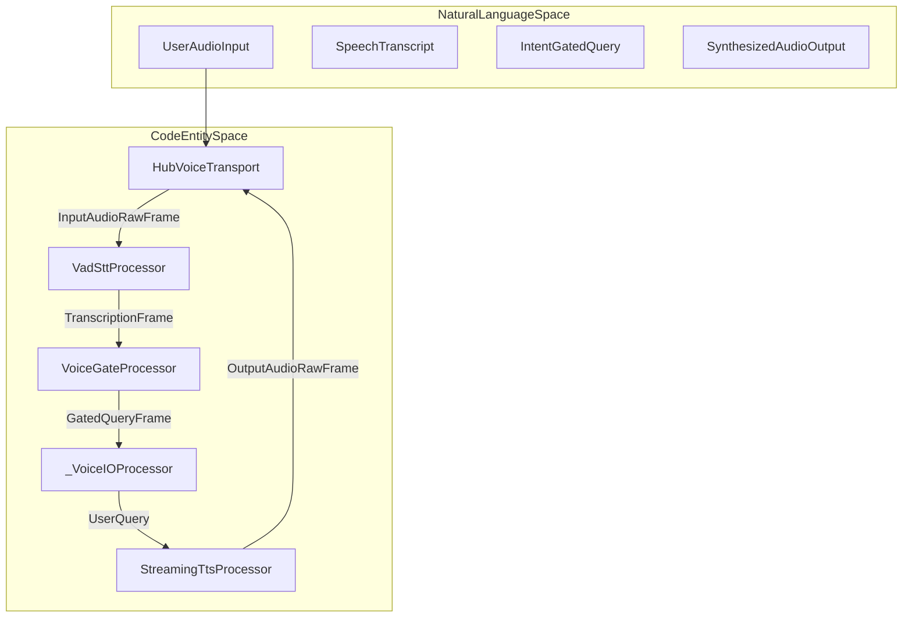
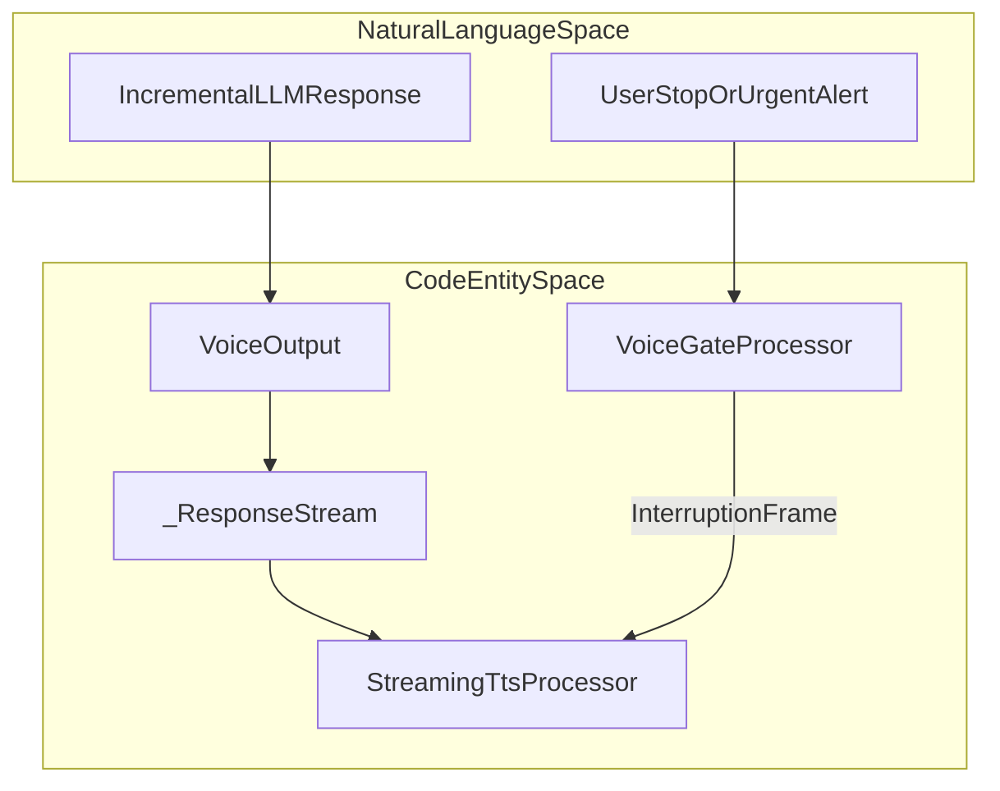

<!-- source: DeepWiki mcp.deepwiki.com · repo NVIDIA/xr-ai · extra page xr-ai-voice: Voice Pipeline · fetched 2026-10-26 -->

# xr-ai-voice: Voice Pipeline

Relevant source files

The following files were used as context for generating this wiki page:

- [agent-samples/simple-vlm-example/yaml/voice_gate.yaml](agent-samples/simple-vlm-example/yaml/voice_gate.yaml)
- [agent-sdk/xr-ai-voice/README.md](agent-sdk/xr-ai-voice/README.md)
- [agent-sdk/xr-ai-voice/pyproject.toml](agent-sdk/xr-ai-voice/pyproject.toml)
- [agent-sdk/xr-ai-voice/xr_ai_voice/__init__.py](agent-sdk/xr-ai-voice/xr_ai_voice/__init__.py)
- [agent-sdk/xr-ai-voice/xr_ai_voice/_aggregation.py](agent-sdk/xr-ai-voice/xr_ai_voice/_aggregation.py)
- [agent-sdk/xr-ai-voice/xr_ai_voice/_frames.py](agent-sdk/xr-ai-voice/xr_ai_voice/_frames.py)
- [agent-sdk/xr-ai-voice/xr_ai_voice/_pipeline.py](agent-sdk/xr-ai-voice/xr_ai_voice/_pipeline.py)
- [agent-sdk/xr-ai-voice/xr_ai_voice/_processors/io.py](agent-sdk/xr-ai-voice/xr_ai_voice/_processors/io.py)
- [agent-sdk/xr-ai-voice/xr_ai_voice/_processors/streaming_tts.py](agent-sdk/xr-ai-voice/xr_ai_voice/_processors/streaming_tts.py)
- [agent-sdk/xr-ai-voice/xr_ai_voice/_processors/vad_stt.py](agent-sdk/xr-ai-voice/xr_ai_voice/_processors/vad_stt.py)
- [agent-sdk/xr-ai-voice/xr_ai_voice/_processors/voice_gate.py](agent-sdk/xr-ai-voice/xr_ai_voice/_processors/voice_gate.py)
- [agent-sdk/xr-ai-voice/xr_ai_voice/_runtime.py](agent-sdk/xr-ai-voice/xr_ai_voice/_runtime.py)
- [agent-sdk/xr-ai-voice/xr_ai_voice/_session.py](agent-sdk/xr-ai-voice/xr_ai_voice/_session.py)
- [agent-sdk/xr-ai-voice/xr_ai_voice/_transport.py](agent-sdk/xr-ai-voice/xr_ai_voice/_transport.py)
- [docs/source/components/agent-sdk.md](docs/source/components/agent-sdk.md)
- [docs/source/reference/agent-sdk-voice.md](docs/source/reference/agent-sdk-voice.md)
- [tests/test_voice_aggregation.py](tests/test_voice_aggregation.py)
- [tests/test_voice_pipeline.py](tests/test_voice_pipeline.py)
- [tests/test_voice_runtime.py](tests/test_voice_runtime.py)
- [tests/test_voice_session.py](tests/test_voice_session.py)
- [tests/test_xr_ai_voicegate.py](tests/test_xr_ai_voicegate.py)
- [utils/xr-ai-voicegate/xr_ai_voicegate/_phrases.py](utils/xr-ai-voicegate/xr_ai_voicegate/_phrases.py)
- [utils/xr-ai-voicegate/xr_ai_voicegate/config.py](utils/xr-ai-voicegate/xr_ai_voicegate/config.py)
- [utils/xr-ai-voicegate/xr_ai_voicegate/gate.py](utils/xr-ai-voicegate/xr_ai_voicegate/gate.py)

The `xr-ai-voice` package provides a participant-aware voice runtime for XR agents. It leverages [Pipecat](https://github.com/pipecat-ai/pipecat) to implement a modular media pipeline while exposing high-level XR concepts like participant lifecycle, voice-gating, and response aggregation to the application layer [agent-sdk/xr-ai-voice/README.md:8-16]().

## Purpose and Scope
This document details the internal architecture of `xr-ai-voice`, covering `VoiceAgent` and `VoiceAggregationAgent`, the Pipecat-based media pipeline (`VadSttProcessor` → `VoiceGateProcessor` → `_VoiceIOProcessor` → `StreamingTtsProcessor`), `HubVoiceTransport`, wake phrase handling via `xr-ai-voicegate`, incremental response streaming, participant lifecycle management, and timestamp anchoring.

Sources: [agent-sdk/xr-ai-voice/README.md:8-16]()

---

## Core Components: VoiceAgent and VoiceAggregationAgent

An XR agent uses `VoiceAgent` to manage its voice-facing input/output boundaries. 

* **`VoiceAgent`**: Owns application readiness, the hub transport, VAD and STT execution, voice gating, internal session state, TTS generation, and pipeline cleanup [agent-sdk/xr-ai-voice/README.md:16](). It publishes final pre-gate transcripts to `VOICE_TRANSCRIPT_TOPIC` (`[agent-sdk/xr-ai-voice/xr_ai_voice/_runtime.py:114-114]()`) and accepted queries to the configured `UserQuery` topic (`[agent-sdk/xr-ai-voice/xr_ai_voice/_runtime.py:39-50]()`).
* **`VoiceAggregationAgent`**: Used when an application has multiple speech producers (e.g., foreground conversational replies, background sensor monitors, and alerts). It subscribes to `VOICE_CONTRIBUTION_TOPIC` (`[agent-sdk/xr-ai-voice/xr_ai_voice/_aggregation.py:40-42]()`) and consolidates simultaneous or rapid updates per participant before publishing a single coherent stream to `VOICE_OUTPUT_TOPIC` (`[agent-sdk/xr-ai-voice/xr_ai_voice/_runtime.py:121-123]()`).

Sources: [agent-sdk/xr-ai-voice/README.md:16](), [agent-sdk/xr-ai-voice/xr_ai_voice/_runtime.py:114-123](), [agent-sdk/xr-ai-voice/xr_ai_voice/_aggregation.py:40-42]()

---

## Pipecat-Based Pipeline Architecture

The voice pipeline is assembled by `_build_voice_pipeline` (`[agent-sdk/xr-ai-voice/xr_ai_voice/_pipeline.py:31-111]()`) and run inside a `PipelineWorker` (`[agent-sdk/xr-ai-voice/xr_ai_voice/_pipeline.py:99-110]()`). It processes audio data sequentially through specialized `FrameProcessor` implementations.

### Pipeline Data Flow and Code Entity Mapping

Sources: [agent-sdk/xr-ai-voice/xr_ai_voice/_pipeline.py:87-94]()

### Pipeline Stages

1. **`HubVoiceTransport`**: Bridges ZMQ IPC from the Device I/O Hub into Pipecat frames (`[agent-sdk/xr-ai-voice/xr_ai_voice/_transport.py:103-104]()`).
2. **`VadSttProcessor`**: Consumes `InputAudioRawFrame`, manages per-participant `VadDetector` instances (`[agent-sdk/xr-ai-voice/xr_ai_voice/_processors/vad_stt.py:84-111]()`), executes early STT probes, and emits `TranscriptionFrame` objects (`[agent-sdk/xr-ai-voice/xr_ai_voice/_processors/vad_stt.py:8-13]()`).
3. **`VoiceGateProcessor`**: Wraps `VoiceGate` to apply wake-phrase matching, STOP intent detection, and participant greeting logic (`[agent-sdk/xr-ai-voice/xr_ai_voice/_processors/voice_gate.py:50-57]()`).
4. **`_VoiceIOProcessor`**: Bridges accepted queries and participant join/leave events to the `AgentRuntime` topic system (`[agent-sdk/xr-ai-voice/xr_ai_voice/_processors/io.py:28-45]()`).
5. **`StreamingTtsProcessor`**: Translates incoming text frames into `OutputAudioRawFrame` items using a `TTSService`, supporting stream interruption and chime observation (`[agent-sdk/xr-ai-voice/xr_ai_voice/_processors/streaming_tts.py:25-40]()`).

Sources: [agent-sdk/xr-ai-voice/xr_ai_voice/_processors/vad_stt.py:84-111](), [agent-sdk/xr-ai-voice/xr_ai_voice/_processors/voice_gate.py:50-57](), [agent-sdk/xr-ai-voice/xr_ai_voice/_processors/io.py:28-45](), [agent-sdk/xr-ai-voice/xr_ai_voice/_processors/streaming_tts.py:25-40]()

---

## Wake Phrases and xr-ai-voicegate

Wake phrase detection and conversation gating are powered by the `xr-ai-voicegate` library (`[utils/xr-ai-voicegate/xr_ai_voicegate/gate.py:38-75]()`). 

* **Sentence-Boundary Matcher**: `build_magic_pattern` (`[utils/xr-ai-voicegate/xr_ai_voicegate/_phrases.py:43-68]`) compiles a regex that matches configured magic phrases only at the start of a transcript or immediately following sentence-final punctuation (`.`, `?`, `!`) separated by whitespace or closing quotes. Mid-sentence mentions do not trigger the gate.
* **STOP Commands**: `STOP_RE` (`[utils/xr-ai-voicegate/xr_ai_voicegate/_phrases.py:15-40]`) matches a closed imperative grammar for speech interruption (e.g., "stop", "stop it", "be quiet", "shut up") with optional conversational prefixes.
* **Event Ladder**: `VoiceGate.feed` evaluates transcripts against a deterministic priority ladder: (1) STOP detection, (2) Fresh magic-phrase match, (3) Follow-up window continuation, (4) Phrase-only match (opening the follow-up window), and (5) Drop (`[utils/xr-ai-voicegate/xr_ai_voicegate/gate.py:41-58]()`).

Sources: [utils/xr-ai-voicegate/xr_ai_voicegate/gate.py:38-75](), [utils/xr-ai-voicegate/xr_ai_voicegate/_phrases.py:15-68]()

---

## HubVoiceTransport and Media Routing

`HubVoiceTransport` inherits from Pipecat's `BaseInputTransport` and `BaseOutputTransport` (`[agent-sdk/xr-ai-voice/xr_ai_voice/_transport.py:34-36]()`). It interfaces directly with `ProcessorEndpoint` (`[agent-sdk/xr-ai-voice/xr_ai_voice/_transport.py:108-116]()`).

* **Input Path**: Receives float32 PCM chunks from the hub, downmixes multi-channel audio to mono, resamples to 16 kHz, and converts them to `InputAudioRawFrame` objects stamped with the hub participant ID (`transport_source`) (`[agent-sdk/xr-ai-voice/xr_ai_voice/_transport.py:162-176]()`).
* **Output Path**: Converts int16 PCM chunks generated by TTS back into float32 `AudioChunk` structures and pushes them via `send_return_audio` (`[agent-sdk/xr-ai-voice/xr_ai_voice/_transport.py:350-380]()`).
* **Preroll and Pacing**: When a participant joins, the transport sends a short preroll of silence to initialize the return track before live speech or chimes begin (`[agent-sdk/xr-ai-voice/xr_ai_voice/_transport.py:64-68]()`).

Sources: [agent-sdk/xr-ai-voice/xr_ai_voice/_transport.py:34-68](), [agent-sdk/xr-ai-voice/xr_ai_voice/_transport.py:162-176]()

---

## Incremental Response Streaming and Interruption

Agents publish responses as `VoiceOutput` objects (`[agent-sdk/xr-ai-voice/xr_ai_voice/_runtime.py:81-112]()`). Incremental responses share a `response_id` across chunks and set `final=False` until the stream terminates (`[agent-sdk/xr-ai-voice/xr_ai_voice/_runtime.py:89-94]()`).

### Streaming and Interruption Mapping

Sources: [agent-sdk/xr-ai-voice/xr_ai_voice/_runtime.py:81-112](), [agent-sdk/xr-ai-voice/xr_ai_voice/_processors/streaming_tts.py:25-45]()

* **Stream Management**: `_ResponseStream` manages bounded queues (`[agent-sdk/xr-ai-voice/xr_ai_voice/_runtime.py:137-144]()`) for text fragments. Each `VoiceAgent` tracks recently closed stream keys to ignore duplicate or stale stream replays (`[agent-sdk/xr-ai-voice/README.md:16]()`).
* **Interruption**: Setting `interrupt=True` on a `VoiceOutput` or triggering a gate `on_stop` event emits an `InterruptionFrame` (`[agent-sdk/xr-ai-voice/xr_ai_voice/_processors/voice_gate.py:27-27]()`, `[agent-sdk/xr-ai-voice/README.md:16]()`), immediately flushing queued hub audio and cancelling active speech generation in `StreamingTtsProcessor` (`[agent-sdk/xr-ai-voice/xr_ai_voice/_processors/streaming_tts.py:40-60]()`).

Sources: [agent-sdk/xr-ai-voice/xr_ai_voice/_runtime.py:81-112](), [agent-sdk/xr-ai-voice/xr_ai_voice/_processors/streaming_tts.py:25-60](), [agent-sdk/xr-ai-voice/README.md:16]()

---

## Participant Lifecycle and Timestamp Anchoring

* **Participant Lifecycle**: `HubVoiceTransport` and `ProcessorEndpoint` monitor roster changes, emitting `ParticipantJoinedFrame` and `ParticipantLeftFrame` (`[agent-sdk/xr-ai-voice/xr_ai_voice/_transport.py:126-127]`, `[agent-sdk/xr-ai-voice/xr_ai_voice/_frames.py:1-20]()`). These propagate through the pipeline so processors can clean up per-participant buffers and detectors without leaking state over long sessions (`[agent-sdk/xr-ai-voice/xr_ai_voice/_processors/vad_stt.py:151-158]()`).
* **Timestamp Anchoring**: To ensure temporal consistency across multimodal inputs, `VadSttProcessor` captures the presentation timestamp (`pts`) of the audio frame at speech onset (`[agent-sdk/xr-ai-voice/xr_ai_voice/_processors/vad_stt.py:128-133]()`). This timestamp is propagated through `TranscriptionFrame` (`[agent-sdk/xr-ai-voice/xr_ai_voice/_processors/voice_gate.py:151-155]()`) into `UserQuery.timestamp_us` (`[agent-sdk/xr-ai-voice/xr_ai_voice/_runtime.py:47-49]()`), allowing downstream reasoning agents to accurately correlate voice commands with co-occurring video frames.

Sources: [agent-sdk/xr-ai-voice/xr_ai_voice/_processors/vad_stt.py:128-158](), [agent-sdk/xr-ai-voice/xr_ai_voice/_processors/voice_gate.py:151-155](), [agent-sdk/xr-ai-voice/xr_ai_voice/_runtime.py:47-49]()

---

## Pipeline Implementation Map

| Code Entity | System Role | File Path |
| :--- | :--- | :--- |
| `VoiceAgent` | Top-level Voice Orchestrator | `[agent-sdk/xr-ai-voice/xr_ai_voice/_runtime.py:198]()` |
| `VoiceAggregationAgent` | Multi-Producer Aggregator | `[agent-sdk/xr-ai-voice/xr_ai_voice/_aggregation.py:57]()` |
| `HubVoiceTransport` | ZMQ IPC to Pipecat Transport | `[agent-sdk/xr-ai-voice/xr_ai_voice/_transport.py:34]()` |
| `VadSttProcessor` | VAD, STT & Onset Anchoring | `[agent-sdk/xr-ai-voice/xr_ai_voice/_processors/vad_stt.py:84]()` |
| `VoiceGateProcessor` | Pipecat Gate Wrapper & Chime Sink | `[agent-sdk/xr-ai-voice/xr_ai_voice/_processors/voice_gate.py:50]()` |
| `VoiceGate` | Magic Phrase & STOP State Machine | `[utils/xr-ai-voicegate/xr_ai_voicegate/gate.py:38]()` |
| `_VoiceIOProcessor` | Runtime Topic Bridge (`UserQuery`) | `[agent-sdk/xr-ai-voice/xr_ai_voice/_processors/io.py:28]()` |
| `StreamingTtsProcessor` | TTS Generation & Interruption | `[agent-sdk/xr-ai-voice/xr_ai_voice/_processors/streaming_tts.py:25]()` |
| `_build_voice_pipeline` | Pipeline Assembly Factory | `[agent-sdk/xr-ai-voice/xr_ai_voice/_pipeline.py:31]()` |

Sources: [agent-sdk/xr-ai-voice/xr_ai_voice/_runtime.py:198](), [agent-sdk/xr-ai-voice/xr_ai_voice/_aggregation.py:57](), [agent-sdk/xr-ai-voice/xr_ai_voice/_transport.py:34](), [agent-sdk/xr-ai-voice/xr_ai_voice/_processors/vad_stt.py:84](), [agent-sdk/xr-ai-voice/xr_ai_voice/_processors/voice_gate.py:50](), [utils/xr-ai-voicegate/xr_ai_voicegate/gate.py:38](), [agent-sdk/xr-ai-voice/xr_ai_voice/_processors/io.py:28](), [agent-sdk/xr-ai-voice/xr_ai_voice/_processors/streaming_tts.py:25](), [agent-sdk/xr-ai-voice/xr_ai_voice/_pipeline.py:31]()

---

