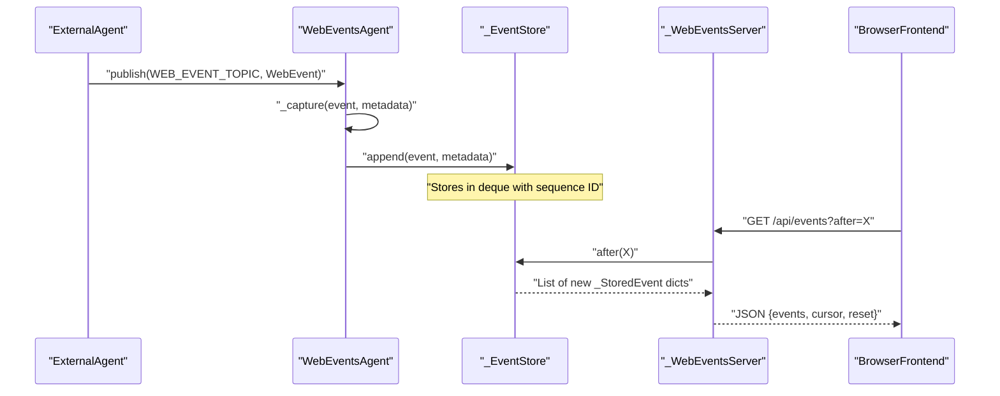
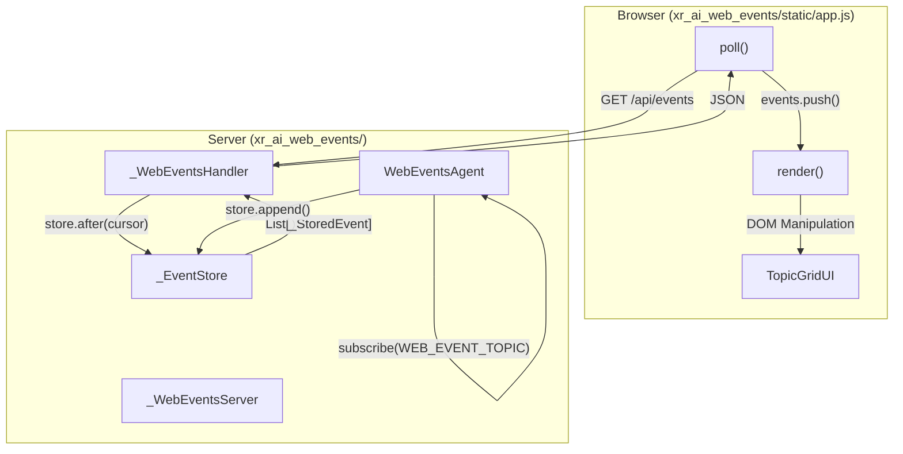

<!-- source: DeepWiki mcp.deepwiki.com · repo NVIDIA/xr-ai · extra page xr-ai-web-events: Telemetry Viewer · fetched 2026-10-26 -->

# xr-ai-web-events: Telemetry Viewer

Relevant source files

The following files were used as context for generating this wiki page:

- [agent-samples/tea-making-sample/worker/tea_making_worker/change_watch.py](agent-samples/tea-making-sample/worker/tea_making_worker/change_watch.py)
- [agent-samples/tea-making-sample/worker/tea_making_worker/prompts/change_watch_caption_prompt.txt](agent-samples/tea-making-sample/worker/tea_making_worker/prompts/change_watch_caption_prompt.txt)
- [agent-samples/tea-making-sample/worker/tea_making_worker/prompts/change_watch_event_prompt.txt](agent-samples/tea-making-sample/worker/tea_making_worker/prompts/change_watch_event_prompt.txt)
- [agent-samples/tea-making-sample/worker/tea_making_worker/prompts/transcript_summary_prompt.txt](agent-samples/tea-making-sample/worker/tea_making_worker/prompts/transcript_summary_prompt.txt)
- [agent-samples/tea-making-sample/worker/tea_making_worker/prompts/video_caption_prompt.txt](agent-samples/tea-making-sample/worker/tea_making_worker/prompts/video_caption_prompt.txt)
- [agent-samples/tea-making-sample/worker/tea_making_worker/prompts/video_delta_prompt.txt](agent-samples/tea-making-sample/worker/tea_making_worker/prompts/video_delta_prompt.txt)
- [agent-samples/tea-making-sample/worker/tea_making_worker/video_log.py](agent-samples/tea-making-sample/worker/tea_making_worker/video_log.py)
- [agent-samples/tea-making-sample/worker/tea_making_worker/web_events.py](agent-samples/tea-making-sample/worker/tea_making_worker/web_events.py)
- [agent-sdk/xr-ai-web-events/README.md](agent-sdk/xr-ai-web-events/README.md)
- [agent-sdk/xr-ai-web-events/pyproject.toml](agent-sdk/xr-ai-web-events/pyproject.toml)
- [agent-sdk/xr-ai-web-events/xr_ai_web_events/__init__.py](agent-sdk/xr-ai-web-events/xr_ai_web_events/__init__.py)
- [agent-sdk/xr-ai-web-events/xr_ai_web_events/_agent.py](agent-sdk/xr-ai-web-events/xr_ai_web_events/_agent.py)
- [agent-sdk/xr-ai-web-events/xr_ai_web_events/_models.py](agent-sdk/xr-ai-web-events/xr_ai_web_events/_models.py)
- [agent-sdk/xr-ai-web-events/xr_ai_web_events/_server.py](agent-sdk/xr-ai-web-events/xr_ai_web_events/_server.py)
- [agent-sdk/xr-ai-web-events/xr_ai_web_events/_store.py](agent-sdk/xr-ai-web-events/xr_ai_web_events/_store.py)
- [agent-sdk/xr-ai-web-events/xr_ai_web_events/static/app.js](agent-sdk/xr-ai-web-events/xr_ai_web_events/static/app.js)
- [agent-sdk/xr-ai-web-events/xr_ai_web_events/static/index.html](agent-sdk/xr-ai-web-events/xr_ai_web_events/static/index.html)
- [docs/source/reference/agent-sdk-web-events.md](docs/source/reference/agent-sdk-web-events.md)

The `xr-ai-web-events` package provides a read-only browser-based viewer for selected, typed runtime events. It allows developers to observe high-level agent logic and instrument readings without tailing logs or accessing low-level media streams [agent-sdk/xr-ai-web-events/README.md:8-12]().

Sources: [agent-sdk/xr-ai-web-events/README.md:8-12]()

## Overview

The system operates by subscribing to a specific topic, `WEB_EVENT_TOPIC`, and storing incoming messages in a bounded in-memory buffer [agent-sdk/xr-ai-web-events/xr_ai_web_events/_agent.py:153-155](). A lightweight HTTP server serves a static HTML/JS frontend that polls an API to visualize these events, grouped by participant and topic [agent-sdk/xr-ai-web-events/xr_ai_web_events/static/app.js:109-134]().

### Key Features
*   **Participant Awareness**: Events are automatically associated with their originating participant via `MessageMetadata` [agent-sdk/xr-ai-web-events/xr_ai_web_events/_store.py:29]().
*   **Security**: Includes built-in DNS-rebinding protection by validating the `Host` header against the listener address [agent-sdk/xr-ai-web-events/xr_ai_web_events/_server.py:71-84]().
*   **Performance**: Payloads are constrained to 16 KiB to ensure the in-memory store remains predictable [agent-sdk/xr-ai-web-events/xr_ai_web_events/_models.py:11-48]().

Sources: [agent-sdk/xr-ai-web-events/xr_ai_web_events/_agent.py:153-155](), [agent-sdk/xr-ai-web-events/xr_ai_web_events/_store.py:29](), [agent-sdk/xr-ai-web-events/xr_ai_web_events/_server.py:71-84](), [agent-sdk/xr-ai-web-events/xr_ai_web_events/_models.py:11-48]()

## Data Model and Constraints

The `WebEvent` class defines the schema for data sent to the viewer. It is validated using Pydantic [agent-sdk/xr-ai-web-events/xr_ai_web_events/_models.py:14-50]().

| Field | Type | Description |
| :--- | :--- | :--- |
| `topic` | `str` | Stable identifier used to group events into columns in the UI [agent-sdk/xr-ai-web-events/xr_ai_web_events/_models.py:19-20](). |
| `payload` | `dict` | JSON-compatible application data [agent-sdk/xr-ai-web-events/xr_ai_web_events/_models.py:22-23](). |
| `title` | `str \| None` | Optional human-readable title for the topic column [agent-sdk/xr-ai-web-events/xr_ai_web_events/_models.py:25-26](). |

### Constraints
*   **Payload Size**: Serialized UTF-8 bytes must not exceed 16,384 bytes (`_MAX_PAYLOAD_BYTES`) [agent-sdk/xr-ai-web-events/xr_ai_web_events/_models.py:11-48]().
*   **Numeric Safety**: The payload must not contain `NaN` or `Inf` values to ensure JSON compatibility [agent-sdk/xr-ai-web-events/xr_ai_web_events/_models.py:45]().
*   **Telemetry**: The `WEB_EVENT_TOPIC` is explicitly marked with `telemetry="none"` to avoid recursive logging of telemetry events [agent-sdk/xr-ai-web-events/xr_ai_web_events/_models.py:52]().

Sources: [agent-sdk/xr-ai-web-events/xr_ai_web_events/_models.py:11-52]()

## Implementation Detail

### WebEventsAgent and Event Capture
The `WebEventsAgent` is the primary entry point. It manages the lifecycle of the `_WebEventsServer` and handles the `WEB_EVENT_TOPIC` subscription [agent-sdk/xr-ai-web-events/xr_ai_web_events/_agent.py:20-53]().

Diagram: "Sequence: Event Capture and Retrieval"

Sources: [agent-sdk/xr-ai-web-events/xr_ai_web_events/_agent.py:153-155](), [agent-sdk/xr-ai-web-events/xr_ai_web_events/_store.py:45-54](), [agent-sdk/xr-ai-web-events/xr_ai_web_events/_server.py:147-161]()

### Event Storage
The `_EventStore` class provides a thread-safe, bounded buffer using `collections.deque` [agent-sdk/xr-ai-web-events/xr_ai_web_events/_store.py:39-43]().
*   **Cursor Tracking**: Each event is assigned a monotonic `sequence` number [agent-sdk/xr-ai-web-events/xr_ai_web_events/_store.py:53-54]().
*   **Rollover Recovery**: If a client's `after` parameter is older than the `oldest` event in the deque, the store sets `reset: True`, signaling the browser to clear its local state [agent-sdk/xr-ai-web-events/xr_ai_web_events/_store.py:60-68]().

Sources: [agent-sdk/xr-ai-web-events/xr_ai_web_events/_store.py:39-68]()

### HTTP Server and Security
The `_WebEventsServer` extends `ThreadingHTTPServer` and uses `_WebEventsHandler` to process requests [agent-sdk/xr-ai-web-events/xr_ai_web_events/_server.py:55-67]().

*   **DNS Rebinding Protection**: The `_host_is_allowed` method ensures that the `Host` header matches the listener's IP or "localhost" [agent-sdk/xr-ai-web-events/xr_ai_web_events/_server.py:71-84](). This prevents malicious websites from making requests to the local telemetry server via the user's browser.
*   **Security Headers**: Every response includes `Content-Security-Policy`, `X-Content-Type-Options: nosniff`, and `Cache-Control: no-store` [agent-sdk/xr-ai-web-events/xr_ai_web_events/_server.py:114-119]().
*   **Endpoints**:
    *   `/`: Serves `index.html` [agent-sdk/xr-ai-web-events/xr_ai_web_events/_server.py:20]().
    *   `/healthz`: Returns `{"status": "ok"}` [agent-sdk/xr-ai-web-events/xr_ai_web_events/_server.py:96-98]().
    *   `/api/events`: JSON endpoint for polling [agent-sdk/xr-ai-web-events/xr_ai_web_events/_server.py:99-101]().

Sources: [agent-sdk/xr-ai-web-events/xr_ai_web_events/_server.py:19-119]()

## Browser Frontend

The frontend is a vanilla JavaScript application that polls the server every 500ms [agent-sdk/xr-ai-web-events/xr_ai_web_events/static/app.js:132-134]().

Diagram: "Class and Entity Mapping for Web Events Viewer"

Sources: [agent-sdk/xr-ai-web-events/xr_ai_web_events/static/app.js:59-136](), [agent-sdk/xr-ai-web-events/xr_ai_web_events/_agent.py:153-155](), [agent-sdk/xr-ai-web-events/xr_ai_web_events/_server.py:87-112]()

### Presentation Logic
The browser uses a `presentation(event)` function to determine what to display in the primary event card. It searches the `payload` for keys like `text`, `message`, or `response`. If none are found, it defaults to the `record_type` or a stringified JSON [agent-sdk/xr-ai-web-events/xr_ai_web_events/static/app.js:32-40]().

Sources: [agent-sdk/xr-ai-web-events/xr_ai_web_events/static/app.js:32-40]()

---

