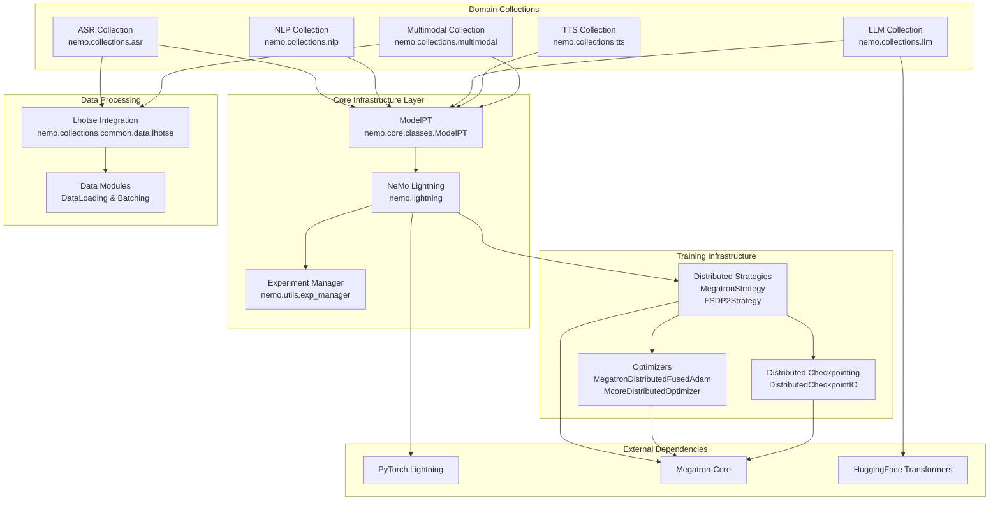
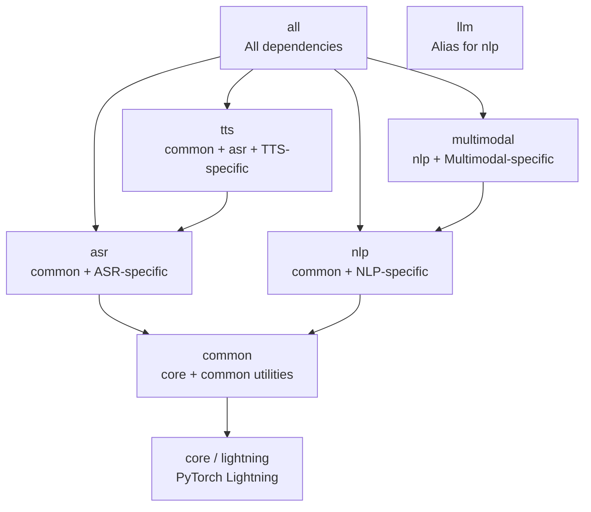
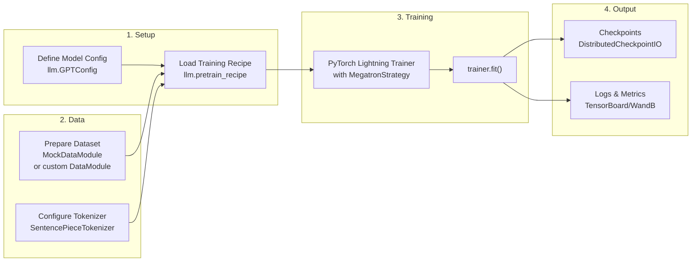

<!-- source: DeepWiki mcp.deepwiki.com · repo NVIDIA/NeMo · page 1 Introduction to NeMo · fetched 2026-10-21 -->

# Introduction to NeMo

<details>
<summary>Relevant source files</summary>

The following files were used as context for generating this wiki page:

- [.dockerignore](.dockerignore)
- [.flake8](.flake8)
- [.flake8.other](.flake8.other)
- [.flake8.speech](.flake8.speech)
- [.github/workflows/cicd-relabel-bot.yml](.github/workflows/cicd-relabel-bot.yml)
- [.github/workflows/code-formatting.yml](.github/workflows/code-formatting.yml)
- [.github/workflows/code-linting.yml](.github/workflows/code-linting.yml)
- [.pre-commit-config.yaml](.pre-commit-config.yaml)
- [.pylintrc](.pylintrc)
- [.pylintrc.other](.pylintrc.other)
- [.pylintrc.speech](.pylintrc.speech)
- [examples/llm/resiliency/README.md](examples/llm/resiliency/README.md)
- [examples/llm/resiliency/crash_simulator.py](examples/llm/resiliency/crash_simulator.py)
- [examples/llm/resiliency/preemption_simulator.py](examples/llm/resiliency/preemption_simulator.py)
- [examples/llm/resiliency/resiliency-in-pretraining-demo.ipynb](examples/llm/resiliency/resiliency-in-pretraining-demo.ipynb)
- [nemo/collections/llm/recipes/callbacks/__init__.py](nemo/collections/llm/recipes/callbacks/__init__.py)
- [nemo/collections/llm/recipes/callbacks/common.py](nemo/collections/llm/recipes/callbacks/common.py)
- [pyproject.toml](pyproject.toml)
- [requirements/requirements.txt](requirements/requirements.txt)
- [requirements/requirements_nlp.txt](requirements/requirements_nlp.txt)
- [requirements/requirements_test.txt](requirements/requirements_test.txt)
- [setup.py](setup.py)

</details>


## Purpose and Scope

This document provides a high-level introduction to the NeMo (Neural Modules) toolkit, including its architecture, core components, domain-specific collections, and installation procedures. It serves as the entry point for understanding how NeMo enables conversational AI model development across multiple domains including automatic speech recognition (ASR), natural language processing (NLP), large language models (LLMs), text-to-speech (TTS), and multimodal applications.

For detailed information on specific subsystems:
- Framework installation and dependency management: see [Framework Overview and Installation](#1.1)
- Core model abstractions and interfaces: see [Core Model Classes and Interfaces](#1.2)
- Training orchestration and experiment management: see [Experiment Management and Training](#1.3)
- Distributed training capabilities: see [Distributed Training Infrastructure](#2)
- Domain-specific implementations: see [LLMs](#3), [ASR](#4), [NLP](#5), [TTS](#6)

---

## What is NeMo?

NeMo is a production-ready toolkit for building, training, and deploying state-of-the-art conversational AI models. Developed by NVIDIA, it provides:

- **Domain-Specific Collections**: Pre-built model architectures for ASR, NLP, LLM, TTS, and multimodal tasks
- **Distributed Training**: Native support for tensor parallelism, pipeline parallelism, and data parallelism via Megatron-Core integration
- **Unified Model Interface**: All models inherit from `ModelPT` base class providing consistent save/restore and lifecycle management
- **Lightning Integration**: Built on PyTorch Lightning for training orchestration and distributed strategies
- **Production Features**: Experiment management, distributed checkpointing, mixed precision training, and model export capabilities

NeMo is designed to scale from single-GPU prototyping to multi-node, multi-GPU production training of large-scale models.

**Sources:** [setup.py:1-295](), [pyproject.toml:1-152](), [requirements/requirements.txt:1-21]()

---

## Architecture Overview

NeMo's architecture consists of domain-specific collections built on top of shared core infrastructure. The following diagram illustrates the major subsystems and their relationships:

### NeMo Framework Architecture



The architecture is organized into three main layers:

1. **Domain Collections**: Task-specific model implementations (ASR, NLP, LLM, TTS, Multimodal)
2. **Core Infrastructure**: Shared abstractions and utilities (`ModelPT`, Lightning integration, experiment management)
3. **Training Infrastructure**: Distributed strategies, optimizers, and checkpointing mechanisms

**Sources:** [setup.py:68-146](), Diagram 1 from provided context

---

## Domain Collections

NeMo provides five major domain-specific collections, each containing pre-built model architectures, data processing pipelines, and training recipes.

### Domain Collection Summary

| Collection | Location | Key Models | Primary Use Cases |
|------------|----------|------------|-------------------|
| **ASR** | `nemo.collections.asr` | `EncDecCTCModel`, `EncDecRNNTModel`, `EncDecMultiTaskModel` | Speech recognition, transcription, streaming ASR |
| **NLP** | `nemo.collections.nlp` | `MTEncDecModel`, Token/Text Classification | Machine translation, NER, text classification |
| **LLM** | `nemo.collections.llm` | `GPTModel`, `MambaModel` (SSM), Megatron models | Large language model training, fine-tuning, inference |
| **TTS** | `nemo.collections.tts` | `Tacotron2`, `WaveGlow`, G2P modules | Speech synthesis, voice cloning |
| **Multimodal** | `nemo.collections.multimodal` | `SALM`, VLM models | Audio-visual models, vision-language tasks |

### Installation by Domain

NeMo uses an `extras_require` system to allow domain-specific installations:

```bash
# Install core NeMo only
pip install nemo-toolkit

# Install with ASR support
pip install nemo-toolkit[asr]

# Install with LLM/NLP support
pip install nemo-toolkit[llm]

# Install with all domains
pip install nemo-toolkit[all]
```

**Sources:** [setup.py:68-146](), Diagram 1 from provided context

---

## Core Infrastructure

### ModelPT Base Class

All NeMo models inherit from `ModelPT` (Model with PyTorch), which provides:

- **Save/Restore**: Unified checkpoint format (`.nemo` archives) with config preservation
- **Configuration Management**: Automatic config serialization and validation
- **Training/Inference Modes**: Standardized `setup_training_data()` and `setup_test_data()` methods
- **Device Management**: Automatic model placement and distributed setup

For detailed information on `ModelPT` and model interfaces, see [Core Model Classes and Interfaces](#1.2).

### NeMo Lightning Integration

NeMo integrates deeply with PyTorch Lightning through the `nemo.lightning` module, providing:

- **Distributed Strategies**: `MegatronStrategy` for Megatron-LM integration, `FSDP2Strategy` for PyTorch FSDP2
- **Mixed Precision**: FP16, BF16, and FP8 support with gradient scaling
- **Callbacks**: `NeMoModelCheckpoint`, resiliency callbacks (straggler detection, auto-resume)

For distributed training details, see [Distributed Training Infrastructure](#2).

### Experiment Manager

The `exp_manager` system ([nemo/utils/exp_manager.py]()) provides:

- **Checkpoint Management**: Top-K checkpoint retention, async checkpointing
- **Logging**: TensorBoard, WandB integration
- **Auto-Resume**: Automatic detection and resumption from last checkpoint
- **Callbacks**: Time-based checkpointing, early stopping, model validation

For experiment management details, see [Experiment Management and Training](#1.3).

**Sources:** Diagram 1 from provided context

---

## Installation and Dependencies

### Core Dependencies

NeMo requires Python 3.10+ and has the following core dependencies:

| Dependency | Purpose | Version Constraint |
|------------|---------|-------------------|
| `torch` | Deep learning framework | Required |
| `pytorch-lightning` | Training orchestration | Via `requirements_lightning.txt` |
| `numpy` | Numerical operations | `>=1.22` |
| `numba` | JIT compilation | Platform-specific |
| `huggingface_hub` | Model hub integration | `>=0.24` |
| `onnx` | Model export | `>=1.7.0` |

**Sources:** [requirements/requirements.txt:1-21]()

### Domain-Specific Dependencies

Domain-specific packages are defined in separate requirements files:

#### NLP/LLM Dependencies (`requirements_nlp.txt`)

```
megatron_core                      # Megatron-LM core
nvidia-modelopt==0.37.0            # Model optimization
nvidia-resiliency-ext>=0.3.0       # Fault tolerance
tensorstore<0.1.72                 # Distributed checkpointing
tiktoken==0.7.0                    # Tokenization
sentence_transformers              # Embeddings
```

#### ASR Dependencies (`requirements_asr.txt`)

Key dependencies for speech recognition (not shown in provided files but referenced via `setup.py:77`).

#### TTS Dependencies (`requirements_tts.txt`)

Key dependencies for text-to-speech (not shown in provided files but referenced via `setup.py:79`).

**Sources:** [requirements/requirements_nlp.txt:1-29](), [setup.py:68-146]()

### Extras Require Structure

The `setup.py` defines a hierarchical dependency structure:



**Installation examples:**

```bash
# ASR only (includes common and lightning)
pip install nemo-toolkit[asr]

# LLM/NLP (includes common and lightning)
pip install nemo-toolkit[llm]

# TTS (includes ASR, common, and lightning)
pip install nemo-toolkit[tts]

# Multimodal (includes NLP, common, and lightning)
pip install nemo-toolkit[multimodal]
```

**Sources:** [setup.py:68-146]()

---

## Getting Started

### Basic Training Workflow

The following diagram illustrates a typical NeMo training workflow:



### Example: LLM Pre-training with Resiliency

The following code snippet demonstrates setting up a small LLM training job with resiliency features:

```python
import nemo_run as run
from nemo.collections import llm

# 1. Configure executor for distributed training
executor = run.LocalExecutor(
    ntasks_per_node=8,
    launcher="torchrun",
    env_vars={
        "TRANSFORMERS_OFFLINE": "1",
        "TORCH_NCCL_AVOID_RECORD_STREAMS": "1"
    }
)

# 2. Load and configure pretrain recipe
pretrain = llm.llama31_8b.pretrain_recipe(
    num_nodes=1,
    num_gpus_per_node=8,
    name="my_experiment",
    dir="/path/to/checkpoints"
)

# 3. Configure model (use smaller config for testing)
pretrain.model = run.Config(
    llm.LlamaModel,
    llm.Llama3Config8B(
        seq_length=2048,
        num_layers=32,
        hidden_size=4096
    )
)

# 4. Set training parameters
pretrain.trainer.max_steps = 10000
pretrain.trainer.val_check_interval = 1000

# 5. Run experiment
with run.Experiment("my_experiment") as exp:
    exp.add(pretrain, executor=executor, tail_logs=True)
    exp.run(sequential=True)
```

**Sources:** [examples/llm/resiliency/resiliency-in-pretraining-demo.ipynb:1-1000](), [examples/llm/resiliency/README.md:1-14]()

### Resiliency Features

NeMo integrates with `nvidia-resiliency-ext` to provide fault tolerance:

- **In-Job Restart**: Automatically restarts training from last checkpoint on failures
- **Straggler Detection**: Identifies and handles slow-performing nodes
- **Asynchronous Checkpointing**: Non-blocking checkpoint saves for large models
- **Preemption Handling**: Graceful shutdown and resume on SIGTERM

Example straggler detection callback:

```python
from nemo.collections.llm.recipes.callbacks.common import straggler_det_callback

# Add to trainer callbacks
pretrain.trainer.callbacks.append(
    straggler_det_callback(
        straggler_report_time_interval=300,  # Report every 5 minutes
        stop_if_detected_straggler=True,
        gpu_relative_perf_threshold=0.7
    )
)
```

**Sources:** [nemo/collections/llm/recipes/callbacks/common.py:1-68](), [examples/llm/resiliency/crash_simulator.py:1-65](), [examples/llm/resiliency/preemption_simulator.py:1-54]()

---

## Code Quality and Development

### Code Formatting

NeMo enforces code quality through automated formatters:

- **Black**: Python code formatting with 119 character line length
- **isort**: Import sorting with black-compatible settings
- **Pylint/Flake8**: Linting for code quality

Configuration is defined in:
- [pyproject.toml:73-116]() for `black` and `isort` settings
- [.pylintrc.speech:1-10]() and [.pylintrc.other:1-13]() for domain-specific linting
- [.flake8.speech:1-10]() and [.flake8.other:1-9]() for flake8 rules

### CI/CD Pipeline

Automated checks run on pull requests:

1. **Code Formatting**: [.github/workflows/code-formatting.yml:1-74]() - Automatically reformats code with black/isort
2. **Linting**: [.github/workflows/code-linting.yml:1-161]() - Runs pylint/flake8 on changed files
3. **Testing**: Container builds and test execution (see [CI/CD Pipeline and Testing](#7.1))

**Sources:** [pyproject.toml:73-116](), [.github/workflows/code-formatting.yml:1-74](), [.github/workflows/code-linting.yml:1-161]()

---

## Next Steps

This introduction provides a foundation for understanding NeMo's architecture and capabilities. For detailed information on specific subsystems:

### Core Framework
- [Framework Overview and Installation](#1.1) - Detailed installation procedures and dependency management
- [Core Model Classes and Interfaces](#1.2) - Deep dive into `ModelPT`, save/restore mechanisms, and model abstractions
- [Experiment Management and Training](#1.3) - Experiment manager, callbacks, logging, and training orchestration

### Distributed Training
- [Distributed Training Infrastructure](#2) - Overview of distributed training capabilities
- [Megatron Strategy and Model Parallelism](#2.1) - Tensor, pipeline, context, and expert parallelism
- [Distributed Optimization and Mixed Precision](#2.2) - Optimizers, FP8 support, gradient scaling
- [Distributed Checkpointing](#2.3) - Async checkpointing, auto-resume, checkpoint format

### Domain-Specific Collections
- [Large Language Models (LLMs)](#3) - LLM training, fine-tuning, and inference
- [Automatic Speech Recognition (ASR)](#4) - ASR model architectures and data processing
- [Natural Language Processing (NLP)](#5) - Machine translation and text classification
- [Text-to-Speech (TTS)](#6) - TTS models and G2P modules

### Development
- [CI/CD Pipeline and Testing](#7.1) - Testing infrastructure and workflows
- [Dependencies and Environment Setup](#7.2) - Environment configuration and dependency management

**Sources:** Table of contents from provided context

---

