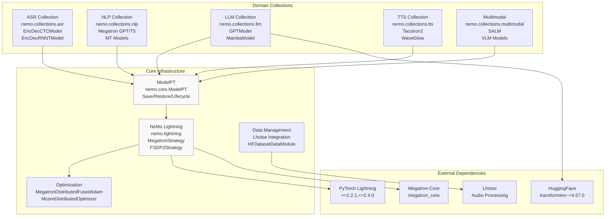
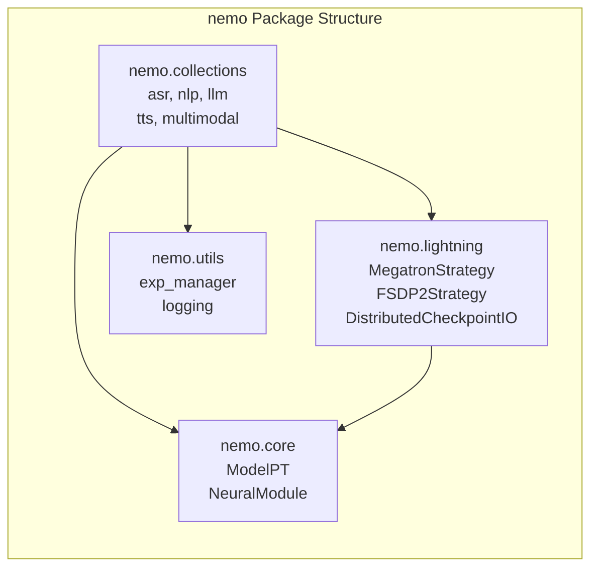
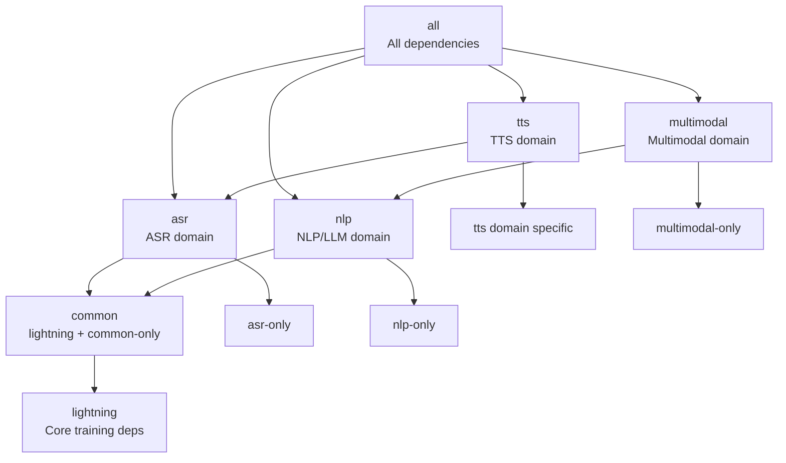
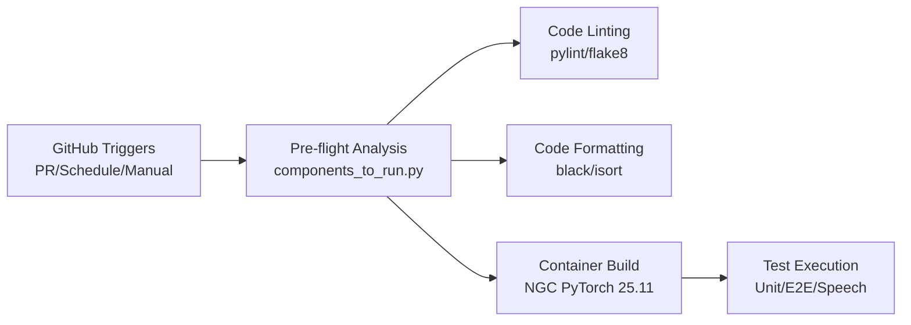

<!-- source: DeepWiki mcp.deepwiki.com · repo NVIDIA/NeMo · page 1.1 Framework Overview and Installation · fetched 2026-10-21 -->

# Framework Overview and Installation

<details>
<summary>Relevant source files</summary>

The following files were used as context for generating this wiki page:

- [.dockerignore](.dockerignore)
- [.flake8](.flake8)
- [.flake8.other](.flake8.other)
- [.flake8.speech](.flake8.speech)
- [.github/workflows/cicd-main-nemo2.yml](.github/workflows/cicd-main-nemo2.yml)
- [.github/workflows/cicd-main-speech.yml](.github/workflows/cicd-main-speech.yml)
- [.github/workflows/cicd-relabel-bot.yml](.github/workflows/cicd-relabel-bot.yml)
- [.github/workflows/code-formatting.yml](.github/workflows/code-formatting.yml)
- [.github/workflows/code-linting.yml](.github/workflows/code-linting.yml)
- [.pre-commit-config.yaml](.pre-commit-config.yaml)
- [.pylintrc](.pylintrc)
- [.pylintrc.other](.pylintrc.other)
- [.pylintrc.speech](.pylintrc.speech)
- [examples/asr/asr_cache_aware_streaming/speech_to_text_cache_aware_streaming_infer.py](examples/asr/asr_cache_aware_streaming/speech_to_text_cache_aware_streaming_infer.py)
- [examples/llm/resiliency/README.md](examples/llm/resiliency/README.md)
- [examples/llm/resiliency/crash_simulator.py](examples/llm/resiliency/crash_simulator.py)
- [examples/llm/resiliency/preemption_simulator.py](examples/llm/resiliency/preemption_simulator.py)
- [examples/llm/resiliency/resiliency-in-pretraining-demo.ipynb](examples/llm/resiliency/resiliency-in-pretraining-demo.ipynb)
- [nemo/collections/llm/gpt/model/hf_llama_embedding.py](nemo/collections/llm/gpt/model/hf_llama_embedding.py)
- [nemo/collections/llm/recipes/callbacks/__init__.py](nemo/collections/llm/recipes/callbacks/__init__.py)
- [nemo/collections/llm/recipes/callbacks/common.py](nemo/collections/llm/recipes/callbacks/common.py)
- [nemo/lightning/one_logger_callback.py](nemo/lightning/one_logger_callback.py)
- [pyproject.toml](pyproject.toml)
- [requirements/requirements.txt](requirements/requirements.txt)
- [requirements/requirements_lightning.txt](requirements/requirements_lightning.txt)
- [requirements/requirements_nlp.txt](requirements/requirements_nlp.txt)
- [requirements/requirements_test.txt](requirements/requirements_test.txt)
- [setup.py](setup.py)
- [tests/functional_tests/L2_NeMo_2_LLAMA4_ENERGON_FINETUNE_EP2.sh](tests/functional_tests/L2_NeMo_2_LLAMA4_ENERGON_FINETUNE_EP2.sh)
- [tests/functional_tests/L2_NeMo_2_LLAMA4_MOCK_FINETUNE_CP2.sh](tests/functional_tests/L2_NeMo_2_LLAMA4_MOCK_FINETUNE_CP2.sh)
- [tests/functional_tests/L2_NeMo_2_LLAMA4_MOCK_FINETUNE_PP2.sh](tests/functional_tests/L2_NeMo_2_LLAMA4_MOCK_FINETUNE_PP2.sh)
- [tests/functional_tests/L2_NeMo_2_MLLAMA_ENERGON_FINETUNE_TP2.sh](tests/functional_tests/L2_NeMo_2_MLLAMA_ENERGON_FINETUNE_TP2.sh)
- [tests/functional_tests/L2_NeMo_2_MLLAMA_IMPORT.sh](tests/functional_tests/L2_NeMo_2_MLLAMA_IMPORT.sh)
- [tests/functional_tests/L2_NeMo_2_MLLAMA_MOCK_FINETUNE_TP2.sh](tests/functional_tests/L2_NeMo_2_MLLAMA_MOCK_FINETUNE_TP2.sh)
- [tests/functional_tests/L2_NeMo_2_MLLAMA_PRELOADED_FINETUNE_TP2.sh](tests/functional_tests/L2_NeMo_2_MLLAMA_PRELOADED_FINETUNE_TP2.sh)
- [tests/functional_tests/L2_NeMo_2_QWEN2VL_PRELOADED_FINETUNE_TP2.sh](tests/functional_tests/L2_NeMo_2_QWEN2VL_PRELOADED_FINETUNE_TP2.sh)
- [tests/functional_tests/L2_Speech_Transcription_Speech_to_Text_Cache_Aware_Infer.sh](tests/functional_tests/L2_Speech_Transcription_Speech_to_Text_Cache_Aware_Infer.sh)
- [tests/functional_tests/L2_Speech_Transcription_Speech_to_Text_Streaming_Infer.sh](tests/functional_tests/L2_Speech_Transcription_Speech_to_Text_Streaming_Infer.sh)
- [tests/lightning/test_one_logger_callback.py](tests/lightning/test_one_logger_callback.py)

</details>


## Purpose and Scope

This document provides an overview of the NeMo framework architecture and installation procedures. It covers the high-level system design, domain collections, core infrastructure components, and dependency management including optional domain-specific packages. For details on core model abstractions and the `ModelPT` base class, see [Core Model Classes and Interfaces](#1.2). For experiment management and training orchestration, see [Experiment Management and Training](#1.3).

---

## NeMo Framework Architecture

NeMo (Neural Modules) is a toolkit for conversational AI that provides pre-built components and training recipes for Automatic Speech Recognition (ASR), Natural Language Processing (NLP), Large Language Models (LLMs), Text-to-Speech (TTS), and Multimodal models. The framework is built on PyTorch Lightning and integrates deeply with NVIDIA's Megatron-Core for distributed training.

### High-Level System Structure



**Architecture Layers**: NeMo follows a layered architecture where domain-specific collections (ASR, NLP, LLM, TTS, Multimodal) build upon the `ModelPT` base class from `nemo.core`. The core infrastructure layer provides Lightning-based distributed training strategies, data loading systems, and optimization components. All components integrate with external frameworks including PyTorch Lightning for training orchestration, Megatron-Core for model parallelism, HuggingFace for model interoperability, and Lhotse for audio processing.

**Sources**: [Diagram 1 from high-level architecture](), [setup.py:68-146](), [requirements/requirements_lightning.txt:1-13]()

### Domain Collections and Package Structure

NeMo organizes functionality into domain-specific collections, each with specialized models, data loaders, and utilities:

| Collection | Package Path | Primary Models | Purpose |
|------------|--------------|----------------|---------|
| **ASR** | `nemo.collections.asr` | `EncDecCTCModel`, `EncDecRNNTModel`, `EncDecMultiTaskModel` | Speech recognition and transcription |
| **NLP** | `nemo.collections.nlp` | `MegatronGPTModel`, `MegatronT5Model`, NMT models | Language understanding and generation |
| **LLM** | `nemo.collections.llm` | `GPTModel`, `MambaModel`, `HFAutoModelForCausalLM` | Large language model training and inference |
| **TTS** | `nemo.collections.tts` | `Tacotron2Model`, `WaveGlowModel`, G2P modules | Speech synthesis |
| **Multimodal** | `nemo.collections.multimodal` | `SALM`, VLM models | Vision-language and audio-language models |
| **Common** | `nemo.collections.common` | Data processing, callbacks | Shared utilities across collections |

**Sources**: [Diagram 1 from high-level architecture](), [setup.py:76-82]()

---

## Core Infrastructure Components

### Package Organization



**Sources**: [setup.py:273](), [pyproject.toml:64]()

### Key Infrastructure Abstractions

#### ModelPT Base Class
- **Location**: `nemo.core.ModelPT`
- **Purpose**: Base class for all NeMo models providing save/restore, config management, and lifecycle hooks
- **Integration**: Interfaces with PyTorch Lightning's `LightningModule` for training orchestration
- See [Core Model Classes and Interfaces](#1.2) for details

#### Lightning Integration
- **Location**: `nemo.lightning`
- **Components**:
  - `MegatronStrategy`: Distributed training with tensor/pipeline/context parallelism
  - `FSDP2Strategy`: PyTorch native Fully Sharded Data Parallel
  - `DistributedCheckpointIO`: Async checkpoint save/load
- **Dependency**: Requires `lightning>2.2.1,<=2.4.0` ([requirements_lightning.txt:4]())

#### Data Management
- **Lhotse Integration**: Audio processing via `LazyNeMoIterator` and `CutSet` for ASR/TTS
- **HuggingFace Datasets**: `HFDatasetDataModule` for LLM training
- **Bucketing**: Dynamic batching with 2D constraints (audio duration × token length)

#### Optimization
- **MegatronDistributedFusedAdam**: FP8-capable optimizer with distributed state
- **McoreDistributedOptimizer**: ZeRO-style optimizer state sharding
- **Mixed Precision**: AMP support with FP16/BF16/FP8 via Transformer Engine

**Sources**: [Diagram 2 from high-level architecture](), [requirements/requirements_lightning.txt:1-13](), [requirements/requirements_nlp.txt:12-13]()

---

## Installation

### System Requirements

| Requirement | Specification |
|-------------|---------------|
| **Python Version** | `>=3.10` |
| **Operating System** | Linux (primary), macOS (limited support) |
| **GPU Support** | NVIDIA GPUs with CUDA 11.8+ (for GPU acceleration) |
| **Package Manager** | pip |

**Sources**: [setup.py:274](), [pyproject.toml:25]()

### Core Dependencies

The base NeMo installation requires the following packages ([requirements/requirements.txt]()):

```
fsspec==2024.12.0
huggingface_hub>=0.24
numba-cuda==0.15.1 (Linux only)
numpy>=1.22
onnx>=1.7.0
protobuf~=5.29.5
torch
tqdm>=4.41.0
setuptools>=70.0.0
```

**Sources**: [requirements/requirements.txt:1-21]()

### Installation Methods

#### Basic Installation

```bash
# Install base NeMo toolkit
pip install nemo-toolkit
```

This installs only core dependencies without domain-specific packages.

#### Installation with Domain Collections

NeMo uses `extras_require` groups defined in [setup.py:68-146]() to provide optional dependencies for specific domains:

```bash
# ASR (Automatic Speech Recognition)
pip install nemo-toolkit[asr]

# NLP/LLM (Natural Language Processing / Large Language Models)
pip install nemo-toolkit[nlp]
# or
pip install nemo-toolkit[llm]

# TTS (Text-to-Speech)
pip install nemo-toolkit[tts]

# Multimodal
pip install nemo-toolkit[multimodal]

# All domains
pip install nemo-toolkit[all]
```

#### Domain-Specific Dependency Hierarchy



**Dependency Resolution Logic**: The extras system uses composition, where higher-level domains inherit dependencies from lower levels. For example, `tts` depends on `asr` because TTS models often use ASR components for alignment ([setup.py:119-125]()).

**Sources**: [setup.py:68-146]()

### Domain-Specific Dependencies

#### ASR Dependencies
Key packages in `requirements_asr.txt`:
- **Lhotse**: Audio data processing and augmentation
- **k2**: Finite state transducer operations
- **kaldifeat**: Feature extraction
- **pynini**: Weighted finite-state transducers

#### NLP/LLM Dependencies
Key packages in `requirements_nlp.txt` ([requirements/requirements_nlp.txt:1-29]()):
- **megatron_core**: Model parallelism primitives
- **nvidia-modelopt==0.37.0**: Model optimization (quantization, pruning)
- **nvidia-resiliency-ext>=0.3.0**: Fault tolerance and straggler detection
- **transformers~=4.57.0**: HuggingFace model integration
- **tiktoken==0.7.0**: Tokenization
- **tensorstore<0.1.72**: Distributed checkpoint storage
- **accelerated-scan**: Mamba/SSM model support

#### Lightning Dependencies
Core training dependencies from `requirements_lightning.txt` ([requirements/requirements_lightning.txt:1-13]()):
- **lightning>2.2.1,<=2.4.0**: PyTorch Lightning training framework
- **hydra-core>1.3,<=1.3.2**: Configuration management
- **omegaconf<=2.3**: Configuration object system
- **peft**: Parameter-efficient fine-tuning
- **transformers~=4.57.0**: HuggingFace integration
- **nv_one_logger_***: NVIDIA telemetry and logging

**Sources**: [requirements/requirements_nlp.txt:1-29](), [requirements/requirements_lightning.txt:1-13]()

---

## Development and Testing Setup

### Installing for Development

For contributors and developers:

```bash
# Clone repository
git clone https://github.com/NVIDIA/NeMo
cd NeMo

# Install in editable mode with all dependencies
pip install -e ".[all]"

# Install test dependencies
pip install -e ".[test]"
```

Test dependencies include ([requirements/requirements_test.txt:1-16]()):
- **pytest**: Test framework
- **black~=24.3**: Code formatting
- **isort>5.1.0,<6.0.0**: Import sorting
- **pylint**: Code linting
- **coverage**: Code coverage measurement

### Code Quality Tools

NeMo enforces code quality through automated checks:

#### Formatting
- **Black** (line length: 119): Automatic code formatting ([pyproject.toml:85-116]())
- **isort**: Import statement organization ([pyproject.toml:73-82]())

Configuration in `pyproject.toml`:
```
[tool.black]
line_length = 119
required_version = "24"
target-version = ['py310', 'py311', 'py312']

[tool.isort]
profile = "black"
line_length = 119
py_version = 310
```

#### Linting
- **pylint**: Python code analysis
- **flake8**: Style guide enforcement

Separate configurations for speech and non-speech domains:
- `.pylintrc.speech` for ASR/TTS/Audio collections ([.pylintrc.speech:1-10]())
- `.pylintrc.other` for remaining code ([.pylintrc.other:1-13]())

**Sources**: [pyproject.toml:73-116](), [requirements/requirements_test.txt:1-16](), [.pre-commit-config.yaml:15-53]()

### CI/CD Pipeline Integration

NeMo uses GitHub Actions for continuous integration:



Key workflows:
- **code-linting.yml**: Runs pylint/flake8 on changed files ([.github/workflows/code-linting.yml:1-161]())
- **code-formatting.yml**: Applies black/isort formatting ([.github/workflows/code-formatting.yml:1-74]())
- **cicd-main-speech.yml**: ASR/TTS/Audio tests ([.github/workflows/cicd-main-speech.yml:1-219]())
- **cicd-main-nemo2.yml**: LLM/Multimodal tests ([.github/workflows/cicd-main-nemo2.yml:1-301]())

**Sources**: [.github/workflows/code-linting.yml:1-161](), [.github/workflows/code-formatting.yml:1-74](), [.github/workflows/cicd-main-speech.yml:14-32](), [.github/workflows/cicd-main-nemo2.yml:14-32]()

---

## Package Metadata and Configuration

### Package Information

The NeMo package is configured through both `setup.py` (legacy) and `pyproject.toml` (modern):

| Property | Value |
|----------|-------|
| **Package Name** | `nemo-toolkit` |
| **License** | Apache License 2.0 |
| **Python Support** | 3.10, 3.11, 3.12 (planned) |
| **Development Status** | Production/Stable |
| **Entry Points** | `nemo_run.cli` → `nemo.collections.llm` |

**Sources**: [setup.py:221-295](), [pyproject.toml:19-71]()

### Build System

From `pyproject.toml` ([pyproject.toml:15-17]()):
```toml
[build-system]
requires = ["setuptools >= 61.0"]
build-backend = "setuptools.build_meta"
```

The package uses `setuptools` for building and distribution.

### Environment Variables

Key environment variables for NeMo operation:

| Variable | Purpose | Example |
|----------|---------|---------|
| `TRANSFORMERS_OFFLINE` | Disable HuggingFace online access | `"1"` |
| `WORLD_SIZE` | Number of distributed processes | `"8"` |
| `RANK` | Current process rank | `"0"` |
| `CUDA_VISIBLE_DEVICES` | GPU device selection | `"0,1,2,3"` |
| `NCCL_*` | NCCL communication settings | Various |

**Sources**: [examples/llm/resiliency/resiliency-in-pretraining-demo.ipynb:141-146](), [nemo/lightning/one_logger_callback.py:47-64]()

---

## Advanced Installation Topics

### Platform-Specific Considerations

#### macOS Support
- **numba**: Uses standard `numba` package instead of `numba-cuda` ([requirements/requirements.txt:3-4]())
- **CUDA packages**: Not available on macOS (Darwin platform)
- **tensorstore**: Not supported on macOS ([requirements/requirements_nlp.txt:26]())

#### GPU Optimization
For optimal GPU performance, install NVIDIA-specific packages:
- **nvidia-modelopt**: Model quantization and pruning ([requirements/requirements_nlp.txt:16]())
- **nvidia-resiliency-ext**: Fault tolerance features ([requirements/requirements_nlp.txt:17]())
- **Apex**: Mixed precision utilities (external dependency)
- **Transformer Engine**: FP8 kernel acceleration (external dependency)

### Container-Based Deployment

NeMo provides Docker containers for reproducible environments:

**NGC PyTorch Container**: Base image for CI/CD builds
- Version: 25.11
- Includes: PyTorch, CUDA, cuDNN, NCCL, Apex, Transformer Engine
- Used in: [.github/workflows/_build_container.yml]()

**Sources**: [.github/workflows/cicd-main-nemo2.yml:31-32](), [.dockerignore:1-20]()

### Dependency Version Pinning

NeMo uses specific version constraints to ensure compatibility:

| Package | Version Constraint | Reason |
|---------|-------------------|--------|
| `lightning` | `>2.2.1,<=2.4.0` | API compatibility |
| `transformers` | `~=4.57.0` | Model format compatibility |
| `hydra-core` | `>1.3,<=1.3.2` | Config system stability |
| `omegaconf` | `<=2.3` | Config compatibility |
| `protobuf` | `~=5.29.5` | PyTorch requirement alignment |

**Sources**: [requirements/requirements_lightning.txt:3-8](), [requirements/requirements.txt:10]()

---

## Summary

NeMo provides a comprehensive toolkit for conversational AI with modular domain collections, robust core infrastructure, and flexible installation options. The framework integrates tightly with PyTorch Lightning for training, Megatron-Core for distributed computing, and HuggingFace for model interoperability. Installation can be tailored to specific use cases through the extras system, enabling efficient dependency management for ASR, NLP, LLM, TTS, or multimodal applications.

For next steps:
- Learn about core model abstractions: [Core Model Classes and Interfaces](#1.2)
- Understand training orchestration: [Experiment Management and Training](#1.3)
- Explore distributed training: [Distributed Training Infrastructure](#2)
- Dive into specific domains: [Large Language Models](#3), [Automatic Speech Recognition](#4)

**Sources**: [setup.py:1-296](), [pyproject.toml:1-152](), All requirements files

---

