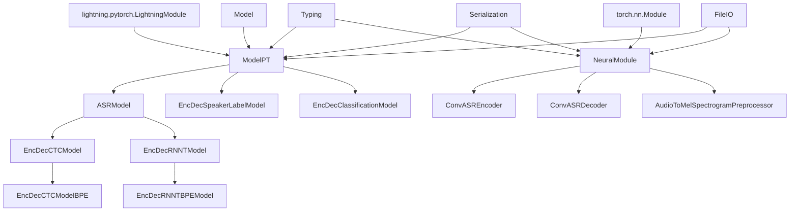
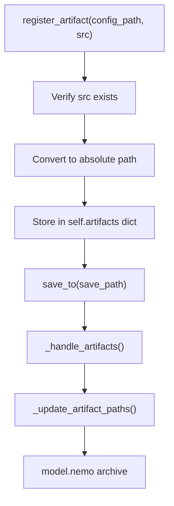
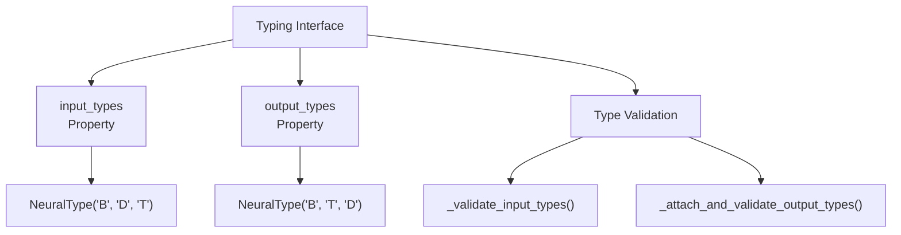
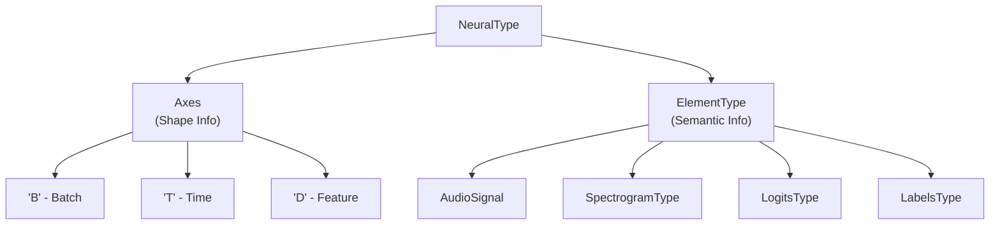
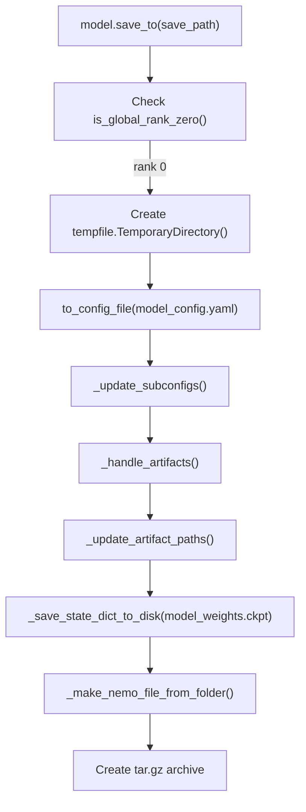
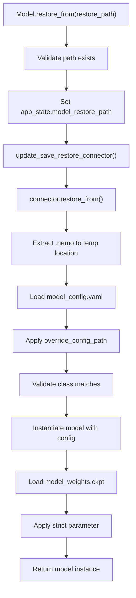

<!-- source: DeepWiki mcp.deepwiki.com · repo NVIDIA/NeMo · page 1.2 Core Model Classes and Interfaces · fetched 2026-10-21 -->

# Core Model Classes and Interfaces

<details>
<summary>Relevant source files</summary>

The following files were used as context for generating this wiki page:

- [docs/source/asr/data/benchmark_en.csv](docs/source/asr/data/benchmark_en.csv)
- [docs/source/asr/data/benchmark_zh.csv](docs/source/asr/data/benchmark_zh.csv)
- [examples/asr/transcribe_speech_parallel.py](examples/asr/transcribe_speech_parallel.py)
- [nemo/collections/asr/data/audio_to_label.py](nemo/collections/asr/data/audio_to_label.py)
- [nemo/collections/asr/data/audio_to_text.py](nemo/collections/asr/data/audio_to_text.py)
- [nemo/collections/asr/data/audio_to_text_dataset.py](nemo/collections/asr/data/audio_to_text_dataset.py)
- [nemo/collections/asr/models/classification_models.py](nemo/collections/asr/models/classification_models.py)
- [nemo/collections/asr/models/configs/asr_models_config.py](nemo/collections/asr/models/configs/asr_models_config.py)
- [nemo/collections/asr/models/ctc_bpe_models.py](nemo/collections/asr/models/ctc_bpe_models.py)
- [nemo/collections/asr/models/ctc_models.py](nemo/collections/asr/models/ctc_models.py)
- [nemo/collections/asr/models/hybrid_rnnt_ctc_bpe_models.py](nemo/collections/asr/models/hybrid_rnnt_ctc_bpe_models.py)
- [nemo/collections/asr/models/hybrid_rnnt_ctc_models.py](nemo/collections/asr/models/hybrid_rnnt_ctc_models.py)
- [nemo/collections/asr/models/label_models.py](nemo/collections/asr/models/label_models.py)
- [nemo/collections/asr/models/rnnt_bpe_models.py](nemo/collections/asr/models/rnnt_bpe_models.py)
- [nemo/collections/asr/models/rnnt_models.py](nemo/collections/asr/models/rnnt_models.py)
- [nemo/collections/asr/models/transformer_bpe_models.py](nemo/collections/asr/models/transformer_bpe_models.py)
- [nemo/core/classes/common.py](nemo/core/classes/common.py)
- [nemo/core/classes/mixins/hf_io_mixin.py](nemo/core/classes/mixins/hf_io_mixin.py)
- [nemo/core/classes/modelPT.py](nemo/core/classes/modelPT.py)
- [nemo/core/config/templates/__init__.py](nemo/core/config/templates/__init__.py)
- [nemo/core/config/templates/model_card.py](nemo/core/config/templates/model_card.py)
- [nemo/core/connectors/save_restore_connector.py](nemo/core/connectors/save_restore_connector.py)
- [nemo/utils/model_utils.py](nemo/utils/model_utils.py)
- [tests/collections/asr/test_asr_ctc_encoder_model_bpe.py](tests/collections/asr/test_asr_ctc_encoder_model_bpe.py)
- [tests/collections/asr/test_asr_ctcencdec_model.py](tests/collections/asr/test_asr_ctcencdec_model.py)
- [tests/collections/asr/test_asr_hybrid_rnnt_ctc_model_bpe.py](tests/collections/asr/test_asr_hybrid_rnnt_ctc_model_bpe.py)
- [tests/collections/asr/test_asr_hybrid_rnnt_ctc_model_char.py](tests/collections/asr/test_asr_hybrid_rnnt_ctc_model_char.py)
- [tests/collections/asr/test_asr_modules.py](tests/collections/asr/test_asr_modules.py)
- [tests/core/test_fileio.py](tests/core/test_fileio.py)
- [tests/core/test_save_restore.py](tests/core/test_save_restore.py)
- [tests/core/test_serialization.py](tests/core/test_serialization.py)
- [tests/core/test_typecheck.py](tests/core/test_typecheck.py)

</details>


This document covers the fundamental base classes and interfaces that form the foundation of all NeMo models and neural modules. These abstractions provide consistent APIs for model configuration, type checking, serialization, and lifecycle management across all NeMo collections.

For information about experiment management and training workflows, see [Experiment Management and Training](#1.3). For details about specific model architectures and collections, see [Large Language Models (LLMs)](#2), [Automatic Speech Recognition (ASR)](#3), and [Natural Language Processing (NLP)](#4).

## Class Hierarchy Overview

NeMo's core architecture is built around an inheritance hierarchy where all models extend `ModelPT`, which combines PyTorch Lightning's `LightningModule` with NeMo-specific interfaces:



**Sources:** [nemo/core/classes/modelPT.py:65](), [nemo/core/classes/common.py:274-287](), [nemo/collections/asr/models/ctc_models.py:49](), [nemo/collections/asr/models/ctc_bpe_models.py:39](), [nemo/collections/asr/models/rnnt_models.py:53](), [nemo/collections/asr/models/rnnt_bpe_models.py:38](), [nemo/collections/asr/models/label_models.py:57](), [nemo/collections/asr/models/classification_models.py:64]()

## ModelPT: The Foundation Class

`ModelPT` (defined in [nemo/core/classes/modelPT.py:65]()) is the base class for all NeMo models. It extends `lightning.pytorch.LightningModule` and implements the `Model`, `Typing`, `Serialization`, and `FileIO` interfaces.

### Key Responsibilities

```mermaid
graph TD
    ModelPT["ModelPT"]
    
    Config["Configuration Management"]
    SaveRestore["Save/Restore"]
    Artifacts["Artifact Registration"]
    Submodules["Nested Models"]
    Optimization["Optimizer/Scheduler Setup"]
    DataLoaders["DataLoader Setup"]
    
    ModelPT --> Config
    ModelPT --> SaveRestore
    ModelPT --> Artifacts
    ModelPT --> Submodules
    ModelPT --> Optimization
    ModelPT --> DataLoaders
    
    Config --> to_config_dict["to_config_dict()"]
    Config --> to_config_file["to_config_file()"]
    Config --> from_config_dict["from_config_dict()"]
    
    SaveRestore --> save_to["save_to(save_path)"]
    SaveRestore --> restore_from["restore_from(restore_path)"]
    SaveRestore --> load_from_checkpoint["load_from_checkpoint()"]
    
    Artifacts --> register_artifact["register_artifact(config_path, src)"]
    Artifacts --> has_artifacts["has_artifacts()"]
    Artifacts --> has_native_or_submodules_artifacts["has_native_or_submodules_artifacts()"]
    
    Submodules --> register_nemo_submodule["register_nemo_submodule(name, config_field, model)"]
    Submodules --> named_nemo_modules["named_nemo_modules()"]
    Submodules --> has_nemo_submodules["has_nemo_submodules()"]
    
    Optimization --> setup_optimization["setup_optimization(optim_config)"]
    Optimization --> setup_optimizer_param_groups["setup_optimizer_param_groups()"]
    Optimization --> configure_optimizers["configure_optimizers()"]
    
    DataLoaders --> setup_training_data["setup_training_data(config)"]
    DataLoaders --> setup_validation_data["setup_validation_data(config)"]
    DataLoaders --> setup_test_data["setup_test_data(config)"]
    DataLoaders --> setup_multiple_validation_data["setup_multiple_validation_data(config)"]
    DataLoaders --> setup_multiple_test_data["setup_multiple_test_data(config)"]
```



### Abstract Methods

Subclasses must implement these abstract methods defined in [nemo/core/classes/modelPT.py:554-587]():

| Method | Signature | Purpose |
|--------|-----------|---------|
| `setup_training_data` | `(train_data_config: Union[DictConfig, Dict])` | Configure training data loader |
| `setup_validation_data` | `(val_data_config: Union[DictConfig, Dict])` | Configure validation data loader |
| `setup_test_data` | `(test_data_config: Union[DictConfig, Dict])` | Configure test data loader (optional) |

**Sources:** [nemo/core/classes/modelPT.py:65-236](), [nemo/core/classes/modelPT.py:554-587]()

### Configuration Management

`ModelPT` models use OmegaConf `DictConfig` objects for configuration. The config is stored in `self._cfg` and contains model architecture, training parameters, and dataset configurations.

#### Configuration Structure

```mermaid
graph LR
    YAMLFile["model_config.yaml"]
    OmegaConfLoad["OmegaConf.load()"]
    DictConfig["DictConfig"]
    ModelInit["ModelPT.__init__(cfg, trainer)"]
    ModelInstance["Model Instance<br/>self._cfg stored"]
    
    YAMLFile --> OmegaConfLoad
    OmegaConfLoad --> DictConfig
    DictConfig --> ModelInit
    ModelInit --> ModelInstance
    
    ModelInstance --> to_config_dict["to_config_dict()"]
    to_config_dict --> SerializedConfig["Dict/DictConfig"]
    SerializedConfig --> from_config_dict["from_config_dict(config)"]
    from_config_dict --> NewModel["New Model Instance"]
```



The constructor [nemo/core/classes/modelPT.py:70-160]() performs these steps:
1. Converts config to `DictConfig` using `model_utils.convert_model_config_to_dict_config()`
2. Updates config version with `model_utils.maybe_update_config_version()`
3. Validates that `'model'` key is not in config (reserved for internal use)
4. Adds `'target'` field pointing to the class path if not present
5. Adds `'nemo_version'` field with package version
6. Saves config to `self._cfg` and hyperparameters with `self.save_hyperparameters("cfg")`

**Sources:** [nemo/core/classes/modelPT.py:70-160](), [nemo/core/classes/common.py:589-643](), [nemo/utils/model_utils.py:80-92]()

### Artifact Management

Models can register external files (e.g., tokenizers, vocabularies) that are packaged when saving to `.nemo` format.

#### Artifact Registration Flow



| Method | Signature | Purpose |
|--------|-----------|---------|
| `register_artifact` | `(config_path: str, src: str, verify_src_exists: bool = True)` | Register file to include in `.nemo` save |
| `has_artifacts` | `() -> bool` | Returns True if model has artifacts |
| `has_native_or_submodules_artifacts` | `() -> bool` | Checks artifacts in model and submodules |

Artifacts are stored in `self.artifacts` dictionary mapping config paths to `ArtifactItem` objects. The `register_artifact()` method [nemo/core/classes/modelPT.py:246-305]():
- Returns absolute path that exists during model lifetime
- Handles `nemo_file:` prefixed paths by extracting from archive
- Validates file existence if `verify_src_exists=True`
- Raises `NeMoBaseException` if registering `.nemo` files (use `register_nemo_submodule()` instead)

**Sources:** [nemo/core/classes/modelPT.py:246-325](), [nemo/core/connectors/save_restore_connector.py:52-94](), [nemo/utils/model_utils.py:63-68]()

## NeuralModule: Base Neural Component

`NeuralModule` serves as the base class for individual neural network components like encoders, decoders, and preprocessors. It extends `torch.nn.Module` while adding NeMo's type checking and serialization capabilities.

### Key Features

| Feature | Description |
|---------|-------------|
| Neural Type Checking | Validates input/output tensor types and shapes |
| Serialization | Save/restore module configurations |
| Weight Counting | Utility for counting trainable parameters |
| Input Examples | Generate sample inputs for tracing/export |

**Sources:** [nemo/core/classes/module.py:26-150]()

## Core Interfaces

NeMo models implement several key interfaces that provide consistent functionality across the framework:

### Typing Interface

The `Typing` interface enables neural type checking through `input_types` and `output_types` properties:



Example implementation:
```python
@property
def input_types(self):
    return {
        "audio_signal": NeuralType(('B', 'D', 'T'), SpectrogramType()),
        "length": NeuralType(tuple('B'), LengthsType()),
    }

@property  
def output_types(self):
    return {
        "outputs": NeuralType(('B', 'D', 'T'), AcousticEncodedRepresentation()),
        "encoded_lengths": NeuralType(tuple('B'), LengthsType()),
    }
```

**Sources:** [nemo/core/classes/common.py:213-524](), [nemo/collections/asr/modules/conv_asr.py:87-104]()

### Serialization Interface

Provides `from_config_dict()` class method for instantiating objects from configuration dictionaries with support for both Hydra 0.x and 1.x formats.

**Sources:** [nemo/core/classes/common.py:526-591]()

### FileIO Interface  

Enables saving and loading models with `save_to()` and `restore_from()` methods, supporting various storage backends and model formats.

**Sources:** [nemo/core/classes/common.py:593-1156]()

## Neural Type System

NeMo's neural type system provides runtime type checking for tensor inputs and outputs, helping catch shape and semantic mismatches during development:



The type system supports:
- **Shape validation**: Ensures tensor dimensions match expected patterns
- **Semantic checking**: Validates that tensor contents match expected types
- **Container support**: Handles nested lists/tuples of tensors
- **Optional parameters**: Allows flexible argument specifications

**Sources:** [nemo/core/classes/common.py:126-524](), [nemo/core/neural_types/__init__.py:1-17]()

## Model Save and Restore Mechanism

NeMo uses the `SaveRestoreConnector` class to package models into `.nemo` archive files containing configuration, weights, and artifacts.

### Save Process



The `.nemo` file structure:
```
model.nemo (tar.gz archive)
├── model_config.yaml      # Model configuration
├── model_weights.ckpt     # PyTorch state_dict
└── [artifacts]/           # Registered artifacts (tokenizers, etc.)
```

Key methods in [nemo/core/classes/modelPT.py:404-442]():
- `save_to(save_path: str)` - Main entry point, only executes on rank 0
- Checks `app_state.model_parallel_size` for distributed settings
- Uses `SaveRestoreConnector` which can be overridden for custom behavior

### Restore Process



The `restore_from()` classmethod [nemo/core/classes/modelPT.py:444-514]() accepts:
- `restore_path` - Path to `.nemo` file
- `override_config_path` - Optional config override (yaml file or DictConfig)
- `map_location` - torch.device for loading (default: GPU if available, else CPU)
- `strict` - Passed to `load_state_dict()` (default: True)
- `return_config` - If True, returns only config without instantiating model
- `trainer` - Optional Trainer forwarded to model constructor
- `save_restore_connector` - Custom SaveRestoreConnector instance

**Sources:** [nemo/core/classes/modelPT.py:404-514](), [nemo/core/connectors/save_restore_connector.py:52-445]()

## Integration with PyTorch Lightning

ModelPT extends PyTorch Lightning's `LightningModule` to leverage Lightning's training infrastructure while adding NeMo-specific features:

| Lightning Feature | NeMo Enhancement |
|------------------|------------------|
| `training_step()` | Wrapped for automatic logging |
| `configure_optimizers()` | Extended optimizer setup with schedulers |
| Checkpointing | Enhanced with `.nemo` format support |
| Multi-GPU training | Integrated with NeMo's distributed strategies |
| Callbacks | Custom callbacks for NeMo-specific functionality |

**Sources:** [nemo/core/classes/modelPT.py:889-924](), [nemo/utils/exp_manager.py:443-1190]()

---

