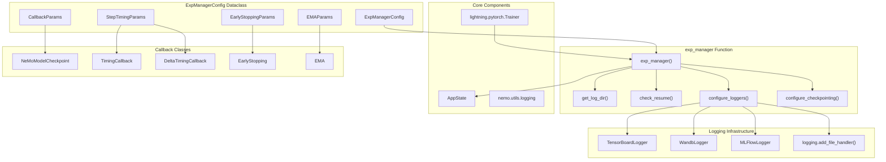
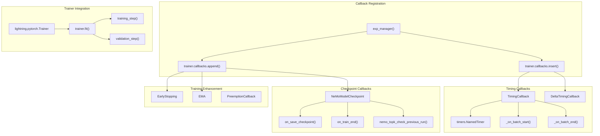
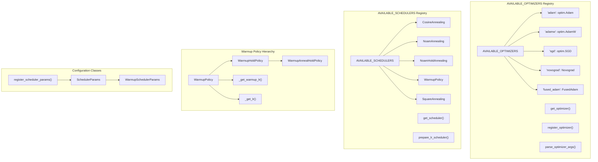
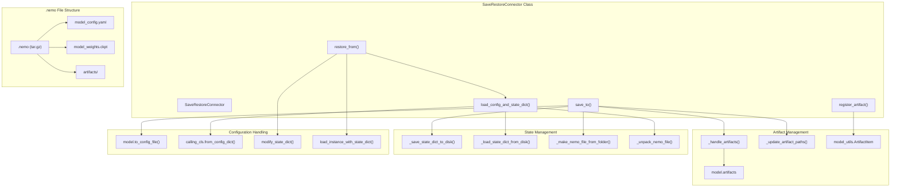
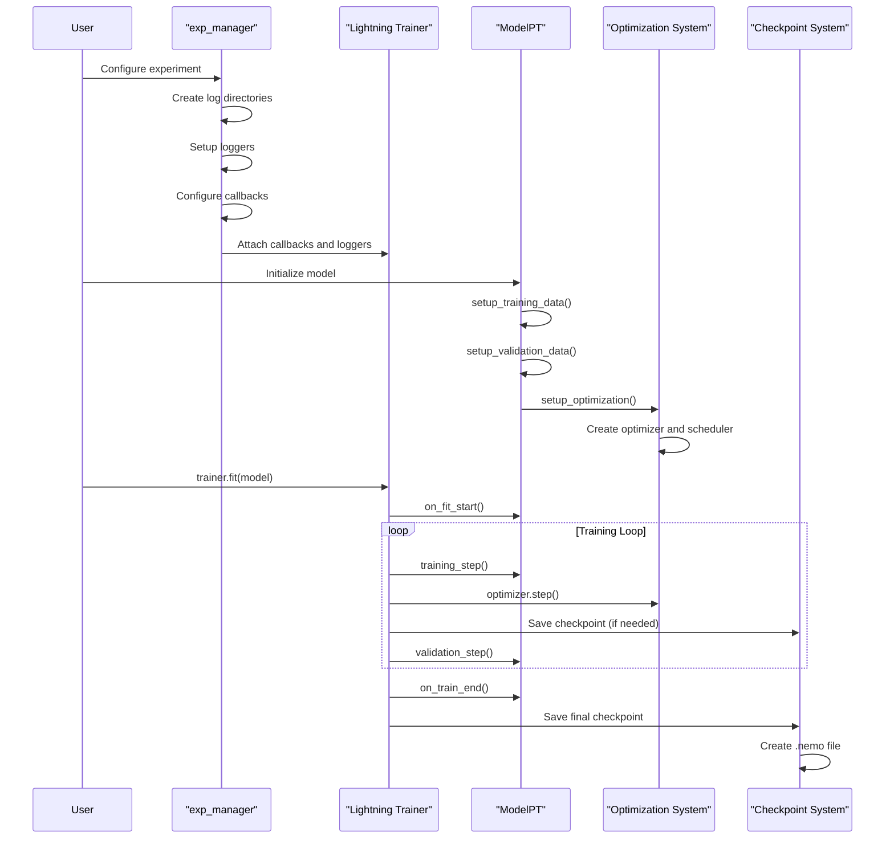

<!-- source: DeepWiki mcp.deepwiki.com · repo NVIDIA/NeMo · page 1.3 Experiment Management and Training · fetched 2026-10-21 -->

# Experiment Management and Training

<details>
<summary>Relevant source files</summary>

The following files were used as context for generating this wiki page:

- [nemo/utils/callbacks/__init__.py](nemo/utils/callbacks/__init__.py)
- [nemo/utils/callbacks/nemo_model_checkpoint.py](nemo/utils/callbacks/nemo_model_checkpoint.py)
- [nemo/utils/callbacks/preemption.py](nemo/utils/callbacks/preemption.py)
- [nemo/utils/exp_manager.py](nemo/utils/exp_manager.py)
- [tests/collections/tts/conftest.py](tests/collections/tts/conftest.py)
- [tests/conftest.py](tests/conftest.py)
- [tests/core/test_exp_manager.py](tests/core/test_exp_manager.py)

</details>


This document covers NeMo's experiment management and training orchestration, focusing on the `exp_manager` system, save/restore functionality, and training lifecycle management. The infrastructure provides unified configuration for logging, checkpointing, optimization, and artifact management across all NeMo model types.

For core model classes, see [Core Model Classes and Interfaces](1.2). For model-specific training procedures, see [Large Language Models (LLMs)](2) and [Automatic Speech Recognition (ASR)](3).

## Experiment Manager (`exp_manager`)

The `exp_manager` function in [nemo/utils/exp_manager.py:443-807]() orchestrates training experiments by configuring directories, logging, checkpointing, and callbacks. It accepts a `lightning.pytorch.Trainer` and `ExpManagerConfig` to set up the complete training environment.

**Experiment Manager Architecture**



**Key Configuration Parameters**

The `ExpManagerConfig` dataclass [nemo/utils/exp_manager.py:208-267]() defines experiment configuration:

| Parameter | Type | Description |
|-----------|------|-------------|
| `exp_dir` | `Optional[str]` | Base experiment directory |
| `name` | `Optional[str]` | Experiment name |  
| `version` | `Optional[str]` | Experiment version |
| `create_checkpoint_callback` | `bool` | Enable `NeMoModelCheckpoint` |
| `create_tensorboard_logger` | `bool` | Enable TensorBoard logging |
| `resume_if_exists` | `bool` | Resume from existing checkpoints |
| `log_step_timing` | `bool` | Enable step timing callbacks |

Sources: [nemo/utils/exp_manager.py:443-807](), [nemo/utils/exp_manager.py:208-267](), [nemo/utils/exp_manager.py:269-383](), [nemo/utils/exp_manager.py:385-441]()

## Training Orchestration and Callbacks

The training orchestration system centers on PyTorch Lightning integration with NeMo-specific callbacks and timing infrastructure.

**Training Callback System**



**Timing Infrastructure**

The `TimingCallback` class [nemo/utils/exp_manager.py:269-383]() provides step timing measurement:

- `_on_batch_start()`: Initializes timing for train/validation/test steps
- `_on_batch_end()`: Records timing and logs via PyTorch Lightning
- `DeltaTimingCallback` [nemo/utils/exp_manager.py:385-441](): Alternative timing using NeMo logger to avoid Lightning overhead

**Key Callback Configuration**

| Callback | Configuration Class | Purpose |
|----------|---------------------|---------|
| `NeMoModelCheckpoint` | `CallbackParams` | Model checkpointing and `.nemo` file creation |
| `EarlyStopping` | `EarlyStoppingParams` | Training termination based on metrics |
| `TimingCallback` | `StepTimingParams` | Performance monitoring |
| `EMA` | `EMAParams` | Exponential moving average of model weights |

Sources: [nemo/utils/exp_manager.py:269-383](), [nemo/utils/exp_manager.py:385-441](), [nemo/utils/exp_manager.py:682-711](), [nemo/utils/exp_manager.py:97-115](), [nemo/utils/exp_manager.py:117-150](), [nemo/utils/exp_manager.py:152-172]()

## Optimization Infrastructure

NeMo's optimization system provides registries for optimizers and learning rate schedulers with built-in warmup, annealing, and advanced scheduling policies.

**Optimizer and Scheduler Registries**



**Key Learning Rate Schedulers**

| Scheduler Class | Base Class | Key Features |
|----------------|------------|--------------|
| `WarmupPolicy` | `_LRScheduler` | Linear warmup with configurable steps/ratio |
| `WarmupHoldPolicy` | `WarmupPolicy` | Adds hold phase after warmup |
| `CosineAnnealing` | `WarmupAnnealHoldPolicy` | Cosine decay with warmup/hold |
| `NoamAnnealing` | `_LRScheduler` | Transformer-style scheduling |
| `NoamHoldAnnealing` | `WarmupHoldPolicy` | Noam with prolonged hold phase |

**Scheduler Configuration Interface**

The `prepare_lr_scheduler()` function [nemo/core/optim/lr_scheduler.py:759-866]() creates scheduler configurations compatible with PyTorch Lightning:

```python
scheduler_setup = {
    'scheduler': scheduler_instance,
    'interval': 'step',  # or 'epoch' 
    'frequency': 1,
    'monitor': 'val_loss',
    'strict': True
}
```

Sources: [nemo/core/optim/optimizers.py:33-45](), [nemo/core/optim/optimizers.py:80-158](), [nemo/core/optim/lr_scheduler.py:39-91](), [nemo/core/optim/lr_scheduler.py:153-228](), [nemo/core/optim/lr_scheduler.py:467-516](), [nemo/core/optim/lr_scheduler.py:759-866]()

## Save/Restore System

NeMo's save/restore system provides model persistence through the `SaveRestoreConnector` and `.nemo` file format, with advanced checkpointing via the `NeMoModelCheckpoint` callback.

**SaveRestoreConnector Architecture**



**NeMoModelCheckpoint Integration**

The `NeMoModelCheckpoint` class [nemo/utils/callbacks/nemo_model_checkpoint.py:39-590]() extends PyTorch Lightning's `ModelCheckpoint`:

| Method | Purpose |
|--------|---------|
| `on_save_checkpoint()` | Saves `.nemo` files when `always_save_nemo=True` |
| `on_train_end()` | Creates final `.nemo` file if `save_nemo_on_train_end=True` |
| `nemo_topk_check_previous_run()` | Handles resume logic for existing checkpoints |
| `_format_nemo_checkpoint_name()` | Generates `.nemo` filenames |

**Key Configuration Parameters**

| Parameter | Type | Default | Description |
|-----------|------|---------|-------------|
| `save_best_model` | `bool` | `False` | Save best checkpoint as `.nemo` |
| `always_save_nemo` | `bool` | `False` | Save `.nemo` on every checkpoint |
| `save_nemo_on_train_end` | `bool` | `True` | Create `.nemo` when training ends |
| `async_save` | `bool` | `False` | Asynchronous checkpoint saving |

**Artifact Registration**

The `register_artifact()` method [nemo/core/connectors/save_restore_connector.py:361-521]() handles file dependencies:

- Copies files to temporary storage during save
- Resolves paths from `.nemo` archives during restore  
- Supports local files and `nemo_file:` URI scheme
- Manages artifact lifecycle with cleanup

Sources: [nemo/core/connectors/save_restore_connector.py:49-92](), [nemo/core/connectors/save_restore_connector.py:231-283](), [nemo/core/connectors/save_restore_connector.py:93-197](), [nemo/core/connectors/save_restore_connector.py:361-521](), [nemo/utils/callbacks/nemo_model_checkpoint.py:39-95](), [nemo/utils/callbacks/nemo_model_checkpoint.py:262-306]()

## Training Configuration and Lifecycle

The training lifecycle in NeMo involves several coordinated systems working together to manage experiments from initialization to completion.



**Configuration Integration**

NeMo integrates configuration management across multiple levels:

- **Experiment Config**: Managed by `ExpManagerConfig` dataclass
- **Model Config**: Handled by individual model configurations
- **Optimizer Config**: Structured with `OptimizerParams` 
- **Scheduler Config**: Managed through `SchedulerParams`

The configuration system supports Hydra for dynamic configuration composition and OmegaConf for structured configs.

Sources: [nemo/utils/exp_manager.py:208-267](), [nemo/core/classes/modelPT.py:69-83]()

**Training Step Integration**

The `ModelPT` class integrates with PyTorch Lightning's training loop while adding NeMo-specific functionality:

- Wrapped training steps for logging integration
- Automatic data loader setup and management  
- Support for multiple validation datasets
- Neural type checking and validation

Sources: [nemo/core/classes/modelPT.py:208-210](), [nemo/utils/model_utils.py:475-483]()

---

