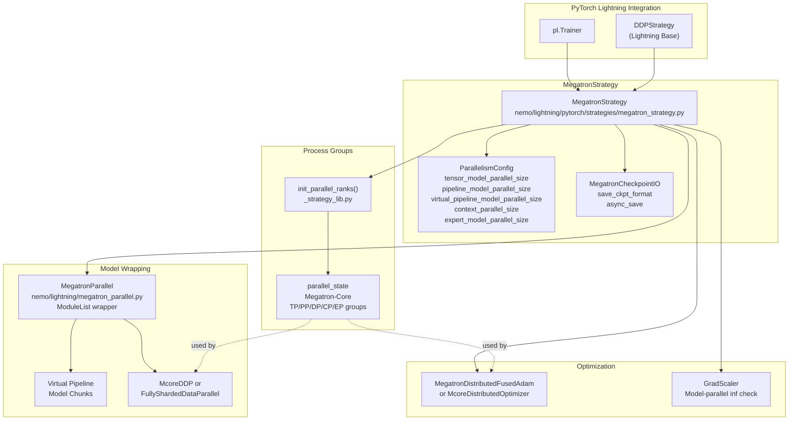
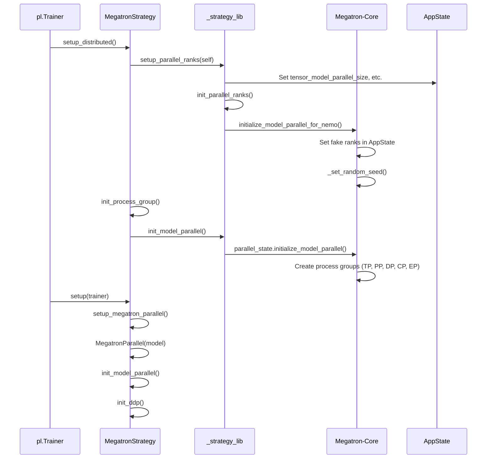
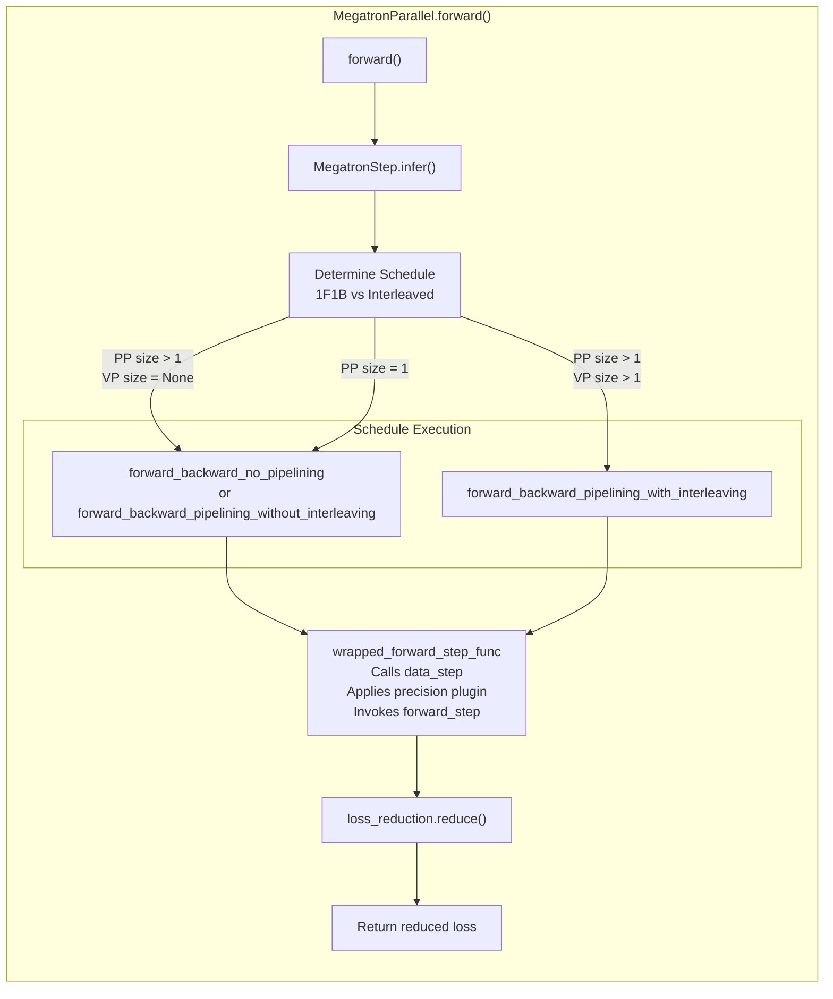
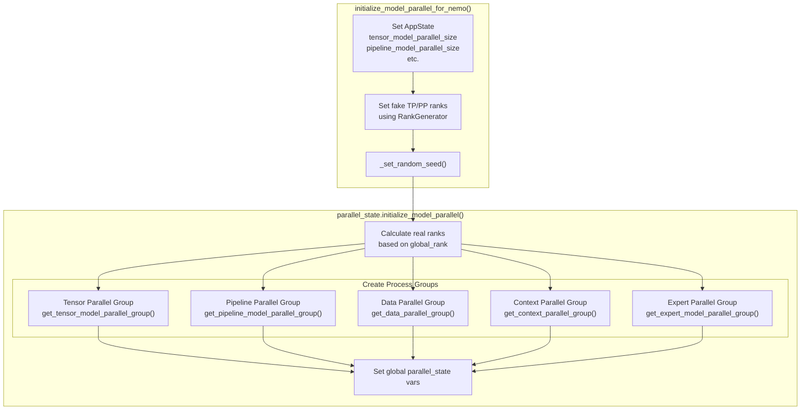
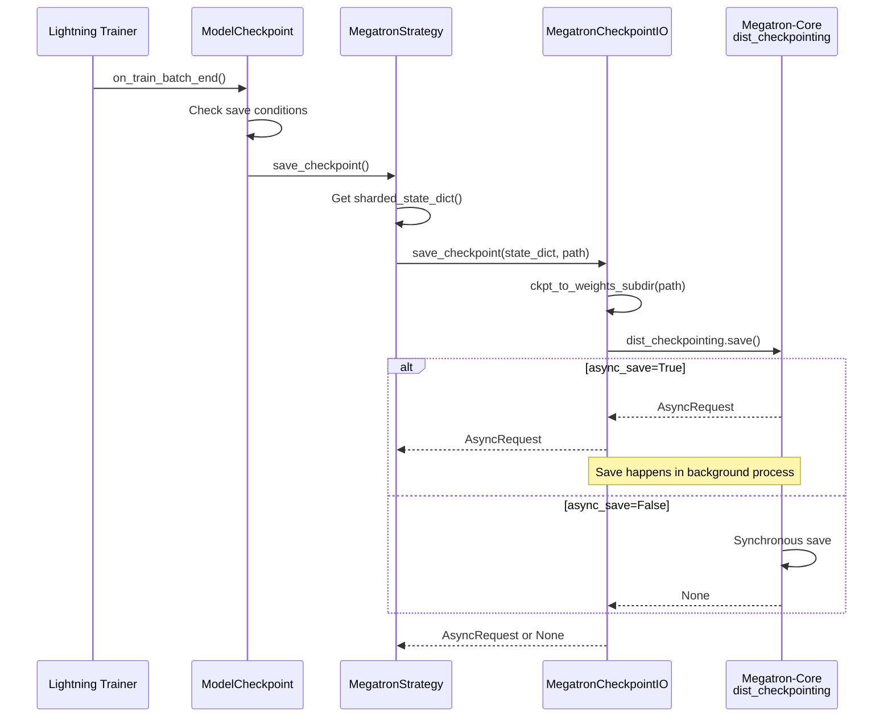
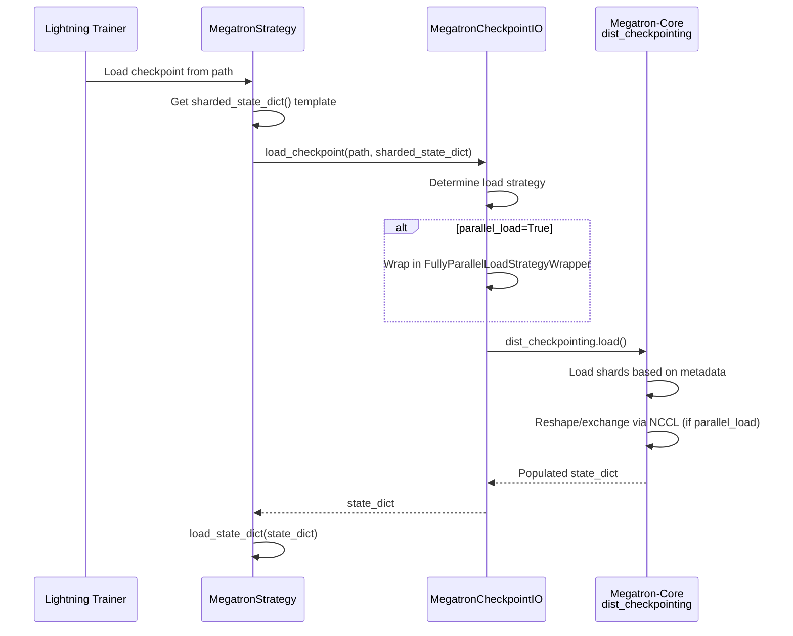
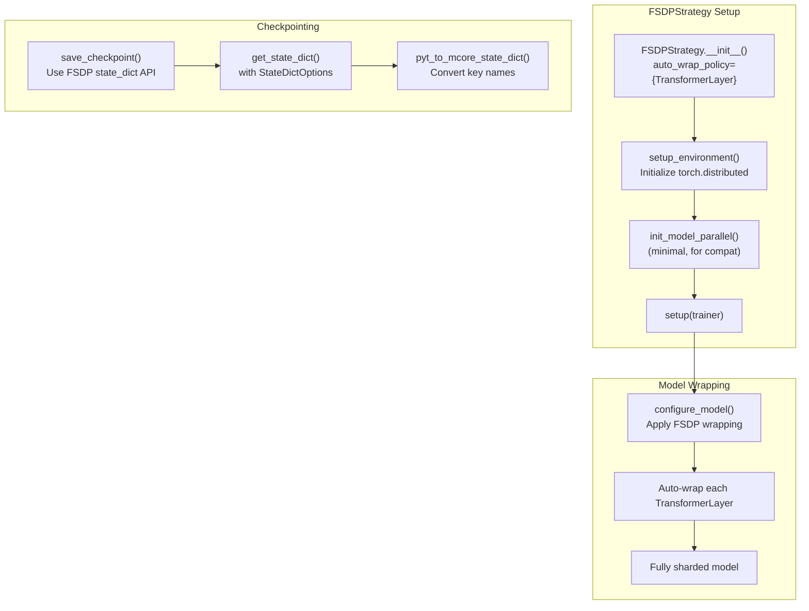
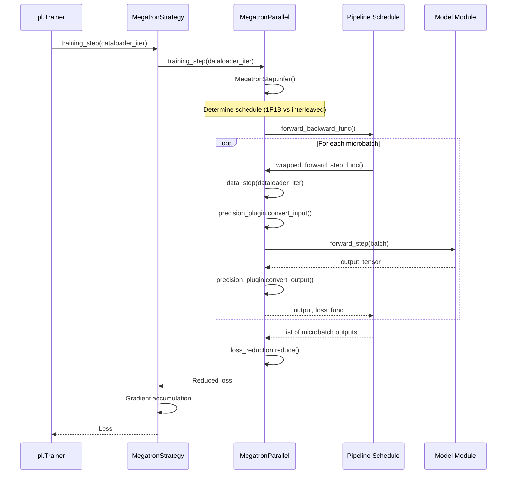

<!-- source: DeepWiki mcp.deepwiki.com · repo NVIDIA/NeMo · page 2 Distributed Training Infrastructure · fetched 2026-10-21 -->

# Distributed Training Infrastructure

<details>
<summary>Relevant source files</summary>

The following files were used as context for generating this wiki page:

- [nemo/collections/common/metrics/perf_metrics.py](nemo/collections/common/metrics/perf_metrics.py)
- [nemo/collections/llm/README.md](nemo/collections/llm/README.md)
- [nemo/core/optim/distributed_adam.py](nemo/core/optim/distributed_adam.py)
- [nemo/core/optim/mcore_optim.py](nemo/core/optim/mcore_optim.py)
- [nemo/lightning/README.md](nemo/lightning/README.md)
- [nemo/lightning/_strategy_lib.py](nemo/lightning/_strategy_lib.py)
- [nemo/lightning/ckpt_utils.py](nemo/lightning/ckpt_utils.py)
- [nemo/lightning/fabric/strategies.py](nemo/lightning/fabric/strategies.py)
- [nemo/lightning/io/pl.py](nemo/lightning/io/pl.py)
- [nemo/lightning/megatron_init.py](nemo/lightning/megatron_init.py)
- [nemo/lightning/megatron_parallel.py](nemo/lightning/megatron_parallel.py)
- [nemo/lightning/nemo_logger.py](nemo/lightning/nemo_logger.py)
- [nemo/lightning/pytorch/callbacks/ddp_parity_checker.py](nemo/lightning/pytorch/callbacks/ddp_parity_checker.py)
- [nemo/lightning/pytorch/callbacks/model_checkpoint.py](nemo/lightning/pytorch/callbacks/model_checkpoint.py)
- [nemo/lightning/pytorch/callbacks/progress_printer.py](nemo/lightning/pytorch/callbacks/progress_printer.py)
- [nemo/lightning/pytorch/optim/megatron.py](nemo/lightning/pytorch/optim/megatron.py)
- [nemo/lightning/pytorch/strategies/fsdp_strategy.py](nemo/lightning/pytorch/strategies/fsdp_strategy.py)
- [nemo/lightning/pytorch/strategies/megatron_strategy.py](nemo/lightning/pytorch/strategies/megatron_strategy.py)
- [nemo/lightning/resume.py](nemo/lightning/resume.py)
- [nemo/package_info.py](nemo/package_info.py)
- [nemo/utils/app_state.py](nemo/utils/app_state.py)
- [nemo/utils/callbacks/dist_ckpt_io.py](nemo/utils/callbacks/dist_ckpt_io.py)
- [nemo/utils/msc_utils.py](nemo/utils/msc_utils.py)
- [tests/collections/llm/test_mnist_model_nemo2.py](tests/collections/llm/test_mnist_model_nemo2.py)
- [tests/collections/llm/test_mnist_model_nemo2_fsdp.py](tests/collections/llm/test_mnist_model_nemo2_fsdp.py)
- [tests/lightning/pytorch/strategies/test_megatron_strategy.py](tests/lightning/pytorch/strategies/test_megatron_strategy.py)
- [tests/lightning/test_ckpt_utils.py](tests/lightning/test_ckpt_utils.py)
- [tests/lightning/test_nemo_logger.py](tests/lightning/test_nemo_logger.py)
- [tests/lightning/test_resume.py](tests/lightning/test_resume.py)
- [tests/lightning/test_strategy_lib.py](tests/lightning/test_strategy_lib.py)
- [tests/utils/test_msc_utils.py](tests/utils/test_msc_utils.py)

</details>


This document covers NeMo's distributed training infrastructure, which enables efficient training of large-scale models through various parallelism strategies. The infrastructure provides abstractions over PyTorch Lightning's training strategies and integrates deeply with NVIDIA's Megatron-LM framework.

**Scope**: This page focuses on the training strategy layer, parallelism implementations, distributed optimization, and checkpoint I/O. For model-specific implementations that use these strategies, see [LLM Model Architectures](#3.1). For experiment management and training orchestration, see [Experiment Management and Training](#1.3).

---

## Overview

NeMo's distributed training infrastructure is built on two primary strategies:

1. **MegatronStrategy**: Leverages Megatron-LM/Megatron-Core for advanced model parallelism (tensor, pipeline, context, expert parallelism)
2. **FSDPStrategy**: Uses PyTorch's native Fully Sharded Data Parallel for simpler, FSDP-based training

The infrastructure handles:
- **Parallelism configuration**: TP, PP, VP, CP, EP dimensions
- **Process group initialization**: NCCL/Gloo process groups for different parallelism types
- **Model wrapping**: Automatic wrapping of models for distributed execution
- **Optimizer distribution**: ZeRO-style optimizer state sharding
- **Distributed checkpointing**: Async, sharded checkpoint save/load

Sources: [nemo/lightning/pytorch/strategies/megatron_strategy.py:151-252](), [nemo/lightning/README.md]()

---

## MegatronStrategy Architecture

### Core Components



**MegatronStrategy Components**

The `MegatronStrategy` class extends PyTorch Lightning's `DDPStrategy` and implements the `IOMixin` interface for checkpoint I/O. It orchestrates all aspects of distributed training.

**Key Attributes**:
- `tensor_model_parallel_size`: Intra-layer parallelism (splits tensors across GPUs)
- `pipeline_model_parallel_size`: Inter-layer parallelism (splits transformer layers)
- `virtual_pipeline_model_parallel_size`: Interleaved pipeline for reduced bubbles
- `context_parallel_size`: Sequence dimension parallelism
- `expert_model_parallel_size`: MoE expert distribution
- `ddp_config`: Megatron-Core's `DistributedDataParallelConfig`

Sources: [nemo/lightning/pytorch/strategies/megatron_strategy.py:151-252](), [nemo/lightning/pytorch/strategies/megatron_strategy.py:256-319]()

### Strategy Initialization Flow



**Initialization Steps**:

1. **Rank Setup** ([nemo/lightning/pytorch/strategies/utils.py:setup_parallel_ranks]()): Configures `AppState` with parallelism dimensions
2. **Process Group Creation** ([nemo/lightning/_strategy_lib.py:44-106]()): Initializes NCCL/Gloo process groups via Megatron-Core
3. **Model Wrapping** ([nemo/lightning/megatron_parallel.py:214-258]()): Wraps model in `MegatronParallel`
4. **DDP Initialization** ([nemo/lightning/megatron_parallel.py:628-731]()): Wraps modules in Megatron DDP or FSDP

Sources: [nemo/lightning/pytorch/strategies/megatron_strategy.py:614-656](), [nemo/lightning/_strategy_lib.py:44-106](), [nemo/lightning/megatron_init.py:78-245]()

---

## MegatronParallel: Model Wrapper

The `MegatronParallel` class is a `nn.ModuleList` that wraps the model for pipeline parallelism and provides the execution interface.

### Architecture

| Component | Description | Location |
|-----------|-------------|----------|
| `pipeline` | List of model chunks (for virtual pipeline) | [nemo/lightning/megatron_parallel.py:230-247]() |
| `data_step` | Function to fetch and move data to device | [nemo/lightning/megatron_parallel.py:252]() |
| `forward_step` | Function for single microbatch forward pass | [nemo/lightning/megatron_parallel.py:253]() |
| `loss_reduction` | Function to reduce losses across microbatches | [nemo/lightning/megatron_parallel.py:254]() |
| `callbacks` | `CallbackConnector` for event-driven hooks | [nemo/lightning/megatron_parallel.py:251]() |
| `ddp_config` | `DistributedDataParallelConfig` from Megatron-Core | [nemo/lightning/megatron_parallel.py:255]() |

### Forward Pass Execution



**Execution Flow**:

1. `MegatronParallel.forward()` is called with data iterator
2. `MegatronStep.infer()` determines the pipeline schedule based on parallelism config
3. Schedule calls `wrapped_forward_step_func` for each microbatch
4. `wrapped_forward_step_func`:
   - Calls `data_step()` to fetch data
   - Applies `precision_plugin.convert_input()` if on first pipeline stage
   - Invokes model's `forward_step()`
   - Applies `precision_plugin.convert_output()` if on last pipeline stage
5. `loss_reduction.reduce()` aggregates microbatch losses
6. Returns final reduced loss

Sources: [nemo/lightning/megatron_parallel.py:260-352](), [nemo/lightning/megatron_parallel.py:490-568]()

### DDP Wrapping

The `init_ddp()` method wraps model chunks in either Megatron DDP or Megatron FSDP:

```python
# Simplified from nemo/lightning/megatron_parallel.py:628-731
for model_chunk in self:
    if use_megatron_fsdp:
        dist_module = FullyShardedDataParallel(
            module.config,
            self.ddp_config,
            module,
            disable_bucketing=(model_chunk_idx > 0)
        )
    else:
        dist_module = McoreDDP(
            module.config,
            self.ddp_config,
            module,
            data_parallel_group=parallel_state.get_data_parallel_group(with_context_parallel=True),
            expert_data_parallel_group=parallel_state.get_data_modulo_expert_parallel_group(),
            disable_bucketing=(model_chunk_idx > 0)
        )
```

**Key Features**:
- **Bucketing disabled** for model chunks after the first (communication overlaps with compute anyway)
- **Expert-aware** DDP with separate process groups for expert parameters
- **Context-parallel aware** data parallel groups

Sources: [nemo/lightning/megatron_parallel.py:628-731]()

---

## Parallelism Dimensions

### Parallelism Types Overview

| Type | Abbreviation | Description | Config Parameter |
|------|--------------|-------------|------------------|
| Tensor Parallel | TP | Splits individual tensors (e.g., QKV, MLP) across GPUs | `tensor_model_parallel_size` |
| Pipeline Parallel | PP | Splits transformer layers across GPUs | `pipeline_model_parallel_size` |
| Virtual Pipeline | VP | Interleaves pipeline stages to reduce bubble | `virtual_pipeline_model_parallel_size` |
| Context Parallel | CP | Splits sequence dimension across GPUs | `context_parallel_size` |
| Expert Parallel | EP | Distributes MoE experts across GPUs | `expert_model_parallel_size` |
| Data Parallel | DP | Replicates model, splits data batches | Computed from world_size / (TP×PP×CP×EP) |

Sources: [nemo/lightning/pytorch/strategies/megatron_strategy.py:159-175](), [nemo/utils/app_state.py:240-280]()

### Process Group Initialization



**Rank Mapping Order**:

The order of process group creation determines how ranks are mapped. NeMo supports two orderings:

1. **Default**: `TP-CP-EP-DP-PP` (data parallel outermost, pipeline parallel innermost)
2. **Alternative**: `TP-PP-DP` via `use_tp_pp_dp_mapping=True` (pipeline parallel second, data parallel outermost)

The mapping affects communication patterns and is controlled by `use_tp_pp_dp_mapping` in `ParallelismConfig`.

Sources: [nemo/lightning/megatron_init.py:78-245](), [nemo/lightning/_strategy_lib.py:44-106](), [nemo/utils/app_state.py:71-79]()

---

## Distributed Optimizers

NeMo provides two distributed optimizer implementations:

### MegatronDistributedFusedAdam

Located in [nemo/core/optim/distributed_adam.py](), this optimizer extends Apex's `DistributedFusedAdam` with NeMo/Megatron optimizations.

**Key Features**:
- **ZeRO-style optimizer state sharding**: Distributes optimizer states across data-parallel ranks
- **FP8 parameter support**: Handles Transformer Engine FP8 tensors
- **Within-node distribution**: Optional `distribute_within_nodes` for faster communication
- **Gradient bucketing**: Groups gradients for efficient all-reduce
- **Async gradient synchronization**: Overlaps communication with computation

**Configuration**:

```python
# Example from nemo/core/optim/distributed_adam.py:223-268
optimizer = MegatronDistributedFusedAdam(
    params=model.parameters(),
    lr=1e-4,
    betas=(0.9, 0.999),
    eps=1e-8,
    weight_decay=0.01,
    disable_distributed_parameters=False,  # Enable ZeRO
    distribute_within_nodes=False,  # Distribute across all ranks (not just within node)
    distributed_size=None,  # Auto-detect from world size
)
```

**FP8 Support**:

The optimizer handles FP8 tensors specially:
1. Initializes FP8 params with `param_sync_dtype=torch.uint8`
2. Uses `quantize_param_fragment()` for FP8 ↔ FP32 conversion
3. Maintains FP32 master weights internally

Sources: [nemo/core/optim/distributed_adam.py:197-268](), [nemo/core/optim/distributed_adam.py:324-503]()

### McoreDistributedOptimizer

Located in [nemo/core/optim/mcore_optim.py](), this is a wrapper around Megatron-Core's native distributed optimizer.

**Key Features**:
- **Native Megatron-Core optimizer**: Uses `OptimizerConfig` from Megatron-Core
- **DistOpt state sharding**: Full support for TP/PP/DP/EP reshardable checkpoints
- **Unified interface**: Implements standard PyTorch optimizer API

**Usage**:

```python
# Configured via OptimizerConfig
from megatron.core.optimizer import OptimizerConfig

config = OptimizerConfig(
    optimizer='adam',
    lr=1e-4,
    weight_decay=0.01,
    use_distributed_optimizer=True,
    bf16=True,
)

# In model.configure_optimizers():
from nemo.lightning.pytorch.optim.megatron import MegatronOptimizerModule

self.optim = MegatronOptimizerModule(config=config)
```

**Sharded State Dict**:

The optimizer provides `sharded_state_dict()` for distributed checkpointing:

```python
# From nemo/core/optim/mcore_optim.py:97-127
def sharded_state_dict(self, model_sharded_state_dict, is_loading=False, metadata=None):
    return self.mcore_optimizer.sharded_state_dict(
        model_sharded_state_dict,
        is_loading=is_loading,
        sharded_offsets=metadata.get('sharded_offsets', ()),
        sharding_type=metadata.get('distrib_optim_sharding_type', 'fully_reshardable'),
    )
```

Sources: [nemo/core/optim/mcore_optim.py:38-127](), [nemo/lightning/pytorch/optim/megatron.py:38-110]()

### Optimizer Comparison

| Feature | MegatronDistributedFusedAdam | McoreDistributedOptimizer |
|---------|------------------------------|---------------------------|
| Base | Apex DistributedFusedAdam | Megatron-Core DistributedOptimizer |
| FP8 Support | ✓ (custom logic) | ✓ (via Megatron-Core) |
| ZeRO Sharding | DP-only or fully reshardable | Fully reshardable (TP/PP/DP/EP) |
| Gradient Bucketing | ✓ | ✓ |
| Async Grad Sync | ✓ | ✓ |
| Configuration | Direct params | `OptimizerConfig` |

Sources: [nemo/core/optim/distributed_adam.py:197-268](), [nemo/core/optim/mcore_optim.py:38-127]()

---

## Distributed Checkpointing

NeMo uses Megatron-Core's distributed checkpointing system for efficient, sharded checkpoint I/O.

### MegatronCheckpointIO

The `MegatronCheckpointIO` class ([nemo/lightning/io/pl.py:149-428]()) implements Lightning's `CheckpointIO` interface with distributed checkpoint support.

**Configuration**:

| Parameter | Description | Default |
|-----------|-------------|---------|
| `save_ckpt_format` | Checkpoint format: `'torch_dist'` or `'zarr'` | `'torch_dist'` |
| `async_save` | Enable asynchronous checkpoint saving | `True` |
| `parallel_save` | Each worker writes its own checkpoint shard | `True` |
| `parallel_load` | Each worker loads its own shard with NCCL exchange | `False` |
| `load_directly_on_device` | Load weights directly to GPU (zarr only) | `True` |

**Checkpoint Structure**:

```
checkpoint_dir/
├── weights/                    # Model weights (sharded)
│   ├── __0_0.distcp
│   ├── __1_0.distcp
│   └── .metadata
├── context/                    # Training context (config, tokenizer)
│   ├── model.yaml
│   └── model.tokenizer/
└── extra_state.pt             # Trainer state (optional)
```

Sources: [nemo/lightning/io/pl.py:149-176](), [nemo/lightning/ckpt_utils.py:15-82]()

### Save Flow



**Save Process**:

1. **State Dict Creation** ([nemo/lightning/megatron_parallel.py:752-814]()):
   - Model calls `sharded_state_dict()` on each module
   - Returns dict with `ShardedTensor` objects containing sharding metadata
2. **Save Strategy Selection** ([nemo/lightning/io/pl.py:331-376]()):
   - Chooses `TorchDistSaveShardedStrategy` or `TensorStoreStrategy` (zarr)
   - Wraps in `FullyParallelSaveStrategyWrapper` if `parallel_save=True`
3. **Async Save** ([nemo/lightning/io/pl.py:180-241]()):
   - Spawns background process to write checkpoint
   - Returns `AsyncRequest` with finalization callbacks
4. **Finalization** ([nemo/utils/callbacks/dist_ckpt_io.py:144-199]()):
   - `AsyncFinalizerCallback` waits for async requests to complete
   - Removes marker files indicating checkpoint is complete

Sources: [nemo/lightning/io/pl.py:180-241](), [nemo/lightning/megatron_parallel.py:752-814](), [nemo/utils/callbacks/dist_ckpt_io.py:88-199]()

### Load Flow



**Load Process**:

1. **Template Creation**: Model creates empty `sharded_state_dict()` as a template
2. **Strategy Selection** ([nemo/lightning/io/pl.py:266-316]()):
   - Uses `FullyParallelLoadStrategyWrapper` if `parallel_load=True`
   - Each rank loads only its required shards and exchanges via NCCL
3. **Strictness Handling** ([nemo/lightning/io/pl.py:290-298]()):
   - Supports Megatron-Core's `StrictHandling` enum
   - Can log or raise on missing/unexpected keys
4. **State Dict Loading**: Standard PyTorch `load_state_dict()` with populated values

Sources: [nemo/lightning/io/pl.py:244-316](), [nemo/lightning/_strategy_lib.py:555-637]()

### Checkpoint Metadata

The distributed checkpoint system uses metadata to enable resharding:

```python
# From trainer.strategy.sharded_state_dict_metadata
metadata = {
    'distrib_optim_sharding_type': 'fully_reshardable',  # or 'dp_reshardable'
    'distrib_optim_fully_reshardable_mem_efficient': False,
    'singleton_local_shards': False,
    'chained_optim_avoid_prefix': True,
}
```

- **`distrib_optim_sharding_type`**: Controls optimizer resharding capability
  - `'fully_reshardable'`: Can reshard across TP/PP/DP/EP changes
  - `'dp_reshardable'`: Can only reshard across DP dimension
- **`distrib_optim_fully_reshardable_mem_efficient`**: Reduces memory during reshardable save (at cost of speed)

Sources: [nemo/lightning/io/pl.py:411-428](), [nemo/lightning/pytorch/strategies/megatron_strategy.py:1063-1088]()

---

## FSDP Strategy Alternative

NeMo also provides `FSDPStrategy` ([nemo/lightning/pytorch/strategies/fsdp_strategy.py]()) as a lighter-weight alternative to `MegatronStrategy`.

### Comparison with MegatronStrategy

| Feature | MegatronStrategy | FSDPStrategy |
|---------|------------------|--------------|
| Base | Lightning DDPStrategy | Lightning FSDPStrategy |
| Tensor Parallelism | ✓ | ✗ |
| Pipeline Parallelism | ✓ | ✗ |
| Data Parallelism | ✓ (via DDP or FSDP) | ✓ (FSDP only) |
| Auto-wrapping | Per transformer layer | Per `TransformerLayer` |
| Checkpoint Format | Megatron dist_checkpointing | PyTorch FSDP state_dict |
| Optimizer | Megatron/Apex optimizers | PyTorch native optimizers |
| Use Case | Large-scale multi-dimensional parallelism | Simpler FSDP-only training |

**Note**: Checkpoints are **not interchangeable** between strategies due to different optimizer state structures. Model weights are compatible if you only need to transfer weights (e.g., pretrain with Megatron, fine-tune with FSDP).

Sources: [nemo/lightning/pytorch/strategies/fsdp_strategy.py:67-85]()

### FSDPStrategy Implementation



**Key Differences**:
- Uses PyTorch's native `torch.distributed.fsdp.FullyShardedDataParallel`
- Wraps based on `auto_wrap_policy` (default: `{TransformerLayer}`)
- Checkpointing uses `get_state_dict()` and `set_state_dict()` from PyTorch
- Key conversion via `pyt_to_mcore_state_dict()` for Megatron-Core compatibility

Sources: [nemo/lightning/pytorch/strategies/fsdp_strategy.py:87-160](), [nemo/lightning/pytorch/strategies/utils.py:mcore_to_pyt_sharded_state_dict]()

---

## Training Step Execution

### MegatronStrategy Training Step



**Execution Steps**:

1. **Step Inference** ([nemo/lightning/megatron_parallel.py:MegatronStep.infer]()): Determines pipeline schedule based on PP/VP configuration
2. **Schedule Execution**: Calls Megatron-Core's pipeline schedule functions
3. **Microbatch Loop**: For each microbatch:
   - `data_step()` fetches data
   - `forward_step()` performs forward pass
   - Precision plugin converts inputs/outputs
4. **Loss Reduction** ([nemo/lightning/megatron_parallel.py:334-345]()): Aggregates microbatch losses
5. **Gradient Handling**: Strategy handles gradient accumulation and optimizer step

Sources: [nemo/lightning/pytorch/strategies/megatron_strategy.py:773-850](), [nemo/lightning/megatron_parallel.py:354-428]()

### Automatic Optimization

NeMo replaces Lightning's automatic optimization with `_MegatronAutomaticOptimization`:

```python
# From nemo/lightning/pytorch/strategies/megatron_strategy.py:1297-1423
class _MegatronAutomaticOptimization(_AutomaticOptimization):
    def __init__(self, trainer):
        super().__init__(trainer)
        self.done = False

    @override
    def on_train_batch_end(self, outputs, batch, batch_idx):
        """Handles gradient clipping, optimizer step, and zero_grad"""
        # Gradient clipping via model.config.grad_clip_norm
        # Optimizer step with accumulation check
        # Zero gradients
```

**Key Customizations**:
- **Gradient clipping**: Uses Megatron-Core's `clip_grad_norm_fp32()` for model-parallel aware clipping
- **Accumulation**: Respects `accumulate_grad_batches` setting
- **Precision handling**: Integrates with `GradScaler` for mixed precision

Sources: [nemo/lightning/pytorch/strategies/megatron_strategy.py:1297-1423]()

---

## Process Group Management

### AppState Integration

The `AppState` singleton ([nemo/utils/app_state.py]()) stores global distributed training state:

```python
# Key attributes
class AppState:
    # Parallelism dimensions
    tensor_model_parallel_size: int
    pipeline_model_parallel_size: int
    context_parallel_size: int
    expert_model_parallel_size: int
    data_parallel_size: int
    
    # Ranks
    global_rank: int
    local_rank: int
    tensor_model_parallel_rank: int
    pipeline_model_parallel_rank: int
    data_parallel_rank: int
    
    # Process groups
    tensor_model_parallel_group: ProcessGroup
    pipeline_model_parallel_group: ProcessGroup
    data_parallel_group: ProcessGroup
```

This state is populated during `initialize_model_parallel_for_nemo()` and used throughout training.

Sources: [nemo/utils/app_state.py:33-149](), [nemo/lightning/megatron_init.py:78-245]()

### Custom Process Group Configuration

NeMo supports advanced process group features:

**NCCL Communicator Configuration** ([nemo/lightning/pytorch/strategies/megatron_strategy.py:241-243]()):
```python
strategy = MegatronStrategy(
    nccl_communicator_config_path='/path/to/nccl_config.yaml',
    # Configures min_ctas, max_ctas, cga_cluster_size per communicator
)
```

**SHARP Support** ([nemo/lightning/pytorch/strategies/megatron_strategy.py:243]()):
```python
strategy = MegatronStrategy(
    use_sharp=True,  # Enable NVIDIA SHARP for optimized collectives
)
```

**Gloo Process Groups** ([nemo/lightning/pytorch/strategies/megatron_strategy.py:246]()):
```python
strategy = MegatronStrategy(
    use_gloo_process_groups=True,  # Create Gloo groups for CPU communication
)
```

Sources: [nemo/lightning/pytorch/strategies/megatron_strategy.py:241-246](), [nemo/lightning/megatron_init.py:103-136]()

---

## Configuration Example

### Complete Training Setup

```python
from nemo import lightning as nl
from nemo.collections import llm

# 1. Configure strategy with parallelism
strategy = nl.MegatronStrategy(
    tensor_model_parallel_size=4,        # 4-way tensor parallelism
    pipeline_model_parallel_size=2,      # 2-way pipeline parallelism
    virtual_pipeline_model_parallel_size=4,  # 4 virtual stages per pipeline stage
    context_parallel_size=1,
    sequence_parallel=True,              # Enable sequence parallelism
    
    # DDP config
    ddp="megatron",
    
    # Checkpointing
    save_ckpt_format='torch_dist',
    ckpt_async_save=True,
    ckpt_parallel_save=True,
    ckpt_optim_fully_reshardable=True,   # Enable full resharding
    
    # Progress
    replace_progress_bar=True,
    progress_interval=10,
)

# 2. Configure optimizer
from megatron.core.optimizer import OptimizerConfig

optim_config = OptimizerConfig(
    optimizer='adam',
    lr=1e-4,
    weight_decay=0.1,
    use_distributed_optimizer=True,
    bf16=True,
)

optim = nl.MegatronOptimizerModule(
    config=optim_config,
    lr_scheduler=nl.lr_scheduler.CosineAnnealingScheduler(warmup_steps=500),
)

# 3. Create trainer
trainer = nl.Trainer(
    devices=8,
    num_nodes=2,  # 16 GPUs total
    max_steps=10000,
    accelerator='gpu',
    strategy=strategy,
    plugins=nl.MegatronMixedPrecision(precision='bf16-mixed'),
    callbacks=[
        nl.ModelCheckpoint(
            save_top_k=3,
            every_n_train_steps=1000,
        )
    ],
)

# 4. Create model and train
model = llm.GPTModel(
    config=llm.GPTConfig130M(),
    optim=optim,
    tokenizer=tokenizer,
)

trainer.fit(model, datamodule=data)
```

**Resulting Configuration**:
- 16 GPUs: TP=4, PP=2, DP=2
- Virtual pipeline with 4 chunks per stage (reduces bubble)
- Async distributed checkpointing with full resharding
- BF16 mixed precision training
- Distributed optimizer with ZeRO

Sources: [nemo/lightning/pytorch/strategies/megatron_strategy.py:256-375](), [tests/collections/llm/test_mnist_model_nemo2.py:900-1100]()

---

## Key Design Patterns

### 1. Strategy-Parallel-Module Separation

The architecture separates concerns:
- **Strategy** (`MegatronStrategy`): Handles infrastructure (process groups, checkpointing, optimization)
- **Parallel** (`MegatronParallel`): Handles execution (pipeline scheduling, microbatching)
- **Module**: Pure model code (Megatron-Core models)

This allows models to be agnostic to distribution strategy.

### 2. Lazy Initialization

Models can be initialized lazily to save memory:

```python
strategy = MegatronStrategy(lazy_init=True)
# Model parameters initialized on meta device until parallel init
```

This is critical for large models that don't fit in CPU memory.

Sources: [nemo/lightning/pytorch/strategies/megatron_strategy.py:284](), [nemo/lightning/_strategy_lib.py:182-217]()

### 3. Callback-Driven Extensibility

`MegatronParallel` uses `CallbackConnector` for event-driven hooks:

```python
# Events fired during forward pass
callbacks.event("on_megatron_step_start", step=step)
callbacks.event("on_megatron_microbatch_start", step=step, batch=batch)
callbacks.event("on_megatron_microbatch_end", step=step, output=output)
callbacks.event("on_megatron_reduce_microbatches_start", ...)
```

This allows custom logic injection without modifying core code.

Sources: [nemo/lightning/megatron_parallel.py:324-350]()

### 4. Precision Plugin Integration

The precision plugin pattern allows swapping precision implementations:

```python
# BF16 mixed precision
trainer = nl.Trainer(
    plugins=nl.MegatronMixedPrecision(precision='bf16-mixed')
)

# FP8 precision
trainer = nl.Trainer(
    plugins=nl.FP8MixedPrecision()
)
```

The plugin handles `convert_input()` and `convert_output()` at pipeline boundaries.

Sources: [nemo/lightning/megatron_parallel.py:537-557]()

---

This infrastructure enables NeMo to efficiently train models ranging from small single-GPU experiments to trillion-parameter models on thousands of GPUs with minimal code changes.

---

