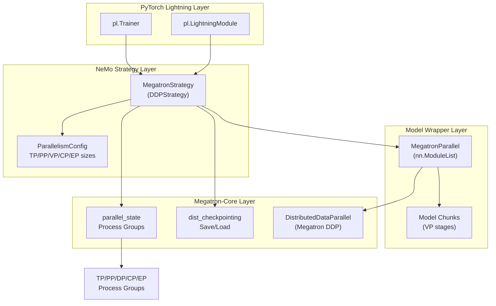
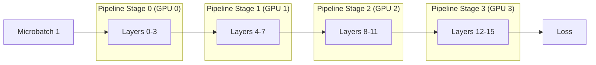
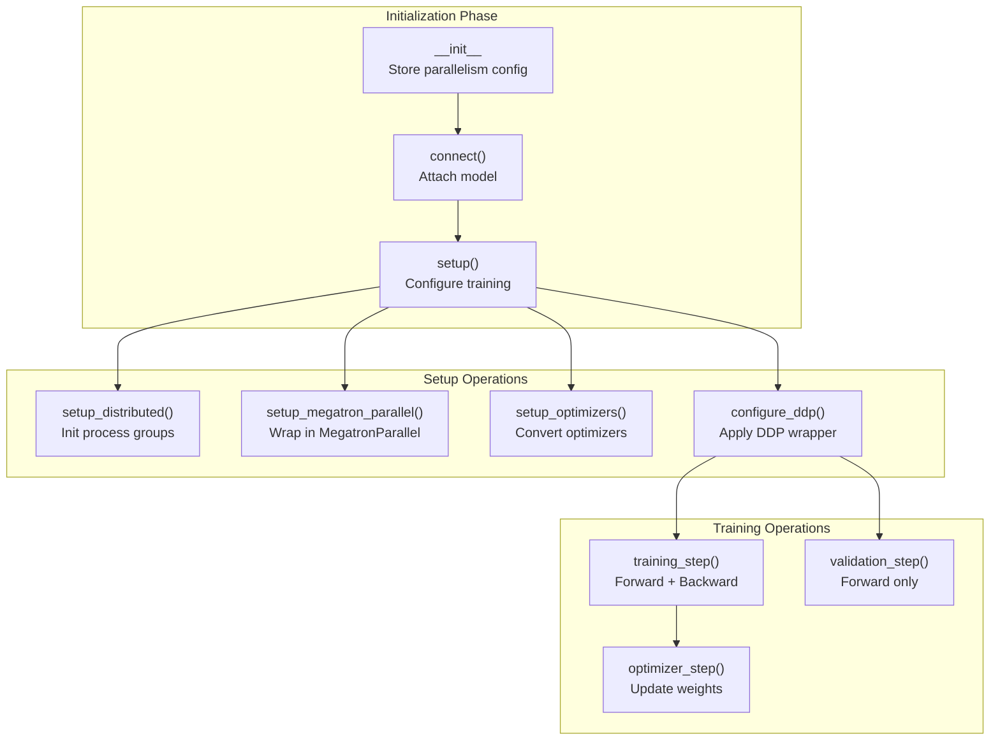
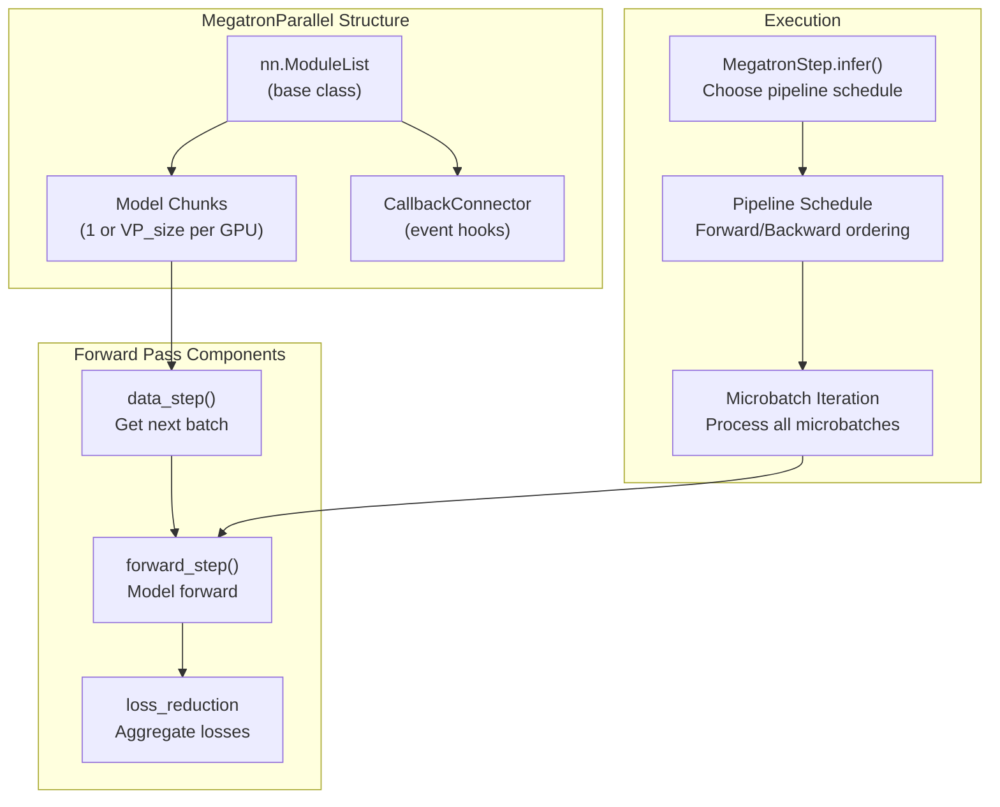
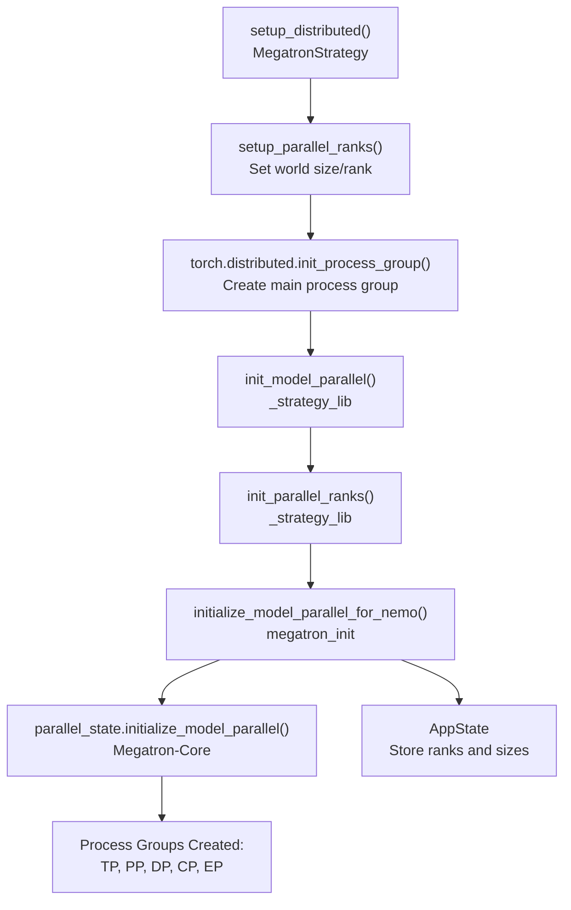
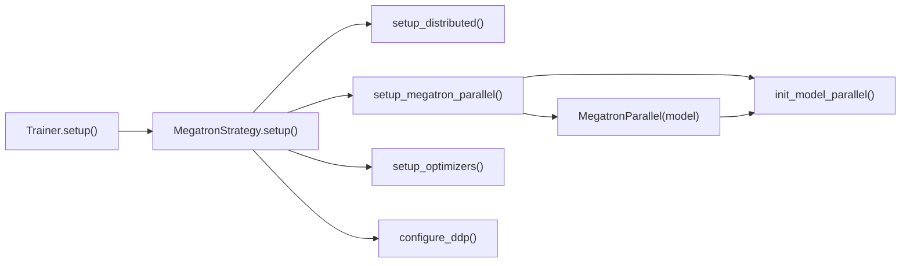

<!-- source: DeepWiki mcp.deepwiki.com · repo NVIDIA/NeMo · page 2.1 Megatron Strategy and Model Parallelism · fetched 2026-10-21 -->

# Megatron Strategy and Model Parallelism

Relevant source files

The following files were used as context for generating this wiki page:

- [nemo/collections/common/metrics/perf_metrics.py](nemo/collections/common/metrics/perf_metrics.py)
- [nemo/collections/llm/README.md](nemo/collections/llm/README.md)
- [nemo/core/optim/distributed_adam.py](nemo/core/optim/distributed_adam.py)
- [nemo/core/optim/mcore_optim.py](nemo/core/optim/mcore_optim.py)
- [nemo/lightning/README.md](nemo/lightning/README.md)
- [nemo/lightning/_strategy_lib.py](nemo/lightning/_strategy_lib.py)
- [nemo/lightning/ckpt_utils.py](nemo/lightning/ckpt_utils.py)
- [nemo/lightning/fabric/strategies.py](nemo/lightning/fabric/strategies.py)
- [nemo/lightning/io/pl.py](nemo/lightning/io/pl.py)
- [nemo/lightning/megatron_init.py](nemo/lightning/megatron_init.py)
- [nemo/lightning/megatron_parallel.py](nemo/lightning/megatron_parallel.py)
- [nemo/lightning/nemo_logger.py](nemo/lightning/nemo_logger.py)
- [nemo/lightning/pytorch/callbacks/ddp_parity_checker.py](nemo/lightning/pytorch/callbacks/ddp_parity_checker.py)
- [nemo/lightning/pytorch/callbacks/model_checkpoint.py](nemo/lightning/pytorch/callbacks/model_checkpoint.py)
- [nemo/lightning/pytorch/callbacks/progress_printer.py](nemo/lightning/pytorch/callbacks/progress_printer.py)
- [nemo/lightning/pytorch/optim/megatron.py](nemo/lightning/pytorch/optim/megatron.py)
- [nemo/lightning/pytorch/strategies/fsdp_strategy.py](nemo/lightning/pytorch/strategies/fsdp_strategy.py)
- [nemo/lightning/pytorch/strategies/megatron_strategy.py](nemo/lightning/pytorch/strategies/megatron_strategy.py)
- [nemo/lightning/resume.py](nemo/lightning/resume.py)
- [nemo/package_info.py](nemo/package_info.py)
- [nemo/utils/app_state.py](nemo/utils/app_state.py)
- [nemo/utils/callbacks/dist_ckpt_io.py](nemo/utils/callbacks/dist_ckpt_io.py)
- [nemo/utils/msc_utils.py](nemo/utils/msc_utils.py)
- [tests/collections/llm/test_mnist_model_nemo2.py](tests/collections/llm/test_mnist_model_nemo2.py)
- [tests/collections/llm/test_mnist_model_nemo2_fsdp.py](tests/collections/llm/test_mnist_model_nemo2_fsdp.py)
- [tests/lightning/pytorch/strategies/test_megatron_strategy.py](tests/lightning/pytorch/strategies/test_megatron_strategy.py)
- [tests/lightning/test_ckpt_utils.py](tests/lightning/test_ckpt_utils.py)
- [tests/lightning/test_nemo_logger.py](tests/lightning/test_nemo_logger.py)
- [tests/lightning/test_resume.py](tests/lightning/test_resume.py)
- [tests/lightning/test_strategy_lib.py](tests/lightning/test_strategy_lib.py)
- [tests/utils/test_msc_utils.py](tests/utils/test_msc_utils.py)

## Purpose and Scope

This document covers the `MegatronStrategy` class and its implementation of model parallelism for training large-scale neural networks in NeMo. The strategy leverages NVIDIA's Megatron-LM framework to enable various forms of parallelism including tensor, pipeline, context, and expert parallelism.

For information about distributed optimization and mixed precision training, see [Distributed Optimization and Mixed Precision](#2.2). For checkpoint management, see [Distributed Checkpointing](#2.3).

**Sources:** [nemo/lightning/pytorch/strategies/megatron_strategy.py:151-252](), [nemo/lightning/README.md:1-10]()

## Overview

`MegatronStrategy` is a PyTorch Lightning strategy that extends `DDPStrategy` to support advanced model parallelism techniques. It serves as the bridge between PyTorch Lightning's training loop and Megatron-Core's parallelism primitives. The strategy wraps models in a `MegatronParallel` container that handles the distribution of model layers across GPUs and manages communication between parallel ranks.

**Diagram: MegatronStrategy Architecture and Integration Points**

**Sources:** [nemo/lightning/pytorch/strategies/megatron_strategy.py:151-252](), [nemo/lightning/megatron_parallel.py:162-212]()

## Parallelism Configuration

The `ParallelismConfig` dataclass captures all parallelism-related settings that are passed from `MegatronStrategy` to the model configuration. These settings control how the model is partitioned across GPUs.

| Parallelism Type | Config Parameter | Description |
|------------------|------------------|-------------|
| Tensor Parallelism (TP) | `tensor_model_parallel_size` | Splits tensors within layers across GPUs |
| Pipeline Parallelism (PP) | `pipeline_model_parallel_size` | Splits transformer layers across GPUs |
| Virtual Pipeline (VP) | `virtual_pipeline_model_parallel_size` | Interleaves pipeline stages to reduce bubbles |
| Context Parallelism (CP) | `context_parallel_size` | Splits sequence dimension across GPUs |
| Expert Parallelism (EP) | `expert_model_parallel_size` | Distributes MoE experts across GPUs |
| Sequence Parallelism | `sequence_parallel` | Parallelizes layer norms and dropout |

**Sources:** [nemo/lightning/pytorch/strategies/megatron_strategy.py:117-149](), [nemo/lightning/pytorch/strategies/megatron_strategy.py:323-342]()

### Tensor Parallelism (TP)

Tensor parallelism splits individual weight matrices and operations across multiple GPUs. For example, a linear layer's weight matrix is partitioned column-wise or row-wise, with different GPUs computing different portions of the output. This is particularly effective for attention layers and feed-forward networks in transformers.

**Sources:** [nemo/lightning/pytorch/strategies/megatron_strategy.py:159]()

### Pipeline Parallelism (PP)

Pipeline parallelism partitions the model's layers across different GPUs, with each GPU responsible for a contiguous set of transformer layers. During training, micro-batches flow through the pipeline stages sequentially. The strategy handles the scheduling of forward and backward passes across pipeline stages.

**Diagram: Pipeline Parallelism with 4 Stages**

**Sources:** [nemo/lightning/pytorch/strategies/megatron_strategy.py:161-162](), [nemo/lightning/megatron_parallel.py:238-246]()

### Virtual Pipeline Parallelism (VP)

Virtual pipeline parallelism improves pipeline efficiency by assigning multiple non-contiguous model chunks to each GPU. This reduces the pipeline bubble (idle time) by allowing computation to overlap with communication. When `virtual_pipeline_model_parallel_size` is set, `MegatronParallel` creates multiple model chunks per GPU.

**Sources:** [nemo/lightning/pytorch/strategies/megatron_strategy.py:163-167](), [nemo/lightning/megatron_parallel.py:238-246]()

### Context Parallelism (CP)

Context parallelism splits the input sequence across multiple GPUs to handle very long sequences that don't fit in a single GPU's memory. The sequence dimension is partitioned, and attention operations are computed in a distributed manner.

**Sources:** [nemo/lightning/pytorch/strategies/megatron_strategy.py:168-169](), [nemo/lightning/pytorch/strategies/megatron_strategy.py:333]()

### Expert Parallelism (EP)

For Mixture-of-Experts (MoE) models, expert parallelism distributes different expert networks across GPUs. This is controlled by `expert_model_parallel_size`. The `moe_extended_tp` flag provides an alternative parallelization strategy for experts.

**Sources:** [nemo/lightning/pytorch/strategies/megatron_strategy.py:172-175](), [nemo/lightning/pytorch/strategies/megatron_strategy.py:334-336]()

### Sequence Parallelism

Sequence parallelism is a memory optimization that parallelizes layer normalization and dropout operations along the sequence dimension when tensor parallelism is enabled. This is particularly beneficial for large models (20B+ parameters).

**Sources:** [nemo/lightning/pytorch/strategies/megatron_strategy.py:170-171](), [nemo/lightning/pytorch/strategies/megatron_strategy.py:338]()

## MegatronStrategy Class

The `MegatronStrategy` class coordinates all aspects of distributed training with model parallelism. It initializes process groups, wraps models in the `MegatronParallel` container, and manages the training loop integration.

**Diagram: MegatronStrategy Lifecycle Methods**

**Sources:** [nemo/lightning/pytorch/strategies/megatron_strategy.py:256-319](), [nemo/lightning/pytorch/strategies/megatron_strategy.py:506-563](), [nemo/lightning/pytorch/strategies/megatron_strategy.py:614-651]()

### Key Constructor Arguments

The `MegatronStrategy` constructor accepts numerous configuration parameters:

- **Parallelism sizes**: `tensor_model_parallel_size`, `pipeline_model_parallel_size`, `virtual_pipeline_model_parallel_size`, `context_parallel_size`, `expert_model_parallel_size`
- **DDP configuration**: `ddp` (can be "megatron", "pytorch", or `DistributedDataParallelConfig`)
- **FSDP configuration**: `fsdp` (can be "megatron" or "pytorch")
- **Checkpoint settings**: `ckpt_load_optimizer`, `ckpt_save_optimizer`, `ckpt_parallel_save`, `ckpt_parallel_load`, `save_ckpt_format`
- **Async checkpointing**: `ckpt_async_save`, `ckpt_torch_dist_multiproc`
- **Progress monitoring**: `replace_progress_bar`, `progress_interval`

**Sources:** [nemo/lightning/pytorch/strategies/megatron_strategy.py:256-319]()

## MegatronParallel Wrapper

The `MegatronParallel` class is a `nn.ModuleList` subclass that wraps model chunks for pipeline parallelism. It manages the forward pass execution, including pipeline scheduling, micro-batching, and gradient accumulation.

**Diagram: MegatronParallel Components and Forward Pass Flow**

**Sources:** [nemo/lightning/megatron_parallel.py:162-212](), [nemo/lightning/megatron_parallel.py:260-352]()

### Pipeline Execution

The `forward()` method in `MegatronParallel` orchestrates the complete pipeline execution:

1. **Step Inference**: Determines the pipeline schedule based on parallelism configuration
2. **Microbatch Iteration**: Executes forward (and optionally backward) passes for each microbatch
3. **Loss Reduction**: Aggregates losses from all microbatches on the last pipeline stage

The execution is controlled by callbacks that fire at key points: `on_megatron_step_start`, `on_megatron_microbatches_start`, `on_megatron_microbatch_start`, `on_megatron_microbatch_end`, `on_megatron_microbatches_end`, `on_megatron_reduce_microbatches_start`, `on_megatron_reduce_microbatches_end`, `on_megatron_step_end`.

**Sources:** [nemo/lightning/megatron_parallel.py:260-352](), [nemo/lightning/megatron_parallel.py:324-350]()

### Model Initialization

The `init_model_parallel()` method handles model-specific initialization:

1. Moves model to GPU (unless using Megatron FSDP)
2. Sets tensor parallel attributes on parameters
3. Prints parameter counts per parallel rank
4. Applies optional module conversion function
5. Initializes DDP wrapping

**Sources:** [nemo/lightning/megatron_parallel.py:570-623]()

### DDP Integration

The `init_ddp()` method wraps model chunks in Megatron-Core's `DistributedDataParallel` or `FullyShardedDataParallel`:

- For non-FSDP mode: Uses `McoreDDP` from `megatron.core.distributed`
- For Megatron FSDP mode: Uses `FullyShardedDataParallel` with custom sharding
- Handles bucketing configuration for gradient communication
- Sets up no_sync and grad_sync functions for overlapping communication

**Sources:** [nemo/lightning/megatron_parallel.py:628-731]()

## Process Group Initialization

Process groups are the foundation for distributed communication. The initialization flow involves multiple stages:

**Diagram: Process Group Initialization Call Chain**

**Sources:** [nemo/lightning/pytorch/strategies/megatron_strategy.py:614-651](), [nemo/lightning/_strategy_lib.py:44-106](), [nemo/lightning/megatron_init.py:78-196]()

### Parallel Ranks Configuration

The `setup_parallel_ranks()` function computes the parallel ranks before process group initialization:

1. Calculate DP size from world size and model parallel sizes
2. Compute fake TP and PP ranks (actual ranks determined by Megatron-Core later)
3. Store configuration in `AppState` for later use
4. Validate that world size is evenly divisible by parallel dimensions

**Sources:** [nemo/lightning/pytorch/strategies/utils.py:142-207]()

### AppState Tracking

The `AppState` singleton stores all distributed training state globally:

- World size and ranks: `world_size`, `global_rank`, `local_rank`
- Parallel sizes: `tensor_model_parallel_size`, `pipeline_model_parallel_size`, etc.
- Parallel ranks: `tensor_model_parallel_rank`, `pipeline_model_parallel_rank`, etc.
- Process groups: `tensor_model_parallel_group`, `data_parallel_group`, etc.
- Configuration flags: `use_tp_pp_dp_mapping`, `use_sharp`, `use_fp8`

**Sources:** [nemo/utils/app_state.py:33-80](), [nemo/lightning/megatron_init.py:118-173]()

## DDP and FSDP Configuration

`MegatronStrategy` supports three DDP modes configured via the `ddp` parameter:

### Megatron DDP

When `ddp="megatron"`, the strategy uses Megatron-Core's `DistributedDataParallel`:

- Default configuration: `DistributedDataParallelConfig(check_for_nan_in_grad=True)`
- Supports gradient bucketing for efficient communication
- Provides hooks for overlapping gradient communication with backward pass
- Integrates with expert parallelism for MoE models

**Sources:** [nemo/lightning/pytorch/strategies/megatron_strategy.py:377-387](), [nemo/lightning/megatron_parallel.py:696-703]()

### PyTorch DDP

When `ddp="pytorch"`, the strategy uses standard PyTorch `DistributedDataParallel`:

- Wraps model in `torch.nn.parallel.DistributedDataParallel`
- Does not support FSDP
- Uses standard PyTorch gradient synchronization

**Sources:** [nemo/lightning/pytorch/strategies/megatron_strategy.py:381-386](), [nemo/lightning/pytorch/strategies/megatron_strategy.py:736-746]()

### Megatron FSDP

When `fsdp="megatron"`, the strategy uses Megatron-Core's `FullyShardedDataParallel`:

- Wraps model in `megatron.core.distributed.FullyShardedDataParallel`
- Requires `ddp_config.use_megatron_fsdp=True` or `ddp_config.use_custom_fsdp=True`
- Supports sharding of optimizer states and gradients
- Requires checkpoint format `save_ckpt_format="fsdp_dtensor"`
- Parameters stay on CPU during initialization to avoid OOM

**Sources:** [nemo/lightning/pytorch/strategies/megatron_strategy.py:404-420](), [nemo/lightning/megatron_parallel.py:654-693]()

## Configuration Table

Below is a comprehensive table of key configuration parameters:

| Parameter | Type | Default | Description |
|-----------|------|---------|-------------|
| `tensor_model_parallel_size` | int | 1 | Number of GPUs for tensor parallelism |
| `pipeline_model_parallel_size` | int | 1 | Number of GPUs for pipeline parallelism |
| `virtual_pipeline_model_parallel_size` | int \| None | None | Number of virtual pipeline stages |
| `context_parallel_size` | int | 1 | Number of GPUs for context parallelism |
| `expert_model_parallel_size` | int | 1 | Number of GPUs for expert parallelism |
| `sequence_parallel` | bool | False | Enable sequence parallelism |
| `ddp` | str \| config | "megatron" | DDP configuration ("megatron", "pytorch", or config object) |
| `fsdp` | str \| None | None | FSDP mode ("megatron" or None) |
| `lazy_init` | bool | False | Use lazy initialization for model parallel parameters |
| `pipeline_dtype` | dtype \| None | None | Data type for pipeline communication |
| `save_ckpt_format` | str | "torch_dist" | Checkpoint format ("torch_dist" or "zarr") |
| `ckpt_async_save` | bool | True | Enable async checkpoint saving |
| `ckpt_parallel_save` | bool | True | Parallel checkpoint save across ranks |
| `ckpt_parallel_load` | bool | True | Parallel checkpoint load across ranks |
| `replace_progress_bar` | bool | True | Replace TQDM with Megatron progress logger |
| `use_tp_pp_dp_mapping` | bool | False | Use TP-PP-DP rank mapping instead of TP-DP-PP |

**Sources:** [nemo/lightning/pytorch/strategies/megatron_strategy.py:256-312]()

## Integration with PyTorch Lightning

The `MegatronStrategy` integrates deeply with PyTorch Lightning's training loop through several key override methods:

### Setup Phase

**Diagram: Strategy Setup Integration with PyTorch Lightning**

**Sources:** [nemo/lightning/pytorch/strategies/megatron_strategy.py:506-563](), [nemo/lightning/pytorch/strategies/megatron_strategy.py:665-714]()

### Training Loop Integration

During training, the strategy overrides the training step to coordinate with pipeline parallelism:

1. **`training_step()`**: Delegates to `MegatronParallel.training_step()`
2. **`validation_step()`**: Similar delegation with `forward_only=True`
3. **`optimizer_step()`**: Handles gradient clipping and finalization before optimizer update

The strategy also modifies the automatic optimization loop through `_MegatronAutomaticOptimization` to properly handle pipeline parallel execution.

**Sources:** [nemo/lightning/pytorch/strategies/megatron_strategy.py:773-822](), [nemo/lightning/pytorch/strategies/megatron_strategy.py:1078-1146]()

### Data Loading

The `process_dataloader()` method applies data sampler transformations if configured. The strategy also wraps data fetchers to handle pipeline parallelism correctly through `_data_fetcher_wrapper()`.

**Sources:** [nemo/lightning/pytorch/strategies/megatron_strategy.py:658-663](), [nemo/lightning/pytorch/strategies/megatron_strategy.py:553-554]()

---

