<!-- source: DeepWiki mcp.deepwiki.com · repo NVIDIA/NeMo · page 2.2 Distributed Optimization and Mixed Precision · fetched 2026-10-21 -->

# Distributed Optimization and Mixed Precision

<details>
<summary>Relevant source files</summary>

The following files were used as context for generating this wiki page:

- [nemo/collections/common/metrics/perf_metrics.py](nemo/collections/common/metrics/perf_metrics.py)
- [nemo/core/optim/distributed_adam.py](nemo/core/optim/distributed_adam.py)
- [nemo/core/optim/mcore_optim.py](nemo/core/optim/mcore_optim.py)
- [nemo/package_info.py](nemo/package_info.py)
- [nemo/utils/callbacks/dist_ckpt_io.py](nemo/utils/callbacks/dist_ckpt_io.py)
- [tests/lightning/pytorch/strategies/test_megatron_strategy.py](tests/lightning/pytorch/strategies/test_megatron_strategy.py)

</details>


## Purpose and Scope

This document covers NeMo's distributed optimization infrastructure and mixed precision training capabilities. It details the two primary optimizer implementations (`MegatronDistributedFusedAdam` and `McoreDistributedOptimizer`), FP8 parameter and gradient quantization, ZeRO-style optimizer state sharding, and process group management for efficient distributed training.

For the broader distributed training strategy layer that integrates these optimizers, see [Megatron Strategy and Model Parallelism](#2.1). For distributed checkpoint format and saving/loading of optimizer state, see [Distributed Checkpointing](#2.3).

---

## Optimizer Architecture

NeMo provides two distributed optimizer implementations that enable training at scale by sharding optimizer state across multiple devices and supporting mixed precision formats including FP8.

### Optimizer Class Hierarchy

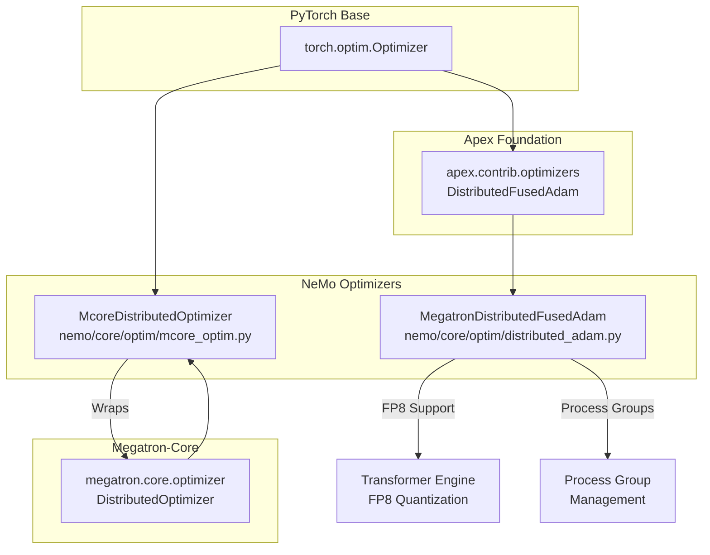

**Sources:** [nemo/core/optim/distributed_adam.py:1-854](), [nemo/core/optim/mcore_optim.py:1-231]()

---

## MegatronDistributedFusedAdam

The `MegatronDistributedFusedAdam` optimizer extends Apex's `DistributedFusedAdam` with NeMo-specific optimizations including FP8 parameter support, configurable process groups for multi-node distribution, and enhanced gradient synchronization.

### Core Features

| Feature | Description | Configuration |
|---------|-------------|---------------|
| ZeRO Optimizer State | Shards optimizer state (momentum, variance) across data parallel ranks | `disable_distributed_parameters=False` |
| FP8 Parameters | Supports Float8Tensor parameters with per-parameter quantization | Automatic for FP8 models |
| Process Group Distribution | Distributes state within nodes or across custom device groups | `distribute_within_nodes` or `distributed_size` |
| Contiguous Param Buffer | Allocates params in contiguous buffer for efficient communication | `contiguous_param_buffer=True` |
| Gradient Copy Overlap | Overlaps gradient copy with backward pass | `greedy_grad_copy=True`, `overlap_grad_sync=True` |
| Mixed Precision Sync | Supports different dtypes for gradient and parameter sync | `grad_sync_dtype`, `param_sync_dtype` |

**Sources:** [nemo/core/optim/distributed_adam.py:197-292]()

### Initialization and Process Groups

The optimizer creates process groups for distributing optimizer state across multiple devices:

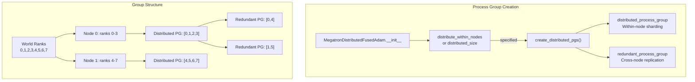

The `create_distributed_pgs` function creates two types of process groups:
- **Distributed Process Group**: Ranks within the same node that shard optimizer state
- **Redundant Process Group**: Corresponding ranks across nodes for synchronization

**Sources:** [nemo/core/optim/distributed_adam.py:132-195]()

### FP8 Parameter Support

MegatronDistributedFusedAdam provides native support for FP8 parameters using Transformer Engine:

#### FP8 Quantization Flow

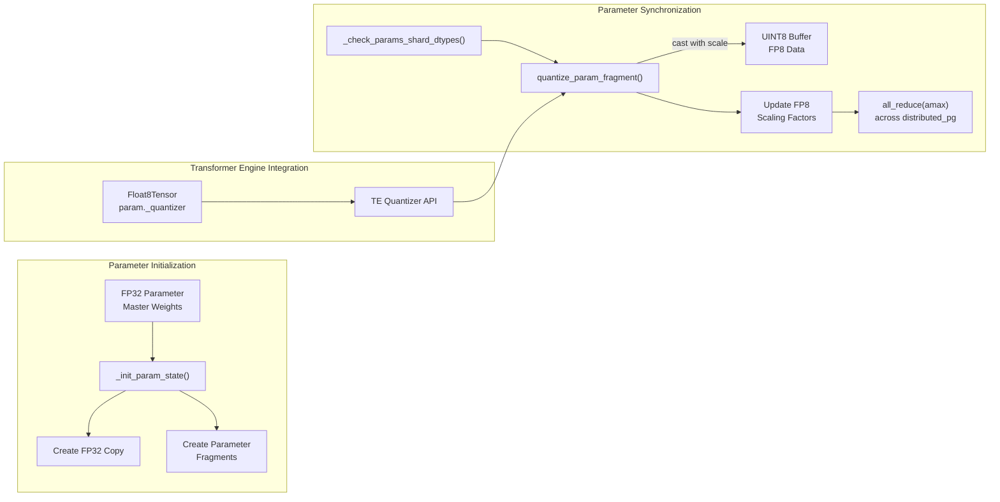

The quantization process:
1. Parameters are initialized as FP32 master weights internally
2. During parameter sync, FP32 values are quantized to FP8 using per-parameter scaling
3. FP8 amax values are reduced across the distributed process group
4. Scale-inverse values are cached for efficient de-quantization

**Sources:** [nemo/core/optim/distributed_adam.py:462-503](), [nemo/core/optim/distributed_adam.py:716-827](), [nemo/core/optim/distributed_adam.py:40-127]()

### Gradient Synchronization

The optimizer implements a sophisticated gradient synchronization mechanism with overlapping:

#### Gradient Copy and Sync Pipeline

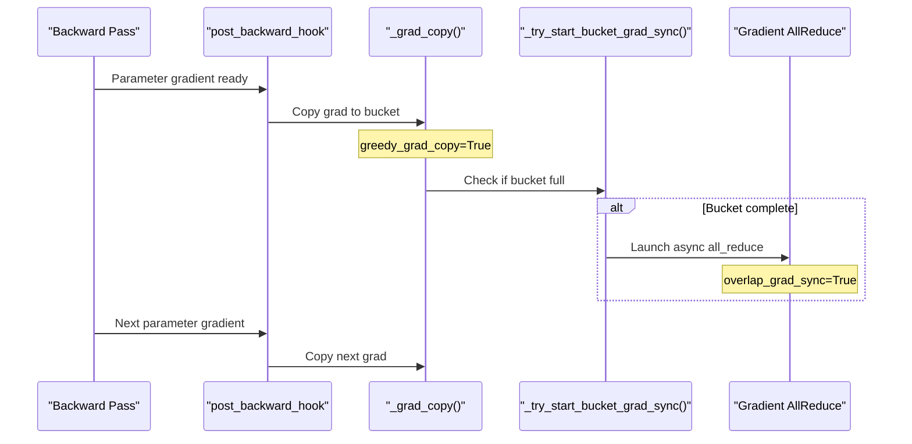

The `_make_post_backward_hook` method creates hooks that:
1. Initialize parameter state on first backward pass
2. Copy gradients into contiguous buckets (`greedy_grad_copy`)
3. Launch asynchronous gradient all-reduce when buckets are complete

**Sources:** [nemo/core/optim/distributed_adam.py:297-322]()

### Parameter Initialization Strategies

The optimizer supports multiple initialization modes for handling different parameter types:

| Method | Purpose | Key Features |
|--------|---------|--------------|
| `init_params()` | Initialize all or selected parameters | Separates FP8 and non-FP8 params |
| `init_params_bucket()` | Initialize parameters as a single bucket | Groups FP32, FP8, and normal params |
| `init_param_buffer()` | Create contiguous buffer for all params | Makes params views into buffer |

**Sources:** [nemo/core/optim/distributed_adam.py:324-358](), [nemo/core/optim/distributed_adam.py:360-461](), [nemo/core/optim/distributed_adam.py:505-587]()

---

## McoreDistributedOptimizer

The `McoreDistributedOptimizer` is a wrapper around Megatron-Core's `DistributedOptimizer`, providing a consistent interface with NeMo's training infrastructure while leveraging Megatron-Core's ZeRO optimization implementation.

### Class Structure

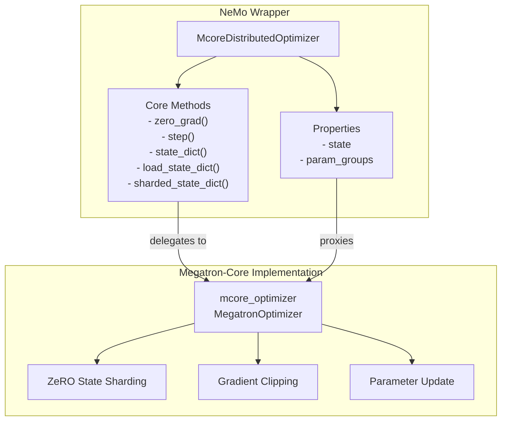

**Sources:** [nemo/core/optim/mcore_optim.py:38-231]()

### Key Wrapper Methods

The wrapper provides these primary functions:

**Training Step**
- `step()`: Performs optimization step with gradient clipping, returns loss, grad_norm, and num_zeros_in_grad
- `zero_grad()`: Clears model and optimizer gradients
- `reload_model_params()`: Reloads parameters from optimizer state (for weight averaging)

**State Management**
- `state_dict()`: Returns optimizer state for checkpointing
- `load_state_dict()`: Loads optimizer state with empty common_step filtering
- `sharded_state_dict()`: Returns distributed checkpoint format with sharding metadata

**Hooks**
- `disable_pre_hook()`: Disables parameter pre-forward hooks
- `enable_pre_hook()`: Enables parameter pre-forward hooks

**Sources:** [nemo/core/optim/mcore_optim.py:54-231]()

### Sharded State Dictionary Format

The `sharded_state_dict` method produces a distributed checkpoint format compatible with Megatron-Core's distributed checkpointing system:

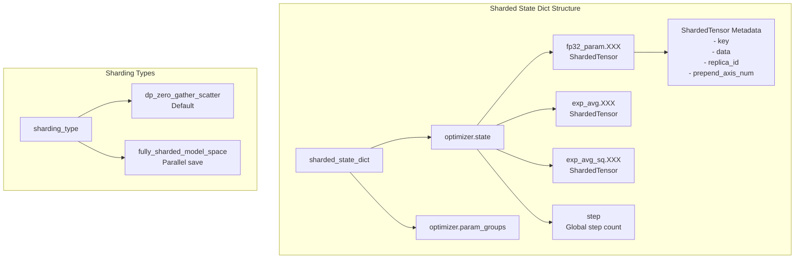

The sharding metadata indicates how optimizer state is distributed:
- `dp_zero_gather_scatter`: State sharded across data parallel ranks with gather on load
- `fully_sharded_model_space`: State fully sharded across model space for parallel save

**Sources:** [nemo/core/optim/mcore_optim.py:97-126](), [nemo/core/optim/distributed_adam.py:829-853]()

---

## Mixed Precision Training

NeMo supports multiple precision formats for parameters, gradients, and optimizer states to balance computational efficiency with numerical accuracy.

### Precision Format Support

| Precision | Parameters | Gradients | Optimizer State | Use Case |
|-----------|-----------|-----------|-----------------|----------|
| FP32 | ✓ | ✓ | ✓ | Baseline, small models |
| FP16 | ✓ | ✓ | Requires FP32 master | Memory-efficient training |
| BF16 | ✓ | ✓ | Requires FP32 master | Large models, stable training |
| FP8 | ✓ | ✓ | Requires FP32 master | Maximum throughput, H100+ |
| Mixed | Different per component | Different per component | FP32 | Production training |

### Mixed Precision Data Flow

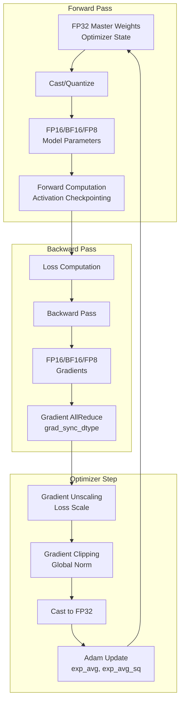

**Sources:** [nemo/core/optim/distributed_adam.py:256-260]()

### FP8 Mixed Precision Configuration

FP8 training with `MegatronDistributedFusedAdam` requires specific dtype configurations:

```python
# Optimizer initialization with FP8 support
optimizer = MegatronDistributedFusedAdam(
    params=model.parameters(),
    lr=1e-4,
    betas=(0.9, 0.999),
    eps=1e-8,
    grad_sync_dtype=torch.float32,    # Use FP32 for gradient all-reduce
    param_sync_dtype=torch.uint8,     # FP8 params sync as UINT8
)
```

The optimizer automatically handles:
- **FP8 Parameter Sync**: Parameters stored as UINT8 with separate scale factors
- **Gradient Accumulation**: Gradients accumulated in FP32 for numerical stability  
- **Scale Updates**: Amax values reduced across ranks after each parameter sync
- **Quantization/Dequantization**: Using Transformer Engine quantizer API

**Sources:** [nemo/core/optim/distributed_adam.py:716-827]()

---

## Gradient Scaling and Clipping

Both optimizers support gradient scaling for mixed precision training and gradient clipping for training stability.

### Gradient Norm Computation

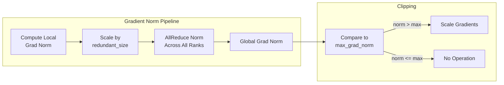

The `grad_norm` method in `MegatronDistributedFusedAdam`:
1. Computes local gradient norm from distributed parameter fragments
2. Scales by redundant process group size (for ZeRO)
3. Performs all-reduce across all ranks
4. Caches result for efficiency

**Sources:** [nemo/core/optim/distributed_adam.py:612-641]()

### Loss Scaling for FP16 Training

Mixed precision training uses loss scaling to prevent gradient underflow:

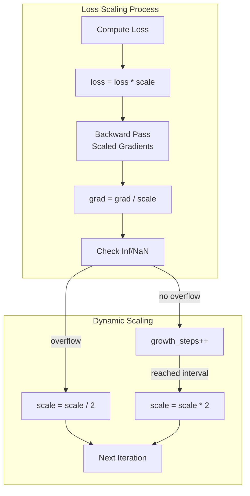

While NeMo's distributed optimizers don't directly implement loss scaling (handled by PyTorch Lightning's precision plugins), they coordinate with the scaling mechanism through gradient overflow detection and optimizer step skipping.

---

## Process Group Management

Efficient distributed optimization requires careful process group configuration for different communication patterns.

### Process Group Architecture

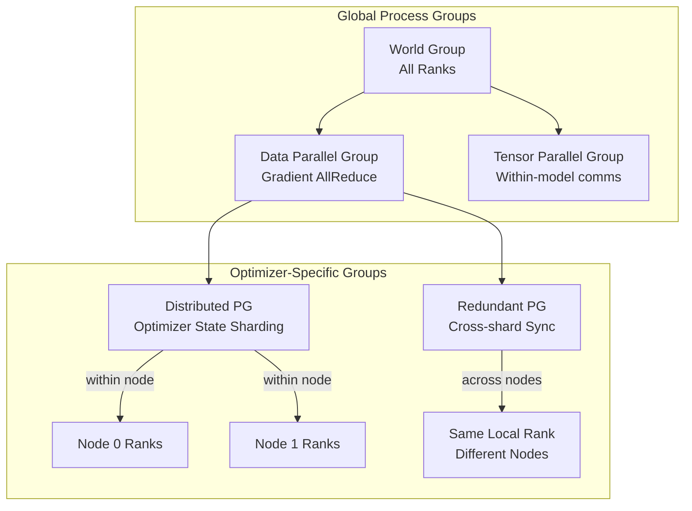

**Sources:** [nemo/core/optim/distributed_adam.py:132-195]()

### Process Group Configuration Strategies

| Strategy | distributed_process_group | redundant_process_group | Use Case |
|----------|--------------------------|-------------------------|----------|
| Standard DP | Data parallel group | Self group (rank-only) | No ZeRO |
| Within-node ZeRO | GPUs in same node | Corresponding ranks across nodes | DGX systems |
| Custom ZeRO | User-defined group | Complement group | Flexible topology |

The `create_distributed_pgs` function sets up these groups based on `distributed_size`:

```python
# For 8 GPUs across 2 nodes (4 GPUs per node)
# distributed_size = 4
# Creates:
# - distributed_process_group for ranks [0,1,2,3] and [4,5,6,7]  
# - redundant_process_group for [0,4], [1,5], [2,6], [3,7]
```

**Sources:** [nemo/core/optim/distributed_adam.py:132-195]()

---

## Optimizer State Checkpointing

Both optimizers integrate with NeMo's distributed checkpointing system for efficient state saving and loading.

### Checkpoint Format Structure

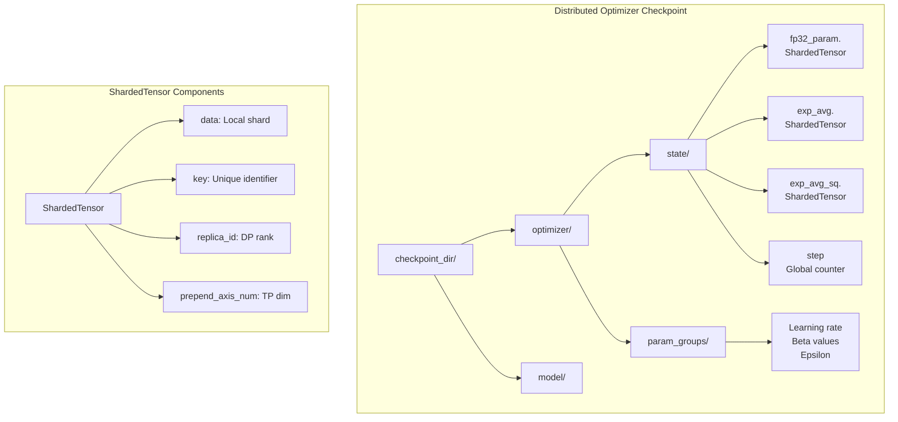

**Sources:** [nemo/core/optim/distributed_adam.py:829-853](), [nemo/core/optim/mcore_optim.py:97-126]()

### Checkpoint Save/Load Flow

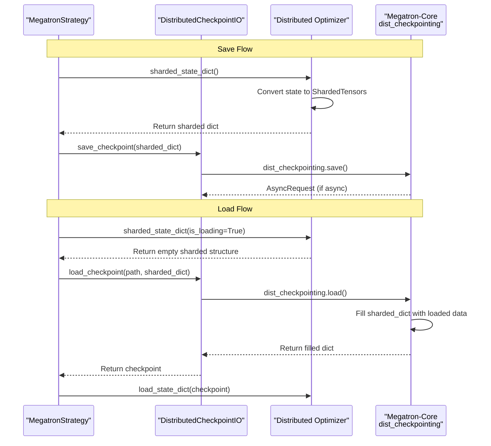

**Sources:** [nemo/utils/callbacks/dist_ckpt_io.py:273-318](), [nemo/utils/callbacks/dist_ckpt_io.py:320-397]()

### FP32 Parameter Renaming

For `MegatronDistributedFusedAdam`, optimizer state keys are renamed during sharded checkpoint creation to distinguish master weights:

```python
# Original key: optimizer.state.param.layers.0.weight
# Renamed to:    optimizer.state.fp32_param.layers.0.weight
```

This renaming happens in the `sharded_state_dict` method to clarify that these are FP32 master copies of potentially FP8/FP16 model parameters.

**Sources:** [nemo/core/optim/distributed_adam.py:846-851]()

---

## Integration with Training Strategies

The distributed optimizers integrate with NeMo's training strategies through standardized interfaces.

### Strategy-Optimizer Integration

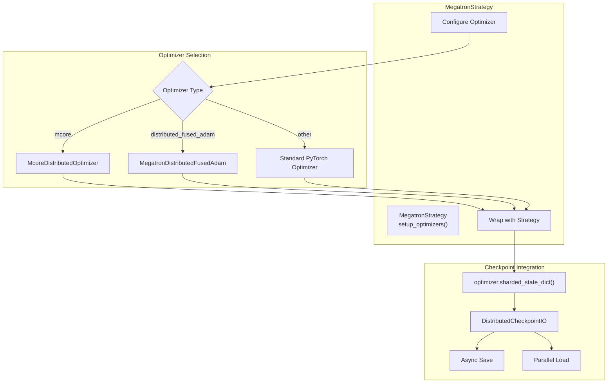

The strategy layer:
1. Configures optimizer based on model config
2. Sets up process groups for distributed optimization
3. Integrates with distributed checkpointing
4. Manages async checkpoint finalization

**Sources:** [tests/lightning/pytorch/strategies/test_megatron_strategy.py:1-142]()

---

## Performance Considerations

### Memory Efficiency

| Technique | Memory Savings | Implementation |
|-----------|---------------|----------------|
| ZeRO-1 (Optimizer State Sharding) | ~4x for Adam | `disable_distributed_parameters=False` |
| Contiguous Param Buffer | Eliminates fragmentation | `contiguous_param_buffer=True` |
| FP8 Parameters | 2x vs FP16, 4x vs FP32 | Automatic with Float8Tensor |
| Gradient Accumulation | Proportional to microbatch count | `grad_sync_dtype` configuration |

### Communication Optimization

1. **Gradient Overlap**: Gradient all-reduce overlapped with backward pass via `overlap_grad_sync=True`
2. **Bucketing**: Gradients grouped into buckets for efficient collective operations
3. **Process Group Locality**: Within-node distribution reduces cross-node communication
4. **Async Checkpointing**: Save process offloaded to separate process/thread

**Sources:** [nemo/core/optim/distributed_adam.py:314-320]()

### FP8 Throughput Benefits

FP8 training provides significant throughput improvements on H100 and newer GPUs:
- 2x throughput vs FP16/BF16 on supported operations
- Reduced memory bandwidth requirements
- Hardware-accelerated FP8 tensor cores

However, FP8 requires:
- Careful scaling factor management (handled automatically)
- Periodic amax reduction (overhead)
- Transformer Engine integration

**Sources:** [nemo/core/optim/distributed_adam.py:40-127]()

---

## Configuration Examples

### Standard Mixed Precision (BF16)

```yaml
# Model config for BF16 training with distributed optimizer
model:
  precision: bf16
  
  optim:
    name: distributed_fused_adam
    lr: 1e-4
    betas: [0.9, 0.999]
    eps: 1e-8
    weight_decay: 0.1
    disable_distributed_parameters: false
    overlap_grad_sync: true
    contiguous_param_buffer: true
```

### FP8 Training with McoreDistributedOptimizer

```yaml
model:
  precision: bf16-mixed  # Model in BF16, params can be FP8
  fp8: true
  fp8_margin: 0
  fp8_interval: 1
  fp8_amax_history_len: 1024
  fp8_amax_compute_algo: max
  
  optim:
    name: mcore_distributed_optimizer
    lr: 1e-4
    weight_decay: 0.1
```

### Within-Node ZeRO Distribution

```yaml
model:
  optim:
    name: distributed_fused_adam
    distribute_within_nodes: true  # Shard within DGX node
    # distributed_size: 8  # Alternative: explicit size
```

**Sources:** [nemo/core/optim/distributed_adam.py:223-268]()

---

This document provides a comprehensive overview of NeMo's distributed optimization infrastructure. For details on how these optimizers integrate with the broader training pipeline, see [Megatron Strategy and Model Parallelism](#2.1). For checkpoint management, see [Distributed Checkpointing](#2.3).

---

