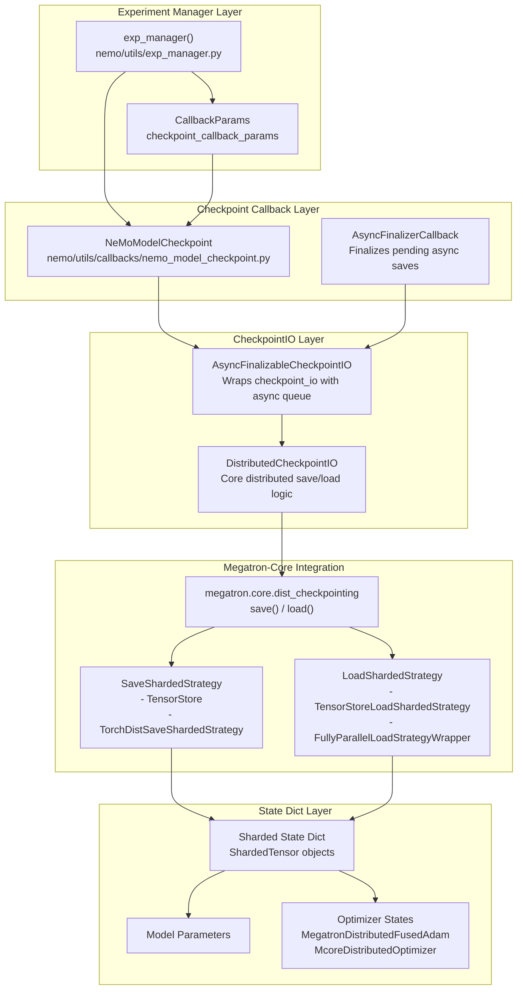
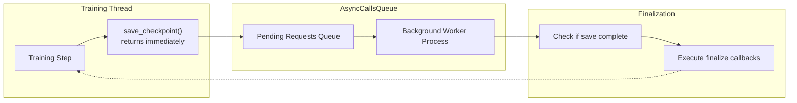
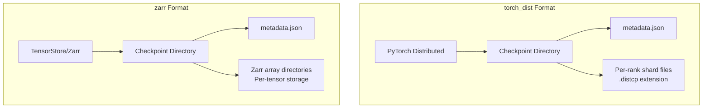
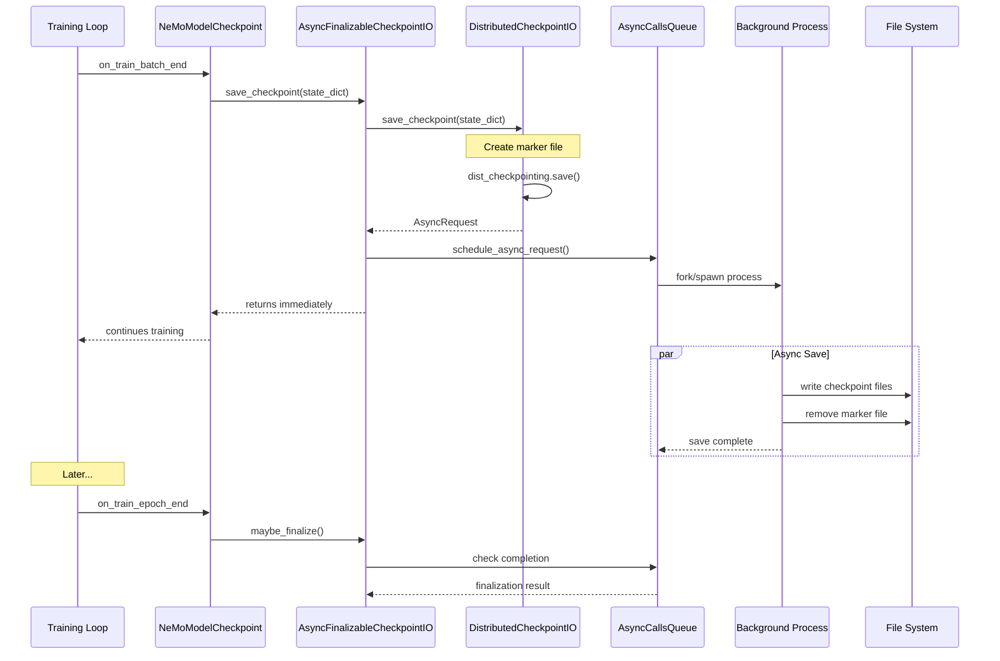
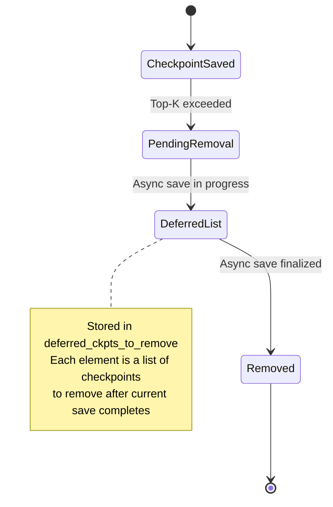
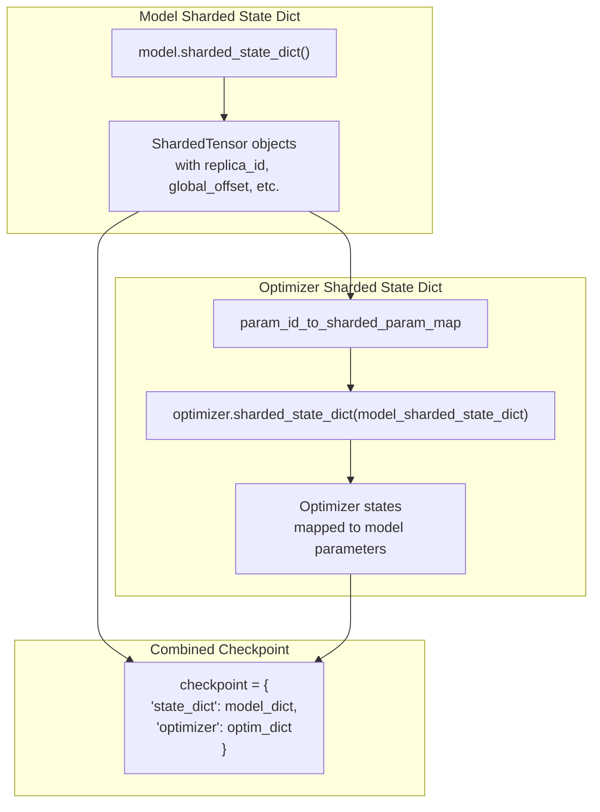
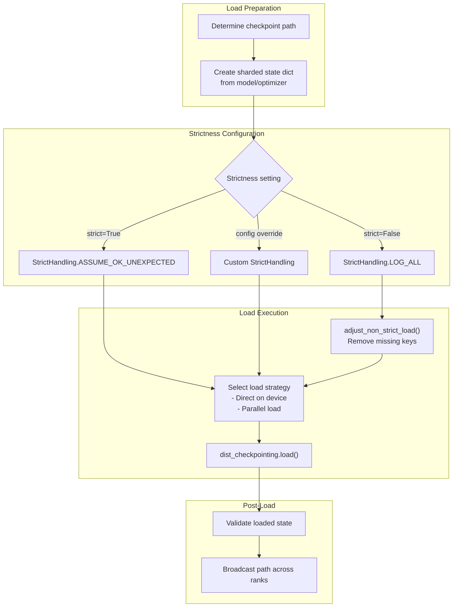
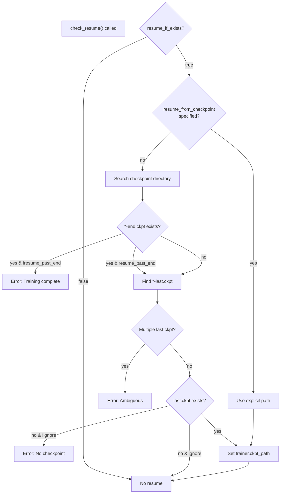
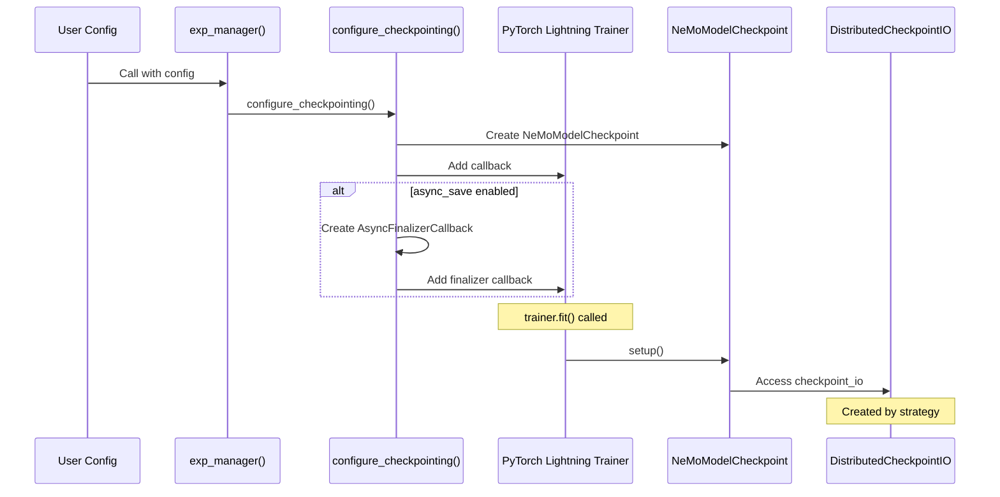

<!-- source: DeepWiki mcp.deepwiki.com · repo NVIDIA/NeMo · page 2.3 Distributed Checkpointing · fetched 2026-10-21 -->

# Distributed Checkpointing

<details>
<summary>Relevant source files</summary>

The following files were used as context for generating this wiki page:

- [nemo/collections/common/metrics/perf_metrics.py](nemo/collections/common/metrics/perf_metrics.py)
- [nemo/core/optim/distributed_adam.py](nemo/core/optim/distributed_adam.py)
- [nemo/core/optim/mcore_optim.py](nemo/core/optim/mcore_optim.py)
- [nemo/package_info.py](nemo/package_info.py)
- [nemo/utils/callbacks/__init__.py](nemo/utils/callbacks/__init__.py)
- [nemo/utils/callbacks/dist_ckpt_io.py](nemo/utils/callbacks/dist_ckpt_io.py)
- [nemo/utils/callbacks/nemo_model_checkpoint.py](nemo/utils/callbacks/nemo_model_checkpoint.py)
- [nemo/utils/callbacks/preemption.py](nemo/utils/callbacks/preemption.py)
- [nemo/utils/exp_manager.py](nemo/utils/exp_manager.py)
- [tests/collections/tts/conftest.py](tests/collections/tts/conftest.py)
- [tests/conftest.py](tests/conftest.py)
- [tests/core/test_exp_manager.py](tests/core/test_exp_manager.py)
- [tests/lightning/pytorch/strategies/test_megatron_strategy.py](tests/lightning/pytorch/strategies/test_megatron_strategy.py)

</details>


## Purpose and Scope

This page documents NeMo's distributed checkpointing infrastructure, which enables efficient saving and loading of model checkpoints in distributed training environments. This system is essential for training large models that are sharded across multiple GPUs using tensor parallelism, pipeline parallelism, or data parallelism strategies.

For information about the overall training strategy infrastructure, see [Megatron Strategy and Model Parallelism](#2.1). For details on distributed optimization, see [Distributed Optimization and Mixed Precision](#2.2). For experiment management and checkpoint callback configuration, see [Experiment Management and Training](#1.3).

---

## Overview

Distributed checkpointing in NeMo addresses the challenge of saving and loading model states when the model is partitioned across multiple devices. Unlike traditional checkpointing where each rank saves its own shard independently, NeMo's distributed checkpointing system coordinates across all ranks to save a unified checkpoint that can be loaded with different parallelism configurations.

**Key Features:**
- **Format flexibility**: Supports multiple backend formats (Zarr-based via TensorStore, PyTorch Distributed)
- **Async saving**: Overlaps checkpoint writing with training to minimize interruption
- **Reshardability**: Load checkpoints with different tensor/pipeline parallelism configurations than they were saved with
- **Integration with Megatron-Core**: Leverages Megatron-Core's `dist_checkpointing` module for efficient sharded tensor management
- **AutoResume**: Automatically finds and resumes from the latest valid checkpoint

**Sources:** [nemo/utils/callbacks/dist_ckpt_io.py:1-60](), [Diagram 2 from architecture overview]()

---

## Architecture and Core Components

### Component Hierarchy



**Sources:** [nemo/utils/callbacks/dist_ckpt_io.py:88-200](), [nemo/utils/callbacks/nemo_model_checkpoint.py:39-95](), [nemo/utils/exp_manager.py:735-743]()

---

## Core Classes and Their Roles

### DistributedCheckpointIO

The `DistributedCheckpointIO` class is the primary interface for saving and loading distributed checkpoints. It implements the `AsyncCompatibleCheckpointIO` interface and delegates to Megatron-Core's distributed checkpointing utilities.

**Key Methods:**

| Method | Purpose | Returns |
|--------|---------|---------|
| `save_checkpoint()` | Saves a sharded state dict to disk | `AsyncRequest` (if async enabled) |
| `load_checkpoint()` | Loads a checkpoint into a sharded state dict | `Dict[str, Any]` |
| `from_config()` | Factory method to create from model config | `DistributedCheckpointIO` |

**Configuration Parameters:**

| Parameter | Type | Default | Description |
|-----------|------|---------|-------------|
| `save_ckpt_format` | str | 'torch_dist' | Backend format: 'torch_dist' or 'zarr' |
| `load_directly_on_device` | bool | True | Load weights directly to GPU (zarr only) |
| `async_save` | bool | False | Enable asynchronous checkpoint saving |
| `parallel_save` | bool | False | Parallelize save across ranks |
| `parallel_load` | bool | False | Parallelize load across ranks |
| `torch_dist_multiproc` | int | None | Extra processes per rank for PyTorch format |

**Sources:** [nemo/utils/callbacks/dist_ckpt_io.py:202-271]()

---

### AsyncFinalizableCheckpointIO

This wrapper class enables asynchronous checkpoint saving by managing a queue of pending checkpoint operations. It allows training to continue while checkpoints are being written to disk.



**Key Attributes:**
- `async_calls_queue`: Instance of `AsyncCallsQueue` from Megatron-Core that manages background save processes
- `checkpoint_io`: The underlying `AsyncCompatibleCheckpointIO` instance (typically `DistributedCheckpointIO`)

**Sources:** [nemo/utils/callbacks/dist_ckpt_io.py:88-169]()

---

### AsyncFinalizerCallback

A PyTorch Lightning callback that ensures async checkpoint saves are properly finalized. It performs non-blocking finalization checks during training and blocking finalization at training end.

**Hook Points:**

| Hook | Behavior | Blocking |
|------|----------|----------|
| `on_train_batch_end()` | Check and finalize completed saves | No |
| `on_train_epoch_end()` | Check and finalize completed saves | No |
| `on_train_end()` | Wait for all pending saves | Yes |

**Sources:** [nemo/utils/callbacks/dist_ckpt_io.py:171-199]()

---

### NeMoModelCheckpoint

Extends PyTorch Lightning's `ModelCheckpoint` to integrate with NeMo's distributed checkpointing system. It manages checkpoint lifecycle including top-K selection, `.nemo` file creation, and unfinished checkpoint cleanup.

**Key Features:**
- Top-K checkpoint management based on monitored metric
- Automatic `.nemo` file generation for best models
- Deferred checkpoint removal during async saves
- Unfinished checkpoint detection and cleanup
- Support for optimizer state pruning

**Important Parameters:**

| Parameter | Type | Default | Description |
|-----------|------|---------|-------------|
| `async_save` | bool | False | Controls finalize callback registration |
| `save_best_model` | bool | False | Save `.nemo` file from best checkpoint |
| `always_save_nemo` | bool | False | Save `.nemo` after every checkpoint |
| `save_last_n_optim_states` | int | -1 | Number of recent checkpoints to keep optimizer states for |
| `model_parallel_size` | int | None | Used for model parallel checkpoint management |

**Sources:** [nemo/utils/callbacks/nemo_model_checkpoint.py:39-95](), [nemo/utils/callbacks/nemo_model_checkpoint.py:461-484]()

---

## Checkpoint Formats and Storage

### Supported Formats

NeMo supports two primary distributed checkpoint formats through Megatron-Core:



**Format Comparison:**

| Feature | torch_dist | zarr |
|---------|-----------|------|
| Backend | PyTorch DCP | TensorStore |
| File Structure | Shard files per rank | Arrays per tensor |
| Direct GPU Load | No | Yes (configurable) |
| Multiprocess Support | Yes (configurable) | No |
| Maturity | Newer | More established in NeMo |

**Configuration Example:**
```yaml
model:
  dist_ckpt_format: 'torch_dist'  # or 'zarr'
  dist_ckpt_load_on_device: True
  dist_ckpt_torch_dist_multiproc: 2
```

**Sources:** [nemo/utils/callbacks/dist_ckpt_io.py:223-271]()

---

### Checkpoint Directory Structure

A typical distributed checkpoint directory contains:

```
checkpoint_dir/
├── metadata.json                    # Checkpoint metadata
├── common.pt                        # Global state (iteration, RNG states)
├── model/                          # Model weights
│   ├── layer_0.weight/            # Zarr arrays or shard files
│   └── layer_0.bias/
├── optimizer/                      # Optimizer states
│   ├── state/
│   └── param_groups/
└── .unfinished                    # Marker file (removed when save completes)
```

**Unfinished Checkpoint Handling:**

The system uses marker files to detect incomplete checkpoints. During save:
1. Marker file created at [checkpoint_path]-unfinished
2. Checkpoint written
3. Marker file removed on successful completion

On resume, `NeMoModelCheckpoint._remove_unfinished_checkpoints()` cleans up any checkpoints with existing marker files.

**Sources:** [nemo/utils/callbacks/nemo_model_checkpoint.py:461-502](), [nemo/utils/callbacks/nemo_model_checkpoint.py:194-204]()

---

## Async Checkpointing Workflow

### Save Process



**Key Implementation Details:**

1. **Marker Creation**: Before starting the save, a marker file is created to track checkpoint status [nemo/utils/callbacks/nemo_model_checkpoint.py:509-527]()

2. **Async Request**: `DistributedCheckpointIO.save_checkpoint()` returns an `AsyncRequest` object containing:
   - Save function to execute
   - Finalization callbacks
   - Synchronization primitives

3. **Process Management**: `AsyncCallsQueue` manages worker processes that execute saves in the background [nemo/utils/callbacks/dist_ckpt_io.py:112-141]()

4. **Finalization**: The `AsyncFinalizerCallback` periodically checks for completed saves and runs finalization functions [nemo/utils/callbacks/dist_ckpt_io.py:143-161]()

**Sources:** [nemo/utils/callbacks/dist_ckpt_io.py:113-141](), [nemo/utils/callbacks/dist_ckpt_io.py:273-318]()

---

### Deferred Checkpoint Removal

When using async checkpointing, old checkpoints cannot be deleted immediately since they might still be referenced by in-progress saves. NeMo implements deferred removal:



**Implementation:**
- `NeMoModelCheckpoint.deferred_ckpts_to_remove`: List of lists tracking checkpoints pending deletion
- Each async save operation gets its own deferred removal list
- Checkpoints are deleted during finalization after the save completes

**Sources:** [nemo/utils/callbacks/nemo_model_checkpoint.py:76-81](), [nemo/utils/callbacks/nemo_model_checkpoint.py:589-618]()

---

## Integration with Optimizer States

### Sharded State Dict Format

Both the model and optimizer must provide sharded state dicts for distributed checkpointing. NeMo's distributed optimizers implement the `sharded_state_dict()` method:



**Key Classes:**

**MegatronDistributedFusedAdam:**
- ZeRO-style optimizer with distributed state
- Implements sharded checkpointing through Apex's DistributedFusedAdam
- Supports FP8 parameters and mixed precision
- Source: [nemo/core/optim/distributed_adam.py:197-268]()

**McoreDistributedOptimizer:**
- Wrapper around Megatron-Core's distributed optimizer
- Provides `sharded_state_dict()` method that delegates to underlying optimizer
- Configurable sharding types: 'fully_sharded_model_space' or 'dp_zero_gather_scatter'
- Source: [nemo/core/optim/mcore_optim.py:97-126]()

**Sources:** [nemo/core/optim/distributed_adam.py:689-762](), [nemo/core/optim/mcore_optim.py:97-126]()

---

### Optimizer State Pruning

To reduce checkpoint size, NeMo supports saving only the most recent N checkpoints with optimizer states:

**Configuration:**
```yaml
exp_manager:
  checkpoint_callback_params:
    save_last_n_optim_states: 3  # Keep optimizer states for last 3 checkpoints
```

**Process:**
1. When a new checkpoint is saved, check if `save_last_n_optim_states` threshold is exceeded
2. Load the oldest checkpoint-with-optimizer-states
3. Re-save it without optimizer states (suffix: `-no-optim.ckpt`)
4. Remove the original checkpoint with optimizer states

**Sources:** [nemo/utils/callbacks/nemo_model_checkpoint.py:389-430](), [nemo/utils/exp_manager.py:172-173]()

---

## Loading Checkpoints

### Load Process and Strictness Handling



**Strictness Options:**

| StrictHandling | Behavior |
|----------------|----------|
| `ASSUME_OK_UNEXPECTED` | Ignore unexpected keys, error on missing keys |
| `LOG_ALL` | Log all mismatches, continue loading |
| `RETURN_ALL` | Return mismatches, let caller handle |

**Configuration:**
```yaml
model:
  dist_ckpt_load_strictness: null  # Default: ASSUME_OK_UNEXPECTED
  dist_ckpt_load_on_device: true   # Load directly to GPU (zarr only)
  dist_ckpt_parallel_load: false   # Parallel load across DP ranks
```

**Sources:** [nemo/utils/callbacks/dist_ckpt_io.py:320-398]()

---

### Parallel Loading

Parallel loading distributes the checkpoint load across data-parallel ranks, then performs an all-gather to replicate the full model across all ranks. This can reduce load time but requires additional memory for the all-gather operation.

**Implementation:**
- Uses `FullyParallelLoadStrategyWrapper` from Megatron-Core
- Wraps the base load strategy (TensorStore or default)
- Coordinates across data parallel group (with context parallel if enabled)

**Configuration:**
```yaml
model:
  dist_ckpt_parallel_load: true
```

**Sources:** [nemo/utils/callbacks/dist_ckpt_io.py:356-361]()

---

## AutoResume and Checkpoint Discovery

### Finding the Latest Checkpoint

NeMo's experiment manager includes automatic checkpoint discovery and resume functionality through the `check_resume()` function:



**Key Parameters:**

| Parameter | Purpose |
|-----------|---------|
| `resume_if_exists` | Enable automatic resume |
| `resume_past_end` | Allow resuming from `-end.ckpt` |
| `resume_ignore_no_checkpoint` | Continue without error if no checkpoint found |
| `resume_from_checkpoint` | Explicit checkpoint path (overrides search) |

**Checkpoint Priority:**
1. Explicit `resume_from_checkpoint` path (if provided)
2. `*-last.ckpt` in checkpoint directory (most recent)
3. Error if no valid checkpoint found (unless `resume_ignore_no_checkpoint=True`)

**Sources:** [nemo/utils/exp_manager.py:1176-1291](), [nemo/utils/exp_manager.py:616-624]()

---

### Unfinished Checkpoint Cleanup

Before resuming training, NeMo automatically removes any incomplete checkpoints that may have been left from previous interrupted runs:

**Process:**
1. During `setup()`, rank 0 calls `_remove_unfinished_checkpoints(dirpath)`
2. Scans checkpoint directory for marker files matching `*-unfinished`
3. Removes both the marker file and associated checkpoint directory/file
4. All ranks synchronize via barrier before continuing

**Sources:** [nemo/utils/callbacks/nemo_model_checkpoint.py:194-204](), [nemo/utils/callbacks/nemo_model_checkpoint.py:503-527]()

---

## Configuration and Setup

### ExpManager Integration

The experiment manager configures distributed checkpointing through the `CallbackParams` dataclass:

**Configuration Schema:**

```python
@dataclass
class CallbackParams:
    dirpath: Optional[str] = None              # Checkpoint directory
    filename: Optional[str] = None             # Checkpoint filename pattern
    monitor: Optional[str] = "val_loss"        # Metric to monitor
    save_top_k: Optional[int] = 3              # Number of best checkpoints to keep
    save_last: Optional[bool] = True           # Save last checkpoint
    every_n_epochs: Optional[int] = 1          # Save frequency (epochs)
    every_n_train_steps: Optional[int] = None  # Save frequency (steps)
    async_save: Optional[bool] = False         # Enable async saving
    save_last_n_optim_states: Optional[int] = -1  # Optimizer state pruning
    save_best_model: bool = False              # Generate .nemo for best
    always_save_nemo: bool = False             # Generate .nemo every save
    save_nemo_on_train_end: Optional[bool] = True  # Generate .nemo at end
```

**Setup Flow:**



**Sources:** [nemo/utils/exp_manager.py:735-743](), [nemo/utils/exp_manager.py:1041-1174]()

---

### Strategy Integration

The checkpoint IO is created by the training strategy (e.g., `MegatronStrategy`):

**Example Configuration:**

```yaml
trainer:
  strategy:
    _target_: nemo.lightning.pytorch.strategies.MegatronStrategy
    ckpt_async_save: true
    ckpt_parallel_save: false

model:
  dist_ckpt_format: 'torch_dist'
  dist_ckpt_load_on_device: true
  dist_ckpt_parallel_save: false
  dist_ckpt_parallel_load: false
  dist_ckpt_torch_dist_multiproc: 2
```

**Creation Logic:**
```python
def create_checkpoint_io(strategy_config, model_config):
    checkpoint_io = DistributedCheckpointIO.from_config(
        model_cfg=model_config,
        async_save=strategy_config.ckpt_async_save
    )
    
    if strategy_config.ckpt_async_save:
        checkpoint_io = AsyncFinalizableCheckpointIO(checkpoint_io)
    
    return checkpoint_io
```

**Sources:** [nemo/utils/callbacks/dist_ckpt_io.py:252-271]()

---

## Best Practices

### Checkpoint Configuration Recommendations

| Use Case | Recommended Settings |
|----------|---------------------|
| **Fast iteration** | `async_save: true`, `save_top_k: 1`, `save_last: true` |
| **Production training** | `async_save: true`, `save_top_k: 3`, `save_best_model: true` |
| **Memory constrained** | `save_last_n_optim_states: 1`, avoid `parallel_load` |
| **Large models (>100B)** | `dist_ckpt_format: 'torch_dist'`, `torch_dist_multiproc: 4` |
| **Frequent resharding** | Use consistent `dist_ckpt_format`, enable `parallel_save` |

### Common Pitfalls

1. **Async save without finalizer**: Always use `AsyncFinalizerCallback` when `async_save=True`, or saves may not complete
2. **Mismatched formats**: Ensure `dist_ckpt_format` matches between save and load
3. **Insufficient disk space**: Async saves use additional temporary space during write
4. **Top-K with large models**: With model parallelism, multiply `save_top_k` by the degree of parallelism to understand actual checkpoint count
5. **Parallel load memory**: Parallel loading requires temporary extra memory for all-gather operations

**Sources:** [nemo/utils/callbacks/dist_ckpt_io.py:171-199](), [nemo/utils/callbacks/nemo_model_checkpoint.py:39-95]()

---

## Related Components

- **MegatronStrategy**: See [Megatron Strategy and Model Parallelism](#2.1) for how distributed checkpointing integrates with the overall parallelism strategy
- **Distributed Optimizers**: See [Distributed Optimization and Mixed Precision](#2.2) for optimizer state management in checkpoints
- **Model Conversion**: See [Model Conversion and Interoperability](#3.3) for converting between checkpoint formats

**Sources:** [Architecture Diagram 2](), [nemo/lightning/pytorch/strategies/megatron_strategy.py]()

---

