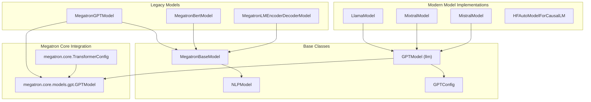
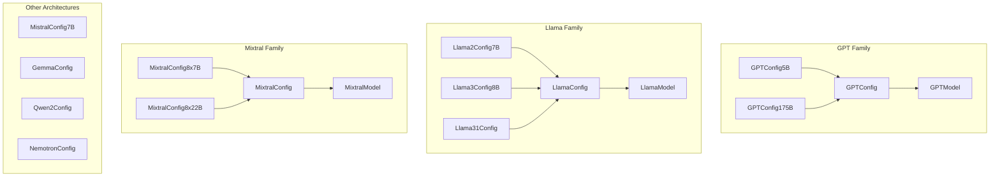
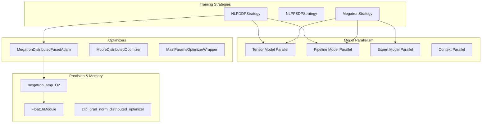
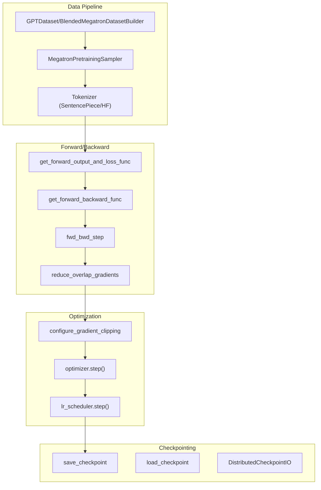
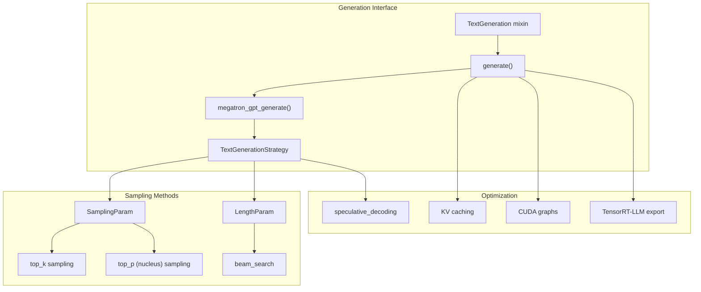

<!-- source: DeepWiki mcp.deepwiki.com · repo NVIDIA/NeMo · page 3 Large Language Models (LLMs) · fetched 2026-10-21 -->

# Large Language Models (LLMs)

<details>
<summary>Relevant source files</summary>

The following files were used as context for generating this wiki page:

- [nemo/collections/common/metrics/perf_metrics.py](nemo/collections/common/metrics/perf_metrics.py)
- [nemo/collections/llm/__init__.py](nemo/collections/llm/__init__.py)
- [nemo/collections/llm/api.py](nemo/collections/llm/api.py)
- [nemo/collections/llm/fn/activation.py](nemo/collections/llm/fn/activation.py)
- [nemo/collections/llm/gpt/model/__init__.py](nemo/collections/llm/gpt/model/__init__.py)
- [nemo/collections/llm/gpt/model/base.py](nemo/collections/llm/gpt/model/base.py)
- [nemo/collections/llm/gpt/model/ssm.py](nemo/collections/llm/gpt/model/ssm.py)
- [nemo/collections/llm/inference/base.py](nemo/collections/llm/inference/base.py)
- [nemo/collections/llm/recipes/__init__.py](nemo/collections/llm/recipes/__init__.py)
- [nemo/collections/llm/recipes/nemotron_nano_12b_v2.py](nemo/collections/llm/recipes/nemotron_nano_12b_v2.py)
- [nemo/collections/llm/recipes/nemotron_nano_9b_v2.py](nemo/collections/llm/recipes/nemotron_nano_9b_v2.py)
- [nemo/core/optim/distributed_adam.py](nemo/core/optim/distributed_adam.py)
- [nemo/core/optim/mcore_optim.py](nemo/core/optim/mcore_optim.py)
- [nemo/lightning/io/state.py](nemo/lightning/io/state.py)
- [nemo/lightning/pytorch/utils.py](nemo/lightning/pytorch/utils.py)
- [nemo/package_info.py](nemo/package_info.py)
- [nemo/utils/callbacks/dist_ckpt_io.py](nemo/utils/callbacks/dist_ckpt_io.py)
- [scripts/llm/generate.py](scripts/llm/generate.py)
- [tests/collections/llm/conversion/test_nmh_conversion.py](tests/collections/llm/conversion/test_nmh_conversion.py)
- [tests/collections/llm/gpt/model/test_nemotronh.py](tests/collections/llm/gpt/model/test_nemotronh.py)
- [tests/collections/llm/gpt/model/test_ssm.py](tests/collections/llm/gpt/model/test_ssm.py)
- [tests/collections/llm/recipes/test_nemotron_nano_12b_v2.py](tests/collections/llm/recipes/test_nemotron_nano_12b_v2.py)
- [tests/collections/llm/recipes/test_nemotron_nano_9b_v2.py](tests/collections/llm/recipes/test_nemotron_nano_9b_v2.py)
- [tests/functional_tests/L2_NeMo_2_Conversion_Test_Nemotron_H_4B.sh](tests/functional_tests/L2_NeMo_2_Conversion_Test_Nemotron_H_4B.sh)
- [tests/functional_tests/L2_NeMo_2_SSM_Finetuning.sh](tests/functional_tests/L2_NeMo_2_SSM_Finetuning.sh)
- [tests/functional_tests/L2_NeMo_2_SSM_Pretraining.sh](tests/functional_tests/L2_NeMo_2_SSM_Pretraining.sh)
- [tests/lightning/pytorch/strategies/test_megatron_strategy.py](tests/lightning/pytorch/strategies/test_megatron_strategy.py)

</details>


This document covers NeMo's comprehensive system for training, fine-tuning, and deploying Large Language Models. The LLM system provides both legacy and modern APIs for working with transformer-based language models, with extensive support for distributed training and various model architectures including GPT, Llama, Mixtral, and others.

For supervised fine-tuning and parameter-efficient training methods, see [Supervised Fine-Tuning and PEFT](#2.3). For HuggingFace integration, see [HuggingFace Integration and AutoModel](#2.4). For model export and deployment, see [Model Export and Deployment](#6).

## System Architecture Overview

NeMo's LLM system is built around two primary collections: the modern `nemo.collections.llm` package and the legacy `nemo.collections.nlp.models.language_modeling` package. The system integrates deeply with Megatron-LM for distributed training capabilities.

### LLM System Architecture

```mermaid
graph TB
    subgraph "Modern LLM Collection"
        LLMPackage["nemo.collections.llm"]
        GPTModel["nemo.collections.llm.gpt.model.GPTModel"]
        LlamaModel["nemo.collections.llm.gpt.model.LlamaModel"]
        MixtralModel["nemo.collections.llm.gpt.model.MixtralModel"]
        MistralModel["nemo.collections.llm.gpt.model.MistralModel"]
    end
    
    subgraph "Legacy NLP Collection"
        NLPPackage["nemo.collections.nlp.models.language_modeling"]
        MegatronGPTModel["MegatronGPTModel"]
        MegatronBaseModel["MegatronBaseModel"]
        MegatronBertModel["MegatronBertModel"]
    end
    
    subgraph "Core Infrastructure"
        MegatronCore["megatron.core"]
        TransformerConfig["TransformerConfig"]
        ModelParallelConfig["ModelParallelConfig"]
        MCoreGPTModel["MCoreGPTModel"]
    end
    
    subgraph "Distributed Training"
        NLPDDPStrategy["NLPDDPStrategy"]
        MegatronStrategy["MegatronStrategy"]
        DistributedOptim["DistributedFusedAdam"]
    end
    
    MegatronGPTModel --> MegatronBaseModel
    MegatronBaseModel --> MegatronCore
    GPTModel --> TransformerConfig
    LlamaModel --> GPTModel
    MixtralModel --> GPTModel
    MistralModel --> GPTModel
    
    MegatronGPTModel --> MCoreGPTModel
    MegatronGPTModel --> NLPDDPStrategy
    NLPDDPStrategy --> DistributedOptim
```



Sources: [nemo/collections/llm/__init__.py:1-438](), [nemo/collections/nlp/models/language_modeling/megatron_gpt_model.py:1-100](), [nemo/collections/nlp/models/language_modeling/megatron_base_model.py:1-100]()

## Core Model Classes

The LLM system is built around several key base classes that provide the foundation for all language model implementations.

### Model Class Hierarchy



Sources: [nemo/collections/nlp/models/language_modeling/megatron_base_model.py:83-100](), [nemo/collections/llm/gpt/model/base.py:1-50](), [nemo/collections/llm/gpt/model/llama.py:57-84]()

### MegatronGPTModel

The `MegatronGPTModel` class is the primary implementation for GPT-style language models in the legacy NLP collection. It provides comprehensive support for distributed training and various optimization techniques.

Key features:
- Megatron-LM integration via `model_provider_func`
- Distributed training with pipeline and tensor parallelism
- Mixed precision training (AMP O1/O2)
- Text generation capabilities
- Gradient accumulation and synchronization

The model supports both Megatron Core (`mcore_gpt=True`) and legacy Megatron implementations.

Sources: [nemo/collections/nlp/models/language_modeling/megatron_gpt_model.py:321-584]()

### MegatronBaseModel

`MegatronBaseModel` serves as the foundation for all Megatron-based models, providing common functionality:

- Model parallel initialization
- Tokenizer management and vocabulary building
- Distributed optimizer configuration
- Gradient clipping strategies
- Mixed precision support

Key methods include `build_transformer_config()`, `_build_tokenizer()`, and `configure_optimizers()`.

Sources: [nemo/collections/nlp/models/language_modeling/megatron_base_model.py:100-256]()

## Modern LLM Collection

The `nemo.collections.llm` package provides a modern, streamlined API for working with large language models. It features clean abstractions and simplified configuration management.

### Available Model Architectures



Sources: [nemo/collections/llm/gpt/model/__init__.py:1-333](), [nemo/collections/llm/gpt/model/llama.py:57-233](), [nemo/collections/llm/gpt/model/mixtral.py:35-124]()

### Configuration System

The modern LLM collection uses dataclass-based configuration with inheritance for model-specific parameters:

- `GPTConfig`: Base configuration for all GPT-style models
- Model-specific configs (e.g., `Llama2Config7B`) inherit and override base parameters
- Integration with Megatron Core's `TransformerConfig`
- Support for PEFT and quantization configurations

Example configuration hierarchy for Llama models:

```python
@dataclass
class LlamaConfig(GPTConfig):
    normalization: str = "RMSNorm"
    activation_func: Callable = F.silu
    position_embedding_type: str = "rope"
    # ... other common Llama settings

@dataclass  
class Llama2Config7B(LlamaConfig):
    num_layers: int = 32
    hidden_size: int = 4096
    num_attention_heads: int = 32
    # ... 7B specific parameters
```

Sources: [nemo/collections/llm/gpt/model/llama.py:57-98]()

## Distributed Training Infrastructure

NeMo's LLM system provides comprehensive distributed training capabilities through integration with Megatron-LM and custom PyTorch Lightning strategies.

### Distributed Training Components



Sources: [nemo/collections/nlp/parts/nlp_overrides.py:200-321](), [nemo/core/optim/distributed_adam.py:1-100](), [nemo/collections/nlp/models/language_modeling/megatron_base_model.py:293-337]()

### Model Parallelism Configuration

The system supports multiple forms of parallelism:

1. **Tensor Model Parallel**: Splits individual layers across devices
2. **Pipeline Model Parallel**: Splits layers vertically across devices  
3. **Expert Model Parallel**: For MoE models, splits experts across devices
4. **Context Parallel**: Splits sequence dimension for long contexts

Configuration is managed through the model config:

```yaml
tensor_model_parallel_size: 4
pipeline_model_parallel_size: 2
expert_model_parallel_size: 1
context_parallel_size: 1
```

The `initialize_model_parallel_for_nemo` function sets up the parallel groups and communication patterns.

Sources: [nemo/collections/nlp/modules/common/megatron/megatron_init.py:1-50](), [examples/nlp/language_modeling/conf/megatron_gpt_config.yaml:84-87]()

## Training Pipeline

The LLM training pipeline orchestrates data loading, forward/backward passes, and optimization across distributed environments.

### Training Execution Flow



Sources: [nemo/collections/nlp/models/language_modeling/megatron_gpt_model.py:719-850](), [nemo/collections/nlp/data/language_modeling/megatron/gpt_dataset.py:1-50]()

### Gradient Accumulation and Synchronization

The training pipeline implements sophisticated gradient handling for distributed environments:

1. **Microbatch Processing**: Global batches are split into microbatches
2. **Pipeline Execution**: `get_forward_backward_func()` handles pipeline stages
3. **Gradient Reduction**: Overlapped gradient synchronization with communication hooks
4. **Mixed Precision**: Automatic scaling and overflow detection

Key functions:
- `fwd_bwd_step()`: Main training step orchestration
- `reduce_overlap_gradients()`: Asynchronous gradient reduction  
- `average_losses_across_data_parallel_group()`: Loss aggregation

Sources: [nemo/collections/nlp/models/language_modeling/megatron_gpt_model.py:719-800](), [nemo/collections/nlp/modules/common/megatron/utils.py:600-700]()

## Text Generation and Inference

NeMo provides comprehensive text generation capabilities with various sampling strategies and optimization techniques.

### Generation Components



Sources: [nemo/collections/nlp/modules/common/text_generation_utils.py:1-100](), [nemo/collections/nlp/modules/common/transformer/text_generation.py:1-50]()

The generation system supports:

- **Sampling Parameters**: Temperature, top-k, top-p, repetition penalty
- **Length Controls**: Max tokens, stop sequences, length penalties  
- **Advanced Techniques**: Beam search, speculative decoding
- **Optimization**: KV caching, CUDA graph capture for inference acceleration

Sources: [nemo/collections/nlp/modules/common/text_generation_utils.py:58-70]()

## Model Export and Optimization

NeMo LLMs can be exported to various optimized formats for production deployment.

Key export targets:
- **ONNX**: Cross-platform inference via `MegatronGPTExportableModel`
- **TensorRT-LLM**: Optimized NVIDIA GPU inference 
- **Triton**: Multi-backend serving with PyTriton integration
- **HuggingFace**: Compatibility with transformers library

The export system handles model parallelism, quantization, and format conversion automatically.

Sources: [nemo/collections/nlp/models/language_modeling/megatron_gpt_model.py:230-319](), [Model Export and Deployment](#6)

---

