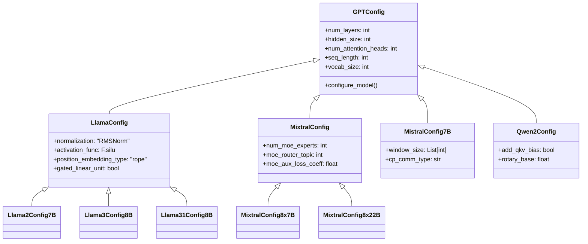
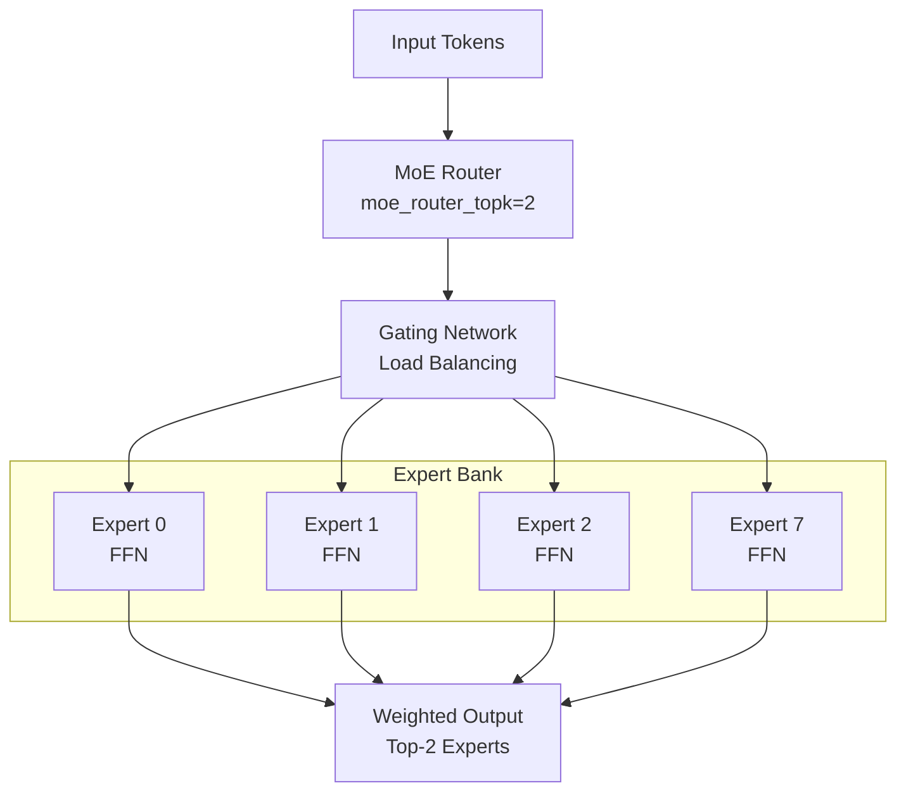
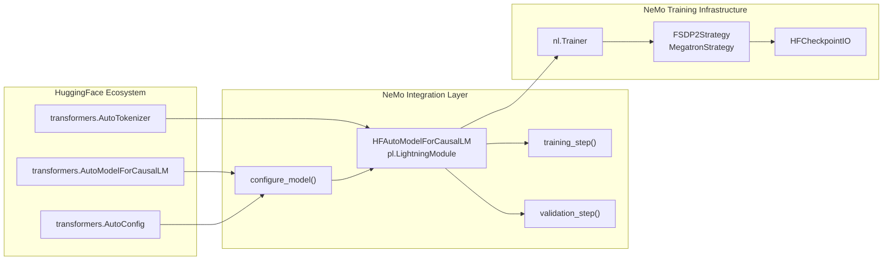
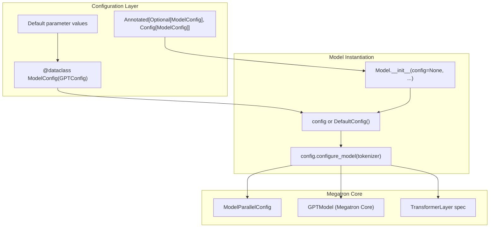

<!-- source: DeepWiki mcp.deepwiki.com · repo NVIDIA/NeMo · page 3.1 LLM Model Architectures and Configurations · fetched 2026-10-21 -->

# LLM Model Architectures and Configurations

<details>
<summary>Relevant source files</summary>

The following files were used as context for generating this wiki page:

- [nemo/collections/common/metrics/perf_metrics.py](nemo/collections/common/metrics/perf_metrics.py)
- [nemo/collections/llm/__init__.py](nemo/collections/llm/__init__.py)
- [nemo/collections/llm/api.py](nemo/collections/llm/api.py)
- [nemo/collections/llm/fn/activation.py](nemo/collections/llm/fn/activation.py)
- [nemo/collections/llm/gpt/model/__init__.py](nemo/collections/llm/gpt/model/__init__.py)
- [nemo/collections/llm/gpt/model/base.py](nemo/collections/llm/gpt/model/base.py)
- [nemo/collections/llm/gpt/model/ssm.py](nemo/collections/llm/gpt/model/ssm.py)
- [nemo/collections/llm/inference/base.py](nemo/collections/llm/inference/base.py)
- [nemo/collections/llm/recipes/__init__.py](nemo/collections/llm/recipes/__init__.py)
- [nemo/collections/llm/recipes/nemotron_nano_12b_v2.py](nemo/collections/llm/recipes/nemotron_nano_12b_v2.py)
- [nemo/collections/llm/recipes/nemotron_nano_9b_v2.py](nemo/collections/llm/recipes/nemotron_nano_9b_v2.py)
- [nemo/core/optim/distributed_adam.py](nemo/core/optim/distributed_adam.py)
- [nemo/core/optim/mcore_optim.py](nemo/core/optim/mcore_optim.py)
- [nemo/lightning/io/state.py](nemo/lightning/io/state.py)
- [nemo/lightning/pytorch/utils.py](nemo/lightning/pytorch/utils.py)
- [nemo/package_info.py](nemo/package_info.py)
- [nemo/utils/callbacks/dist_ckpt_io.py](nemo/utils/callbacks/dist_ckpt_io.py)
- [scripts/llm/generate.py](scripts/llm/generate.py)
- [tests/collections/llm/conversion/test_nmh_conversion.py](tests/collections/llm/conversion/test_nmh_conversion.py)
- [tests/collections/llm/gpt/model/test_nemotronh.py](tests/collections/llm/gpt/model/test_nemotronh.py)
- [tests/collections/llm/gpt/model/test_ssm.py](tests/collections/llm/gpt/model/test_ssm.py)
- [tests/collections/llm/recipes/test_nemotron_nano_12b_v2.py](tests/collections/llm/recipes/test_nemotron_nano_12b_v2.py)
- [tests/collections/llm/recipes/test_nemotron_nano_9b_v2.py](tests/collections/llm/recipes/test_nemotron_nano_9b_v2.py)
- [tests/functional_tests/L2_NeMo_2_Conversion_Test_Nemotron_H_4B.sh](tests/functional_tests/L2_NeMo_2_Conversion_Test_Nemotron_H_4B.sh)
- [tests/functional_tests/L2_NeMo_2_SSM_Finetuning.sh](tests/functional_tests/L2_NeMo_2_SSM_Finetuning.sh)
- [tests/functional_tests/L2_NeMo_2_SSM_Pretraining.sh](tests/functional_tests/L2_NeMo_2_SSM_Pretraining.sh)
- [tests/lightning/pytorch/strategies/test_megatron_strategy.py](tests/lightning/pytorch/strategies/test_megatron_strategy.py)

</details>


This document covers the supported LLM model architectures in NeMo and their configuration systems. It focuses on the various pre-built model architectures (Llama, Mixtral, Mistral, GPT variants, and others) and how to configure them for training and inference.

For information about distributed training strategies and Megatron-LM integration, see [Megatron-LM Integration and Distributed Training](#2.1). For fine-tuning workflows and PEFT methods, see [Supervised Fine-Tuning and PEFT](#2.3). For broader HuggingFace ecosystem integration, see [HuggingFace Integration and AutoModel](#2.4).

## Base GPT Architecture

NeMo's LLM collection is built around a foundational `GPTModel` class that extends PyTorch Lightning's `LightningModule`. All supported architectures inherit from this base implementation, which provides common functionality for transformer-based language models.

### GPTConfig Base Class

The `GPTConfig` dataclass serves as the foundation for all model configurations, defining common parameters across architectures:

**GPTConfig Hierarchy**


Sources: [nemo/collections/llm/gpt/model/base.py:58-200](), [nemo/collections/llm/gpt/model/llama.py:57-84](), [nemo/collections/llm/gpt/model/mixtral.py:35-79]()

### GPTModel Base Implementation  

The `GPTModel` class provides the core functionality:

- **Model Configuration**: Converts config dataclasses to Megatron-Core model instances
- **Training Integration**: Handles forward/backward passes, loss computation, and optimization
- **Checkpoint Management**: Implements save/restore functionality with distributed checkpointing
- **Tokenizer Integration**: Manages tokenizer lifecycle and vocabulary handling

Sources: [nemo/collections/llm/gpt/model/base.py:202-850]()

## Native NeMo Architectures

NeMo provides native implementations for several popular LLM architectures, each with multiple size configurations.

### Llama Family

The Llama family includes multiple generations with different capabilities:

**Llama Architecture Variants**

```mermaid
graph TB
    LlamaConfig["LlamaConfig<br/>Base Llama Configuration"]
    
    subgraph "Llama 2 Series"
        Llama2Config7B["Llama2Config7B<br/>32 layers, 4096 hidden"]
        Llama2Config13B["Llama2Config13B<br/>40 layers, 5120 hidden"] 
        Llama2Config70B["Llama2Config70B<br/>80 layers, 8192 hidden<br/>GQA: 8 groups"]
    end
    
    subgraph "Llama 3 Series"
        Llama3Config8B["Llama3Config8B<br/>32 layers, 4096 hidden<br/>8K context"]
        Llama3Config70B["Llama3Config70B<br/>80 layers, 8192 hidden<br/>8K context"]
    end
    
    subgraph "Llama 3.1 Series"
        Llama31Config8B["Llama31Config8B<br/>131K context<br/>RoPE scaling"]
        Llama31Config405B["Llama31Config405B<br/>126 layers, 16384 hidden<br/>131K context"]
    end
    
    subgraph "Code Llama"
        CodeLlamaConfig7B["CodeLlamaConfig7B<br/>16K context<br/>1M rotary base"]
        CodeLlamaConfig70B["CodeLlamaConfig70B<br/>Code specialized"]
    end
    
    LlamaConfig --> Llama2Config7B
    LlamaConfig --> Llama2Config13B  
    LlamaConfig --> Llama2Config70B
    LlamaConfig --> Llama3Config8B
    LlamaConfig --> Llama3Config70B
    LlamaConfig --> Llama31Config8B
    LlamaConfig --> Llama31Config405B
    LlamaConfig --> CodeLlamaConfig7B
    LlamaConfig --> CodeLlamaConfig70B
```


Key Llama features:
- **RMSNorm**: Layer normalization variant
- **SiLU Activation**: Swish-like activation function
- **RoPE**: Rotary Position Embedding
- **GQA**: Grouped Query Attention for larger models
- **Gated MLP**: SwiGLU-style feed-forward networks

Sources: [nemo/collections/llm/gpt/model/llama.py:57-439]()

### Mixtral (Mixture of Experts)

Mixtral implements sparse MoE architecture with different expert configurations:

- **MixtralConfig8x3B**: 8 experts, 2560 hidden size, efficient variant
- **MixtralConfig8x7B**: 8 experts, 4096 hidden size, standard variant  
- **MixtralConfig8x22B**: 8 experts, 6144 hidden size, large variant

**Mixtral MoE Architecture**


Sources: [nemo/collections/llm/gpt/model/mixtral.py:35-123]()

### Mistral Family

Mistral models feature sliding window attention for long sequences:

- **MistralConfig7B**: 32K sequence length with sliding window
- **MistralNeMoConfig12B**: 40 layers, 5120 hidden size

Key Mistral features:
- **Sliding Window Attention**: Configurable via `window_size` parameter
- **Context Parallel Communication**: Optimized via `cp_comm_type`
- **Extended Context**: Up to 32K tokens with efficient attention

Sources: [nemo/collections/llm/gpt/model/mistral.py:38-103]()

### Other Architectures

NeMo supports additional architectures with specialized configurations:

| Architecture | Key Features | Config Classes |
|--------------|-------------|----------------|
| **Qwen2/2.5** | QKV bias, high rotary base | `Qwen2Config500M` to `Qwen25Config72B` |
| **Gemma** | RMSNorm, GELU activation | `GemmaConfig2B`, `GemmaConfig7B` |
| **Gemma2** | Sliding window, alternating attention | `Gemma2Config2B` to `Gemma2Config27B` |
| **Baichuan2** | Chinese-optimized architecture | `Baichuan2Config7B` |
| **ChatGLM** | GLM architecture with RoPE | `ChatGLM2Config6B`, `ChatGLM3Config6B` |
| **Nemotron** | Squared ReLU, LayerNorm | `Nemotron3Config4B` to `Nemotron4Config340B` |
| **StarCoder** | Code-specialized models | `StarcoderConfig15B`, `Starcoder2Config15B` |

Sources: [nemo/collections/llm/gpt/model/qwen2.py:37-195](), [nemo/collections/llm/gpt/model/gemma.py:42-69](), [nemo/collections/llm/gpt/model/baichuan.py:37-66]()

## HuggingFace Model Integration

NeMo provides seamless integration with HuggingFace models through the `HFAutoModelForCausalLM` wrapper class.

### HFAutoModelForCausalLM Architecture

**HuggingFace Integration Flow**


### Key Integration Features

The `HFAutoModelForCausalLM` class provides:

- **Dynamic Model Loading**: Supports any HuggingFace causal LM via `model_name` parameter
- **Quantization Support**: Built-in 4-bit quantization via BitsAndBytesConfig
- **Advanced Loss Functions**: Linear cross-entropy loss for memory efficiency
- **Custom Kernels**: Optional Liger kernel integration for optimization
- **PEFT Integration**: Seamless adapter support via `model_transform`

**Configuration Parameters**:
```python
HFAutoModelForCausalLM(
    model_name='mistralai/Mistral-7B-v0.1',
    load_pretrained_weights=True,
    trust_remote_code=False,
    default_dtype=torch.bfloat16,
    load_in_4bit=False,
    attn_implementation="sdpa",
    use_liger_kernel=False,
    use_linear_ce_loss=True
)
```

Sources: [nemo/collections/llm/gpt/model/hf_auto_model_for_causal_lm.py:65-651]()

## Configuration System

NeMo uses a structured configuration system built on dataclasses and the `Config` type annotation system.

### Configuration Hierarchy

**Configuration System Architecture**  


### Model Selection and Instantiation

**Model Creation Patterns**:

1. **Direct Instantiation**:
```python
# Use specific configuration
model = LlamaModel(config=Llama3Config8B())

# Use default configuration  
model = MistralModel()  # Uses MistralConfig7B()
```

2. **Factory Pattern via Recipes**:
```python
# Recipe-based instantiation
model_config = llama3_8b.model()
```

3. **HuggingFace Integration**:
```python
# Any HuggingFace model
model = HFAutoModelForCausalLM(model_name="microsoft/DialoGPT-large")
```

### Configuration Override System

Model configurations support runtime parameter overrides:

```python
# Override specific parameters
config = Llama3Config8B(
    seq_length=16384,  # Extend context length
    num_layers=40,     # Increase model depth
    hidden_dropout=0.1 # Add dropout
)
```

Sources: [nemo/collections/llm/gpt/model/base.py:58-200](), [nemo/collections/llm/utils.py:24-50]()

## Model Registry and Factory System

NeMo provides a centralized model registry accessible through the main collections interface.

### Available Models

The complete model registry is exposed through `nemo.collections.llm`:

```python
from nemo.collections.llm import (
    # Llama family
    LlamaModel, Llama2Config7B, Llama3Config8B, Llama31Config70B,
    
    # Mixtral family  
    MixtralModel, MixtralConfig8x7B, MixtralConfig8x22B,
    
    # Mistral family
    MistralModel, MistralConfig7B, MistralNeMoConfig12B,
    
    # HuggingFace integration
    HFAutoModelForCausalLM,
    
    # Other architectures
    GemmaModel, Qwen2Model, Baichuan2Model, ChatGLMModel
)
```

### Recipe System

Pre-configured recipes provide common model configurations:

| Recipe Function | Model Architecture | Key Features |
|-----------------|-------------------|--------------|
| `llama3_8b` | Llama 3 8B | Standard configuration |
| `llama31_70b` | Llama 3.1 70B | Extended context, RoPE scaling |
| `mixtral_8x7b` | Mixtral 8x7B | Sparse MoE, 2 active experts |
| `mistral_7b` | Mistral 7B | Sliding window attention |
| `hf_auto_model_for_causal_lm` | Any HF model | Generic HuggingFace wrapper |

Sources: [nemo/collections/llm/__init__.py:52-196](), [nemo/collections/llm/recipes/__init__.py:16-228]()

---

