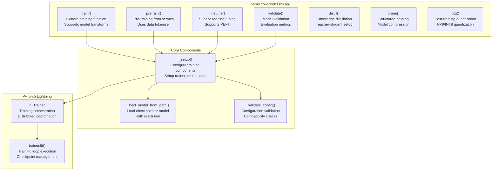
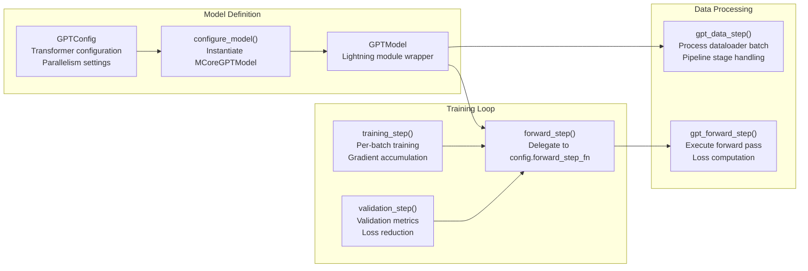
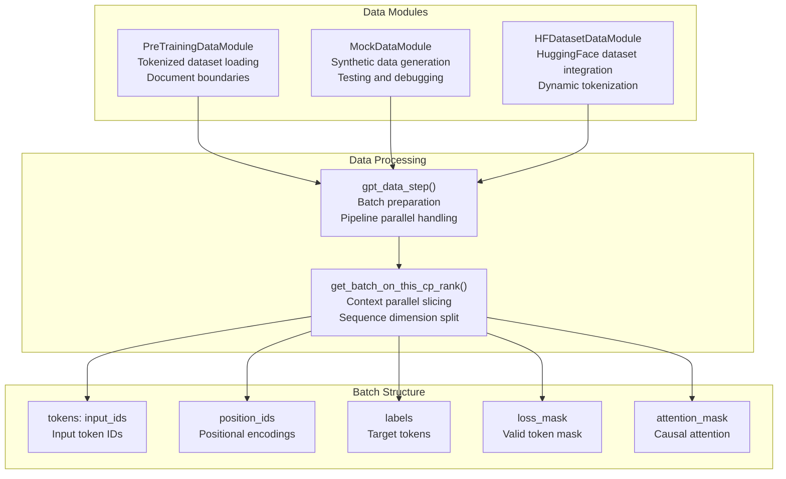
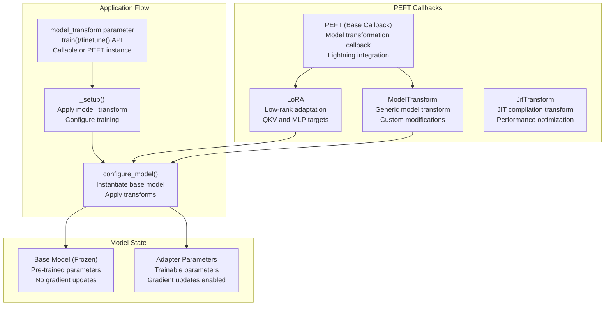
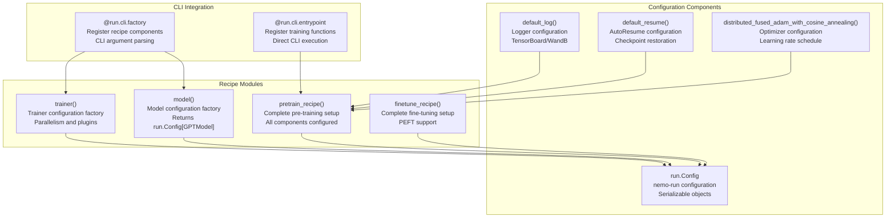
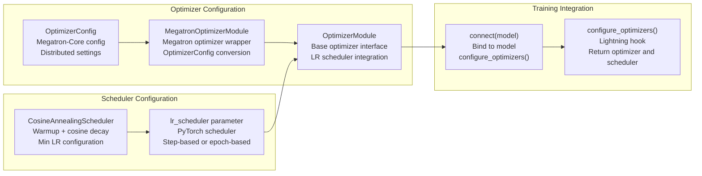

<!-- source: DeepWiki mcp.deepwiki.com · repo NVIDIA/NeMo · page 3.2 LLM Training and Fine-Tuning · fetched 2026-10-21 -->

# LLM Training and Fine-Tuning

<details>
<summary>Relevant source files</summary>

The following files were used as context for generating this wiki page:

- [.dockerignore](.dockerignore)
- [.flake8](.flake8)
- [.flake8.other](.flake8.other)
- [.flake8.speech](.flake8.speech)
- [.github/workflows/cicd-relabel-bot.yml](.github/workflows/cicd-relabel-bot.yml)
- [.github/workflows/code-formatting.yml](.github/workflows/code-formatting.yml)
- [.github/workflows/code-linting.yml](.github/workflows/code-linting.yml)
- [.pre-commit-config.yaml](.pre-commit-config.yaml)
- [.pylintrc](.pylintrc)
- [.pylintrc.other](.pylintrc.other)
- [.pylintrc.speech](.pylintrc.speech)
- [examples/llm/resiliency/README.md](examples/llm/resiliency/README.md)
- [examples/llm/resiliency/crash_simulator.py](examples/llm/resiliency/crash_simulator.py)
- [examples/llm/resiliency/preemption_simulator.py](examples/llm/resiliency/preemption_simulator.py)
- [examples/llm/resiliency/resiliency-in-pretraining-demo.ipynb](examples/llm/resiliency/resiliency-in-pretraining-demo.ipynb)
- [nemo/collections/llm/__init__.py](nemo/collections/llm/__init__.py)
- [nemo/collections/llm/api.py](nemo/collections/llm/api.py)
- [nemo/collections/llm/fn/activation.py](nemo/collections/llm/fn/activation.py)
- [nemo/collections/llm/gpt/model/__init__.py](nemo/collections/llm/gpt/model/__init__.py)
- [nemo/collections/llm/gpt/model/base.py](nemo/collections/llm/gpt/model/base.py)
- [nemo/collections/llm/gpt/model/ssm.py](nemo/collections/llm/gpt/model/ssm.py)
- [nemo/collections/llm/inference/base.py](nemo/collections/llm/inference/base.py)
- [nemo/collections/llm/recipes/__init__.py](nemo/collections/llm/recipes/__init__.py)
- [nemo/collections/llm/recipes/callbacks/__init__.py](nemo/collections/llm/recipes/callbacks/__init__.py)
- [nemo/collections/llm/recipes/callbacks/common.py](nemo/collections/llm/recipes/callbacks/common.py)
- [nemo/collections/llm/recipes/nemotron_nano_12b_v2.py](nemo/collections/llm/recipes/nemotron_nano_12b_v2.py)
- [nemo/collections/llm/recipes/nemotron_nano_9b_v2.py](nemo/collections/llm/recipes/nemotron_nano_9b_v2.py)
- [nemo/lightning/io/state.py](nemo/lightning/io/state.py)
- [nemo/lightning/pytorch/utils.py](nemo/lightning/pytorch/utils.py)
- [pyproject.toml](pyproject.toml)
- [requirements/requirements.txt](requirements/requirements.txt)
- [requirements/requirements_nlp.txt](requirements/requirements_nlp.txt)
- [requirements/requirements_test.txt](requirements/requirements_test.txt)
- [scripts/llm/generate.py](scripts/llm/generate.py)
- [setup.py](setup.py)
- [tests/collections/llm/conversion/test_nmh_conversion.py](tests/collections/llm/conversion/test_nmh_conversion.py)
- [tests/collections/llm/gpt/model/test_nemotronh.py](tests/collections/llm/gpt/model/test_nemotronh.py)
- [tests/collections/llm/gpt/model/test_ssm.py](tests/collections/llm/gpt/model/test_ssm.py)
- [tests/collections/llm/recipes/test_nemotron_nano_12b_v2.py](tests/collections/llm/recipes/test_nemotron_nano_12b_v2.py)
- [tests/collections/llm/recipes/test_nemotron_nano_9b_v2.py](tests/collections/llm/recipes/test_nemotron_nano_9b_v2.py)
- [tests/functional_tests/L2_NeMo_2_Conversion_Test_Nemotron_H_4B.sh](tests/functional_tests/L2_NeMo_2_Conversion_Test_Nemotron_H_4B.sh)
- [tests/functional_tests/L2_NeMo_2_SSM_Finetuning.sh](tests/functional_tests/L2_NeMo_2_SSM_Finetuning.sh)
- [tests/functional_tests/L2_NeMo_2_SSM_Pretraining.sh](tests/functional_tests/L2_NeMo_2_SSM_Pretraining.sh)

</details>


This document covers the training and fine-tuning workflows for large language models in NeMo. The framework provides high-level APIs for pre-training, fine-tuning, and advanced optimization techniques including parameter-efficient fine-tuning (PEFT), distillation, pruning, and quantization.

For information about LLM model architectures and configurations, see page 3.1. For HuggingFace integration, see page 3.3. For inference and generation, see page 3.4.

## Overview

NeMo provides several training workflows through the `nemo.collections.llm.api` module:

- **Pre-training (`pretrain`)**: Training language models from scratch on large unlabeled corpora
- **Fine-tuning (`finetune`)**: Adapting pre-trained models to specific tasks with supervised data
- **Full Fine-tuning (`train`)**: General-purpose training API supporting both pre-training and fine-tuning
- **PEFT (`peft` parameter)**: Parameter-efficient fine-tuning using LoRA and adapters
- **Distillation (`distill`)**: Knowledge transfer from teacher to student models
- **Pruning (`prune`)**: Structured pruning to reduce model size
- **Quantization (`ptq`)**: Post-training quantization for deployment

All training workflows use PyTorch Lightning for orchestration and Megatron-Core for distributed training primitives.

Sources: [nemo/collections/llm/api.py:66-183](), [nemo/collections/llm/__init__.py:406-433]()

## Training API Architecture

### Primary Training Functions

Title: NeMo LLM Training API Functions



The training API provides multiple entry points that wrap PyTorch Lightning's training loop with NeMo-specific setup for distributed training, data loading, and model management.

Sources: [nemo/collections/llm/api.py:66-131](), [nemo/collections/llm/api.py:134-183](), [nemo/collections/llm/api.py:185-239]()

### Model and Training Configuration

Title: GPT Model Training Flow



The `GPTModel` class wraps Megatron-Core's `MCoreGPTModel` and provides PyTorch Lightning integration. The `GPTConfig` dataclass extends `TransformerConfig` with GPT-specific settings and defines data/forward step functions.

Sources: [nemo/collections/llm/gpt/model/base.py:558-673](), [nemo/collections/llm/gpt/model/base.py:59-146](), [nemo/collections/llm/gpt/model/base.py:319-444]()

## Pre-training Workflows

### Pre-training API

The `pretrain()` function provides a streamlined interface for training language models from scratch. It configures the trainer to use the tokenizer from the data module and sets up distributed training.

```python
# Example: Basic pre-training workflow
from nemo.collections import llm
from nemo import lightning as nl

model = llm.MistralModel()
data = llm.PreTrainingDataModule(
    paths=["path/to/data"],
    seq_length=4096,
    global_batch_size=512,
    micro_batch_size=2
)
precision = nl.MegatronMixedPrecision(precision="bf16-mixed")
trainer = nl.Trainer(
    strategy=nl.MegatronStrategy(tensor_model_parallel_size=2),
    plugins=precision
)
llm.pretrain(model, data, trainer)
```

The `pretrain()` function wraps `train()` with preset configurations: it uses `tokenizer="data"` to ensure consistent tokenization between the data loader and model.

Sources: [nemo/collections/llm/api.py:134-183]()

### Data Loading for Pre-training

Title: Pre-training Data Pipeline



The data loading pipeline handles distributed data processing with support for pipeline and context parallelism. The `gpt_data_step()` function manages data distribution across pipeline stages.

Sources: [nemo/collections/llm/gpt/model/base.py:59-112](), [nemo/collections/llm/gpt/data/__init__.py:36-50]()

## Fine-tuning Workflows

### Fine-tuning API

The `finetune()` function adapts pre-trained models to specific tasks using supervised data. It supports both full fine-tuning and parameter-efficient methods through the `peft` parameter.

```python
# Example: Fine-tuning with LoRA
from nemo.collections import llm
from nemo import lightning as nl

model = llm.MistralModel()
data = llm.SquadDataModule(
    seq_length=4096,
    global_batch_size=16,
    micro_batch_size=2
)
peft = llm.peft.LoRA(
    target_modules=['attention_qkv', 'attention_dense'],
    dim=32
)
trainer = nl.Trainer(
    strategy=nl.MegatronStrategy(tensor_model_parallel_size=2),
    plugins=nl.MegatronMixedPrecision(precision="bf16-mixed")
)
llm.finetune(model, data, trainer, peft=peft)
```

By default, `finetune()` uses `tokenizer="model"` to use the model's checkpoint tokenizer, but this can be overridden to `tokenizer="data"` for vocabulary expansion.

Sources: [nemo/collections/llm/api.py:185-239]()

### Fine-tuning Data Modules

| Data Module | Purpose | Key Features |
|-------------|---------|--------------|
| `FineTuningDataModule` | General supervised fine-tuning | Supports packed sequences, JSON/JSONL input |
| `SquadDataModule` | Question answering | SQuAD dataset format, context-question-answer structure |
| `DollyDataModule` | Instruction following | Dolly dataset format, instruction-response pairs |
| `ChatDataModule` | Multi-turn conversations | Role-based formatting, conversation history |
| `HFDatasetDataModule` | HuggingFace datasets | Direct HF dataset integration, flexible collation |

Sources: [nemo/collections/llm/gpt/data/__init__.py:36-50]()

### PEFT Implementation

Title: PEFT Integration Architecture



PEFT is implemented through PyTorch Lightning callbacks that transform the model after instantiation. The `PEFT` base class and its subclasses (e.g., `LoRA`) apply parameter-efficient modifications to frozen base models.

Sources: [nemo/collections/llm/api.py:185-239](), [nemo/lightning/pytorch/callbacks/__init__.py:1-14]()

## Recipe System

### Recipe Architecture

NeMo provides a recipe system built on `nemo-run` for reproducible training configurations. Recipes combine model configurations, training strategies, data modules, and optimization settings into executable training scripts.

Title: Recipe Component Organization



Recipes are decorated with `@run.cli.factory` to register them as CLI-accessible components. The complete recipes (`pretrain_recipe`, `finetune_recipe`) combine all necessary components for training.

Sources: [nemo/collections/llm/recipes/__init__.py:1-236](), [nemo/collections/llm/recipes/nemotron_nano_9b_v2.py:42-82]()

### Example Recipe Structure

```python
# Model factory
@run.cli.factory(name="mistral_7b")
def model() -> run.Config[pl.LightningModule]:
    return run.Config(
        llm.MistralModel,
        config=run.Config(llm.MistralConfig7B)
    )

# Trainer factory  
@run.cli.factory(target=finetune, name="mistral_7b")
def trainer(
    tensor_parallelism: int = 2,
    pipeline_parallelism: int = 1,
    num_nodes: int = 1,
    num_gpus_per_node: int = 8,
) -> run.Config[nl.Trainer]:
    strategy = run.Config(
        nl.MegatronStrategy,
        tensor_model_parallel_size=tensor_parallelism,
        pipeline_model_parallel_size=pipeline_parallelism,
    )
    return run.Config(
        nl.Trainer,
        devices=num_gpus_per_node,
        num_nodes=num_nodes,
        strategy=strategy,
        plugins=[bf16_mixed()]
    )

# Complete fine-tuning recipe
@run.cli.factory(target=finetune, name="mistral_7b")
def finetune_recipe(
    dir: Optional[str] = None,
    name: str = "default",
    num_nodes: int = 1,
) -> run.Partial:
    return run.Partial(
        finetune,
        model=model(),
        data=llm.SquadDataModule(...),
        trainer=trainer(num_nodes=num_nodes),
        log=default_log(dir=dir, name=name),
        optim=distributed_fused_adam_with_cosine_annealing(...)
    )
```

Sources: [nemo/collections/llm/recipes/nemotron_nano_9b_v2.py:64-186](), [nemo/collections/llm/recipes/log/default.py:1-60]()

## Optimization Configuration

### Optimizer Setup

NeMo uses `OptimizerModule` to configure optimizers with learning rate schedules. The `MegatronOptimizerModule` provides integration with Megatron-Core's distributed optimizers.

| Optimizer | Implementation | Use Case |
|-----------|----------------|----------|
| `MegatronDistributedFusedAdam` | Fused Adam with distributed state | Large models with tensor/pipeline parallelism |
| `McoreDistributedOptimizer` | ZeRO-style distributed optimizer | Memory-efficient training |
| Standard PyTorch optimizers | `torch.optim.*` | Single-GPU or simple multi-GPU setups |

Title: Optimizer Configuration Flow



The optimizer module connects to the model via the `connect()` method, which binds `configure_optimizers()` to return the configured optimizer and scheduler.

Sources: [nemo/collections/llm/gpt/model/base.py:565-590](), [nemo/lightning/pytorch/optim/__init__.py:1-30]()

## Advanced Training Features

### Knowledge Distillation

The `distill()` function implements knowledge distillation by training a student model to match a teacher model's outputs. It creates a `DistillationGPTModel` wrapper that computes distillation losses.

```python
# Example: Model distillation
from nemo.collections import llm

student = llm.finetune(
    student_model_path="/path/to/student",
    teacher_model_path="/path/to/teacher", 
    data=llm.SquadDataModule(...),
    trainer=trainer,
    distillation_config_path="distill_config.yaml"
)
```

The distillation configuration YAML specifies loss weights and distillation strategy (logits, hidden states, attention).

Sources: [nemo/collections/llm/api.py:382-465]()

### Model Pruning

The `prune()` function applies structured pruning to reduce model size. It supports FFN and attention dimension reduction while maintaining model quality through calibration on sample data.

```python
# Example: Pruning configuration
from nemo.collections.llm.modelopt.prune import PruningConfig

pruning_config = PruningConfig(
    target_ffn_hidden_size=9216,  # Reduce from 16384
    target_hidden_size=3072        # Reduce from 4096
)

llm.prune(
    nemo_checkpoint="path/to/model.nemo",
    save_path="path/to/pruned",
    pruning_config=pruning_config,
    data=data,
    num_train_samples=1024
)
```

Sources: [nemo/collections/llm/api.py:297-379]()

### Post-Training Quantization

The `ptq()` function quantizes models for efficient deployment. It supports FP8, INT8, and other formats through ModelOpt integration.

```python
# Example: FP8 quantization
from nemo.collections.llm.modelopt import QuantizationConfig, ExportConfig

quant_config = QuantizationConfig(algorithm="fp8")
export_config = ExportConfig(
    path="/path/to/export",
    export_format="tensorrt_llm"
)

llm.ptq(
    model_path="/path/to/model.nemo",
    export_config=export_config,
    quantization_config=quant_config,
    calibration_tp=8
)
```

The PTQ process runs calibration to determine quantization scales, then exports the quantized model in the target format.

Sources: [nemo/collections/llm/api.py:468-573]()

## Configuration and Usage

### SFT Configuration Structure

```yaml
model:
  # Core model configuration
  restore_from_path: /path/to/pretrained/model.nemo
  
  # Training parameters
  global_batch_size: 128
  micro_batch_size: 4
  answer_only_loss: true
  
  # Data configuration
  data:
    train_ds:
      file_names: [train_data.jsonl]
      concat_sampling_probabilities: [1.0]
      max_seq_length: 2048
      prompt_template: "Q: {input}\n\nA: {output}"
    
    validation_ds:
      file_names: [val_data.jsonl]
      metric:
        name: "exact_string_match"
```

### PEFT Configuration Structure

```yaml
model:
  # PEFT configuration
  peft:
    peft_scheme: "lora"
    
    lora_tuning:
      target_modules: ['attention_qkv', 'attention_dense', 'mlp_fc1', 'mlp_fc2']
      adapter_dim: 32
      alpha: 32
      adapter_dropout: 0.0
      column_init_method: 'xavier'
      row_init_method: 'zero'
```

The configuration system supports both SFT and PEFT through structured YAML configurations that define training parameters, data sources, and method-specific settings.

Sources: [examples/nlp/language_modeling/tuning/conf/megatron_gpt_finetuning_config.yaml:46-130](), [nemo/collections/nlp/parts/peft_config.py:147-235]()

## Integration Points

### Megatron-Core Integration

The SFT and PEFT systems integrate with Megatron-Core for distributed training through:

- **Pipeline Parallelism**: `fwd_bwd_step()` method handles microbatch processing across pipeline stages
- **Tensor Parallelism**: Adapter modules support distributed linear layers via `ColumnParallelLinear` and `RowParallelLinear`
- **Sequence Parallelism**: Adapters handle sequence parallel communication patterns

### HuggingFace Compatibility

PEFT configurations provide compatibility layers for HuggingFace integration:

- **Model Conversion**: Support for converting between NeMo and HuggingFace PEFT formats
- **Adapter Loading**: Direct loading of HuggingFace LoRA adapters
- **Configuration Mapping**: Translation between configuration formats

Sources: [nemo/collections/nlp/models/language_modeling/megatron_gpt_sft_model.py:408-522](), [nemo/collections/nlp/modules/common/megatron/adapters/parallel_adapters.py:159-375]()

---

