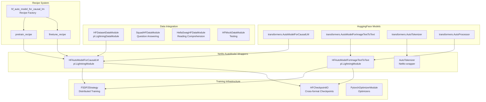
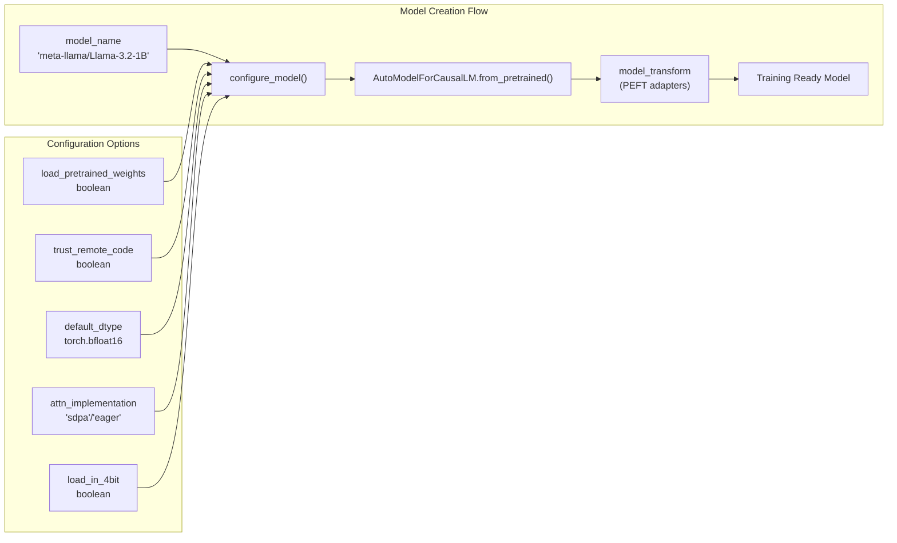
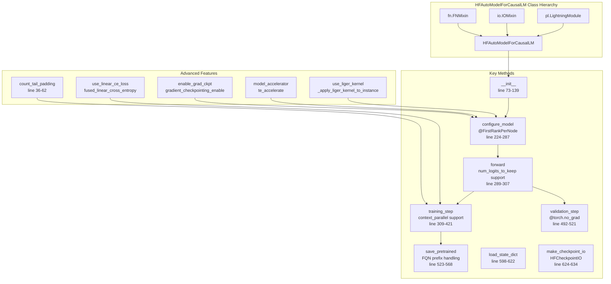
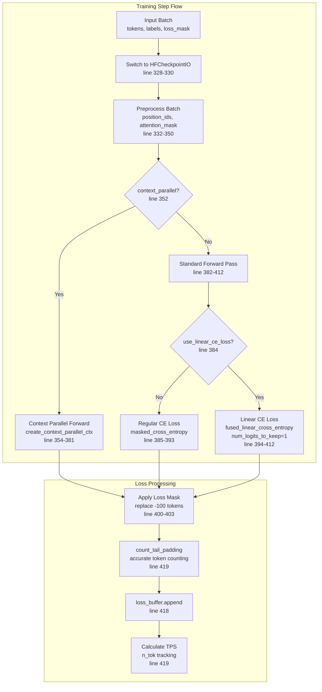
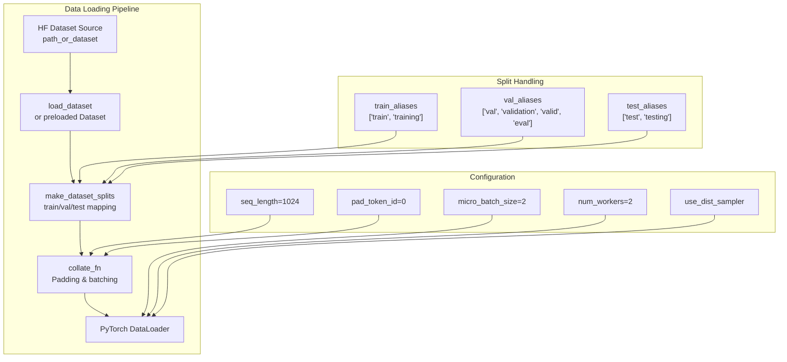
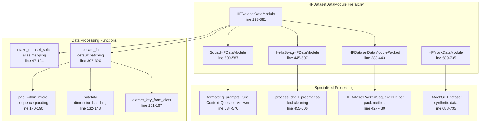
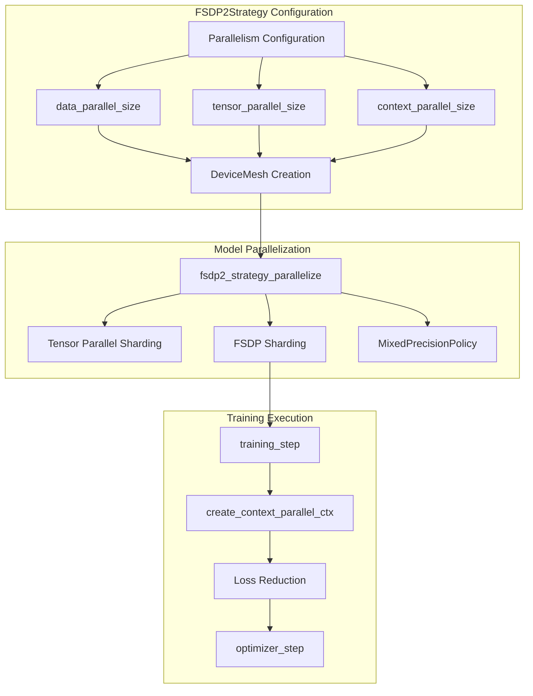
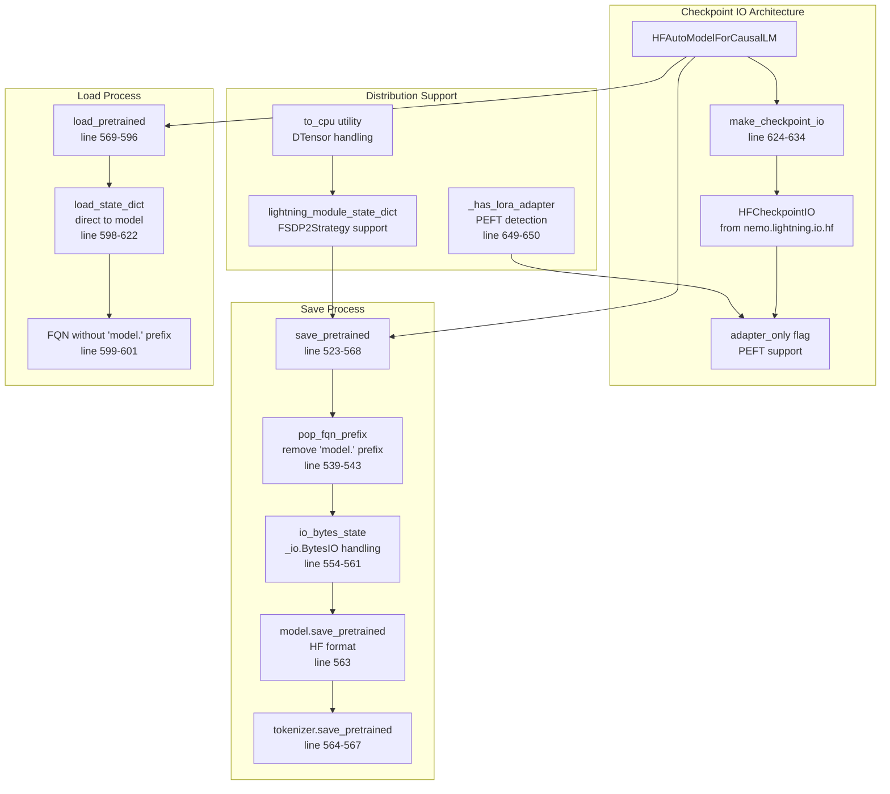
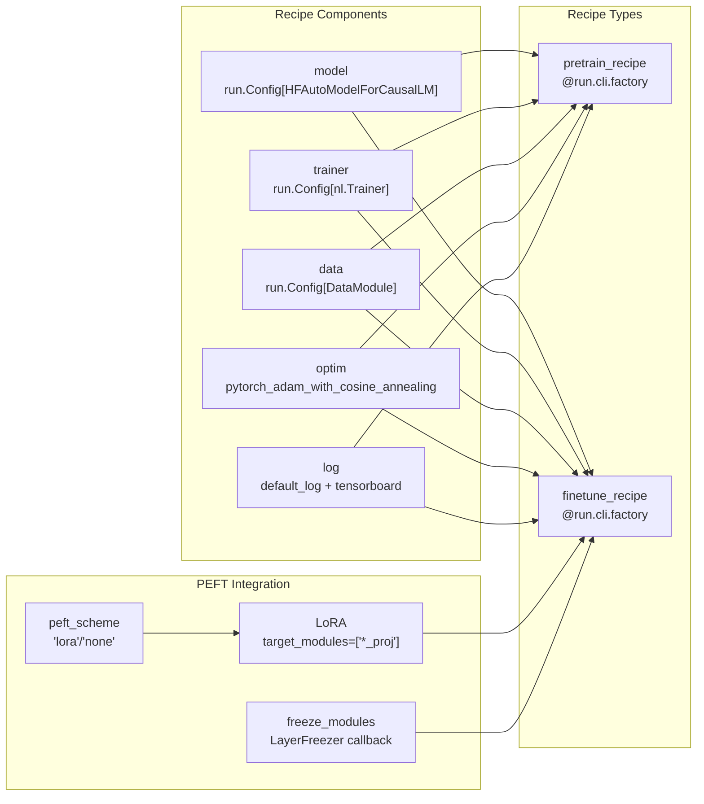

<!-- source: DeepWiki mcp.deepwiki.com · repo NVIDIA/NeMo · page 3.3 HuggingFace Integration and AutoModel · fetched 2026-10-21 -->

# HuggingFace Integration and AutoModel

<details>
<summary>Relevant source files</summary>

The following files were used as context for generating this wiki page:

- [nemo/collections/llm/gpt/data/__init__.py](nemo/collections/llm/gpt/data/__init__.py)
- [nemo/collections/llm/gpt/data/hf_dataset.py](nemo/collections/llm/gpt/data/hf_dataset.py)
- [nemo/collections/llm/recipes/optim/adam.py](nemo/collections/llm/recipes/optim/adam.py)
- [nemo/collections/llm/recipes/optim/sgd.py](nemo/collections/llm/recipes/optim/sgd.py)
- [nemo/lightning/pytorch/callbacks/layer_freezer.py](nemo/lightning/pytorch/callbacks/layer_freezer.py)
- [nemo/lightning/pytorch/optim/pytorch.py](nemo/lightning/pytorch/optim/pytorch.py)
- [nemo/lightning/pytorch/strategies/fsdp2_strategy.py](nemo/lightning/pytorch/strategies/fsdp2_strategy.py)
- [nemo/lightning/pytorch/strategies/utils.py](nemo/lightning/pytorch/strategies/utils.py)
- [tests/collections/llm/gpt/data/test_hf_hellaswag.py](tests/collections/llm/gpt/data/test_hf_hellaswag.py)
- [tests/collections/llm/gpt/data/test_hf_mockdataset.py](tests/collections/llm/gpt/data/test_hf_mockdataset.py)

</details>


## Purpose and Scope

This document covers NeMo's integration with HuggingFace (HF) models through AutoModel wrapper classes, enabling seamless use of HuggingFace pretrained models within NeMo's training and inference workflows. The integration provides day-0 support for popular HuggingFace transformer models while maintaining compatibility with NeMo's distributed training strategies, data handling, and checkpoint management systems.

For information about NeMo's native LLM architectures, see [LLM Model Architectures and Configurations](#2.2). For details about PEFT techniques, see [Supervised Fine-Tuning and PEFT](#2.3).

## Architecture Overview

The HuggingFace integration consists of wrapper classes that adapt HuggingFace models to work within NeMo's PyTorch Lightning framework, along with specialized data modules and checkpoint handling systems.

### System Architecture Diagram



Sources: [nemo/collections/llm/gpt/model/hf_auto_model_for_causal_lm.py:65-651](), [nemo/collections/vlm/hf/model/hf_auto_model_for_image_text_to_text.py:27-303](), [nemo/collections/llm/gpt/data/hf_dataset.py:193-735]()

## Core Components

### AutoModel Wrapper Classes

The integration centers around Lightning module wrappers that adapt HuggingFace models for NeMo workflows:

| Class | Purpose | HF Base Class | File Location |
|-------|---------|---------------|---------------|
| `HFAutoModelForCausalLM` | Causal language modeling | `AutoModelForCausalLM` | [nemo/collections/llm/gpt/model/hf_auto_model_for_causal_lm.py]() |
| `HFAutoModelForImageTextToText` | Vision-language modeling | `AutoModelForImageTextToText` | [nemo/collections/vlm/hf/model/hf_auto_model_for_image_text_to_text.py]() |

### Model Configuration and Initialization



Sources: [nemo/collections/llm/gpt/model/hf_auto_model_for_causal_lm.py:187-287](), [nemo/collections/vlm/hf/model/hf_auto_model_for_image_text_to_text.py:82-120]()

## HFAutoModelForCausalLM

The `HFAutoModelForCausalLM` class is the primary wrapper for causal language models, providing full integration with NeMo's training infrastructure.

### Key Features

- **Automatic Model Loading**: Supports both pretrained weights and from-config initialization
- **Optimized Loss Computation**: Optional linear cross-entropy loss for memory efficiency
- **Advanced Attention**: Configurable attention implementations (SDPA, eager, Flash Attention)
- **Quantization Support**: Built-in 4-bit quantization with BitsAndBytesConfig
- **Gradient Checkpointing**: Memory optimization for large models
- **Context Parallelism**: Support for sequence parallelism across context dimension

### Core Methods and Implementation



Sources: [nemo/collections/llm/gpt/model/hf_auto_model_for_causal_lm.py:65-651](), [nemo/automodel/dist_utils.py:21-88]()

### Training Step Implementation

The `training_step` method implements sophisticated loss computation with multiple optimization paths:



**Key Features:**
- **Context Parallelism**: Uses `create_context_parallel_ctx` with `cp_buffers` and `cp_seq_dims` for distributed sequence processing
- **Linear CE Optimization**: `fused_linear_cross_entropy` with `num_logits_to_keep=1` reduces memory usage by avoiding full logits matrix
- **Accurate Token Counting**: `count_tail_padding` function counts only non-padding tokens for precise throughput metrics
- **Checkpoint IO Switching**: Automatically switches from `MegatronCheckpointIO` to `HFCheckpointIO` when needed

Sources: [nemo/collections/llm/gpt/model/hf_auto_model_for_causal_lm.py:309-421](), [nemo/collections/llm/gpt/model/hf_auto_model_for_causal_lm.py:36-62](), [nemo/automodel/loss/linear_ce.py]()

## Data Integration

### HFDatasetDataModule

The `HFDatasetDataModule` provides comprehensive support for HuggingFace datasets within PyTorch Lightning's data handling framework.



Sources: [nemo/collections/llm/gpt/data/hf_dataset.py:193-365](), [nemo/collections/llm/gpt/data/hf_dataset.py:47-124]()

### Specialized Data Modules



**Implementation Details:**

| Module | Key Implementation | Code Location |
|--------|-------------------|---------------|
| `SquadHFDataModule` | `formatting_prompts_func` creates context-question-answer format with `loss_mask` for answer tokens only | [line 534-570]() |
| `HellaSwagHFDataModule` | `preprocess` removes WikiHow artifacts, `process_doc` handles multiple choice format | [line 455-477]() |
| `HFMockDataModule` | `_MockGPTDataset` generates synthetic data with configurable vocab size and sequence length | [line 688-735]() |
| `HFDatasetDataModulePacked` | Uses `HFDatasetPackedSequenceHelper.pack` with `packed_sequence_size` and `split_across_pack` parameters | [line 427-430]() |

Sources: [nemo/collections/llm/gpt/data/hf_dataset.py:193-735](), [nemo/collections/llm/gpt/data/hf_dataset_packed_sequence.py]()

## Training Strategy Integration

### FSDP2Strategy Support

The HuggingFace models integrate with NeMo's `FSDP2Strategy` for distributed training:



Sources: [nemo/lightning/pytorch/strategies/fsdp2_strategy.py:63-302](), [nemo/lightning/pytorch/strategies/utils.py:451-529](), [nemo/lightning/pytorch/strategies/utils.py:621-681]()

### Checkpoint IO Integration

The checkpoint system provides seamless integration between NeMo's distributed training and HuggingFace model formats:



**Key Implementation Details:**
- **FQN Prefix Management**: `pop_fqn_prefix` removes `"model."` prefix from state dict keys to match HuggingFace expectations
- **BytesIO Handling**: Separates `_io.BytesIO` objects into `io_bytes.pt` for complex serialized state
- **PEFT Adapter Detection**: `_has_lora_adapter` automatically detects PEFT adapters by checking for "lora" in module names
- **Direct Model Loading**: `load_state_dict` bypasses Lightning's wrapper and loads directly to `self.model`

Sources: [nemo/collections/llm/gpt/model/hf_auto_model_for_causal_lm.py:523-651](), [nemo/lightning/pytorch/strategies/utils.py:570-608](), [nemo/lightning/io/hf.py]()

## Recipe System

### Factory Pattern Implementation

The recipe system provides pre-configured training setups through factory functions:



Sources: [nemo/collections/llm/recipes/hf_auto_model_for_causal_lm.py:37-70](), [nemo/collections/llm/recipes/hf_auto_model_for_causal_lm.py:127-174](), [nemo/collections/llm/recipes/hf_auto_model_for_causal_lm.py:177-257]()

### Configuration Examples

The recipe system supports flexible configuration through CLI and Python APIs:

**CLI Usage:**
```bash
nemo llm pretrain --factory hf_auto_model_for_causal_lm \
  model_name="meta-llama/Llama-3.2-1B" \
  num_nodes=2 num_gpus_per_node=8
```

**Python API:**
```python
recipe = finetune_recipe(
    model_name="mistralai/Mistral-Nemo-Instruct-2407",
    peft_scheme='lora',
    max_steps=1000
)
```

Sources: [nemo/collections/llm/recipes/hf_auto_model_for_causal_lm.py:154-160](), [nemo/collections/llm/recipes/hf_auto_model_for_causal_lm.py:210-218]()

## Vision-Language Model Support

### HFAutoModelForImageTextToText

The vision-language wrapper extends support to multimodal models:

- **Processor Integration**: Uses `AutoProcessor` for combined text and image processing
- **Model Freezing**: Selective freezing of vision or language components
- **Token Filtering**: Automatic filtering of special vision tokens from loss computation
- **Format Support**: Compatible with models like LLaVA, Qwen2-VL, PaliGemma

Sources: [nemo/collections/vlm/hf/model/hf_auto_model_for_image_text_to_text.py:27-120](), [nemo/collections/vlm/hf/model/hf_auto_model_for_image_text_to_text.py:258-288]()

## Usage Patterns

### Basic Training Setup

```python
# Model initialization
model = HFAutoModelForCausalLM(
    model_name="meta-llama/Llama-3.2-1B",
    load_pretrained_weights=True,
    attn_implementation="sdpa"
)

# Data preparation  
data = SquadHFDataModule(
    path_or_dataset="rajpurkar/squad",
    tokenizer=AutoTokenizer("meta-llama/Llama-3.2-1B")
)

# Training strategy
strategy = FSDP2Strategy(
    data_parallel_size=4,
    tensor_parallel_size=2
)
```

### Advanced Configuration

```python
# PEFT with LoRA
peft = LoRA(target_modules=['*_proj'], dim=16)

# Custom model transform
def apply_peft(model_wrapper):
    peft.transform(model_wrapper.model)

model = HFAutoModelForCausalLM(
    model_name="mistralai/Mistral-7B-v0.1",
    model_transform=apply_peft,
    use_linear_ce_loss=True,
    enable_grad_ckpt=True
)
```

Sources: [tutorials/llm/automodel/sft.ipynb:214-308](), [tutorials/llm/automodel/peft.ipynb:214-308](), [scripts/llm/automodel.py:146-189]()

---

