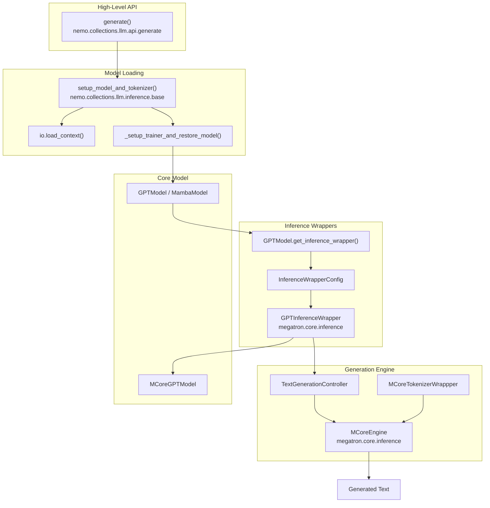
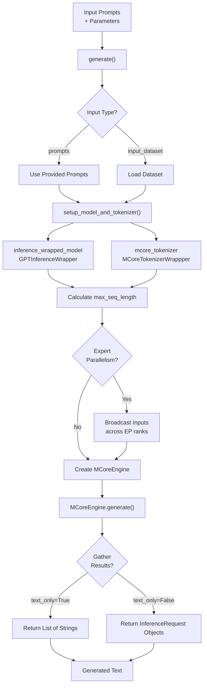
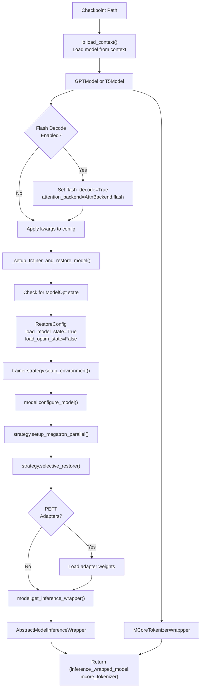
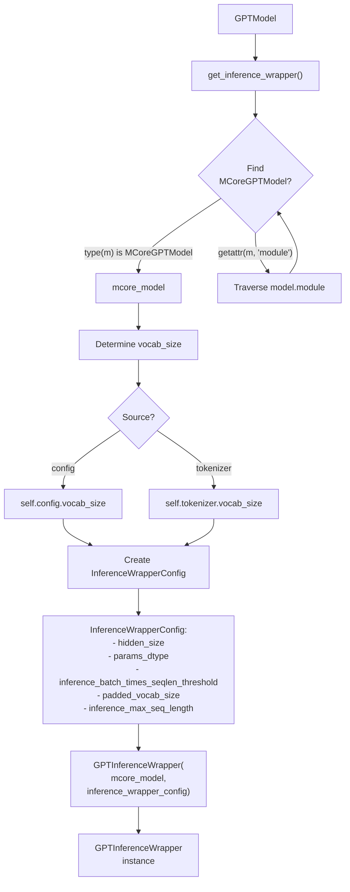
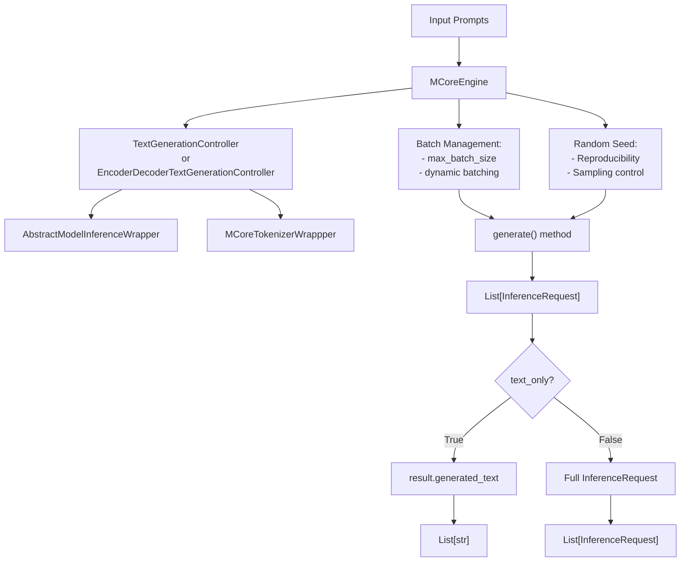

<!-- source: DeepWiki mcp.deepwiki.com · repo NVIDIA/NeMo · page 3.4 LLM Inference and Generation · fetched 2026-10-21 -->

# LLM Inference and Generation

<details>
<summary>Relevant source files</summary>

The following files were used as context for generating this wiki page:

- [nemo/collections/llm/__init__.py](nemo/collections/llm/__init__.py)
- [nemo/collections/llm/api.py](nemo/collections/llm/api.py)
- [nemo/collections/llm/fn/activation.py](nemo/collections/llm/fn/activation.py)
- [nemo/collections/llm/gpt/model/__init__.py](nemo/collections/llm/gpt/model/__init__.py)
- [nemo/collections/llm/gpt/model/base.py](nemo/collections/llm/gpt/model/base.py)
- [nemo/collections/llm/gpt/model/ssm.py](nemo/collections/llm/gpt/model/ssm.py)
- [nemo/collections/llm/inference/base.py](nemo/collections/llm/inference/base.py)
- [nemo/collections/llm/recipes/__init__.py](nemo/collections/llm/recipes/__init__.py)
- [nemo/collections/llm/recipes/nemotron_nano_12b_v2.py](nemo/collections/llm/recipes/nemotron_nano_12b_v2.py)
- [nemo/collections/llm/recipes/nemotron_nano_9b_v2.py](nemo/collections/llm/recipes/nemotron_nano_9b_v2.py)
- [nemo/lightning/io/state.py](nemo/lightning/io/state.py)
- [nemo/lightning/pytorch/utils.py](nemo/lightning/pytorch/utils.py)
- [scripts/llm/generate.py](scripts/llm/generate.py)
- [tests/collections/llm/conversion/test_nmh_conversion.py](tests/collections/llm/conversion/test_nmh_conversion.py)
- [tests/collections/llm/gpt/model/test_nemotronh.py](tests/collections/llm/gpt/model/test_nemotronh.py)
- [tests/collections/llm/gpt/model/test_ssm.py](tests/collections/llm/gpt/model/test_ssm.py)
- [tests/collections/llm/recipes/test_nemotron_nano_12b_v2.py](tests/collections/llm/recipes/test_nemotron_nano_12b_v2.py)
- [tests/collections/llm/recipes/test_nemotron_nano_9b_v2.py](tests/collections/llm/recipes/test_nemotron_nano_9b_v2.py)
- [tests/functional_tests/L2_NeMo_2_Conversion_Test_Nemotron_H_4B.sh](tests/functional_tests/L2_NeMo_2_Conversion_Test_Nemotron_H_4B.sh)
- [tests/functional_tests/L2_NeMo_2_SSM_Finetuning.sh](tests/functional_tests/L2_NeMo_2_SSM_Finetuning.sh)
- [tests/functional_tests/L2_NeMo_2_SSM_Pretraining.sh](tests/functional_tests/L2_NeMo_2_SSM_Pretraining.sh)

</details>


This document covers the inference and text generation capabilities for Large Language Models in NeMo. It focuses on the `generate()` API, the `MCoreEngine` inference engine, `TextGenerationController`, and the inference wrapper system that enables efficient text generation from trained LLM checkpoints.

For model architecture details and configurations, see page 3.1. For training workflows, see page 3.2. For HuggingFace integration, see page 3.3.

## Inference System Overview

The NeMo LLM inference system is built around several key components that work together to enable efficient text generation from trained model checkpoints:

**Diagram: Inference Architecture Components**



Sources: [nemo/collections/llm/api.py:743-876](), [nemo/collections/llm/inference/base.py:192-249](), [nemo/collections/llm/gpt/model/base.py:701-755]()

## The generate() API Function

The `generate()` function is the primary entry point for text generation from trained LLM checkpoints. It handles model loading, inference setup, and batch text generation.

**Diagram: generate() Function Flow**



Key parameters:
- `path`: Path to the NeMo checkpoint
- `trainer`: Configured `nl.Trainer` with appropriate parallelism settings
- `prompts`: List of input prompts or `input_dataset` for batch processing
- `inference_params`: `CommonInferenceParams` object controlling generation behavior
- `params_dtype`: Data type for model parameters (default: `torch.bfloat16`)
- `max_batch_size`: Maximum batch size for generation
- `enable_flash_decode`: Enable flash attention for decoding (default: `True`)

Sources: [nemo/collections/llm/api.py:743-876](), [scripts/llm/generate.py:169-236]()

## Model and Tokenizer Setup

### setup_model_and_tokenizer()

The `setup_model_and_tokenizer()` function loads a trained checkpoint and prepares it for inference by creating the inference wrapper and tokenizer wrapper.

**Diagram: Model Loading and Inference Preparation**



Parameters:
- `path`: Path to checkpoint
- `trainer`: NeMo Lightning Trainer instance
- `params_dtype`: Model parameter data type
- `inference_batch_times_seqlen_threshold`: Threshold for using pipelining
- `inference_max_seq_length`: Maximum sequence length for inference
- `enable_flash_decode`: Enable flash attention decoding

Sources: [nemo/collections/llm/inference/base.py:192-249](), [nemo/collections/llm/inference/base.py:116-190]()

### MCoreTokenizerWrappper

The `MCoreTokenizerWrappper` class adapts NeMo tokenizers to the interface expected by Megatron-Core's inference engines.

| Method | Purpose | NeMo Tokenizer Mapping |
|--------|---------|------------------------|
| `detokenize()` | Convert token IDs to text | `tokenizer.ids_to_text()` |
| `tokenize()` | Convert text to token IDs | `tokenizer.text_to_ids()` |
| `bos` | Beginning-of-sequence token ID | `tokenizer.bos_id` |
| `pad` | Padding token ID | `tokenizer.pad_id` |
| `eod` | End-of-document token ID | `tokenizer.eod` |
| `vocab_size` | Vocabulary size | `tokenizer.vocab_size` |

Sources: [nemo/collections/llm/inference/base.py:45-113]()

## Inference Wrapper System

### GPTModel.get_inference_wrapper()

The `get_inference_wrapper()` method on `GPTModel` creates a `GPTInferenceWrapper` that encapsulates the underlying Megatron-Core model for efficient inference.

**Diagram: Inference Wrapper Creation**



Key configuration parameters:
- `hidden_size`: Model hidden dimension size
- `params_dtype`: Data type for parameters during inference
- `inference_batch_times_seqlen_threshold`: Controls whether to use pipelining (threshold typically 1000)
- `padded_vocab_size`: Vocabulary size for output projection
- `inference_max_seq_length`: Maximum sequence length for prefill and decode

Sources: [nemo/collections/llm/gpt/model/base.py:701-755]()

### InferenceWrapperConfig

The `InferenceWrapperConfig` from Megatron-Core controls inference behavior:

| Parameter | Purpose | Typical Value |
|-----------|---------|---------------|
| `hidden_size` | Model hidden dimension | From model config |
| `params_dtype` | Parameter precision | `torch.bfloat16` or `torch.float16` |
| `inference_batch_times_seqlen_threshold` | Pipelining threshold | 1000 |
| `padded_vocab_size` | Vocabulary size | From tokenizer |
| `inference_max_seq_length` | Max sequence length | 2560-8192 |

The wrapper manages:
- **KV cache allocation**: Efficient memory management for key-value caches
- **Batch processing**: Optimal batching for inference workloads
- **Sequence pipelining**: Overlapping computation for long sequences

Sources: [nemo/collections/llm/gpt/model/base.py:738-755](), [nemo/collections/llm/inference/base.py:296-303]()

## MCoreEngine and Text Generation

### MCoreEngine

The `MCoreEngine` is the central inference engine from Megatron-Core that coordinates text generation across distributed model replicas.

**Diagram: MCoreEngine Architecture**



Initialization:
```python
mcore_engine = MCoreEngine(
    text_generation_controller=text_generation_controller,
    max_batch_size=max_batch_size,
    random_seed=random_seed
)
```

Generation call:
```python
results = mcore_engine.generate(
    prompts=prompts,
    add_BOS=add_BOS,
    encoder_prompts=encoder_prompts,  # For encoder-decoder models
    common_inference_params=common_inference_params,
)
```

Sources: [nemo/collections/llm/inference/base.py:251-305](), [nemo/collections/llm/inference/base.py:307-350]()

### TextGenerationController

The `TextGenerationController` manages the generation process by coordinating the inference wrapper and tokenizer:

| Component | Responsibility |
|-----------|---------------|
| `inference_wrapped_model` | Wrapped model for efficient inference |
| `tokenizer` | Tokenizer wrapper for encoding/decoding |
| Token generation | Iterative token sampling and selection |
| KV cache management | Efficient cache updates during generation |
| Stopping criteria | End-of-sequence detection |

For encoder-decoder models (like T5), use `EncoderDecoderTextGenerationController` which handles both encoder and decoder prompts.

Sources: [nemo/collections/llm/inference/base.py:281-293]()

### setup_mcore_engine()

The `setup_mcore_engine()` helper function provides a convenient way to create a fully configured `MCoreEngine` instance:

```python
mcore_engine, model, tokenizer = setup_mcore_engine(
    path=checkpoint_path,
    trainer=trainer,
    params_dtype=torch.bfloat16,
    inference_batch_times_seqlen_threshold=1000,
    inference_max_seq_length=4096,
    enable_flash_decode=True,
    max_batch_size=32,
    random_seed=1234,
)
```

This function internally calls `setup_model_and_tokenizer()` and creates the `TextGenerationController` and `MCoreEngine`.

Sources: [nemo/collections/llm/inference/base.py:307-350]()

## Common Inference Parameters

The `CommonInferenceParams` class from Megatron-Core controls generation behavior:

**Key Parameters:**

| Parameter | Purpose | Typical Values |
|-----------|---------|---------------|
| `temperature` | Controls randomness in sampling | 0.0 (greedy) to 1.5 (creative) |
| `top_k` | Top-K sampling - select from top K tokens | 0 (disabled), 1 (greedy), 10-50 (typical) |
| `top_p` | Nucleus sampling - cumulative probability threshold | 0.0 to 1.0 (e.g., 0.9) |
| `num_tokens_to_generate` | Maximum tokens to generate | 25-2048 |
| `return_log_probs` | Return log probabilities | `True` / `False` |
| `top_n_logprobs` | Return top N log probs per position | 0-10 |

Example usage:
```python
from megatron.core.inference.common_inference_params import CommonInferenceParams

inference_params = CommonInferenceParams(
    temperature=0.1,
    top_k=10,
    top_p=0.95,
    num_tokens_to_generate=512,
    return_log_probs=False,
)
```

Sources: [scripts/llm/generate.py:217-224](), [nemo/collections/llm/api.py:854-858]()

## Configuration Management

### ModelOpt Integration

NeMo integrates with NVIDIA TensorRT Model Optimizer for advanced optimizations:

```python
def setup_trainer_and_restore_model_with_modelopt_spec(
    model_path: str,
    tensor_model_parallel_size: int = 1,
    pipeline_model_parallel_size: int = 1,
    inference_only: bool = True,
    # ... additional parameters
) -> tuple[Union[llm.GPTModel, llm.MambaModel], nl.Trainer]
```

This function automatically detects and applies ModelOpt specifications when loading models with quantization or optimization states.

Sources: [nemo/collections/llm/modelopt/model_utils.py:98-203]()

### Lifecycle State Management

The API maintains state consistency across lifecycle phases through:
- **Checkpoint compatibility**: Automatic detection of ModelOpt states
- **Configuration merging**: Dynamic config updates for optimization
- **State preservation**: Maintaining model states across transformations
- **Artifact management**: Consistent artifact handling and storage

Sources: [nemo/collections/llm/modelopt/model_utils.py:82-96](), [nemo/lightning/fabric/strategies.py:336-422]()

---

