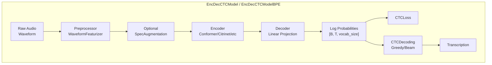
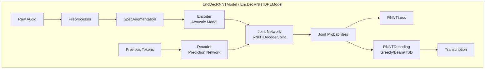
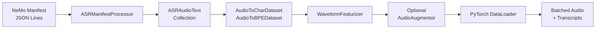
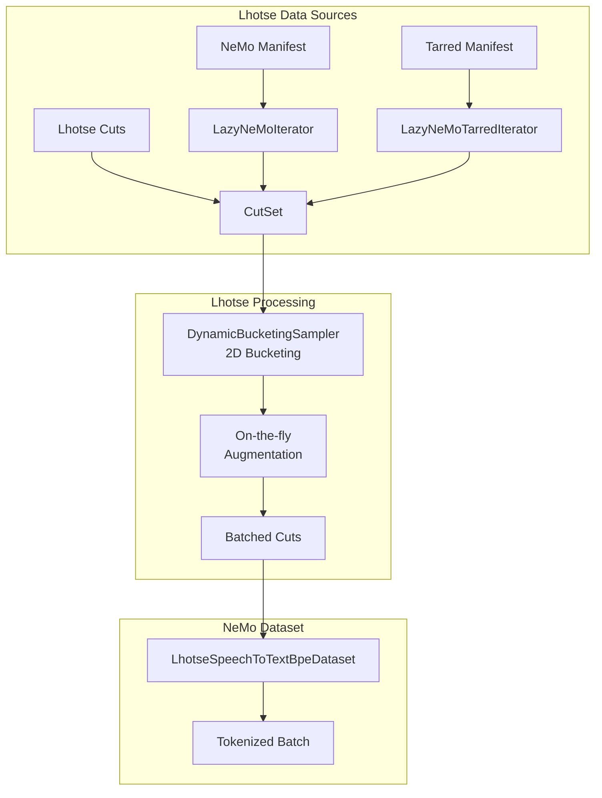
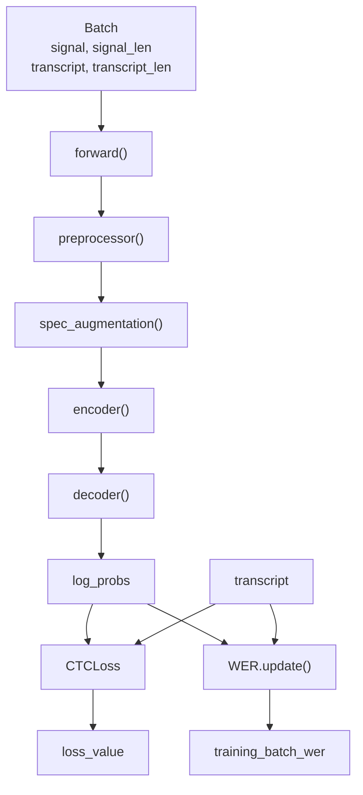
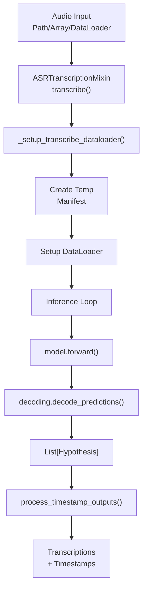

<!-- source: DeepWiki mcp.deepwiki.com · repo NVIDIA/NeMo · page 4 Automatic Speech Recognition (ASR) · fetched 2026-10-21 -->

# Automatic Speech Recognition (ASR)

<details>
<summary>Relevant source files</summary>

The following files were used as context for generating this wiki page:

- [docs/source/asr/data/benchmark_en.csv](docs/source/asr/data/benchmark_en.csv)
- [docs/source/asr/data/benchmark_zh.csv](docs/source/asr/data/benchmark_zh.csv)
- [docs/source/asr/datasets.rst](docs/source/asr/datasets.rst)
- [examples/asr/transcribe_speech_parallel.py](examples/asr/transcribe_speech_parallel.py)
- [examples/speechlm2/conf/salm.yaml](examples/speechlm2/conf/salm.yaml)
- [examples/speechlm2/salm_eval.py](examples/speechlm2/salm_eval.py)
- [examples/speechlm2/salm_generate.py](examples/speechlm2/salm_generate.py)
- [examples/speechlm2/to_hf.py](examples/speechlm2/to_hf.py)
- [nemo/collections/asr/data/audio_to_label.py](nemo/collections/asr/data/audio_to_label.py)
- [nemo/collections/asr/data/audio_to_text.py](nemo/collections/asr/data/audio_to_text.py)
- [nemo/collections/asr/data/audio_to_text_dataset.py](nemo/collections/asr/data/audio_to_text_dataset.py)
- [nemo/collections/asr/data/audio_to_text_lhotse.py](nemo/collections/asr/data/audio_to_text_lhotse.py)
- [nemo/collections/asr/models/classification_models.py](nemo/collections/asr/models/classification_models.py)
- [nemo/collections/asr/models/configs/asr_models_config.py](nemo/collections/asr/models/configs/asr_models_config.py)
- [nemo/collections/asr/models/ctc_bpe_models.py](nemo/collections/asr/models/ctc_bpe_models.py)
- [nemo/collections/asr/models/ctc_models.py](nemo/collections/asr/models/ctc_models.py)
- [nemo/collections/asr/models/hybrid_rnnt_ctc_bpe_models.py](nemo/collections/asr/models/hybrid_rnnt_ctc_bpe_models.py)
- [nemo/collections/asr/models/hybrid_rnnt_ctc_models.py](nemo/collections/asr/models/hybrid_rnnt_ctc_models.py)
- [nemo/collections/asr/models/label_models.py](nemo/collections/asr/models/label_models.py)
- [nemo/collections/asr/models/rnnt_bpe_models.py](nemo/collections/asr/models/rnnt_bpe_models.py)
- [nemo/collections/asr/models/rnnt_models.py](nemo/collections/asr/models/rnnt_models.py)
- [nemo/collections/asr/models/transformer_bpe_models.py](nemo/collections/asr/models/transformer_bpe_models.py)
- [nemo/collections/common/data/lhotse/cutset.py](nemo/collections/common/data/lhotse/cutset.py)
- [nemo/collections/common/data/lhotse/dataloader.py](nemo/collections/common/data/lhotse/dataloader.py)
- [nemo/collections/common/data/lhotse/nemo_adapters.py](nemo/collections/common/data/lhotse/nemo_adapters.py)
- [nemo/collections/common/data/lhotse/sampling.py](nemo/collections/common/data/lhotse/sampling.py)
- [nemo/collections/common/data/lhotse/text_adapters.py](nemo/collections/common/data/lhotse/text_adapters.py)
- [nemo/collections/speechlm2/data/salm_dataset.py](nemo/collections/speechlm2/data/salm_dataset.py)
- [nemo/collections/speechlm2/models/salm.py](nemo/collections/speechlm2/models/salm.py)
- [nemo/collections/speechlm2/parts/pretrained.py](nemo/collections/speechlm2/parts/pretrained.py)
- [nemo/core/classes/common.py](nemo/core/classes/common.py)
- [nemo/core/classes/mixins/hf_io_mixin.py](nemo/core/classes/mixins/hf_io_mixin.py)
- [nemo/core/classes/modelPT.py](nemo/core/classes/modelPT.py)
- [nemo/core/config/templates/__init__.py](nemo/core/config/templates/__init__.py)
- [nemo/core/config/templates/model_card.py](nemo/core/config/templates/model_card.py)
- [nemo/core/connectors/save_restore_connector.py](nemo/core/connectors/save_restore_connector.py)
- [nemo/utils/model_utils.py](nemo/utils/model_utils.py)
- [requirements/requirements_asr.txt](requirements/requirements_asr.txt)
- [requirements/requirements_audio.txt](requirements/requirements_audio.txt)
- [scripts/speech_recognition/estimate_duration_bins_2d.py](scripts/speech_recognition/estimate_duration_bins_2d.py)
- [scripts/speech_recognition/oomptimizer.py](scripts/speech_recognition/oomptimizer.py)
- [tests/collections/asr/test_asr_ctc_encoder_model_bpe.py](tests/collections/asr/test_asr_ctc_encoder_model_bpe.py)
- [tests/collections/asr/test_asr_ctcencdec_model.py](tests/collections/asr/test_asr_ctcencdec_model.py)
- [tests/collections/asr/test_asr_hybrid_rnnt_ctc_model_bpe.py](tests/collections/asr/test_asr_hybrid_rnnt_ctc_model_bpe.py)
- [tests/collections/asr/test_asr_hybrid_rnnt_ctc_model_char.py](tests/collections/asr/test_asr_hybrid_rnnt_ctc_model_char.py)
- [tests/collections/asr/test_asr_modules.py](tests/collections/asr/test_asr_modules.py)
- [tests/collections/common/test_2d_bucketing_constraint.py](tests/collections/common/test_2d_bucketing_constraint.py)
- [tests/collections/common/test_lhotse_dataloading.py](tests/collections/common/test_lhotse_dataloading.py)
- [tests/collections/common/test_lhotse_multimodal_dataloading.py](tests/collections/common/test_lhotse_multimodal_dataloading.py)
- [tests/collections/common/test_lhotse_nemo_adapters.py](tests/collections/common/test_lhotse_nemo_adapters.py)
- [tests/collections/speechlm2/test_audio_placeholders.py](tests/collections/speechlm2/test_audio_placeholders.py)
- [tests/collections/speechlm2/test_duplex_s2s.py](tests/collections/speechlm2/test_duplex_s2s.py)
- [tests/collections/speechlm2/test_duplex_s2s_speech_decoder.py](tests/collections/speechlm2/test_duplex_s2s_speech_decoder.py)
- [tests/collections/speechlm2/test_salm.py](tests/collections/speechlm2/test_salm.py)
- [tests/core/test_fileio.py](tests/core/test_fileio.py)
- [tests/core/test_save_restore.py](tests/core/test_save_restore.py)
- [tests/core/test_serialization.py](tests/core/test_serialization.py)
- [tests/core/test_typecheck.py](tests/core/test_typecheck.py)

</details>


## Purpose and Scope

This document describes NeMo's Automatic Speech Recognition (ASR) collection, which provides end-to-end neural models for converting speech audio to text. The ASR collection includes multiple model architectures (CTC, RNNT, and multi-task models), data loading infrastructure with Lhotse integration, and utilities for training, fine-tuning, and inference.

For information about Text-to-Speech synthesis, see [TTS Models and G2P Modules](#6.1). For general model lifecycle management (save/restore, configuration), see [Core Model Classes and Interfaces](#1.2).

---

## Model Architecture Hierarchy

All ASR models inherit from `ModelPT` (see [Core Model Classes](#1.2)) and implement the encoder-decoder pattern. The collection provides three main architecture families:

### CTC-Based Models

**EncDecCTCModel** implements Connectionist Temporal Classification with character-level vocabularies. The model consists of:
- **Preprocessor**: Converts raw audio to spectrograms (typically mel-spectrograms)
- **Encoder**: Neural network that processes spectrograms (Conformer, Citrinet, QuartzNet, etc.)
- **Decoder**: Linear projection layer that maps encoder outputs to vocabulary probabilities
- **Loss**: CTCLoss with zero_infinity=True for numerical stability

The character variant is defined in [nemo/collections/asr/models/ctc_models.py:49-709]().

**EncDecCTCModelBPE** extends the CTC architecture with Byte Pair Encoding (BPE) tokenization, enabling subword-level modeling. It adds:
- **Tokenizer**: SentencePiece or aggregate tokenizer for BPE
- **CTCBPEDecoding**: BPE-aware decoding with optional language model integration

Defined in [nemo/collections/asr/models/ctc_bpe_models.py:39-517]().



**Diagram: CTC Model Architecture**

Sources: [nemo/collections/asr/models/ctc_models.py:49-709](), [nemo/collections/asr/models/ctc_bpe_models.py:39-517]()

### RNNT-Based Models

**EncDecRNNTModel** implements Recurrent Neural Network Transducer (RNNT) with character vocabularies:
- **Preprocessor**: Audio to spectrogram conversion
- **Encoder**: Acoustic encoder (processes audio features)
- **Decoder** (Prediction Network): Language model that predicts next token given history
- **Joint Network**: Combines encoder and decoder outputs to produce joint probabilities
- **Loss**: RNNTLoss (supports multiple variants: default, multiblank, TDT)

Defined in [nemo/collections/asr/models/rnnt_models.py:53-796]().

**EncDecRNNTBPEModel** adds BPE tokenization to RNNT, using the same encoder-decoder-joint architecture with subword tokenization.

Defined in [nemo/collections/asr/models/rnnt_bpe_models.py:38-357]().



**Diagram: RNNT Model Architecture**

Sources: [nemo/collections/asr/models/rnnt_models.py:53-796](), [nemo/collections/asr/models/rnnt_bpe_models.py:38-357]()

### Hybrid and Multi-Task Models

**EncDecHybridRNNTCTCModel** and **EncDecHybridRNNTCTCBPEModel** combine RNNT and CTC losses during training:
- Shared encoder between RNNT and CTC paths
- Auxiliary CTC decoder alongside RNNT decoder/joint
- Joint training with weighted loss combination: `loss = λ_rnnt * rnnt_loss + λ_ctc * ctc_loss`
- Supports InterCTC for intermediate layer supervision

Defined in [nemo/collections/asr/models/hybrid_rnnt_ctc_models.py:1-582]() and [nemo/collections/asr/models/hybrid_rnnt_ctc_bpe_models.py:1-535]().

**EncDecMultiTaskModel** supports advanced multi-task scenarios like Canary models with:
- Attention-based encoder-decoder (AED) architecture
- Multi-head decoders for different tasks (ASR, translation, language ID)
- Prompted inputs with task/language/punctuation tokens
- Support for multi-lingual training

### Speaker and Classification Models

**EncDecSpeakerLabelModel** provides speaker verification, language identification, and audio classification:
- Encoder extracts embeddings from audio
- Decoder projects embeddings to class logits
- Supports angular softmax losses for metric learning
- Used for tasks like speaker recognition, language ID, VAD

Defined in [nemo/collections/asr/models/label_models.py:57-575]().

Sources: [nemo/collections/asr/models/label_models.py:57-575](), [nemo/collections/asr/models/hybrid_rnnt_ctc_models.py:1-582]()

---

## Data Loading Infrastructure

NeMo ASR supports two data loading paradigms: traditional PyTorch DataLoaders and Lhotse-based dataloaders.

### Traditional Data Loading

The traditional approach uses NeMo manifest files (JSON lines with `audio_filepath`, `text`, `duration`):



**Diagram: Traditional NeMo Data Loading**

Key classes:
- **ASRManifestProcessor**: Parses manifest files and applies text normalization [nemo/collections/asr/data/audio_to_text.py:113-181]()
- **AudioToCharDataset** / **AudioToBPEDataset**: Dataset classes for character and BPE tokenization [nemo/collections/asr/data/audio_to_text.py:333-773]()
- **TarredAudioToCharDataset** / **TarredAudioToBPEDataset**: WebDataset-based tarred variants for scalability [nemo/collections/asr/data/audio_to_text.py:776-1318]()
- **WaveformFeaturizer**: Loads and preprocesses audio files [nemo/collections/asr/parts/preprocessing/features.py]()

Sources: [nemo/collections/asr/data/audio_to_text.py:113-1318](), [nemo/collections/asr/data/audio_to_text_dataset.py:1-767]()

### Lhotse Integration

Lhotse provides advanced data loading with dynamic bucketing, on-the-fly augmentation, and efficient multimodal handling:



**Diagram: Lhotse-based Data Loading**

Key components:
- **LazyNeMoIterator**: Converts NeMo manifests to Lhotse CutSets on-the-fly [nemo/collections/common/data/lhotse/nemo_adapters.py:39-255]()
- **LazyNeMoTarredIterator**: Reads tarred NeMo datasets as CutSets [nemo/collections/common/data/lhotse/nemo_adapters.py:258-504]()
- **DynamicBucketingSampler**: Groups examples by audio duration and token count for efficient batching [nemo/collections/common/data/lhotse/dataloader.py:1-1149]()
- **LhotseSpeechToTextBpeDataset**: Tokenizes text from Lhotse Cuts [nemo/collections/asr/data/audio_to_text_lhotse.py]()

The Lhotse path is enabled via config: `train_ds.use_lhotse=true`.

Sources: [nemo/collections/common/data/lhotse/nemo_adapters.py:39-504](), [nemo/collections/common/data/lhotse/dataloader.py:1-1149](), [nemo/collections/common/data/lhotse/cutset.py:1-1353]()

### Audio Preprocessing and Augmentation

Audio preprocessing pipeline:

1. **Audio Loading**: Read audio files (WAV, MP3, FLAC, OPUS) via soundfile/librosa
2. **Resampling**: Convert to model's expected sample rate
3. **Feature Extraction**: Extract mel-spectrograms or MFCCs
4. **Augmentation**: Apply optional augmentations (speed, noise, SpecAugment)

Common augmentations:
- **Speed Perturbation**: 0.9x, 1.0x, 1.1x speed factors
- **Noise Augmentation**: Add background noise
- **SpecAugment**: Frequency and time masking on spectrograms [nemo/collections/asr/models/ctc_models.py:87-90]()
- **Temporal Masking**: Mask time steps in audio

Configuration example:
```yaml
preprocessor:
  _target_: nemo.collections.asr.modules.AudioToMelSpectrogramPreprocessor
  sample_rate: 16000
  normalize: per_feature
  window_size: 0.025
  window_stride: 0.01
  features: 80
```

Sources: [nemo/collections/asr/models/ctc_models.py:60-90](), [nemo/collections/asr/parts/preprocessing/]()

---

## Training Workflow

### Training Step Implementation

CTC training step in **EncDecCTCModel** [nemo/collections/asr/models/ctc_models.py:548-603]():



**Diagram: CTC Training Step**

RNNT training step in **EncDecRNNTModel** [nemo/collections/asr/models/rnnt_models.py:583-661]():

1. Forward pass through encoder (acoustic features → encoded representations)
2. Forward pass through prediction network (previous tokens → predicted representations)
3. Joint network combines encoder and prediction outputs
4. RNNTLoss computes alignment loss
5. Optional auxiliary losses (InterCTC, variational noise)
6. WER computation for monitoring (on subset of batches)

Key training features:
- **Mixed Precision**: Automatic mixed precision via PyTorch Lightning
- **Gradient Accumulation**: Controlled via trainer config
- **Distributed Training**: Via MegatronStrategy or FSDP2Strategy (see [Distributed Training](#2))
- **InterCTC**: Auxiliary CTC losses at intermediate encoder layers [nemo/collections/asr/parts/mixins/mixins.py]()

Sources: [nemo/collections/asr/models/ctc_models.py:548-603](), [nemo/collections/asr/models/rnnt_models.py:583-661]()

### Validation and Testing

Validation step:
1. Forward pass (without augmentation)
2. Compute loss on validation set
3. Run decoding to compute WER/CER metrics
4. Support for multiple validation datasets via `setup_multiple_validation_data()`

The validation workflow is implemented in:
- CTC: [nemo/collections/asr/models/ctc_models.py:624-677]()
- RNNT: [nemo/collections/asr/models/rnnt_models.py:663-716]()

Sources: [nemo/collections/asr/models/ctc_models.py:624-677](), [nemo/collections/asr/models/rnnt_models.py:663-716]()

---

## Decoding and Inference

### Decoding Strategies

Both CTC and RNNT models support multiple decoding strategies:

**CTC Decoding** (via `CTCDecoding` and `CTCBPEDecoding`):
- **Greedy**: Argmax at each timestep, collapse repeats
- **Beam Search**: Beam search with optional CTC prefix scorer
- **External LM**: Integration with KenLM or neural LMs
- **Timestamps**: Frame-level alignments for word/character timestamps

**RNNT Decoding** (via `RNNTDecoding` and `RNNTBPEDecoding`):
- **Greedy**: Autoregressive greedy decoding
- **Beam Search**: Maintain top-k hypotheses
- **Modified Beam Search**: Constrained decoding for reduced computation
- **TSD (Time Synchronous Decoding)**: Efficient beam search variant
- **ALSD (Alignment-Length Synchronous Decoding)**: Advanced beam search

Configuration example:
```yaml
decoding:
  strategy: greedy  # or beam
  beam_size: 4      # for beam search
  compute_timestamps: true  # enable word timestamps
```

Sources: [nemo/collections/asr/parts/submodules/ctc_decoding.py](), [nemo/collections/asr/parts/submodules/rnnt_decoding.py]()

### Transcription API

All ASR models provide a `transcribe()` method for inference:



**Diagram: Transcription Pipeline**

Key parameters:
- `audio`: Path(s) to audio files, numpy arrays, or DataLoader
- `batch_size`: Inference batch size
- `return_hypotheses`: Return full Hypothesis objects with timestamps/scores
- `timestamps`: Enable word/character-level timestamps
- `channel_selector`: Select specific channels from multi-channel audio
- `override_config`: Override model's decoding config

Example usage:
```python
model = nemo_asr.models.EncDecCTCModelBPE.restore_from("model.nemo")
transcriptions = model.transcribe(
    audio=["audio1.wav", "audio2.wav"],
    batch_size=16,
    timestamps=True,
    return_hypotheses=True
)
```

Transcription is implemented in `ASRTranscriptionMixin` which is mixed into all ASR models via multiple inheritance.

Sources: [nemo/collections/asr/parts/mixins/transcription.py](), [nemo/collections/asr/models/ctc_models.py:120-191](), [nemo/collections/asr/models/rnnt_models.py:240-330]()

---

## Tokenization

### Character-Level Tokenization

Character models use a fixed vocabulary of characters/phonemes. The vocabulary is defined in model config:

```yaml
labels: [" ", "a", "b", "c", ..., "z", "'"]
```

Text parsing is handled by language-specific parsers [nemo/collections/common/parts/preprocessing/parsers.py]():
- `en`: English character parser
- `ipa`: International Phonetic Alphabet parser
- Custom parsers for other languages

Sources: [nemo/collections/common/parts/preprocessing/parsers.py]()

### BPE Tokenization

BPE models use subword tokenization via:
- **SentencePieceTokenizer**: Standard BPE/Unigram tokenizer
- **AggregateTokenizer**: Multi-tokenizer aggregation for code-switching

Setup via `ASRBPEMixin`:
```python
def _setup_tokenizer(self, tokenizer_cfg):
    if tokenizer_cfg.type == "bpe":
        self.tokenizer = SentencePieceTokenizer(model_path=tokenizer_cfg.dir)
    elif tokenizer_cfg.type == "agg":
        self.tokenizer = AggregateTokenizer.from_config(tokenizer_cfg)
```

The tokenizer is registered in model config:
```yaml
tokenizer:
  dir: path/to/tokenizer.model
  type: bpe
```

BPE integration is provided by `ASRBPEMixin` [nemo/collections/asr/parts/mixins/mixins.py:75-136]().

Sources: [nemo/collections/asr/parts/mixins/mixins.py:75-136](), [nemo/collections/asr/models/ctc_bpe_models.py:42-75]()

---

## Key Components Reference

### Model Base Classes

| Class | Purpose | File |
|-------|---------|------|
| `ASRModel` | Base class for all ASR models | [nemo/collections/asr/models/asr_model.py]() |
| `EncDecCTCModel` | CTC with character vocabulary | [nemo/collections/asr/models/ctc_models.py:49]() |
| `EncDecCTCModelBPE` | CTC with BPE tokenization | [nemo/collections/asr/models/ctc_bpe_models.py:39]() |
| `EncDecRNNTModel` | RNNT with character vocabulary | [nemo/collections/asr/models/rnnt_models.py:53]() |
| `EncDecRNNTBPEModel` | RNNT with BPE tokenization | [nemo/collections/asr/models/rnnt_bpe_models.py:38]() |
| `EncDecSpeakerLabelModel` | Speaker/classification models | [nemo/collections/asr/models/label_models.py:57]() |

### Loss Functions

| Loss | Purpose | File |
|------|---------|------|
| `CTCLoss` | CTC loss with blank token | [nemo/collections/asr/losses/ctc.py]() |
| `RNNTLoss` | RNNT loss (supports multiblank, TDT) | [nemo/collections/asr/losses/rnnt.py]() |
| `AngularSoftmaxLoss` | Metric learning for speaker models | [nemo/collections/common/losses/]() |

### Metrics

| Metric | Purpose | File |
|--------|---------|------|
| `WER` | Word Error Rate computation | [nemo/collections/asr/metrics/wer.py]() |
| `CER` | Character Error Rate (via WER with use_cer=True) | [nemo/collections/asr/metrics/wer.py]() |

### Mixins

| Mixin | Purpose | File |
|-------|---------|------|
| `ASRModuleMixin` | Common ASR utilities | [nemo/collections/asr/parts/mixins/mixins.py]() |
| `ASRBPEMixin` | BPE tokenization setup | [nemo/collections/asr/parts/mixins/mixins.py:75-136]() |
| `ASRTranscriptionMixin` | Transcription API | [nemo/collections/asr/parts/mixins/transcription.py]() |
| `InterCTCMixin` | Intermediate CTC losses | [nemo/collections/asr/parts/mixins/mixins.py]() |

Sources: [nemo/collections/asr/models/](), [nemo/collections/asr/parts/mixins/]()

---

## Configuration and Setup

### Model Configuration Structure

ASR models are configured via Hydra/OmegaConf. Typical structure:

```yaml
model:
  sample_rate: 16000
  
  preprocessor:
    _target_: nemo.collections.asr.modules.AudioToMelSpectrogramPreprocessor
    sample_rate: ${model.sample_rate}
    features: 80
    window_size: 0.025
  
  encoder:
    _target_: nemo.collections.asr.modules.ConformerEncoder
    feat_in: ${model.preprocessor.features}
    n_layers: 18
    d_model: 512
  
  decoder:
    _target_: nemo.collections.asr.modules.ConvASRDecoder
    feat_in: ${model.encoder.d_model}
    num_classes: 1024  # vocabulary size
  
  optim:
    name: adamw
    lr: 0.001
    betas: [0.9, 0.999]
    weight_decay: 0.0001
  
  train_ds:
    manifest_filepath: train_manifest.json
    sample_rate: ${model.sample_rate}
    batch_size: 16
    shuffle: true
    use_lhotse: false  # or true for Lhotse
```

All model components support Hydra instantiation via `_target_` field.

Sources: [nemo/collections/asr/models/ctc_models.py:52-118](), [nemo/core/classes/common.py:587-610]()

### Dataset Setup Methods

Models implement abstract methods from `ModelPT`:
- **setup_training_data()**: Initialize training DataLoader [nemo/collections/asr/models/ctc_models.py:381-424]()
- **setup_validation_data()**: Initialize validation DataLoader [nemo/collections/asr/models/ctc_models.py:426-447]()
- **setup_test_data()**: Initialize test DataLoader [nemo/collections/asr/models/ctc_models.py:449-470]()

These methods:
1. Parse data config (manifest paths, batch size, augmentation)
2. Inject model-level config (sample_rate, labels) into dataset config
3. Create appropriate Dataset class (char/BPE, tarred/non-tarred, Lhotse/traditional)
4. Wrap in PyTorch DataLoader with collation function

Sources: [nemo/collections/asr/models/ctc_models.py:303-470](), [nemo/collections/asr/data/audio_to_text_dataset.py:40-81]()

---

## Advanced Features

### Dynamic Vocabulary Change

Models support changing vocabulary after training for transfer learning:

**CTC**: `change_vocabulary(new_vocabulary, decoding_cfg)` [nemo/collections/asr/models/ctc_models.py:193-262]()
- Replaces decoder with new vocabulary size
- Reinitializes CTCLoss and WER metric
- Updates decoding strategy

**RNNT**: `change_vocabulary(new_vocabulary, decoding_cfg)` [nemo/collections/asr/models/rnnt_models.py:332-401]()
- Replaces joint network vocabulary
- Reinitializes decoder/joint components
- Updates decoding strategy

**BPE Models**: `change_vocabulary(new_tokenizer_dir, new_tokenizer_type, decoding_cfg)`
- Loads new tokenizer
- Updates decoder and decoding components

This enables fine-tuning pre-trained models on new languages or domains.

Sources: [nemo/collections/asr/models/ctc_models.py:193-262](), [nemo/collections/asr/models/rnnt_models.py:332-401](), [nemo/collections/asr/models/ctc_bpe_models.py:210-318]()

### Streaming and Chunked Inference

For real-time applications, models support streaming inference:
- **Chunked Buffered Inference**: Process audio in chunks with context buffering
- **Cache-aware Decoding**: Maintain decoder state across chunks
- **Latency Control**: Configure chunk size vs. accuracy tradeoff

Streaming support is model-dependent (Conformer with limited context, FastConformer, etc.).

### Multi-Dataset Training

NeMo supports training on multiple datasets simultaneously:
- **ConcatDataset**: Concatenate multiple datasets with sampling strategies (temperature, round-robin)
- **Multiple Validation Sets**: Evaluate on multiple test sets with separate metrics
- **Code-Switching**: Mix languages within single training run

Configuration:
```yaml
train_ds:
  manifest_filepath:
    - dataset1.json
    - dataset2.json
  concat_sampling_technique: temperature
  concat_sampling_temperature: 5
```

Sources: [nemo/collections/asr/data/audio_to_text_dataset.py:83-129](), [nemo/collections/common/data/dataset.py]()

### Adapter Fine-Tuning

ASR models support parameter-efficient fine-tuning via adapters:
- Linear adapters inserted in encoder layers
- Only adapter parameters trained during fine-tuning
- Significant reduction in trainable parameters

Setup via `setup_adapters()` method inherited from `ASRAdapterModelMixin`.

Sources: [nemo/collections/asr/parts/mixins/mixins.py]()

---

## File Organization

```
nemo/collections/asr/
├── models/
│   ├── ctc_models.py              # CTC character models
│   ├── ctc_bpe_models.py          # CTC BPE models
│   ├── rnnt_models.py             # RNNT character models
│   ├── rnnt_bpe_models.py         # RNNT BPE models
│   ├── hybrid_rnnt_ctc_models.py  # Hybrid RNNT+CTC
│   ├── label_models.py            # Speaker/classification
│   └── asr_model.py               # Base ASR model class
├── data/
│   ├── audio_to_text.py           # Traditional data loading
│   ├── audio_to_text_dataset.py   # Dataset utilities
│   ├── audio_to_text_lhotse.py    # Lhotse dataset adapter
│   └── audio_to_label.py          # Classification datasets
├── parts/
│   ├── mixins/
│   │   ├── mixins.py              # Common ASR mixins
│   │   └── transcription.py       # Transcription API
│   ├── submodules/
│   │   ├── ctc_decoding.py        # CTC decoding
│   │   └── rnnt_decoding.py       # RNNT decoding
│   ├── preprocessing/
│   │   ├── features.py            # Audio feature extraction
│   │   └── perturb.py             # Audio augmentation
│   └── utils/
│       └── rnnt_utils.py          # RNNT utilities
├── losses/
│   ├── ctc.py                     # CTC loss
│   └── rnnt.py                    # RNNT loss
└── metrics/
    └── wer.py                     # WER/CER metrics

nemo/collections/common/data/lhotse/
├── dataloader.py                  # Lhotse dataloader
├── cutset.py                      # CutSet utilities
├── nemo_adapters.py               # NeMo→Lhotse adapters
└── text_adapters.py               # Text processing
```

Sources: Repository file structure

---

