<!-- source: DeepWiki mcp.deepwiki.com · repo NVIDIA/NeMo · page 4.1 ASR Model Architectures · fetched 2026-10-21 -->

# ASR Model Architectures

<details>
<summary>Relevant source files</summary>

The following files were used as context for generating this wiki page:

- [docs/source/asr/data/benchmark_en.csv](docs/source/asr/data/benchmark_en.csv)
- [docs/source/asr/data/benchmark_zh.csv](docs/source/asr/data/benchmark_zh.csv)
- [examples/asr/asr_chunked_inference/rnnt/speech_to_text_streaming_infer_rnnt.py](examples/asr/asr_chunked_inference/rnnt/speech_to_text_streaming_infer_rnnt.py)
- [examples/asr/conf/speech_multitask/fast-conformer_aed.yaml](examples/asr/conf/speech_multitask/fast-conformer_aed.yaml)
- [examples/asr/transcribe_speech_parallel.py](examples/asr/transcribe_speech_parallel.py)
- [nemo/collections/asr/data/audio_to_label.py](nemo/collections/asr/data/audio_to_label.py)
- [nemo/collections/asr/data/audio_to_text.py](nemo/collections/asr/data/audio_to_text.py)
- [nemo/collections/asr/data/audio_to_text_dataset.py](nemo/collections/asr/data/audio_to_text_dataset.py)
- [nemo/collections/asr/data/audio_to_text_lhotse_prompted.py](nemo/collections/asr/data/audio_to_text_lhotse_prompted.py)
- [nemo/collections/asr/models/aed_multitask_models.py](nemo/collections/asr/models/aed_multitask_models.py)
- [nemo/collections/asr/models/classification_models.py](nemo/collections/asr/models/classification_models.py)
- [nemo/collections/asr/models/configs/asr_models_config.py](nemo/collections/asr/models/configs/asr_models_config.py)
- [nemo/collections/asr/models/ctc_bpe_models.py](nemo/collections/asr/models/ctc_bpe_models.py)
- [nemo/collections/asr/models/ctc_models.py](nemo/collections/asr/models/ctc_models.py)
- [nemo/collections/asr/models/hybrid_rnnt_ctc_bpe_models.py](nemo/collections/asr/models/hybrid_rnnt_ctc_bpe_models.py)
- [nemo/collections/asr/models/hybrid_rnnt_ctc_models.py](nemo/collections/asr/models/hybrid_rnnt_ctc_models.py)
- [nemo/collections/asr/models/label_models.py](nemo/collections/asr/models/label_models.py)
- [nemo/collections/asr/models/rnnt_bpe_models.py](nemo/collections/asr/models/rnnt_bpe_models.py)
- [nemo/collections/asr/models/rnnt_models.py](nemo/collections/asr/models/rnnt_models.py)
- [nemo/collections/asr/models/transformer_bpe_models.py](nemo/collections/asr/models/transformer_bpe_models.py)
- [nemo/collections/asr/parts/mixins/transcription.py](nemo/collections/asr/parts/mixins/transcription.py)
- [nemo/collections/asr/parts/utils/aligner_utils.py](nemo/collections/asr/parts/utils/aligner_utils.py)
- [nemo/collections/asr/parts/utils/chunking_utils.py](nemo/collections/asr/parts/utils/chunking_utils.py)
- [nemo/collections/asr/parts/utils/streaming_utils.py](nemo/collections/asr/parts/utils/streaming_utils.py)
- [nemo/collections/common/prompts/canary.py](nemo/collections/common/prompts/canary.py)
- [nemo/collections/common/prompts/canary2.py](nemo/collections/common/prompts/canary2.py)
- [nemo/collections/common/prompts/formatter.py](nemo/collections/common/prompts/formatter.py)
- [nemo/collections/common/tokenizers/canary_tokenizer.py](nemo/collections/common/tokenizers/canary_tokenizer.py)
- [nemo/collections/speechlm2/data/s2s_dataset.py](nemo/collections/speechlm2/data/s2s_dataset.py)
- [nemo/core/classes/common.py](nemo/core/classes/common.py)
- [nemo/core/classes/mixins/hf_io_mixin.py](nemo/core/classes/mixins/hf_io_mixin.py)
- [nemo/core/classes/modelPT.py](nemo/core/classes/modelPT.py)
- [nemo/core/config/templates/__init__.py](nemo/core/config/templates/__init__.py)
- [nemo/core/config/templates/model_card.py](nemo/core/config/templates/model_card.py)
- [nemo/core/connectors/save_restore_connector.py](nemo/core/connectors/save_restore_connector.py)
- [nemo/utils/model_utils.py](nemo/utils/model_utils.py)
- [tests/collections/asr/conftest.py](tests/collections/asr/conftest.py)
- [tests/collections/asr/decoding/test_batched_hyps_and_alignments.py](tests/collections/asr/decoding/test_batched_hyps_and_alignments.py)
- [tests/collections/asr/mixins/test_transcription.py](tests/collections/asr/mixins/test_transcription.py)
- [tests/collections/asr/test_asr_ctc_encoder_model_bpe.py](tests/collections/asr/test_asr_ctc_encoder_model_bpe.py)
- [tests/collections/asr/test_asr_ctcencdec_model.py](tests/collections/asr/test_asr_ctcencdec_model.py)
- [tests/collections/asr/test_asr_hybrid_rnnt_ctc_model_bpe.py](tests/collections/asr/test_asr_hybrid_rnnt_ctc_model_bpe.py)
- [tests/collections/asr/test_asr_hybrid_rnnt_ctc_model_char.py](tests/collections/asr/test_asr_hybrid_rnnt_ctc_model_char.py)
- [tests/collections/asr/test_asr_modules.py](tests/collections/asr/test_asr_modules.py)
- [tests/collections/asr/test_asr_multitask_model_bpe.py](tests/collections/asr/test_asr_multitask_model_bpe.py)
- [tests/collections/asr/utils/test_chunking_utils.py](tests/collections/asr/utils/test_chunking_utils.py)
- [tests/collections/common/test_lhotse_nemo_adapters_ais_get_batch.py](tests/collections/common/test_lhotse_nemo_adapters_ais_get_batch.py)
- [tests/core/test_fileio.py](tests/core/test_fileio.py)
- [tests/core/test_neural_module.py](tests/core/test_neural_module.py)
- [tests/core/test_save_restore.py](tests/core/test_save_restore.py)
- [tests/core/test_serialization.py](tests/core/test_serialization.py)
- [tests/core/test_typecheck.py](tests/core/test_typecheck.py)

</details>


## Purpose and Scope

This page documents the architecture and implementation of NeMo's Automatic Speech Recognition (ASR) models. It covers the core model classes including `EncDecCTCModel`, `EncDecRNNTModel`, and `EncDecMultiTaskModel`, along with their encoder-decoder architectures, loss functions, and decoding strategies.

For information about ASR data loading and processing with Lhotse, see [Lhotse Data Loading and Processing](#4.2). For details on training, transcription, and streaming inference, see [ASR Training, Transcription, and Streaming](#4.3).

## ASR Model Class Hierarchy

All ASR models in NeMo inherit from a common base class hierarchy that provides save/restore functionality, training orchestration, and standardized interfaces.

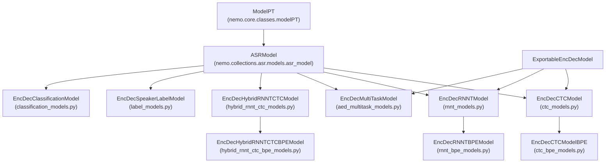

**Sources:** [nemo/collections/asr/models/ctc_models.py:49](), [nemo/collections/asr/models/rnnt_models.py:53](), [nemo/collections/asr/models/aed_multitask_models.py:133](), [nemo/collections/asr/models/label_models.py:57]()

## Common Encoder-Decoder Architecture Pattern

All NeMo ASR models follow a standard encoder-decoder pattern with the following components:

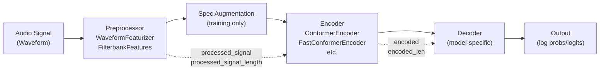

### Component Instantiation

All model components are instantiated using the `from_config_dict` class method pattern:

| Component | Config Key | Typical Classes |
|-----------|-----------|-----------------|
| Preprocessor | `cfg.preprocessor` | `AudioToMelSpectrogramPreprocessor`, `AudioToMFCCPreprocessor` |
| Encoder | `cfg.encoder` | `ConformerEncoder`, `FastConformerEncoder`, `SqueezeformerEncoder` |
| Decoder | `cfg.decoder` | `ConvASRDecoder` (CTC), `RNNTDecoder` (RNNT), `TransformerDecoder` (AED) |
| Spec Augmentation | `cfg.spec_augment` | `SpecAugment`, `SpecCutout` |

**Sources:** [nemo/collections/asr/models/ctc_models.py:60-79](), [nemo/collections/asr/models/rnnt_models.py:66-80](), [nemo/collections/asr/models/aed_multitask_models.py:155-171]()

## CTC-Based Models

### EncDecCTCModel Architecture

The `EncDecCTCModel` implements Connectionist Temporal Classification (CTC) loss for sequence-to-sequence speech recognition with character-level encoding.

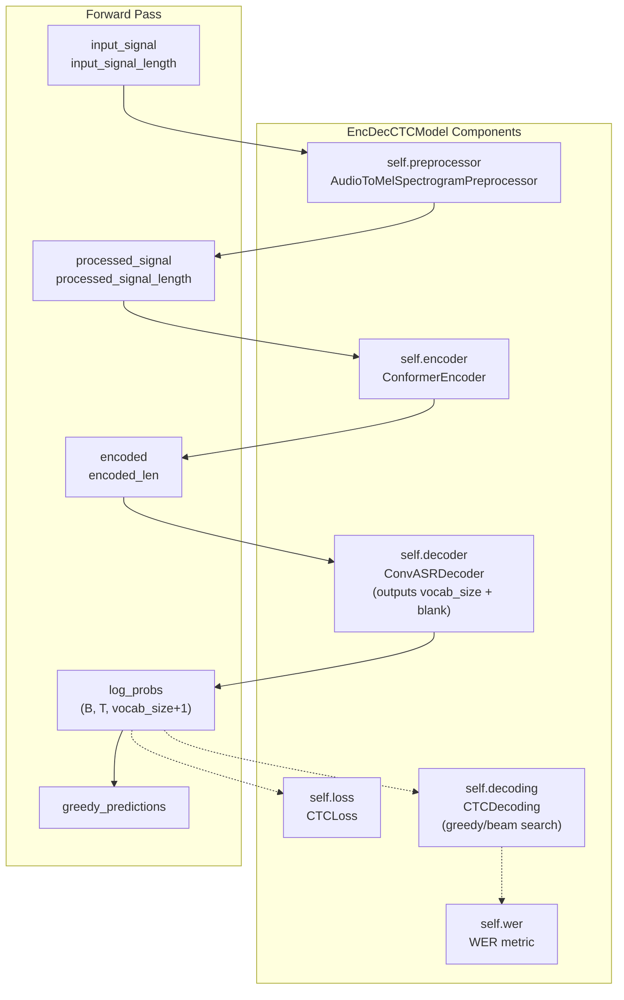

#### Key Implementation Details

- **Initialization:** [nemo/collections/asr/models/ctc_models.py:52-119]()
- **Forward Method:** [nemo/collections/asr/models/ctc_models.py:494-545]()
- **Training Step:** [nemo/collections/asr/models/ctc_models.py:548-603]()
- **Vocabulary Management:** [nemo/collections/asr/models/ctc_models.py:193-262]()

The model supports:
- Character-level vocabulary defined in `cfg.decoder.vocabulary`
- CTC blank token automatically added by decoder
- InterCTC loss for intermediate layer supervision
- Multiple validation dataloaders with different decoding strategies

**Sources:** [nemo/collections/asr/models/ctc_models.py:49-792]()

### EncDecCTCModelBPE Architecture

`EncDecCTCModelBPE` extends CTC models with Byte Pair Encoding (BPE) tokenization for subword-level modeling.

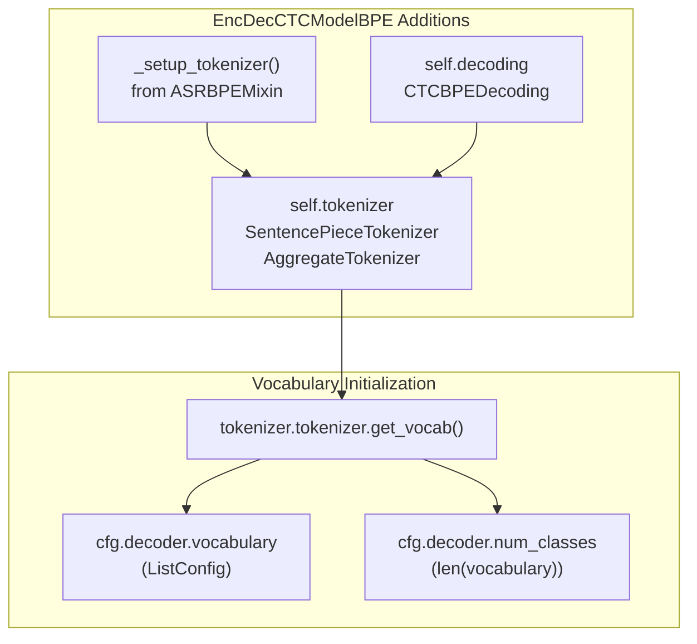

#### Key Implementation Details

- **Initialization:** [nemo/collections/asr/models/ctc_bpe_models.py:42-94]()
- **Tokenizer Setup:** Inherits from `ASRBPEMixin` which provides `_setup_tokenizer` method
- **Vocabulary Change:** [nemo/collections/asr/models/ctc_bpe_models.py:210-317]()
- **Supported Tokenizers:** SentencePiece (BPE/WPE), AggregateTokenizer for multilingual models

**Sources:** [nemo/collections/asr/models/ctc_bpe_models.py:39-532]()

## RNNT-Based Models

### EncDecRNNTModel Architecture

The `EncDecRNNTModel` implements RNN-Transducer (RNNT) architecture with prediction network and joint network for streaming-capable ASR.

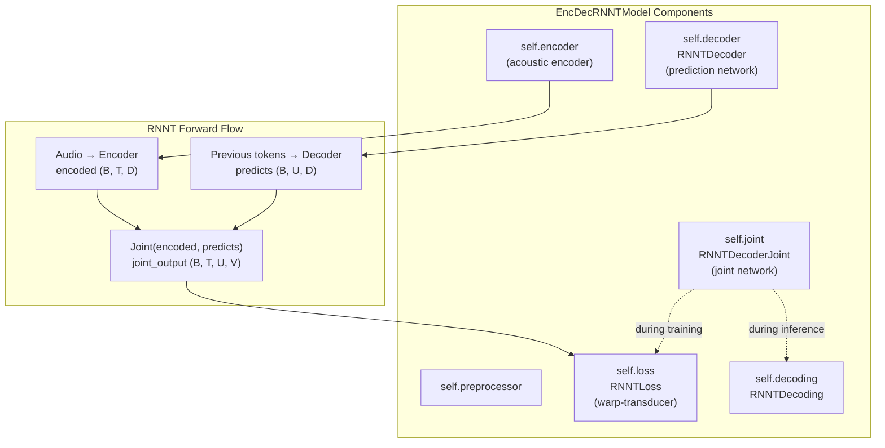

#### RNNT Joint Network Structure

The joint network combines acoustic and linguistic features:

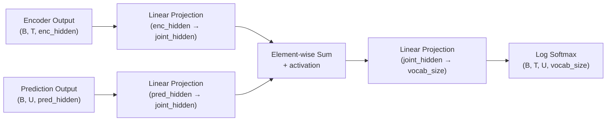

#### Key Implementation Details

- **Initialization:** [nemo/collections/asr/models/rnnt_models.py:56-140]()
- **Model Configuration:** Requires `cfg.model_defaults.enc_hidden` and `cfg.model_defaults.pred_hidden`
- **Joint Configuration:** [nemo/collections/asr/models/rnnt_models.py:73-77]()
- **Loss Configuration:** [nemo/collections/asr/models/rnnt_models.py:83-95]() - supports multiple loss variants (default, TDT, multi-blank)
- **Optimization Normalization:** [nemo/collections/asr/models/rnnt_models.py:141-190]() - variational noise, gradient normalization

**Sources:** [nemo/collections/asr/models/rnnt_models.py:53-800]()

### EncDecRNNTBPEModel Architecture

`EncDecRNNTBPEModel` adds BPE tokenization to RNNT models:

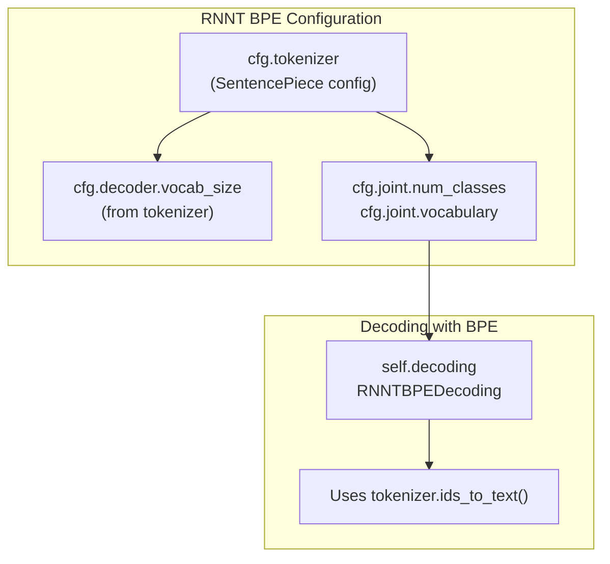

#### Key Implementation Details

- **Initialization:** [nemo/collections/asr/models/rnnt_bpe_models.py:172-242]()
- **Vocabulary Setup:** [nemo/collections/asr/models/rnnt_bpe_models.py:202-210]()
- **Decoding Config:** [nemo/collections/asr/models/rnnt_bpe_models.py:244-251]() - uses `RNNTBPEDecodingConfig`
- **Change Vocabulary:** [nemo/collections/asr/models/rnnt_bpe_models.py:253-377]() - allows switching tokenizers

**Sources:** [nemo/collections/asr/models/rnnt_bpe_models.py:38-574]()

## Multi-Task AED Models

### EncDecMultiTaskModel Architecture

The `EncDecMultiTaskModel` implements an Attention-based Encoder-Decoder (AED) architecture for multi-task learning including ASR, translation, and multi-lingual recognition.

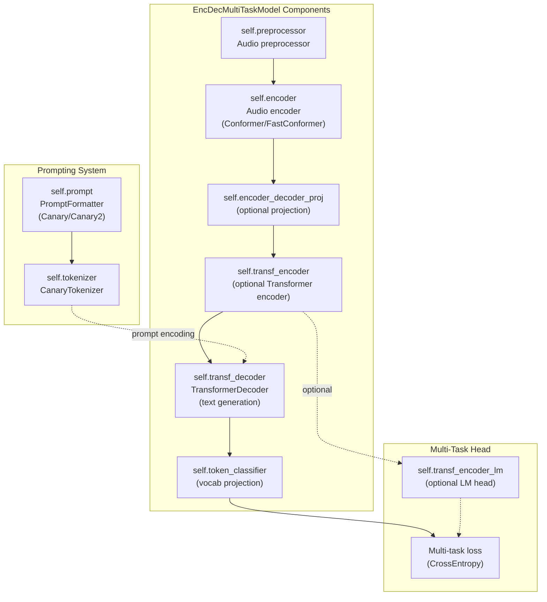

#### Prompted Multi-Task Training

The multi-task model uses a prompting system to specify task, language, and other parameters:

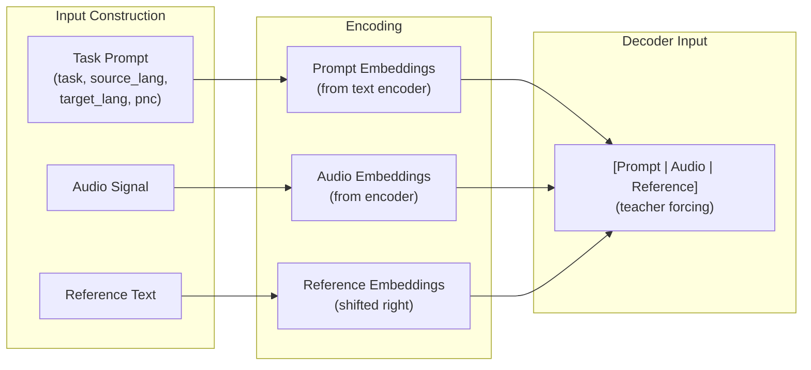

#### Key Implementation Details

- **Initialization:** [nemo/collections/asr/models/aed_multitask_models.py:136-239]()
- **Prompt Format:** [nemo/collections/asr/models/aed_multitask_models.py:143-150]() - uses `PromptFormatter` (Canary/Canary2 format)
- **Config Check:** [nemo/collections/asr/models/aed_multitask_models.py:83-97]() - validates required config keys
- **Forward Pass:** [nemo/collections/asr/models/aed_multitask_models.py:428-502]()
- **Training Step:** [nemo/collections/asr/models/aed_multitask_models.py:504-632]()
- **Multi-Task Metrics:** [nemo/collections/asr/models/aed_multitask_models.py:241-243]() - uses `MultiTaskMetric` for per-task WER/BLEU

**Supported Tasks:**
- ASR (Automatic Speech Recognition)
- ST (Speech Translation)
- S2T_Translation (Speech-to-Text Translation)
- PC (Punctuation and Capitalization)

**Sources:** [nemo/collections/asr/models/aed_multitask_models.py:133-1168]()

## Hybrid RNNT-CTC Models

### EncDecHybridRNNTCTCModel Architecture

The `EncDecHybridRNNTCTCModel` combines RNNT and CTC losses for improved training stability and accuracy.

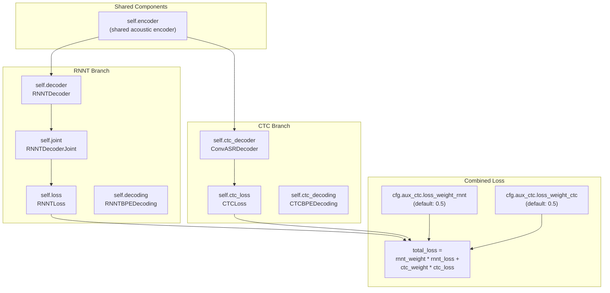

#### Key Implementation Details

- **Initialization:** [nemo/collections/asr/models/hybrid_rnnt_ctc_models.py:40-120]()
- **Auxiliary CTC Config:** [nemo/collections/asr/models/hybrid_rnnt_ctc_models.py:45-78]() - requires `cfg.aux_ctc` with decoder and loss weights
- **Training Step:** [nemo/collections/asr/models/hybrid_rnnt_ctc_models.py:183-279]() - computes both losses
- **Multi-Decoder Support:** [nemo/collections/asr/models/hybrid_rnnt_ctc_models.py:122-157]() - uses AccessMixin for auxiliary outputs
- **Decoding Strategy:** [nemo/collections/asr/models/hybrid_rnnt_ctc_models.py:159-181]() - can switch between RNNT and CTC decoding

**Sources:** [nemo/collections/asr/models/hybrid_rnnt_ctc_models.py:37-457]()

## Additional ASR Model Architectures

### EncDecSpeakerLabelModel

Speaker recognition and verification model using encoder-decoder architecture with classification/embedding head.

| Component | Description |
|-----------|-------------|
| **Base Class** | `ModelPT`, `ExportableEncDecModel`, `VerificationMixin` |
| **Encoder** | Typically SpeakerNet, ECAPA-TDNN, or TitaNet |
| **Decoder** | Classification head or embedding projection |
| **Loss** | CrossEntropyLoss or AngularSoftmax for verification |
| **Use Cases** | Speaker identification, speaker verification, language identification |

**Sources:** [nemo/collections/asr/models/label_models.py:57-684]()

### EncDecClassificationModel and EncDecRegressionModel

General audio classification and regression models:

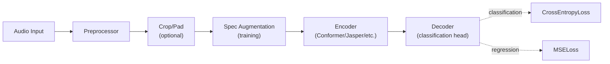

**Applications:**
- Voice Activity Detection (VAD)
- Emotion Recognition
- Audio Scene Classification
- Speech Quality Assessment (regression)

**Sources:** [nemo/collections/asr/models/classification_models.py:64-586]()

## Model Components Deep Dive

### Preprocessor Components

All ASR models use audio preprocessing to convert raw waveforms to feature representations:

| Preprocessor | Output | Config Key | Common Use |
|--------------|--------|-----------|------------|
| `AudioToMelSpectrogramPreprocessor` | Mel-scale spectrogram | `cfg.preprocessor` | Most ASR models |
| `AudioToMFCCPreprocessor` | MFCC features | `cfg.preprocessor` | Traditional ASR |
| `WaveformFeaturizer` | Raw waveform samples | Used in dataset classes | Data loading |

**Configuration Example:**
```yaml
preprocessor:
  _target_: nemo.collections.asr.modules.AudioToMelSpectrogramPreprocessor
  normalize: per_feature
  window_size: 0.025
  window_stride: 0.01
  window: hann
  features: 80
  n_fft: 512
  frame_splicing: 1
  dither: 0.00001
  pad_to: 0
```

**Sources:** [nemo/collections/asr/models/ctc_models.py:60](), [nemo/collections/asr/models/rnnt_models.py:66]()

### Encoder Components

Common encoder architectures:

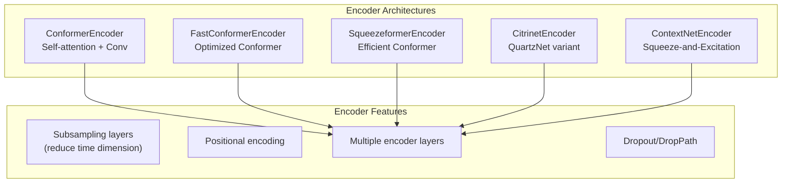

**Common Encoder Config:**
```yaml
encoder:
  _target_: nemo.collections.asr.modules.ConformerEncoder
  feat_in: 80
  n_layers: 18
  d_model: 256
  feat_out: -1
  subsampling: striding
  subsampling_factor: 4
  subsampling_conv_channels: 256
  ff_expansion_factor: 4
  self_attention_model: rel_pos
  n_heads: 4
  att_context_size: [-1, -1]
  xscaling: true
  conv_kernel_size: 31
  dropout: 0.1
```

**Sources:** [nemo/collections/asr/models/ctc_models.py:61](), [nemo/collections/asr/models/rnnt_models.py:67]()

### Decoder Components

Decoder types by model architecture:

| Model Type | Decoder Class | Output Dimension | Purpose |
|------------|---------------|------------------|---------|
| CTC | `ConvASRDecoder` | `vocab_size + 1` (blank) | Linear projection to logits |
| RNNT | `RNNTDecoder` | `pred_hidden` | Prediction network (LSTM/Transformer) |
| RNNT | `RNNTDecoderJoint` | `vocab_size + 1` | Joint network combining encoder/decoder |
| AED | `TransformerDecoder` | `lm_dec_hidden` | Autoregressive text decoder |
| Classification | `ConvASRDecoderClassification` | `num_classes` | Classification head |

**Sources:** [nemo/collections/asr/models/ctc_models.py:79](), [nemo/collections/asr/models/rnnt_models.py:79-80](), [nemo/collections/asr/models/aed_multitask_models.py:172-230]()

## Model Mixins and Capabilities

### ASR Mixins Overview

NeMo ASR models use mixins to add modular functionality:

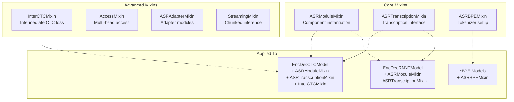

### ASRBPEMixin: Tokenizer Setup

The `ASRBPEMixin` provides standardized tokenizer initialization:

```python
# From ASRBPEMixin._setup_tokenizer()
def _setup_tokenizer(self, tokenizer_cfg: DictConfig):
    # Supports:
    # - type: "bpe" (SentencePiece)
    # - type: "wpe" (WordPiece/BERT)
    # - type: "agg" (Aggregate multilingual)
```

**Tokenizer Types:**
- **BPE:** SentencePiece tokenizer (most common)
- **WPE:** WordPiece tokenizer (BERT-style)
- **AGG:** AggregateTokenizer (multilingual models combining multiple tokenizers)

**Sources:** [nemo/collections/asr/parts/mixins/mixins.py]()

### InterCTCMixin: Intermediate Supervision

The `InterCTCMixin` enables CTC loss at intermediate encoder layers:

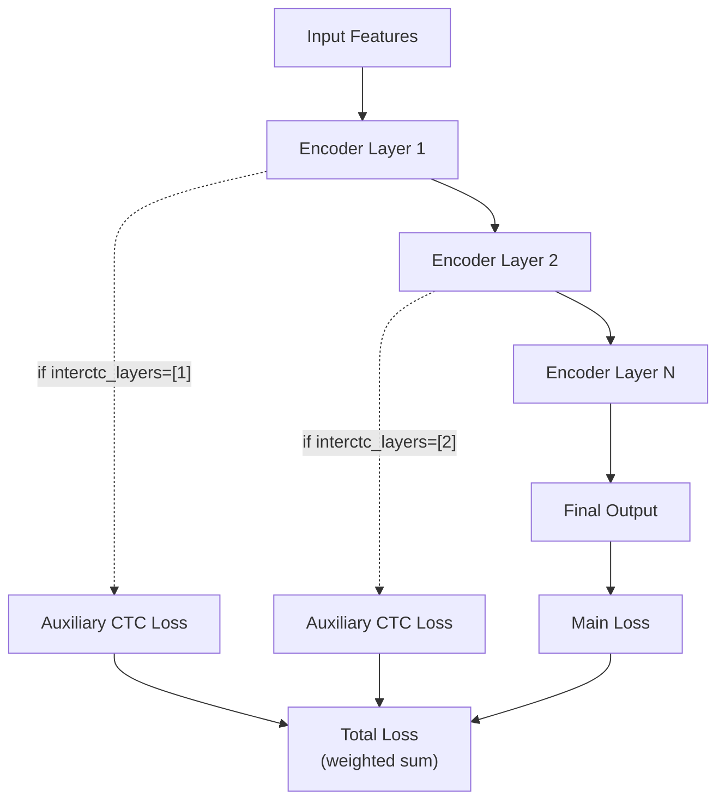

**Configuration:**
```yaml
interctc:
  loss_weights: [0.3]  # Weight for each auxiliary loss
  apply_at_layers: [8]  # Apply CTC at encoder layer 8
```

**Sources:** [nemo/collections/asr/models/ctc_models.py:115](), [nemo/collections/asr/parts/mixins/interctc_mixin.py]()

### ASRTranscriptionMixin: Inference Interface

Provides unified transcription interface across all ASR model types:

| Method | Purpose | Models |
|--------|---------|--------|
| `transcribe()` | Main transcription entry point | All ASR models |
| `_transcribe_forward()` | Model-specific forward pass | Overridden per model |
| `_transcribe_output_processing()` | Post-process hypotheses | Overridden per model |
| `_setup_transcribe_dataloader()` | Create temporary dataloader | All ASR models |

**Sources:** [nemo/collections/asr/parts/mixins/transcription.py](), [nemo/collections/asr/models/ctc_models.py:120-191]()

## Data Flow and Training Pipeline

### Training Step Flow

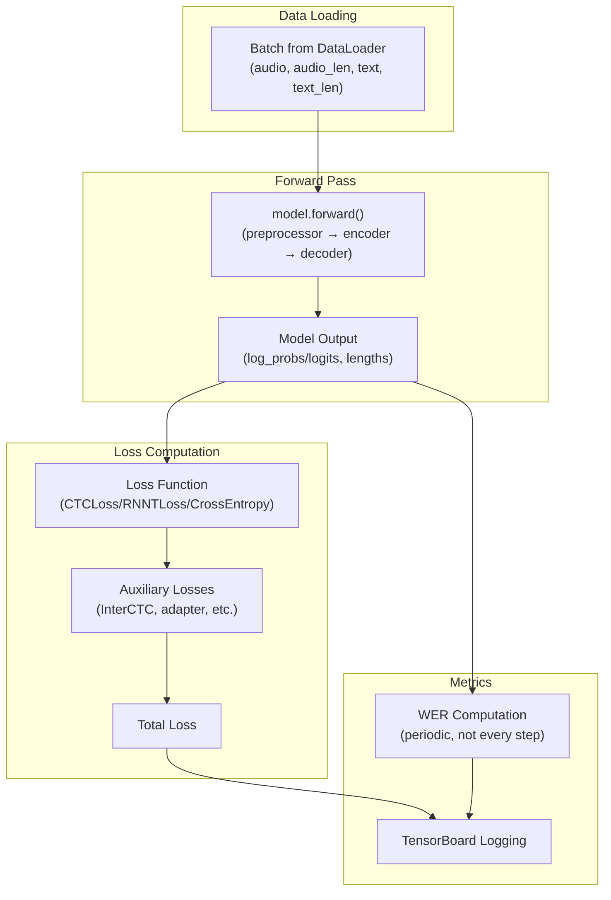

**Training Step Example (CTC):**
[nemo/collections/asr/models/ctc_models.py:548-603]()

**Training Step Example (RNNT):**
[nemo/collections/asr/models/rnnt_models.py:518-656]()

**Training Step Example (Multi-Task):**
[nemo/collections/asr/models/aed_multitask_models.py:504-632]()

**Sources:** [nemo/collections/asr/models/ctc_models.py:548-603](), [nemo/collections/asr/models/rnnt_models.py:518-656](), [nemo/collections/asr/models/aed_multitask_models.py:504-632]()

### Validation and Testing

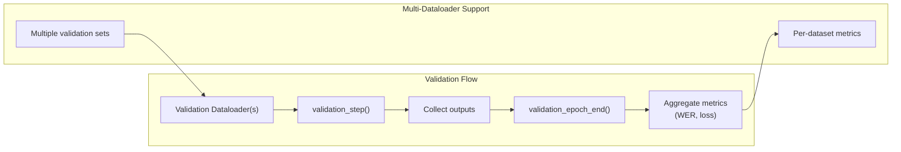

**Multi-Validation Support:**
- Models support multiple validation dataloaders via `setup_multiple_validation_data()`
- Each dataloader gets its own metrics prefix (e.g., `val_librispeech_`, `val_commonvoice_`)
- Implemented via `resolve_validation_dataloaders()` in model utils

**Sources:** [nemo/collections/asr/models/ctc_models.py:624-677](), [nemo/utils/model_utils.py:276-337]()

## Model Save and Restore

### .nemo File Format

All ASR models can be saved to `.nemo` format, a tarball containing:

```
model.nemo/
├── model_config.yaml      # Model configuration (OmegaConf)
├── model_weights.ckpt     # PyTorch state dict
└── artifacts/             # Additional files (tokenizers, etc.)
    ├── tokenizer.model
    └── ...
```

### Save/Restore Example

```python
# Save model
model.save_to('asr_model.nemo')

# Restore model
model = EncDecCTCModel.restore_from('asr_model.nemo')

# Restore with config override
model = EncDecCTCModel.restore_from(
    'asr_model.nemo',
    override_config_path='new_config.yaml'
)
```

**Key Methods:**
- `save_to()`: [nemo/core/classes/modelPT.py:404-442]()
- `restore_from()`: [nemo/core/classes/modelPT.py:444-514]()
- Connector: [nemo/core/connectors/save_restore_connector.py:41-719]()

**Sources:** [nemo/core/classes/modelPT.py:404-514](), [nemo/core/connectors/save_restore_connector.py:52-95]()

## Model Configuration Structure

### Standard Config Schema

All ASR models follow a common configuration structure:

```yaml
# Model class and version
name: "ASR_Model"
target: "nemo.collections.asr.models.EncDecCTCModel"
nemo_version: "2.7.0"

# Sample rate
sample_rate: 16000

# Model components
preprocessor:
  _target_: nemo.collections.asr.modules.AudioToMelSpectrogramPreprocessor
  # ... preprocessor params

encoder:
  _target_: nemo.collections.asr.modules.ConformerEncoder
  # ... encoder params

decoder:
  _target_: nemo.collections.asr.modules.ConvASRDecoder
  vocabulary: [...]  # Character or BPE vocabulary
  num_classes: -1    # Auto-set from vocabulary

# Training
optim:
  name: adamw
  lr: 2.0
  betas: [0.9, 0.98]
  weight_decay: 1e-3
  sched:
    name: NoamAnnealing
    warmup_steps: 10000

# Data
train_ds:
  manifest_filepath: "train_manifest.json"
  batch_size: 32
  shuffle: true
  num_workers: 8
  
validation_ds:
  manifest_filepath: "val_manifest.json"
  batch_size: 32
  shuffle: false
```

**Sources:** [nemo/collections/asr/models/ctc_models.py:52-119](), [examples/asr/conf/]()

---

