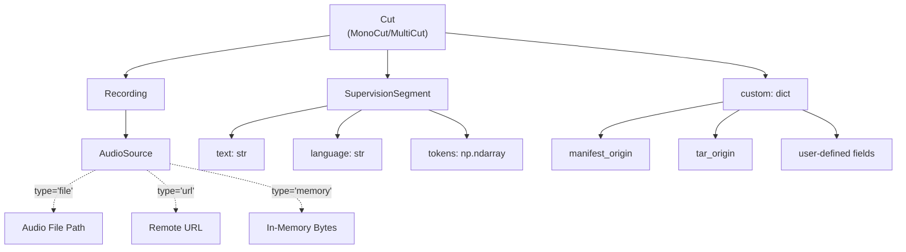
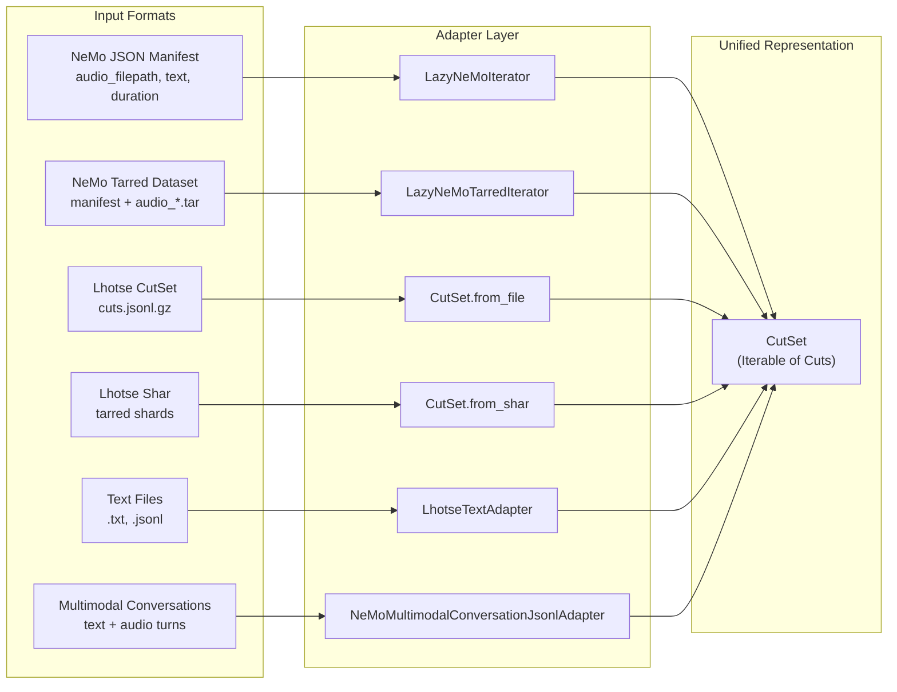
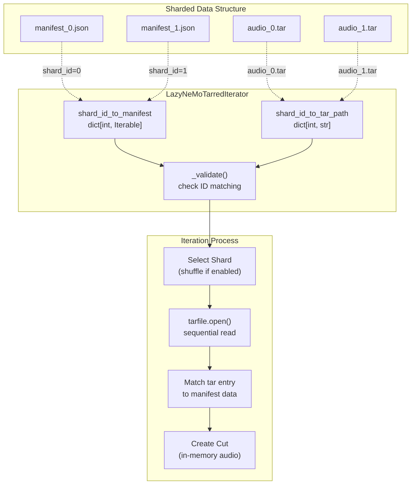
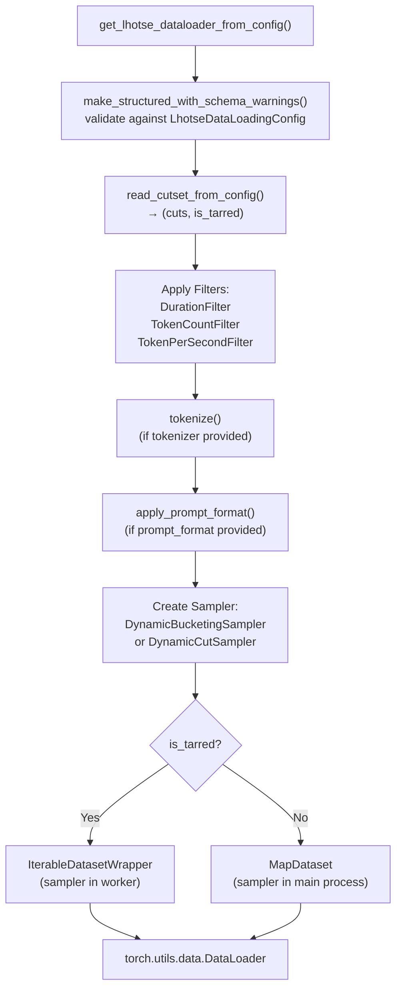
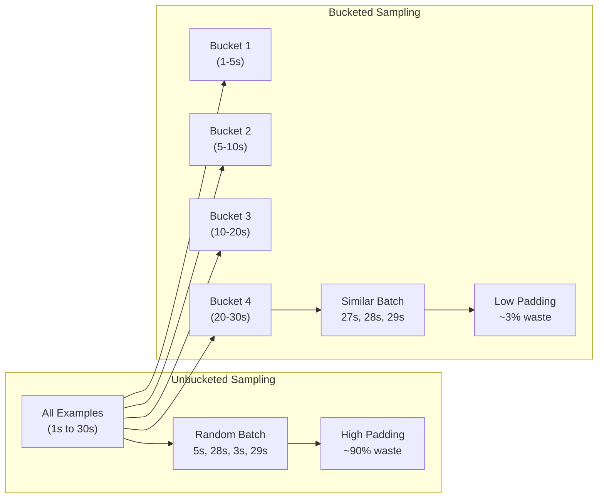
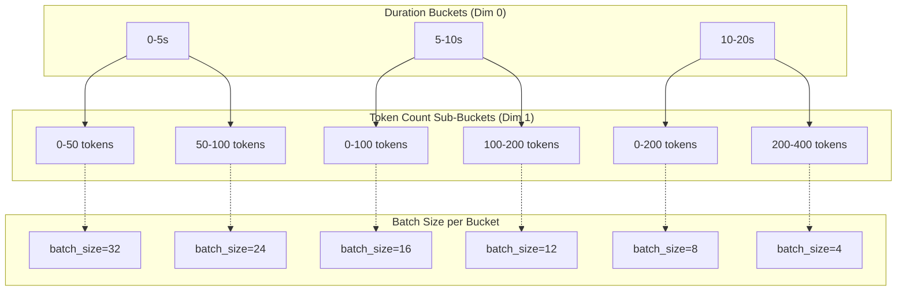
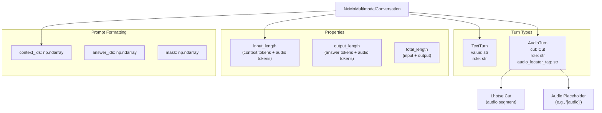
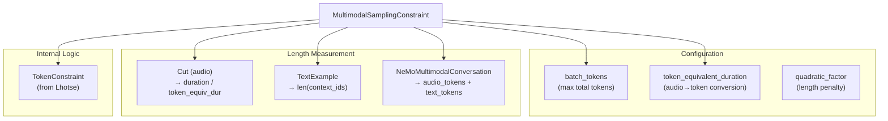

<!-- source: DeepWiki mcp.deepwiki.com · repo NVIDIA/NeMo · page 4.2 Lhotse Data Loading and Processing · fetched 2026-10-21 -->

# Lhotse Data Loading and Processing

<details>
<summary>Relevant source files</summary>

The following files were used as context for generating this wiki page:

- [docs/source/asr/datasets.rst](docs/source/asr/datasets.rst)
- [examples/speechlm2/conf/salm.yaml](examples/speechlm2/conf/salm.yaml)
- [examples/speechlm2/salm_eval.py](examples/speechlm2/salm_eval.py)
- [examples/speechlm2/salm_generate.py](examples/speechlm2/salm_generate.py)
- [examples/speechlm2/to_hf.py](examples/speechlm2/to_hf.py)
- [nemo/collections/asr/data/audio_to_text_lhotse.py](nemo/collections/asr/data/audio_to_text_lhotse.py)
- [nemo/collections/common/data/lhotse/cutset.py](nemo/collections/common/data/lhotse/cutset.py)
- [nemo/collections/common/data/lhotse/dataloader.py](nemo/collections/common/data/lhotse/dataloader.py)
- [nemo/collections/common/data/lhotse/nemo_adapters.py](nemo/collections/common/data/lhotse/nemo_adapters.py)
- [nemo/collections/common/data/lhotse/sampling.py](nemo/collections/common/data/lhotse/sampling.py)
- [nemo/collections/common/data/lhotse/text_adapters.py](nemo/collections/common/data/lhotse/text_adapters.py)
- [nemo/collections/speechlm2/data/salm_dataset.py](nemo/collections/speechlm2/data/salm_dataset.py)
- [nemo/collections/speechlm2/models/salm.py](nemo/collections/speechlm2/models/salm.py)
- [nemo/collections/speechlm2/parts/pretrained.py](nemo/collections/speechlm2/parts/pretrained.py)
- [requirements/requirements_asr.txt](requirements/requirements_asr.txt)
- [requirements/requirements_audio.txt](requirements/requirements_audio.txt)
- [scripts/speech_recognition/estimate_duration_bins_2d.py](scripts/speech_recognition/estimate_duration_bins_2d.py)
- [scripts/speech_recognition/oomptimizer.py](scripts/speech_recognition/oomptimizer.py)
- [tests/collections/common/test_2d_bucketing_constraint.py](tests/collections/common/test_2d_bucketing_constraint.py)
- [tests/collections/common/test_lhotse_dataloading.py](tests/collections/common/test_lhotse_dataloading.py)
- [tests/collections/common/test_lhotse_multimodal_dataloading.py](tests/collections/common/test_lhotse_multimodal_dataloading.py)
- [tests/collections/common/test_lhotse_nemo_adapters.py](tests/collections/common/test_lhotse_nemo_adapters.py)
- [tests/collections/speechlm2/test_audio_placeholders.py](tests/collections/speechlm2/test_audio_placeholders.py)
- [tests/collections/speechlm2/test_duplex_s2s.py](tests/collections/speechlm2/test_duplex_s2s.py)
- [tests/collections/speechlm2/test_duplex_s2s_speech_decoder.py](tests/collections/speechlm2/test_duplex_s2s_speech_decoder.py)
- [tests/collections/speechlm2/test_salm.py](tests/collections/speechlm2/test_salm.py)

</details>


This document describes NeMo's integration with Lhotse, a speech data handling library, for efficient ASR and multimodal data loading. Lhotse provides advanced features like dynamic batch sizing, 2D bucketing, weighted data multiplexing, and unified handling of audio and text modalities.

For ASR model architectures that consume this data, see [ASR Model Architectures](#4.1). For training, transcription, and streaming inference workflows, see [ASR Training, Transcription, and Streaming](#4.3).

---

## Core Concepts

Lhotse operates on two fundamental abstractions: **Cuts** and **Samplers**.

### Cuts and CutSets

A `Cut` is Lhotse's representation of a single training example, containing audio metadata, references to audio data, transcripts, and custom fields. A `CutSet` is an iterable collection of Cuts. NeMo converts its native manifest formats to Lhotse Cuts for processing.

**Key Lhotse Cut Components:**
- `Recording`: Audio file metadata (path, sampling rate, duration, channels)
- `SupervisionSegment`: Transcript, timing, language, custom metadata
- Custom fields: Arbitrary metadata attached via `cut.custom` dictionary

**Mermaid Diagram: Cut Data Structure**



Sources: [nemo/collections/common/data/lhotse/nemo_adapters.py:26-203](), [nemo/collections/common/data/lhotse/cutset.py:28-31]()

### Samplers

Samplers determine how Cuts are grouped into mini-batches. Lhotse provides several sampler types:

| Sampler Type | Description | Key Constraint |
|-------------|-------------|----------------|
| `DynamicCutSampler` | Static or dynamic batch sizes | `max_duration`, `max_cuts` |
| `DynamicBucketingSampler` | Groups similar-length examples | `num_buckets`, `bucket_buffer_size` |
| `RoundRobinSampler` | Alternates between multiple datasets | `weights` (optional) |
| `ZipSampler` | Yields tuples from multiple datasets | N/A |

Sources: [nemo/collections/common/data/lhotse/dataloader.py:26-40]()

---

## Data Format Support

NeMo's Lhotse integration supports multiple input formats through adapter classes that convert source data to `CutSet` objects.

### Supported Input Formats

**Mermaid Diagram: Data Format Conversion Pipeline**



Sources: [nemo/collections/common/data/lhotse/cutset.py:53-74](), [nemo/collections/common/data/lhotse/nemo_adapters.py:39-203]()

### LazyNeMoIterator

`LazyNeMoIterator` converts non-tarred NeMo JSON manifests to Lhotse Cuts on-the-fly. It requires `audio_filepath`, `duration`, and `text` fields in the manifest.

**Key Features:**
- Lazy iteration (reads manifests line-by-line)
- Automatic sampling rate detection (via `soundfile.info`) or uses manifest field
- Support for partial recordings via `offset` field
- Language mapping via configurable `lang_field`
- Custom field preservation in `cut.custom`
- Filtering via `_skipme` flag in manifest entries

**Example Manifest Entry:**
```json
{
  "audio_filepath": "/path/to/audio.wav",
  "duration": 5.73,
  "text": "the transcription",
  "lang": "en",
  "sampling_rate": 16000,
  "custom_field": "value"
}
```

Sources: [nemo/collections/common/data/lhotse/nemo_adapters.py:39-203](), [docs/source/asr/datasets.rst:180-193]()

### LazyNeMoTarredIterator

`LazyNeMoTarredIterator` handles tarred NeMo datasets where audio files are packed into tar archives. It requires a `shard_id` field in manifest entries to match tar files.

**Architecture:**



**Key Features:**
- Shard shuffling with configurable seed (`shard_seed`)
- Subset support via `skip_missing_manifest_entries` (filters audio not in manifest)
- Handles NeMo offset manifests (files with `-sub1`, `-sub2` suffixes)
- Optimized memory usage via `make_cut_with_subset_inmemory_recording`
- AIStore batch mode via `USE_AIS_GET_BATCH` environment variable

**Shard ID Detection:**
Extracts shard IDs using regex patterns:
- Manifest: `manifest[^/]*_(\d+)[^/]*\.json`
- Tar: `audio[^/]*_(\d+)[^/]*\.tar`

Sources: [nemo/collections/common/data/lhotse/nemo_adapters.py:205-579](), [tests/collections/common/test_lhotse_dataloading.py:610-656]()

---

## Configuration and Dataloader Creation

### LhotseDataLoadingConfig

The `LhotseDataLoadingConfig` dataclass defines all configuration options for Lhotse dataloading:

```mermaid
graph TB
    subgraph "Input Configuration"
        InputCfg["input_cfg<br/>(structured config)"]
        ManifestPath["manifest_filepath"]
        TarredPath["tarred_audio_filepaths"]
        CutsPath["cuts_path"]
        SharPath["shar_path"]
    end
    
    subgraph "Batch Size Configuration"
        BatchSize["batch_size<br/>(static)"]
        BatchDuration["batch_duration<br/>(dynamic)"]
        QuadraticDuration["quadratic_duration<br/>(penalty for long examples)"]
    end
    
    subgraph "Bucketing Configuration"
        UseBucketing["use_bucketing: bool"]
        NumBuckets["num_buckets: int"]
        BucketBatchSize["bucket_batch_size<br/>(adaptive)"]
        DurationBins["bucket_duration_bins<br/>(pre-computed)"]
        BufferSize["bucket_buffer_size: int"]
    end
    
    subgraph "Multimodal Configuration"
        AudioLocator["audio_locator_tag<br/>(placeholder token)"]
        TokenEquivDuration["token_equivalent_duration<br/>(audio→token conversion)"]
        BatchTokens["batch_tokens<br/>(unified constraint)"]
    end
    
    subgraph "Filtering Configuration"
        MinDuration["min_duration"]
        MaxDuration["max_duration"]
        MinTPS["min_tps / max_tps"]
        MinTokens["min_tokens / max_tokens"]
    end
    
    LhotseDataLoadingConfig["LhotseDataLoadingConfig"] --> InputCfg
    LhotseDataLoadingConfig --> BatchSize
    LhotseDataLoadingConfig --> UseBucketing
    LhotseDataLoadingConfig --> AudioLocator
    LhotseDataLoadingConfig --> MinDuration
```



Sources: [nemo/collections/common/data/lhotse/dataloader.py:69-249]()

### Dataloader Creation Flow

**Mermaid Diagram: get_lhotse_dataloader_from_config Flow**



Sources: [nemo/collections/common/data/lhotse/dataloader.py:260-372]()

### read_cutset_from_config

The `read_cutset_from_config` function dispatches to appropriate parsers based on configuration:

| Config Key | Parser Function | Returns |
|-----------|----------------|---------|
| `input_cfg` | `read_dataset_config` | Weighted/grouped datasets |
| `manifest_filepath` | `read_nemo_manifest` | NeMo manifest cuts |
| `cuts_path` | `read_lhotse_manifest` | Lhotse CutSet |
| `shar_path` | `read_lhotse_manifest` | Lhotse Shar cuts |

**Extended Input Config Format:**

The `input_cfg` format supports hierarchical dataset grouping with weights:

```yaml
input_cfg:
  - type: nemo_tarred
    manifest_filepath: /path/to/manifest_0.json
    tarred_audio_filepaths: /path/to/audio_*.tar
    weight: 0.7
    tags:
      lang: en
  - type: group
    weight: 0.3
    tags:
      task: asr
    input_cfg:
      - type: nemo_tarred
        manifest_filepath: /path/to/manifest_1.json
        tarred_audio_filepaths: /path/to/audio_*.tar
        weight: 0.6
      - type: lhotse_shar
        shar_path: /path/to/shar_dir
        weight: 0.4
```

Sources: [nemo/collections/common/data/lhotse/cutset.py:137-216](), [nemo/collections/common/data/lhotse/cutset.py:345-407]()

---

## Sampling Strategies

### Dynamic Batch Sizing

Lhotse supports dynamic batch sizes based on total audio duration rather than fixed example counts. This maximizes GPU utilization by grouping many short examples or few long examples per batch.

**Key Parameters:**
- `batch_duration`: Maximum total audio duration (seconds) per batch
- `quadratic_duration`: Duration threshold where quadratic penalty begins (for transformers)
- `batch_size`: Optional maximum number of examples (used with `batch_duration`)

**Example Configuration:**
```yaml
batch_duration: 1100  # seconds
quadratic_duration: 30  # seconds
batch_size: null  # no limit on example count
```

Sources: [nemo/collections/common/data/lhotse/dataloader.py:91-94](), [docs/source/asr/datasets.rst:629-633]()

### 1D Bucketing

Dynamic bucketing groups examples of similar duration into buckets, then samples from individual buckets to minimize padding.



**Key Parameters:**
- `num_buckets`: Number of duration bins (default: 30)
- `bucket_buffer_size`: Examples to buffer before distributing to buckets
- `bucket_duration_bins`: Pre-computed bin edges (optional, auto-estimated otherwise)

Sources: [nemo/collections/common/data/lhotse/dataloader.py:98-103](), [docs/source/asr/datasets.rst:549-564]()

### 2D Bucketing

`FixedBucketBatchSizeConstraint2D` extends bucketing to two dimensions: audio duration and output token count. This is especially useful for encoder-decoder models where output length varies significantly.

**Architecture:**



**Token Count Measurement:**

```python
# From _measure_tokens in sampling.py
def _measure_tokens(cut: Cut) -> int:
    total = 0
    for supervision in cut.supervisions:
        if hasattr(supervision, "tokens"):
            total += len(supervision.tokens)
    return total
```

**Strict vs. Non-Strict Mode:**
- `strict_2d=True`: Only consider sub-buckets within the matched duration bucket
- `strict_2d=False`: Promote examples to larger duration buckets if they fit

**Max Ratio Filtering:**
When `max_ratio` is specified, examples exceeding the tokens-per-second threshold are discarded:

```python
if max_ratio is not None and example_lens[1] / example_lens[0] > max_ratio[fit_idx]:
    return None  # Discard outlier
```

Sources: [nemo/collections/common/data/lhotse/sampling.py:108-207](), [scripts/speech_recognition/estimate_duration_bins_2d.py:149-241]()

### Estimating Duration Bins

The `estimate_duration_bins_2d.py` script computes optimal bucket boundaries:

```bash
python scripts/speech_recognition/estimate_duration_bins_2d.py \
  manifest.json \
  --tokenizer tokenizer.model \
  --buckets 8 \
  --sub-buckets 2 \
  --num_examples 10000
```

**Output Format:**
```python
bucket_duration_bins = [
    (5.0, 50.0),   # bucket 0: ≤5s duration, ≤50 tokens
    (5.0, 100.0),  # bucket 1: ≤5s duration, ≤100 tokens
    (10.0, 100.0), # bucket 2: ≤10s duration, ≤100 tokens
    (10.0, 200.0), # bucket 3: ≤10s duration, ≤200 tokens
    # ...
]
```

Sources: [scripts/speech_recognition/estimate_duration_bins_2d.py:43-241]()

---

## Multimodal Data Support

### NeMoMultimodalConversation

`NeMoMultimodalConversation` represents conversations with interleaved text and audio turns, used for speech-augmented language models (SALM) and other multimodal architectures.

**Data Structure:**



**Example Manifest Entry:**

```json
{
  "id": "convo_1",
  "conversations": [
    {
      "type": "text",
      "from": "User",
      "value": "Please transcribe this audio:"
    },
    {
      "type": "audio",
      "from": "User",
      "value": "audio.wav",
      "duration": 5.73,
      "offset": 0.0
    },
    {
      "type": "text",
      "from": "Assistant",
      "value": "The transcription is: hello world"
    }
  ]
}
```

Sources: [nemo/collections/common/data/lhotse/text_adapters.py:312-393](), [tests/collections/common/test_lhotse_multimodal_dataloading.py:110-178]()

### Audio Token Equivalence

For unified batching of audio and text, audio duration is converted to token count:

```python
# From MultimodalSamplingConstraint.measure_length
audio_len_in_tokens = math.ceil(cut.duration / token_equivalent_duration)
```

`token_equivalent_duration` typically equals the frame shift of the audio encoder (e.g., 0.08s for an encoder with 8x subsampling and 10ms frame shift).

**Example:**
- Audio: 5.73s duration
- `token_equivalent_duration`: 0.08s
- Equivalent tokens: ⌈5.73 / 0.08⌉ = 72 tokens

Sources: [nemo/collections/common/data/lhotse/sampling.py:83-96](), [nemo/collections/speechlm2/models/salm.py:105-109]()

### MultimodalSamplingConstraint

`MultimodalSamplingConstraint` provides unified batch sizing for audio and text modalities:



Sources: [nemo/collections/common/data/lhotse/sampling.py:29-106]()

### Multimodal Dataset Integration

The `SALMDataset` demonstrates multimodal data processing:

```python
# From SALMDataset.__getitem__
def __getitem__(self, conversations: CutSet) -> dict:
    # Load audio for all audio turns
    audios, audio_lens, conversations = collate_conversation_audio_fault_tolerant(conversations)
    
    # Batch text sequences (already tokenized)
    input_ids = pad_sequence([conv.input_ids for conv in conversations], ...)
    loss_mask = pad_sequence([conv.mask for conv in conversations], ...)
    
    return {
        "audios": audios,
        "audio_lens": audio_lens,
        "input_ids": input_ids,
        "loss_mask": loss_mask,
    }
```

Sources: [nemo/collections/speechlm2/data/salm_dataset.py:36-135](), [nemo/collections/common/data/lhotse/text_adapters.py:394-462]()

---

## Advanced Features

### Weighted Data Multiplexing

The `mux` function combines multiple datasets with configurable sampling weights:

```python
# From cutset.py
cuts = mux(
    dataset1, dataset2, dataset3,
    weights=[0.5, 0.3, 0.2],
    max_open_streams=2,
    seed="trng"
)
```

This creates an infinite iterator that samples from each dataset according to weights, ensuring stable distribution across training.

Sources: [nemo/collections/common/data/lhotse/cutset.py:520-563]()

### Data Filtering

Multiple filter classes remove examples based on criteria:

| Filter Class | Criterion | Configuration |
|-------------|-----------|---------------|
| `DurationFilter` | Audio duration | `min_duration`, `max_duration` |
| `TokenCountFilter` | Token count | `min_tokens`, `max_tokens` |
| `TokenPerSecondFilter` | Tokens per second | `min_tps`, `max_tps` |
| `TokenPerTokenFilter` | Output/input ratio | `min_tpt`, `max_tpt` |
| `CERFilter` | Character error rate | `max_cer` |
| `ValidationStatusFilter` | Validation flag | `keep` status |

Sources: [nemo/collections/common/data/lhotse/sampling.py:210-371]()

### Extra Fields

Both `LazyNeMoIterator` and `LazyNeMoTarredIterator` support attaching extra metadata via `extra_fields`:

```python
cuts = CutSet(LazyNeMoIterator(
    "manifest.json",
    extra_fields=[
        {
            "type": "text_sample",
            "name": "question",
            "path": "questions.txt",
        }
    ]
))
```

Supported field types:
- `text_iter`: Iterate through file lines sequentially
- `text_sample`: Randomly sample lines from file

Sources: [nemo/collections/common/data/lhotse/nemo_adapters.py:626-694]()

### Shard Slicing

For large-scale training with many shards, `slice_length` enables random slicing:

```yaml
slice_length: 10000  # Only read 10k examples per shard
```

This improves randomness by sampling different offsets in each epoch, at the cost of some I/O redundancy.

Sources: [nemo/collections/common/data/lhotse/dataloader.py:241-248](), [nemo/collections/common/data/lhotse/nemo_adapters.py:247-250]()

---

## Integration with ASR Models

### LhotseSpeechToTextBpeDataset

The ASR-specific dataset class connects Lhotse Cuts to PyTorch tensors:

```python
class LhotseSpeechToTextBpeDataset:
    def __init__(self, tokenizer: TokenizerSpec):
        self.tokenizer = TokenizerWrapper(tokenizer)
        self.load_audio = AudioSamples(fault_tolerant=True)
    
    def __getitem__(self, cuts: CutSet) -> Tuple[torch.Tensor, ...]:
        # Load audio
        audio, audio_lens, cuts = self.load_audio(cuts)
        
        # Tokenize transcripts
        tokens = [
            torch.cat([
                torch.as_tensor(self.tokenizer(s.text, s.language))
                for s in cut.supervisions
            ])
            for cut in cuts
        ]
        
        return audio, audio_lens, tokens, token_lens
```

Sources: [nemo/collections/asr/data/audio_to_text_lhotse.py:26-69]()

### Configuration Example

Complete example for ASR model with 2D bucketing:

```yaml
model:
  train_ds:
    use_lhotse: true
    manifest_filepath: /path/to/manifest.json
    
    # Dynamic batch sizing
    batch_duration: 1100  # seconds
    quadratic_duration: 30  # seconds
    
    # 2D bucketing
    use_bucketing: true
    num_buckets: 8
    bucket_duration_bins: [
      [5.0, 50],
      [5.0, 100],
      [10.0, 100],
      [10.0, 200],
      [20.0, 200],
      [20.0, 400],
      [30.0, 400],
      [30.0, 800],
    ]
    
    # Filtering
    min_duration: 0.5
    max_duration: 30.0
    max_tps: [10.0, 10.0, 8.0, 8.0, 7.0, 7.0, 6.0, 6.0]
    
    # Worker configuration
    num_workers: 4
    pin_memory: true
```

Sources: [docs/source/asr/datasets.rst:600-647](), [tests/collections/common/test_lhotse_dataloading.py:247-290]()

---

## Performance Considerations

### Map vs. Iterable Datasets

Lhotse automatically selects the appropriate PyTorch dataset type:

| Data Type | Default Mode | Rationale |
|-----------|-------------|-----------|
| Tarred audio | Iterable | Samplers move to workers; avoid I/O in main process |
| Text data | Iterable | Efficient iteration through large text files |
| Non-tarred audio | Map | Random access to audio files |

Override with `force_map_dataset` or `force_iterable_dataset` if needed.

Sources: [nemo/collections/common/data/lhotse/dataloader.py:227-240](), [nemo/collections/common/data/lhotse/dataloader.py:345-370]()

### Memory Optimization

`make_cut_with_subset_inmemory_recording` reduces memory usage for long recordings in tarred datasets:

```python
# Instead of holding full 1-hour recording in memory
# for a 5-second cut, we extract only the needed segment
cut = make_cut_with_subset_inmemory_recording(
    recording, offset=30.0, duration=5.0
)
```

Sources: [nemo/collections/common/data/lhotse/nemo_adapters.py:581-624]()

### CUDA Expandable Segments

Enabled by default to reduce memory fragmentation:

```python
maybe_set_cuda_expandable_segments(enabled=True)
# Sets: torch.cuda.memory.set_per_process_memory_fraction(1.0)
```

Sources: [nemo/collections/common/data/lhotse/dataloader.py:290]()

---

