<!-- source: DeepWiki mcp.deepwiki.com · repo NVIDIA/NeMo · page 4.3 ASR Training, Transcription, and Streaming · fetched 2026-10-21 -->

# ASR Training, Transcription, and Streaming

<details>
<summary>Relevant source files</summary>

The following files were used as context for generating this wiki page:

- [examples/asr/asr_adapters/README.md](examples/asr/asr_adapters/README.md)
- [examples/asr/asr_adapters/scoring_and_analysis.py](examples/asr/asr_adapters/scoring_and_analysis.py)
- [examples/asr/asr_chunked_inference/README.md](examples/asr/asr_chunked_inference/README.md)
- [examples/asr/asr_chunked_inference/aed/speech_to_text_aed_chunked_infer.py](examples/asr/asr_chunked_inference/aed/speech_to_text_aed_chunked_infer.py)
- [examples/asr/asr_chunked_inference/rnnt/speech_to_text_buffered_infer_rnnt.py](examples/asr/asr_chunked_inference/rnnt/speech_to_text_buffered_infer_rnnt.py)
- [examples/asr/asr_chunked_inference/rnnt/speech_to_text_streaming_infer_rnnt.py](examples/asr/asr_chunked_inference/rnnt/speech_to_text_streaming_infer_rnnt.py)
- [examples/asr/conf/speech_multitask/fast-conformer_aed.yaml](examples/asr/conf/speech_multitask/fast-conformer_aed.yaml)
- [examples/asr/transcribe_speech.py](examples/asr/transcribe_speech.py)
- [examples/slu/speech_intent_slot/README.md](examples/slu/speech_intent_slot/README.md)
- [examples/speaker_tasks/README.md](examples/speaker_tasks/README.md)
- [nemo/collections/asr/data/audio_to_text_lhotse_prompted.py](nemo/collections/asr/data/audio_to_text_lhotse_prompted.py)
- [nemo/collections/asr/models/aed_multitask_models.py](nemo/collections/asr/models/aed_multitask_models.py)
- [nemo/collections/asr/parts/mixins/transcription.py](nemo/collections/asr/parts/mixins/transcription.py)
- [nemo/collections/asr/parts/utils/aligner_utils.py](nemo/collections/asr/parts/utils/aligner_utils.py)
- [nemo/collections/asr/parts/utils/chunking_utils.py](nemo/collections/asr/parts/utils/chunking_utils.py)
- [nemo/collections/asr/parts/utils/eval_utils.py](nemo/collections/asr/parts/utils/eval_utils.py)
- [nemo/collections/asr/parts/utils/streaming_utils.py](nemo/collections/asr/parts/utils/streaming_utils.py)
- [nemo/collections/asr/parts/utils/timestamp_utils.py](nemo/collections/asr/parts/utils/timestamp_utils.py)
- [nemo/collections/asr/parts/utils/transcribe_utils.py](nemo/collections/asr/parts/utils/transcribe_utils.py)
- [nemo/collections/common/prompts/canary.py](nemo/collections/common/prompts/canary.py)
- [nemo/collections/common/prompts/canary2.py](nemo/collections/common/prompts/canary2.py)
- [nemo/collections/common/prompts/formatter.py](nemo/collections/common/prompts/formatter.py)
- [nemo/collections/common/tokenizers/canary_tokenizer.py](nemo/collections/common/tokenizers/canary_tokenizer.py)
- [nemo/collections/speechlm2/data/s2s_dataset.py](nemo/collections/speechlm2/data/s2s_dataset.py)
- [tests/collections/asr/conftest.py](tests/collections/asr/conftest.py)
- [tests/collections/asr/decoding/test_batched_hyps_and_alignments.py](tests/collections/asr/decoding/test_batched_hyps_and_alignments.py)
- [tests/collections/asr/mixins/test_transcription.py](tests/collections/asr/mixins/test_transcription.py)
- [tests/collections/asr/test_asr_multitask_model_bpe.py](tests/collections/asr/test_asr_multitask_model_bpe.py)
- [tests/collections/asr/utils/test_chunking_utils.py](tests/collections/asr/utils/test_chunking_utils.py)
- [tests/collections/common/test_lhotse_nemo_adapters_ais_get_batch.py](tests/collections/common/test_lhotse_nemo_adapters_ais_get_batch.py)
- [tests/core/test_neural_module.py](tests/core/test_neural_module.py)
- [tools/asr_evaluator/asr_evaluator.py](tools/asr_evaluator/asr_evaluator.py)
- [tools/asr_evaluator/conf/eval.yaml](tools/asr_evaluator/conf/eval.yaml)
- [tools/asr_evaluator/utils.py](tools/asr_evaluator/utils.py)
- [tools/nmt_grpc_service/README.md](tools/nmt_grpc_service/README.md)
- [tools/rir_corpus_generator/README.md](tools/rir_corpus_generator/README.md)

</details>


This document covers the training, transcription (offline inference), and streaming inference workflows for Automatic Speech Recognition (ASR) models in NeMo. It explains the practical execution of ASR training scripts, the main transcription utilities for batch inference, and specialized streaming/chunked inference capabilities for long-form audio and real-time applications.

For information about ASR model architectures, see page 4.1. For details about data processing with Lhotse, see page 4.2.

## ASR Training Workflows

NeMo ASR models follow a standardized training workflow built on PyTorch Lightning's `Trainer` and NeMo's `ModelPT` base class. The training process involves data setup, forward passes, loss computation, and metric logging.

### Training Data Setup

ASR training uses JSON manifest files where each line contains metadata for an audio sample:

```json
{"audio_filepath": "/path/to/audio.wav", "duration": 3.5, "text": "transcription text"}
```

Training Data Setup Flow:
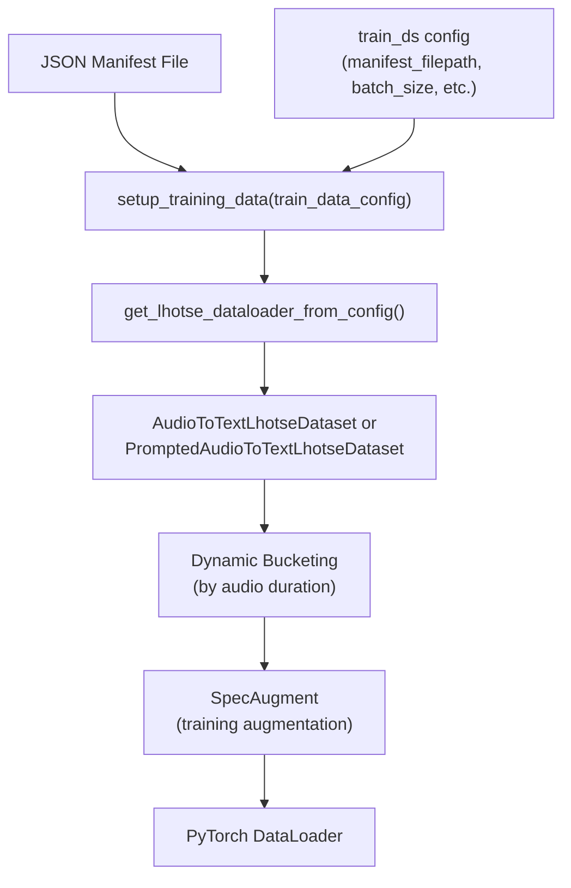

The `setup_training_data()` method (implemented in `EncDecCTCModel`, `EncDecRNNTModel`, `EncDecMultiTaskModel`) creates the training data pipeline by:
1. Reading manifest files and audio metadata
2. Creating Lhotse `CutSet` objects for efficient data handling
3. Applying dynamic bucketing to group similar-length utterances
4. Setting up data augmentation (SpecAugment during training)

**Sources:** [nemo/collections/asr/models/aed_multitask_models.py:633-657](), [nemo/collections/asr/data/audio_to_text_lhotse_prompted.py:50-151]()

### Training Step

Training Step Flow:
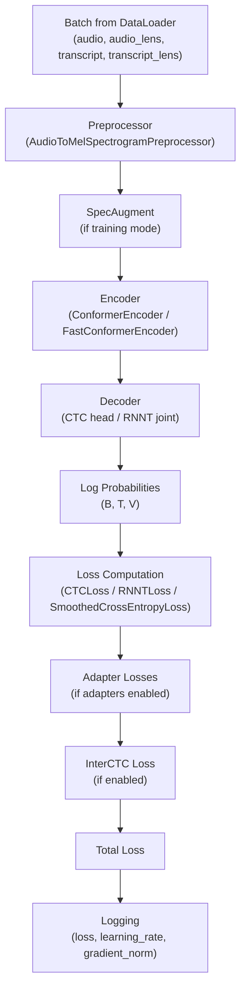

The `training_step()` method handles:
- **Forward Pass**: Audio → Preprocessor → SpecAugment → Encoder → Decoder
- **Loss Computation**: Model-specific loss (CTC, RNNT, or cross-entropy for AED models)
- **Auxiliary Losses**: Adapter losses, InterCTC losses (if configured)
- **Logging**: Training metrics (loss, learning rate, etc.)

For multitask models like Canary, the loss computation masks prompt tokens to only compute loss on the target text.

**Sources:** [nemo/collections/asr/models/aed_multitask_models.py:1031-1103]()

### Validation and Metrics

Validation Step Flow:
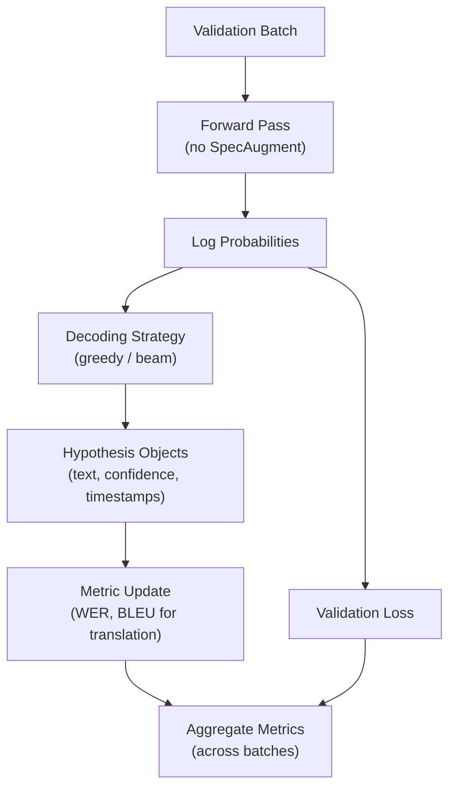

The `validation_step()` method:
- Disables SpecAugment (model in eval mode)
- Runs forward pass to get predictions
- Decodes predictions using configured strategy
- Updates metrics (WER for ASR, BLEU for translation tasks)
- Computes validation loss

For multitask models, the `MultiTaskMetric` class handles different metrics for different tasks (e.g., WER for ASR, BLEU for translation).

**Sources:** [nemo/collections/asr/models/aed_multitask_models.py:1105-1150](), [nemo/collections/asr/metrics/multitask_metric.py:1-100]()

## Transcription (Offline Inference)

Transcription is the process of converting audio files to text using a trained ASR model. NeMo provides comprehensive transcription utilities for batch inference on audio files or manifest datasets.

### transcribe_speech.py Script

The main transcription script is `transcribe_speech.py`, which provides a command-line interface for ASR inference:

```bash
python transcribe_speech.py \
    model_path=/path/to/model.nemo \
    audio_dir=/path/to/audio/files \
    batch_size=32 \
    amp=True \
    timestamps=True
```

TranscriptionConfig Parameters:
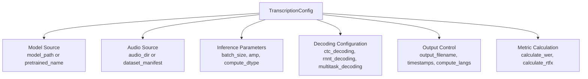

**Key Configuration Options:**

| Parameter | Type | Default | Purpose |
|-----------|------|---------|---------|
| `model_path` | str | None | Path to `.nemo` checkpoint file |
| `pretrained_name` | str | None | NGC pretrained model name |
| `audio_dir` | str | None | Directory with audio files |
| `dataset_manifest` | str | None | JSON manifest file path |
| `batch_size` | int | 32 | Inference batch size |
| `amp` | bool | False | Enable Automatic Mixed Precision |
| `compute_dtype` | str | None | Data type (float32/bfloat16/float16) |
| `timestamps` | bool | None | Generate timestamps (word/segment level) |
| `compute_langs` | bool | False | Generate language IDs |
| `decoder_type` | str | None | Force decoder (ctc/rnnt) for hybrid models |
| `calculate_wer` | bool | True | Calculate WER/CER on results |
| `calculate_rtfx` | bool | False | Measure Real-Time Factor |

**Sources:** [examples/asr/transcribe_speech.py:106-212]()

### Transcription Workflow

Main Transcription Flow:
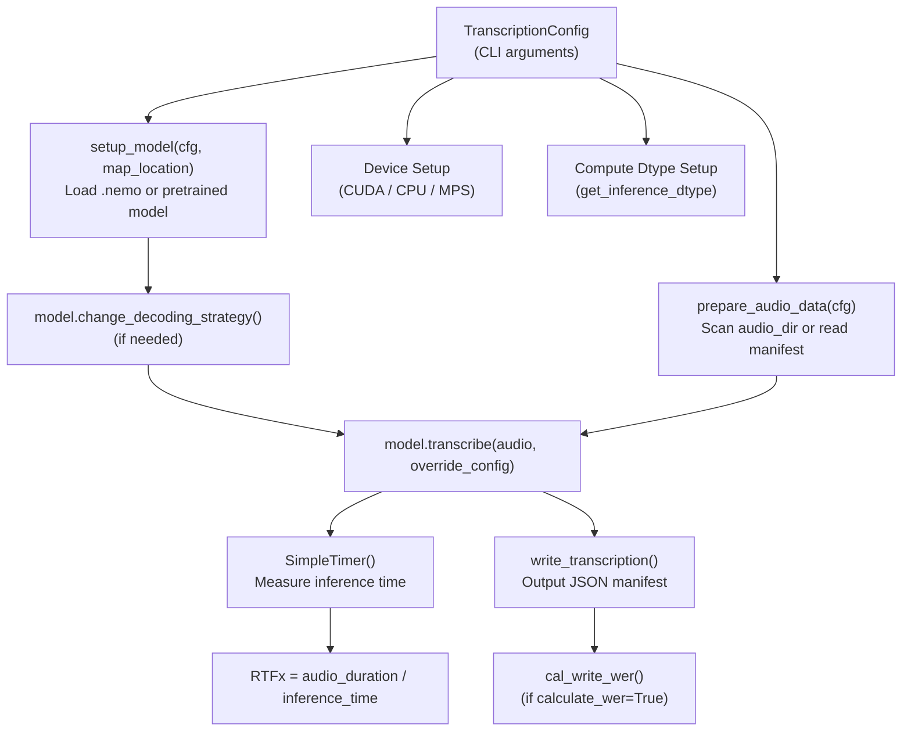

**Sources:** [examples/asr/transcribe_speech.py:215-497]()

### Model.transcribe() Method

All ASR models implement a `transcribe()` method (via `ASRTranscriptionMixin`) that handles the inference pipeline:

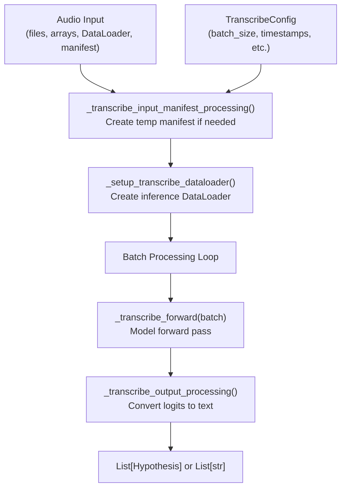

The `transcribe()` method:
1. **Input Processing**: Converts file paths, arrays, or manifests into a DataLoader
2. **Batch Processing**: Iterates through batches, running forward passes
3. **Decoding**: Uses configured decoding strategy (greedy/beam)
4. **Output Processing**: Returns `Hypothesis` objects or text strings
5. **Timestamp Generation**: Optionally adds word/segment timestamps

For `EncDecMultiTaskModel` (Canary models), the transcribe method supports:
- **Prompt Configuration**: Task-specific prompts (ASR, translation)
- **Chunking**: Automatic chunking for long-form audio
- **Language Switching**: Multi-language transcription

**Sources:** [nemo/collections/asr/models/aed_multitask_models.py:491-603](), [nemo/collections/asr/parts/mixins/transcription.py:232-387]()

### Transcription Utilities

The `transcribe_utils.py` module provides helper functions:

**setup_model()**: Load model from checkpoint or NGC
```python
def setup_model(cfg: DictConfig, map_location: torch.device) -> Tuple[ASRModel, str]
```
- Restores from `.nemo` files using `ASRModel.restore_from()`
- Downloads from NGC using `ASRModel.from_pretrained()`
- Applies runtime model changes (attention model, etc.)

**prepare_audio_data()**: Process input audio sources
```python
def prepare_audio_data(cfg: DictConfig) -> Tuple[List[str], Optional[str]]
```
- Scans directories for audio files (*.wav, *.flac, etc.)
- Reads and processes JSON manifest files
- Optionally sorts by duration for efficient batching
- Returns filepaths and sorted manifest path

**write_transcription()**: Output results to JSON manifest
```python
def write_transcription(transcriptions, cfg, model_name, filepaths=None, 
                       compute_langs=False, timestamps=False) -> Tuple[str, str]
```
- Handles `Hypothesis` objects or plain text
- Writes JSON manifest with predictions
- Includes timestamps, language IDs, confidence scores
- Supports N-best hypothesis output

**compute_output_filename()**: Generate output filenames
```python
def compute_output_filename(cfg: DictConfig, model_name: str) -> DictConfig
```
- Creates default output filename based on input
- Uses model name and dataset name in filename

**restore_transcription_order()**: Restore original order after sorting
```python
def restore_transcription_order(manifest_path: str, transcriptions: list) -> list
```
- Reorders results after duration-based sorting

**Sources:** [nemo/collections/asr/parts/utils/transcribe_utils.py:297-324](), [nemo/collections/asr/parts/utils/transcribe_utils.py:327-382](), [nemo/collections/asr/parts/utils/transcribe_utils.py:446-543](), [nemo/collections/asr/parts/utils/transcribe_utils.py:412-422](), [nemo/collections/asr/parts/utils/transcribe_utils.py:393-409]()

## Streaming and Chunked Inference

For long-form audio (hours of speech) or real-time streaming applications, NeMo provides specialized chunked inference capabilities. These avoid memory issues and enable low-latency transcription.

### Buffered vs Streaming Inference

The key difference between buffered and streaming inference is chunk size and latency:

| Mode | Chunk Size | Right Context | Latency | Use Case |
|------|-----------|---------------|---------|----------|
| **Buffered** | 5-10 seconds | 2-5 seconds | ~7-15s | Long file transcription |
| **Streaming** | 0.1-0.25 seconds | 0.5-2 seconds | ~0.6-2.25s | Real-time applications |
| **Long-form** | 30-40 seconds | 1 second | Variable | Hours of audio (chunked) |

### RNNT Streaming Inference

The `speech_to_text_streaming_infer_rnnt.py` script provides optimized streaming for RNNT models:

```bash
python speech_to_text_streaming_infer_rnnt.py \
    pretrained_name=nvidia/parakeet-rnnt-1.1b \
    dataset_manifest=/path/to/manifest.json \
    chunk_secs=2.0 \
    left_context_secs=10.0 \
    right_context_secs=2.0 \
    batch_size=32
```

Streaming RNNT Architecture:
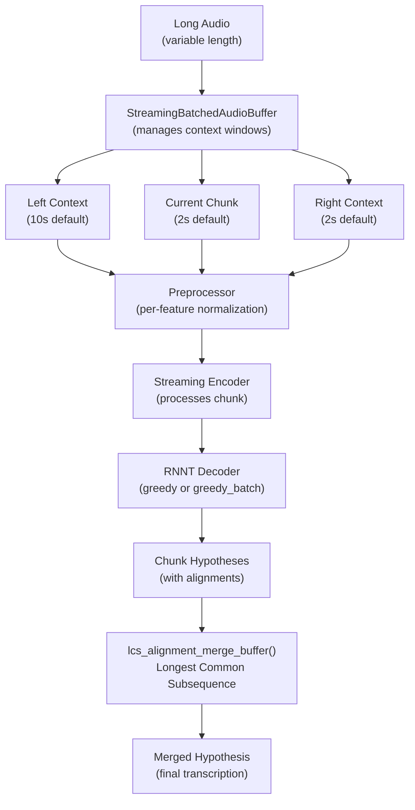

**Key Components:**

**StreamingBatchedAudioBuffer**: Manages audio chunks with context
- Maintains left, chunk, and right context windows
- Handles per-feature normalization across chunk boundaries
- Supports batched processing of multiple audio files

**LCS Alignment Merge**: Deduplicates overlapping predictions
- Uses Longest Common Subsequence to find overlap between consecutive chunks
- Removes duplicate tokens at chunk boundaries
- Handles incomplete alignments with partial matching

**Sources:** [examples/asr/asr_chunked_inference/rnnt/speech_to_text_streaming_infer_rnnt.py:108-165](), [nemo/collections/asr/parts/utils/streaming_utils.py:81-297](), [nemo/collections/asr/parts/utils/streaming_utils.py:300-355]()

### Streaming Inference Workflow

Streaming Transcription Flow:
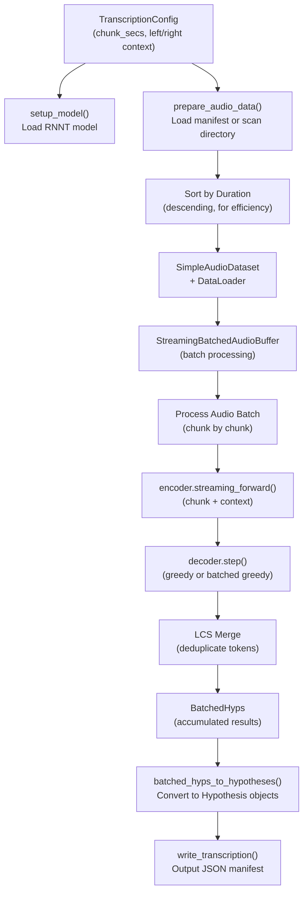

**Sources:** [examples/asr/asr_chunked_inference/rnnt/speech_to_text_streaming_infer_rnnt.py:167-330](), [nemo/collections/asr/parts/utils/streaming_utils.py:617-841]()

### AED Chunked Inference

For AED models (e.g., Canary), the `speech_to_text_aed_chunked_infer.py` script provides non-overlapping chunking:

```bash
python speech_to_text_aed_chunked_infer.py \
    pretrained_name=nvidia/canary-1b-flash \
    dataset_manifest=/path/to/manifest.json \
    chunk_len_in_secs=40.0 \
    batch_size=16 \
    timestamps=True
```

AED Chunked Inference Flow:
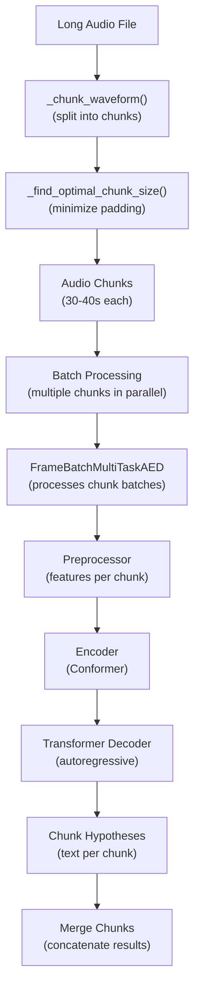

**Key Features:**

**Dynamic Chunk Sizing**: Finds optimal chunk size to minimize padding on last chunk
- Tries chunk sizes from 30-40 seconds
- Maximizes last chunk length to reduce wasted computation

**FrameBatchMultiTaskAED**: Batched processing for AED models
- Handles prompt formatting for each chunk
- Manages decoder attention context
- Resets decoder state between chunks

**Timestamp Support**: Generates word and segment timestamps
- Uses forced alignment with external CTC model
- Merges timestamps across chunks
- Adjusts offsets for chunk boundaries

**Sources:** [examples/asr/asr_chunked_inference/aed/speech_to_text_aed_chunked_infer.py:75-205](), [nemo/collections/asr/data/audio_to_text_lhotse_prompted.py:159-244](), [nemo/collections/asr/parts/utils/transcribe_utils.py:217-282]()

### Parallel Chunking for Canary-1B-v2

Canary-1B-v2 supports intelligent parallel chunking via the `.transcribe()` method:

```python
# Automatic parallel chunking for long audio
model = nemo_asr.models.EncDecMultiTaskModel.from_pretrained("nvidia/canary-1b-v2")
results = model.transcribe(
    audio="/path/to/long_audio.wav",
    batch_size=1,  # Required for chunking
    timestamps=True
)
```

Parallel Chunking Flow:
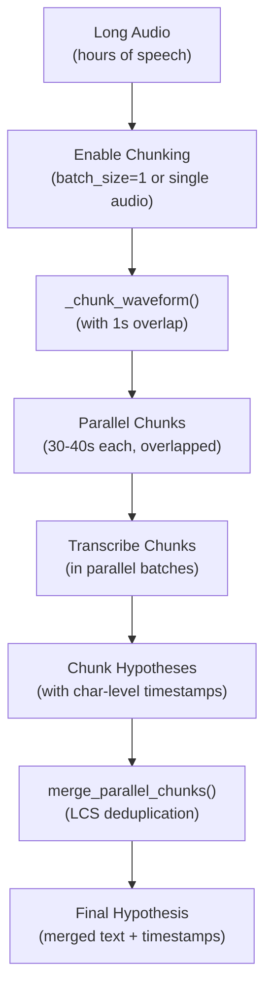

**Advantages:**
- Automatic chunk size optimization (30-40s per chunk)
- Overlapping windows (1s overlap) for better boundary handling
- LCS-based deduplication at chunk boundaries
- Preserves timestamps across chunks
- Handles arbitrarily long audio

**Sources:** [nemo/collections/asr/models/aed_multitask_models.py:574-603](), [nemo/collections/asr/parts/utils/chunking_utils.py:21-79](), [nemo/collections/asr/parts/utils/chunking_utils.py:81-117]()

### Buffered Inference (Legacy)

For backwards compatibility, NeMo provides `speech_to_text_buffered_infer_rnnt.py` with older merge algorithms:

```bash
python speech_to_text_buffered_infer_rnnt.py \
    pretrained_name=nvidia/parakeet-rnnt-1.1b \
    dataset_manifest=/path/to/manifest.json \
    chunk_len_in_secs=1.6 \
    total_buffer_in_secs=4.0 \
    merge_algo=lcs
```

**Merge Algorithms:**
- **middle**: Uses middle tokens of overlapping regions (fast, approximate)
- **lcs**: Longest Common Subsequence alignment (accurate, slower)
- **tdt**: Token-and-Duration Transducer specific merging

**Note**: The `speech_to_text_streaming_infer_rnnt.py` script is recommended for new implementations.

**Sources:** [examples/asr/asr_chunked_inference/rnnt/speech_to_text_buffered_infer_rnnt.py:90-149]()

## Transcription Utilities and Scripts

### Main Transcription Script

The `transcribe_speech.py` script provides a comprehensive command-line interface for ASR inference using the `TranscriptionConfig` dataclass and `main()` function:

#### Transcription Workflow
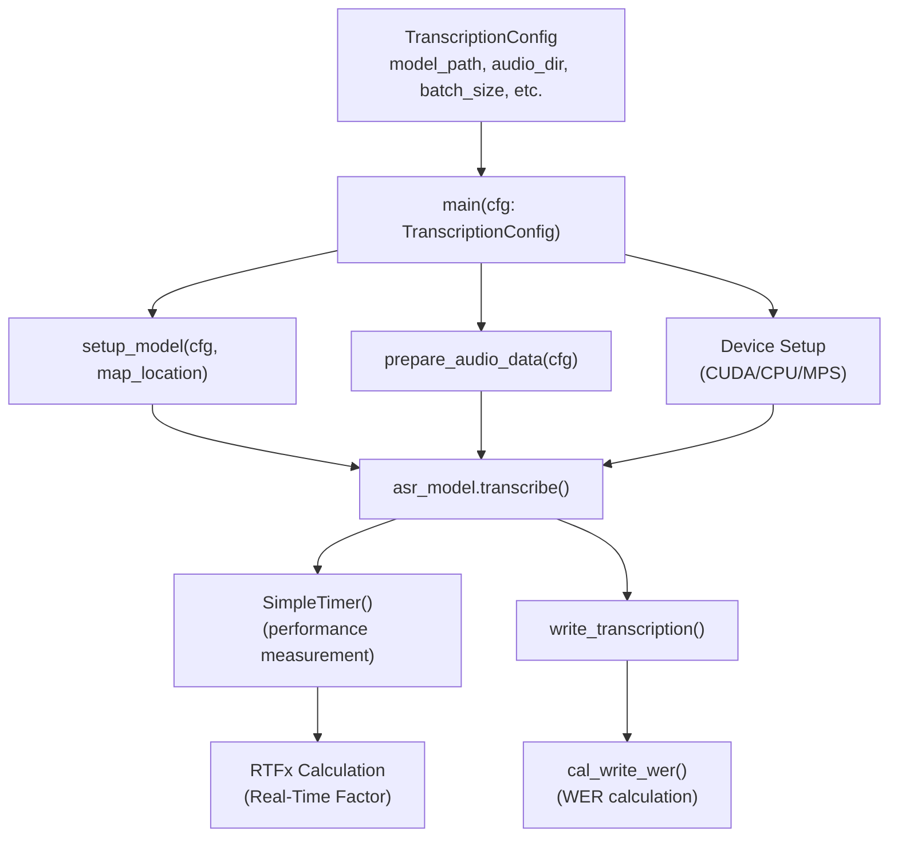

#### Key Configuration Options

The `TranscriptionConfig` dataclass supports extensive configuration:

| Parameter | Type | Purpose |
|-----------|------|---------|
| `model_path` | str | Path to `.nemo` checkpoint file |
| `pretrained_name` | str | Name of pretrained model from NGC |
| `audio_dir` | str | Directory containing audio files |
| `dataset_manifest` | str | Path to JSON manifest file |
| `batch_size` | int | Inference batch size (default: 32) |
| `compute_timestamps` | bool | Generate timestamp information |
| `compute_langs` | bool | Generate language ID information |
| `decoder_type` | str | Force decoder type (ctc/rnnt) for hybrid models |
| `amp` | bool | Enable Automatic Mixed Precision |
| `cuda` | int | Specify CUDA device index |

#### Decoding Strategy Configuration

The script supports runtime decoding strategy changes:

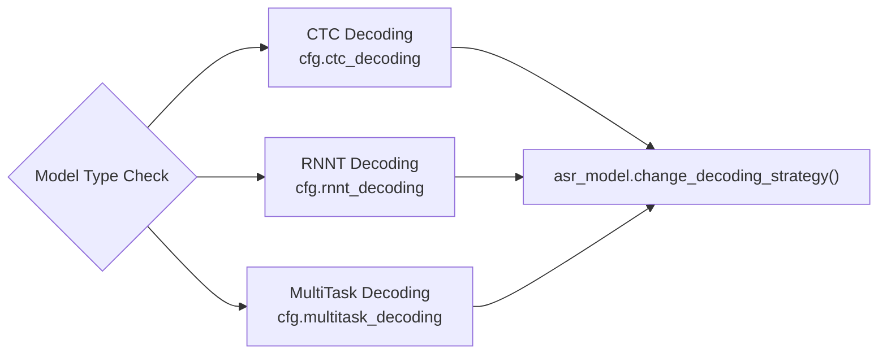

#### Performance Measurement

The script includes comprehensive performance measurement:
- **SimpleTimer**: Measures inference time per batch
- **RTFx Calculation**: Real-Time Factor (audio_duration / inference_time)  
- **Warmup Steps**: Excludes initial runs from performance metrics
- **Memory Monitoring**: GPU memory usage tracking

**Sources:** [examples/asr/transcribe_speech.py:105-212](), [examples/asr/transcribe_speech.py:214-500](), [nemo/utils/timers.py:42-85]()

### Utility Functions

The `transcribe_utils.py` module provides essential helper functions for ASR inference tasks:

#### Model Setup and Loading
```python
def setup_model(cfg: DictConfig, map_location: torch.device) -> Tuple[ASRModel, str]
```

The `setup_model()` function handles model loading from multiple sources:
- **Checkpoint Loading**: Restores from `.nemo` files using `ASRModel.restore_from()`
- **Pretrained Models**: Downloads from NGC using `ASRModel.from_pretrained()`
- **Model Configuration**: Applies runtime model changes via `change_attention_model()`

#### Audio Data Preparation
```python
def prepare_audio_data(cfg: DictConfig) -> Tuple[List[str], bool]
```

The `prepare_audio_data()` function processes input audio sources:
- **Directory Scanning**: Recursively finds audio files by extension
- **Manifest Processing**: Reads JSON manifest files with audio metadata
- **Duration Sorting**: Optionally sorts by audio duration for efficient batching
- **Path Resolution**: Resolves relative paths using `get_full_path()`

#### Output Writing and Formatting
```python
def write_transcription(transcriptions, cfg, model_name, filepaths=None, 
                       compute_langs=False, timestamps=False) -> Tuple[str, str]
```

The `write_transcription()` function handles output formatting:
- **Hypothesis Processing**: Supports both string and `Hypothesis` objects
- **Metadata Extraction**: Includes timestamps, confidence scores, language IDs
- **N-Best Support**: Writes beam search alternatives when available  
- **JSON Output**: Creates structured manifest files with predictions

#### Additional Utilities

| Function | Purpose | Implementation |
|----------|---------|----------------|
| `restore_transcription_order()` | Reorder results after sorting | Maintains original manifest order |
| `compute_output_filename()` | Generate output filenames | Creates default names based on input/model |
| `normalize_timestamp_output()` | JSON serialization | Converts tensor timestamps to integers |
| `compute_metrics_per_sample()` | Per-utterance metrics | WER/CER calculation per sample |

**Sources:** [nemo/collections/asr/parts/utils/transcribe_utils.py:264-291](), [nemo/collections/asr/parts/utils/transcribe_utils.py:294-389](), [nemo/collections/asr/parts/utils/transcribe_utils.py:412-509](), [nemo/collections/asr/parts/utils/transcribe_utils.py:512-602]()

## Model Export and Deployment

### Export Framework

NeMo ASR models implement the `Exportable` interface for deployment to various runtime environments:

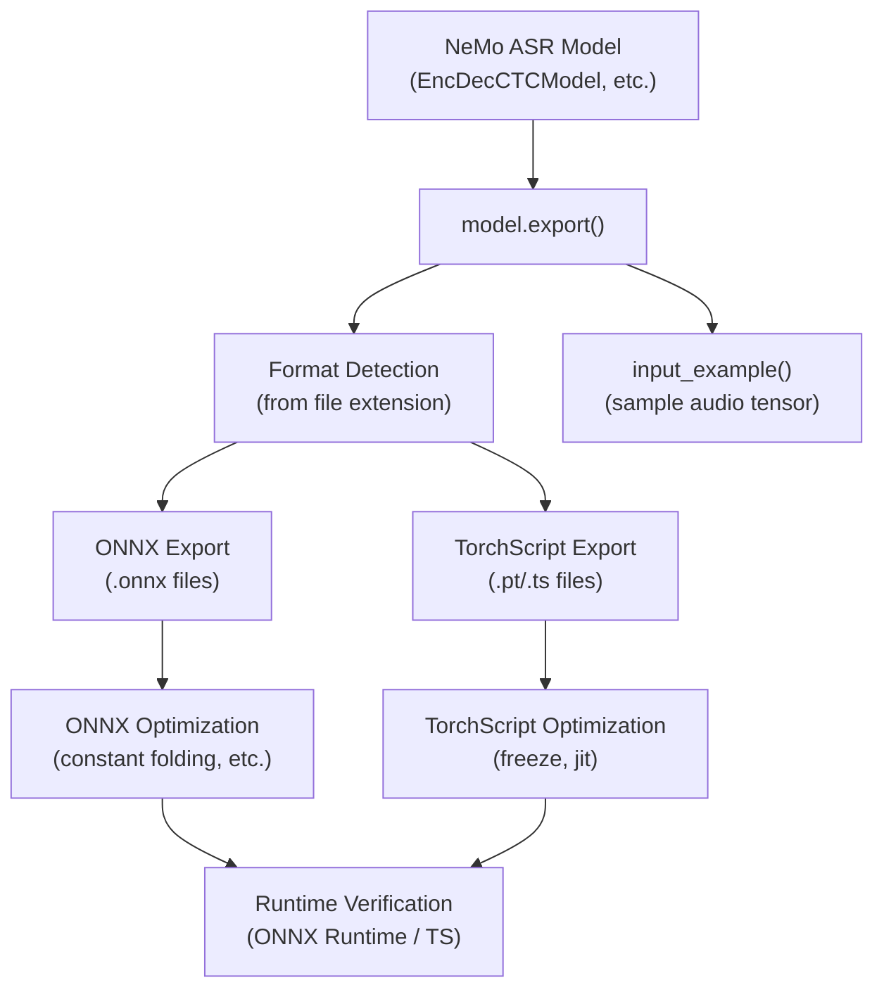

The export process includes:
- **Format Selection**: Automatic detection based on file extension (.onnx, .pt, .ts)
- **Trace Generation**: Creating execution traces from sample inputs
- **Optimization**: Model-specific optimizations for deployment
- **Verification**: Runtime validation of exported models

**Sources:** [nemo/core/classes/exportable.py:60-136](), [tests/collections/asr/test_asr_exportables.py:39-57]()

### Deployment Considerations

Export options include:
- **Dynamic Axes**: Configurable input shapes for variable-length audio
- **Batch Size**: Fixed or dynamic batching for inference
- **Precision**: FP16/FP32 precision modes
- **Runtime Backends**: ONNX Runtime, TensorRT, TorchScript

**Sources:** [nemo/core/classes/exportable.py:224-270]()

---

