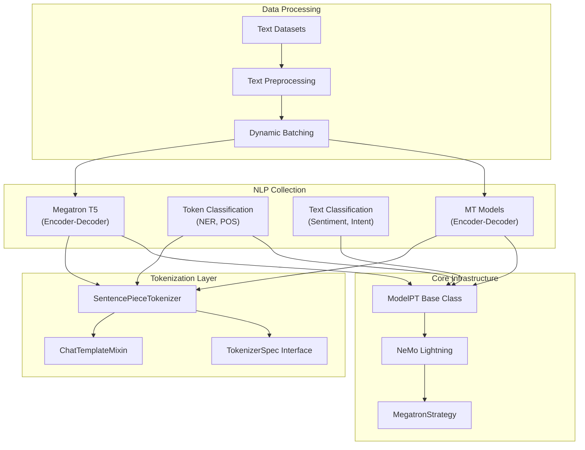
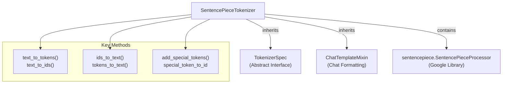
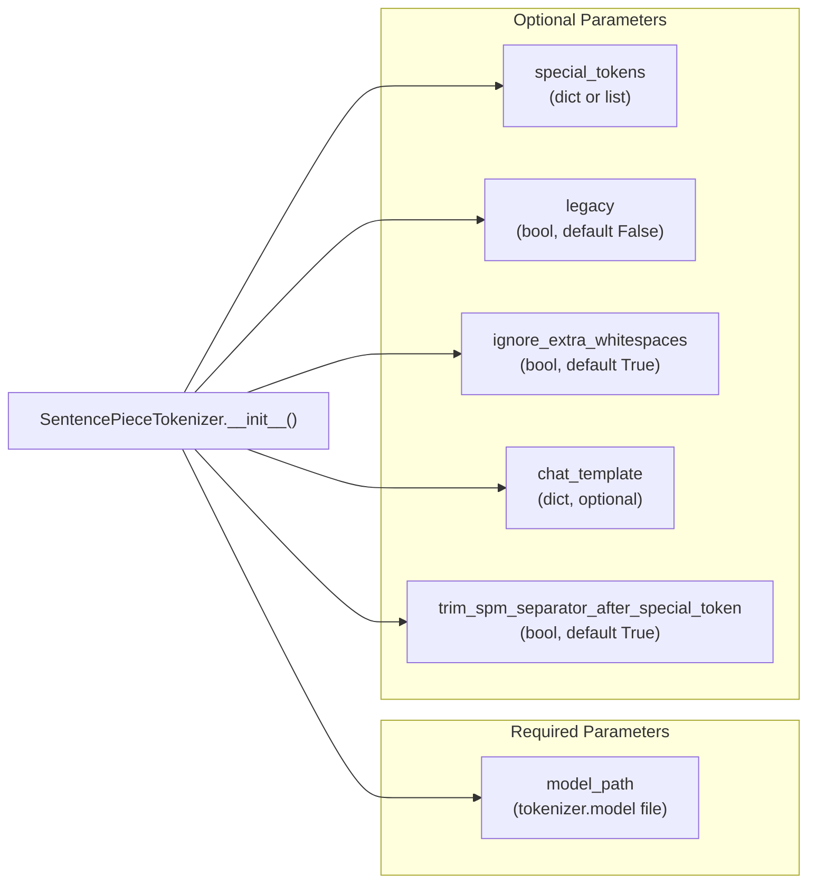
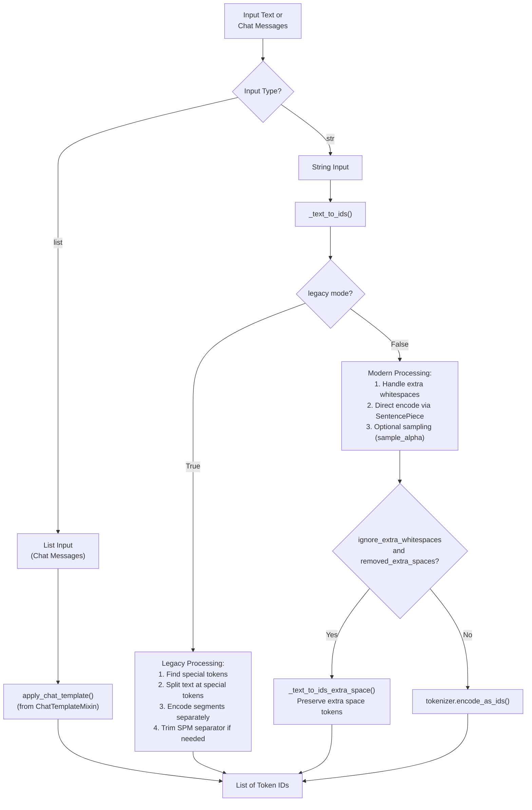
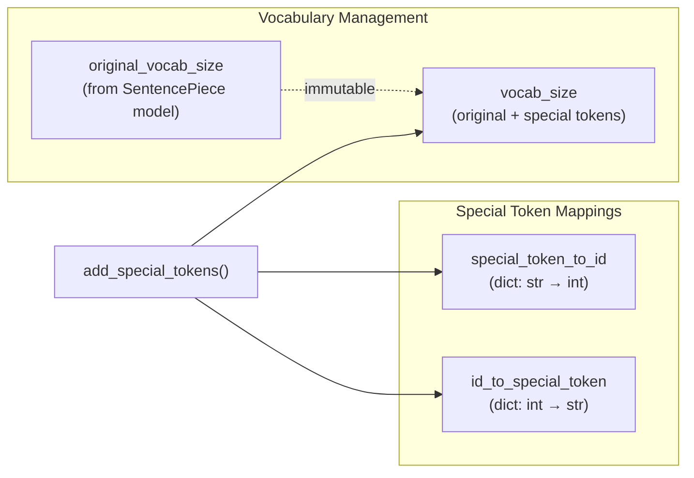
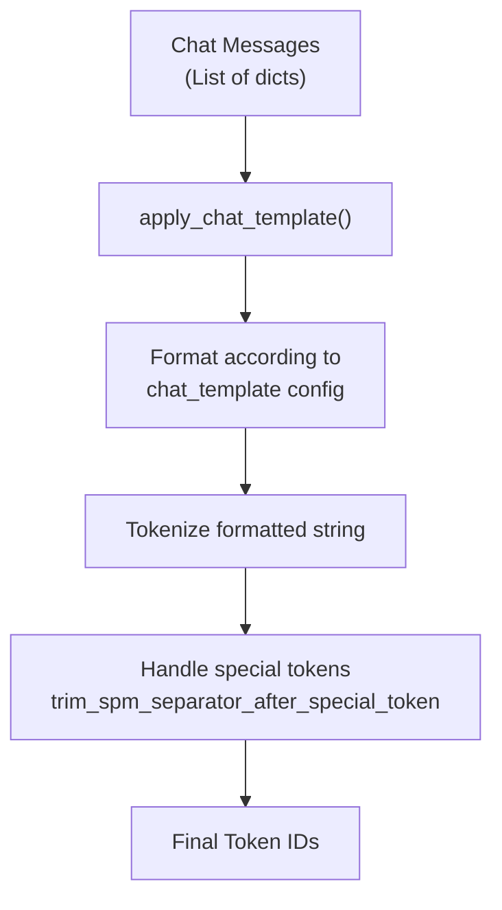
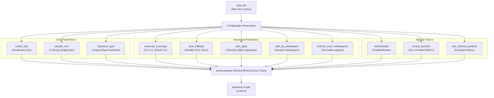
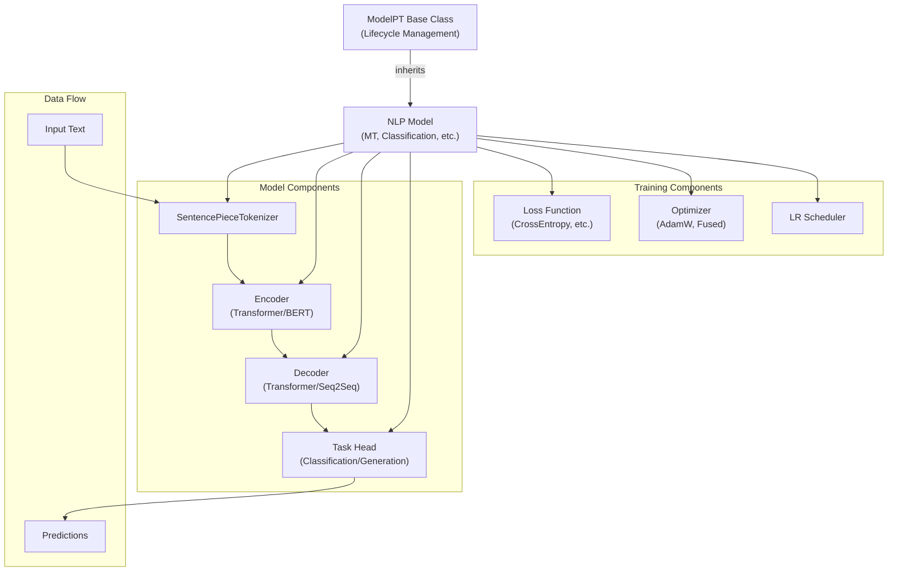
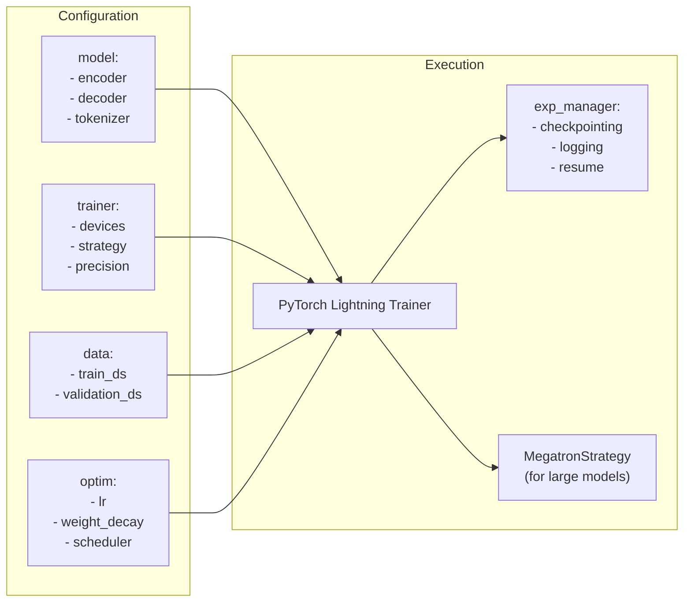
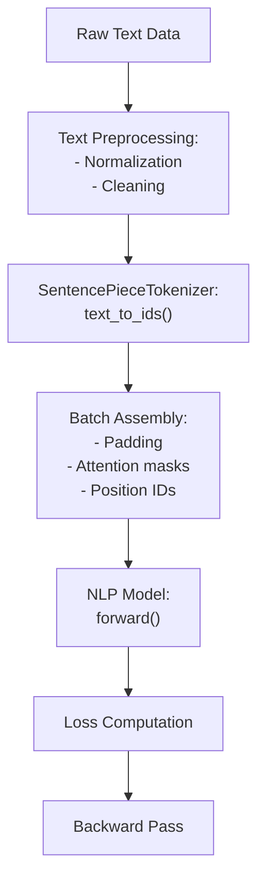

<!-- source: DeepWiki mcp.deepwiki.com · repo NVIDIA/NeMo · page 5 Natural Language Processing (NLP) · fetched 2026-10-21 -->

# Natural Language Processing (NLP)

Relevant source files

The following files were used as context for generating this wiki page:

- [nemo/collections/common/tokenizers/sentencepiece_tokenizer.py](nemo/collections/common/tokenizers/sentencepiece_tokenizer.py)
- [nemo/utils/timers.py](nemo/utils/timers.py)

## Purpose and Scope

This section covers NeMo's traditional Natural Language Processing capabilities, including machine translation, token classification, and text classification models. These models typically follow encoder-decoder or encoder-only architectures and are distinct from the large-scale autoregressive language models.

For large language model (LLM) capabilities such as GPT, Mamba, and other decoder-only models, see [Large Language Models (LLMs)](#3). For multimodal models that combine text with other modalities, see the Multimodal section in [Framework Overview](#1).

---

## NLP Collection Overview

The NLP collection in NeMo provides models and utilities for traditional NLP tasks such as machine translation (MT), named entity recognition (NER), and text classification. These models leverage the core NeMo infrastructure including `ModelPT` for lifecycle management, distributed training strategies, and checkpointing.

**Key Components:**
- **Encoder-Decoder Models**: T5, NMT architectures for sequence-to-sequence tasks
- **Classification Models**: Token-level and sequence-level classification
- **Tokenization**: SentencePiece-based tokenizers with multi-language support
- **Training Infrastructure**: Integration with Megatron-Core for distributed training

**Sources:** [nemo/collections/common/tokenizers/sentencepiece_tokenizer.py:1-616]()

---

## Tokenization Infrastructure

### SentencePieceTokenizer

The `SentencePieceTokenizer` class provides the primary tokenization mechanism for NLP models in NeMo. It wraps the Google SentencePiece library and extends it with NeMo-specific functionality including special token handling, chat templates, and whitespace normalization.

#### Class Architecture

**Sources:** [nemo/collections/common/tokenizers/sentencepiece_tokenizer.py:31-46]()

#### Initialization and Configuration

The tokenizer supports two operational modes controlled by the `legacy` parameter:

| Mode | Special Tokens | Use Case |
|------|---------------|----------|
| **Legacy** (`legacy=True`) | Added at runtime via `add_special_tokens()` | Backward compatibility with existing models |
| **Modern** (`legacy=False`) | Defined during SentencePiece training | New models, cleaner architecture |

**Constructor Parameters:**

**Sources:** [nemo/collections/common/tokenizers/sentencepiece_tokenizer.py:47-84]()

#### Text-to-IDs Conversion Flow

The tokenization pipeline handles several edge cases including special tokens, extra whitespaces, and chat formatting:

**Sources:** [nemo/collections/common/tokenizers/sentencepiece_tokenizer.py:145-250]()

#### Special Token Handling (Legacy Mode)

In legacy mode, special tokens are handled separately from the main vocabulary. The tokenizer maintains two mappings:

**Example Special Token Properties:**

| Property | Legacy Mode | Modern Mode |
|----------|-------------|-------------|
| `pad_id` | `tokens_to_ids([self.pad_token])[0]` | `tokenizer.pad_id()` |
| `bos_id` | `tokens_to_ids([self.bos_token])[0]` | `tokenizer.bos_id()` |
| `eos_id` | `tokens_to_ids([self.eos_token])[0]` | `tokenizer.eos_id()` |
| `unk_id` | `tokenizer.unk_id()` | `tokenizer.unk_id()` |
| `sep_id`, `cls_id`, `mask_id` | Supported | Raises `NameError` |

**Sources:** [nemo/collections/common/tokenizers/sentencepiece_tokenizer.py:344-452]()

#### Whitespace Normalization

The tokenizer implements sophisticated whitespace handling to accommodate different training scenarios:

| Attribute | Description | Impact |
|-----------|-------------|--------|
| `removed_extra_spaces` | Detects if model ignores extra spaces | Set by comparing `encode_as_pieces('x  y')` vs `encode_as_pieces('x y')` |
| `ignore_extra_whitespaces` | User-configurable flag | Controls whether to preserve or ignore extra spaces |
| `extra_space_token` | Special marker ('☯') | Used to preserve space positions when needed |
| `space_sensitive` | Detects if model is space-aware | Set by comparing `text_to_tokens('x y')` vs `text_to_tokens('x') + text_to_tokens('y')` |

**Sources:** [nemo/collections/common/tokenizers/sentencepiece_tokenizer.py:82-84](), [nemo/collections/common/tokenizers/sentencepiece_tokenizer.py:229-250]()

#### Chat Template Integration

The tokenizer inherits from `ChatTemplateMixin`, enabling it to format conversational inputs according to model-specific templates (e.g., Llama-style `[INST]` tags, ChatML format):

**Special Token Trimming:** When `trim_spm_separator_after_special_token=True`, the tokenizer removes the SentencePiece separator (`▁`) that appears immediately after special tokens, preventing patterns like `<INST> ▁who` from becoming `[inst_id, sep_id, who_id]` instead of the desired `[inst_id, who_id]`.

**Sources:** [nemo/collections/common/tokenizers/sentencepiece_tokenizer.py:24](), [nemo/collections/common/tokenizers/sentencepiece_tokenizer.py:119-128](), [nemo/collections/common/tokenizers/sentencepiece_tokenizer.py:197-207]()

---

### Creating SentencePiece Models

The `create_spt_model()` function provides a wrapper around SentencePiece training with NeMo-specific defaults and options:

#### Parameter Details

| Parameter | Type | Description | Default |
|-----------|------|-------------|---------|
| `data_file` | str | Path to training corpus | Required |
| `vocab_size` | int | Target vocabulary size | Required |
| `sample_size` | int | Max sentences to load (-1 for all) | Required |
| `tokenizer_type` | str | Algorithm: `unigram`, `bpe`, `char`, `word` | `'unigram'` |
| `character_coverage` | float | Charset coverage (0.0-1.0) | 1.0 |
| `do_lower_case` | bool | Lowercase normalization | Required |
| `bos` / `eos` / `pad` | bool | Include special tokens | `False` |
| `control_symbols` | List[str] | Non-encoded control tokens | `None` |
| `user_defined_symbols` | List[str] | Encoded user symbols | `None` |
| `byte_fallback` | bool | Fallback to bytes for `<unk>` | `False` |
| `split_digits` | bool | Separate digit tokens | `False` |
| `split_by_whitespace` | bool | Respect whitespace boundaries | `True` |
| `remove_extra_whitespaces` | bool | Normalize multiple spaces | `False` |

**Output Files:**
- `{output_dir}/tokenizer.model`: SentencePiece binary model
- `{output_dir}/vocab.txt`: BERT-style vocabulary file with `##` prefix for subwords

**Sources:** [nemo/collections/common/tokenizers/sentencepiece_tokenizer.py:464-616]()

---

## NLP Model Integration

### ModelPT Integration

NLP models in NeMo inherit from `ModelPT`, which provides:

- **Checkpoint Management**: Save/restore with distributed checkpoint support
- **Configuration System**: Hydra-based configuration with OmegaConf
- **Training Lifecycle**: Integration with PyTorch Lightning
- **Export Capabilities**: ONNX, TorchScript, HuggingFace format conversion

**Typical NLP Model Structure:**

**Sources:** Based on architecture diagrams and [nemo/collections/common/tokenizers/sentencepiece_tokenizer.py:1-28]()

---

## Training and Inference

### Training Configuration

NLP models leverage NeMo's experiment manager and training infrastructure:

### Tokenization in Training Pipeline

**Sources:** Based on general NeMo architecture patterns

---

## Common Use Cases

### Machine Translation

Machine translation models in NeMo follow encoder-decoder architectures with SentencePiece tokenization for both source and target languages.

**Key Features:**
- Multi-lingual tokenizers with combined vocabularies
- Beam search decoding
- Length penalty and coverage penalty
- Optional parallel corpus filtering

### Token Classification

Token classification tasks (NER, POS tagging) use encoder-only models with per-token prediction heads.

**Key Features:**
- BIO/BIOES tagging schemes
- Conditional Random Field (CRF) layers
- Subword-to-word alignment
- Entity-level F1 metrics

### Text Classification

Sequence-level classification (sentiment analysis, intent detection) uses pooled encoder representations.

**Key Features:**
- CLS token pooling or mean pooling
- Multi-label classification support
- Hierarchical classification
- Few-shot learning capabilities

**Sources:** Based on NLP collection architecture patterns and [nemo/collections/common/tokenizers/sentencepiece_tokenizer.py]() for tokenization integration

---

## Summary

The NLP collection in NeMo provides a comprehensive framework for traditional NLP tasks:

- **Tokenization**: `SentencePieceTokenizer` with legacy and modern modes, special token handling, and chat template support
- **Model Architecture**: Integration with `ModelPT` for lifecycle management and distributed training
- **Training Infrastructure**: Leverages NeMo Lightning, Megatron strategies, and experiment management
- **Task Coverage**: Machine translation, token classification, text classification, and more

For autoregressive language modeling and large-scale pretraining, refer to [Large Language Models (LLMs)](#3). For speech-related NLP tasks, see [Automatic Speech Recognition (ASR)](#4).

---

