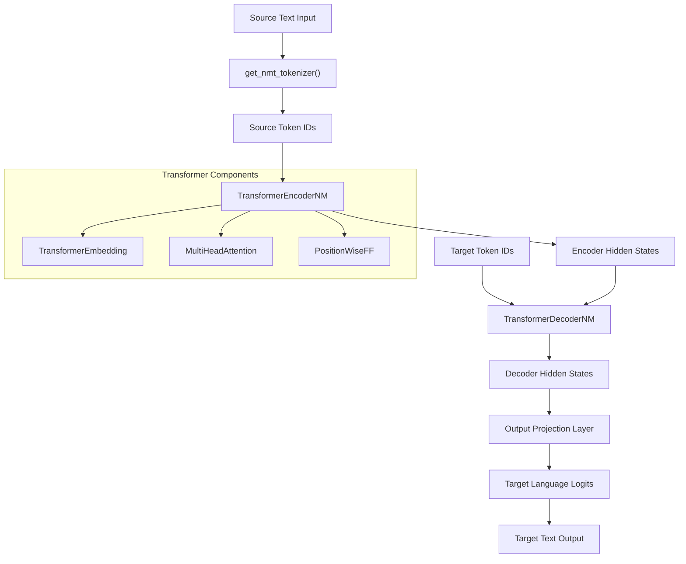
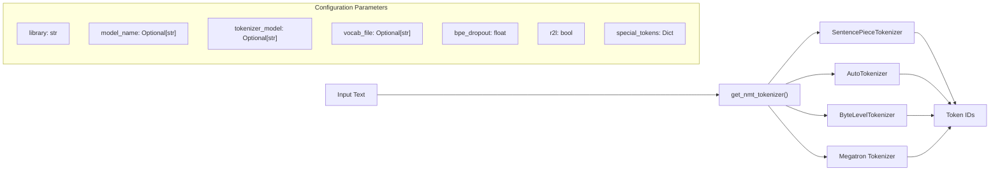
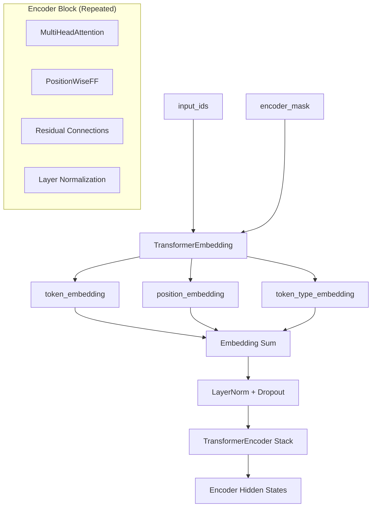
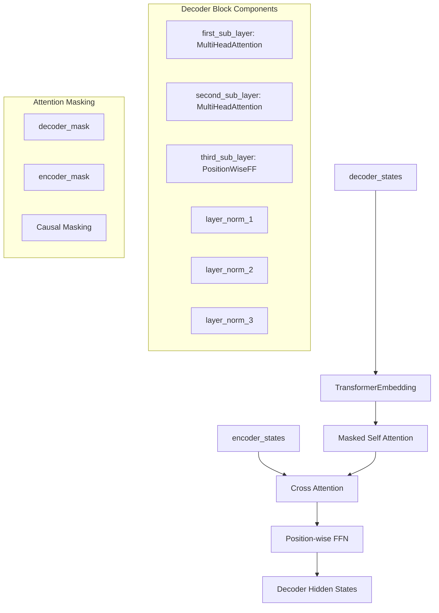
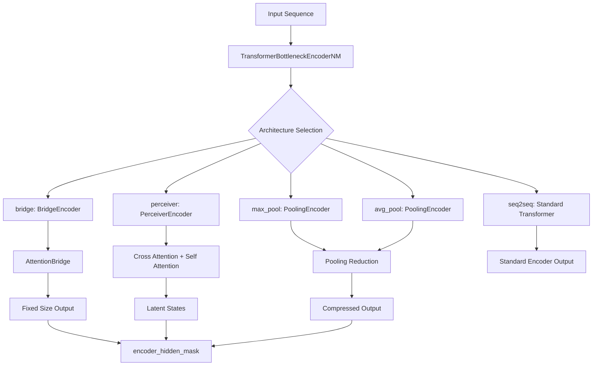
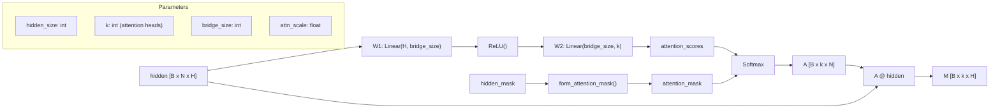
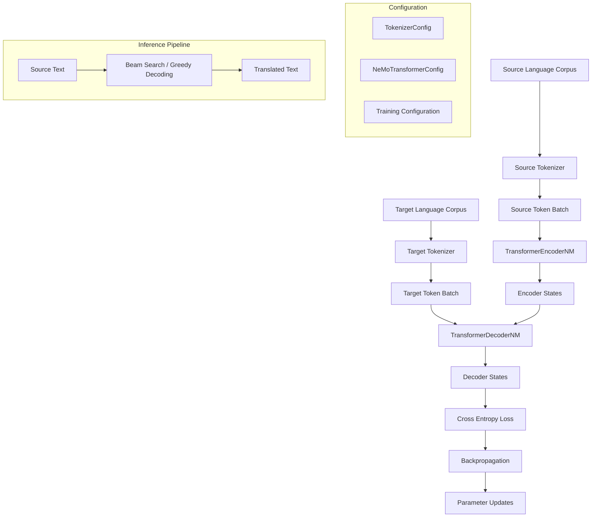
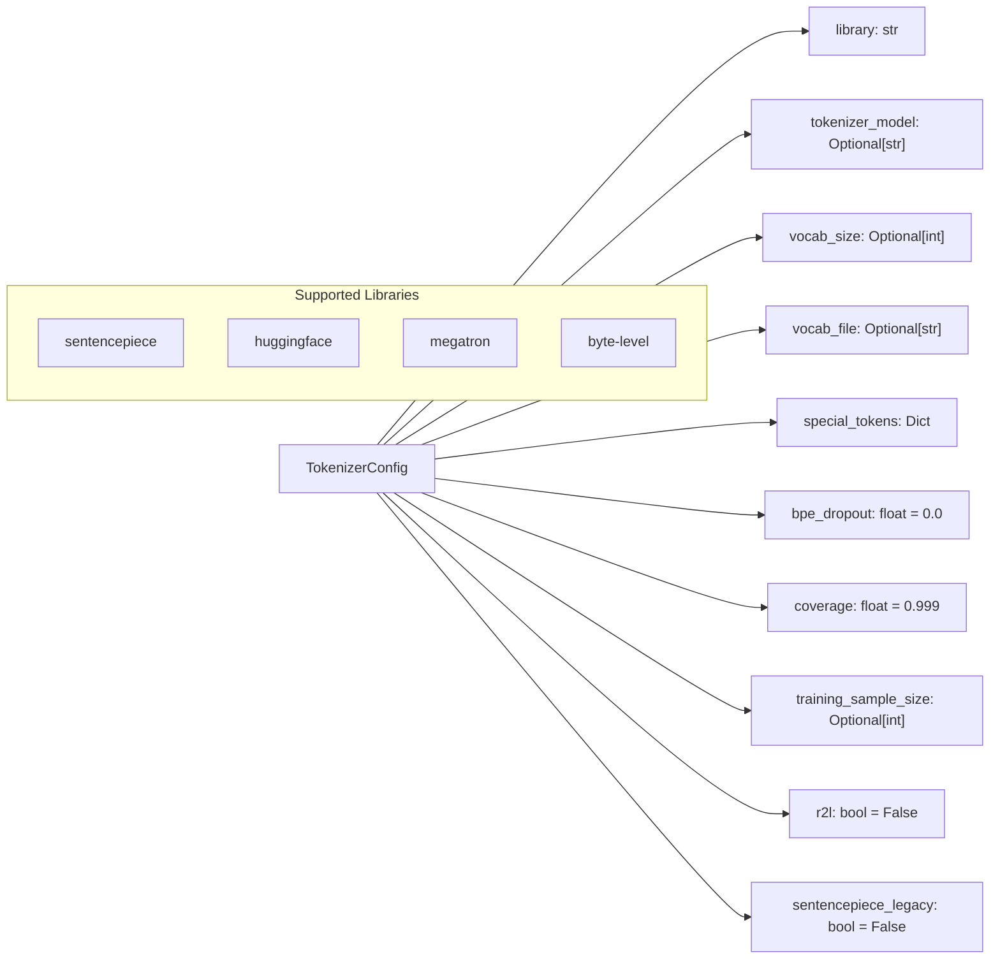

<!-- source: DeepWiki mcp.deepwiki.com · repo NVIDIA/NeMo · page 5.1 Machine Translation · fetched 2026-10-21 -->

# Machine Translation

Relevant source files

The following files were used as context for generating this wiki page:

- [nemo/collections/common/tokenizers/sentencepiece_tokenizer.py](nemo/collections/common/tokenizers/sentencepiece_tokenizer.py)
- [nemo/utils/timers.py](nemo/utils/timers.py)

Machine translation in NeMo is built on top of the framework's transformer encoder-decoder architecture, providing neural machine translation (NMT) capabilities through configurable transformer models. This system supports various tokenization strategies, encoder-decoder configurations, and advanced architectural variants for efficient sequence-to-sequence translation tasks.

For information about general NLP models beyond translation, see [Natural Language Processing (NLP)](#4). For large language model capabilities, see [Large Language Models (LLMs)](#2).

## Architecture Overview

NeMo's machine translation system follows a classic encoder-decoder transformer architecture where source language sequences are encoded into context-aware representations and then decoded into target language sequences.

Sources: [nemo/collections/nlp/modules/common/transformer/transformer.py:76-164](), [nemo/collections/nlp/modules/common/transformer/transformer.py:166-241](), [nemo/collections/nlp/modules/common/tokenizer_utils.py:164-285]()

## Neural Machine Translation Tokenization

NeMo provides specialized tokenization support for machine translation through the `get_nmt_tokenizer` function, which supports multiple tokenization libraries and configurations optimized for translation tasks.

### Supported Tokenization Libraries

| Library | Description | Use Case |
|---------|-------------|----------|
| `sentencepiece` | Subword tokenization with BPE | Most common for MT, handles OOV well |
| `huggingface` | HuggingFace AutoTokenizer | Pre-trained model compatibility |
| `byte-level` | Byte-level tokenization | Character-level translation |
| `megatron` | Megatron tokenization | Large-scale MT models |

Sources: [nemo/collections/nlp/modules/common/tokenizer_utils.py:164-285]()

## Core Transformer Components

The machine translation system is built using modular transformer components that can be composed into various architectures.

### Encoder Architecture

Sources: [nemo/collections/nlp/modules/common/transformer/transformer_modules.py:83-147](), [nemo/collections/nlp/modules/common/transformer/transformer_encoders.py:102-174]()

### Decoder Architecture

Sources: [nemo/collections/nlp/modules/common/transformer/transformer_decoders.py:26-111](), [nemo/collections/nlp/modules/common/transformer/transformer_decoders.py:113-207]()

## Advanced Encoder Architectures

NeMo provides several specialized encoder architectures for improved efficiency and performance in machine translation tasks.

### Bottleneck Encoders

Sources: [nemo/collections/nlp/modules/common/transformer/transformer_bottleneck.py:59-257](), [nemo/collections/nlp/modules/common/transformer/bridge_encoders.py:23-141](), [nemo/collections/nlp/modules/common/transformer/perceiver_encoders.py:26-174]()

### Attention Bridge Mechanism

The `AttentionBridge` component enables variable-length input sequences to be compressed into fixed-size representations for efficient processing.

Sources: [nemo/collections/nlp/modules/common/transformer/transformer_modules.py:245-296]()

## Training and Inference Pipeline

The machine translation training pipeline integrates tokenization, model architecture selection, and distributed training capabilities.

Sources: [nemo/collections/nlp/modules/common/tokenizer_utils.py:41-57](), [nemo/collections/nlp/modules/common/transformer/transformer.py:38-74]()

## Configuration and Integration

Machine translation models in NeMo are configured through structured configuration objects that define tokenization, model architecture, and training parameters.

### Tokenizer Configuration

The `TokenizerConfig` dataclass provides standardized configuration for NMT tokenization:

Sources: [nemo/collections/nlp/modules/common/tokenizer_utils.py:41-57]()

### Transformer Configuration

```mermaid
graph TB
    NeMoTransformerConfig["NeMoTransformerConfig"] --> RequiredParams["Required Parameters"]
    NeMoTransformerConfig --> EmbeddingParams["Embedding Parameters"]
    NeMoTransformerConfig --> TransformerParams["Transformer Parameters"]
    
    RequiredParams --> HiddenSize["hidden_size: int"]
    RequiredParams --> NumLayers["num_layers: int"]
    RequiredParams --> InnerSize["inner_size: int"]
    RequiredParams --> NumAttentionHeads["num_attention_heads: int"]
    
    EmbeddingParams --> MaxSeqLength["max_sequence_length: int = 512"]
    EmbeddingParams --> NumTokenTypes["num_token_types: int = 2"]
    EmbeddingParams --> EmbeddingDropout["embedding_dropout: float = 0.0"]
    EmbeddingParams --> LearnPosEnc["learn_positional_encodings: bool = False"]
    
    TransformerParams --> FFNDropout["ffn_dropout: float = 0.0"]
    TransformerParams --> AttnScoreDropout["attn_score_dropout: float = 0.0"]
    TransformerParams --> AttnLayerDropout["attn_layer_dropout: float = 0.0"]
    TransformerParams --> HiddenAct["hidden_act: str = 'relu'"]
    TransformerParams --> PreLN["pre_ln: bool = False"]
    TransformerParams --> PreLNFinal["pre_ln_final_layer_norm: bool = True"]
```

Sources: [nemo/collections/nlp/modules/common/transformer/transformer.py:38-74]()

---

