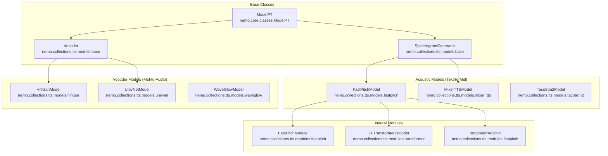
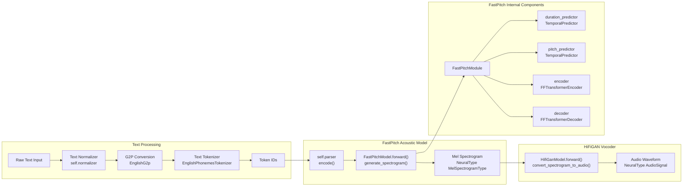
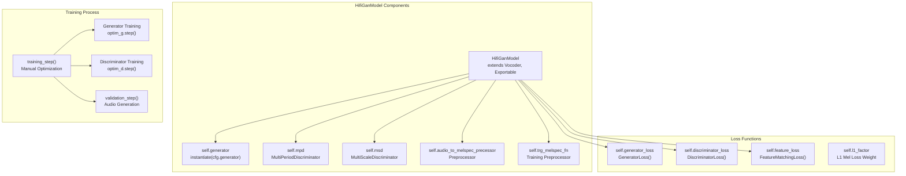
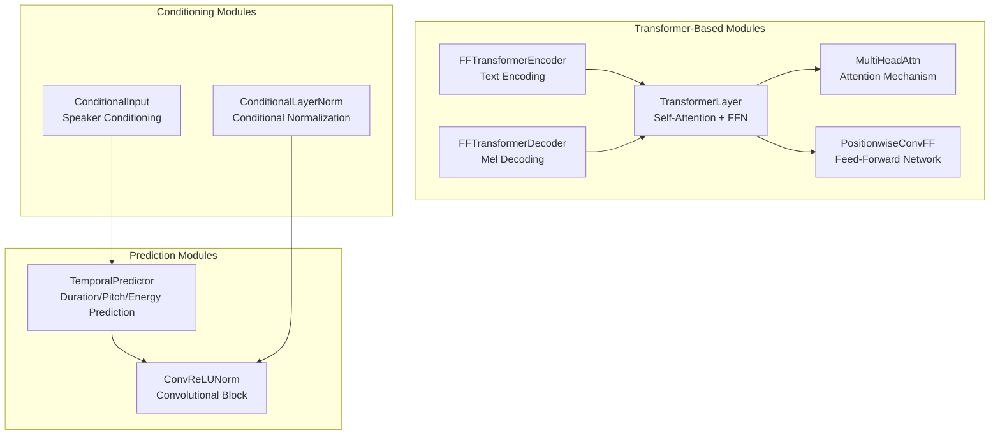

<!-- source: DeepWiki mcp.deepwiki.com · repo NVIDIA/NeMo · page 6 Text-to-Speech (TTS) · fetched 2026-10-21 -->

# Text-to-Speech (TTS)

<details>
<summary>Relevant source files</summary>

The following files were used as context for generating this wiki page:

- [.gitignore](.gitignore)
- [nemo/collections/tts/__init__.py](nemo/collections/tts/__init__.py)
- [nemo/collections/tts/g2p/modules.py](nemo/collections/tts/g2p/modules.py)
- [nemo/collections/tts/parts/__init__.py](nemo/collections/tts/parts/__init__.py)
- [nemo/core/neural_types/__init__.py](nemo/core/neural_types/__init__.py)
- [tests/__init__.py](tests/__init__.py)
- [tests/collections/common/tokenizers/text_to_speech/test_tokenizer_utils.py](tests/collections/common/tokenizers/text_to_speech/test_tokenizer_utils.py)
- [tests/collections/tts/g2p/data/test_g2p_data_utils.py](tests/collections/tts/g2p/data/test_g2p_data_utils.py)
- [tests/collections/tts/g2p/test_modules.py](tests/collections/tts/g2p/test_modules.py)

</details>


## Purpose and Scope

This document covers NeMo's Text-to-Speech (TTS) system, which enables high-quality speech synthesis from text using neural acoustic models and vocoders. The TTS collection provides complete end-to-end pipelines for training and inference, with support for multiple architectures including FastPitch, HiFiGAN, Mixer-TTS, and other state-of-the-art models.

For related speech technologies, see [Automatic Speech Recognition (ASR)](#3). For general model training workflows, see [Experiment Management and Training](#1.3).

## TTS System Architecture

NeMo's TTS system implements a two-stage pipeline: acoustic modeling (text-to-spectrogram) followed by vocoding (spectrogram-to-audio). The system supports multiple model architectures with complete training and inference capabilities.

### TTS Model Architecture Overview



Sources: [nemo/collections/tts/models/fastpitch.py:82-83](), [nemo/collections/tts/models/hifigan.py:43-46](), [nemo/collections/tts/modules/fastpitch.py:157-158](), [nemo/collections/tts/modules/transformer.py:264-265]()

### End-to-End TTS Pipeline



Sources: [nemo/collections/tts/models/fastpitch.py:82-199](), [nemo/collections/tts/models/hifigan.py:162-174](), [nemo/collections/tts/modules/fastpitch.py:157-185]()

## FastPitch: Non-Autoregressive TTS Model

FastPitch is NeMo's primary acoustic model for high-quality, efficient text-to-speech synthesis. It generates mel spectrograms from text in parallel, making it significantly faster than autoregressive models.

### FastPitch Model Components

```mermaid
graph TB
    subgraph "FastPitchModel Class"
        FastPitchModel["FastPitchModel<br/>extends SpectrogramGenerator"]
        Preprocessor["self.preprocessor<br/>instantiate(cfg.preprocessor)"]
        FastPitchCoreModule["self.fastpitch<br/>FastPitchModule"]
        Aligner["self.aligner<br/>instantiate(cfg.alignment_module)"]
        Vocab["self.vocab<br/>Text Tokenizer"]
    end
    
    subgraph "FastPitchModule Internal Architecture"
        Encoder["self.encoder<br/>FFTransformerEncoder"]
        Decoder["self.decoder<br/>FFTransformerDecoder"]
        DurationPred["self.duration_predictor<br/>TemporalPredictor"]
        PitchPred["self.pitch_predictor<br/>TemporalPredictor"]
        EnergyPred["self.energy_predictor<br/>TemporalPredictor"]
        SpeakerEmb["self.speaker_emb<br/>torch.nn.Embedding"]
        PitchEmb["self.pitch_emb<br/>torch.nn.Conv1d"]
        EnergyEmb["self.energy_emb<br/>torch.nn.Conv1d"]
        Projection["self.proj<br/>torch.nn.Linear"]
    end
    
    subgraph "Loss Functions"
        MelLoss["MelLoss<br/>fastpitchloss.MelLoss"]
        DurationLoss["DurationLoss<br/>fastpitchloss.DurationLoss"]
        PitchLoss["PitchLoss<br/>fastpitchloss.PitchLoss"]
        EnergyLoss["EnergyLoss<br/>fastpitchloss.EnergyLoss"]
        ForwardSumLoss["ForwardSumLoss<br/>aligner_loss.ForwardSumLoss"]
        BinLoss["BinLoss<br/>aligner_loss.BinLoss"]
    end
    
    FastPitchModel --> Preprocessor
    FastPitchModel --> FastPitchCoreModule
    FastPitchModel --> Aligner
    FastPitchModel --> Vocab
    
    FastPitchCoreModule --> Encoder
    FastPitchCoreModule --> Decoder
    FastPitchCoreModule --> DurationPred
    FastPitchCoreModule --> PitchPred
    FastPitchCoreModule --> EnergyPred
    FastPitchCoreModule --> SpeakerEmb
    FastPitchCoreModule --> PitchEmb
    FastPitchCoreModule --> EnergyEmb
    FastPitchCoreModule --> Projection
    
    FastPitchModel --> MelLoss
    FastPitchModel --> DurationLoss
    FastPitchModel --> PitchLoss
    FastPitchModel --> EnergyLoss
    FastPitchModel --> ForwardSumLoss
    FastPitchModel --> BinLoss
```



Sources: [nemo/collections/tts/models/fastpitch.py:85-199](), [nemo/collections/tts/modules/fastpitch.py:157-221](), [nemo/collections/tts/losses/fastpitchloss.py:61-182]()

### FastPitch Training and Inference Methods

| Method | Purpose | Key Operations |
|--------|---------|----------------|
| `training_step()` | Training forward pass | Text processing, duration/pitch prediction, alignment learning, loss computation |
| `validation_step()` | Validation forward pass | Similar to training but with evaluation metrics |
| `generate_spectrogram()` | Inference method | Token parsing, spectrogram generation from text input |
| `forward()` | Core forward pass | Encoder → Duration/Pitch prediction → Decoder → Mel projection |

Sources: [nemo/collections/tts/models/fastpitch.py:364-484](), [nemo/collections/tts/models/fastpitch.py:340-362]()

## HiFiGAN: High-Fidelity Vocoder

HiFiGAN is a GAN-based neural vocoder that converts mel spectrograms to high-quality audio waveforms. It uses multi-period and multi-scale discriminators for training stability and audio quality.

### HiFiGAN Architecture



Sources: [nemo/collections/tts/models/hifigan.py:48-81](), [nemo/collections/tts/models/hifigan.py:175-232]()

### HiFiGAN Key Methods

| Method | Purpose | Key Operations |
|--------|---------|----------------|
| `forward()` | Generator forward pass | `self.generator(x=spec)` - mel to audio conversion |
| `convert_spectrogram_to_audio()` | Public inference API | Type-checked spectrogram to audio conversion |
| `training_step()` | GAN training loop | Discriminator training → Generator training with feature matching |
| `validation_step()` | Validation and logging | Audio generation, bias denoising, logging to tensorboard/wandb |

Sources: [nemo/collections/tts/models/hifigan.py:162-174](), [nemo/collections/tts/models/hifigan.py:175-294]()

## Available Pre-trained TTS Models

NeMo provides a comprehensive collection of pre-trained TTS models across multiple languages and speakers, accessible through NVIDIA NGC.

### Acoustic Models (Text-to-Mel)

| Model | Language | Dataset | Speakers | Sample Rate | Tokenization | Class |
|-------|----------|---------|----------|-------------|--------------|--------|
| `tts_en_fastpitch` | English | LJSpeech | 1 (Female) | 22050Hz | ARPABET | `FastPitchModel` |
| `tts_en_fastpitch_ipa` | English | LJSpeech | 1 (Female) | 22050Hz | IPA | `FastPitchModel` |
| `tts_en_fastpitch_multispeaker` | English | HiFiTTS | 10 | 44100Hz | ARPABET | `FastPitchModel` |
| `tts_de_fastpitch_multispeaker_5` | German | HUI Audio Corpus | 5 | 44100Hz | ARPABET | `FastPitchModel` |
| `tts_es_fastpitch_multispeaker` | Spanish | OpenSLR Latin American | 174 | 44100Hz | IPA | `FastPitchModel` |
| `tts_zh_fastpitch_sfspeech` | Chinese | SFSpeech Bilingual | 1 (Female) | 22050Hz | Pinyin | `FastPitchModel` |
| `tts_en_lj_mixertts` | English | LJSpeech | 1 (Female) | 22050Hz | ARPABET | `MixerTTSModel` |

Sources: [docs/source/tts/data/ngc_models_am.csv:2-13]()

### Vocoder Models (Mel-to-Audio)

| Model | Language | Training Data | Speakers | Sample Rate | Class |
|-------|----------|---------------|----------|-------------|--------|
| `tts_en_hifigan` | English | LJSpeech | 1 | 22050Hz | `HifiGanModel` |
| `tts_en_hifitts_hifigan_ft_fastpitch` | English | HiFiTTS | 10 | 44100Hz | `HifiGanModel` |
| `tts_de_hui_hifigan_ft_fastpitch_multispeaker_5` | German | HUI Audio Corpus | 5 | 44100Hz | `HifiGanModel` |
| `tts_es_hifigan_ft_fastpitch_multispeaker` | Spanish | OpenSLR Latin American | 174 | 44100Hz | `HifiGanModel` |
| `tts_zh_hifigan_sfspeech` | Chinese | SFSpeech Bilingual | 1 | 22050Hz | `HifiGanModel` |
| `tts_en_lj_univnet` | English | LJSpeech | 1 | 22050Hz | `UnivNetModel` |
| `tts_en_waveglow_88m` | English | LJSpeech | 1 | 22050Hz | `WaveGlowModel` |

Sources: [docs/source/tts/data/ngc_models_vocoder.csv:2-13]()

### Model Loading and Usage

```python
# Load pre-trained FastPitch model
fastpitch = FastPitchModel.from_pretrained("tts_en_fastpitch")

# Load pre-trained HiFiGAN vocoder  
hifigan = HifiGanModel.from_pretrained("tts_en_hifigan")

# Text-to-speech synthesis pipeline
spectrogram = fastpitch.generate_spectrogram(tokens=text_tokens)
audio = hifigan.convert_spectrogram_to_audio(spec=spectrogram)
```

Sources: [nemo/collections/tts/models/fastpitch.py:707-805](), [nemo/collections/tts/models/hifigan.py:411-508]()

## TTS Neural Modules and Components

The TTS system is built on reusable neural modules that handle specific aspects of the text-to-speech pipeline.

### Core TTS Modules



Sources: [nemo/collections/tts/modules/transformer.py:264-308](), [nemo/collections/tts/modules/fastpitch.py:107-155]()

### Neural Type Specifications in TTS

TTS modules use NeMo's neural type system for tensor validation and documentation:

| Neural Type | TTS Usage | Tensor Shape | Purpose |
|-------------|-----------|--------------|---------|
| `TokenIndex` | Text input | `('B', 'T_text')` | Tokenized text sequences |
| `MelSpectrogramType` | Acoustic features | `('B', 'D', 'T_spec')` | Mel spectrogram representations |
| `AudioSignal` | Waveform output | `('B', 'T_audio')` | Raw audio waveforms |
| `TokenDurationType` | Duration prediction | `('B', 'T_text')` | Phone/character durations |
| `RegressionValuesType` | Prosodic features | `('B', 'T')` | Pitch, energy values |
| `EncodedRepresentation` | Hidden states | `('B', 'T', 'D')` | Encoder/decoder representations |

Sources: [nemo/collections/tts/models/fastpitch.py:292-307](), [nemo/collections/tts/modules/fastpitch.py:223-254]()

## Summary

The Text-to-Speech system and Neural Module framework work together to provide a robust, type-safe foundation for speech synthesis in NeMo. The neural type system ensures compatibility between components, while the TTS collection provides specialized models and modules for converting text to natural-sounding speech. This architecture enables both flexibility in model design and reliability through compile-time type checking.

---

