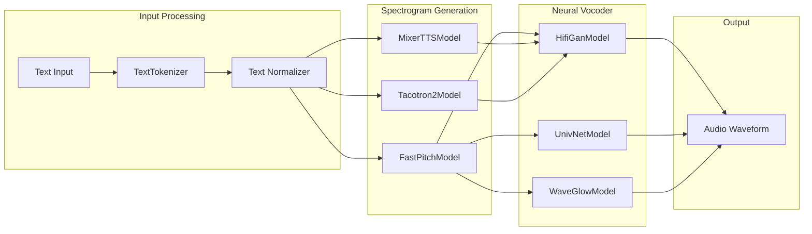
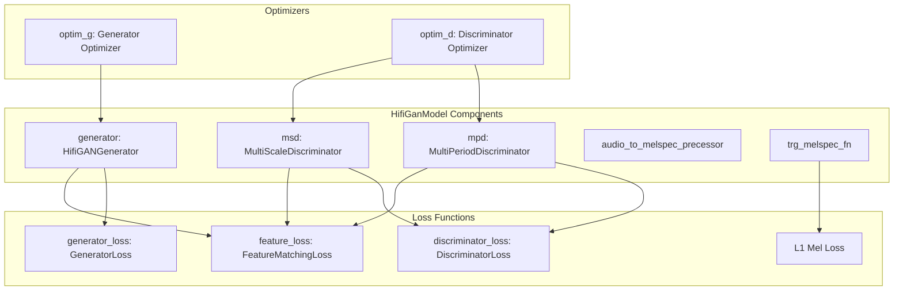
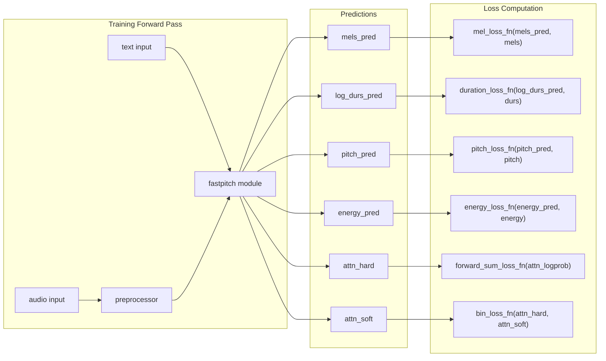

<!-- source: DeepWiki mcp.deepwiki.com · repo NVIDIA/NeMo · page 6.1 TTS Models and G2P Modules · fetched 2026-10-21 -->

# TTS Model Architectures and Training

Relevant source files

The following files were used as context for generating this wiki page:

- [.gitignore](.gitignore)
- [nemo/collections/tts/__init__.py](nemo/collections/tts/__init__.py)
- [nemo/collections/tts/g2p/modules.py](nemo/collections/tts/g2p/modules.py)
- [nemo/collections/tts/parts/__init__.py](nemo/collections/tts/parts/__init__.py)
- [nemo/core/neural_types/__init__.py](nemo/core/neural_types/__init__.py)
- [tests/__init__.py](tests/__init__.py)
- [tests/collections/common/tokenizers/text_to_speech/test_tokenizer_utils.py](tests/collections/common/tokenizers/text_to_speech/test_tokenizer_utils.py)
- [tests/collections/tts/g2p/data/test_g2p_data_utils.py](tests/collections/tts/g2p/data/test_g2p_data_utils.py)
- [tests/collections/tts/g2p/test_modules.py](tests/collections/tts/g2p/test_modules.py)

## Purpose and Scope

This document covers the core Text-to-Speech (TTS) model architectures implemented in NeMo, their training procedures, and how they integrate to form complete speech synthesis pipelines. The focus is on spectrogram generation models like `FastPitchModel` and neural vocoder models like `HifiGanModel`, along with their training methodologies.

For information about the underlying neural modules and TTS components that compose these models, see [Neural Modules and TTS Components](#5.2). For model export and deployment workflows, see [Model Export Framework and ONNX](#6.2).

## TTS Pipeline Architecture Overview

NeMo's TTS system follows a two-stage approach where spectrogram generators convert text to mel-spectrograms, and neural vocoders convert spectrograms to audio waveforms.

### TTS Pipeline Flow

Sources: [nemo/collections/tts/models/fastpitch.py:1-100](), [nemo/collections/tts/models/hifigan.py:1-50](), [nemo/collections/tts/models/mixer_tts.py:1-100]()

## Spectrogram Generation Models

### FastPitch Architecture

`FastPitchModel` is the primary spectrogram generator, implementing a non-autoregressive transformer-based architecture that predicts mel-spectrograms from text with explicit duration and pitch modeling.

#### FastPitch Model Components

```mermaid
graph TB
    subgraph "FastPitchModel Class Structure"
        FPModel["FastPitchModel"]
        FPModule["FastPitchModule"]
        SpectGen["SpectrogramGenerator"]
        Exportable["Exportable"]
        AdapterMixin["FastPitchAdapterModelMixin"]
    end
    
    subgraph "Core Components"
        Preprocessor["preprocessor: AudioToMelSpectrogramPreprocessor"]
        InputFFT["input_fft: FFTransformerEncoder"]
        OutputFFT["output_fft: FFTransformerDecoder"]
        DurPredictor["duration_predictor: TemporalPredictor"]
        PitchPredictor["pitch_predictor: TemporalPredictor"]
        EnergyPredictor["energy_predictor: TemporalPredictor"]
        Aligner["aligner: AlignmentEncoder"]
    end
    
    subgraph "Loss Functions"
        MelLoss["MelLoss"]
        DurationLoss["DurationLoss"]
        PitchLoss["PitchLoss"]
        EnergyLoss["EnergyLoss"]
        ForwardSumLoss["ForwardSumLoss"]
        BinLoss["BinLoss"]
    end
    
    FPModel --> SpectGen
    FPModel --> Exportable
    FPModel --> AdapterMixin
    FPModel --> FPModule
    
    FPModule --> Preprocessor
    FPModule --> InputFFT
    FPModule --> OutputFFT
    FPModule --> DurPredictor
    FPModule --> PitchPredictor
    FPModule --> EnergyPredictor
    FPModule --> Aligner
    
    FPModel --> MelLoss
    FPModel --> DurationLoss
    FPModel --> PitchLoss
    FPModel --> EnergyLoss
    FPModel --> ForwardSumLoss
    FPModel --> BinLoss
```

Sources: [nemo/collections/tts/models/fastpitch.py:82-199](), [nemo/collections/tts/modules/fastpitch.py:157-221]()

#### FastPitch Training Flow

The `FastPitchModel` supports both alignment-based and duration-based training modes:

| Training Mode | Alignment Learning | Duration Source | Pitch Source |
|---------------|-------------------|-----------------|--------------|
| `learn_alignment=True` | Uses alignment module | Predicted from attention | Frame-level, averaged to tokens |
| `learn_alignment=False` | Pre-computed durations | Ground truth durations | Token-level ground truth |

**Key Training Methods:**

- `training_step()`: [nemo/collections/tts/models/fastpitch.py:364-484]()
- `validation_step()`: [nemo/collections/tts/models/fastpitch.py:486-567]()
- Forward pass: [nemo/collections/tts/modules/fastpitch.py:269-383]()

Sources: [nemo/collections/tts/models/fastpitch.py:85-199](), [nemo/collections/tts/losses/fastpitchloss.py:60-182]()

### MixerTTS Architecture

`MixerTTSModel` implements the Mixer-TTS architecture with self-attention and alignment learning capabilities.

#### MixerTTS Key Features

- **Alignment Module**: Uses `AlignmentEncoder` for learning text-audio alignments
- **Language Model Conditioning**: Optional conditioning on pre-trained language model embeddings
- **Adaptive Binary Loss**: Gradually introduces hard attention constraints during training

**Core Components:**
- `encoder`: Text encoder with embedding layers
- `decoder`: Spectrogram decoder 
- `aligner`: Attention alignment module
- `duration_predictor`, `pitch_predictor`: Prosody prediction modules

Sources: [nemo/collections/tts/models/mixer_tts.py:60-156](), [nemo/collections/tts/models/mixer_tts.py:282-402]()

## Neural Vocoder Models

### HiFiGAN Architecture

`HifiGanModel` implements the HiFi-GAN neural vocoder that converts mel-spectrograms to high-quality audio waveforms using adversarial training.

#### HiFiGAN Training Architecture

Sources: [nemo/collections/tts/models/hifigan.py:43-81](), [nemo/collections/tts/models/hifigan.py:113-152]()

#### HiFiGAN Training Process

The `HifiGanModel` uses manual optimization with separate discriminator and generator training steps:

**Training Step Process:**
1. **Discriminator Training**: [nemo/collections/tts/models/hifigan.py:187-199]()
   - Compute MPD and MSD discriminator losses
   - Backpropagate discriminator loss
   
2. **Generator Training**: [nemo/collections/tts/models/hifigan.py:201-212]()
   - Compute generator loss, feature matching loss, and L1 mel loss
   - Combine losses with L1 factor weighting
   - Backpropagate generator loss

**Key Configuration:**
- `l1_factor`: Weighting for L1 mel reconstruction loss (default: 45)
- `automatic_optimization = False`: Enables manual optimization
- Separate learning rate schedulers for generator and discriminator

Sources: [nemo/collections/tts/models/hifigan.py:175-232]()

## Training Loss Functions

### FastPitch Loss Components

The training losses for FastPitch are implemented as separate loss classes:

| Loss Class | Purpose | Loss Scale |
|------------|---------|------------|
| `MelLoss` | Mel-spectrogram reconstruction | 1.0 |
| `DurationLoss` | Duration prediction (log-duration MSE) | 0.1 (default) |
| `PitchLoss` | Pitch contour prediction | 0.1 (default) |
| `EnergyLoss` | Energy prediction (optional) | 0.1 (default) |
| `ForwardSumLoss` | CTC alignment loss | 1.0 |
| `BinLoss` | Hard attention binarization | Warmup scheduled |

#### Loss Computation Flow

Sources: [nemo/collections/tts/models/fastpitch.py:428-439](), [nemo/collections/tts/losses/fastpitchloss.py:61-182]()

## Model Integration and Inference

### Data Loading and Processing

Both FastPitch and HiFiGAN models support multiple dataset classes:

**FastPitch Datasets:**
- `nemo.collections.tts.data.dataset.TTSDataset`
- `nemo.collections.tts.data.text_to_speech_dataset.TextToSpeechDataset`

**HiFiGAN Datasets:**
- `nemo.collections.tts.data.vocoder_dataset.VocoderDataset`

### Text Processing Pipeline

The text processing involves multiple components:

1. **Text Normalization**: Optional normalization via `text_normalizer_call`
2. **Tokenization**: Conversion to phonemes or characters using tokenizers
3. **G2P Conversion**: Grapheme-to-phoneme conversion for phonetic representations

**Key Tokenizer Classes:**
- `EnglishPhonemesTokenizer`: ARPABET or IPA phoneme tokenization
- `EnglishCharsTokenizer`: Character-level tokenization

Sources: [nemo/collections/tts/models/fastpitch.py:200-268](), [nemo/collections/tts/models/fastpitch.py:602-677]()

### Available Pre-trained Models

The framework provides numerous pre-trained models across different languages:

**FastPitch Models:**
- `tts_en_fastpitch`: English LJSpeech (ARPABET)
- `tts_en_fastpitch_multispeaker`: Multi-speaker HiFiTTS
- `tts_de_fastpitch_multispeaker_5`: German multi-speaker
- `tts_es_fastpitch_multispeaker`: Spanish multi-speaker
- `tts_zh_fastpitch_sfspeech`: Chinese single speaker

**HiFiGAN Models:**
- `tts_en_hifigan`: English LJSpeech baseline
- `tts_en_hifitts_hifigan_ft_fastpitch`: Multi-speaker English
- Language-specific vocoders for German, Spanish, and Chinese

Sources: [nemo/collections/tts/models/fastpitch.py:708-805](), [nemo/collections/tts/models/hifigan.py:412-508](), [docs/source/tts/data/ngc_models_am.csv:1-14](), [docs/source/tts/data/ngc_models_vocoder.csv:1-14]()

---

