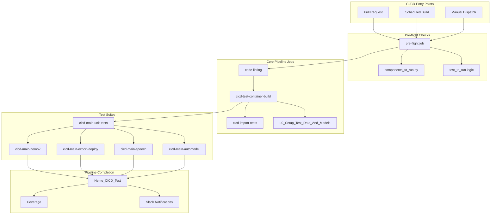
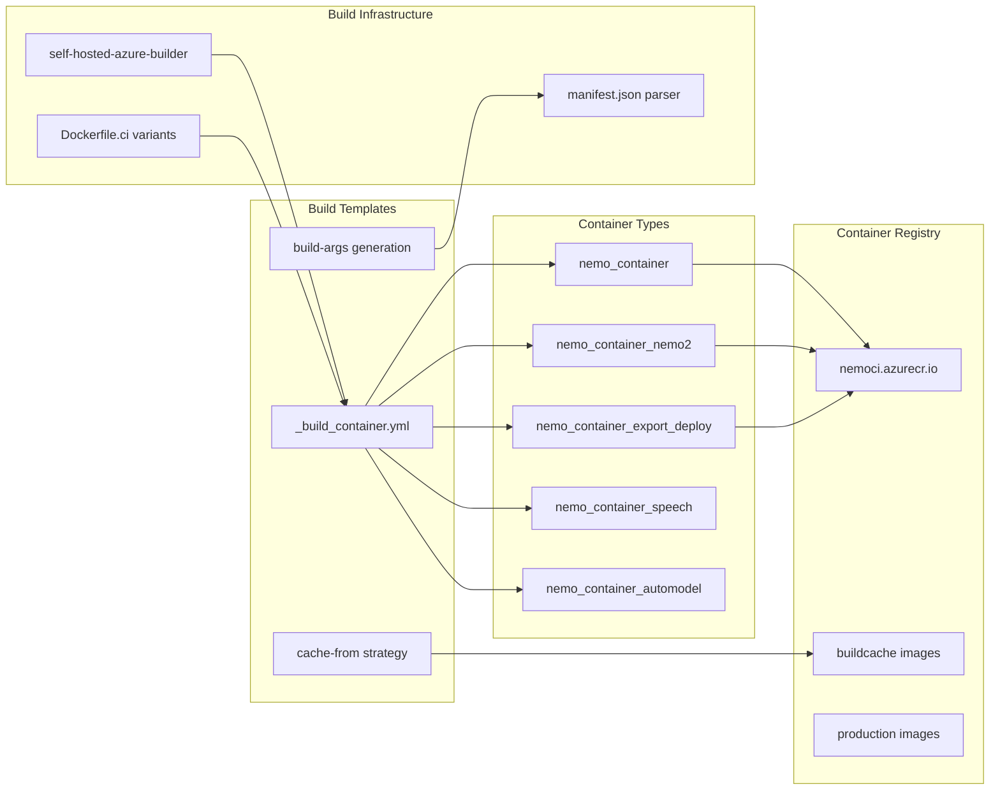
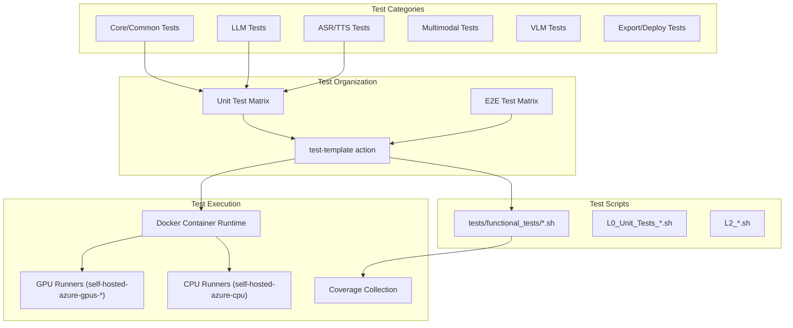
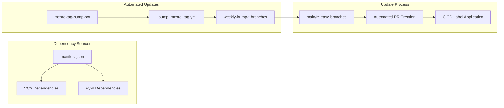
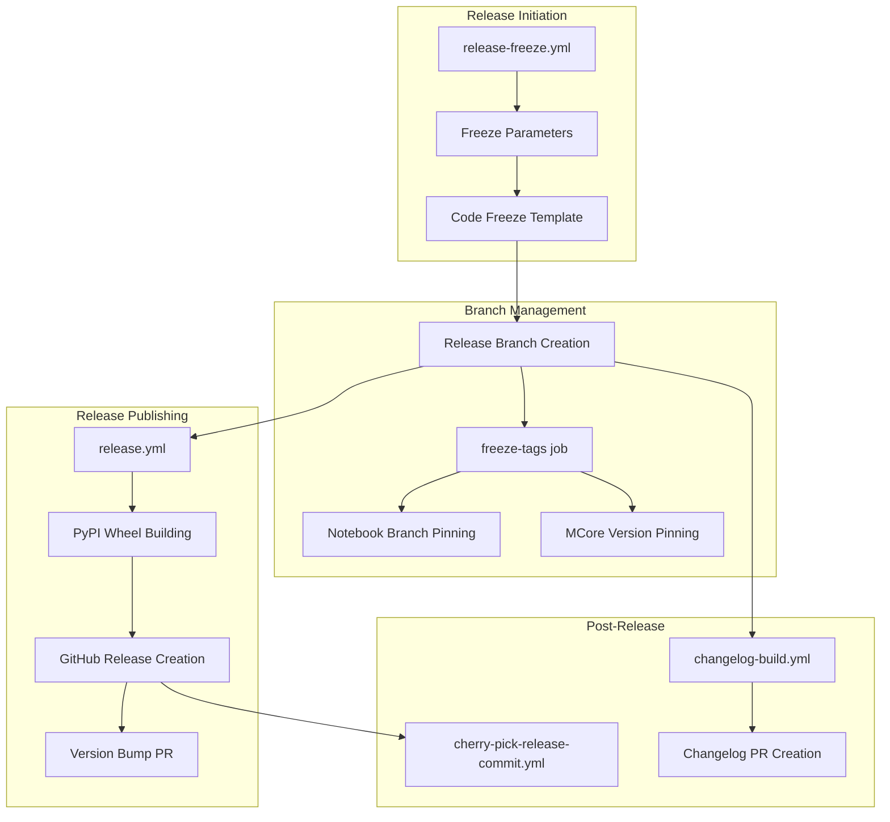
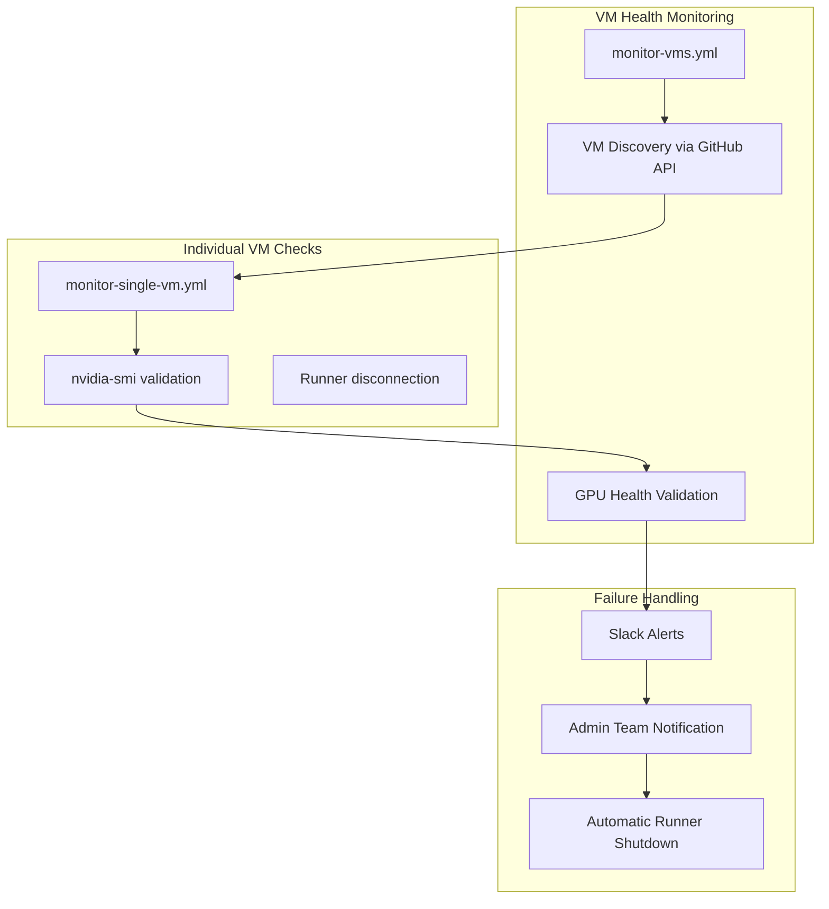
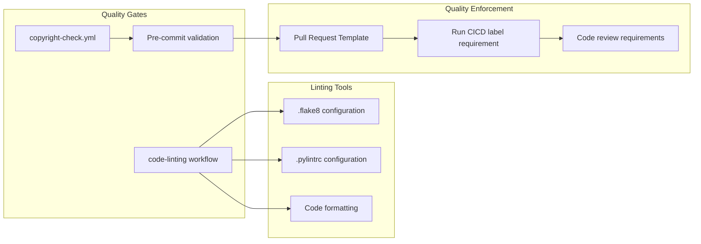
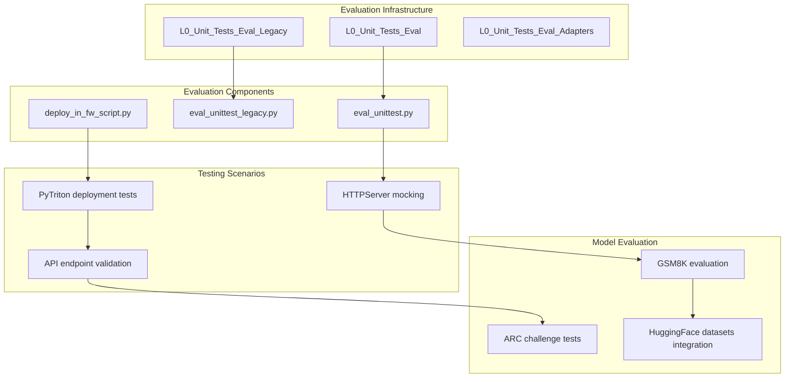

<!-- source: DeepWiki mcp.deepwiki.com · repo NVIDIA/NeMo · page 7 Development and Infrastructure · fetched 2026-10-21 -->

# Development and Infrastructure

Relevant source files

The following files were used as context for generating this wiki page:

- [.dockerignore](.dockerignore)
- [.flake8](.flake8)
- [.flake8.other](.flake8.other)
- [.flake8.speech](.flake8.speech)
- [.github/actions/test-template/action.yml](.github/actions/test-template/action.yml)
- [.github/workflows/cicd-main-unit-tests.yml](.github/workflows/cicd-main-unit-tests.yml)
- [.github/workflows/cicd-main.yml](.github/workflows/cicd-main.yml)
- [.github/workflows/cicd-relabel-bot.yml](.github/workflows/cicd-relabel-bot.yml)
- [.github/workflows/code-formatting.yml](.github/workflows/code-formatting.yml)
- [.github/workflows/code-linting.yml](.github/workflows/code-linting.yml)
- [.github/workflows/monitor-single-vm.yml](.github/workflows/monitor-single-vm.yml)
- [.github/workflows/monitor-vms.yml](.github/workflows/monitor-vms.yml)
- [.pre-commit-config.yaml](.pre-commit-config.yaml)
- [.pylintrc](.pylintrc)
- [.pylintrc.other](.pylintrc.other)
- [.pylintrc.speech](.pylintrc.speech)
- [examples/llm/resiliency/README.md](examples/llm/resiliency/README.md)
- [examples/llm/resiliency/crash_simulator.py](examples/llm/resiliency/crash_simulator.py)
- [examples/llm/resiliency/preemption_simulator.py](examples/llm/resiliency/preemption_simulator.py)
- [examples/llm/resiliency/resiliency-in-pretraining-demo.ipynb](examples/llm/resiliency/resiliency-in-pretraining-demo.ipynb)
- [external/patches/triton-lang_triton_6570_lazy_init.patch](external/patches/triton-lang_triton_6570_lazy_init.patch)
- [nemo/collections/common/data/lhotse/__init__.py](nemo/collections/common/data/lhotse/__init__.py)
- [nemo/collections/llm/recipes/callbacks/__init__.py](nemo/collections/llm/recipes/callbacks/__init__.py)
- [nemo/collections/llm/recipes/callbacks/common.py](nemo/collections/llm/recipes/callbacks/common.py)
- [pyproject.toml](pyproject.toml)
- [requirements/manifest.json](requirements/manifest.json)
- [requirements/requirements.txt](requirements/requirements.txt)
- [requirements/requirements_nlp.txt](requirements/requirements_nlp.txt)
- [requirements/requirements_test.txt](requirements/requirements_test.txt)
- [scripts/installers/install_k2.sh](scripts/installers/install_k2.sh)
- [setup.py](setup.py)
- [tests/lightning/pytorch/callbacks/test_jit_transform.py](tests/lightning/pytorch/callbacks/test_jit_transform.py)

This document covers the development workflows, continuous integration/continuous deployment (CI/CD) systems, release management processes, and infrastructure components that support the NeMo framework. It provides technical details about how code changes are tested, validated, and deployed, including dependency management, container building, and quality assurance processes.

For information about model export and deployment workflows, see [Model Export and Deployment](#6). For CI/CD pipeline details and testing processes, see [CI/CD Infrastructure and Testing](#7.1). For release management specifics, see [Release Management and Dependency Updates](#7.2).

## CI/CD Pipeline Overview

The NeMo project uses a comprehensive GitHub Actions-based CI/CD system that automatically tests code changes, manages dependencies, and coordinates releases. The main pipeline is defined in [`.github/workflows/cicd-main.yml`]() and orchestrates multiple specialized workflows.

**Sources:** [`.github/workflows/cicd-main.yml:37-497`]()

## Container Infrastructure and Build System

The NeMo CI/CD system relies heavily on containerized environments to ensure consistent testing and deployment. Container builds are managed through specialized workflows that handle caching, multi-stage builds, and dependency management.

**Sources:** [`.github/workflows/_build_container.yml:1-90`](), [`.github/workflows/update-buildcache.yml:81-113`]()

## Test Infrastructure and Component Selection

The testing system dynamically selects which components to test based on code changes, using a sophisticated component detection system that analyzes git diffs to determine affected subsystems.

**Sources:** [`.github/workflows/cicd-main-unit-tests.yml:22-213`](), [`.github/actions/test-template/action.yml:52-229`]()

## Dependency Management System

NeMo uses a centralized dependency management system based on [`requirements/manifest.json`]() that defines both PyPI and VCS dependencies, with automated update mechanisms for key dependencies like Megatron-LM.

| Component | Repository | Management Strategy |
|-----------|------------|-------------------|
| **Megatron-LM** | `NVIDIA/Megatron-LM` | Automated daily bumps via `mcore-tag-bump-bot.yml` |
| **Transformer Engine** | `NVIDIA/TransformerEngine` | Version-pinned in manifest |
| **TensorRT-LLM** | `NVIDIA/TensorRT-LLM` | Version-pinned in manifest |
| **Apex** | `NVIDIA/Apex` | Version-pinned in manifest |
| **Base Image** | `nvcr.io/nvidia/pytorch` | NGC PyTorch container |

**Sources:** [`.github/workflows/mcore-tag-bump-bot.yml:1-63`](), [`.github/workflows/_bump_mcore_tag.yml:44-57`](), [`requirements/manifest.json:1-23`]()

## Release Management Workflow

The release process involves code freezes, branch management, and automated changelog generation. Release workflows coordinate between multiple repositories and manage version bumping across the ecosystem.

**Sources:** [`.github/workflows/release-freeze.yml:27-86`](), [`.github/workflows/release.yml:33-49`](), [`.github/workflows/cherry-pick-release-commit.yml:9-15`]()

## Quality Assurance and Monitoring

The system includes comprehensive monitoring, notification systems, and infrastructure health checks to ensure reliable operation of the CI/CD pipeline.

### Infrastructure Monitoring

### Notification System

The CI/CD system includes sophisticated notification mechanisms that alert teams about pipeline failures, successful completions, and infrastructure issues.

| Notification Type | Trigger | Target | Implementation |
|------------------|---------|--------|----------------|
| **Pipeline Success** | Successful CICD completion | PR comments | `peter-evans/create-or-update-comment@v4` |
| **Pipeline Failure** | Test failures with "Run CICD" label | Slack webhook | `notify.py` script |
| **Infrastructure Issues** | VM health degradation | Slack admin alerts | VM monitoring workflow |
| **Release Events** | Release completion/failure | Release Slack channel | Release workflow notifications |

**Sources:** [`.github/workflows/monitor-vms.yml:8-55`](), [`.github/workflows/monitor-single-vm.yml:16-55`](), [`.github/scripts/notify.py:20-79`]()

## Code Quality and Linting

The development infrastructure includes automated code quality checks that run on every pull request to ensure consistency and maintainability.

**Sources:** [`.github/workflows/copyright-check.yml:20-23`](), [`.github/PULL_REQUEST_TEMPLATE.md:1-58`](), [`.github/CODEOWNERS:1-5`]()

## Evaluation and Testing Framework

The system includes specialized evaluation infrastructure for testing model performance and deployment scenarios, with support for both legacy and modern evaluation frameworks.

**Sources:** [`tests/evaluation/eval_unittest.py:22-90`](), [`tests/evaluation/eval_unittest_legacy.py:21-126`](), [`tests/functional_tests/L0_Unit_Tests_Eval.sh:14-18`]()

---

