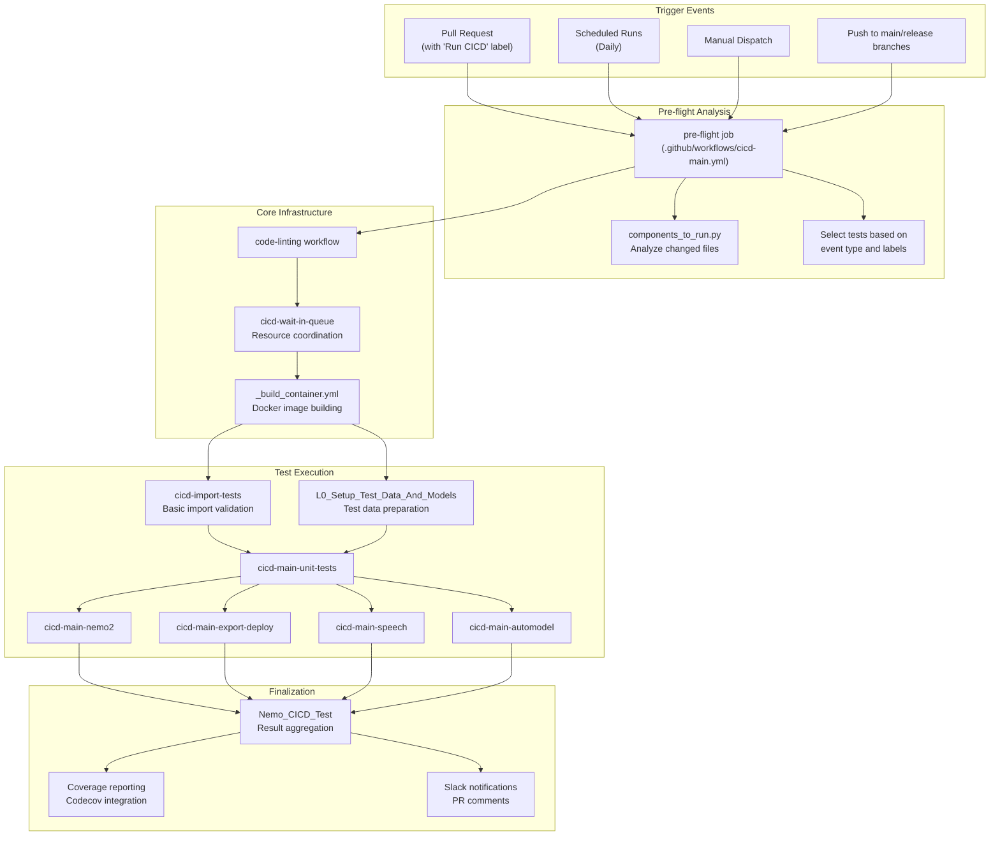
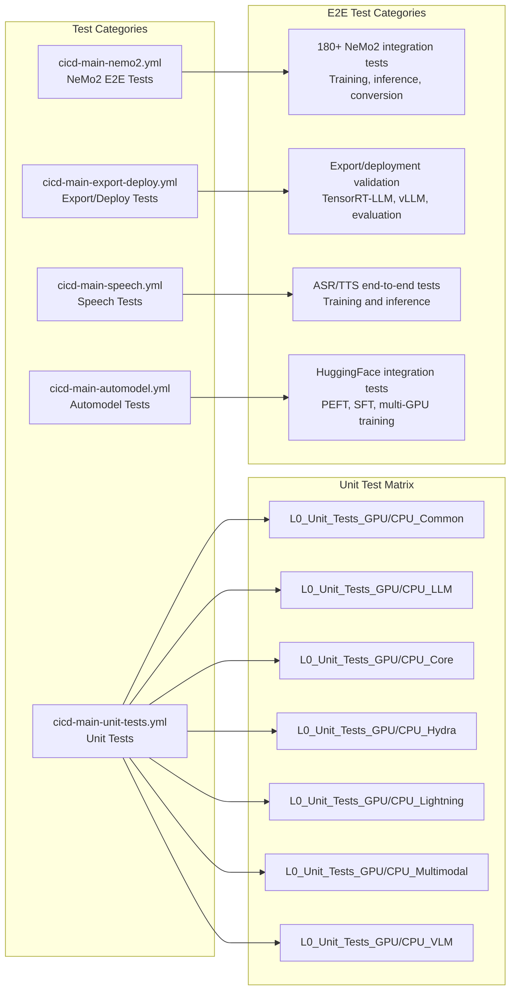
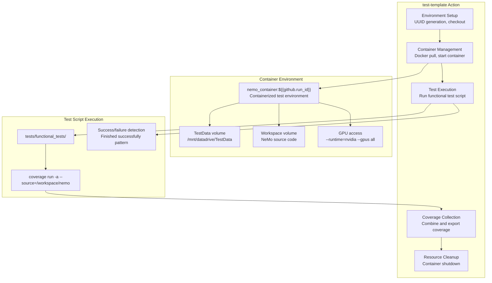
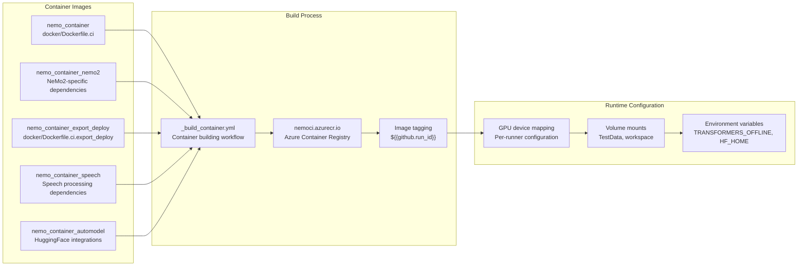
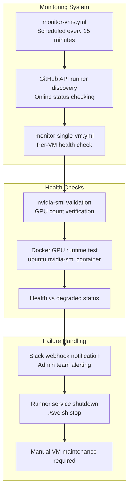
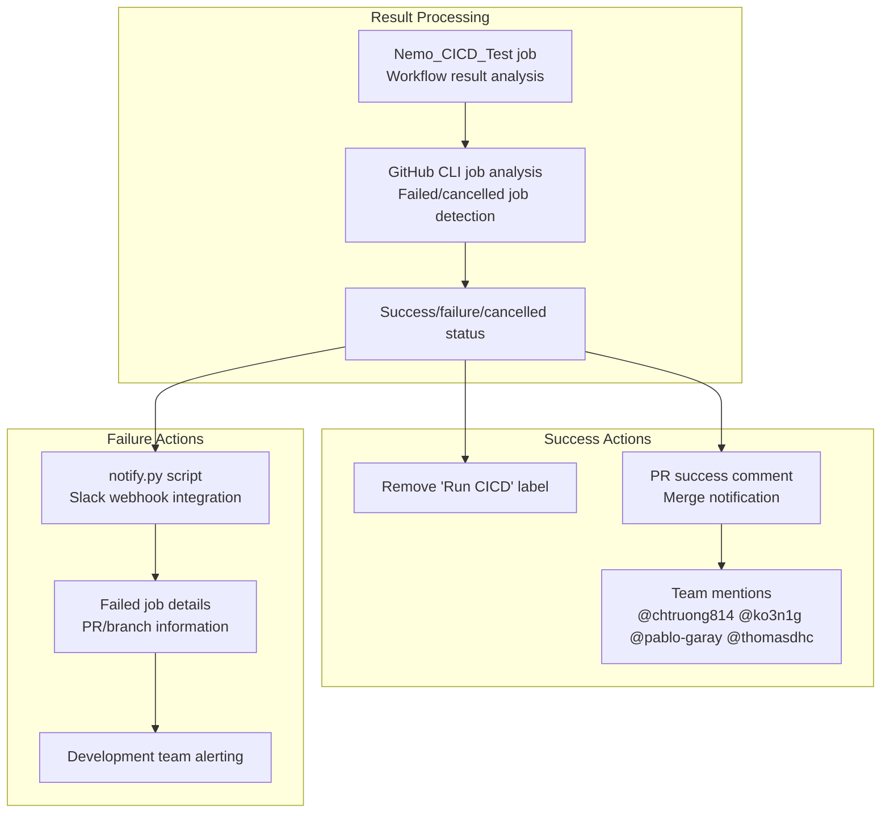

<!-- source: DeepWiki mcp.deepwiki.com · repo NVIDIA/NeMo · page 7.1 CI/CD Pipeline and Testing · fetched 2026-10-21 -->

# CI/CD Infrastructure and Testing

Relevant source files

The following files were used as context for generating this wiki page:

- [.github/actions/test-template/action.yml](.github/actions/test-template/action.yml)
- [.github/workflows/cicd-main-unit-tests.yml](.github/workflows/cicd-main-unit-tests.yml)
- [.github/workflows/cicd-main.yml](.github/workflows/cicd-main.yml)
- [.github/workflows/monitor-single-vm.yml](.github/workflows/monitor-single-vm.yml)
- [.github/workflows/monitor-vms.yml](.github/workflows/monitor-vms.yml)
- [external/patches/triton-lang_triton_6570_lazy_init.patch](external/patches/triton-lang_triton_6570_lazy_init.patch)
- [nemo/collections/common/data/lhotse/__init__.py](nemo/collections/common/data/lhotse/__init__.py)
- [requirements/manifest.json](requirements/manifest.json)
- [scripts/installers/install_k2.sh](scripts/installers/install_k2.sh)
- [tests/lightning/pytorch/callbacks/test_jit_transform.py](tests/lightning/pytorch/callbacks/test_jit_transform.py)

## Purpose and Scope

This document describes the continuous integration and continuous deployment (CI/CD) infrastructure for the NeMo framework, including automated testing pipelines, container-based execution environments, and quality assurance processes. The CI/CD system orchestrates unit tests, end-to-end tests, and integration tests across different NeMo components including LLMs, ASR, TTS, and model export functionality.

For information about dependency management and version updates, see [Release Management and Dependency Updates](#7.2).

## CI/CD Pipeline Architecture

The NeMo CI/CD infrastructure is built around GitHub Actions and consists of a main orchestration workflow that coordinates multiple specialized test workflows based on code changes and component dependencies.

**Sources:** [.github/workflows/cicd-main.yml:1-497]()

The main workflow implements several key features:

- **Event-driven execution**: Tests run on pull requests with the "Run CICD" label, scheduled daily runs, manual dispatch, and pushes to main branches
- **Component-based test selection**: The `components_to_run.py` script analyzes changed files to determine which test suites need to run
- **Concurrency control**: Uses GitHub's concurrency groups to prevent overlapping runs and manage resource usage
- **Fail-fast configuration**: Supports both fail-fast and no-fail-fast modes via PR labels

## Test Infrastructure Components

The CI/CD system is organized into specialized workflows for different aspects of the NeMo framework:

**Sources:** [.github/workflows/cicd-main-unit-tests.yml:1-213](), [.github/workflows/cicd-main-nemo2.yml:1-303](), [.github/workflows/cicd-main-export-deploy.yml:1-115](), [.github/workflows/cicd-main-speech.yml:1-199](), [.github/workflows/cicd-main-automodel.yml:1-138]()

### Test Execution Template

All test execution uses a standardized template that provides consistent containerized environments and result handling:

**Sources:** [.github/actions/test-template/action.yml:1-229]()

## Component Selection Logic

The CI/CD system implements intelligent test selection based on file changes to optimize execution time and resource usage:

| Component | File Patterns | Test Workflows |
|-----------|---------------|----------------|
| `nemo2` | `nemo/collections/llm/`, `nemo/lightning/` | NeMo2 E2E tests, LLM training/inference |
| `automodel` | `nemo/collections/automodel/` | HuggingFace integration, PEFT, SFT |
| `export-deploy` | `nemo/export/`, deployment scripts | Model export, TensorRT-LLM, evaluation |
| `speech` | `nemo/collections/asr/`, `nemo/collections/tts/` | ASR/TTS training and inference |

**Sources:** [.github/workflows/cicd-main.yml:55-70]()

## Container and Environment Management

The CI/CD system uses specialized Docker containers built from multiple Dockerfiles to support different testing requirements:

**Sources:** [.github/actions/test-template/action.yml:89-128]()

### Runner and GPU Configuration

The system supports multiple self-hosted runners with different GPU configurations:

| Runner Type | GPU Configuration | Use Cases |
|-------------|------------------|-----------|
| `self-hosted-azure` | Multi-GPU (2-8 GPUs) | Distributed training tests |
| `self-hosted-azure-gpus-1` | Single GPU | Unit tests, inference |
| `self-hosted-azure-gpus-2-h100` | 2x H100 GPUs | High-performance training |
| `self-hosted-azure-cpu` | CPU-only | CPU-specific tests |
| `azure-gpu-vm-runner1-h100` | H100 GPU | FP8 precision tests |

**Sources:** [.github/workflows/cicd-main-nemo2.yml:38-283](), [.github/actions/test-template/action.yml:96-107]()

## Infrastructure Monitoring

The CI/CD system includes automated infrastructure monitoring to ensure runner health and availability:

**Sources:** [.github/workflows/monitor-vms.yml:1-55](), [.github/workflows/monitor-single-vm.yml:1-55]()

## Coverage and Reporting

The CI/CD system implements comprehensive code coverage tracking with separate reporting for unit tests and end-to-end tests:

### Coverage Collection Process

1. **Test-level coverage**: Each test script runs with `coverage run -a --source=/workspace/nemo`
2. **Container-level aggregation**: Coverage data is combined within each test container using `coverage combine`
3. **Artifact collection**: Coverage reports are uploaded as GitHub Actions artifacts with unique identifiers
4. **Final aggregation**: The Coverage job downloads all artifacts and combines them into unified reports
5. **External reporting**: Final coverage data is uploaded to Codecov with separate flags for `unit-test` and `e2e`

**Sources:** [.github/workflows/cicd-main.yml:447-497](), [.github/actions/test-template/action.yml:185-220]()

## Notification and Failure Handling

The CI/CD system provides comprehensive notification and failure handling through multiple channels:

**Sources:** [.github/workflows/cicd-main.yml:341-446](), [.github/scripts/notify.py:1-80]()

### Notification Features

- **PR Comments**: Automated success notifications with workflow links and team mentions
- **Slack Integration**: Rich failure notifications with PR details, failed job lists, and admin team mentions
- **Label Management**: Automatic removal of "Run CICD" labels upon completion or failure
- **Retry Logic**: The test template includes retry mechanisms with timeout handling for infrastructure issues

The notification system uses structured Slack messages with markdown formatting to provide clear, actionable information about CI/CD status and required interventions.

**Sources:** [.github/workflows/cicd-main.yml:396-435](), [.github/scripts/notify.py:48-76]()

---

