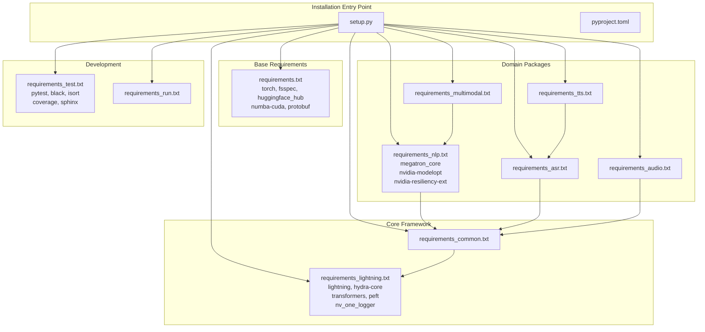
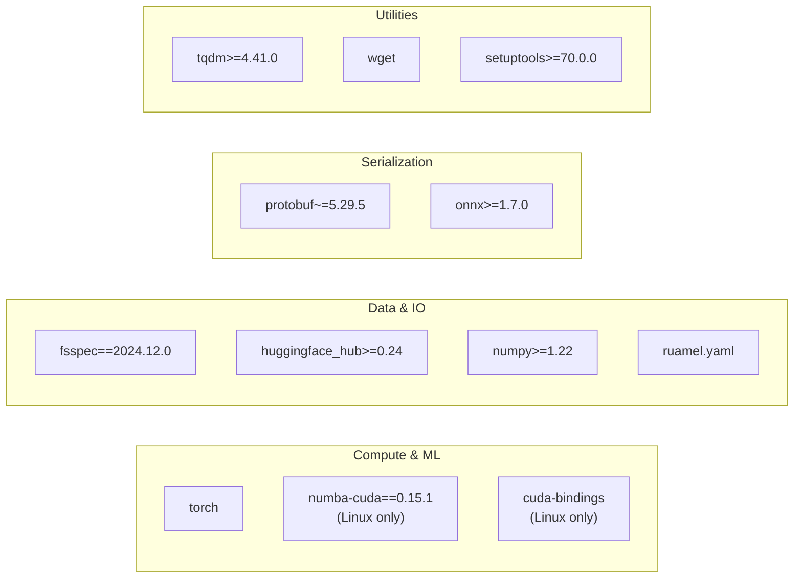
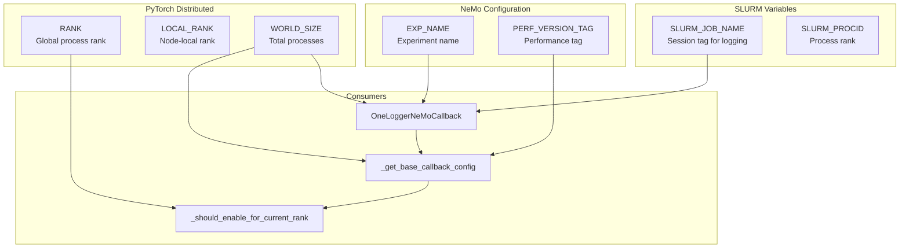
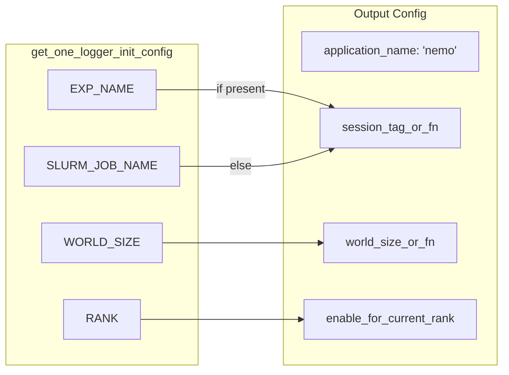
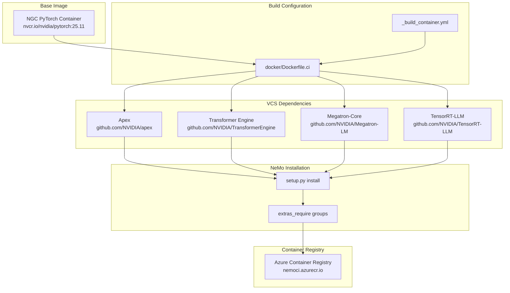
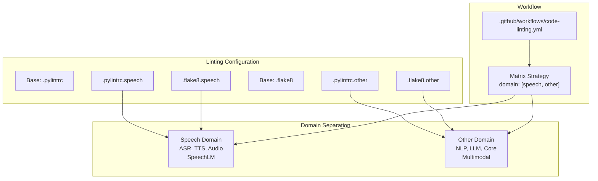
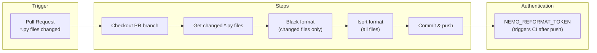
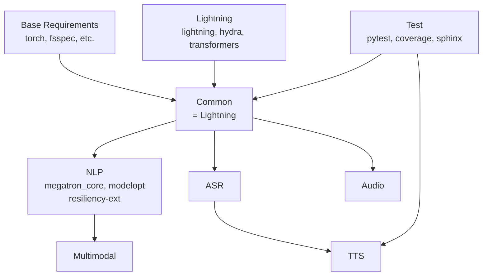

<!-- source: DeepWiki mcp.deepwiki.com · repo NVIDIA/NeMo · page 7.2 Dependencies and Environment Setup · fetched 2026-10-21 -->

# Dependencies and Environment Setup

<details>
<summary>Relevant source files</summary>

The following files were used as context for generating this wiki page:

- [.dockerignore](.dockerignore)
- [.flake8](.flake8)
- [.flake8.other](.flake8.other)
- [.flake8.speech](.flake8.speech)
- [.github/workflows/cicd-main-nemo2.yml](.github/workflows/cicd-main-nemo2.yml)
- [.github/workflows/cicd-main-speech.yml](.github/workflows/cicd-main-speech.yml)
- [.github/workflows/cicd-relabel-bot.yml](.github/workflows/cicd-relabel-bot.yml)
- [.github/workflows/code-formatting.yml](.github/workflows/code-formatting.yml)
- [.github/workflows/code-linting.yml](.github/workflows/code-linting.yml)
- [.pre-commit-config.yaml](.pre-commit-config.yaml)
- [.pylintrc](.pylintrc)
- [.pylintrc.other](.pylintrc.other)
- [.pylintrc.speech](.pylintrc.speech)
- [examples/asr/asr_cache_aware_streaming/speech_to_text_cache_aware_streaming_infer.py](examples/asr/asr_cache_aware_streaming/speech_to_text_cache_aware_streaming_infer.py)
- [examples/llm/resiliency/README.md](examples/llm/resiliency/README.md)
- [examples/llm/resiliency/crash_simulator.py](examples/llm/resiliency/crash_simulator.py)
- [examples/llm/resiliency/preemption_simulator.py](examples/llm/resiliency/preemption_simulator.py)
- [examples/llm/resiliency/resiliency-in-pretraining-demo.ipynb](examples/llm/resiliency/resiliency-in-pretraining-demo.ipynb)
- [nemo/collections/llm/gpt/model/hf_llama_embedding.py](nemo/collections/llm/gpt/model/hf_llama_embedding.py)
- [nemo/collections/llm/recipes/callbacks/__init__.py](nemo/collections/llm/recipes/callbacks/__init__.py)
- [nemo/collections/llm/recipes/callbacks/common.py](nemo/collections/llm/recipes/callbacks/common.py)
- [nemo/lightning/one_logger_callback.py](nemo/lightning/one_logger_callback.py)
- [pyproject.toml](pyproject.toml)
- [requirements/requirements.txt](requirements/requirements.txt)
- [requirements/requirements_lightning.txt](requirements/requirements_lightning.txt)
- [requirements/requirements_nlp.txt](requirements/requirements_nlp.txt)
- [requirements/requirements_test.txt](requirements/requirements_test.txt)
- [setup.py](setup.py)
- [tests/functional_tests/L2_NeMo_2_LLAMA4_ENERGON_FINETUNE_EP2.sh](tests/functional_tests/L2_NeMo_2_LLAMA4_ENERGON_FINETUNE_EP2.sh)
- [tests/functional_tests/L2_NeMo_2_LLAMA4_MOCK_FINETUNE_CP2.sh](tests/functional_tests/L2_NeMo_2_LLAMA4_MOCK_FINETUNE_CP2.sh)
- [tests/functional_tests/L2_NeMo_2_LLAMA4_MOCK_FINETUNE_PP2.sh](tests/functional_tests/L2_NeMo_2_LLAMA4_MOCK_FINETUNE_PP2.sh)
- [tests/functional_tests/L2_NeMo_2_MLLAMA_ENERGON_FINETUNE_TP2.sh](tests/functional_tests/L2_NeMo_2_MLLAMA_ENERGON_FINETUNE_TP2.sh)
- [tests/functional_tests/L2_NeMo_2_MLLAMA_IMPORT.sh](tests/functional_tests/L2_NeMo_2_MLLAMA_IMPORT.sh)
- [tests/functional_tests/L2_NeMo_2_MLLAMA_MOCK_FINETUNE_TP2.sh](tests/functional_tests/L2_NeMo_2_MLLAMA_MOCK_FINETUNE_TP2.sh)
- [tests/functional_tests/L2_NeMo_2_MLLAMA_PRELOADED_FINETUNE_TP2.sh](tests/functional_tests/L2_NeMo_2_MLLAMA_PRELOADED_FINETUNE_TP2.sh)
- [tests/functional_tests/L2_NeMo_2_QWEN2VL_PRELOADED_FINETUNE_TP2.sh](tests/functional_tests/L2_NeMo_2_QWEN2VL_PRELOADED_FINETUNE_TP2.sh)
- [tests/functional_tests/L2_Speech_Transcription_Speech_to_Text_Cache_Aware_Infer.sh](tests/functional_tests/L2_Speech_Transcription_Speech_to_Text_Cache_Aware_Infer.sh)
- [tests/functional_tests/L2_Speech_Transcription_Speech_to_Text_Streaming_Infer.sh](tests/functional_tests/L2_Speech_Transcription_Speech_to_Text_Streaming_Infer.sh)
- [tests/lightning/test_one_logger_callback.py](tests/lightning/test_one_logger_callback.py)

</details>


## Purpose and Scope

This document describes the dependency management system, environment configuration, and development tooling setup for the NeMo toolkit. It covers the modular dependency structure that allows users to install only the components they need, environment variable configuration for distributed training, and the CI/CD container build process. For information about the CI/CD testing infrastructure and workflows, see [CI/CD Pipeline and Testing](#7.1).

## Dependency Management Architecture

NeMo uses a hierarchical dependency structure that allows selective installation of domain-specific components. The dependency management is implemented through Python's `extras_require` mechanism in [setup.py]().

### Dependency Organization Structure



**Dependency Organization in NeMo**

Sources: [setup.py:57-146](), [requirements/requirements.txt](), [requirements/requirements_lightning.txt](), [requirements/requirements_nlp.txt]()

### Extras Require Groups

The [setup.py:68-145]() file defines multiple extras groups that compose hierarchically:

| Extras Group | Dependencies | Use Case |
|--------------|-------------|----------|
| `core` / `lightning` | `requirements_lightning.txt` | PyTorch Lightning integration |
| `nlp` / `llm` | `requirements_nlp.txt` + `common` | LLM and NLP models |
| `asr` | `requirements_asr.txt` + `common` | Speech recognition models |
| `tts` | `requirements_tts.txt` + `asr` + `common` | Text-to-speech models |
| `multimodal` | `requirements_multimodal.txt` + `nlp` + `common` | Vision-language models |
| `audio` | `requirements_audio.txt` + `common` | Audio processing |
| `test` | `requirements_test.txt` + `tts` + `common` | Testing and development |
| `all` | All domain packages | Complete installation |

Installation examples:
```bash
# Install base + NLP/LLM dependencies
pip install nemo_toolkit[nlp]

# Install base + ASR dependencies
pip install nemo_toolkit[asr]

# Install everything
pip install nemo_toolkit[all]
```

Sources: [setup.py:68-146]()

## Core Dependencies

### Base Requirements

The [requirements/requirements.txt:1-21]() file defines platform-agnostic core dependencies:



**Core Base Dependencies**

Key version constraints:
- `numba-cuda==0.15.1` with `platform_system != 'Darwin'` check for CUDA compilation on Linux
- `protobuf~=5.29.5` pinned to align with PyTorch requirements
- `numexpr<2.14.0` WAR for numpy.typing compatibility
- `setuptools>=70.0.0` for build system

Sources: [requirements/requirements.txt:1-21]()

### Lightning Framework Dependencies

The [requirements/requirements_lightning.txt:1-13]() specifies NeMo Lightning integration:

| Package | Version Constraint | Purpose |
|---------|-------------------|---------|
| `lightning` | `>2.2.1,<=2.4.0` | PyTorch Lightning framework |
| `hydra-core` | `>1.3,<=1.3.2` | Configuration management |
| `omegaconf` | `<=2.3` | Configuration parsing |
| `transformers` | `~=4.57.0` | HuggingFace model integration |
| `peft` | No constraint | Parameter-efficient fine-tuning |
| `nv_one_logger_core` | `>=2.3.1` | NVIDIA telemetry core |
| `nv_one_logger_training_telemetry` | `>=2.3.1` | Training metrics logging |
| `nv_one_logger_pytorch_lightning_integration` | `>=2.3.1` | Lightning callback integration |

Sources: [requirements/requirements_lightning.txt:1-13]()

### NLP and LLM Dependencies

The [requirements/requirements_nlp.txt:1-29]() includes distributed training and optimization packages:

**Critical Dependencies:**
- `megatron_core`: Megatron-LM model parallelism primitives
- `nvidia-modelopt==0.37.0`: Model optimization and quantization
- `nvidia-resiliency-ext>=0.3.0,<1.0.0`: Fault tolerance and straggler detection (Linux only)
- `tensorstore<0.1.72`: Distributed checkpoint storage (Linux only)
- `tiktoken==0.7.0`: Fast BPE tokenizer
- `zarr>=2.18.2,<3.0.0`: Chunked array storage for checkpoints

**Platform-specific constraints:**
- `numpy<2` for tensorstore compatibility
- `tensorstore` and `nvidia-resiliency-ext` excluded on macOS (`platform_system != 'Darwin'`)

Sources: [requirements/requirements_nlp.txt:1-29]()

## Environment Variable Configuration

### Distributed Training Environment

NeMo relies on environment variables for distributed coordination and configuration. These are consumed by various components:



**Environment Variable Usage in Telemetry**

Sources: [nemo/lightning/one_logger_callback.py:37-64](), [nemo/lightning/one_logger_callback.py:67-149]()

### Key Environment Variables

| Variable | Purpose | Default | Usage Example |
|----------|---------|---------|---------------|
| `WORLD_SIZE` | Total distributed processes | `1` | Batch size calculation: [nemo/lightning/one_logger_callback.py:52]() |
| `RANK` | Global process rank | `-1` | Enable logging on rank 0: [nemo/lightning/one_logger_callback.py:257-259]() |
| `LOCAL_RANK` | Node-local process rank | `0` | Device assignment |
| `SLURM_JOB_NAME` | SLURM job identifier | `"nemo-run"` | Session tag: [nemo/lightning/one_logger_callback.py:50]() |
| `EXP_NAME` | Experiment name (NeMo v1) | - | Overrides SLURM_JOB_NAME: [nemo/lightning/one_logger_callback.py:47-50]() |
| `PERF_VERSION_TAG` | Performance version tag | `"0.0.0"` | Perf tag generation: [nemo/lightning/one_logger_callback.py:98]() |

### NCCL and Training Optimization

Environment variables for distributed communication and optimization, used in [.github/workflows/cicd-main-nemo2.yml]() and examples:

```bash
# NCCL optimization
TORCH_NCCL_AVOID_RECORD_STREAMS=1
NCCL_NVLS_ENABLE=0

# Transformer Engine FP8
NVTE_DP_AMAX_REDUCE_INTERVAL=0
NVTE_ASYNC_AMAX_REDUCTION=1

# Offline mode
TRANSFORMERS_OFFLINE=1
```

Sources: [examples/llm/resiliency/resiliency-in-pretraining-demo.ipynb:140-145]()

### Telemetry Configuration

The `OneLoggerNeMoCallback` uses environment variables for configuration:



**Environment Variable Resolution in OneLogger**

The function [get_one_logger_init_config:37-64]() prioritizes `EXP_NAME` over `SLURM_JOB_NAME`, defaulting to `"nemo-run"`. The [_should_enable_for_current_rank:247-259]() function enables telemetry only on rank 0 to avoid duplicate data.

Sources: [nemo/lightning/one_logger_callback.py:37-64](), [nemo/lightning/one_logger_callback.py:247-259]()

## CI/CD Container Environment

### Container Build Process



**CI/CD Container Build Pipeline**

Sources: [.github/workflows/cicd-main-nemo2.yml:27-32](), [.github/workflows/cicd-main-speech.yml:27-32]()

### Build Workflow Structure

The container build is triggered by workflow calls in both NeMo2 and Speech test suites:

1. **NeMo2 Tests**: [.github/workflows/cicd-main-nemo2.yml:27-32]() builds `nemo_container_nemo2`
2. **Speech Tests**: [.github/workflows/cicd-main-speech.yml:27-32]() builds `nemo_container_speech`

Both use the shared `_build_container.yml` workflow with [docker/Dockerfile.ci]() as the build context.

**Image Naming Convention:**
- Base name: `nemoci.azurecr.io/nemo_container_<variant>`
- Variant tags: `nemo2`, `speech`, `common`, `multimodal`, `llm`

Sources: [.github/workflows/cicd-main-nemo2.yml:22-24](), [.github/workflows/cicd-main-speech.yml:22-24]()

### VCS Dependencies Installation Pattern

External dependencies are typically installed from source during container build:

```bash
# Apex (mixed precision training)
pip install git+https://github.com/NVIDIA/apex.git

# Transformer Engine (FP8 kernels)
pip install git+https://github.com/NVIDIA/TransformerEngine.git

# Megatron-Core (model parallelism)
pip install git+https://github.com/NVIDIA/Megatron-LM.git

# TensorRT-LLM (inference optimization)
pip install git+https://github.com/NVIDIA/TensorRT-LLM.git
```

This ensures compatibility with the latest NGC PyTorch container and allows pinning to specific commits for stability.

Sources: Referenced in context as common practice for NGC container builds

## Development Tools Configuration

### Code Formatting

NeMo uses `black` and `isort` for consistent code formatting, configured in [pyproject.toml]().

#### Black Configuration

[pyproject.toml:85-116]() specifies:

| Setting | Value | Purpose |
|---------|-------|---------|
| `line_length` | `119` | Maximum line length |
| `skip_string_normalization` | `true` | Preserve single/double quotes |
| `required_version` | `"24"` | Pin major version for consistency |
| `target-version` | `['py310', 'py311', 'py312']` | Python version compatibility |

**Excluded Paths:** The `extend-exclude` regex excludes collections not yet reformatted:
- `nemo/collections/asr/`
- `nemo/collections/common/`
- `nemo/collections/multimodal/`
- `nemo/collections/nlp/`
- `nemo/collections/tts/`

Sources: [pyproject.toml:85-116]()

#### Isort Configuration

[pyproject.toml:73-82]() configures import sorting:

```toml
[tool.isort]
profile = "black"              # Black-compatible
line_length = 119
py_version = 310
known_first_party = ["nemo"]   # FIRSTPARTY section
sections = ["FUTURE", "STDLIB", "THIRDPARTY", "FIRSTPARTY", "LOCALFOLDER"]
```

Sources: [pyproject.toml:73-82]()

### Code Linting



**Domain-Specific Linting Architecture**

Sources: [.github/workflows/code-linting.yml:1-161]()

### Linting Rules by Domain

**Speech Domain** ([.pylintrc.speech:1-10](), [.flake8.speech:1-10]()):
- Enabled: `W0611` (unused-import) only
- Files: `nemo/collections/{asr,tts,audio,common/data/lhotse,multimodal/speech_llm,speechlm,speechlm2}/**/*.py`

**Other Domain** ([.pylintrc.other:1-12](), [.flake8.other:1-9]()):
- Enabled: `C0115` (missing-class-docstring), `C0116` (missing-function-docstring), `W0611` (unused-import), `C0301` (line-too-long)
- Files: All `nemo/**/*.py` except speech domain and export

**Common Rules** (both domains):
- `F541`: f-string without placeholders
- `F841`: Assigned but never used
- `F401`: Imported but unused
- `E741`: Ambiguous variable name
- `F821`: Undefined name
- `E266`: Too many leading `#` for block comment

Sources: [.pylintrc.speech:1-10](), [.pylintrc.other:1-12](), [.flake8.speech:1-10](), [.flake8.other:1-9]()

### Linting Workflow Execution

The [.github/workflows/code-linting.yml:8-161]() workflow:

1. **Triggers:** On PR open/sync/reopen and label changes
2. **Matrix Strategy:** Runs two jobs in parallel (speech, other)
3. **File Filtering:** [code-linting.yml:22-58]() uses `step-security/changed-files` to lint only modified files
4. **Skip Labels:**
   - `skip-docs`: Disables `C0115,C0116` docstring checks
   - `skip-linting`: Runs with `--exit-zero` (warnings only)

**Execution Pattern:**
```bash
# PyLint
pylint --rcfile=".pylintrc.${DOMAIN}" ${CHANGED_FILES[@]}

# Flake8
flake8 --config=".flake8.${DOMAIN}" ${CHANGED_FILES[@]}
```

Sources: [.github/workflows/code-linting.yml:60-109]()

### Pre-commit Hooks

[.pre-commit-config.yaml:15-53]() configures automated checks:

```yaml
repos:
  - repo: https://github.com/pre-commit/pre-commit-hooks
    hooks:
      - id: check-yaml
      - id: check-case-conflict
      - id: detect-private-key
      - id: check-added-large-files (maxkb=1000)
      - id: requirements-txt-fixer

  - repo: https://github.com/PyCQA/isort
    hooks:
      - id: isort

  - repo: https://github.com/psf/black-pre-commit-mirror
    hooks:
      - id: black
```

**CI Configuration:** The `ci` section ([.pre-commit-config.yaml:18-23]()) skips `black` and `isort` hooks in favor of the dedicated [.github/workflows/code-formatting.yml]() workflow to avoid reformatting all files.

Sources: [.pre-commit-config.yaml:15-53]()

### Formatting Workflow

The [.github/workflows/code-formatting.yml:1-74]() workflow automatically reformats code on PRs:



**Incremental Black, Full Isort**

**Key Behavior:**
- **Black:** Applied only to changed files ([code-formatting.yml:52-59]())
- **Isort:** Applied to all files since the repo is already formatted ([code-formatting.yml:61-67]())
- **Custom Token:** Uses `NEMO_REFORMAT_TOKEN` to trigger CI workflows after auto-formatting ([code-formatting.yml:37]())

Sources: [.github/workflows/code-formatting.yml:1-74]()

## Testing Dependencies

The [requirements/requirements_test.txt:1-16]() file specifies testing and documentation tools:

| Package | Version | Purpose |
|---------|---------|---------|
| `pytest` | Latest | Test framework |
| `pytest-mock` | Latest | Mocking utilities |
| `pytest-runner` | Latest | Test runner |
| `parameterized` | Latest | Parameterized tests |
| `coverage` | Latest | Code coverage |
| `black` | `~=24.3` | Code formatting (for CI) |
| `isort` | `>5.1.0,<6.0.0` | Import sorting (for CI) |
| `sphinx` | Latest | Documentation generation |
| `sphinxcontrib-bibtex` | Latest | Bibliography support |

The `test` extras group ([setup.py:97-103]()) chains `test` + `tts` + `common`, ensuring test infrastructure has access to all speech domain dependencies.

Sources: [requirements/requirements_test.txt:1-16](), [setup.py:97-103]()

### Test Infrastructure Environment Variables

Test scripts use environment variables for configuration:

**Coverage Collection:**
```bash
coverage run -a --data-file=/workspace/.coverage \
  --source=/workspace/nemo \
  <test_script.py>
```

**Model Paths:**
- Test data: `/home/TestData/`
- Model paths: `/home/TestData/asr/<model_name>.nemo`
- Output: `/tmp/<test_name>_results/`

Examples in [tests/functional_tests/L2_Speech_Transcription_Speech_to_Text_Streaming_Infer.sh:15-36](), [tests/functional_tests/L2_NeMo_2_LLAMA4_MOCK_FINETUNE_PP2.sh:14-18]()

Sources: [tests/functional_tests/L2_Speech_Transcription_Speech_to_Text_Streaming_Infer.sh:15-36](), [tests/functional_tests/L2_NeMo_2_LLAMA4_MOCK_FINETUNE_PP2.sh:14-18]()

## Installation Patterns

### Standard Installation

```bash
# Minimal install (base requirements only)
pip install nemo_toolkit

# With specific domain
pip install nemo_toolkit[nlp]
pip install nemo_toolkit[asr]
pip install nemo_toolkit[multimodal]

# Development install
pip install -e ".[all]"
```

### Dependency Chain Resolution

The `extras_require` groups compose hierarchically:



**Dependency Chain Example:**
- Installing `nemo_toolkit[tts]` pulls: `tts` → `asr` → `common` → `lightning` → `base`
- Installing `nemo_toolkit[multimodal]` pulls: `multimodal` → `nlp` → `common` → `lightning` → `base`

Sources: [setup.py:86-146]()

### Python Version Requirements

[pyproject.toml:25]() and [setup.py:274]() specify:
```toml
requires-python = ">=3.10"
```

[pyproject.toml:92]() targets Python 3.10, 3.11, and 3.12 for black formatting.

Sources: [pyproject.toml:25](), [pyproject.toml:92](), [setup.py:274]()