# Page: Introduction to NeMo

# Introduction to NeMo

<details>
<summary>Relevant source files</summary>

The following files were used as context for generating this wiki page:

- [.dockerignore](.dockerignore)
- [.flake8](.flake8)
- [.flake8.other](.flake8.other)
- [.flake8.speech](.flake8.speech)
- [.github/workflows/cicd-relabel-bot.yml](.github/workflows/cicd-relabel-bot.yml)
- [.github/workflows/code-formatting.yml](.github/workflows/code-formatting.yml)
- [.github/workflows/code-linting.yml](.github/workflows/code-linting.yml)
- [.pre-commit-config.yaml](.pre-commit-config.yaml)
- [.pylintrc](.pylintrc)
- [.pylintrc.other](.pylintrc.other)
- [.pylintrc.speech](.pylintrc.speech)
- [examples/llm/resiliency/README.md](examples/llm/resiliency/README.md)
- [examples/llm/resiliency/crash_simulator.py](examples/llm/resiliency/crash_simulator.py)
- [examples/llm/resiliency/preemption_simulator.py](examples/llm/resiliency/preemption_simulator.py)
- [examples/llm/resiliency/resiliency-in-pretraining-demo.ipynb](examples/llm/resiliency/resiliency-in-pretraining-demo.ipynb)
- [nemo/collections/llm/recipes/callbacks/__init__.py](nemo/collections/llm/recipes/callbacks/__init__.py)
- [nemo/collections/llm/recipes/callbacks/common.py](nemo/collections/llm/recipes/callbacks/common.py)
- [pyproject.toml](pyproject.toml)
- [requirements/requirements.txt](requirements/requirements.txt)
- [requirements/requirements_nlp.txt](requirements/requirements_nlp.txt)
- [requirements/requirements_test.txt](requirements/requirements_test.txt)
- [setup.py](setup.py)

</details>


## Purpose and Scope

This document provides a high-level introduction to the NeMo (Neural Modules) toolkit, including its architecture, core components, domain-specific collections, and installation procedures. It serves as the entry point for understanding how NeMo enables conversational AI model development across multiple domains including automatic speech recognition (ASR), natural language processing (NLP), large language models (LLMs), text-to-speech (TTS), and multimodal applications.

For detailed information on specific subsystems:
- Framework installation and dependency management: see [Framework Overview and Installation](#1.1)
- Core model abstractions and interfaces: see [Core Model Classes and Interfaces](#1.2)
- Training orchestration and experiment management: see [Experiment Management and Training](#1.3)
- Distributed training capabilities: see [Distributed Training Infrastructure](#2)
- Domain-specific implementations: see [LLMs](#3), [ASR](#4), [NLP](#5), [TTS](#6)

---

## What is NeMo?

NeMo is a production-ready toolkit for building, training, and deploying state-of-the-art conversational AI models. Developed by NVIDIA, it provides:

- **Domain-Specific Collections**: Pre-built model architectures for ASR, NLP, LLM, TTS, and multimodal tasks
- **Distributed Training**: Native support for tensor parallelism, pipeline parallelism, and data parallelism via Megatron-Core integration
- **Unified Model Interface**: All models inherit from `ModelPT` base class providing consistent save/restore and lifecycle management
- **Lightning Integration**: Built on PyTorch Lightning for training orchestration and distributed strategies
- **Production Features**: Experiment management, distributed checkpointing, mixed precision training, and model export capabilities

NeMo is designed to scale from single-GPU prototyping to multi-node, multi-GPU production training of large-scale models.

**Sources:** [setup.py:1-295](), [pyproject.toml:1-152](), [requirements/requirements.txt:1-21]()

---

## Architecture Overview

NeMo's architecture consists of domain-specific collections built on top of shared core infrastructure. The following diagram illustrates the major subsystems and their relationships:

### NeMo Framework Architecture

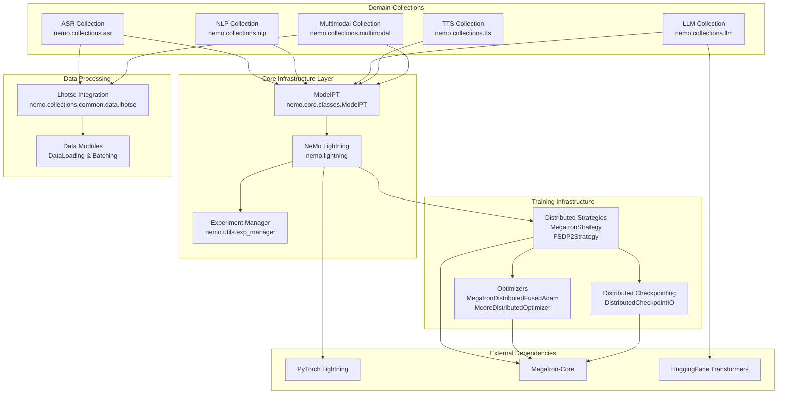

The architecture is organized into three main layers:

1. **Domain Collections**: Task-specific model implementations (ASR, NLP, LLM, TTS, Multimodal)
2. **Core Infrastructure**: Shared abstractions and utilities (`ModelPT`, Lightning integration, experiment management)
3. **Training Infrastructure**: Distributed strategies, optimizers, and checkpointing mechanisms

**Sources:** [setup.py:68-146](), Diagram 1 from provided context

---

## Domain Collections

NeMo provides five major domain-specific collections, each containing pre-built model architectures, data processing pipelines, and training recipes.

### Domain Collection Summary

| Collection | Location | Key Models | Primary Use Cases |
|------------|----------|------------|-------------------|
| **ASR** | `nemo.collections.asr` | `EncDecCTCModel`, `EncDecRNNTModel`, `EncDecMultiTaskModel` | Speech recognition, transcription, streaming ASR |
| **NLP** | `nemo.collections.nlp` | `MTEncDecModel`, Token/Text Classification | Machine translation, NER, text classification |
| **LLM** | `nemo.collections.llm` | `GPTModel`, `MambaModel` (SSM), Megatron models | Large language model training, fine-tuning, inference |
| **TTS** | `nemo.collections.tts` | `Tacotron2`, `WaveGlow`, G2P modules | Speech synthesis, voice cloning |
| **Multimodal** | `nemo.collections.multimodal` | `SALM`, VLM models | Audio-visual models, vision-language tasks |

### Installation by Domain

NeMo uses an `extras_require` system to allow domain-specific installations:

```bash
# Install core NeMo only
pip install nemo-toolkit

# Install with ASR support
pip install nemo-toolkit[asr]

# Install with LLM/NLP support
pip install nemo-toolkit[llm]

# Install with all domains
pip install nemo-toolkit[all]
```

**Sources:** [setup.py:68-146](), Diagram 1 from provided context

---

## Core Infrastructure

### ModelPT Base Class

All NeMo models inherit from `ModelPT` (Model with PyTorch), which provides:

- **Save/Restore**: Unified checkpoint format (`.nemo` archives) with config preservation
- **Configuration Management**: Automatic config serialization and validation
- **Training/Inference Modes**: Standardized `setup_training_data()` and `setup_test_data()` methods
- **Device Management**: Automatic model placement and distributed setup

For detailed information on `ModelPT` and model interfaces, see [Core Model Classes and Interfaces](#1.2).

### NeMo Lightning Integration

NeMo integrates deeply with PyTorch Lightning through the `nemo.lightning` module, providing:

- **Distributed Strategies**: `MegatronStrategy` for Megatron-LM integration, `FSDP2Strategy` for PyTorch FSDP2
- **Mixed Precision**: FP16, BF16, and FP8 support with gradient scaling
- **Callbacks**: `NeMoModelCheckpoint`, resiliency callbacks (straggler detection, auto-resume)

For distributed training details, see [Distributed Training Infrastructure](#2).

### Experiment Manager

The `exp_manager` system ([nemo/utils/exp_manager.py]()) provides:

- **Checkpoint Management**: Top-K checkpoint retention, async checkpointing
- **Logging**: TensorBoard, WandB integration
- **Auto-Resume**: Automatic detection and resumption from last checkpoint
- **Callbacks**: Time-based checkpointing, early stopping, model validation

For experiment management details, see [Experiment Management and Training](#1.3).

**Sources:** Diagram 1 from provided context

---

## Installation and Dependencies

### Core Dependencies

NeMo requires Python 3.10+ and has the following core dependencies:

| Dependency | Purpose | Version Constraint |
|------------|---------|-------------------|
| `torch` | Deep learning framework | Required |
| `pytorch-lightning` | Training orchestration | Via `requirements_lightning.txt` |
| `numpy` | Numerical operations | `>=1.22` |
| `numba` | JIT compilation | Platform-specific |
| `huggingface_hub` | Model hub integration | `>=0.24` |
| `onnx` | Model export | `>=1.7.0` |

**Sources:** [requirements/requirements.txt:1-21]()

### Domain-Specific Dependencies

Domain-specific packages are defined in separate requirements files:

#### NLP/LLM Dependencies (`requirements_nlp.txt`)

```
megatron_core                      # Megatron-LM core
nvidia-modelopt==0.37.0            # Model optimization
nvidia-resiliency-ext>=0.3.0       # Fault tolerance
tensorstore<0.1.72                 # Distributed checkpointing
tiktoken==0.7.0                    # Tokenization
sentence_transformers              # Embeddings
```

#### ASR Dependencies (`requirements_asr.txt`)

Key dependencies for speech recognition (not shown in provided files but referenced via `setup.py:77`).

#### TTS Dependencies (`requirements_tts.txt`)

Key dependencies for text-to-speech (not shown in provided files but referenced via `setup.py:79`).

**Sources:** [requirements/requirements_nlp.txt:1-29](), [setup.py:68-146]()

### Extras Require Structure

The `setup.py` defines a hierarchical dependency structure:

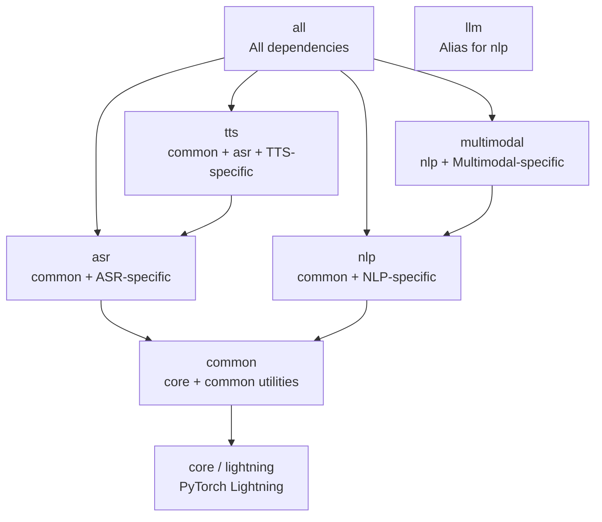

**Installation examples:**

```bash
# ASR only (includes common and lightning)
pip install nemo-toolkit[asr]

# LLM/NLP (includes common and lightning)
pip install nemo-toolkit[llm]

# TTS (includes ASR, common, and lightning)
pip install nemo-toolkit[tts]

# Multimodal (includes NLP, common, and lightning)
pip install nemo-toolkit[multimodal]
```

**Sources:** [setup.py:68-146]()

---

## Getting Started

### Basic Training Workflow

The following diagram illustrates a typical NeMo training workflow:

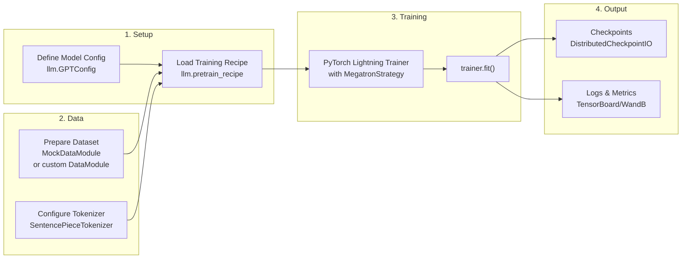

### Example: LLM Pre-training with Resiliency

The following code snippet demonstrates setting up a small LLM training job with resiliency features:

```python
import nemo_run as run
from nemo.collections import llm

# 1. Configure executor for distributed training
executor = run.LocalExecutor(
    ntasks_per_node=8,
    launcher="torchrun",
    env_vars={
        "TRANSFORMERS_OFFLINE": "1",
        "TORCH_NCCL_AVOID_RECORD_STREAMS": "1"
    }
)

# 2. Load and configure pretrain recipe
pretrain = llm.llama31_8b.pretrain_recipe(
    num_nodes=1,
    num_gpus_per_node=8,
    name="my_experiment",
    dir="/path/to/checkpoints"
)

# 3. Configure model (use smaller config for testing)
pretrain.model = run.Config(
    llm.LlamaModel,
    llm.Llama3Config8B(
        seq_length=2048,
        num_layers=32,
        hidden_size=4096
    )
)

# 4. Set training parameters
pretrain.trainer.max_steps = 10000
pretrain.trainer.val_check_interval = 1000

# 5. Run experiment
with run.Experiment("my_experiment") as exp:
    exp.add(pretrain, executor=executor, tail_logs=True)
    exp.run(sequential=True)
```

**Sources:** [examples/llm/resiliency/resiliency-in-pretraining-demo.ipynb:1-1000](), [examples/llm/resiliency/README.md:1-14]()

### Resiliency Features

NeMo integrates with `nvidia-resiliency-ext` to provide fault tolerance:

- **In-Job Restart**: Automatically restarts training from last checkpoint on failures
- **Straggler Detection**: Identifies and handles slow-performing nodes
- **Asynchronous Checkpointing**: Non-blocking checkpoint saves for large models
- **Preemption Handling**: Graceful shutdown and resume on SIGTERM

Example straggler detection callback:

```python
from nemo.collections.llm.recipes.callbacks.common import straggler_det_callback

# Add to trainer callbacks
pretrain.trainer.callbacks.append(
    straggler_det_callback(
        straggler_report_time_interval=300,  # Report every 5 minutes
        stop_if_detected_straggler=True,
        gpu_relative_perf_threshold=0.7
    )
)
```

**Sources:** [nemo/collections/llm/recipes/callbacks/common.py:1-68](), [examples/llm/resiliency/crash_simulator.py:1-65](), [examples/llm/resiliency/preemption_simulator.py:1-54]()

---

## Code Quality and Development

### Code Formatting

NeMo enforces code quality through automated formatters:

- **Black**: Python code formatting with 119 character line length
- **isort**: Import sorting with black-compatible settings
- **Pylint/Flake8**: Linting for code quality

Configuration is defined in:
- [pyproject.toml:73-116]() for `black` and `isort` settings
- [.pylintrc.speech:1-10]() and [.pylintrc.other:1-13]() for domain-specific linting
- [.flake8.speech:1-10]() and [.flake8.other:1-9]() for flake8 rules

### CI/CD Pipeline

Automated checks run on pull requests:

1. **Code Formatting**: [.github/workflows/code-formatting.yml:1-74]() - Automatically reformats code with black/isort
2. **Linting**: [.github/workflows/code-linting.yml:1-161]() - Runs pylint/flake8 on changed files
3. **Testing**: Container builds and test execution (see [CI/CD Pipeline and Testing](#7.1))

**Sources:** [pyproject.toml:73-116](), [.github/workflows/code-formatting.yml:1-74](), [.github/workflows/code-linting.yml:1-161]()

---

## Next Steps

This introduction provides a foundation for understanding NeMo's architecture and capabilities. For detailed information on specific subsystems:

### Core Framework
- [Framework Overview and Installation](#1.1) - Detailed installation procedures and dependency management
- [Core Model Classes and Interfaces](#1.2) - Deep dive into `ModelPT`, save/restore mechanisms, and model abstractions
- [Experiment Management and Training](#1.3) - Experiment manager, callbacks, logging, and training orchestration

### Distributed Training
- [Distributed Training Infrastructure](#2) - Overview of distributed training capabilities
- [Megatron Strategy and Model Parallelism](#2.1) - Tensor, pipeline, context, and expert parallelism
- [Distributed Optimization and Mixed Precision](#2.2) - Optimizers, FP8 support, gradient scaling
- [Distributed Checkpointing](#2.3) - Async checkpointing, auto-resume, checkpoint format

### Domain-Specific Collections
- [Large Language Models (LLMs)](#3) - LLM training, fine-tuning, and inference
- [Automatic Speech Recognition (ASR)](#4) - ASR model architectures and data processing
- [Natural Language Processing (NLP)](#5) - Machine translation and text classification
- [Text-to-Speech (TTS)](#6) - TTS models and G2P modules

### Development
- [CI/CD Pipeline and Testing](#7.1) - Testing infrastructure and workflows
- [Dependencies and Environment Setup](#7.2) - Environment configuration and dependency management

**Sources:** Table of contents from provided context

---

# Page: Framework Overview and Installation

# Framework Overview and Installation

<details>
<summary>Relevant source files</summary>

The following files were used as context for generating this wiki page:

- [.dockerignore](.dockerignore)
- [.flake8](.flake8)
- [.flake8.other](.flake8.other)
- [.flake8.speech](.flake8.speech)
- [.github/workflows/cicd-main-nemo2.yml](.github/workflows/cicd-main-nemo2.yml)
- [.github/workflows/cicd-main-speech.yml](.github/workflows/cicd-main-speech.yml)
- [.github/workflows/cicd-relabel-bot.yml](.github/workflows/cicd-relabel-bot.yml)
- [.github/workflows/code-formatting.yml](.github/workflows/code-formatting.yml)
- [.github/workflows/code-linting.yml](.github/workflows/code-linting.yml)
- [.pre-commit-config.yaml](.pre-commit-config.yaml)
- [.pylintrc](.pylintrc)
- [.pylintrc.other](.pylintrc.other)
- [.pylintrc.speech](.pylintrc.speech)
- [examples/asr/asr_cache_aware_streaming/speech_to_text_cache_aware_streaming_infer.py](examples/asr/asr_cache_aware_streaming/speech_to_text_cache_aware_streaming_infer.py)
- [examples/llm/resiliency/README.md](examples/llm/resiliency/README.md)
- [examples/llm/resiliency/crash_simulator.py](examples/llm/resiliency/crash_simulator.py)
- [examples/llm/resiliency/preemption_simulator.py](examples/llm/resiliency/preemption_simulator.py)
- [examples/llm/resiliency/resiliency-in-pretraining-demo.ipynb](examples/llm/resiliency/resiliency-in-pretraining-demo.ipynb)
- [nemo/collections/llm/gpt/model/hf_llama_embedding.py](nemo/collections/llm/gpt/model/hf_llama_embedding.py)
- [nemo/collections/llm/recipes/callbacks/__init__.py](nemo/collections/llm/recipes/callbacks/__init__.py)
- [nemo/collections/llm/recipes/callbacks/common.py](nemo/collections/llm/recipes/callbacks/common.py)
- [nemo/lightning/one_logger_callback.py](nemo/lightning/one_logger_callback.py)
- [pyproject.toml](pyproject.toml)
- [requirements/requirements.txt](requirements/requirements.txt)
- [requirements/requirements_lightning.txt](requirements/requirements_lightning.txt)
- [requirements/requirements_nlp.txt](requirements/requirements_nlp.txt)
- [requirements/requirements_test.txt](requirements/requirements_test.txt)
- [setup.py](setup.py)
- [tests/functional_tests/L2_NeMo_2_LLAMA4_ENERGON_FINETUNE_EP2.sh](tests/functional_tests/L2_NeMo_2_LLAMA4_ENERGON_FINETUNE_EP2.sh)
- [tests/functional_tests/L2_NeMo_2_LLAMA4_MOCK_FINETUNE_CP2.sh](tests/functional_tests/L2_NeMo_2_LLAMA4_MOCK_FINETUNE_CP2.sh)
- [tests/functional_tests/L2_NeMo_2_LLAMA4_MOCK_FINETUNE_PP2.sh](tests/functional_tests/L2_NeMo_2_LLAMA4_MOCK_FINETUNE_PP2.sh)
- [tests/functional_tests/L2_NeMo_2_MLLAMA_ENERGON_FINETUNE_TP2.sh](tests/functional_tests/L2_NeMo_2_MLLAMA_ENERGON_FINETUNE_TP2.sh)
- [tests/functional_tests/L2_NeMo_2_MLLAMA_IMPORT.sh](tests/functional_tests/L2_NeMo_2_MLLAMA_IMPORT.sh)
- [tests/functional_tests/L2_NeMo_2_MLLAMA_MOCK_FINETUNE_TP2.sh](tests/functional_tests/L2_NeMo_2_MLLAMA_MOCK_FINETUNE_TP2.sh)
- [tests/functional_tests/L2_NeMo_2_MLLAMA_PRELOADED_FINETUNE_TP2.sh](tests/functional_tests/L2_NeMo_2_MLLAMA_PRELOADED_FINETUNE_TP2.sh)
- [tests/functional_tests/L2_NeMo_2_QWEN2VL_PRELOADED_FINETUNE_TP2.sh](tests/functional_tests/L2_NeMo_2_QWEN2VL_PRELOADED_FINETUNE_TP2.sh)
- [tests/functional_tests/L2_Speech_Transcription_Speech_to_Text_Cache_Aware_Infer.sh](tests/functional_tests/L2_Speech_Transcription_Speech_to_Text_Cache_Aware_Infer.sh)
- [tests/functional_tests/L2_Speech_Transcription_Speech_to_Text_Streaming_Infer.sh](tests/functional_tests/L2_Speech_Transcription_Speech_to_Text_Streaming_Infer.sh)
- [tests/lightning/test_one_logger_callback.py](tests/lightning/test_one_logger_callback.py)

</details>


## Purpose and Scope

This document provides an overview of the NeMo framework architecture and installation procedures. It covers the high-level system design, domain collections, core infrastructure components, and dependency management including optional domain-specific packages. For details on core model abstractions and the `ModelPT` base class, see [Core Model Classes and Interfaces](#1.2). For experiment management and training orchestration, see [Experiment Management and Training](#1.3).

---

## NeMo Framework Architecture

NeMo (Neural Modules) is a toolkit for conversational AI that provides pre-built components and training recipes for Automatic Speech Recognition (ASR), Natural Language Processing (NLP), Large Language Models (LLMs), Text-to-Speech (TTS), and Multimodal models. The framework is built on PyTorch Lightning and integrates deeply with NVIDIA's Megatron-Core for distributed training.

### High-Level System Structure

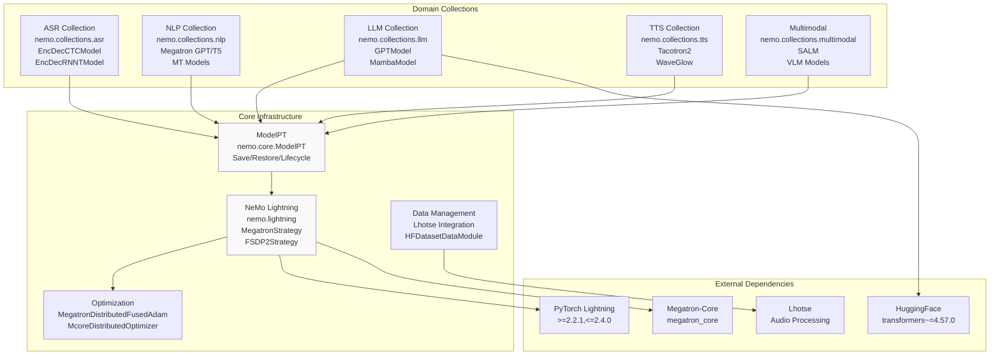

**Architecture Layers**: NeMo follows a layered architecture where domain-specific collections (ASR, NLP, LLM, TTS, Multimodal) build upon the `ModelPT` base class from `nemo.core`. The core infrastructure layer provides Lightning-based distributed training strategies, data loading systems, and optimization components. All components integrate with external frameworks including PyTorch Lightning for training orchestration, Megatron-Core for model parallelism, HuggingFace for model interoperability, and Lhotse for audio processing.

**Sources**: [Diagram 1 from high-level architecture](), [setup.py:68-146](), [requirements/requirements_lightning.txt:1-13]()

### Domain Collections and Package Structure

NeMo organizes functionality into domain-specific collections, each with specialized models, data loaders, and utilities:

| Collection | Package Path | Primary Models | Purpose |
|------------|--------------|----------------|---------|
| **ASR** | `nemo.collections.asr` | `EncDecCTCModel`, `EncDecRNNTModel`, `EncDecMultiTaskModel` | Speech recognition and transcription |
| **NLP** | `nemo.collections.nlp` | `MegatronGPTModel`, `MegatronT5Model`, NMT models | Language understanding and generation |
| **LLM** | `nemo.collections.llm` | `GPTModel`, `MambaModel`, `HFAutoModelForCausalLM` | Large language model training and inference |
| **TTS** | `nemo.collections.tts` | `Tacotron2Model`, `WaveGlowModel`, G2P modules | Speech synthesis |
| **Multimodal** | `nemo.collections.multimodal` | `SALM`, VLM models | Vision-language and audio-language models |
| **Common** | `nemo.collections.common` | Data processing, callbacks | Shared utilities across collections |

**Sources**: [Diagram 1 from high-level architecture](), [setup.py:76-82]()

---

## Core Infrastructure Components

### Package Organization

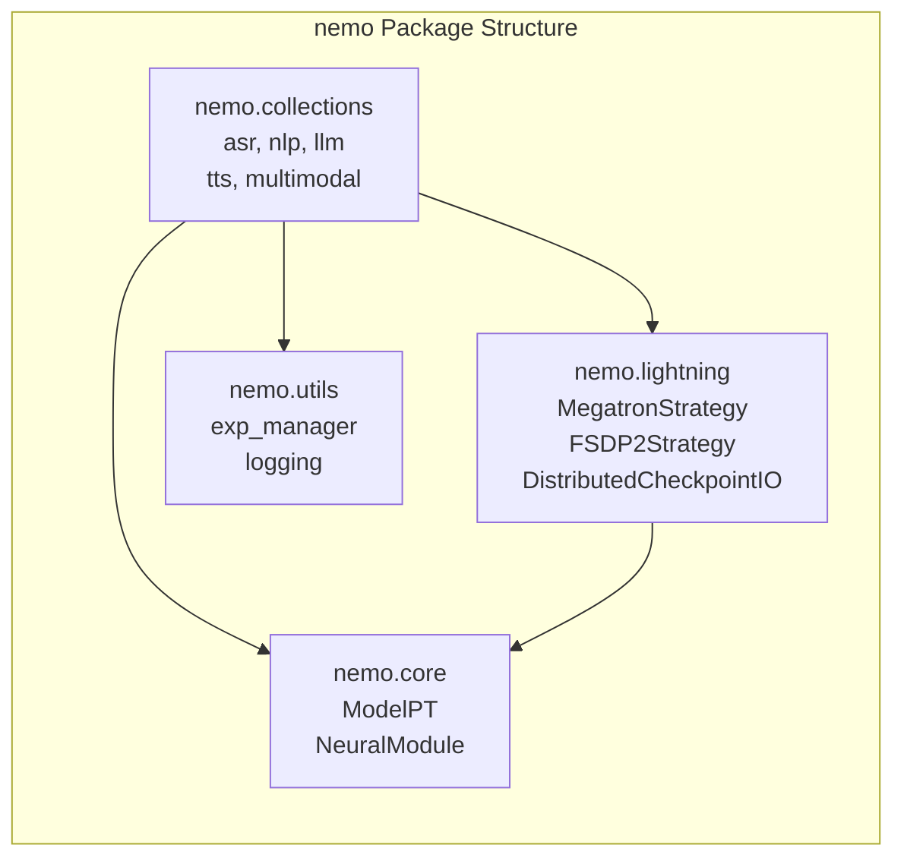

**Sources**: [setup.py:273](), [pyproject.toml:64]()

### Key Infrastructure Abstractions

#### ModelPT Base Class
- **Location**: `nemo.core.ModelPT`
- **Purpose**: Base class for all NeMo models providing save/restore, config management, and lifecycle hooks
- **Integration**: Interfaces with PyTorch Lightning's `LightningModule` for training orchestration
- See [Core Model Classes and Interfaces](#1.2) for details

#### Lightning Integration
- **Location**: `nemo.lightning`
- **Components**:
  - `MegatronStrategy`: Distributed training with tensor/pipeline/context parallelism
  - `FSDP2Strategy`: PyTorch native Fully Sharded Data Parallel
  - `DistributedCheckpointIO`: Async checkpoint save/load
- **Dependency**: Requires `lightning>2.2.1,<=2.4.0` ([requirements_lightning.txt:4]())

#### Data Management
- **Lhotse Integration**: Audio processing via `LazyNeMoIterator` and `CutSet` for ASR/TTS
- **HuggingFace Datasets**: `HFDatasetDataModule` for LLM training
- **Bucketing**: Dynamic batching with 2D constraints (audio duration × token length)

#### Optimization
- **MegatronDistributedFusedAdam**: FP8-capable optimizer with distributed state
- **McoreDistributedOptimizer**: ZeRO-style optimizer state sharding
- **Mixed Precision**: AMP support with FP16/BF16/FP8 via Transformer Engine

**Sources**: [Diagram 2 from high-level architecture](), [requirements/requirements_lightning.txt:1-13](), [requirements/requirements_nlp.txt:12-13]()

---

## Installation

### System Requirements

| Requirement | Specification |
|-------------|---------------|
| **Python Version** | `>=3.10` |
| **Operating System** | Linux (primary), macOS (limited support) |
| **GPU Support** | NVIDIA GPUs with CUDA 11.8+ (for GPU acceleration) |
| **Package Manager** | pip |

**Sources**: [setup.py:274](), [pyproject.toml:25]()

### Core Dependencies

The base NeMo installation requires the following packages ([requirements/requirements.txt]()):

```
fsspec==2024.12.0
huggingface_hub>=0.24
numba-cuda==0.15.1 (Linux only)
numpy>=1.22
onnx>=1.7.0
protobuf~=5.29.5
torch
tqdm>=4.41.0
setuptools>=70.0.0
```

**Sources**: [requirements/requirements.txt:1-21]()

### Installation Methods

#### Basic Installation

```bash
# Install base NeMo toolkit
pip install nemo-toolkit
```

This installs only core dependencies without domain-specific packages.

#### Installation with Domain Collections

NeMo uses `extras_require` groups defined in [setup.py:68-146]() to provide optional dependencies for specific domains:

```bash
# ASR (Automatic Speech Recognition)
pip install nemo-toolkit[asr]

# NLP/LLM (Natural Language Processing / Large Language Models)
pip install nemo-toolkit[nlp]
# or
pip install nemo-toolkit[llm]

# TTS (Text-to-Speech)
pip install nemo-toolkit[tts]

# Multimodal
pip install nemo-toolkit[multimodal]

# All domains
pip install nemo-toolkit[all]
```

#### Domain-Specific Dependency Hierarchy

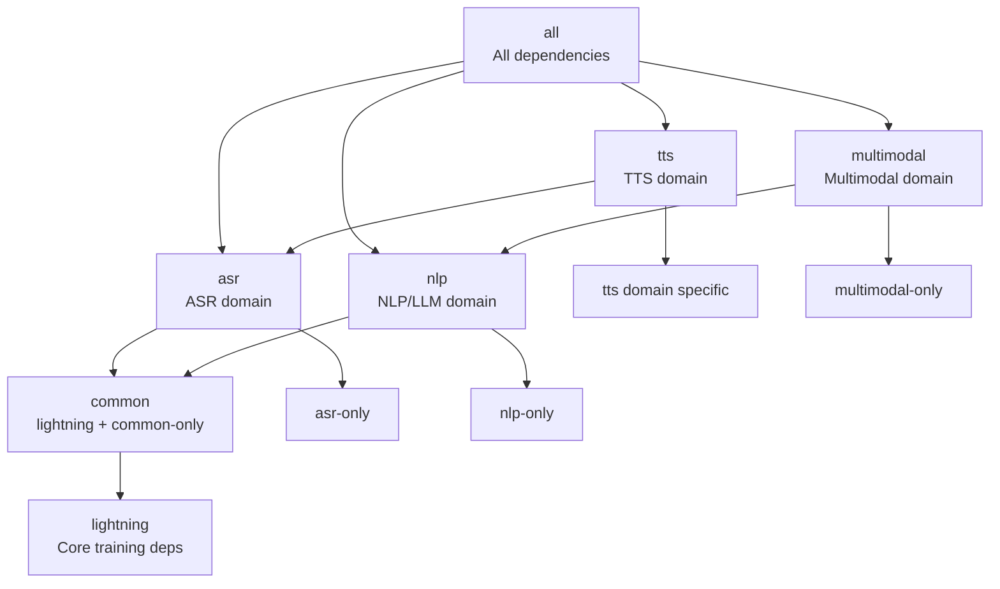

**Dependency Resolution Logic**: The extras system uses composition, where higher-level domains inherit dependencies from lower levels. For example, `tts` depends on `asr` because TTS models often use ASR components for alignment ([setup.py:119-125]()).

**Sources**: [setup.py:68-146]()

### Domain-Specific Dependencies

#### ASR Dependencies
Key packages in `requirements_asr.txt`:
- **Lhotse**: Audio data processing and augmentation
- **k2**: Finite state transducer operations
- **kaldifeat**: Feature extraction
- **pynini**: Weighted finite-state transducers

#### NLP/LLM Dependencies
Key packages in `requirements_nlp.txt` ([requirements/requirements_nlp.txt:1-29]()):
- **megatron_core**: Model parallelism primitives
- **nvidia-modelopt==0.37.0**: Model optimization (quantization, pruning)
- **nvidia-resiliency-ext>=0.3.0**: Fault tolerance and straggler detection
- **transformers~=4.57.0**: HuggingFace model integration
- **tiktoken==0.7.0**: Tokenization
- **tensorstore<0.1.72**: Distributed checkpoint storage
- **accelerated-scan**: Mamba/SSM model support

#### Lightning Dependencies
Core training dependencies from `requirements_lightning.txt` ([requirements/requirements_lightning.txt:1-13]()):
- **lightning>2.2.1,<=2.4.0**: PyTorch Lightning training framework
- **hydra-core>1.3,<=1.3.2**: Configuration management
- **omegaconf<=2.3**: Configuration object system
- **peft**: Parameter-efficient fine-tuning
- **transformers~=4.57.0**: HuggingFace integration
- **nv_one_logger_***: NVIDIA telemetry and logging

**Sources**: [requirements/requirements_nlp.txt:1-29](), [requirements/requirements_lightning.txt:1-13]()

---

## Development and Testing Setup

### Installing for Development

For contributors and developers:

```bash
# Clone repository
git clone https://github.com/NVIDIA/NeMo
cd NeMo

# Install in editable mode with all dependencies
pip install -e ".[all]"

# Install test dependencies
pip install -e ".[test]"
```

Test dependencies include ([requirements/requirements_test.txt:1-16]()):
- **pytest**: Test framework
- **black~=24.3**: Code formatting
- **isort>5.1.0,<6.0.0**: Import sorting
- **pylint**: Code linting
- **coverage**: Code coverage measurement

### Code Quality Tools

NeMo enforces code quality through automated checks:

#### Formatting
- **Black** (line length: 119): Automatic code formatting ([pyproject.toml:85-116]())
- **isort**: Import statement organization ([pyproject.toml:73-82]())

Configuration in `pyproject.toml`:
```
[tool.black]
line_length = 119
required_version = "24"
target-version = ['py310', 'py311', 'py312']

[tool.isort]
profile = "black"
line_length = 119
py_version = 310
```

#### Linting
- **pylint**: Python code analysis
- **flake8**: Style guide enforcement

Separate configurations for speech and non-speech domains:
- `.pylintrc.speech` for ASR/TTS/Audio collections ([.pylintrc.speech:1-10]())
- `.pylintrc.other` for remaining code ([.pylintrc.other:1-13]())

**Sources**: [pyproject.toml:73-116](), [requirements/requirements_test.txt:1-16](), [.pre-commit-config.yaml:15-53]()

### CI/CD Pipeline Integration

NeMo uses GitHub Actions for continuous integration:

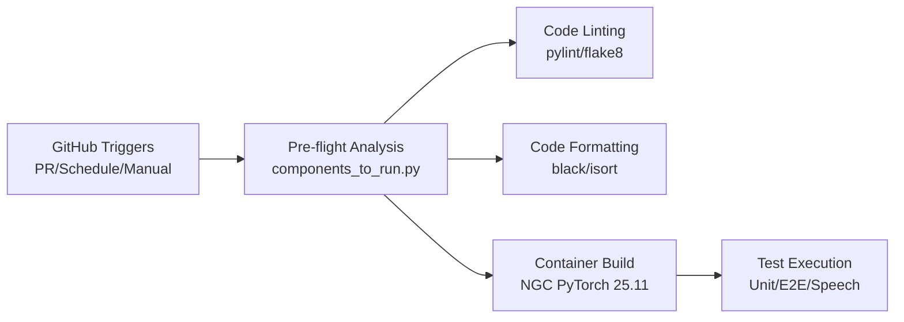

Key workflows:
- **code-linting.yml**: Runs pylint/flake8 on changed files ([.github/workflows/code-linting.yml:1-161]())
- **code-formatting.yml**: Applies black/isort formatting ([.github/workflows/code-formatting.yml:1-74]())
- **cicd-main-speech.yml**: ASR/TTS/Audio tests ([.github/workflows/cicd-main-speech.yml:1-219]())
- **cicd-main-nemo2.yml**: LLM/Multimodal tests ([.github/workflows/cicd-main-nemo2.yml:1-301]())

**Sources**: [.github/workflows/code-linting.yml:1-161](), [.github/workflows/code-formatting.yml:1-74](), [.github/workflows/cicd-main-speech.yml:14-32](), [.github/workflows/cicd-main-nemo2.yml:14-32]()

---

## Package Metadata and Configuration

### Package Information

The NeMo package is configured through both `setup.py` (legacy) and `pyproject.toml` (modern):

| Property | Value |
|----------|-------|
| **Package Name** | `nemo-toolkit` |
| **License** | Apache License 2.0 |
| **Python Support** | 3.10, 3.11, 3.12 (planned) |
| **Development Status** | Production/Stable |
| **Entry Points** | `nemo_run.cli` → `nemo.collections.llm` |

**Sources**: [setup.py:221-295](), [pyproject.toml:19-71]()

### Build System

From `pyproject.toml` ([pyproject.toml:15-17]()):
```toml
[build-system]
requires = ["setuptools >= 61.0"]
build-backend = "setuptools.build_meta"
```

The package uses `setuptools` for building and distribution.

### Environment Variables

Key environment variables for NeMo operation:

| Variable | Purpose | Example |
|----------|---------|---------|
| `TRANSFORMERS_OFFLINE` | Disable HuggingFace online access | `"1"` |
| `WORLD_SIZE` | Number of distributed processes | `"8"` |
| `RANK` | Current process rank | `"0"` |
| `CUDA_VISIBLE_DEVICES` | GPU device selection | `"0,1,2,3"` |
| `NCCL_*` | NCCL communication settings | Various |

**Sources**: [examples/llm/resiliency/resiliency-in-pretraining-demo.ipynb:141-146](), [nemo/lightning/one_logger_callback.py:47-64]()

---

## Advanced Installation Topics

### Platform-Specific Considerations

#### macOS Support
- **numba**: Uses standard `numba` package instead of `numba-cuda` ([requirements/requirements.txt:3-4]())
- **CUDA packages**: Not available on macOS (Darwin platform)
- **tensorstore**: Not supported on macOS ([requirements/requirements_nlp.txt:26]())

#### GPU Optimization
For optimal GPU performance, install NVIDIA-specific packages:
- **nvidia-modelopt**: Model quantization and pruning ([requirements/requirements_nlp.txt:16]())
- **nvidia-resiliency-ext**: Fault tolerance features ([requirements/requirements_nlp.txt:17]())
- **Apex**: Mixed precision utilities (external dependency)
- **Transformer Engine**: FP8 kernel acceleration (external dependency)

### Container-Based Deployment

NeMo provides Docker containers for reproducible environments:

**NGC PyTorch Container**: Base image for CI/CD builds
- Version: 25.11
- Includes: PyTorch, CUDA, cuDNN, NCCL, Apex, Transformer Engine
- Used in: [.github/workflows/_build_container.yml]()

**Sources**: [.github/workflows/cicd-main-nemo2.yml:31-32](), [.dockerignore:1-20]()

### Dependency Version Pinning

NeMo uses specific version constraints to ensure compatibility:

| Package | Version Constraint | Reason |
|---------|-------------------|--------|
| `lightning` | `>2.2.1,<=2.4.0` | API compatibility |
| `transformers` | `~=4.57.0` | Model format compatibility |
| `hydra-core` | `>1.3,<=1.3.2` | Config system stability |
| `omegaconf` | `<=2.3` | Config compatibility |
| `protobuf` | `~=5.29.5` | PyTorch requirement alignment |

**Sources**: [requirements/requirements_lightning.txt:3-8](), [requirements/requirements.txt:10]()

---

## Summary

NeMo provides a comprehensive toolkit for conversational AI with modular domain collections, robust core infrastructure, and flexible installation options. The framework integrates tightly with PyTorch Lightning for training, Megatron-Core for distributed computing, and HuggingFace for model interoperability. Installation can be tailored to specific use cases through the extras system, enabling efficient dependency management for ASR, NLP, LLM, TTS, or multimodal applications.

For next steps:
- Learn about core model abstractions: [Core Model Classes and Interfaces](#1.2)
- Understand training orchestration: [Experiment Management and Training](#1.3)
- Explore distributed training: [Distributed Training Infrastructure](#2)
- Dive into specific domains: [Large Language Models](#3), [Automatic Speech Recognition](#4)

**Sources**: [setup.py:1-296](), [pyproject.toml:1-152](), All requirements files

---

# Page: Core Model Classes and Interfaces

# Core Model Classes and Interfaces

<details>
<summary>Relevant source files</summary>

The following files were used as context for generating this wiki page:

- [docs/source/asr/data/benchmark_en.csv](docs/source/asr/data/benchmark_en.csv)
- [docs/source/asr/data/benchmark_zh.csv](docs/source/asr/data/benchmark_zh.csv)
- [examples/asr/transcribe_speech_parallel.py](examples/asr/transcribe_speech_parallel.py)
- [nemo/collections/asr/data/audio_to_label.py](nemo/collections/asr/data/audio_to_label.py)
- [nemo/collections/asr/data/audio_to_text.py](nemo/collections/asr/data/audio_to_text.py)
- [nemo/collections/asr/data/audio_to_text_dataset.py](nemo/collections/asr/data/audio_to_text_dataset.py)
- [nemo/collections/asr/models/classification_models.py](nemo/collections/asr/models/classification_models.py)
- [nemo/collections/asr/models/configs/asr_models_config.py](nemo/collections/asr/models/configs/asr_models_config.py)
- [nemo/collections/asr/models/ctc_bpe_models.py](nemo/collections/asr/models/ctc_bpe_models.py)
- [nemo/collections/asr/models/ctc_models.py](nemo/collections/asr/models/ctc_models.py)
- [nemo/collections/asr/models/hybrid_rnnt_ctc_bpe_models.py](nemo/collections/asr/models/hybrid_rnnt_ctc_bpe_models.py)
- [nemo/collections/asr/models/hybrid_rnnt_ctc_models.py](nemo/collections/asr/models/hybrid_rnnt_ctc_models.py)
- [nemo/collections/asr/models/label_models.py](nemo/collections/asr/models/label_models.py)
- [nemo/collections/asr/models/rnnt_bpe_models.py](nemo/collections/asr/models/rnnt_bpe_models.py)
- [nemo/collections/asr/models/rnnt_models.py](nemo/collections/asr/models/rnnt_models.py)
- [nemo/collections/asr/models/transformer_bpe_models.py](nemo/collections/asr/models/transformer_bpe_models.py)
- [nemo/core/classes/common.py](nemo/core/classes/common.py)
- [nemo/core/classes/mixins/hf_io_mixin.py](nemo/core/classes/mixins/hf_io_mixin.py)
- [nemo/core/classes/modelPT.py](nemo/core/classes/modelPT.py)
- [nemo/core/config/templates/__init__.py](nemo/core/config/templates/__init__.py)
- [nemo/core/config/templates/model_card.py](nemo/core/config/templates/model_card.py)
- [nemo/core/connectors/save_restore_connector.py](nemo/core/connectors/save_restore_connector.py)
- [nemo/utils/model_utils.py](nemo/utils/model_utils.py)
- [tests/collections/asr/test_asr_ctc_encoder_model_bpe.py](tests/collections/asr/test_asr_ctc_encoder_model_bpe.py)
- [tests/collections/asr/test_asr_ctcencdec_model.py](tests/collections/asr/test_asr_ctcencdec_model.py)
- [tests/collections/asr/test_asr_hybrid_rnnt_ctc_model_bpe.py](tests/collections/asr/test_asr_hybrid_rnnt_ctc_model_bpe.py)
- [tests/collections/asr/test_asr_hybrid_rnnt_ctc_model_char.py](tests/collections/asr/test_asr_hybrid_rnnt_ctc_model_char.py)
- [tests/collections/asr/test_asr_modules.py](tests/collections/asr/test_asr_modules.py)
- [tests/core/test_fileio.py](tests/core/test_fileio.py)
- [tests/core/test_save_restore.py](tests/core/test_save_restore.py)
- [tests/core/test_serialization.py](tests/core/test_serialization.py)
- [tests/core/test_typecheck.py](tests/core/test_typecheck.py)

</details>


This document covers the fundamental base classes and interfaces that form the foundation of all NeMo models and neural modules. These abstractions provide consistent APIs for model configuration, type checking, serialization, and lifecycle management across all NeMo collections.

For information about experiment management and training workflows, see [Experiment Management and Training](#1.3). For details about specific model architectures and collections, see [Large Language Models (LLMs)](#2), [Automatic Speech Recognition (ASR)](#3), and [Natural Language Processing (NLP)](#4).

## Class Hierarchy Overview

NeMo's core architecture is built around an inheritance hierarchy where all models extend `ModelPT`, which combines PyTorch Lightning's `LightningModule` with NeMo-specific interfaces:

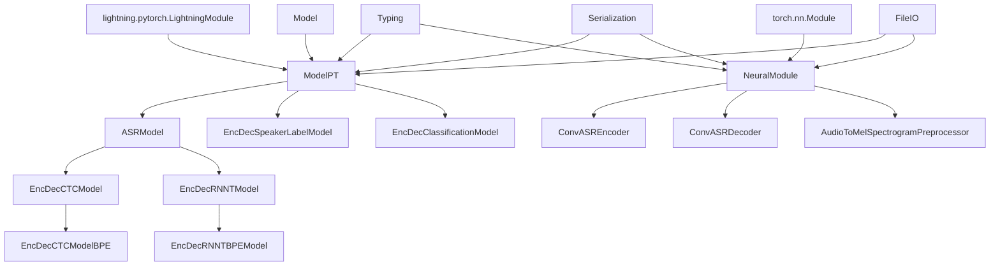

**Sources:** [nemo/core/classes/modelPT.py:65](), [nemo/core/classes/common.py:274-287](), [nemo/collections/asr/models/ctc_models.py:49](), [nemo/collections/asr/models/ctc_bpe_models.py:39](), [nemo/collections/asr/models/rnnt_models.py:53](), [nemo/collections/asr/models/rnnt_bpe_models.py:38](), [nemo/collections/asr/models/label_models.py:57](), [nemo/collections/asr/models/classification_models.py:64]()

## ModelPT: The Foundation Class

`ModelPT` (defined in [nemo/core/classes/modelPT.py:65]()) is the base class for all NeMo models. It extends `lightning.pytorch.LightningModule` and implements the `Model`, `Typing`, `Serialization`, and `FileIO` interfaces.

### Key Responsibilities

```mermaid
graph TD
    ModelPT["ModelPT"]
    
    Config["Configuration Management"]
    SaveRestore["Save/Restore"]
    Artifacts["Artifact Registration"]
    Submodules["Nested Models"]
    Optimization["Optimizer/Scheduler Setup"]
    DataLoaders["DataLoader Setup"]
    
    ModelPT --> Config
    ModelPT --> SaveRestore
    ModelPT --> Artifacts
    ModelPT --> Submodules
    ModelPT --> Optimization
    ModelPT --> DataLoaders
    
    Config --> to_config_dict["to_config_dict()"]
    Config --> to_config_file["to_config_file()"]
    Config --> from_config_dict["from_config_dict()"]
    
    SaveRestore --> save_to["save_to(save_path)"]
    SaveRestore --> restore_from["restore_from(restore_path)"]
    SaveRestore --> load_from_checkpoint["load_from_checkpoint()"]
    
    Artifacts --> register_artifact["register_artifact(config_path, src)"]
    Artifacts --> has_artifacts["has_artifacts()"]
    Artifacts --> has_native_or_submodules_artifacts["has_native_or_submodules_artifacts()"]
    
    Submodules --> register_nemo_submodule["register_nemo_submodule(name, config_field, model)"]
    Submodules --> named_nemo_modules["named_nemo_modules()"]
    Submodules --> has_nemo_submodules["has_nemo_submodules()"]
    
    Optimization --> setup_optimization["setup_optimization(optim_config)"]
    Optimization --> setup_optimizer_param_groups["setup_optimizer_param_groups()"]
    Optimization --> configure_optimizers["configure_optimizers()"]
    
    DataLoaders --> setup_training_data["setup_training_data(config)"]
    DataLoaders --> setup_validation_data["setup_validation_data(config)"]
    DataLoaders --> setup_test_data["setup_test_data(config)"]
    DataLoaders --> setup_multiple_validation_data["setup_multiple_validation_data(config)"]
    DataLoaders --> setup_multiple_test_data["setup_multiple_test_data(config)"]
```

### Abstract Methods

Subclasses must implement these abstract methods defined in [nemo/core/classes/modelPT.py:554-587]():

| Method | Signature | Purpose |
|--------|-----------|---------|
| `setup_training_data` | `(train_data_config: Union[DictConfig, Dict])` | Configure training data loader |
| `setup_validation_data` | `(val_data_config: Union[DictConfig, Dict])` | Configure validation data loader |
| `setup_test_data` | `(test_data_config: Union[DictConfig, Dict])` | Configure test data loader (optional) |

**Sources:** [nemo/core/classes/modelPT.py:65-236](), [nemo/core/classes/modelPT.py:554-587]()

### Configuration Management

`ModelPT` models use OmegaConf `DictConfig` objects for configuration. The config is stored in `self._cfg` and contains model architecture, training parameters, and dataset configurations.

#### Configuration Structure

```mermaid
graph LR
    YAMLFile["model_config.yaml"]
    OmegaConfLoad["OmegaConf.load()"]
    DictConfig["DictConfig"]
    ModelInit["ModelPT.__init__(cfg, trainer)"]
    ModelInstance["Model Instance<br/>self._cfg stored"]
    
    YAMLFile --> OmegaConfLoad
    OmegaConfLoad --> DictConfig
    DictConfig --> ModelInit
    ModelInit --> ModelInstance
    
    ModelInstance --> to_config_dict["to_config_dict()"]
    to_config_dict --> SerializedConfig["Dict/DictConfig"]
    SerializedConfig --> from_config_dict["from_config_dict(config)"]
    from_config_dict --> NewModel["New Model Instance"]
```

The constructor [nemo/core/classes/modelPT.py:70-160]() performs these steps:
1. Converts config to `DictConfig` using `model_utils.convert_model_config_to_dict_config()`
2. Updates config version with `model_utils.maybe_update_config_version()`
3. Validates that `'model'` key is not in config (reserved for internal use)
4. Adds `'target'` field pointing to the class path if not present
5. Adds `'nemo_version'` field with package version
6. Saves config to `self._cfg` and hyperparameters with `self.save_hyperparameters("cfg")`

**Sources:** [nemo/core/classes/modelPT.py:70-160](), [nemo/core/classes/common.py:589-643](), [nemo/utils/model_utils.py:80-92]()

### Artifact Management

Models can register external files (e.g., tokenizers, vocabularies) that are packaged when saving to `.nemo` format.

#### Artifact Registration Flow

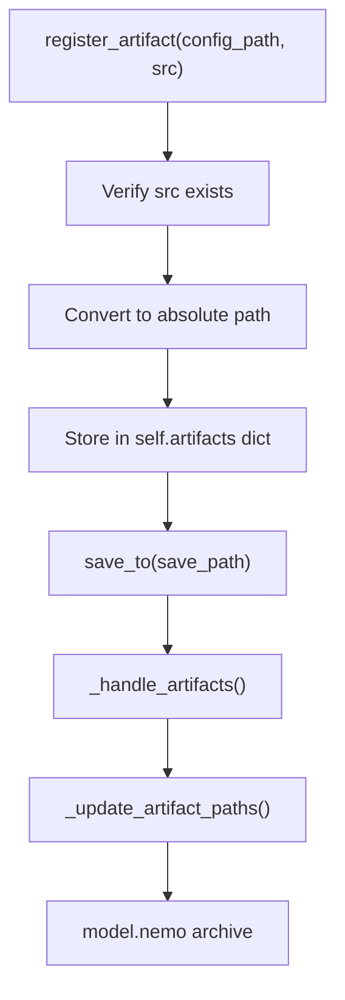

| Method | Signature | Purpose |
|--------|-----------|---------|
| `register_artifact` | `(config_path: str, src: str, verify_src_exists: bool = True)` | Register file to include in `.nemo` save |
| `has_artifacts` | `() -> bool` | Returns True if model has artifacts |
| `has_native_or_submodules_artifacts` | `() -> bool` | Checks artifacts in model and submodules |

Artifacts are stored in `self.artifacts` dictionary mapping config paths to `ArtifactItem` objects. The `register_artifact()` method [nemo/core/classes/modelPT.py:246-305]():
- Returns absolute path that exists during model lifetime
- Handles `nemo_file:` prefixed paths by extracting from archive
- Validates file existence if `verify_src_exists=True`
- Raises `NeMoBaseException` if registering `.nemo` files (use `register_nemo_submodule()` instead)

**Sources:** [nemo/core/classes/modelPT.py:246-325](), [nemo/core/connectors/save_restore_connector.py:52-94](), [nemo/utils/model_utils.py:63-68]()

## NeuralModule: Base Neural Component

`NeuralModule` serves as the base class for individual neural network components like encoders, decoders, and preprocessors. It extends `torch.nn.Module` while adding NeMo's type checking and serialization capabilities.

### Key Features

| Feature | Description |
|---------|-------------|
| Neural Type Checking | Validates input/output tensor types and shapes |
| Serialization | Save/restore module configurations |
| Weight Counting | Utility for counting trainable parameters |
| Input Examples | Generate sample inputs for tracing/export |

**Sources:** [nemo/core/classes/module.py:26-150]()

## Core Interfaces

NeMo models implement several key interfaces that provide consistent functionality across the framework:

### Typing Interface

The `Typing` interface enables neural type checking through `input_types` and `output_types` properties:

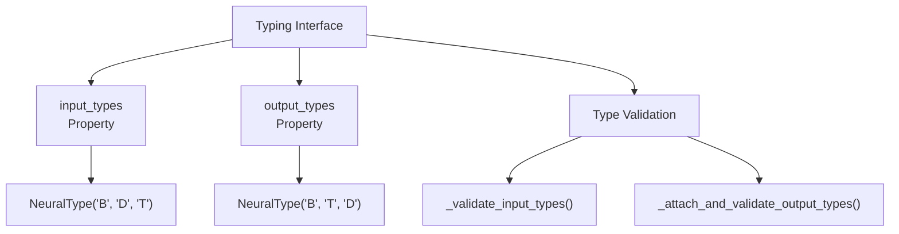

Example implementation:
```python
@property
def input_types(self):
    return {
        "audio_signal": NeuralType(('B', 'D', 'T'), SpectrogramType()),
        "length": NeuralType(tuple('B'), LengthsType()),
    }

@property  
def output_types(self):
    return {
        "outputs": NeuralType(('B', 'D', 'T'), AcousticEncodedRepresentation()),
        "encoded_lengths": NeuralType(tuple('B'), LengthsType()),
    }
```

**Sources:** [nemo/core/classes/common.py:213-524](), [nemo/collections/asr/modules/conv_asr.py:87-104]()

### Serialization Interface

Provides `from_config_dict()` class method for instantiating objects from configuration dictionaries with support for both Hydra 0.x and 1.x formats.

**Sources:** [nemo/core/classes/common.py:526-591]()

### FileIO Interface  

Enables saving and loading models with `save_to()` and `restore_from()` methods, supporting various storage backends and model formats.

**Sources:** [nemo/core/classes/common.py:593-1156]()

## Neural Type System

NeMo's neural type system provides runtime type checking for tensor inputs and outputs, helping catch shape and semantic mismatches during development:

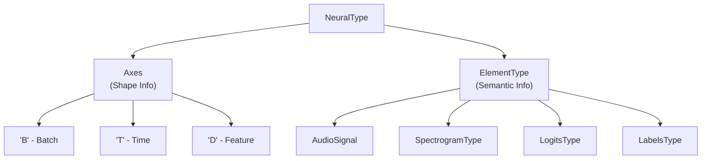

The type system supports:
- **Shape validation**: Ensures tensor dimensions match expected patterns
- **Semantic checking**: Validates that tensor contents match expected types
- **Container support**: Handles nested lists/tuples of tensors
- **Optional parameters**: Allows flexible argument specifications

**Sources:** [nemo/core/classes/common.py:126-524](), [nemo/core/neural_types/__init__.py:1-17]()

## Model Save and Restore Mechanism

NeMo uses the `SaveRestoreConnector` class to package models into `.nemo` archive files containing configuration, weights, and artifacts.

### Save Process

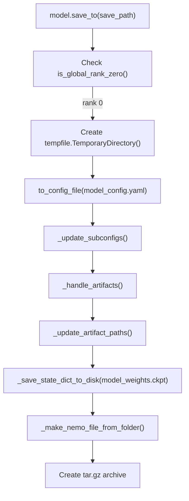

The `.nemo` file structure:
```
model.nemo (tar.gz archive)
├── model_config.yaml      # Model configuration
├── model_weights.ckpt     # PyTorch state_dict
└── [artifacts]/           # Registered artifacts (tokenizers, etc.)
```

Key methods in [nemo/core/classes/modelPT.py:404-442]():
- `save_to(save_path: str)` - Main entry point, only executes on rank 0
- Checks `app_state.model_parallel_size` for distributed settings
- Uses `SaveRestoreConnector` which can be overridden for custom behavior

### Restore Process

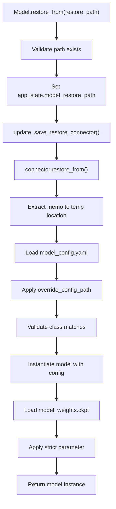

The `restore_from()` classmethod [nemo/core/classes/modelPT.py:444-514]() accepts:
- `restore_path` - Path to `.nemo` file
- `override_config_path` - Optional config override (yaml file or DictConfig)
- `map_location` - torch.device for loading (default: GPU if available, else CPU)
- `strict` - Passed to `load_state_dict()` (default: True)
- `return_config` - If True, returns only config without instantiating model
- `trainer` - Optional Trainer forwarded to model constructor
- `save_restore_connector` - Custom SaveRestoreConnector instance

**Sources:** [nemo/core/classes/modelPT.py:404-514](), [nemo/core/connectors/save_restore_connector.py:52-445]()

## Integration with PyTorch Lightning

ModelPT extends PyTorch Lightning's `LightningModule` to leverage Lightning's training infrastructure while adding NeMo-specific features:

| Lightning Feature | NeMo Enhancement |
|------------------|------------------|
| `training_step()` | Wrapped for automatic logging |
| `configure_optimizers()` | Extended optimizer setup with schedulers |
| Checkpointing | Enhanced with `.nemo` format support |
| Multi-GPU training | Integrated with NeMo's distributed strategies |
| Callbacks | Custom callbacks for NeMo-specific functionality |

**Sources:** [nemo/core/classes/modelPT.py:889-924](), [nemo/utils/exp_manager.py:443-1190]()

---

# Page: Experiment Management and Training

# Experiment Management and Training

<details>
<summary>Relevant source files</summary>

The following files were used as context for generating this wiki page:

- [nemo/utils/callbacks/__init__.py](nemo/utils/callbacks/__init__.py)
- [nemo/utils/callbacks/nemo_model_checkpoint.py](nemo/utils/callbacks/nemo_model_checkpoint.py)
- [nemo/utils/callbacks/preemption.py](nemo/utils/callbacks/preemption.py)
- [nemo/utils/exp_manager.py](nemo/utils/exp_manager.py)
- [tests/collections/tts/conftest.py](tests/collections/tts/conftest.py)
- [tests/conftest.py](tests/conftest.py)
- [tests/core/test_exp_manager.py](tests/core/test_exp_manager.py)

</details>


This document covers NeMo's experiment management and training orchestration, focusing on the `exp_manager` system, save/restore functionality, and training lifecycle management. The infrastructure provides unified configuration for logging, checkpointing, optimization, and artifact management across all NeMo model types.

For core model classes, see [Core Model Classes and Interfaces](1.2). For model-specific training procedures, see [Large Language Models (LLMs)](2) and [Automatic Speech Recognition (ASR)](3).

## Experiment Manager (`exp_manager`)

The `exp_manager` function in [nemo/utils/exp_manager.py:443-807]() orchestrates training experiments by configuring directories, logging, checkpointing, and callbacks. It accepts a `lightning.pytorch.Trainer` and `ExpManagerConfig` to set up the complete training environment.

**Experiment Manager Architecture**

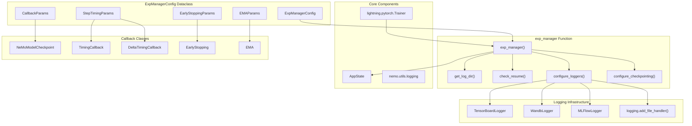

**Key Configuration Parameters**

The `ExpManagerConfig` dataclass [nemo/utils/exp_manager.py:208-267]() defines experiment configuration:

| Parameter | Type | Description |
|-----------|------|-------------|
| `exp_dir` | `Optional[str]` | Base experiment directory |
| `name` | `Optional[str]` | Experiment name |  
| `version` | `Optional[str]` | Experiment version |
| `create_checkpoint_callback` | `bool` | Enable `NeMoModelCheckpoint` |
| `create_tensorboard_logger` | `bool` | Enable TensorBoard logging |
| `resume_if_exists` | `bool` | Resume from existing checkpoints |
| `log_step_timing` | `bool` | Enable step timing callbacks |

Sources: [nemo/utils/exp_manager.py:443-807](), [nemo/utils/exp_manager.py:208-267](), [nemo/utils/exp_manager.py:269-383](), [nemo/utils/exp_manager.py:385-441]()

## Training Orchestration and Callbacks

The training orchestration system centers on PyTorch Lightning integration with NeMo-specific callbacks and timing infrastructure.

**Training Callback System**

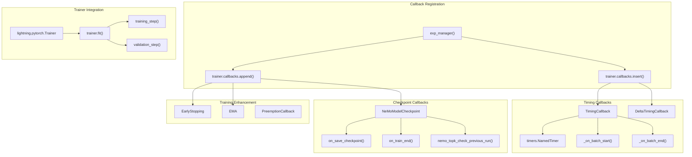

**Timing Infrastructure**

The `TimingCallback` class [nemo/utils/exp_manager.py:269-383]() provides step timing measurement:

- `_on_batch_start()`: Initializes timing for train/validation/test steps
- `_on_batch_end()`: Records timing and logs via PyTorch Lightning
- `DeltaTimingCallback` [nemo/utils/exp_manager.py:385-441](): Alternative timing using NeMo logger to avoid Lightning overhead

**Key Callback Configuration**

| Callback | Configuration Class | Purpose |
|----------|---------------------|---------|
| `NeMoModelCheckpoint` | `CallbackParams` | Model checkpointing and `.nemo` file creation |
| `EarlyStopping` | `EarlyStoppingParams` | Training termination based on metrics |
| `TimingCallback` | `StepTimingParams` | Performance monitoring |
| `EMA` | `EMAParams` | Exponential moving average of model weights |

Sources: [nemo/utils/exp_manager.py:269-383](), [nemo/utils/exp_manager.py:385-441](), [nemo/utils/exp_manager.py:682-711](), [nemo/utils/exp_manager.py:97-115](), [nemo/utils/exp_manager.py:117-150](), [nemo/utils/exp_manager.py:152-172]()

## Optimization Infrastructure

NeMo's optimization system provides registries for optimizers and learning rate schedulers with built-in warmup, annealing, and advanced scheduling policies.

**Optimizer and Scheduler Registries**

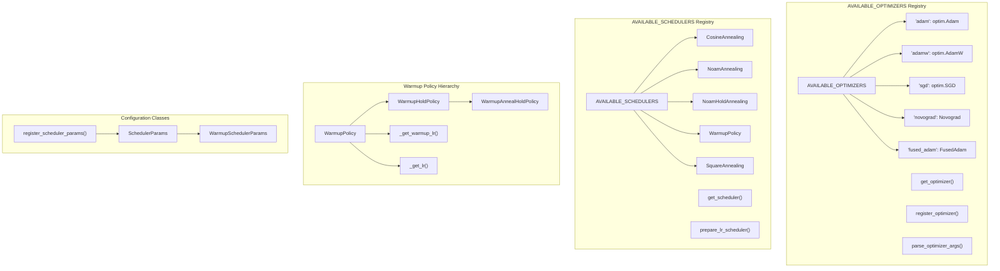

**Key Learning Rate Schedulers**

| Scheduler Class | Base Class | Key Features |
|----------------|------------|--------------|
| `WarmupPolicy` | `_LRScheduler` | Linear warmup with configurable steps/ratio |
| `WarmupHoldPolicy` | `WarmupPolicy` | Adds hold phase after warmup |
| `CosineAnnealing` | `WarmupAnnealHoldPolicy` | Cosine decay with warmup/hold |
| `NoamAnnealing` | `_LRScheduler` | Transformer-style scheduling |
| `NoamHoldAnnealing` | `WarmupHoldPolicy` | Noam with prolonged hold phase |

**Scheduler Configuration Interface**

The `prepare_lr_scheduler()` function [nemo/core/optim/lr_scheduler.py:759-866]() creates scheduler configurations compatible with PyTorch Lightning:

```python
scheduler_setup = {
    'scheduler': scheduler_instance,
    'interval': 'step',  # or 'epoch' 
    'frequency': 1,
    'monitor': 'val_loss',
    'strict': True
}
```

Sources: [nemo/core/optim/optimizers.py:33-45](), [nemo/core/optim/optimizers.py:80-158](), [nemo/core/optim/lr_scheduler.py:39-91](), [nemo/core/optim/lr_scheduler.py:153-228](), [nemo/core/optim/lr_scheduler.py:467-516](), [nemo/core/optim/lr_scheduler.py:759-866]()

## Save/Restore System

NeMo's save/restore system provides model persistence through the `SaveRestoreConnector` and `.nemo` file format, with advanced checkpointing via the `NeMoModelCheckpoint` callback.

**SaveRestoreConnector Architecture**

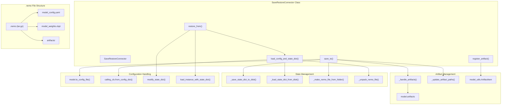

**NeMoModelCheckpoint Integration**

The `NeMoModelCheckpoint` class [nemo/utils/callbacks/nemo_model_checkpoint.py:39-590]() extends PyTorch Lightning's `ModelCheckpoint`:

| Method | Purpose |
|--------|---------|
| `on_save_checkpoint()` | Saves `.nemo` files when `always_save_nemo=True` |
| `on_train_end()` | Creates final `.nemo` file if `save_nemo_on_train_end=True` |
| `nemo_topk_check_previous_run()` | Handles resume logic for existing checkpoints |
| `_format_nemo_checkpoint_name()` | Generates `.nemo` filenames |

**Key Configuration Parameters**

| Parameter | Type | Default | Description |
|-----------|------|---------|-------------|
| `save_best_model` | `bool` | `False` | Save best checkpoint as `.nemo` |
| `always_save_nemo` | `bool` | `False` | Save `.nemo` on every checkpoint |
| `save_nemo_on_train_end` | `bool` | `True` | Create `.nemo` when training ends |
| `async_save` | `bool` | `False` | Asynchronous checkpoint saving |

**Artifact Registration**

The `register_artifact()` method [nemo/core/connectors/save_restore_connector.py:361-521]() handles file dependencies:

- Copies files to temporary storage during save
- Resolves paths from `.nemo` archives during restore  
- Supports local files and `nemo_file:` URI scheme
- Manages artifact lifecycle with cleanup

Sources: [nemo/core/connectors/save_restore_connector.py:49-92](), [nemo/core/connectors/save_restore_connector.py:231-283](), [nemo/core/connectors/save_restore_connector.py:93-197](), [nemo/core/connectors/save_restore_connector.py:361-521](), [nemo/utils/callbacks/nemo_model_checkpoint.py:39-95](), [nemo/utils/callbacks/nemo_model_checkpoint.py:262-306]()

## Training Configuration and Lifecycle

The training lifecycle in NeMo involves several coordinated systems working together to manage experiments from initialization to completion.

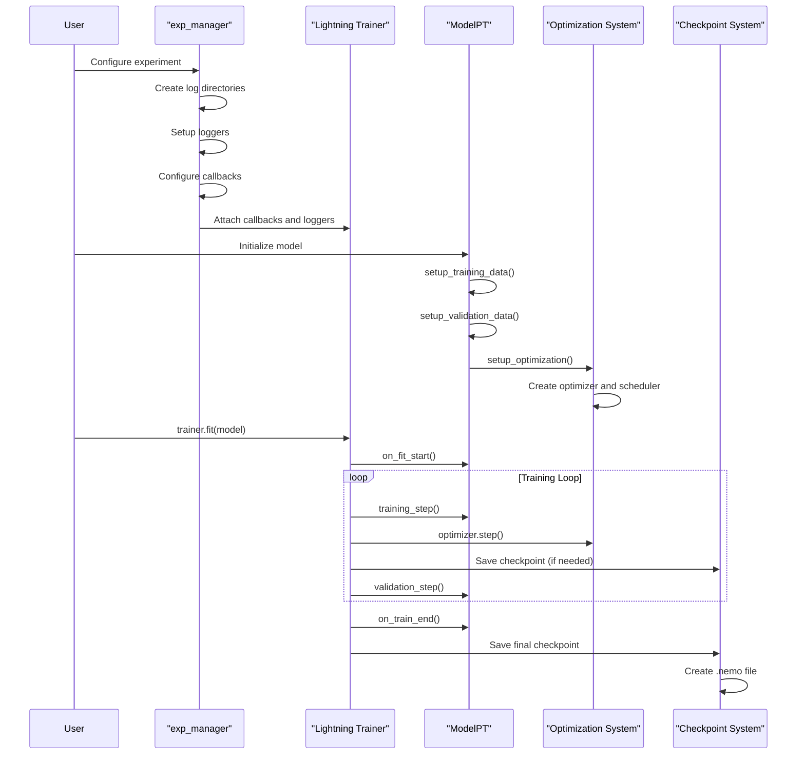

**Configuration Integration**

NeMo integrates configuration management across multiple levels:

- **Experiment Config**: Managed by `ExpManagerConfig` dataclass
- **Model Config**: Handled by individual model configurations
- **Optimizer Config**: Structured with `OptimizerParams` 
- **Scheduler Config**: Managed through `SchedulerParams`

The configuration system supports Hydra for dynamic configuration composition and OmegaConf for structured configs.

Sources: [nemo/utils/exp_manager.py:208-267](), [nemo/core/classes/modelPT.py:69-83]()

**Training Step Integration**

The `ModelPT` class integrates with PyTorch Lightning's training loop while adding NeMo-specific functionality:

- Wrapped training steps for logging integration
- Automatic data loader setup and management  
- Support for multiple validation datasets
- Neural type checking and validation

Sources: [nemo/core/classes/modelPT.py:208-210](), [nemo/utils/model_utils.py:475-483]()

---

# Page: Distributed Training Infrastructure

# Distributed Training Infrastructure

<details>
<summary>Relevant source files</summary>

The following files were used as context for generating this wiki page:

- [nemo/collections/common/metrics/perf_metrics.py](nemo/collections/common/metrics/perf_metrics.py)
- [nemo/collections/llm/README.md](nemo/collections/llm/README.md)
- [nemo/core/optim/distributed_adam.py](nemo/core/optim/distributed_adam.py)
- [nemo/core/optim/mcore_optim.py](nemo/core/optim/mcore_optim.py)
- [nemo/lightning/README.md](nemo/lightning/README.md)
- [nemo/lightning/_strategy_lib.py](nemo/lightning/_strategy_lib.py)
- [nemo/lightning/ckpt_utils.py](nemo/lightning/ckpt_utils.py)
- [nemo/lightning/fabric/strategies.py](nemo/lightning/fabric/strategies.py)
- [nemo/lightning/io/pl.py](nemo/lightning/io/pl.py)
- [nemo/lightning/megatron_init.py](nemo/lightning/megatron_init.py)
- [nemo/lightning/megatron_parallel.py](nemo/lightning/megatron_parallel.py)
- [nemo/lightning/nemo_logger.py](nemo/lightning/nemo_logger.py)
- [nemo/lightning/pytorch/callbacks/ddp_parity_checker.py](nemo/lightning/pytorch/callbacks/ddp_parity_checker.py)
- [nemo/lightning/pytorch/callbacks/model_checkpoint.py](nemo/lightning/pytorch/callbacks/model_checkpoint.py)
- [nemo/lightning/pytorch/callbacks/progress_printer.py](nemo/lightning/pytorch/callbacks/progress_printer.py)
- [nemo/lightning/pytorch/optim/megatron.py](nemo/lightning/pytorch/optim/megatron.py)
- [nemo/lightning/pytorch/strategies/fsdp_strategy.py](nemo/lightning/pytorch/strategies/fsdp_strategy.py)
- [nemo/lightning/pytorch/strategies/megatron_strategy.py](nemo/lightning/pytorch/strategies/megatron_strategy.py)
- [nemo/lightning/resume.py](nemo/lightning/resume.py)
- [nemo/package_info.py](nemo/package_info.py)
- [nemo/utils/app_state.py](nemo/utils/app_state.py)
- [nemo/utils/callbacks/dist_ckpt_io.py](nemo/utils/callbacks/dist_ckpt_io.py)
- [nemo/utils/msc_utils.py](nemo/utils/msc_utils.py)
- [tests/collections/llm/test_mnist_model_nemo2.py](tests/collections/llm/test_mnist_model_nemo2.py)
- [tests/collections/llm/test_mnist_model_nemo2_fsdp.py](tests/collections/llm/test_mnist_model_nemo2_fsdp.py)
- [tests/lightning/pytorch/strategies/test_megatron_strategy.py](tests/lightning/pytorch/strategies/test_megatron_strategy.py)
- [tests/lightning/test_ckpt_utils.py](tests/lightning/test_ckpt_utils.py)
- [tests/lightning/test_nemo_logger.py](tests/lightning/test_nemo_logger.py)
- [tests/lightning/test_resume.py](tests/lightning/test_resume.py)
- [tests/lightning/test_strategy_lib.py](tests/lightning/test_strategy_lib.py)
- [tests/utils/test_msc_utils.py](tests/utils/test_msc_utils.py)

</details>


This document covers NeMo's distributed training infrastructure, which enables efficient training of large-scale models through various parallelism strategies. The infrastructure provides abstractions over PyTorch Lightning's training strategies and integrates deeply with NVIDIA's Megatron-LM framework.

**Scope**: This page focuses on the training strategy layer, parallelism implementations, distributed optimization, and checkpoint I/O. For model-specific implementations that use these strategies, see [LLM Model Architectures](#3.1). For experiment management and training orchestration, see [Experiment Management and Training](#1.3).

---

## Overview

NeMo's distributed training infrastructure is built on two primary strategies:

1. **MegatronStrategy**: Leverages Megatron-LM/Megatron-Core for advanced model parallelism (tensor, pipeline, context, expert parallelism)
2. **FSDPStrategy**: Uses PyTorch's native Fully Sharded Data Parallel for simpler, FSDP-based training

The infrastructure handles:
- **Parallelism configuration**: TP, PP, VP, CP, EP dimensions
- **Process group initialization**: NCCL/Gloo process groups for different parallelism types
- **Model wrapping**: Automatic wrapping of models for distributed execution
- **Optimizer distribution**: ZeRO-style optimizer state sharding
- **Distributed checkpointing**: Async, sharded checkpoint save/load

Sources: [nemo/lightning/pytorch/strategies/megatron_strategy.py:151-252](), [nemo/lightning/README.md]()

---

## MegatronStrategy Architecture

### Core Components

```mermaid
graph TB
    subgraph "PyTorch Lightning Integration"
        Trainer["pl.Trainer"]
        DDPStrategy["DDPStrategy<br/>(Lightning Base)"]
    end
    
    subgraph "MegatronStrategy"
        Strategy["MegatronStrategy<br/>nemo/lightning/pytorch/strategies/megatron_strategy.py"]
        ParallelismConfig["ParallelismConfig<br/>tensor_model_parallel_size<br/>pipeline_model_parallel_size<br/>virtual_pipeline_model_parallel_size<br/>context_parallel_size<br/>expert_model_parallel_size"]
        CheckpointIO["MegatronCheckpointIO<br/>save_ckpt_format<br/>async_save"]
    end
    
    subgraph "Model Wrapping"
        MegatronParallel["MegatronParallel<br/>nemo/lightning/megatron_parallel.py<br/>ModuleList wrapper"]
        VPModels["Virtual Pipeline<br/>Model Chunks"]
        DDPWrapper["McoreDDP or<br/>FullyShardedDataParallel"]
    end
    
    subgraph "Process Groups"
        InitParallelRanks["init_parallel_ranks()<br/>_strategy_lib.py"]
        ParallelState["parallel_state<br/>Megatron-Core<br/>TP/PP/DP/CP/EP groups"]
    end
    
    subgraph "Optimization"
        DistOptimizer["MegatronDistributedFusedAdam<br/>or McoreDistributedOptimizer"]
        GradScaler["GradScaler<br/>Model-parallel inf check"]
    end
    
    Trainer --> Strategy
    DDPStrategy --> Strategy
    Strategy --> ParallelismConfig
    Strategy --> CheckpointIO
    Strategy --> MegatronParallel
    Strategy --> InitParallelRanks
    
    MegatronParallel --> VPModels
    MegatronParallel --> DDPWrapper
    
    InitParallelRanks --> ParallelState
    
    Strategy --> DistOptimizer
    Strategy --> GradScaler
    
    ParallelState -.->|"used by"| DistOptimizer
    ParallelState -.->|"used by"| DDPWrapper
```

**MegatronStrategy Components**

The `MegatronStrategy` class extends PyTorch Lightning's `DDPStrategy` and implements the `IOMixin` interface for checkpoint I/O. It orchestrates all aspects of distributed training.

**Key Attributes**:
- `tensor_model_parallel_size`: Intra-layer parallelism (splits tensors across GPUs)
- `pipeline_model_parallel_size`: Inter-layer parallelism (splits transformer layers)
- `virtual_pipeline_model_parallel_size`: Interleaved pipeline for reduced bubbles
- `context_parallel_size`: Sequence dimension parallelism
- `expert_model_parallel_size`: MoE expert distribution
- `ddp_config`: Megatron-Core's `DistributedDataParallelConfig`

Sources: [nemo/lightning/pytorch/strategies/megatron_strategy.py:151-252](), [nemo/lightning/pytorch/strategies/megatron_strategy.py:256-319]()

### Strategy Initialization Flow

```mermaid
sequenceDiagram
    participant Trainer as pl.Trainer
    participant Strategy as MegatronStrategy
    participant StrategyLib as _strategy_lib
    participant MCore as Megatron-Core
    participant AppState as AppState

    Trainer->>Strategy: setup_distributed()
    Strategy->>StrategyLib: setup_parallel_ranks(self)
    StrategyLib->>AppState: Set tensor_model_parallel_size, etc.
    StrategyLib->>StrategyLib: init_parallel_ranks()
    StrategyLib->>MCore: initialize_model_parallel_for_nemo()
    MCore->>MCore: Set fake ranks in AppState
    MCore->>MCore: _set_random_seed()
    
    Strategy->>Strategy: init_process_group()
    Strategy->>StrategyLib: init_model_parallel()
    StrategyLib->>MCore: parallel_state.initialize_model_parallel()
    MCore->>MCore: Create process groups (TP, PP, DP, CP, EP)
    
    Trainer->>Strategy: setup(trainer)
    Strategy->>Strategy: setup_megatron_parallel()
    Strategy->>Strategy: MegatronParallel(model)
    Strategy->>Strategy: init_model_parallel()
    Strategy->>Strategy: init_ddp()
```

**Initialization Steps**:

1. **Rank Setup** ([nemo/lightning/pytorch/strategies/utils.py:setup_parallel_ranks]()): Configures `AppState` with parallelism dimensions
2. **Process Group Creation** ([nemo/lightning/_strategy_lib.py:44-106]()): Initializes NCCL/Gloo process groups via Megatron-Core
3. **Model Wrapping** ([nemo/lightning/megatron_parallel.py:214-258]()): Wraps model in `MegatronParallel`
4. **DDP Initialization** ([nemo/lightning/megatron_parallel.py:628-731]()): Wraps modules in Megatron DDP or FSDP

Sources: [nemo/lightning/pytorch/strategies/megatron_strategy.py:614-656](), [nemo/lightning/_strategy_lib.py:44-106](), [nemo/lightning/megatron_init.py:78-245]()

---

## MegatronParallel: Model Wrapper

The `MegatronParallel` class is a `nn.ModuleList` that wraps the model for pipeline parallelism and provides the execution interface.

### Architecture

| Component | Description | Location |
|-----------|-------------|----------|
| `pipeline` | List of model chunks (for virtual pipeline) | [nemo/lightning/megatron_parallel.py:230-247]() |
| `data_step` | Function to fetch and move data to device | [nemo/lightning/megatron_parallel.py:252]() |
| `forward_step` | Function for single microbatch forward pass | [nemo/lightning/megatron_parallel.py:253]() |
| `loss_reduction` | Function to reduce losses across microbatches | [nemo/lightning/megatron_parallel.py:254]() |
| `callbacks` | `CallbackConnector` for event-driven hooks | [nemo/lightning/megatron_parallel.py:251]() |
| `ddp_config` | `DistributedDataParallelConfig` from Megatron-Core | [nemo/lightning/megatron_parallel.py:255]() |

### Forward Pass Execution

```mermaid
graph LR
    subgraph "MegatronParallel.forward()"
        Start["forward()"]
        InferStep["MegatronStep.infer()"]
        ScheduleType["Determine Schedule<br/>1F1B vs Interleaved"]
        
        subgraph "Schedule Execution"
            Forward1F1B["forward_backward_no_pipelining<br/>or forward_backward_pipelining_without_interleaving"]
            ForwardInterleaved["forward_backward_pipelining_with_interleaving"]
        end
        
        WrappedForward["wrapped_forward_step_func<br/>Calls data_step<br/>Applies precision plugin<br/>Invokes forward_step"]
        
        Reduce["loss_reduction.reduce()"]
        Output["Return reduced loss"]
    end
    
    Start --> InferStep
    InferStep --> ScheduleType
    ScheduleType -->|"PP size > 1<br/>VP size = None"| Forward1F1B
    ScheduleType -->|"PP size > 1<br/>VP size > 1"| ForwardInterleaved
    ScheduleType -->|"PP size = 1"| Forward1F1B
    
    Forward1F1B --> WrappedForward
    ForwardInterleaved --> WrappedForward
    
    WrappedForward --> Reduce
    Reduce --> Output
```

**Execution Flow**:

1. `MegatronParallel.forward()` is called with data iterator
2. `MegatronStep.infer()` determines the pipeline schedule based on parallelism config
3. Schedule calls `wrapped_forward_step_func` for each microbatch
4. `wrapped_forward_step_func`:
   - Calls `data_step()` to fetch data
   - Applies `precision_plugin.convert_input()` if on first pipeline stage
   - Invokes model's `forward_step()`
   - Applies `precision_plugin.convert_output()` if on last pipeline stage
5. `loss_reduction.reduce()` aggregates microbatch losses
6. Returns final reduced loss

Sources: [nemo/lightning/megatron_parallel.py:260-352](), [nemo/lightning/megatron_parallel.py:490-568]()

### DDP Wrapping

The `init_ddp()` method wraps model chunks in either Megatron DDP or Megatron FSDP:

```python
# Simplified from nemo/lightning/megatron_parallel.py:628-731
for model_chunk in self:
    if use_megatron_fsdp:
        dist_module = FullyShardedDataParallel(
            module.config,
            self.ddp_config,
            module,
            disable_bucketing=(model_chunk_idx > 0)
        )
    else:
        dist_module = McoreDDP(
            module.config,
            self.ddp_config,
            module,
            data_parallel_group=parallel_state.get_data_parallel_group(with_context_parallel=True),
            expert_data_parallel_group=parallel_state.get_data_modulo_expert_parallel_group(),
            disable_bucketing=(model_chunk_idx > 0)
        )
```

**Key Features**:
- **Bucketing disabled** for model chunks after the first (communication overlaps with compute anyway)
- **Expert-aware** DDP with separate process groups for expert parameters
- **Context-parallel aware** data parallel groups

Sources: [nemo/lightning/megatron_parallel.py:628-731]()

---

## Parallelism Dimensions

### Parallelism Types Overview

| Type | Abbreviation | Description | Config Parameter |
|------|--------------|-------------|------------------|
| Tensor Parallel | TP | Splits individual tensors (e.g., QKV, MLP) across GPUs | `tensor_model_parallel_size` |
| Pipeline Parallel | PP | Splits transformer layers across GPUs | `pipeline_model_parallel_size` |
| Virtual Pipeline | VP | Interleaves pipeline stages to reduce bubble | `virtual_pipeline_model_parallel_size` |
| Context Parallel | CP | Splits sequence dimension across GPUs | `context_parallel_size` |
| Expert Parallel | EP | Distributes MoE experts across GPUs | `expert_model_parallel_size` |
| Data Parallel | DP | Replicates model, splits data batches | Computed from world_size / (TP×PP×CP×EP) |

Sources: [nemo/lightning/pytorch/strategies/megatron_strategy.py:159-175](), [nemo/utils/app_state.py:240-280]()

### Process Group Initialization

```mermaid
graph TB
    subgraph "initialize_model_parallel_for_nemo()"
        SetAppState["Set AppState<br/>tensor_model_parallel_size<br/>pipeline_model_parallel_size<br/>etc."]
        SetFakeRanks["Set fake TP/PP ranks<br/>using RankGenerator"]
        InitSeed["_set_random_seed()"]
    end
    
    subgraph "parallel_state.initialize_model_parallel()"
        CalcRanks["Calculate real ranks<br/>based on global_rank"]
        
        subgraph "Create Process Groups"
            TPGroup["Tensor Parallel Group<br/>get_tensor_model_parallel_group()"]
            PPGroup["Pipeline Parallel Group<br/>get_pipeline_model_parallel_group()"]
            DPGroup["Data Parallel Group<br/>get_data_parallel_group()"]
            CPGroup["Context Parallel Group<br/>get_context_parallel_group()"]
            EPGroup["Expert Parallel Group<br/>get_expert_model_parallel_group()"]
        end
        
        SetGlobalVars["Set global parallel_state vars"]
    end
    
    SetAppState --> SetFakeRanks
    SetFakeRanks --> InitSeed
    InitSeed --> CalcRanks
    
    CalcRanks --> TPGroup
    CalcRanks --> PPGroup
    CalcRanks --> DPGroup
    CalcRanks --> CPGroup
    CalcRanks --> EPGroup
    
    TPGroup --> SetGlobalVars
    PPGroup --> SetGlobalVars
    DPGroup --> SetGlobalVars
    CPGroup --> SetGlobalVars
    EPGroup --> SetGlobalVars
```

**Rank Mapping Order**:

The order of process group creation determines how ranks are mapped. NeMo supports two orderings:

1. **Default**: `TP-CP-EP-DP-PP` (data parallel outermost, pipeline parallel innermost)
2. **Alternative**: `TP-PP-DP` via `use_tp_pp_dp_mapping=True` (pipeline parallel second, data parallel outermost)

The mapping affects communication patterns and is controlled by `use_tp_pp_dp_mapping` in `ParallelismConfig`.

Sources: [nemo/lightning/megatron_init.py:78-245](), [nemo/lightning/_strategy_lib.py:44-106](), [nemo/utils/app_state.py:71-79]()

---

## Distributed Optimizers

NeMo provides two distributed optimizer implementations:

### MegatronDistributedFusedAdam

Located in [nemo/core/optim/distributed_adam.py](), this optimizer extends Apex's `DistributedFusedAdam` with NeMo/Megatron optimizations.

**Key Features**:
- **ZeRO-style optimizer state sharding**: Distributes optimizer states across data-parallel ranks
- **FP8 parameter support**: Handles Transformer Engine FP8 tensors
- **Within-node distribution**: Optional `distribute_within_nodes` for faster communication
- **Gradient bucketing**: Groups gradients for efficient all-reduce
- **Async gradient synchronization**: Overlaps communication with computation

**Configuration**:

```python
# Example from nemo/core/optim/distributed_adam.py:223-268
optimizer = MegatronDistributedFusedAdam(
    params=model.parameters(),
    lr=1e-4,
    betas=(0.9, 0.999),
    eps=1e-8,
    weight_decay=0.01,
    disable_distributed_parameters=False,  # Enable ZeRO
    distribute_within_nodes=False,  # Distribute across all ranks (not just within node)
    distributed_size=None,  # Auto-detect from world size
)
```

**FP8 Support**:

The optimizer handles FP8 tensors specially:
1. Initializes FP8 params with `param_sync_dtype=torch.uint8`
2. Uses `quantize_param_fragment()` for FP8 ↔ FP32 conversion
3. Maintains FP32 master weights internally

Sources: [nemo/core/optim/distributed_adam.py:197-268](), [nemo/core/optim/distributed_adam.py:324-503]()

### McoreDistributedOptimizer

Located in [nemo/core/optim/mcore_optim.py](), this is a wrapper around Megatron-Core's native distributed optimizer.

**Key Features**:
- **Native Megatron-Core optimizer**: Uses `OptimizerConfig` from Megatron-Core
- **DistOpt state sharding**: Full support for TP/PP/DP/EP reshardable checkpoints
- **Unified interface**: Implements standard PyTorch optimizer API

**Usage**:

```python
# Configured via OptimizerConfig
from megatron.core.optimizer import OptimizerConfig

config = OptimizerConfig(
    optimizer='adam',
    lr=1e-4,
    weight_decay=0.01,
    use_distributed_optimizer=True,
    bf16=True,
)

# In model.configure_optimizers():
from nemo.lightning.pytorch.optim.megatron import MegatronOptimizerModule

self.optim = MegatronOptimizerModule(config=config)
```

**Sharded State Dict**:

The optimizer provides `sharded_state_dict()` for distributed checkpointing:

```python
# From nemo/core/optim/mcore_optim.py:97-127
def sharded_state_dict(self, model_sharded_state_dict, is_loading=False, metadata=None):
    return self.mcore_optimizer.sharded_state_dict(
        model_sharded_state_dict,
        is_loading=is_loading,
        sharded_offsets=metadata.get('sharded_offsets', ()),
        sharding_type=metadata.get('distrib_optim_sharding_type', 'fully_reshardable'),
    )
```

Sources: [nemo/core/optim/mcore_optim.py:38-127](), [nemo/lightning/pytorch/optim/megatron.py:38-110]()

### Optimizer Comparison

| Feature | MegatronDistributedFusedAdam | McoreDistributedOptimizer |
|---------|------------------------------|---------------------------|
| Base | Apex DistributedFusedAdam | Megatron-Core DistributedOptimizer |
| FP8 Support | ✓ (custom logic) | ✓ (via Megatron-Core) |
| ZeRO Sharding | DP-only or fully reshardable | Fully reshardable (TP/PP/DP/EP) |
| Gradient Bucketing | ✓ | ✓ |
| Async Grad Sync | ✓ | ✓ |
| Configuration | Direct params | `OptimizerConfig` |

Sources: [nemo/core/optim/distributed_adam.py:197-268](), [nemo/core/optim/mcore_optim.py:38-127]()

---

## Distributed Checkpointing

NeMo uses Megatron-Core's distributed checkpointing system for efficient, sharded checkpoint I/O.

### MegatronCheckpointIO

The `MegatronCheckpointIO` class ([nemo/lightning/io/pl.py:149-428]()) implements Lightning's `CheckpointIO` interface with distributed checkpoint support.

**Configuration**:

| Parameter | Description | Default |
|-----------|-------------|---------|
| `save_ckpt_format` | Checkpoint format: `'torch_dist'` or `'zarr'` | `'torch_dist'` |
| `async_save` | Enable asynchronous checkpoint saving | `True` |
| `parallel_save` | Each worker writes its own checkpoint shard | `True` |
| `parallel_load` | Each worker loads its own shard with NCCL exchange | `False` |
| `load_directly_on_device` | Load weights directly to GPU (zarr only) | `True` |

**Checkpoint Structure**:

```
checkpoint_dir/
├── weights/                    # Model weights (sharded)
│   ├── __0_0.distcp
│   ├── __1_0.distcp
│   └── .metadata
├── context/                    # Training context (config, tokenizer)
│   ├── model.yaml
│   └── model.tokenizer/
└── extra_state.pt             # Trainer state (optional)
```

Sources: [nemo/lightning/io/pl.py:149-176](), [nemo/lightning/ckpt_utils.py:15-82]()

### Save Flow

```mermaid
sequenceDiagram
    participant Trainer as Lightning Trainer
    participant Callback as ModelCheckpoint
    participant Strategy as MegatronStrategy
    participant CheckpointIO as MegatronCheckpointIO
    participant DistCkpt as Megatron-Core<br/>dist_checkpointing
    
    Trainer->>Callback: on_train_batch_end()
    Callback->>Callback: Check save conditions
    Callback->>Strategy: save_checkpoint()
    Strategy->>Strategy: Get sharded_state_dict()
    Strategy->>CheckpointIO: save_checkpoint(state_dict, path)
    
    CheckpointIO->>CheckpointIO: ckpt_to_weights_subdir(path)
    CheckpointIO->>DistCkpt: dist_checkpointing.save()
    
    alt async_save=True
        DistCkpt-->>CheckpointIO: AsyncRequest
        CheckpointIO-->>Strategy: AsyncRequest
        Note over CheckpointIO,DistCkpt: Save happens in background process
    else async_save=False
        DistCkpt->>DistCkpt: Synchronous save
        DistCkpt-->>CheckpointIO: None
    end
    
    CheckpointIO-->>Strategy: AsyncRequest or None
```

**Save Process**:

1. **State Dict Creation** ([nemo/lightning/megatron_parallel.py:752-814]()):
   - Model calls `sharded_state_dict()` on each module
   - Returns dict with `ShardedTensor` objects containing sharding metadata
2. **Save Strategy Selection** ([nemo/lightning/io/pl.py:331-376]()):
   - Chooses `TorchDistSaveShardedStrategy` or `TensorStoreStrategy` (zarr)
   - Wraps in `FullyParallelSaveStrategyWrapper` if `parallel_save=True`
3. **Async Save** ([nemo/lightning/io/pl.py:180-241]()):
   - Spawns background process to write checkpoint
   - Returns `AsyncRequest` with finalization callbacks
4. **Finalization** ([nemo/utils/callbacks/dist_ckpt_io.py:144-199]()):
   - `AsyncFinalizerCallback` waits for async requests to complete
   - Removes marker files indicating checkpoint is complete

Sources: [nemo/lightning/io/pl.py:180-241](), [nemo/lightning/megatron_parallel.py:752-814](), [nemo/utils/callbacks/dist_ckpt_io.py:88-199]()

### Load Flow

```mermaid
sequenceDiagram
    participant Trainer as Lightning Trainer
    participant Strategy as MegatronStrategy
    participant CheckpointIO as MegatronCheckpointIO
    participant DistCkpt as Megatron-Core<br/>dist_checkpointing
    
    Trainer->>Strategy: Load checkpoint from path
    Strategy->>Strategy: Get sharded_state_dict() template
    Strategy->>CheckpointIO: load_checkpoint(path, sharded_state_dict)
    
    CheckpointIO->>CheckpointIO: Determine load strategy
    alt parallel_load=True
        CheckpointIO->>CheckpointIO: Wrap in FullyParallelLoadStrategyWrapper
    end
    
    CheckpointIO->>DistCkpt: dist_checkpointing.load()
    DistCkpt->>DistCkpt: Load shards based on metadata
    DistCkpt->>DistCkpt: Reshape/exchange via NCCL (if parallel_load)
    DistCkpt-->>CheckpointIO: Populated state_dict
    
    CheckpointIO-->>Strategy: state_dict
    Strategy->>Strategy: load_state_dict(state_dict)
```

**Load Process**:

1. **Template Creation**: Model creates empty `sharded_state_dict()` as a template
2. **Strategy Selection** ([nemo/lightning/io/pl.py:266-316]()):
   - Uses `FullyParallelLoadStrategyWrapper` if `parallel_load=True`
   - Each rank loads only its required shards and exchanges via NCCL
3. **Strictness Handling** ([nemo/lightning/io/pl.py:290-298]()):
   - Supports Megatron-Core's `StrictHandling` enum
   - Can log or raise on missing/unexpected keys
4. **State Dict Loading**: Standard PyTorch `load_state_dict()` with populated values

Sources: [nemo/lightning/io/pl.py:244-316](), [nemo/lightning/_strategy_lib.py:555-637]()

### Checkpoint Metadata

The distributed checkpoint system uses metadata to enable resharding:

```python
# From trainer.strategy.sharded_state_dict_metadata
metadata = {
    'distrib_optim_sharding_type': 'fully_reshardable',  # or 'dp_reshardable'
    'distrib_optim_fully_reshardable_mem_efficient': False,
    'singleton_local_shards': False,
    'chained_optim_avoid_prefix': True,
}
```

- **`distrib_optim_sharding_type`**: Controls optimizer resharding capability
  - `'fully_reshardable'`: Can reshard across TP/PP/DP/EP changes
  - `'dp_reshardable'`: Can only reshard across DP dimension
- **`distrib_optim_fully_reshardable_mem_efficient`**: Reduces memory during reshardable save (at cost of speed)

Sources: [nemo/lightning/io/pl.py:411-428](), [nemo/lightning/pytorch/strategies/megatron_strategy.py:1063-1088]()

---

## FSDP Strategy Alternative

NeMo also provides `FSDPStrategy` ([nemo/lightning/pytorch/strategies/fsdp_strategy.py]()) as a lighter-weight alternative to `MegatronStrategy`.

### Comparison with MegatronStrategy

| Feature | MegatronStrategy | FSDPStrategy |
|---------|------------------|--------------|
| Base | Lightning DDPStrategy | Lightning FSDPStrategy |
| Tensor Parallelism | ✓ | ✗ |
| Pipeline Parallelism | ✓ | ✗ |
| Data Parallelism | ✓ (via DDP or FSDP) | ✓ (FSDP only) |
| Auto-wrapping | Per transformer layer | Per `TransformerLayer` |
| Checkpoint Format | Megatron dist_checkpointing | PyTorch FSDP state_dict |
| Optimizer | Megatron/Apex optimizers | PyTorch native optimizers |
| Use Case | Large-scale multi-dimensional parallelism | Simpler FSDP-only training |

**Note**: Checkpoints are **not interchangeable** between strategies due to different optimizer state structures. Model weights are compatible if you only need to transfer weights (e.g., pretrain with Megatron, fine-tune with FSDP).

Sources: [nemo/lightning/pytorch/strategies/fsdp_strategy.py:67-85]()

### FSDPStrategy Implementation

```mermaid
graph TB
    subgraph "FSDPStrategy Setup"
        Init["FSDPStrategy.__init__()<br/>auto_wrap_policy={TransformerLayer}"]
        SetupEnv["setup_environment()<br/>Initialize torch.distributed"]
        InitModel["init_model_parallel()<br/>(minimal, for compat)"]
        SetupTrainer["setup(trainer)"]
    end
    
    subgraph "Model Wrapping"
        ConfigFSDP["configure_model()<br/>Apply FSDP wrapping"]
        WrapPolicy["Auto-wrap each TransformerLayer"]
        FSDPModule["Fully sharded model"]
    end
    
    subgraph "Checkpointing"
        SaveState["save_checkpoint()<br/>Use FSDP state_dict API"]
        GetStateDict["get_state_dict()<br/>with StateDictOptions"]
        ConvertMcore["pyt_to_mcore_state_dict()<br/>Convert key names"]
    end
    
    Init --> SetupEnv
    SetupEnv --> InitModel
    InitModel --> SetupTrainer
    SetupTrainer --> ConfigFSDP
    ConfigFSDP --> WrapPolicy
    WrapPolicy --> FSDPModule
    
    SaveState --> GetStateDict
    GetStateDict --> ConvertMcore
```

**Key Differences**:
- Uses PyTorch's native `torch.distributed.fsdp.FullyShardedDataParallel`
- Wraps based on `auto_wrap_policy` (default: `{TransformerLayer}`)
- Checkpointing uses `get_state_dict()` and `set_state_dict()` from PyTorch
- Key conversion via `pyt_to_mcore_state_dict()` for Megatron-Core compatibility

Sources: [nemo/lightning/pytorch/strategies/fsdp_strategy.py:87-160](), [nemo/lightning/pytorch/strategies/utils.py:mcore_to_pyt_sharded_state_dict]()

---

## Training Step Execution

### MegatronStrategy Training Step

```mermaid
sequenceDiagram
    participant Trainer as pl.Trainer
    participant Strategy as MegatronStrategy
    participant Parallel as MegatronParallel
    participant Schedule as Pipeline Schedule
    participant Model as Model Module
    
    Trainer->>Strategy: training_step(dataloader_iter)
    Strategy->>Parallel: training_step(dataloader_iter)
    
    Parallel->>Parallel: MegatronStep.infer()
    Note over Parallel: Determine schedule (1F1B vs interleaved)
    
    Parallel->>Schedule: forward_backward_func()
    
    loop For each microbatch
        Schedule->>Parallel: wrapped_forward_step_func()
        Parallel->>Parallel: data_step(dataloader_iter)
        Parallel->>Parallel: precision_plugin.convert_input()
        Parallel->>Model: forward_step(batch)
        Model-->>Parallel: output_tensor
        Parallel->>Parallel: precision_plugin.convert_output()
        Parallel-->>Schedule: output, loss_func
    end
    
    Schedule-->>Parallel: List of microbatch outputs
    Parallel->>Parallel: loss_reduction.reduce()
    Parallel-->>Strategy: Reduced loss
    
    Strategy->>Strategy: Gradient accumulation
    Strategy-->>Trainer: Loss
```

**Execution Steps**:

1. **Step Inference** ([nemo/lightning/megatron_parallel.py:MegatronStep.infer]()): Determines pipeline schedule based on PP/VP configuration
2. **Schedule Execution**: Calls Megatron-Core's pipeline schedule functions
3. **Microbatch Loop**: For each microbatch:
   - `data_step()` fetches data
   - `forward_step()` performs forward pass
   - Precision plugin converts inputs/outputs
4. **Loss Reduction** ([nemo/lightning/megatron_parallel.py:334-345]()): Aggregates microbatch losses
5. **Gradient Handling**: Strategy handles gradient accumulation and optimizer step

Sources: [nemo/lightning/pytorch/strategies/megatron_strategy.py:773-850](), [nemo/lightning/megatron_parallel.py:354-428]()

### Automatic Optimization

NeMo replaces Lightning's automatic optimization with `_MegatronAutomaticOptimization`:

```python
# From nemo/lightning/pytorch/strategies/megatron_strategy.py:1297-1423
class _MegatronAutomaticOptimization(_AutomaticOptimization):
    def __init__(self, trainer):
        super().__init__(trainer)
        self.done = False

    @override
    def on_train_batch_end(self, outputs, batch, batch_idx):
        """Handles gradient clipping, optimizer step, and zero_grad"""
        # Gradient clipping via model.config.grad_clip_norm
        # Optimizer step with accumulation check
        # Zero gradients
```

**Key Customizations**:
- **Gradient clipping**: Uses Megatron-Core's `clip_grad_norm_fp32()` for model-parallel aware clipping
- **Accumulation**: Respects `accumulate_grad_batches` setting
- **Precision handling**: Integrates with `GradScaler` for mixed precision

Sources: [nemo/lightning/pytorch/strategies/megatron_strategy.py:1297-1423]()

---

## Process Group Management

### AppState Integration

The `AppState` singleton ([nemo/utils/app_state.py]()) stores global distributed training state:

```python
# Key attributes
class AppState:
    # Parallelism dimensions
    tensor_model_parallel_size: int
    pipeline_model_parallel_size: int
    context_parallel_size: int
    expert_model_parallel_size: int
    data_parallel_size: int
    
    # Ranks
    global_rank: int
    local_rank: int
    tensor_model_parallel_rank: int
    pipeline_model_parallel_rank: int
    data_parallel_rank: int
    
    # Process groups
    tensor_model_parallel_group: ProcessGroup
    pipeline_model_parallel_group: ProcessGroup
    data_parallel_group: ProcessGroup
```

This state is populated during `initialize_model_parallel_for_nemo()` and used throughout training.

Sources: [nemo/utils/app_state.py:33-149](), [nemo/lightning/megatron_init.py:78-245]()

### Custom Process Group Configuration

NeMo supports advanced process group features:

**NCCL Communicator Configuration** ([nemo/lightning/pytorch/strategies/megatron_strategy.py:241-243]()):
```python
strategy = MegatronStrategy(
    nccl_communicator_config_path='/path/to/nccl_config.yaml',
    # Configures min_ctas, max_ctas, cga_cluster_size per communicator
)
```

**SHARP Support** ([nemo/lightning/pytorch/strategies/megatron_strategy.py:243]()):
```python
strategy = MegatronStrategy(
    use_sharp=True,  # Enable NVIDIA SHARP for optimized collectives
)
```

**Gloo Process Groups** ([nemo/lightning/pytorch/strategies/megatron_strategy.py:246]()):
```python
strategy = MegatronStrategy(
    use_gloo_process_groups=True,  # Create Gloo groups for CPU communication
)
```

Sources: [nemo/lightning/pytorch/strategies/megatron_strategy.py:241-246](), [nemo/lightning/megatron_init.py:103-136]()

---

## Configuration Example

### Complete Training Setup

```python
from nemo import lightning as nl
from nemo.collections import llm

# 1. Configure strategy with parallelism
strategy = nl.MegatronStrategy(
    tensor_model_parallel_size=4,        # 4-way tensor parallelism
    pipeline_model_parallel_size=2,      # 2-way pipeline parallelism
    virtual_pipeline_model_parallel_size=4,  # 4 virtual stages per pipeline stage
    context_parallel_size=1,
    sequence_parallel=True,              # Enable sequence parallelism
    
    # DDP config
    ddp="megatron",
    
    # Checkpointing
    save_ckpt_format='torch_dist',
    ckpt_async_save=True,
    ckpt_parallel_save=True,
    ckpt_optim_fully_reshardable=True,   # Enable full resharding
    
    # Progress
    replace_progress_bar=True,
    progress_interval=10,
)

# 2. Configure optimizer
from megatron.core.optimizer import OptimizerConfig

optim_config = OptimizerConfig(
    optimizer='adam',
    lr=1e-4,
    weight_decay=0.1,
    use_distributed_optimizer=True,
    bf16=True,
)

optim = nl.MegatronOptimizerModule(
    config=optim_config,
    lr_scheduler=nl.lr_scheduler.CosineAnnealingScheduler(warmup_steps=500),
)

# 3. Create trainer
trainer = nl.Trainer(
    devices=8,
    num_nodes=2,  # 16 GPUs total
    max_steps=10000,
    accelerator='gpu',
    strategy=strategy,
    plugins=nl.MegatronMixedPrecision(precision='bf16-mixed'),
    callbacks=[
        nl.ModelCheckpoint(
            save_top_k=3,
            every_n_train_steps=1000,
        )
    ],
)

# 4. Create model and train
model = llm.GPTModel(
    config=llm.GPTConfig130M(),
    optim=optim,
    tokenizer=tokenizer,
)

trainer.fit(model, datamodule=data)
```

**Resulting Configuration**:
- 16 GPUs: TP=4, PP=2, DP=2
- Virtual pipeline with 4 chunks per stage (reduces bubble)
- Async distributed checkpointing with full resharding
- BF16 mixed precision training
- Distributed optimizer with ZeRO

Sources: [nemo/lightning/pytorch/strategies/megatron_strategy.py:256-375](), [tests/collections/llm/test_mnist_model_nemo2.py:900-1100]()

---

## Key Design Patterns

### 1. Strategy-Parallel-Module Separation

The architecture separates concerns:
- **Strategy** (`MegatronStrategy`): Handles infrastructure (process groups, checkpointing, optimization)
- **Parallel** (`MegatronParallel`): Handles execution (pipeline scheduling, microbatching)
- **Module**: Pure model code (Megatron-Core models)

This allows models to be agnostic to distribution strategy.

### 2. Lazy Initialization

Models can be initialized lazily to save memory:

```python
strategy = MegatronStrategy(lazy_init=True)
# Model parameters initialized on meta device until parallel init
```

This is critical for large models that don't fit in CPU memory.

Sources: [nemo/lightning/pytorch/strategies/megatron_strategy.py:284](), [nemo/lightning/_strategy_lib.py:182-217]()

### 3. Callback-Driven Extensibility

`MegatronParallel` uses `CallbackConnector` for event-driven hooks:

```python
# Events fired during forward pass
callbacks.event("on_megatron_step_start", step=step)
callbacks.event("on_megatron_microbatch_start", step=step, batch=batch)
callbacks.event("on_megatron_microbatch_end", step=step, output=output)
callbacks.event("on_megatron_reduce_microbatches_start", ...)
```

This allows custom logic injection without modifying core code.

Sources: [nemo/lightning/megatron_parallel.py:324-350]()

### 4. Precision Plugin Integration

The precision plugin pattern allows swapping precision implementations:

```python
# BF16 mixed precision
trainer = nl.Trainer(
    plugins=nl.MegatronMixedPrecision(precision='bf16-mixed')
)

# FP8 precision
trainer = nl.Trainer(
    plugins=nl.FP8MixedPrecision()
)
```

The plugin handles `convert_input()` and `convert_output()` at pipeline boundaries.

Sources: [nemo/lightning/megatron_parallel.py:537-557]()

---

This infrastructure enables NeMo to efficiently train models ranging from small single-GPU experiments to trillion-parameter models on thousands of GPUs with minimal code changes.

---

# Page: Megatron Strategy and Model Parallelism

# Megatron Strategy and Model Parallelism

<details>
<summary>Relevant source files</summary>

The following files were used as context for generating this wiki page:

- [nemo/collections/common/metrics/perf_metrics.py](nemo/collections/common/metrics/perf_metrics.py)
- [nemo/collections/llm/README.md](nemo/collections/llm/README.md)
- [nemo/core/optim/distributed_adam.py](nemo/core/optim/distributed_adam.py)
- [nemo/core/optim/mcore_optim.py](nemo/core/optim/mcore_optim.py)
- [nemo/lightning/README.md](nemo/lightning/README.md)
- [nemo/lightning/_strategy_lib.py](nemo/lightning/_strategy_lib.py)
- [nemo/lightning/ckpt_utils.py](nemo/lightning/ckpt_utils.py)
- [nemo/lightning/fabric/strategies.py](nemo/lightning/fabric/strategies.py)
- [nemo/lightning/io/pl.py](nemo/lightning/io/pl.py)
- [nemo/lightning/megatron_init.py](nemo/lightning/megatron_init.py)
- [nemo/lightning/megatron_parallel.py](nemo/lightning/megatron_parallel.py)
- [nemo/lightning/nemo_logger.py](nemo/lightning/nemo_logger.py)
- [nemo/lightning/pytorch/callbacks/ddp_parity_checker.py](nemo/lightning/pytorch/callbacks/ddp_parity_checker.py)
- [nemo/lightning/pytorch/callbacks/model_checkpoint.py](nemo/lightning/pytorch/callbacks/model_checkpoint.py)
- [nemo/lightning/pytorch/callbacks/progress_printer.py](nemo/lightning/pytorch/callbacks/progress_printer.py)
- [nemo/lightning/pytorch/optim/megatron.py](nemo/lightning/pytorch/optim/megatron.py)
- [nemo/lightning/pytorch/strategies/fsdp_strategy.py](nemo/lightning/pytorch/strategies/fsdp_strategy.py)
- [nemo/lightning/pytorch/strategies/megatron_strategy.py](nemo/lightning/pytorch/strategies/megatron_strategy.py)
- [nemo/lightning/resume.py](nemo/lightning/resume.py)
- [nemo/package_info.py](nemo/package_info.py)
- [nemo/utils/app_state.py](nemo/utils/app_state.py)
- [nemo/utils/callbacks/dist_ckpt_io.py](nemo/utils/callbacks/dist_ckpt_io.py)
- [nemo/utils/msc_utils.py](nemo/utils/msc_utils.py)
- [tests/collections/llm/test_mnist_model_nemo2.py](tests/collections/llm/test_mnist_model_nemo2.py)
- [tests/collections/llm/test_mnist_model_nemo2_fsdp.py](tests/collections/llm/test_mnist_model_nemo2_fsdp.py)
- [tests/lightning/pytorch/strategies/test_megatron_strategy.py](tests/lightning/pytorch/strategies/test_megatron_strategy.py)
- [tests/lightning/test_ckpt_utils.py](tests/lightning/test_ckpt_utils.py)
- [tests/lightning/test_nemo_logger.py](tests/lightning/test_nemo_logger.py)
- [tests/lightning/test_resume.py](tests/lightning/test_resume.py)
- [tests/lightning/test_strategy_lib.py](tests/lightning/test_strategy_lib.py)
- [tests/utils/test_msc_utils.py](tests/utils/test_msc_utils.py)

</details>


## Purpose and Scope

This document covers the `MegatronStrategy` class and its implementation of model parallelism for training large-scale neural networks in NeMo. The strategy leverages NVIDIA's Megatron-LM framework to enable various forms of parallelism including tensor, pipeline, context, and expert parallelism.

For information about distributed optimization and mixed precision training, see [Distributed Optimization and Mixed Precision](#2.2). For checkpoint management, see [Distributed Checkpointing](#2.3).

**Sources:** [nemo/lightning/pytorch/strategies/megatron_strategy.py:151-252](), [nemo/lightning/README.md:1-10]()

## Overview

`MegatronStrategy` is a PyTorch Lightning strategy that extends `DDPStrategy` to support advanced model parallelism techniques. It serves as the bridge between PyTorch Lightning's training loop and Megatron-Core's parallelism primitives. The strategy wraps models in a `MegatronParallel` container that handles the distribution of model layers across GPUs and manages communication between parallel ranks.

```mermaid
graph TB
    subgraph "PyTorch Lightning Layer"
        Trainer["pl.Trainer"]
        LightningModule["pl.LightningModule"]
    end
    
    subgraph "NeMo Strategy Layer"
        MegatronStrategy["MegatronStrategy<br/>(DDPStrategy)"]
        ParallelismConfig["ParallelismConfig<br/>TP/PP/VP/CP/EP sizes"]
    end
    
    subgraph "Model Wrapper Layer"
        MegatronParallel["MegatronParallel<br/>(nn.ModuleList)"]
        ModelChunks["Model Chunks<br/>(VP stages)"]
    end
    
    subgraph "Megatron-Core Layer"
        ParallelState["parallel_state<br/>Process Groups"]
        DistCheckpointing["dist_checkpointing<br/>Save/Load"]
        DistDDP["DistributedDataParallel<br/>(Megatron DDP)"]
    end
    
    Trainer --> MegatronStrategy
    LightningModule --> MegatronStrategy
    MegatronStrategy --> ParallelismConfig
    MegatronStrategy --> MegatronParallel
    MegatronParallel --> ModelChunks
    MegatronParallel --> DistDDP
    MegatronStrategy --> ParallelState
    MegatronStrategy --> DistCheckpointing
    
    ParallelState --> ProcessGroups["TP/PP/DP/CP/EP<br/>Process Groups"]
```

**Diagram: MegatronStrategy Architecture and Integration Points**

**Sources:** [nemo/lightning/pytorch/strategies/megatron_strategy.py:151-252](), [nemo/lightning/megatron_parallel.py:162-212]()

## Parallelism Configuration

The `ParallelismConfig` dataclass captures all parallelism-related settings that are passed from `MegatronStrategy` to the model configuration. These settings control how the model is partitioned across GPUs.

| Parallelism Type | Config Parameter | Description |
|------------------|------------------|-------------|
| Tensor Parallelism (TP) | `tensor_model_parallel_size` | Splits tensors within layers across GPUs |
| Pipeline Parallelism (PP) | `pipeline_model_parallel_size` | Splits transformer layers across GPUs |
| Virtual Pipeline (VP) | `virtual_pipeline_model_parallel_size` | Interleaves pipeline stages to reduce bubbles |
| Context Parallelism (CP) | `context_parallel_size` | Splits sequence dimension across GPUs |
| Expert Parallelism (EP) | `expert_model_parallel_size` | Distributes MoE experts across GPUs |
| Sequence Parallelism | `sequence_parallel` | Parallelizes layer norms and dropout |

**Sources:** [nemo/lightning/pytorch/strategies/megatron_strategy.py:117-149](), [nemo/lightning/pytorch/strategies/megatron_strategy.py:323-342]()

### Tensor Parallelism (TP)

Tensor parallelism splits individual weight matrices and operations across multiple GPUs. For example, a linear layer's weight matrix is partitioned column-wise or row-wise, with different GPUs computing different portions of the output. This is particularly effective for attention layers and feed-forward networks in transformers.

**Sources:** [nemo/lightning/pytorch/strategies/megatron_strategy.py:159]()

### Pipeline Parallelism (PP)

Pipeline parallelism partitions the model's layers across different GPUs, with each GPU responsible for a contiguous set of transformer layers. During training, micro-batches flow through the pipeline stages sequentially. The strategy handles the scheduling of forward and backward passes across pipeline stages.

```mermaid
graph LR
    subgraph "Pipeline Stage 0 (GPU 0)"
        L1["Layers 0-3"]
    end
    
    subgraph "Pipeline Stage 1 (GPU 1)"
        L2["Layers 4-7"]
    end
    
    subgraph "Pipeline Stage 2 (GPU 2)"
        L3["Layers 8-11"]
    end
    
    subgraph "Pipeline Stage 3 (GPU 3)"
        L4["Layers 12-15"]
    end
    
    MB1["Microbatch 1"] --> L1
    L1 --> L2
    L2 --> L3
    L3 --> L4
    L4 --> Loss1["Loss"]
```

**Diagram: Pipeline Parallelism with 4 Stages**

**Sources:** [nemo/lightning/pytorch/strategies/megatron_strategy.py:161-162](), [nemo/lightning/megatron_parallel.py:238-246]()

### Virtual Pipeline Parallelism (VP)

Virtual pipeline parallelism improves pipeline efficiency by assigning multiple non-contiguous model chunks to each GPU. This reduces the pipeline bubble (idle time) by allowing computation to overlap with communication. When `virtual_pipeline_model_parallel_size` is set, `MegatronParallel` creates multiple model chunks per GPU.

**Sources:** [nemo/lightning/pytorch/strategies/megatron_strategy.py:163-167](), [nemo/lightning/megatron_parallel.py:238-246]()

### Context Parallelism (CP)

Context parallelism splits the input sequence across multiple GPUs to handle very long sequences that don't fit in a single GPU's memory. The sequence dimension is partitioned, and attention operations are computed in a distributed manner.

**Sources:** [nemo/lightning/pytorch/strategies/megatron_strategy.py:168-169](), [nemo/lightning/pytorch/strategies/megatron_strategy.py:333]()

### Expert Parallelism (EP)

For Mixture-of-Experts (MoE) models, expert parallelism distributes different expert networks across GPUs. This is controlled by `expert_model_parallel_size`. The `moe_extended_tp` flag provides an alternative parallelization strategy for experts.

**Sources:** [nemo/lightning/pytorch/strategies/megatron_strategy.py:172-175](), [nemo/lightning/pytorch/strategies/megatron_strategy.py:334-336]()

### Sequence Parallelism

Sequence parallelism is a memory optimization that parallelizes layer normalization and dropout operations along the sequence dimension when tensor parallelism is enabled. This is particularly beneficial for large models (20B+ parameters).

**Sources:** [nemo/lightning/pytorch/strategies/megatron_strategy.py:170-171](), [nemo/lightning/pytorch/strategies/megatron_strategy.py:338]()

## MegatronStrategy Class

The `MegatronStrategy` class coordinates all aspects of distributed training with model parallelism. It initializes process groups, wraps models in the `MegatronParallel` container, and manages the training loop integration.

```mermaid
graph TB
    subgraph "Initialization Phase"
        Constructor["__init__<br/>Store parallelism config"]
        Connect["connect()<br/>Attach model"]
        Setup["setup()<br/>Configure training"]
    end
    
    subgraph "Setup Operations"
        SetupDist["setup_distributed()<br/>Init process groups"]
        SetupMegatron["setup_megatron_parallel()<br/>Wrap in MegatronParallel"]
        SetupOpt["setup_optimizers()<br/>Convert optimizers"]
        ConfigDDP["configure_ddp()<br/>Apply DDP wrapper"]
    end
    
    subgraph "Training Operations"
        TrainStep["training_step()<br/>Forward + Backward"]
        ValStep["validation_step()<br/>Forward only"]
        OptStep["optimizer_step()<br/>Update weights"]
    end
    
    Constructor --> Connect
    Connect --> Setup
    Setup --> SetupDist
    Setup --> SetupMegatron
    Setup --> SetupOpt
    Setup --> ConfigDDP
    
    ConfigDDP --> TrainStep
    ConfigDDP --> ValStep
    TrainStep --> OptStep
```

**Diagram: MegatronStrategy Lifecycle Methods**

**Sources:** [nemo/lightning/pytorch/strategies/megatron_strategy.py:256-319](), [nemo/lightning/pytorch/strategies/megatron_strategy.py:506-563](), [nemo/lightning/pytorch/strategies/megatron_strategy.py:614-651]()

### Key Constructor Arguments

The `MegatronStrategy` constructor accepts numerous configuration parameters:

- **Parallelism sizes**: `tensor_model_parallel_size`, `pipeline_model_parallel_size`, `virtual_pipeline_model_parallel_size`, `context_parallel_size`, `expert_model_parallel_size`
- **DDP configuration**: `ddp` (can be "megatron", "pytorch", or `DistributedDataParallelConfig`)
- **FSDP configuration**: `fsdp` (can be "megatron" or "pytorch")
- **Checkpoint settings**: `ckpt_load_optimizer`, `ckpt_save_optimizer`, `ckpt_parallel_save`, `ckpt_parallel_load`, `save_ckpt_format`
- **Async checkpointing**: `ckpt_async_save`, `ckpt_torch_dist_multiproc`
- **Progress monitoring**: `replace_progress_bar`, `progress_interval`

**Sources:** [nemo/lightning/pytorch/strategies/megatron_strategy.py:256-319]()

## MegatronParallel Wrapper

The `MegatronParallel` class is a `nn.ModuleList` subclass that wraps model chunks for pipeline parallelism. It manages the forward pass execution, including pipeline scheduling, micro-batching, and gradient accumulation.

```mermaid
graph TB
    subgraph "MegatronParallel Structure"
        ModuleList["nn.ModuleList<br/>(base class)"]
        Chunks["Model Chunks<br/>(1 or VP_size per GPU)"]
        Callbacks["CallbackConnector<br/>(event hooks)"]
    end
    
    subgraph "Forward Pass Components"
        DataStep["data_step()<br/>Get next batch"]
        ForwardStep["forward_step()<br/>Model forward"]
        LossReduction["loss_reduction<br/>Aggregate losses"]
    end
    
    subgraph "Execution"
        MegatronStep["MegatronStep.infer()<br/>Choose pipeline schedule"]
        PipelineSchedule["Pipeline Schedule<br/>Forward/Backward ordering"]
        Microbatches["Microbatch Iteration<br/>Process all microbatches"]
    end
    
    ModuleList --> Chunks
    ModuleList --> Callbacks
    
    Chunks --> DataStep
    DataStep --> ForwardStep
    ForwardStep --> LossReduction
    
    MegatronStep --> PipelineSchedule
    PipelineSchedule --> Microbatches
    Microbatches --> ForwardStep
```

**Diagram: MegatronParallel Components and Forward Pass Flow**

**Sources:** [nemo/lightning/megatron_parallel.py:162-212](), [nemo/lightning/megatron_parallel.py:260-352]()

### Pipeline Execution

The `forward()` method in `MegatronParallel` orchestrates the complete pipeline execution:

1. **Step Inference**: Determines the pipeline schedule based on parallelism configuration
2. **Microbatch Iteration**: Executes forward (and optionally backward) passes for each microbatch
3. **Loss Reduction**: Aggregates losses from all microbatches on the last pipeline stage

The execution is controlled by callbacks that fire at key points: `on_megatron_step_start`, `on_megatron_microbatches_start`, `on_megatron_microbatch_start`, `on_megatron_microbatch_end`, `on_megatron_microbatches_end`, `on_megatron_reduce_microbatches_start`, `on_megatron_reduce_microbatches_end`, `on_megatron_step_end`.

**Sources:** [nemo/lightning/megatron_parallel.py:260-352](), [nemo/lightning/megatron_parallel.py:324-350]()

### Model Initialization

The `init_model_parallel()` method handles model-specific initialization:

1. Moves model to GPU (unless using Megatron FSDP)
2. Sets tensor parallel attributes on parameters
3. Prints parameter counts per parallel rank
4. Applies optional module conversion function
5. Initializes DDP wrapping

**Sources:** [nemo/lightning/megatron_parallel.py:570-623]()

### DDP Integration

The `init_ddp()` method wraps model chunks in Megatron-Core's `DistributedDataParallel` or `FullyShardedDataParallel`:

- For non-FSDP mode: Uses `McoreDDP` from `megatron.core.distributed`
- For Megatron FSDP mode: Uses `FullyShardedDataParallel` with custom sharding
- Handles bucketing configuration for gradient communication
- Sets up no_sync and grad_sync functions for overlapping communication

**Sources:** [nemo/lightning/megatron_parallel.py:628-731]()

## Process Group Initialization

Process groups are the foundation for distributed communication. The initialization flow involves multiple stages:

```mermaid
graph TB
    SetupDist["setup_distributed()<br/>MegatronStrategy"]
    
    SetupParallelRanks["setup_parallel_ranks()<br/>Set world size/rank"]
    
    InitProcGroup["torch.distributed.init_process_group()<br/>Create main process group"]
    
    InitModelParallel["init_model_parallel()<br/>_strategy_lib"]
    
    InitParallelRanks["init_parallel_ranks()<br/>_strategy_lib"]
    
    InitForNemo["initialize_model_parallel_for_nemo()<br/>megatron_init"]
    
    MCoreInit["parallel_state.initialize_model_parallel()<br/>Megatron-Core"]
    
    ProcessGroups["Process Groups Created:<br/>TP, PP, DP, CP, EP"]
    
    AppState["AppState<br/>Store ranks and sizes"]
    
    SetupDist --> SetupParallelRanks
    SetupParallelRanks --> InitProcGroup
    InitProcGroup --> InitModelParallel
    InitModelParallel --> InitParallelRanks
    InitParallelRanks --> InitForNemo
    InitForNemo --> MCoreInit
    MCoreInit --> ProcessGroups
    InitForNemo --> AppState
```

**Diagram: Process Group Initialization Call Chain**

**Sources:** [nemo/lightning/pytorch/strategies/megatron_strategy.py:614-651](), [nemo/lightning/_strategy_lib.py:44-106](), [nemo/lightning/megatron_init.py:78-196]()

### Parallel Ranks Configuration

The `setup_parallel_ranks()` function computes the parallel ranks before process group initialization:

1. Calculate DP size from world size and model parallel sizes
2. Compute fake TP and PP ranks (actual ranks determined by Megatron-Core later)
3. Store configuration in `AppState` for later use
4. Validate that world size is evenly divisible by parallel dimensions

**Sources:** [nemo/lightning/pytorch/strategies/utils.py:142-207]()

### AppState Tracking

The `AppState` singleton stores all distributed training state globally:

- World size and ranks: `world_size`, `global_rank`, `local_rank`
- Parallel sizes: `tensor_model_parallel_size`, `pipeline_model_parallel_size`, etc.
- Parallel ranks: `tensor_model_parallel_rank`, `pipeline_model_parallel_rank`, etc.
- Process groups: `tensor_model_parallel_group`, `data_parallel_group`, etc.
- Configuration flags: `use_tp_pp_dp_mapping`, `use_sharp`, `use_fp8`

**Sources:** [nemo/utils/app_state.py:33-80](), [nemo/lightning/megatron_init.py:118-173]()

## DDP and FSDP Configuration

`MegatronStrategy` supports three DDP modes configured via the `ddp` parameter:

### Megatron DDP

When `ddp="megatron"`, the strategy uses Megatron-Core's `DistributedDataParallel`:

- Default configuration: `DistributedDataParallelConfig(check_for_nan_in_grad=True)`
- Supports gradient bucketing for efficient communication
- Provides hooks for overlapping gradient communication with backward pass
- Integrates with expert parallelism for MoE models

**Sources:** [nemo/lightning/pytorch/strategies/megatron_strategy.py:377-387](), [nemo/lightning/megatron_parallel.py:696-703]()

### PyTorch DDP

When `ddp="pytorch"`, the strategy uses standard PyTorch `DistributedDataParallel`:

- Wraps model in `torch.nn.parallel.DistributedDataParallel`
- Does not support FSDP
- Uses standard PyTorch gradient synchronization

**Sources:** [nemo/lightning/pytorch/strategies/megatron_strategy.py:381-386](), [nemo/lightning/pytorch/strategies/megatron_strategy.py:736-746]()

### Megatron FSDP

When `fsdp="megatron"`, the strategy uses Megatron-Core's `FullyShardedDataParallel`:

- Wraps model in `megatron.core.distributed.FullyShardedDataParallel`
- Requires `ddp_config.use_megatron_fsdp=True` or `ddp_config.use_custom_fsdp=True`
- Supports sharding of optimizer states and gradients
- Requires checkpoint format `save_ckpt_format="fsdp_dtensor"`
- Parameters stay on CPU during initialization to avoid OOM

**Sources:** [nemo/lightning/pytorch/strategies/megatron_strategy.py:404-420](), [nemo/lightning/megatron_parallel.py:654-693]()

## Configuration Table

Below is a comprehensive table of key configuration parameters:

| Parameter | Type | Default | Description |
|-----------|------|---------|-------------|
| `tensor_model_parallel_size` | int | 1 | Number of GPUs for tensor parallelism |
| `pipeline_model_parallel_size` | int | 1 | Number of GPUs for pipeline parallelism |
| `virtual_pipeline_model_parallel_size` | int \| None | None | Number of virtual pipeline stages |
| `context_parallel_size` | int | 1 | Number of GPUs for context parallelism |
| `expert_model_parallel_size` | int | 1 | Number of GPUs for expert parallelism |
| `sequence_parallel` | bool | False | Enable sequence parallelism |
| `ddp` | str \| config | "megatron" | DDP configuration ("megatron", "pytorch", or config object) |
| `fsdp` | str \| None | None | FSDP mode ("megatron" or None) |
| `lazy_init` | bool | False | Use lazy initialization for model parallel parameters |
| `pipeline_dtype` | dtype \| None | None | Data type for pipeline communication |
| `save_ckpt_format` | str | "torch_dist" | Checkpoint format ("torch_dist" or "zarr") |
| `ckpt_async_save` | bool | True | Enable async checkpoint saving |
| `ckpt_parallel_save` | bool | True | Parallel checkpoint save across ranks |
| `ckpt_parallel_load` | bool | True | Parallel checkpoint load across ranks |
| `replace_progress_bar` | bool | True | Replace TQDM with Megatron progress logger |
| `use_tp_pp_dp_mapping` | bool | False | Use TP-PP-DP rank mapping instead of TP-DP-PP |

**Sources:** [nemo/lightning/pytorch/strategies/megatron_strategy.py:256-312]()

## Integration with PyTorch Lightning

The `MegatronStrategy` integrates deeply with PyTorch Lightning's training loop through several key override methods:

### Setup Phase

```mermaid
graph LR
    TrainerSetup["Trainer.setup()"] --> StrategySetup["MegatronStrategy.setup()"]
    StrategySetup --> SetupDist["setup_distributed()"]
    StrategySetup --> SetupMegatron["setup_megatron_parallel()"]
    StrategySetup --> SetupOpt["setup_optimizers()"]
    StrategySetup --> ConfigDDP["configure_ddp()"]
    
    SetupMegatron --> CreateWrapper["MegatronParallel(model)"]
    SetupMegatron --> InitMP["init_model_parallel()"]
    CreateWrapper --> InitMP
```

**Diagram: Strategy Setup Integration with PyTorch Lightning**

**Sources:** [nemo/lightning/pytorch/strategies/megatron_strategy.py:506-563](), [nemo/lightning/pytorch/strategies/megatron_strategy.py:665-714]()

### Training Loop Integration

During training, the strategy overrides the training step to coordinate with pipeline parallelism:

1. **`training_step()`**: Delegates to `MegatronParallel.training_step()`
2. **`validation_step()`**: Similar delegation with `forward_only=True`
3. **`optimizer_step()`**: Handles gradient clipping and finalization before optimizer update

The strategy also modifies the automatic optimization loop through `_MegatronAutomaticOptimization` to properly handle pipeline parallel execution.

**Sources:** [nemo/lightning/pytorch/strategies/megatron_strategy.py:773-822](), [nemo/lightning/pytorch/strategies/megatron_strategy.py:1078-1146]()

### Data Loading

The `process_dataloader()` method applies data sampler transformations if configured. The strategy also wraps data fetchers to handle pipeline parallelism correctly through `_data_fetcher_wrapper()`.

**Sources:** [nemo/lightning/pytorch/strategies/megatron_strategy.py:658-663](), [nemo/lightning/pytorch/strategies/megatron_strategy.py:553-554]()

---

# Page: Distributed Optimization and Mixed Precision

# Distributed Optimization and Mixed Precision

<details>
<summary>Relevant source files</summary>

The following files were used as context for generating this wiki page:

- [nemo/collections/common/metrics/perf_metrics.py](nemo/collections/common/metrics/perf_metrics.py)
- [nemo/core/optim/distributed_adam.py](nemo/core/optim/distributed_adam.py)
- [nemo/core/optim/mcore_optim.py](nemo/core/optim/mcore_optim.py)
- [nemo/package_info.py](nemo/package_info.py)
- [nemo/utils/callbacks/dist_ckpt_io.py](nemo/utils/callbacks/dist_ckpt_io.py)
- [tests/lightning/pytorch/strategies/test_megatron_strategy.py](tests/lightning/pytorch/strategies/test_megatron_strategy.py)

</details>


## Purpose and Scope

This document covers NeMo's distributed optimization infrastructure and mixed precision training capabilities. It details the two primary optimizer implementations (`MegatronDistributedFusedAdam` and `McoreDistributedOptimizer`), FP8 parameter and gradient quantization, ZeRO-style optimizer state sharding, and process group management for efficient distributed training.

For the broader distributed training strategy layer that integrates these optimizers, see [Megatron Strategy and Model Parallelism](#2.1). For distributed checkpoint format and saving/loading of optimizer state, see [Distributed Checkpointing](#2.3).

---

## Optimizer Architecture

NeMo provides two distributed optimizer implementations that enable training at scale by sharding optimizer state across multiple devices and supporting mixed precision formats including FP8.

### Optimizer Class Hierarchy

```mermaid
graph TB
    subgraph "PyTorch Base"
        TorchOptim["torch.optim.Optimizer"]
    end
    
    subgraph "Apex Foundation"
        ApexDistAdam["apex.contrib.optimizers<br/>DistributedFusedAdam"]
    end
    
    subgraph "NeMo Optimizers"
        MegatronDistAdam["MegatronDistributedFusedAdam<br/>nemo/core/optim/distributed_adam.py"]
        McoreOptim["McoreDistributedOptimizer<br/>nemo/core/optim/mcore_optim.py"]
    end
    
    subgraph "Megatron-Core"
        McoreDistOptim["megatron.core.optimizer<br/>DistributedOptimizer"]
    end
    
    TorchOptim --> ApexDistAdam
    TorchOptim --> McoreOptim
    ApexDistAdam --> MegatronDistAdam
    McoreDistOptim --> McoreOptim
    
    MegatronDistAdam -->|"FP8 Support"| TE["Transformer Engine<br/>FP8 Quantization"]
    MegatronDistAdam -->|"Process Groups"| PG["Process Group<br/>Management"]
    McoreOptim -->|"Wraps"| McoreDistOptim
```

**Sources:** [nemo/core/optim/distributed_adam.py:1-854](), [nemo/core/optim/mcore_optim.py:1-231]()

---

## MegatronDistributedFusedAdam

The `MegatronDistributedFusedAdam` optimizer extends Apex's `DistributedFusedAdam` with NeMo-specific optimizations including FP8 parameter support, configurable process groups for multi-node distribution, and enhanced gradient synchronization.

### Core Features

| Feature | Description | Configuration |
|---------|-------------|---------------|
| ZeRO Optimizer State | Shards optimizer state (momentum, variance) across data parallel ranks | `disable_distributed_parameters=False` |
| FP8 Parameters | Supports Float8Tensor parameters with per-parameter quantization | Automatic for FP8 models |
| Process Group Distribution | Distributes state within nodes or across custom device groups | `distribute_within_nodes` or `distributed_size` |
| Contiguous Param Buffer | Allocates params in contiguous buffer for efficient communication | `contiguous_param_buffer=True` |
| Gradient Copy Overlap | Overlaps gradient copy with backward pass | `greedy_grad_copy=True`, `overlap_grad_sync=True` |
| Mixed Precision Sync | Supports different dtypes for gradient and parameter sync | `grad_sync_dtype`, `param_sync_dtype` |

**Sources:** [nemo/core/optim/distributed_adam.py:197-292]()

### Initialization and Process Groups

The optimizer creates process groups for distributing optimizer state across multiple devices:

```mermaid
graph TB
    subgraph "Process Group Creation"
        Init["MegatronDistributedFusedAdam.__init__"]
        CheckNodes["distribute_within_nodes<br/>or distributed_size"]
        CreatePG["create_distributed_pgs()"]
        
        Init --> CheckNodes
        CheckNodes -->|"specified"| CreatePG
        CreatePG --> DistPG["distributed_process_group<br/>Within-node sharding"]
        CreatePG --> RedPG["redundant_process_group<br/>Cross-node replication"]
    end
    
    subgraph "Group Structure"
        WorldRanks["World Ranks<br/>0,1,2,3,4,5,6,7"]
        Node0["Node 0: ranks 0-3"]
        Node1["Node 1: ranks 4-7"]
        
        WorldRanks --> Node0
        WorldRanks --> Node1
        
        Node0 --> DistGroup0["Distributed PG: [0,1,2,3]"]
        Node1 --> DistGroup1["Distributed PG: [4,5,6,7]"]
        
        DistGroup0 --> RedGroup0["Redundant PG: [0,4]"]
        DistGroup0 --> RedGroup1["Redundant PG: [1,5]"]
    end
```

The `create_distributed_pgs` function creates two types of process groups:
- **Distributed Process Group**: Ranks within the same node that shard optimizer state
- **Redundant Process Group**: Corresponding ranks across nodes for synchronization

**Sources:** [nemo/core/optim/distributed_adam.py:132-195]()

### FP8 Parameter Support

MegatronDistributedFusedAdam provides native support for FP8 parameters using Transformer Engine:

#### FP8 Quantization Flow

```mermaid
graph LR
    subgraph "Parameter Initialization"
        FP32Param["FP32 Parameter<br/>Master Weights"]
        InitState["_init_param_state()"]
        
        FP32Param --> InitState
        InitState --> FP32Copy["Create FP32 Copy"]
        InitState --> Fragments["Create Parameter<br/>Fragments"]
    end
    
    subgraph "Parameter Synchronization"
        ParamSync["_check_params_shard_dtypes()"]
        QuantFrag["quantize_param_fragment()"]
        FP8Buffer["UINT8 Buffer<br/>FP8 Data"]
        
        ParamSync --> QuantFrag
        QuantFrag -->|"cast with scale"| FP8Buffer
        QuantFrag --> UpdateScale["Update FP8<br/>Scaling Factors"]
        UpdateScale --> AllReduceAmax["all_reduce(amax)<br/>across distributed_pg"]
    end
    
    subgraph "Transformer Engine Integration"
        Float8Tensor["Float8Tensor<br/>param._quantizer"]
        TEQuantizer["TE Quantizer API"]
        
        Float8Tensor --> TEQuantizer
        TEQuantizer --> QuantFrag
    end
```

The quantization process:
1. Parameters are initialized as FP32 master weights internally
2. During parameter sync, FP32 values are quantized to FP8 using per-parameter scaling
3. FP8 amax values are reduced across the distributed process group
4. Scale-inverse values are cached for efficient de-quantization

**Sources:** [nemo/core/optim/distributed_adam.py:462-503](), [nemo/core/optim/distributed_adam.py:716-827](), [nemo/core/optim/distributed_adam.py:40-127]()

### Gradient Synchronization

The optimizer implements a sophisticated gradient synchronization mechanism with overlapping:

#### Gradient Copy and Sync Pipeline

```mermaid
sequenceDiagram
    participant Backward as "Backward Pass"
    participant Hook as "post_backward_hook"
    participant GradCopy as "_grad_copy()"
    participant BucketSync as "_try_start_bucket_grad_sync()"
    participant AllReduce as "Gradient AllReduce"
    
    Backward->>Hook: Parameter gradient ready
    Hook->>GradCopy: Copy grad to bucket
    Note over GradCopy: greedy_grad_copy=True
    GradCopy->>BucketSync: Check if bucket full
    alt Bucket complete
        BucketSync->>AllReduce: Launch async all_reduce
        Note over AllReduce: overlap_grad_sync=True
    end
    Backward->>Hook: Next parameter gradient
    Hook->>GradCopy: Copy next grad
```

The `_make_post_backward_hook` method creates hooks that:
1. Initialize parameter state on first backward pass
2. Copy gradients into contiguous buckets (`greedy_grad_copy`)
3. Launch asynchronous gradient all-reduce when buckets are complete

**Sources:** [nemo/core/optim/distributed_adam.py:297-322]()

### Parameter Initialization Strategies

The optimizer supports multiple initialization modes for handling different parameter types:

| Method | Purpose | Key Features |
|--------|---------|--------------|
| `init_params()` | Initialize all or selected parameters | Separates FP8 and non-FP8 params |
| `init_params_bucket()` | Initialize parameters as a single bucket | Groups FP32, FP8, and normal params |
| `init_param_buffer()` | Create contiguous buffer for all params | Makes params views into buffer |

**Sources:** [nemo/core/optim/distributed_adam.py:324-358](), [nemo/core/optim/distributed_adam.py:360-461](), [nemo/core/optim/distributed_adam.py:505-587]()

---

## McoreDistributedOptimizer

The `McoreDistributedOptimizer` is a wrapper around Megatron-Core's `DistributedOptimizer`, providing a consistent interface with NeMo's training infrastructure while leveraging Megatron-Core's ZeRO optimization implementation.

### Class Structure

```mermaid
graph TB
    subgraph "NeMo Wrapper"
        McoreOpt["McoreDistributedOptimizer"]
        Methods["Core Methods<br/>- zero_grad()<br/>- step()<br/>- state_dict()<br/>- load_state_dict()<br/>- sharded_state_dict()"]
        Properties["Properties<br/>- state<br/>- param_groups"]
    end
    
    subgraph "Megatron-Core Implementation"
        MCore["mcore_optimizer<br/>MegatronOptimizer"]
        ZeRO["ZeRO State Sharding"]
        GradClip["Gradient Clipping"]
        ParamUpdate["Parameter Update"]
    end
    
    McoreOpt --> Methods
    McoreOpt --> Properties
    Methods -->|"delegates to"| MCore
    Properties -->|"proxies"| MCore
    
    MCore --> ZeRO
    MCore --> GradClip
    MCore --> ParamUpdate
```

**Sources:** [nemo/core/optim/mcore_optim.py:38-231]()

### Key Wrapper Methods

The wrapper provides these primary functions:

**Training Step**
- `step()`: Performs optimization step with gradient clipping, returns loss, grad_norm, and num_zeros_in_grad
- `zero_grad()`: Clears model and optimizer gradients
- `reload_model_params()`: Reloads parameters from optimizer state (for weight averaging)

**State Management**
- `state_dict()`: Returns optimizer state for checkpointing
- `load_state_dict()`: Loads optimizer state with empty common_step filtering
- `sharded_state_dict()`: Returns distributed checkpoint format with sharding metadata

**Hooks**
- `disable_pre_hook()`: Disables parameter pre-forward hooks
- `enable_pre_hook()`: Enables parameter pre-forward hooks

**Sources:** [nemo/core/optim/mcore_optim.py:54-231]()

### Sharded State Dictionary Format

The `sharded_state_dict` method produces a distributed checkpoint format compatible with Megatron-Core's distributed checkpointing system:

```mermaid
graph TB
    subgraph "Sharded State Dict Structure"
        Root["sharded_state_dict"]
        OptState["optimizer.state"]
        OptGroups["optimizer.param_groups"]
        
        Root --> OptState
        Root --> OptGroups
        
        OptState --> FP32Params["fp32_param.XXX<br/>ShardedTensor"]
        OptState --> ExpAvg["exp_avg.XXX<br/>ShardedTensor"]
        OptState --> ExpAvgSq["exp_avg_sq.XXX<br/>ShardedTensor"]
        OptState --> Step["step<br/>Global step count"]
        
        FP32Params --> Metadata["ShardedTensor Metadata<br/>- key<br/>- data<br/>- replica_id<br/>- prepend_axis_num"]
    end
    
    subgraph "Sharding Types"
        SType["sharding_type"]
        DPZero["dp_zero_gather_scatter<br/>Default"]
        FullyShard["fully_sharded_model_space<br/>Parallel save"]
        
        SType --> DPZero
        SType --> FullyShard
    end
```

The sharding metadata indicates how optimizer state is distributed:
- `dp_zero_gather_scatter`: State sharded across data parallel ranks with gather on load
- `fully_sharded_model_space`: State fully sharded across model space for parallel save

**Sources:** [nemo/core/optim/mcore_optim.py:97-126](), [nemo/core/optim/distributed_adam.py:829-853]()

---

## Mixed Precision Training

NeMo supports multiple precision formats for parameters, gradients, and optimizer states to balance computational efficiency with numerical accuracy.

### Precision Format Support

| Precision | Parameters | Gradients | Optimizer State | Use Case |
|-----------|-----------|-----------|-----------------|----------|
| FP32 | ✓ | ✓ | ✓ | Baseline, small models |
| FP16 | ✓ | ✓ | Requires FP32 master | Memory-efficient training |
| BF16 | ✓ | ✓ | Requires FP32 master | Large models, stable training |
| FP8 | ✓ | ✓ | Requires FP32 master | Maximum throughput, H100+ |
| Mixed | Different per component | Different per component | FP32 | Production training |

### Mixed Precision Data Flow

```mermaid
graph TB
    subgraph "Forward Pass"
        FP32Master["FP32 Master Weights<br/>Optimizer State"]
        Cast1["Cast/Quantize"]
        FP16Param["FP16/BF16/FP8<br/>Model Parameters"]
        Forward["Forward Computation<br/>Activation Checkpointing"]
        
        FP32Master --> Cast1
        Cast1 --> FP16Param
        FP16Param --> Forward
    end
    
    subgraph "Backward Pass"
        Loss["Loss Computation"]
        Backward["Backward Pass"]
        FP16Grad["FP16/BF16/FP8<br/>Gradients"]
        GradSync["Gradient AllReduce<br/>grad_sync_dtype"]
        
        Forward --> Loss
        Loss --> Backward
        Backward --> FP16Grad
        FP16Grad --> GradSync
    end
    
    subgraph "Optimizer Step"
        GradUnscale["Gradient Unscaling<br/>Loss Scale"]
        GradClip["Gradient Clipping<br/>Global Norm"]
        Cast2["Cast to FP32"]
        AdamUpdate["Adam Update<br/>exp_avg, exp_avg_sq"]
        
        GradSync --> GradUnscale
        GradUnscale --> GradClip
        GradClip --> Cast2
        Cast2 --> AdamUpdate
        AdamUpdate --> FP32Master
    end
```

**Sources:** [nemo/core/optim/distributed_adam.py:256-260]()

### FP8 Mixed Precision Configuration

FP8 training with `MegatronDistributedFusedAdam` requires specific dtype configurations:

```python
# Optimizer initialization with FP8 support
optimizer = MegatronDistributedFusedAdam(
    params=model.parameters(),
    lr=1e-4,
    betas=(0.9, 0.999),
    eps=1e-8,
    grad_sync_dtype=torch.float32,    # Use FP32 for gradient all-reduce
    param_sync_dtype=torch.uint8,     # FP8 params sync as UINT8
)
```

The optimizer automatically handles:
- **FP8 Parameter Sync**: Parameters stored as UINT8 with separate scale factors
- **Gradient Accumulation**: Gradients accumulated in FP32 for numerical stability  
- **Scale Updates**: Amax values reduced across ranks after each parameter sync
- **Quantization/Dequantization**: Using Transformer Engine quantizer API

**Sources:** [nemo/core/optim/distributed_adam.py:716-827]()

---

## Gradient Scaling and Clipping

Both optimizers support gradient scaling for mixed precision training and gradient clipping for training stability.

### Gradient Norm Computation

```mermaid
graph LR
    subgraph "Gradient Norm Pipeline"
        LocalNorm["Compute Local<br/>Grad Norm"]
        ScaleReduce["Scale by<br/>redundant_size"]
        AllReduce["AllReduce Norm<br/>Across All Ranks"]
        GlobalNorm["Global Grad Norm"]
        
        LocalNorm --> ScaleReduce
        ScaleReduce --> AllReduce
        AllReduce --> GlobalNorm
    end
    
    subgraph "Clipping"
        GlobalNorm --> Compare["Compare to<br/>max_grad_norm"]
        Compare -->|"norm > max"| Scale["Scale Gradients"]
        Compare -->|"norm <= max"| NoOp["No Operation"]
    end
```

The `grad_norm` method in `MegatronDistributedFusedAdam`:
1. Computes local gradient norm from distributed parameter fragments
2. Scales by redundant process group size (for ZeRO)
3. Performs all-reduce across all ranks
4. Caches result for efficiency

**Sources:** [nemo/core/optim/distributed_adam.py:612-641]()

### Loss Scaling for FP16 Training

Mixed precision training uses loss scaling to prevent gradient underflow:

```mermaid
graph TB
    subgraph "Loss Scaling Process"
        Loss["Compute Loss"]
        Scale1["loss = loss * scale"]
        Backward["Backward Pass<br/>Scaled Gradients"]
        Unscale["grad = grad / scale"]
        CheckOverflow["Check Inf/NaN"]
        
        Loss --> Scale1
        Scale1 --> Backward
        Backward --> Unscale
        Unscale --> CheckOverflow
    end
    
    subgraph "Dynamic Scaling"
        CheckOverflow -->|"overflow"| DecreaseScale["scale = scale / 2"]
        CheckOverflow -->|"no overflow"| CheckGrowth["growth_steps++"]
        CheckGrowth -->|"reached interval"| IncreaseScale["scale = scale * 2"]
        
        DecreaseScale --> NextIter["Next Iteration"]
        IncreaseScale --> NextIter
    end
```

While NeMo's distributed optimizers don't directly implement loss scaling (handled by PyTorch Lightning's precision plugins), they coordinate with the scaling mechanism through gradient overflow detection and optimizer step skipping.

---

## Process Group Management

Efficient distributed optimization requires careful process group configuration for different communication patterns.

### Process Group Architecture

```mermaid
graph TB
    subgraph "Global Process Groups"
        World["World Group<br/>All Ranks"]
        DP["Data Parallel Group<br/>Gradient AllReduce"]
        TP["Tensor Parallel Group<br/>Within-model comms"]
    end
    
    subgraph "Optimizer-Specific Groups"
        DistPG["Distributed PG<br/>Optimizer State Sharding"]
        RedPG["Redundant PG<br/>Cross-shard Sync"]
        
        DistPG -->|"within node"| Node0["Node 0 Ranks"]
        DistPG -->|"within node"| Node1["Node 1 Ranks"]
        
        RedPG -->|"across nodes"| CrossNode["Same Local Rank<br/>Different Nodes"]
    end
    
    World --> DP
    World --> TP
    DP --> DistPG
    DP --> RedPG
```

**Sources:** [nemo/core/optim/distributed_adam.py:132-195]()

### Process Group Configuration Strategies

| Strategy | distributed_process_group | redundant_process_group | Use Case |
|----------|--------------------------|-------------------------|----------|
| Standard DP | Data parallel group | Self group (rank-only) | No ZeRO |
| Within-node ZeRO | GPUs in same node | Corresponding ranks across nodes | DGX systems |
| Custom ZeRO | User-defined group | Complement group | Flexible topology |

The `create_distributed_pgs` function sets up these groups based on `distributed_size`:

```python
# For 8 GPUs across 2 nodes (4 GPUs per node)
# distributed_size = 4
# Creates:
# - distributed_process_group for ranks [0,1,2,3] and [4,5,6,7]  
# - redundant_process_group for [0,4], [1,5], [2,6], [3,7]
```

**Sources:** [nemo/core/optim/distributed_adam.py:132-195]()

---

## Optimizer State Checkpointing

Both optimizers integrate with NeMo's distributed checkpointing system for efficient state saving and loading.

### Checkpoint Format Structure

```mermaid
graph TB
    subgraph "Distributed Optimizer Checkpoint"
        Root["checkpoint_dir/"]
        
        Root --> Optimizer["optimizer/"]
        Root --> Model["model/"]
        
        Optimizer --> State["state/"]
        Optimizer --> Groups["param_groups/"]
        
        State --> FP32["fp32_param.<key><br/>ShardedTensor"]
        State --> ExpAvg["exp_avg.<key><br/>ShardedTensor"]
        State --> ExpAvgSq["exp_avg_sq.<key><br/>ShardedTensor"]
        State --> StepCount["step<br/>Global counter"]
        
        Groups --> GroupConfig["Learning rate<br/>Beta values<br/>Epsilon"]
    end
    
    subgraph "ShardedTensor Components"
        ST["ShardedTensor"]
        ST --> Data["data: Local shard"]
        ST --> Key["key: Unique identifier"]
        ST --> Replica["replica_id: DP rank"]
        ST --> AxisNum["prepend_axis_num: TP dim"]
    end
```

**Sources:** [nemo/core/optim/distributed_adam.py:829-853](), [nemo/core/optim/mcore_optim.py:97-126]()

### Checkpoint Save/Load Flow

```mermaid
sequenceDiagram
    participant Strategy as "MegatronStrategy"
    participant CkptIO as "DistributedCheckpointIO"
    participant Optimizer as "Distributed Optimizer"
    participant MCore as "Megatron-Core<br/>dist_checkpointing"
    
    Note over Strategy,MCore: Save Flow
    Strategy->>Optimizer: sharded_state_dict()
    Optimizer->>Optimizer: Convert state to ShardedTensors
    Optimizer-->>Strategy: Return sharded dict
    Strategy->>CkptIO: save_checkpoint(sharded_dict)
    CkptIO->>MCore: dist_checkpointing.save()
    MCore-->>CkptIO: AsyncRequest (if async)
    
    Note over Strategy,MCore: Load Flow
    Strategy->>Optimizer: sharded_state_dict(is_loading=True)
    Optimizer-->>Strategy: Return empty sharded structure
    Strategy->>CkptIO: load_checkpoint(path, sharded_dict)
    CkptIO->>MCore: dist_checkpointing.load()
    MCore->>MCore: Fill sharded_dict with loaded data
    MCore-->>CkptIO: Return filled dict
    CkptIO-->>Strategy: Return checkpoint
    Strategy->>Optimizer: load_state_dict(checkpoint)
```

**Sources:** [nemo/utils/callbacks/dist_ckpt_io.py:273-318](), [nemo/utils/callbacks/dist_ckpt_io.py:320-397]()

### FP32 Parameter Renaming

For `MegatronDistributedFusedAdam`, optimizer state keys are renamed during sharded checkpoint creation to distinguish master weights:

```python
# Original key: optimizer.state.param.layers.0.weight
# Renamed to:    optimizer.state.fp32_param.layers.0.weight
```

This renaming happens in the `sharded_state_dict` method to clarify that these are FP32 master copies of potentially FP8/FP16 model parameters.

**Sources:** [nemo/core/optim/distributed_adam.py:846-851]()

---

## Integration with Training Strategies

The distributed optimizers integrate with NeMo's training strategies through standardized interfaces.

### Strategy-Optimizer Integration

```mermaid
graph TB
    subgraph "MegatronStrategy"
        Strategy["MegatronStrategy<br/>setup_optimizers()"]
        ConfigOptim["Configure Optimizer"]
        WrapOptim["Wrap with Strategy"]
    end
    
    subgraph "Optimizer Selection"
        ConfigOptim --> CheckType{"Optimizer Type"}
        CheckType -->|"mcore"| McoreOpt["McoreDistributedOptimizer"]
        CheckType -->|"distributed_fused_adam"| MegatronOpt["MegatronDistributedFusedAdam"]
        CheckType -->|"other"| StandardOpt["Standard PyTorch Optimizer"]
    end
    
    subgraph "Checkpoint Integration"
        WrapOptim --> ShardedSD["optimizer.sharded_state_dict()"]
        ShardedSD --> CkptIO["DistributedCheckpointIO"]
        CkptIO --> Save["Async Save"]
        CkptIO --> Load["Parallel Load"]
    end
    
    McoreOpt --> WrapOptim
    MegatronOpt --> WrapOptim
    StandardOpt --> WrapOptim
```

The strategy layer:
1. Configures optimizer based on model config
2. Sets up process groups for distributed optimization
3. Integrates with distributed checkpointing
4. Manages async checkpoint finalization

**Sources:** [tests/lightning/pytorch/strategies/test_megatron_strategy.py:1-142]()

---

## Performance Considerations

### Memory Efficiency

| Technique | Memory Savings | Implementation |
|-----------|---------------|----------------|
| ZeRO-1 (Optimizer State Sharding) | ~4x for Adam | `disable_distributed_parameters=False` |
| Contiguous Param Buffer | Eliminates fragmentation | `contiguous_param_buffer=True` |
| FP8 Parameters | 2x vs FP16, 4x vs FP32 | Automatic with Float8Tensor |
| Gradient Accumulation | Proportional to microbatch count | `grad_sync_dtype` configuration |

### Communication Optimization

1. **Gradient Overlap**: Gradient all-reduce overlapped with backward pass via `overlap_grad_sync=True`
2. **Bucketing**: Gradients grouped into buckets for efficient collective operations
3. **Process Group Locality**: Within-node distribution reduces cross-node communication
4. **Async Checkpointing**: Save process offloaded to separate process/thread

**Sources:** [nemo/core/optim/distributed_adam.py:314-320]()

### FP8 Throughput Benefits

FP8 training provides significant throughput improvements on H100 and newer GPUs:
- 2x throughput vs FP16/BF16 on supported operations
- Reduced memory bandwidth requirements
- Hardware-accelerated FP8 tensor cores

However, FP8 requires:
- Careful scaling factor management (handled automatically)
- Periodic amax reduction (overhead)
- Transformer Engine integration

**Sources:** [nemo/core/optim/distributed_adam.py:40-127]()

---

## Configuration Examples

### Standard Mixed Precision (BF16)

```yaml
# Model config for BF16 training with distributed optimizer
model:
  precision: bf16
  
  optim:
    name: distributed_fused_adam
    lr: 1e-4
    betas: [0.9, 0.999]
    eps: 1e-8
    weight_decay: 0.1
    disable_distributed_parameters: false
    overlap_grad_sync: true
    contiguous_param_buffer: true
```

### FP8 Training with McoreDistributedOptimizer

```yaml
model:
  precision: bf16-mixed  # Model in BF16, params can be FP8
  fp8: true
  fp8_margin: 0
  fp8_interval: 1
  fp8_amax_history_len: 1024
  fp8_amax_compute_algo: max
  
  optim:
    name: mcore_distributed_optimizer
    lr: 1e-4
    weight_decay: 0.1
```

### Within-Node ZeRO Distribution

```yaml
model:
  optim:
    name: distributed_fused_adam
    distribute_within_nodes: true  # Shard within DGX node
    # distributed_size: 8  # Alternative: explicit size
```

**Sources:** [nemo/core/optim/distributed_adam.py:223-268]()

---

This document provides a comprehensive overview of NeMo's distributed optimization infrastructure. For details on how these optimizers integrate with the broader training pipeline, see [Megatron Strategy and Model Parallelism](#2.1). For checkpoint management, see [Distributed Checkpointing](#2.3).

---

# Page: Distributed Checkpointing

# Distributed Checkpointing

<details>
<summary>Relevant source files</summary>

The following files were used as context for generating this wiki page:

- [nemo/collections/common/metrics/perf_metrics.py](nemo/collections/common/metrics/perf_metrics.py)
- [nemo/core/optim/distributed_adam.py](nemo/core/optim/distributed_adam.py)
- [nemo/core/optim/mcore_optim.py](nemo/core/optim/mcore_optim.py)
- [nemo/package_info.py](nemo/package_info.py)
- [nemo/utils/callbacks/__init__.py](nemo/utils/callbacks/__init__.py)
- [nemo/utils/callbacks/dist_ckpt_io.py](nemo/utils/callbacks/dist_ckpt_io.py)
- [nemo/utils/callbacks/nemo_model_checkpoint.py](nemo/utils/callbacks/nemo_model_checkpoint.py)
- [nemo/utils/callbacks/preemption.py](nemo/utils/callbacks/preemption.py)
- [nemo/utils/exp_manager.py](nemo/utils/exp_manager.py)
- [tests/collections/tts/conftest.py](tests/collections/tts/conftest.py)
- [tests/conftest.py](tests/conftest.py)
- [tests/core/test_exp_manager.py](tests/core/test_exp_manager.py)
- [tests/lightning/pytorch/strategies/test_megatron_strategy.py](tests/lightning/pytorch/strategies/test_megatron_strategy.py)

</details>


## Purpose and Scope

This page documents NeMo's distributed checkpointing infrastructure, which enables efficient saving and loading of model checkpoints in distributed training environments. This system is essential for training large models that are sharded across multiple GPUs using tensor parallelism, pipeline parallelism, or data parallelism strategies.

For information about the overall training strategy infrastructure, see [Megatron Strategy and Model Parallelism](#2.1). For details on distributed optimization, see [Distributed Optimization and Mixed Precision](#2.2). For experiment management and checkpoint callback configuration, see [Experiment Management and Training](#1.3).

---

## Overview

Distributed checkpointing in NeMo addresses the challenge of saving and loading model states when the model is partitioned across multiple devices. Unlike traditional checkpointing where each rank saves its own shard independently, NeMo's distributed checkpointing system coordinates across all ranks to save a unified checkpoint that can be loaded with different parallelism configurations.

**Key Features:**
- **Format flexibility**: Supports multiple backend formats (Zarr-based via TensorStore, PyTorch Distributed)
- **Async saving**: Overlaps checkpoint writing with training to minimize interruption
- **Reshardability**: Load checkpoints with different tensor/pipeline parallelism configurations than they were saved with
- **Integration with Megatron-Core**: Leverages Megatron-Core's `dist_checkpointing` module for efficient sharded tensor management
- **AutoResume**: Automatically finds and resumes from the latest valid checkpoint

**Sources:** [nemo/utils/callbacks/dist_ckpt_io.py:1-60](), [Diagram 2 from architecture overview]()

---

## Architecture and Core Components

### Component Hierarchy

```mermaid
graph TB
    subgraph "Experiment Manager Layer"
        ExpManager["exp_manager()<br/>nemo/utils/exp_manager.py"]
        CheckpointConfig["CallbackParams<br/>checkpoint_callback_params"]
    end
    
    subgraph "Checkpoint Callback Layer"
        NeMoModelCheckpoint["NeMoModelCheckpoint<br/>nemo/utils/callbacks/nemo_model_checkpoint.py"]
        AsyncFinalizerCallback["AsyncFinalizerCallback<br/>Finalizes pending async saves"]
    end
    
    subgraph "CheckpointIO Layer"
        AsyncFinalizableCheckpointIO["AsyncFinalizableCheckpointIO<br/>Wraps checkpoint_io with async queue"]
        DistributedCheckpointIO["DistributedCheckpointIO<br/>Core distributed save/load logic"]
    end
    
    subgraph "Megatron-Core Integration"
        DistCheckpointing["megatron.core.dist_checkpointing<br/>save() / load()"]
        SaveStrategies["SaveShardedStrategy<br/>- TensorStore<br/>- TorchDistSaveShardedStrategy"]
        LoadStrategies["LoadShardedStrategy<br/>- TensorStoreLoadShardedStrategy<br/>- FullyParallelLoadStrategyWrapper"]
    end
    
    subgraph "State Dict Layer"
        ShardedStateDict["Sharded State Dict<br/>ShardedTensor objects"]
        ModelState["Model Parameters"]
        OptimizerState["Optimizer States<br/>MegatronDistributedFusedAdam<br/>McoreDistributedOptimizer"]
    end
    
    ExpManager --> NeMoModelCheckpoint
    ExpManager --> CheckpointConfig
    CheckpointConfig --> NeMoModelCheckpoint
    
    NeMoModelCheckpoint --> AsyncFinalizableCheckpointIO
    AsyncFinalizerCallback --> AsyncFinalizableCheckpointIO
    
    AsyncFinalizableCheckpointIO --> DistributedCheckpointIO
    DistributedCheckpointIO --> DistCheckpointing
    
    DistCheckpointing --> SaveStrategies
    DistCheckpointing --> LoadStrategies
    
    SaveStrategies --> ShardedStateDict
    LoadStrategies --> ShardedStateDict
    
    ShardedStateDict --> ModelState
    ShardedStateDict --> OptimizerState
```

**Sources:** [nemo/utils/callbacks/dist_ckpt_io.py:88-200](), [nemo/utils/callbacks/nemo_model_checkpoint.py:39-95](), [nemo/utils/exp_manager.py:735-743]()

---

## Core Classes and Their Roles

### DistributedCheckpointIO

The `DistributedCheckpointIO` class is the primary interface for saving and loading distributed checkpoints. It implements the `AsyncCompatibleCheckpointIO` interface and delegates to Megatron-Core's distributed checkpointing utilities.

**Key Methods:**

| Method | Purpose | Returns |
|--------|---------|---------|
| `save_checkpoint()` | Saves a sharded state dict to disk | `AsyncRequest` (if async enabled) |
| `load_checkpoint()` | Loads a checkpoint into a sharded state dict | `Dict[str, Any]` |
| `from_config()` | Factory method to create from model config | `DistributedCheckpointIO` |

**Configuration Parameters:**

| Parameter | Type | Default | Description |
|-----------|------|---------|-------------|
| `save_ckpt_format` | str | 'torch_dist' | Backend format: 'torch_dist' or 'zarr' |
| `load_directly_on_device` | bool | True | Load weights directly to GPU (zarr only) |
| `async_save` | bool | False | Enable asynchronous checkpoint saving |
| `parallel_save` | bool | False | Parallelize save across ranks |
| `parallel_load` | bool | False | Parallelize load across ranks |
| `torch_dist_multiproc` | int | None | Extra processes per rank for PyTorch format |

**Sources:** [nemo/utils/callbacks/dist_ckpt_io.py:202-271]()

---

### AsyncFinalizableCheckpointIO

This wrapper class enables asynchronous checkpoint saving by managing a queue of pending checkpoint operations. It allows training to continue while checkpoints are being written to disk.

```mermaid
graph LR
    subgraph "Training Thread"
        TrainStep["Training Step"]
        SaveRequest["save_checkpoint()<br/>returns immediately"]
    end
    
    subgraph "AsyncCallsQueue"
        Queue["Pending Requests Queue"]
        WorkerProcess["Background Worker Process"]
    end
    
    subgraph "Finalization"
        CheckDone["Check if save complete"]
        FinalizeFn["Execute finalize callbacks"]
    end
    
    TrainStep --> SaveRequest
    SaveRequest --> Queue
    Queue --> WorkerProcess
    WorkerProcess --> CheckDone
    CheckDone --> FinalizeFn
    FinalizeFn -.-> TrainStep
```

**Key Attributes:**
- `async_calls_queue`: Instance of `AsyncCallsQueue` from Megatron-Core that manages background save processes
- `checkpoint_io`: The underlying `AsyncCompatibleCheckpointIO` instance (typically `DistributedCheckpointIO`)

**Sources:** [nemo/utils/callbacks/dist_ckpt_io.py:88-169]()

---

### AsyncFinalizerCallback

A PyTorch Lightning callback that ensures async checkpoint saves are properly finalized. It performs non-blocking finalization checks during training and blocking finalization at training end.

**Hook Points:**

| Hook | Behavior | Blocking |
|------|----------|----------|
| `on_train_batch_end()` | Check and finalize completed saves | No |
| `on_train_epoch_end()` | Check and finalize completed saves | No |
| `on_train_end()` | Wait for all pending saves | Yes |

**Sources:** [nemo/utils/callbacks/dist_ckpt_io.py:171-199]()

---

### NeMoModelCheckpoint

Extends PyTorch Lightning's `ModelCheckpoint` to integrate with NeMo's distributed checkpointing system. It manages checkpoint lifecycle including top-K selection, `.nemo` file creation, and unfinished checkpoint cleanup.

**Key Features:**
- Top-K checkpoint management based on monitored metric
- Automatic `.nemo` file generation for best models
- Deferred checkpoint removal during async saves
- Unfinished checkpoint detection and cleanup
- Support for optimizer state pruning

**Important Parameters:**

| Parameter | Type | Default | Description |
|-----------|------|---------|-------------|
| `async_save` | bool | False | Controls finalize callback registration |
| `save_best_model` | bool | False | Save `.nemo` file from best checkpoint |
| `always_save_nemo` | bool | False | Save `.nemo` after every checkpoint |
| `save_last_n_optim_states` | int | -1 | Number of recent checkpoints to keep optimizer states for |
| `model_parallel_size` | int | None | Used for model parallel checkpoint management |

**Sources:** [nemo/utils/callbacks/nemo_model_checkpoint.py:39-95](), [nemo/utils/callbacks/nemo_model_checkpoint.py:461-484]()

---

## Checkpoint Formats and Storage

### Supported Formats

NeMo supports two primary distributed checkpoint formats through Megatron-Core:

```mermaid
graph TB
    subgraph "torch_dist Format"
        TorchDist["PyTorch Distributed"]
        TorchFiles["Checkpoint Directory"]
        TorchMeta["metadata.json"]
        TorchShards["Per-rank shard files<br/>.distcp extension"]
    end
    
    subgraph "zarr Format"
        Zarr["TensorStore/Zarr"]
        ZarrFiles["Checkpoint Directory"]
        ZarrMeta["metadata.json"]
        ZarrArrays["Zarr array directories<br/>Per-tensor storage"]
    end
    
    TorchDist --> TorchFiles
    TorchFiles --> TorchMeta
    TorchFiles --> TorchShards
    
    Zarr --> ZarrFiles
    ZarrFiles --> ZarrMeta
    ZarrFiles --> ZarrArrays
```

**Format Comparison:**

| Feature | torch_dist | zarr |
|---------|-----------|------|
| Backend | PyTorch DCP | TensorStore |
| File Structure | Shard files per rank | Arrays per tensor |
| Direct GPU Load | No | Yes (configurable) |
| Multiprocess Support | Yes (configurable) | No |
| Maturity | Newer | More established in NeMo |

**Configuration Example:**
```yaml
model:
  dist_ckpt_format: 'torch_dist'  # or 'zarr'
  dist_ckpt_load_on_device: True
  dist_ckpt_torch_dist_multiproc: 2
```

**Sources:** [nemo/utils/callbacks/dist_ckpt_io.py:223-271]()

---

### Checkpoint Directory Structure

A typical distributed checkpoint directory contains:

```
checkpoint_dir/
├── metadata.json                    # Checkpoint metadata
├── common.pt                        # Global state (iteration, RNG states)
├── model/                          # Model weights
│   ├── layer_0.weight/            # Zarr arrays or shard files
│   └── layer_0.bias/
├── optimizer/                      # Optimizer states
│   ├── state/
│   └── param_groups/
└── .unfinished                    # Marker file (removed when save completes)
```

**Unfinished Checkpoint Handling:**

The system uses marker files to detect incomplete checkpoints. During save:
1. Marker file created at [checkpoint_path]-unfinished
2. Checkpoint written
3. Marker file removed on successful completion

On resume, `NeMoModelCheckpoint._remove_unfinished_checkpoints()` cleans up any checkpoints with existing marker files.

**Sources:** [nemo/utils/callbacks/nemo_model_checkpoint.py:461-502](), [nemo/utils/callbacks/nemo_model_checkpoint.py:194-204]()

---

## Async Checkpointing Workflow

### Save Process

```mermaid
sequenceDiagram
    participant Train as Training Loop
    participant Callback as NeMoModelCheckpoint
    participant AsyncIO as AsyncFinalizableCheckpointIO
    participant DistIO as DistributedCheckpointIO
    participant Queue as AsyncCallsQueue
    participant Worker as Background Process
    participant Storage as File System
    
    Train->>Callback: on_train_batch_end
    Callback->>AsyncIO: save_checkpoint(state_dict)
    AsyncIO->>DistIO: save_checkpoint(state_dict)
    
    Note over DistIO: Create marker file
    DistIO->>DistIO: dist_checkpointing.save()
    DistIO-->>AsyncIO: AsyncRequest
    
    AsyncIO->>Queue: schedule_async_request()
    Queue->>Worker: fork/spawn process
    
    AsyncIO-->>Callback: returns immediately
    Callback-->>Train: continues training
    
    par Async Save
        Worker->>Storage: write checkpoint files
        Worker->>Storage: remove marker file
        Worker-->>Queue: save complete
    end
    
    Note over Train: Later...
    Train->>Callback: on_train_epoch_end
    Callback->>AsyncIO: maybe_finalize()
    AsyncIO->>Queue: check completion
    Queue-->>AsyncIO: finalization result
```

**Key Implementation Details:**

1. **Marker Creation**: Before starting the save, a marker file is created to track checkpoint status [nemo/utils/callbacks/nemo_model_checkpoint.py:509-527]()

2. **Async Request**: `DistributedCheckpointIO.save_checkpoint()` returns an `AsyncRequest` object containing:
   - Save function to execute
   - Finalization callbacks
   - Synchronization primitives

3. **Process Management**: `AsyncCallsQueue` manages worker processes that execute saves in the background [nemo/utils/callbacks/dist_ckpt_io.py:112-141]()

4. **Finalization**: The `AsyncFinalizerCallback` periodically checks for completed saves and runs finalization functions [nemo/utils/callbacks/dist_ckpt_io.py:143-161]()

**Sources:** [nemo/utils/callbacks/dist_ckpt_io.py:113-141](), [nemo/utils/callbacks/dist_ckpt_io.py:273-318]()

---

### Deferred Checkpoint Removal

When using async checkpointing, old checkpoints cannot be deleted immediately since they might still be referenced by in-progress saves. NeMo implements deferred removal:

```mermaid
stateDiagram-v2
    [*] --> CheckpointSaved
    CheckpointSaved --> PendingRemoval: Top-K exceeded
    PendingRemoval --> DeferredList: Async save in progress
    DeferredList --> Removed: Async save finalized
    Removed --> [*]
    
    note right of DeferredList
        Stored in deferred_ckpts_to_remove
        Each element is a list of checkpoints
        to remove after current save completes
    end note
```

**Implementation:**
- `NeMoModelCheckpoint.deferred_ckpts_to_remove`: List of lists tracking checkpoints pending deletion
- Each async save operation gets its own deferred removal list
- Checkpoints are deleted during finalization after the save completes

**Sources:** [nemo/utils/callbacks/nemo_model_checkpoint.py:76-81](), [nemo/utils/callbacks/nemo_model_checkpoint.py:589-618]()

---

## Integration with Optimizer States

### Sharded State Dict Format

Both the model and optimizer must provide sharded state dicts for distributed checkpointing. NeMo's distributed optimizers implement the `sharded_state_dict()` method:

```mermaid
graph TB
    subgraph "Model Sharded State Dict"
        ModelParams["model.sharded_state_dict()"]
        ModelTensors["ShardedTensor objects<br/>with replica_id, global_offset, etc."]
    end
    
    subgraph "Optimizer Sharded State Dict"
        OptimMethod["optimizer.sharded_state_dict(model_sharded_state_dict)"]
        OptimStates["Optimizer states<br/>mapped to model parameters"]
        ParamMapping["param_id_to_sharded_param_map"]
    end
    
    subgraph "Combined Checkpoint"
        FinalDict["checkpoint = {<br/>  'state_dict': model_dict,<br/>  'optimizer': optim_dict<br/>}"]
    end
    
    ModelParams --> ModelTensors
    ModelTensors --> ParamMapping
    ParamMapping --> OptimMethod
    OptimMethod --> OptimStates
    
    ModelTensors --> FinalDict
    OptimStates --> FinalDict
```

**Key Classes:**

**MegatronDistributedFusedAdam:**
- ZeRO-style optimizer with distributed state
- Implements sharded checkpointing through Apex's DistributedFusedAdam
- Supports FP8 parameters and mixed precision
- Source: [nemo/core/optim/distributed_adam.py:197-268]()

**McoreDistributedOptimizer:**
- Wrapper around Megatron-Core's distributed optimizer
- Provides `sharded_state_dict()` method that delegates to underlying optimizer
- Configurable sharding types: 'fully_sharded_model_space' or 'dp_zero_gather_scatter'
- Source: [nemo/core/optim/mcore_optim.py:97-126]()

**Sources:** [nemo/core/optim/distributed_adam.py:689-762](), [nemo/core/optim/mcore_optim.py:97-126]()

---

### Optimizer State Pruning

To reduce checkpoint size, NeMo supports saving only the most recent N checkpoints with optimizer states:

**Configuration:**
```yaml
exp_manager:
  checkpoint_callback_params:
    save_last_n_optim_states: 3  # Keep optimizer states for last 3 checkpoints
```

**Process:**
1. When a new checkpoint is saved, check if `save_last_n_optim_states` threshold is exceeded
2. Load the oldest checkpoint-with-optimizer-states
3. Re-save it without optimizer states (suffix: `-no-optim.ckpt`)
4. Remove the original checkpoint with optimizer states

**Sources:** [nemo/utils/callbacks/nemo_model_checkpoint.py:389-430](), [nemo/utils/exp_manager.py:172-173]()

---

## Loading Checkpoints

### Load Process and Strictness Handling

```mermaid
graph TB
    subgraph "Load Preparation"
        GetPath["Determine checkpoint path"]
        CreateShardedDict["Create sharded state dict<br/>from model/optimizer"]
    end
    
    subgraph "Strictness Configuration"
        CheckStrictness{"Strictness setting"}
        StrictTrue["StrictHandling.ASSUME_OK_UNEXPECTED"]
        StrictFalse["StrictHandling.LOG_ALL"]
        CustomStrict["Custom StrictHandling"]
    end
    
    subgraph "Load Execution"
        AdjustDict["adjust_non_strict_load()<br/>Remove missing keys"]
        LoadStrategy["Select load strategy<br/>- Direct on device<br/>- Parallel load"]
        McoreLoad["dist_checkpointing.load()"]
    end
    
    subgraph "Post-Load"
        ValidateLoad["Validate loaded state"]
        BroadcastPath["Broadcast path across ranks"]
    end
    
    GetPath --> CreateShardedDict
    CreateShardedDict --> CheckStrictness
    
    CheckStrictness -->|strict=True| StrictTrue
    CheckStrictness -->|strict=False| StrictFalse
    CheckStrictness -->|config override| CustomStrict
    
    StrictTrue --> LoadStrategy
    StrictFalse --> AdjustDict
    CustomStrict --> LoadStrategy
    AdjustDict --> LoadStrategy
    
    LoadStrategy --> McoreLoad
    McoreLoad --> ValidateLoad
    ValidateLoad --> BroadcastPath
```

**Strictness Options:**

| StrictHandling | Behavior |
|----------------|----------|
| `ASSUME_OK_UNEXPECTED` | Ignore unexpected keys, error on missing keys |
| `LOG_ALL` | Log all mismatches, continue loading |
| `RETURN_ALL` | Return mismatches, let caller handle |

**Configuration:**
```yaml
model:
  dist_ckpt_load_strictness: null  # Default: ASSUME_OK_UNEXPECTED
  dist_ckpt_load_on_device: true   # Load directly to GPU (zarr only)
  dist_ckpt_parallel_load: false   # Parallel load across DP ranks
```

**Sources:** [nemo/utils/callbacks/dist_ckpt_io.py:320-398]()

---

### Parallel Loading

Parallel loading distributes the checkpoint load across data-parallel ranks, then performs an all-gather to replicate the full model across all ranks. This can reduce load time but requires additional memory for the all-gather operation.

**Implementation:**
- Uses `FullyParallelLoadStrategyWrapper` from Megatron-Core
- Wraps the base load strategy (TensorStore or default)
- Coordinates across data parallel group (with context parallel if enabled)

**Configuration:**
```yaml
model:
  dist_ckpt_parallel_load: true
```

**Sources:** [nemo/utils/callbacks/dist_ckpt_io.py:356-361]()

---

## AutoResume and Checkpoint Discovery

### Finding the Latest Checkpoint

NeMo's experiment manager includes automatic checkpoint discovery and resume functionality through the `check_resume()` function:

```mermaid
graph TB
    Start["check_resume() called"]
    
    CheckResumeFlag{"resume_if_exists?"}
    CheckResumeFlag -->|false| End["No resume"]
    CheckResumeFlag -->|true| CheckExplicit{"resume_from_checkpoint<br/>specified?"}
    
    CheckExplicit -->|yes| UseExplicit["Use explicit path"]
    CheckExplicit -->|no| SearchDir["Search checkpoint directory"]
    
    SearchDir --> CheckEnd{"*-end.ckpt exists?"}
    CheckEnd -->|yes & !resume_past_end| Error1["Error: Training complete"]
    CheckEnd -->|yes & resume_past_end| FindLast
    CheckEnd -->|no| FindLast["Find *-last.ckpt"]
    
    FindLast --> CheckMultiple{"Multiple last.ckpt?"}
    CheckMultiple -->|yes| Error2["Error: Ambiguous"]
    CheckMultiple -->|no| CheckExists{"last.ckpt exists?"}
    
    CheckExists -->|no & !ignore| Error3["Error: No checkpoint"]
    CheckExists -->|no & ignore| End
    CheckExists -->|yes| SetPath["Set trainer.ckpt_path"]
    
    UseExplicit --> SetPath
    SetPath --> End
```

**Key Parameters:**

| Parameter | Purpose |
|-----------|---------|
| `resume_if_exists` | Enable automatic resume |
| `resume_past_end` | Allow resuming from `-end.ckpt` |
| `resume_ignore_no_checkpoint` | Continue without error if no checkpoint found |
| `resume_from_checkpoint` | Explicit checkpoint path (overrides search) |

**Checkpoint Priority:**
1. Explicit `resume_from_checkpoint` path (if provided)
2. `*-last.ckpt` in checkpoint directory (most recent)
3. Error if no valid checkpoint found (unless `resume_ignore_no_checkpoint=True`)

**Sources:** [nemo/utils/exp_manager.py:1176-1291](), [nemo/utils/exp_manager.py:616-624]()

---

### Unfinished Checkpoint Cleanup

Before resuming training, NeMo automatically removes any incomplete checkpoints that may have been left from previous interrupted runs:

**Process:**
1. During `setup()`, rank 0 calls `_remove_unfinished_checkpoints(dirpath)`
2. Scans checkpoint directory for marker files matching `*-unfinished`
3. Removes both the marker file and associated checkpoint directory/file
4. All ranks synchronize via barrier before continuing

**Sources:** [nemo/utils/callbacks/nemo_model_checkpoint.py:194-204](), [nemo/utils/callbacks/nemo_model_checkpoint.py:503-527]()

---

## Configuration and Setup

### ExpManager Integration

The experiment manager configures distributed checkpointing through the `CallbackParams` dataclass:

**Configuration Schema:**

```python
@dataclass
class CallbackParams:
    dirpath: Optional[str] = None              # Checkpoint directory
    filename: Optional[str] = None             # Checkpoint filename pattern
    monitor: Optional[str] = "val_loss"        # Metric to monitor
    save_top_k: Optional[int] = 3              # Number of best checkpoints to keep
    save_last: Optional[bool] = True           # Save last checkpoint
    every_n_epochs: Optional[int] = 1          # Save frequency (epochs)
    every_n_train_steps: Optional[int] = None  # Save frequency (steps)
    async_save: Optional[bool] = False         # Enable async saving
    save_last_n_optim_states: Optional[int] = -1  # Optimizer state pruning
    save_best_model: bool = False              # Generate .nemo for best
    always_save_nemo: bool = False             # Generate .nemo every save
    save_nemo_on_train_end: Optional[bool] = True  # Generate .nemo at end
```

**Setup Flow:**

```mermaid
sequenceDiagram
    participant User as User Config
    participant ExpMgr as exp_manager()
    participant Config as configure_checkpointing()
    participant Trainer as PyTorch Lightning Trainer
    participant Callback as NeMoModelCheckpoint
    participant IO as DistributedCheckpointIO
    
    User->>ExpMgr: Call with config
    ExpMgr->>Config: configure_checkpointing()
    
    Config->>Callback: Create NeMoModelCheckpoint
    Config->>Trainer: Add callback
    
    alt async_save enabled
        Config->>Config: Create AsyncFinalizerCallback
        Config->>Trainer: Add finalizer callback
    end
    
    Note over Trainer: trainer.fit() called
    
    Trainer->>Callback: setup()
    Callback->>IO: Access checkpoint_io
    Note over IO: Created by strategy
```

**Sources:** [nemo/utils/exp_manager.py:735-743](), [nemo/utils/exp_manager.py:1041-1174]()

---

### Strategy Integration

The checkpoint IO is created by the training strategy (e.g., `MegatronStrategy`):

**Example Configuration:**

```yaml
trainer:
  strategy:
    _target_: nemo.lightning.pytorch.strategies.MegatronStrategy
    ckpt_async_save: true
    ckpt_parallel_save: false

model:
  dist_ckpt_format: 'torch_dist'
  dist_ckpt_load_on_device: true
  dist_ckpt_parallel_save: false
  dist_ckpt_parallel_load: false
  dist_ckpt_torch_dist_multiproc: 2
```

**Creation Logic:**
```python
def create_checkpoint_io(strategy_config, model_config):
    checkpoint_io = DistributedCheckpointIO.from_config(
        model_cfg=model_config,
        async_save=strategy_config.ckpt_async_save
    )
    
    if strategy_config.ckpt_async_save:
        checkpoint_io = AsyncFinalizableCheckpointIO(checkpoint_io)
    
    return checkpoint_io
```

**Sources:** [nemo/utils/callbacks/dist_ckpt_io.py:252-271]()

---

## Best Practices

### Checkpoint Configuration Recommendations

| Use Case | Recommended Settings |
|----------|---------------------|
| **Fast iteration** | `async_save: true`, `save_top_k: 1`, `save_last: true` |
| **Production training** | `async_save: true`, `save_top_k: 3`, `save_best_model: true` |
| **Memory constrained** | `save_last_n_optim_states: 1`, avoid `parallel_load` |
| **Large models (>100B)** | `dist_ckpt_format: 'torch_dist'`, `torch_dist_multiproc: 4` |
| **Frequent resharding** | Use consistent `dist_ckpt_format`, enable `parallel_save` |

### Common Pitfalls

1. **Async save without finalizer**: Always use `AsyncFinalizerCallback` when `async_save=True`, or saves may not complete
2. **Mismatched formats**: Ensure `dist_ckpt_format` matches between save and load
3. **Insufficient disk space**: Async saves use additional temporary space during write
4. **Top-K with large models**: With model parallelism, multiply `save_top_k` by the degree of parallelism to understand actual checkpoint count
5. **Parallel load memory**: Parallel loading requires temporary extra memory for all-gather operations

**Sources:** [nemo/utils/callbacks/dist_ckpt_io.py:171-199](), [nemo/utils/callbacks/nemo_model_checkpoint.py:39-95]()

---

## Related Components

- **MegatronStrategy**: See [Megatron Strategy and Model Parallelism](#2.1) for how distributed checkpointing integrates with the overall parallelism strategy
- **Distributed Optimizers**: See [Distributed Optimization and Mixed Precision](#2.2) for optimizer state management in checkpoints
- **Model Conversion**: See [Model Conversion and Interoperability](#3.3) for converting between checkpoint formats

**Sources:** [Architecture Diagram 2](), [nemo/lightning/pytorch/strategies/megatron_strategy.py]()

---

# Page: Large Language Models (LLMs)

# Large Language Models (LLMs)

<details>
<summary>Relevant source files</summary>

The following files were used as context for generating this wiki page:

- [nemo/collections/common/metrics/perf_metrics.py](nemo/collections/common/metrics/perf_metrics.py)
- [nemo/collections/llm/__init__.py](nemo/collections/llm/__init__.py)
- [nemo/collections/llm/api.py](nemo/collections/llm/api.py)
- [nemo/collections/llm/fn/activation.py](nemo/collections/llm/fn/activation.py)
- [nemo/collections/llm/gpt/model/__init__.py](nemo/collections/llm/gpt/model/__init__.py)
- [nemo/collections/llm/gpt/model/base.py](nemo/collections/llm/gpt/model/base.py)
- [nemo/collections/llm/gpt/model/ssm.py](nemo/collections/llm/gpt/model/ssm.py)
- [nemo/collections/llm/inference/base.py](nemo/collections/llm/inference/base.py)
- [nemo/collections/llm/recipes/__init__.py](nemo/collections/llm/recipes/__init__.py)
- [nemo/collections/llm/recipes/nemotron_nano_12b_v2.py](nemo/collections/llm/recipes/nemotron_nano_12b_v2.py)
- [nemo/collections/llm/recipes/nemotron_nano_9b_v2.py](nemo/collections/llm/recipes/nemotron_nano_9b_v2.py)
- [nemo/core/optim/distributed_adam.py](nemo/core/optim/distributed_adam.py)
- [nemo/core/optim/mcore_optim.py](nemo/core/optim/mcore_optim.py)
- [nemo/lightning/io/state.py](nemo/lightning/io/state.py)
- [nemo/lightning/pytorch/utils.py](nemo/lightning/pytorch/utils.py)
- [nemo/package_info.py](nemo/package_info.py)
- [nemo/utils/callbacks/dist_ckpt_io.py](nemo/utils/callbacks/dist_ckpt_io.py)
- [scripts/llm/generate.py](scripts/llm/generate.py)
- [tests/collections/llm/conversion/test_nmh_conversion.py](tests/collections/llm/conversion/test_nmh_conversion.py)
- [tests/collections/llm/gpt/model/test_nemotronh.py](tests/collections/llm/gpt/model/test_nemotronh.py)
- [tests/collections/llm/gpt/model/test_ssm.py](tests/collections/llm/gpt/model/test_ssm.py)
- [tests/collections/llm/recipes/test_nemotron_nano_12b_v2.py](tests/collections/llm/recipes/test_nemotron_nano_12b_v2.py)
- [tests/collections/llm/recipes/test_nemotron_nano_9b_v2.py](tests/collections/llm/recipes/test_nemotron_nano_9b_v2.py)
- [tests/functional_tests/L2_NeMo_2_Conversion_Test_Nemotron_H_4B.sh](tests/functional_tests/L2_NeMo_2_Conversion_Test_Nemotron_H_4B.sh)
- [tests/functional_tests/L2_NeMo_2_SSM_Finetuning.sh](tests/functional_tests/L2_NeMo_2_SSM_Finetuning.sh)
- [tests/functional_tests/L2_NeMo_2_SSM_Pretraining.sh](tests/functional_tests/L2_NeMo_2_SSM_Pretraining.sh)
- [tests/lightning/pytorch/strategies/test_megatron_strategy.py](tests/lightning/pytorch/strategies/test_megatron_strategy.py)

</details>


This document covers NeMo's comprehensive system for training, fine-tuning, and deploying Large Language Models. The LLM system provides both legacy and modern APIs for working with transformer-based language models, with extensive support for distributed training and various model architectures including GPT, Llama, Mixtral, and others.

For supervised fine-tuning and parameter-efficient training methods, see [Supervised Fine-Tuning and PEFT](#2.3). For HuggingFace integration, see [HuggingFace Integration and AutoModel](#2.4). For model export and deployment, see [Model Export and Deployment](#6).

## System Architecture Overview

NeMo's LLM system is built around two primary collections: the modern `nemo.collections.llm` package and the legacy `nemo.collections.nlp.models.language_modeling` package. The system integrates deeply with Megatron-LM for distributed training capabilities.

### LLM System Architecture

```mermaid
graph TB
    subgraph "Modern LLM Collection"
        LLMPackage["nemo.collections.llm"]
        GPTModel["nemo.collections.llm.gpt.model.GPTModel"]
        LlamaModel["nemo.collections.llm.gpt.model.LlamaModel"]
        MixtralModel["nemo.collections.llm.gpt.model.MixtralModel"]
        MistralModel["nemo.collections.llm.gpt.model.MistralModel"]
    end
    
    subgraph "Legacy NLP Collection"
        NLPPackage["nemo.collections.nlp.models.language_modeling"]
        MegatronGPTModel["MegatronGPTModel"]
        MegatronBaseModel["MegatronBaseModel"]
        MegatronBertModel["MegatronBertModel"]
    end
    
    subgraph "Core Infrastructure"
        MegatronCore["megatron.core"]
        TransformerConfig["TransformerConfig"]
        ModelParallelConfig["ModelParallelConfig"]
        MCoreGPTModel["MCoreGPTModel"]
    end
    
    subgraph "Distributed Training"
        NLPDDPStrategy["NLPDDPStrategy"]
        MegatronStrategy["MegatronStrategy"]
        DistributedOptim["DistributedFusedAdam"]
    end
    
    MegatronGPTModel --> MegatronBaseModel
    MegatronBaseModel --> MegatronCore
    GPTModel --> TransformerConfig
    LlamaModel --> GPTModel
    MixtralModel --> GPTModel
    MistralModel --> GPTModel
    
    MegatronGPTModel --> MCoreGPTModel
    MegatronGPTModel --> NLPDDPStrategy
    NLPDDPStrategy --> DistributedOptim
```

Sources: [nemo/collections/llm/__init__.py:1-438](), [nemo/collections/nlp/models/language_modeling/megatron_gpt_model.py:1-100](), [nemo/collections/nlp/models/language_modeling/megatron_base_model.py:1-100]()

## Core Model Classes

The LLM system is built around several key base classes that provide the foundation for all language model implementations.

### Model Class Hierarchy

```mermaid
graph TB
    subgraph "Base Classes"
        NLPModel["NLPModel"]
        MegatronBaseModel["MegatronBaseModel"]
        GPTConfig["GPTConfig"]
        GPTModel_Modern["GPTModel (llm)"]
    end
    
    subgraph "Legacy Models"
        MegatronGPTModel["MegatronGPTModel"]
        MegatronBertModel["MegatronBertModel"]
        MegatronLMEncoderDecoderModel["MegatronLMEncoderDecoderModel"]
    end
    
    subgraph "Modern Model Implementations"
        LlamaModel["LlamaModel"]
        MixtralModel["MixtralModel"] 
        MistralModel["MistralModel"]
        HFAutoModelForCausalLM["HFAutoModelForCausalLM"]
    end
    
    subgraph "Megatron Core Integration"
        MCoreGPTModel["megatron.core.models.gpt.GPTModel"]
        TransformerConfig["megatron.core.TransformerConfig"]
    end
    
    MegatronBaseModel --> NLPModel
    MegatronGPTModel --> MegatronBaseModel
    MegatronBertModel --> MegatronBaseModel
    MegatronLMEncoderDecoderModel --> MegatronBaseModel
    
    GPTModel_Modern --> GPTConfig
    LlamaModel --> GPTModel_Modern
    MixtralModel --> GPTModel_Modern
    MistralModel --> GPTModel_Modern
    
    MegatronGPTModel --> MCoreGPTModel
    GPTModel_Modern --> MCoreGPTModel
    TransformerConfig --> MCoreGPTModel
```

Sources: [nemo/collections/nlp/models/language_modeling/megatron_base_model.py:83-100](), [nemo/collections/llm/gpt/model/base.py:1-50](), [nemo/collections/llm/gpt/model/llama.py:57-84]()

### MegatronGPTModel

The `MegatronGPTModel` class is the primary implementation for GPT-style language models in the legacy NLP collection. It provides comprehensive support for distributed training and various optimization techniques.

Key features:
- Megatron-LM integration via `model_provider_func`
- Distributed training with pipeline and tensor parallelism
- Mixed precision training (AMP O1/O2)
- Text generation capabilities
- Gradient accumulation and synchronization

The model supports both Megatron Core (`mcore_gpt=True`) and legacy Megatron implementations.

Sources: [nemo/collections/nlp/models/language_modeling/megatron_gpt_model.py:321-584]()

### MegatronBaseModel

`MegatronBaseModel` serves as the foundation for all Megatron-based models, providing common functionality:

- Model parallel initialization
- Tokenizer management and vocabulary building
- Distributed optimizer configuration
- Gradient clipping strategies
- Mixed precision support

Key methods include `build_transformer_config()`, `_build_tokenizer()`, and `configure_optimizers()`.

Sources: [nemo/collections/nlp/models/language_modeling/megatron_base_model.py:100-256]()

## Modern LLM Collection

The `nemo.collections.llm` package provides a modern, streamlined API for working with large language models. It features clean abstractions and simplified configuration management.

### Available Model Architectures

```mermaid
graph TB
    subgraph "GPT Family"
        GPTConfig["GPTConfig"]
        GPTConfig5B["GPTConfig5B"]
        GPTConfig175B["GPTConfig175B"]
        GPTModel["GPTModel"]
    end
    
    subgraph "Llama Family"
        LlamaConfig["LlamaConfig"]
        Llama2Config7B["Llama2Config7B"]
        Llama3Config8B["Llama3Config8B"]
        Llama31Config["Llama31Config"]
        LlamaModel["LlamaModel"]
    end
    
    subgraph "Mixtral Family"
        MixtralConfig["MixtralConfig"]
        MixtralConfig8x7B["MixtralConfig8x7B"]
        MixtralConfig8x22B["MixtralConfig8x22B"]
        MixtralModel["MixtralModel"]
    end
    
    subgraph "Other Architectures"
        MistralConfig7B["MistralConfig7B"]
        GemmaConfig["GemmaConfig"]
        Qwen2Config["Qwen2Config"]
        NemotronConfig["NemotronConfig"]
    end
    
    GPTConfig --> GPTModel
    GPTConfig5B --> GPTConfig
    GPTConfig175B --> GPTConfig
    
    LlamaConfig --> LlamaModel
    Llama2Config7B --> LlamaConfig
    Llama3Config8B --> LlamaConfig
    Llama31Config --> LlamaConfig
    
    MixtralConfig --> MixtralModel
    MixtralConfig8x7B --> MixtralConfig
    MixtralConfig8x22B --> MixtralConfig
```

Sources: [nemo/collections/llm/gpt/model/__init__.py:1-333](), [nemo/collections/llm/gpt/model/llama.py:57-233](), [nemo/collections/llm/gpt/model/mixtral.py:35-124]()

### Configuration System

The modern LLM collection uses dataclass-based configuration with inheritance for model-specific parameters:

- `GPTConfig`: Base configuration for all GPT-style models
- Model-specific configs (e.g., `Llama2Config7B`) inherit and override base parameters
- Integration with Megatron Core's `TransformerConfig`
- Support for PEFT and quantization configurations

Example configuration hierarchy for Llama models:

```python
@dataclass
class LlamaConfig(GPTConfig):
    normalization: str = "RMSNorm"
    activation_func: Callable = F.silu
    position_embedding_type: str = "rope"
    # ... other common Llama settings

@dataclass  
class Llama2Config7B(LlamaConfig):
    num_layers: int = 32
    hidden_size: int = 4096
    num_attention_heads: int = 32
    # ... 7B specific parameters
```

Sources: [nemo/collections/llm/gpt/model/llama.py:57-98]()

## Distributed Training Infrastructure

NeMo's LLM system provides comprehensive distributed training capabilities through integration with Megatron-LM and custom PyTorch Lightning strategies.

### Distributed Training Components

```mermaid
graph TB
    subgraph "Training Strategies"
        NLPDDPStrategy["NLPDDPStrategy"]
        NLPFSDPStrategy["NLPFSDPStrategy"]  
        MegatronStrategy["MegatronStrategy"]
    end
    
    subgraph "Model Parallelism"
        TensorParallel["Tensor Model Parallel"]
        PipelineParallel["Pipeline Model Parallel"]
        ExpertParallel["Expert Model Parallel"]
        ContextParallel["Context Parallel"]
    end
    
    subgraph "Optimizers"
        DistributedFusedAdam["MegatronDistributedFusedAdam"]
        McoreDistributedOptimizer["McoreDistributedOptimizer"]
        MainParamsOptimizerWrapper["MainParamsOptimizerWrapper"]
    end
    
    subgraph "Precision & Memory"
        MegatronAmpO2["megatron_amp_O2"]
        Float16Module["Float16Module"]
        GradientClipping["clip_grad_norm_distributed_optimizer"]
    end
    
    NLPDDPStrategy --> TensorParallel
    NLPDDPStrategy --> PipelineParallel
    NLPDDPStrategy --> DistributedFusedAdam
    
    MegatronStrategy --> TensorParallel
    MegatronStrategy --> PipelineParallel
    MegatronStrategy --> ExpertParallel
    
    DistributedFusedAdam --> MegatronAmpO2
    MegatronAmpO2 --> Float16Module
```

Sources: [nemo/collections/nlp/parts/nlp_overrides.py:200-321](), [nemo/core/optim/distributed_adam.py:1-100](), [nemo/collections/nlp/models/language_modeling/megatron_base_model.py:293-337]()

### Model Parallelism Configuration

The system supports multiple forms of parallelism:

1. **Tensor Model Parallel**: Splits individual layers across devices
2. **Pipeline Model Parallel**: Splits layers vertically across devices  
3. **Expert Model Parallel**: For MoE models, splits experts across devices
4. **Context Parallel**: Splits sequence dimension for long contexts

Configuration is managed through the model config:

```yaml
tensor_model_parallel_size: 4
pipeline_model_parallel_size: 2
expert_model_parallel_size: 1
context_parallel_size: 1
```

The `initialize_model_parallel_for_nemo` function sets up the parallel groups and communication patterns.

Sources: [nemo/collections/nlp/modules/common/megatron/megatron_init.py:1-50](), [examples/nlp/language_modeling/conf/megatron_gpt_config.yaml:84-87]()

## Training Pipeline

The LLM training pipeline orchestrates data loading, forward/backward passes, and optimization across distributed environments.

### Training Execution Flow

```mermaid
graph TB
    subgraph "Data Pipeline"
        DataLoader["GPTDataset/BlendedMegatronDatasetBuilder"]
        DataSampler["MegatronPretrainingSampler"]
        Tokenizer["Tokenizer (SentencePiece/HF)"]
    end
    
    subgraph "Forward/Backward"
        ForwardStep["get_forward_output_and_loss_func"]
        BackwardStep["get_forward_backward_func"]
        MicrobatchLoop["fwd_bwd_step"]
        GradientSync["reduce_overlap_gradients"]
    end
    
    subgraph "Optimization"
        GradClipping["configure_gradient_clipping"]
        OptimizerStep["optimizer.step()"]
        LRScheduler["lr_scheduler.step()"]
    end
    
    subgraph "Checkpointing"
        SaveCheckpoint["save_checkpoint"]
        LoadCheckpoint["load_checkpoint"] 
        DistCheckpoint["DistributedCheckpointIO"]
    end
    
    DataLoader --> DataSampler
    DataSampler --> Tokenizer
    Tokenizer --> ForwardStep
    ForwardStep --> BackwardStep
    BackwardStep --> MicrobatchLoop
    MicrobatchLoop --> GradientSync
    GradientSync --> GradClipping
    GradClipping --> OptimizerStep
    OptimizerStep --> LRScheduler
    LRScheduler --> SaveCheckpoint
```

Sources: [nemo/collections/nlp/models/language_modeling/megatron_gpt_model.py:719-850](), [nemo/collections/nlp/data/language_modeling/megatron/gpt_dataset.py:1-50]()

### Gradient Accumulation and Synchronization

The training pipeline implements sophisticated gradient handling for distributed environments:

1. **Microbatch Processing**: Global batches are split into microbatches
2. **Pipeline Execution**: `get_forward_backward_func()` handles pipeline stages
3. **Gradient Reduction**: Overlapped gradient synchronization with communication hooks
4. **Mixed Precision**: Automatic scaling and overflow detection

Key functions:
- `fwd_bwd_step()`: Main training step orchestration
- `reduce_overlap_gradients()`: Asynchronous gradient reduction  
- `average_losses_across_data_parallel_group()`: Loss aggregation

Sources: [nemo/collections/nlp/models/language_modeling/megatron_gpt_model.py:719-800](), [nemo/collections/nlp/modules/common/megatron/utils.py:600-700]()

## Text Generation and Inference

NeMo provides comprehensive text generation capabilities with various sampling strategies and optimization techniques.

### Generation Components

```mermaid
graph TB
    subgraph "Generation Interface"
        TextGeneration["TextGeneration mixin"]
        generate["generate()"]
        megatron_gpt_generate["megatron_gpt_generate()"]
        TextGenerationStrategy["TextGenerationStrategy"]
    end
    
    subgraph "Sampling Methods"
        SamplingParam["SamplingParam"]
        LengthParam["LengthParam"] 
        TopK["top_k sampling"]
        TopP["top_p (nucleus) sampling"]
        BeamSearch["beam_search"]
    end
    
    subgraph "Optimization"
        KVCaching["KV caching"]
        CUDAGraphs["CUDA graphs"]
        SpeculativeDecoding["speculative_decoding"]
        TensorRTLLM["TensorRT-LLM export"]
    end
    
    TextGeneration --> generate
    generate --> megatron_gpt_generate
    megatron_gpt_generate --> TextGenerationStrategy
    
    TextGenerationStrategy --> SamplingParam
    TextGenerationStrategy --> LengthParam
    SamplingParam --> TopK
    SamplingParam --> TopP
    LengthParam --> BeamSearch
    
    generate --> KVCaching
    generate --> CUDAGraphs
    TextGenerationStrategy --> SpeculativeDecoding
    generate --> TensorRTLLM
```

Sources: [nemo/collections/nlp/modules/common/text_generation_utils.py:1-100](), [nemo/collections/nlp/modules/common/transformer/text_generation.py:1-50]()

The generation system supports:

- **Sampling Parameters**: Temperature, top-k, top-p, repetition penalty
- **Length Controls**: Max tokens, stop sequences, length penalties  
- **Advanced Techniques**: Beam search, speculative decoding
- **Optimization**: KV caching, CUDA graph capture for inference acceleration

Sources: [nemo/collections/nlp/modules/common/text_generation_utils.py:58-70]()

## Model Export and Optimization

NeMo LLMs can be exported to various optimized formats for production deployment.

Key export targets:
- **ONNX**: Cross-platform inference via `MegatronGPTExportableModel`
- **TensorRT-LLM**: Optimized NVIDIA GPU inference 
- **Triton**: Multi-backend serving with PyTriton integration
- **HuggingFace**: Compatibility with transformers library

The export system handles model parallelism, quantization, and format conversion automatically.

Sources: [nemo/collections/nlp/models/language_modeling/megatron_gpt_model.py:230-319](), [Model Export and Deployment](#6)

---

# Page: LLM Model Architectures and Configurations

# LLM Model Architectures and Configurations

<details>
<summary>Relevant source files</summary>

The following files were used as context for generating this wiki page:

- [nemo/collections/common/metrics/perf_metrics.py](nemo/collections/common/metrics/perf_metrics.py)
- [nemo/collections/llm/__init__.py](nemo/collections/llm/__init__.py)
- [nemo/collections/llm/api.py](nemo/collections/llm/api.py)
- [nemo/collections/llm/fn/activation.py](nemo/collections/llm/fn/activation.py)
- [nemo/collections/llm/gpt/model/__init__.py](nemo/collections/llm/gpt/model/__init__.py)
- [nemo/collections/llm/gpt/model/base.py](nemo/collections/llm/gpt/model/base.py)
- [nemo/collections/llm/gpt/model/ssm.py](nemo/collections/llm/gpt/model/ssm.py)
- [nemo/collections/llm/inference/base.py](nemo/collections/llm/inference/base.py)
- [nemo/collections/llm/recipes/__init__.py](nemo/collections/llm/recipes/__init__.py)
- [nemo/collections/llm/recipes/nemotron_nano_12b_v2.py](nemo/collections/llm/recipes/nemotron_nano_12b_v2.py)
- [nemo/collections/llm/recipes/nemotron_nano_9b_v2.py](nemo/collections/llm/recipes/nemotron_nano_9b_v2.py)
- [nemo/core/optim/distributed_adam.py](nemo/core/optim/distributed_adam.py)
- [nemo/core/optim/mcore_optim.py](nemo/core/optim/mcore_optim.py)
- [nemo/lightning/io/state.py](nemo/lightning/io/state.py)
- [nemo/lightning/pytorch/utils.py](nemo/lightning/pytorch/utils.py)
- [nemo/package_info.py](nemo/package_info.py)
- [nemo/utils/callbacks/dist_ckpt_io.py](nemo/utils/callbacks/dist_ckpt_io.py)
- [scripts/llm/generate.py](scripts/llm/generate.py)
- [tests/collections/llm/conversion/test_nmh_conversion.py](tests/collections/llm/conversion/test_nmh_conversion.py)
- [tests/collections/llm/gpt/model/test_nemotronh.py](tests/collections/llm/gpt/model/test_nemotronh.py)
- [tests/collections/llm/gpt/model/test_ssm.py](tests/collections/llm/gpt/model/test_ssm.py)
- [tests/collections/llm/recipes/test_nemotron_nano_12b_v2.py](tests/collections/llm/recipes/test_nemotron_nano_12b_v2.py)
- [tests/collections/llm/recipes/test_nemotron_nano_9b_v2.py](tests/collections/llm/recipes/test_nemotron_nano_9b_v2.py)
- [tests/functional_tests/L2_NeMo_2_Conversion_Test_Nemotron_H_4B.sh](tests/functional_tests/L2_NeMo_2_Conversion_Test_Nemotron_H_4B.sh)
- [tests/functional_tests/L2_NeMo_2_SSM_Finetuning.sh](tests/functional_tests/L2_NeMo_2_SSM_Finetuning.sh)
- [tests/functional_tests/L2_NeMo_2_SSM_Pretraining.sh](tests/functional_tests/L2_NeMo_2_SSM_Pretraining.sh)
- [tests/lightning/pytorch/strategies/test_megatron_strategy.py](tests/lightning/pytorch/strategies/test_megatron_strategy.py)

</details>


This document covers the supported LLM model architectures in NeMo and their configuration systems. It focuses on the various pre-built model architectures (Llama, Mixtral, Mistral, GPT variants, and others) and how to configure them for training and inference.

For information about distributed training strategies and Megatron-LM integration, see [Megatron-LM Integration and Distributed Training](#2.1). For fine-tuning workflows and PEFT methods, see [Supervised Fine-Tuning and PEFT](#2.3). For broader HuggingFace ecosystem integration, see [HuggingFace Integration and AutoModel](#2.4).

## Base GPT Architecture

NeMo's LLM collection is built around a foundational `GPTModel` class that extends PyTorch Lightning's `LightningModule`. All supported architectures inherit from this base implementation, which provides common functionality for transformer-based language models.

### GPTConfig Base Class

The `GPTConfig` dataclass serves as the foundation for all model configurations, defining common parameters across architectures:

**GPTConfig Hierarchy**
```mermaid
classDiagram
    class GPTConfig {
        +num_layers: int
        +hidden_size: int
        +num_attention_heads: int
        +seq_length: int
        +vocab_size: int
        +configure_model()
    }
    
    class LlamaConfig {
        +normalization: "RMSNorm"
        +activation_func: F.silu
        +position_embedding_type: "rope"
        +gated_linear_unit: bool
    }
    
    class MixtralConfig {
        +num_moe_experts: int
        +moe_router_topk: int
        +moe_aux_loss_coeff: float
    }
    
    class MistralConfig7B {
        +window_size: List[int]
        +cp_comm_type: str
    }
    
    class Qwen2Config {
        +add_qkv_bias: bool
        +rotary_base: float
    }
    
    GPTConfig <|-- LlamaConfig
    GPTConfig <|-- MixtralConfig
    GPTConfig <|-- MistralConfig7B
    GPTConfig <|-- Qwen2Config
    
    LlamaConfig <|-- Llama2Config7B
    LlamaConfig <|-- Llama3Config8B
    LlamaConfig <|-- Llama31Config8B
    MixtralConfig <|-- MixtralConfig8x7B
    MixtralConfig <|-- MixtralConfig8x22B
```

Sources: [nemo/collections/llm/gpt/model/base.py:58-200](), [nemo/collections/llm/gpt/model/llama.py:57-84](), [nemo/collections/llm/gpt/model/mixtral.py:35-79]()

### GPTModel Base Implementation  

The `GPTModel` class provides the core functionality:

- **Model Configuration**: Converts config dataclasses to Megatron-Core model instances
- **Training Integration**: Handles forward/backward passes, loss computation, and optimization
- **Checkpoint Management**: Implements save/restore functionality with distributed checkpointing
- **Tokenizer Integration**: Manages tokenizer lifecycle and vocabulary handling

Sources: [nemo/collections/llm/gpt/model/base.py:202-850]()

## Native NeMo Architectures

NeMo provides native implementations for several popular LLM architectures, each with multiple size configurations.

### Llama Family

The Llama family includes multiple generations with different capabilities:

**Llama Architecture Variants**
```mermaid
graph TB
    LlamaConfig["LlamaConfig<br/>Base Llama Configuration"]
    
    subgraph "Llama 2 Series"
        Llama2Config7B["Llama2Config7B<br/>32 layers, 4096 hidden"]
        Llama2Config13B["Llama2Config13B<br/>40 layers, 5120 hidden"] 
        Llama2Config70B["Llama2Config70B<br/>80 layers, 8192 hidden<br/>GQA: 8 groups"]
    end
    
    subgraph "Llama 3 Series"
        Llama3Config8B["Llama3Config8B<br/>32 layers, 4096 hidden<br/>8K context"]
        Llama3Config70B["Llama3Config70B<br/>80 layers, 8192 hidden<br/>8K context"]
    end
    
    subgraph "Llama 3.1 Series"
        Llama31Config8B["Llama31Config8B<br/>131K context<br/>RoPE scaling"]
        Llama31Config405B["Llama31Config405B<br/>126 layers, 16384 hidden<br/>131K context"]
    end
    
    subgraph "Code Llama"
        CodeLlamaConfig7B["CodeLlamaConfig7B<br/>16K context<br/>1M rotary base"]
        CodeLlamaConfig70B["CodeLlamaConfig70B<br/>Code specialized"]
    end
    
    LlamaConfig --> Llama2Config7B
    LlamaConfig --> Llama2Config13B  
    LlamaConfig --> Llama2Config70B
    LlamaConfig --> Llama3Config8B
    LlamaConfig --> Llama3Config70B
    LlamaConfig --> Llama31Config8B
    LlamaConfig --> Llama31Config405B
    LlamaConfig --> CodeLlamaConfig7B
    LlamaConfig --> CodeLlamaConfig70B
```

Key Llama features:
- **RMSNorm**: Layer normalization variant
- **SiLU Activation**: Swish-like activation function
- **RoPE**: Rotary Position Embedding
- **GQA**: Grouped Query Attention for larger models
- **Gated MLP**: SwiGLU-style feed-forward networks

Sources: [nemo/collections/llm/gpt/model/llama.py:57-439]()

### Mixtral (Mixture of Experts)

Mixtral implements sparse MoE architecture with different expert configurations:

- **MixtralConfig8x3B**: 8 experts, 2560 hidden size, efficient variant
- **MixtralConfig8x7B**: 8 experts, 4096 hidden size, standard variant  
- **MixtralConfig8x22B**: 8 experts, 6144 hidden size, large variant

**Mixtral MoE Architecture**
```mermaid
graph TD
    Input["Input Tokens"]
    Router["MoE Router<br/>moe_router_topk=2"]
    
    subgraph "Expert Bank"
        Expert0["Expert 0<br/>FFN"]
        Expert1["Expert 1<br/>FFN"] 
        Expert2["Expert 2<br/>FFN"]
        ExpertN["Expert 7<br/>FFN"]
    end
    
    Gate["Gating Network<br/>Load Balancing"]
    Output["Weighted Output<br/>Top-2 Experts"]
    
    Input --> Router
    Router --> Gate
    Gate --> Expert0
    Gate --> Expert1
    Gate --> Expert2
    Gate --> ExpertN
    
    Expert0 --> Output
    Expert1 --> Output
    Expert2 --> Output
    ExpertN --> Output
```

Sources: [nemo/collections/llm/gpt/model/mixtral.py:35-123]()

### Mistral Family

Mistral models feature sliding window attention for long sequences:

- **MistralConfig7B**: 32K sequence length with sliding window
- **MistralNeMoConfig12B**: 40 layers, 5120 hidden size

Key Mistral features:
- **Sliding Window Attention**: Configurable via `window_size` parameter
- **Context Parallel Communication**: Optimized via `cp_comm_type`
- **Extended Context**: Up to 32K tokens with efficient attention

Sources: [nemo/collections/llm/gpt/model/mistral.py:38-103]()

### Other Architectures

NeMo supports additional architectures with specialized configurations:

| Architecture | Key Features | Config Classes |
|--------------|-------------|----------------|
| **Qwen2/2.5** | QKV bias, high rotary base | `Qwen2Config500M` to `Qwen25Config72B` |
| **Gemma** | RMSNorm, GELU activation | `GemmaConfig2B`, `GemmaConfig7B` |
| **Gemma2** | Sliding window, alternating attention | `Gemma2Config2B` to `Gemma2Config27B` |
| **Baichuan2** | Chinese-optimized architecture | `Baichuan2Config7B` |
| **ChatGLM** | GLM architecture with RoPE | `ChatGLM2Config6B`, `ChatGLM3Config6B` |
| **Nemotron** | Squared ReLU, LayerNorm | `Nemotron3Config4B` to `Nemotron4Config340B` |
| **StarCoder** | Code-specialized models | `StarcoderConfig15B`, `Starcoder2Config15B` |

Sources: [nemo/collections/llm/gpt/model/qwen2.py:37-195](), [nemo/collections/llm/gpt/model/gemma.py:42-69](), [nemo/collections/llm/gpt/model/baichuan.py:37-66]()

## HuggingFace Model Integration

NeMo provides seamless integration with HuggingFace models through the `HFAutoModelForCausalLM` wrapper class.

### HFAutoModelForCausalLM Architecture

**HuggingFace Integration Flow**
```mermaid
graph LR
    subgraph "HuggingFace Ecosystem"
        HFModel["transformers.AutoModelForCausalLM"]
        HFConfig["transformers.AutoConfig"] 
        HFTokenizer["transformers.AutoTokenizer"]
    end
    
    subgraph "NeMo Integration Layer"
        HFAutoModel["HFAutoModelForCausalLM<br/>pl.LightningModule"]
        ConfigureModel["configure_model()"]
        TrainingStep["training_step()"]
        ValidationStep["validation_step()"]
    end
    
    subgraph "NeMo Training Infrastructure"
        Trainer["nl.Trainer"]
        Strategy["FSDP2Strategy<br/>MegatronStrategy"]
        CheckpointIO["HFCheckpointIO"]
    end
    
    HFModel --> ConfigureModel
    HFConfig --> ConfigureModel
    HFTokenizer --> HFAutoModel
    
    ConfigureModel --> HFAutoModel
    HFAutoModel --> TrainingStep
    HFAutoModel --> ValidationStep
    
    HFAutoModel --> Trainer
    Trainer --> Strategy
    Strategy --> CheckpointIO
```

### Key Integration Features

The `HFAutoModelForCausalLM` class provides:

- **Dynamic Model Loading**: Supports any HuggingFace causal LM via `model_name` parameter
- **Quantization Support**: Built-in 4-bit quantization via BitsAndBytesConfig
- **Advanced Loss Functions**: Linear cross-entropy loss for memory efficiency
- **Custom Kernels**: Optional Liger kernel integration for optimization
- **PEFT Integration**: Seamless adapter support via `model_transform`

**Configuration Parameters**:
```python
HFAutoModelForCausalLM(
    model_name='mistralai/Mistral-7B-v0.1',
    load_pretrained_weights=True,
    trust_remote_code=False,
    default_dtype=torch.bfloat16,
    load_in_4bit=False,
    attn_implementation="sdpa",
    use_liger_kernel=False,
    use_linear_ce_loss=True
)
```

Sources: [nemo/collections/llm/gpt/model/hf_auto_model_for_causal_lm.py:65-651]()

## Configuration System

NeMo uses a structured configuration system built on dataclasses and the `Config` type annotation system.

### Configuration Hierarchy

**Configuration System Architecture**  
```mermaid
graph TB
    subgraph "Configuration Layer"
        ConfigAnnotation["Annotated[Optional[ModelConfig], Config[ModelConfig]]"]
        DataclassConfig["@dataclass ModelConfig(GPTConfig)"]
        DefaultValues["Default parameter values"]
    end
    
    subgraph "Model Instantiation"
        ModelInit["Model.__init__(config=None, ...)"]
        ConfigDefault["config or DefaultConfig()"]
        ConfigureModel["config.configure_model(tokenizer)"]
    end
    
    subgraph "Megatron Core"
        MCoreConfig["ModelParallelConfig"]
        MCoreModel["GPTModel (Megatron Core)"]
        MCoreSpec["TransformerLayer spec"]
    end
    
    ConfigAnnotation --> ModelInit
    DataclassConfig --> ConfigDefault
    DefaultValues --> DataclassConfig
    
    ModelInit --> ConfigDefault
    ConfigDefault --> ConfigureModel
    
    ConfigureModel --> MCoreConfig
    ConfigureModel --> MCoreModel
    ConfigureModel --> MCoreSpec
```

### Model Selection and Instantiation

**Model Creation Patterns**:

1. **Direct Instantiation**:
```python
# Use specific configuration
model = LlamaModel(config=Llama3Config8B())

# Use default configuration  
model = MistralModel()  # Uses MistralConfig7B()
```

2. **Factory Pattern via Recipes**:
```python
# Recipe-based instantiation
model_config = llama3_8b.model()
```

3. **HuggingFace Integration**:
```python
# Any HuggingFace model
model = HFAutoModelForCausalLM(model_name="microsoft/DialoGPT-large")
```

### Configuration Override System

Model configurations support runtime parameter overrides:

```python
# Override specific parameters
config = Llama3Config8B(
    seq_length=16384,  # Extend context length
    num_layers=40,     # Increase model depth
    hidden_dropout=0.1 # Add dropout
)
```

Sources: [nemo/collections/llm/gpt/model/base.py:58-200](), [nemo/collections/llm/utils.py:24-50]()

## Model Registry and Factory System

NeMo provides a centralized model registry accessible through the main collections interface.

### Available Models

The complete model registry is exposed through `nemo.collections.llm`:

```python
from nemo.collections.llm import (
    # Llama family
    LlamaModel, Llama2Config7B, Llama3Config8B, Llama31Config70B,
    
    # Mixtral family  
    MixtralModel, MixtralConfig8x7B, MixtralConfig8x22B,
    
    # Mistral family
    MistralModel, MistralConfig7B, MistralNeMoConfig12B,
    
    # HuggingFace integration
    HFAutoModelForCausalLM,
    
    # Other architectures
    GemmaModel, Qwen2Model, Baichuan2Model, ChatGLMModel
)
```

### Recipe System

Pre-configured recipes provide common model configurations:

| Recipe Function | Model Architecture | Key Features |
|-----------------|-------------------|--------------|
| `llama3_8b` | Llama 3 8B | Standard configuration |
| `llama31_70b` | Llama 3.1 70B | Extended context, RoPE scaling |
| `mixtral_8x7b` | Mixtral 8x7B | Sparse MoE, 2 active experts |
| `mistral_7b` | Mistral 7B | Sliding window attention |
| `hf_auto_model_for_causal_lm` | Any HF model | Generic HuggingFace wrapper |

Sources: [nemo/collections/llm/__init__.py:52-196](), [nemo/collections/llm/recipes/__init__.py:16-228]()

---

# Page: LLM Training and Fine-Tuning

# LLM Training and Fine-Tuning

<details>
<summary>Relevant source files</summary>

The following files were used as context for generating this wiki page:

- [.dockerignore](.dockerignore)
- [.flake8](.flake8)
- [.flake8.other](.flake8.other)
- [.flake8.speech](.flake8.speech)
- [.github/workflows/cicd-relabel-bot.yml](.github/workflows/cicd-relabel-bot.yml)
- [.github/workflows/code-formatting.yml](.github/workflows/code-formatting.yml)
- [.github/workflows/code-linting.yml](.github/workflows/code-linting.yml)
- [.pre-commit-config.yaml](.pre-commit-config.yaml)
- [.pylintrc](.pylintrc)
- [.pylintrc.other](.pylintrc.other)
- [.pylintrc.speech](.pylintrc.speech)
- [examples/llm/resiliency/README.md](examples/llm/resiliency/README.md)
- [examples/llm/resiliency/crash_simulator.py](examples/llm/resiliency/crash_simulator.py)
- [examples/llm/resiliency/preemption_simulator.py](examples/llm/resiliency/preemption_simulator.py)
- [examples/llm/resiliency/resiliency-in-pretraining-demo.ipynb](examples/llm/resiliency/resiliency-in-pretraining-demo.ipynb)
- [nemo/collections/llm/__init__.py](nemo/collections/llm/__init__.py)
- [nemo/collections/llm/api.py](nemo/collections/llm/api.py)
- [nemo/collections/llm/fn/activation.py](nemo/collections/llm/fn/activation.py)
- [nemo/collections/llm/gpt/model/__init__.py](nemo/collections/llm/gpt/model/__init__.py)
- [nemo/collections/llm/gpt/model/base.py](nemo/collections/llm/gpt/model/base.py)
- [nemo/collections/llm/gpt/model/ssm.py](nemo/collections/llm/gpt/model/ssm.py)
- [nemo/collections/llm/inference/base.py](nemo/collections/llm/inference/base.py)
- [nemo/collections/llm/recipes/__init__.py](nemo/collections/llm/recipes/__init__.py)
- [nemo/collections/llm/recipes/callbacks/__init__.py](nemo/collections/llm/recipes/callbacks/__init__.py)
- [nemo/collections/llm/recipes/callbacks/common.py](nemo/collections/llm/recipes/callbacks/common.py)
- [nemo/collections/llm/recipes/nemotron_nano_12b_v2.py](nemo/collections/llm/recipes/nemotron_nano_12b_v2.py)
- [nemo/collections/llm/recipes/nemotron_nano_9b_v2.py](nemo/collections/llm/recipes/nemotron_nano_9b_v2.py)
- [nemo/lightning/io/state.py](nemo/lightning/io/state.py)
- [nemo/lightning/pytorch/utils.py](nemo/lightning/pytorch/utils.py)
- [pyproject.toml](pyproject.toml)
- [requirements/requirements.txt](requirements/requirements.txt)
- [requirements/requirements_nlp.txt](requirements/requirements_nlp.txt)
- [requirements/requirements_test.txt](requirements/requirements_test.txt)
- [scripts/llm/generate.py](scripts/llm/generate.py)
- [setup.py](setup.py)
- [tests/collections/llm/conversion/test_nmh_conversion.py](tests/collections/llm/conversion/test_nmh_conversion.py)
- [tests/collections/llm/gpt/model/test_nemotronh.py](tests/collections/llm/gpt/model/test_nemotronh.py)
- [tests/collections/llm/gpt/model/test_ssm.py](tests/collections/llm/gpt/model/test_ssm.py)
- [tests/collections/llm/recipes/test_nemotron_nano_12b_v2.py](tests/collections/llm/recipes/test_nemotron_nano_12b_v2.py)
- [tests/collections/llm/recipes/test_nemotron_nano_9b_v2.py](tests/collections/llm/recipes/test_nemotron_nano_9b_v2.py)
- [tests/functional_tests/L2_NeMo_2_Conversion_Test_Nemotron_H_4B.sh](tests/functional_tests/L2_NeMo_2_Conversion_Test_Nemotron_H_4B.sh)
- [tests/functional_tests/L2_NeMo_2_SSM_Finetuning.sh](tests/functional_tests/L2_NeMo_2_SSM_Finetuning.sh)
- [tests/functional_tests/L2_NeMo_2_SSM_Pretraining.sh](tests/functional_tests/L2_NeMo_2_SSM_Pretraining.sh)

</details>


This document covers the training and fine-tuning workflows for large language models in NeMo. The framework provides high-level APIs for pre-training, fine-tuning, and advanced optimization techniques including parameter-efficient fine-tuning (PEFT), distillation, pruning, and quantization.

For information about LLM model architectures and configurations, see page 3.1. For HuggingFace integration, see page 3.3. For inference and generation, see page 3.4.

## Overview

NeMo provides several training workflows through the `nemo.collections.llm.api` module:

- **Pre-training (`pretrain`)**: Training language models from scratch on large unlabeled corpora
- **Fine-tuning (`finetune`)**: Adapting pre-trained models to specific tasks with supervised data
- **Full Fine-tuning (`train`)**: General-purpose training API supporting both pre-training and fine-tuning
- **PEFT (`peft` parameter)**: Parameter-efficient fine-tuning using LoRA and adapters
- **Distillation (`distill`)**: Knowledge transfer from teacher to student models
- **Pruning (`prune`)**: Structured pruning to reduce model size
- **Quantization (`ptq`)**: Post-training quantization for deployment

All training workflows use PyTorch Lightning for orchestration and Megatron-Core for distributed training primitives.

Sources: [nemo/collections/llm/api.py:66-183](), [nemo/collections/llm/__init__.py:406-433]()

## Training API Architecture

### Primary Training Functions

Title: NeMo LLM Training API Functions

```mermaid
graph TB
    subgraph "nemo.collections.llm.api"
        train["train()<br/>General training function<br/>Supports model transforms"]
        pretrain["pretrain()<br/>Pre-training from scratch<br/>Uses data tokenizer"]
        finetune["finetune()<br/>Supervised fine-tuning<br/>Supports PEFT"]
        validate["validate()<br/>Model validation<br/>Evaluation metrics"]
        distill["distill()<br/>Knowledge distillation<br/>Teacher-student setup"]
        prune["prune()<br/>Structured pruning<br/>Model compression"]
        ptq["ptq()<br/>Post-training quantization<br/>FP8/INT8 quantization"]
    end
    
    subgraph "Core Components"
        _setup["_setup()<br/>Configure training components<br/>Setup trainer, model, data"]
        _load_model_from_path["_load_model_from_path()<br/>Load checkpoint or model<br/>Path resolution"]
        _validate_config["_validate_config()<br/>Configuration validation<br/>Compatibility checks"]
    end
    
    subgraph "PyTorch Lightning"
        Trainer["nl.Trainer<br/>Training orchestration<br/>Distributed coordination"]
        fit["trainer.fit()<br/>Training loop execution<br/>Checkpoint management"]
    end
    
    train --> _setup
    pretrain --> _setup
    finetune --> _setup
    validate --> _setup
    
    _setup --> _load_model_from_path
    _setup --> _validate_config
    _setup --> Trainer
    
    Trainer --> fit
```

The training API provides multiple entry points that wrap PyTorch Lightning's training loop with NeMo-specific setup for distributed training, data loading, and model management.

Sources: [nemo/collections/llm/api.py:66-131](), [nemo/collections/llm/api.py:134-183](), [nemo/collections/llm/api.py:185-239]()

### Model and Training Configuration

Title: GPT Model Training Flow

```mermaid
graph LR
    subgraph "Model Definition"
        GPTModel["GPTModel<br/>Lightning module wrapper"]
        GPTConfig["GPTConfig<br/>Transformer configuration<br/>Parallelism settings"]
        configure_model["configure_model()<br/>Instantiate MCoreGPTModel"]
    end
    
    subgraph "Data Processing"
        gpt_data_step["gpt_data_step()<br/>Process dataloader batch<br/>Pipeline stage handling"]
        gpt_forward_step["gpt_forward_step()<br/>Execute forward pass<br/>Loss computation"]
    end
    
    subgraph "Training Loop"
        training_step["training_step()<br/>Per-batch training<br/>Gradient accumulation"]
        validation_step["validation_step()<br/>Validation metrics<br/>Loss reduction"]
        forward_step["forward_step()<br/>Delegate to config.forward_step_fn"]
    end
    
    GPTConfig --> configure_model
    configure_model --> GPTModel
    
    GPTModel --> gpt_data_step
    GPTModel --> forward_step
    forward_step --> gpt_forward_step
    
    training_step --> forward_step
    validation_step --> forward_step
```

The `GPTModel` class wraps Megatron-Core's `MCoreGPTModel` and provides PyTorch Lightning integration. The `GPTConfig` dataclass extends `TransformerConfig` with GPT-specific settings and defines data/forward step functions.

Sources: [nemo/collections/llm/gpt/model/base.py:558-673](), [nemo/collections/llm/gpt/model/base.py:59-146](), [nemo/collections/llm/gpt/model/base.py:319-444]()

## Pre-training Workflows

### Pre-training API

The `pretrain()` function provides a streamlined interface for training language models from scratch. It configures the trainer to use the tokenizer from the data module and sets up distributed training.

```python
# Example: Basic pre-training workflow
from nemo.collections import llm
from nemo import lightning as nl

model = llm.MistralModel()
data = llm.PreTrainingDataModule(
    paths=["path/to/data"],
    seq_length=4096,
    global_batch_size=512,
    micro_batch_size=2
)
precision = nl.MegatronMixedPrecision(precision="bf16-mixed")
trainer = nl.Trainer(
    strategy=nl.MegatronStrategy(tensor_model_parallel_size=2),
    plugins=precision
)
llm.pretrain(model, data, trainer)
```

The `pretrain()` function wraps `train()` with preset configurations: it uses `tokenizer="data"` to ensure consistent tokenization between the data loader and model.

Sources: [nemo/collections/llm/api.py:134-183]()

### Data Loading for Pre-training

Title: Pre-training Data Pipeline

```mermaid
graph TB
    subgraph "Data Modules"
        PreTrainingDataModule["PreTrainingDataModule<br/>Tokenized dataset loading<br/>Document boundaries"]
        MockDataModule["MockDataModule<br/>Synthetic data generation<br/>Testing and debugging"]
        HFDatasetDataModule["HFDatasetDataModule<br/>HuggingFace dataset integration<br/>Dynamic tokenization"]
    end
    
    subgraph "Data Processing"
        gpt_data_step_fn["gpt_data_step()<br/>Batch preparation<br/>Pipeline parallel handling"]
        get_batch_on_this_cp_rank["get_batch_on_this_cp_rank()<br/>Context parallel slicing<br/>Sequence dimension split"]
    end
    
    subgraph "Batch Structure"
        tokens["tokens: input_ids<br/>Input token IDs"]
        position_ids["position_ids<br/>Positional encodings"]
        labels["labels<br/>Target tokens"]
        loss_mask["loss_mask<br/>Valid token mask"]
        attention_mask["attention_mask<br/>Causal attention"]
    end
    
    PreTrainingDataModule --> gpt_data_step_fn
    MockDataModule --> gpt_data_step_fn
    HFDatasetDataModule --> gpt_data_step_fn
    
    gpt_data_step_fn --> get_batch_on_this_cp_rank
    
    get_batch_on_this_cp_rank --> tokens
    get_batch_on_this_cp_rank --> position_ids
    get_batch_on_this_cp_rank --> labels
    get_batch_on_this_cp_rank --> loss_mask
    get_batch_on_this_cp_rank --> attention_mask
```

The data loading pipeline handles distributed data processing with support for pipeline and context parallelism. The `gpt_data_step()` function manages data distribution across pipeline stages.

Sources: [nemo/collections/llm/gpt/model/base.py:59-112](), [nemo/collections/llm/gpt/data/__init__.py:36-50]()

## Fine-tuning Workflows

### Fine-tuning API

The `finetune()` function adapts pre-trained models to specific tasks using supervised data. It supports both full fine-tuning and parameter-efficient methods through the `peft` parameter.

```python
# Example: Fine-tuning with LoRA
from nemo.collections import llm
from nemo import lightning as nl

model = llm.MistralModel()
data = llm.SquadDataModule(
    seq_length=4096,
    global_batch_size=16,
    micro_batch_size=2
)
peft = llm.peft.LoRA(
    target_modules=['attention_qkv', 'attention_dense'],
    dim=32
)
trainer = nl.Trainer(
    strategy=nl.MegatronStrategy(tensor_model_parallel_size=2),
    plugins=nl.MegatronMixedPrecision(precision="bf16-mixed")
)
llm.finetune(model, data, trainer, peft=peft)
```

By default, `finetune()` uses `tokenizer="model"` to use the model's checkpoint tokenizer, but this can be overridden to `tokenizer="data"` for vocabulary expansion.

Sources: [nemo/collections/llm/api.py:185-239]()

### Fine-tuning Data Modules

| Data Module | Purpose | Key Features |
|-------------|---------|--------------|
| `FineTuningDataModule` | General supervised fine-tuning | Supports packed sequences, JSON/JSONL input |
| `SquadDataModule` | Question answering | SQuAD dataset format, context-question-answer structure |
| `DollyDataModule` | Instruction following | Dolly dataset format, instruction-response pairs |
| `ChatDataModule` | Multi-turn conversations | Role-based formatting, conversation history |
| `HFDatasetDataModule` | HuggingFace datasets | Direct HF dataset integration, flexible collation |

Sources: [nemo/collections/llm/gpt/data/__init__.py:36-50]()

### PEFT Implementation

Title: PEFT Integration Architecture

```mermaid
graph TB
    subgraph "PEFT Callbacks"
        PEFT["PEFT (Base Callback)<br/>Model transformation callback<br/>Lightning integration"]
        LoRA["LoRA<br/>Low-rank adaptation<br/>QKV and MLP targets"]
        ModelTransform["ModelTransform<br/>Generic model transform<br/>Custom modifications"]
        JitTransform["JitTransform<br/>JIT compilation transform<br/>Performance optimization"]
    end
    
    subgraph "Application Flow"
        model_transform_param["model_transform parameter<br/>train()/finetune() API<br/>Callable or PEFT instance"]
        _setup_fn["_setup()<br/>Apply model_transform<br/>Configure training"]
        configure_model["configure_model()<br/>Instantiate base model<br/>Apply transforms"]
    end
    
    subgraph "Model State"
        base_model["Base Model (Frozen)<br/>Pre-trained parameters<br/>No gradient updates"]
        adapter_params["Adapter Parameters<br/>Trainable parameters<br/>Gradient updates enabled"]
    end
    
    PEFT --> LoRA
    PEFT --> ModelTransform
    
    model_transform_param --> _setup_fn
    _setup_fn --> configure_model
    
    LoRA --> configure_model
    ModelTransform --> configure_model
    
    configure_model --> base_model
    configure_model --> adapter_params
```

PEFT is implemented through PyTorch Lightning callbacks that transform the model after instantiation. The `PEFT` base class and its subclasses (e.g., `LoRA`) apply parameter-efficient modifications to frozen base models.

Sources: [nemo/collections/llm/api.py:185-239](), [nemo/lightning/pytorch/callbacks/__init__.py:1-14]()

## Recipe System

### Recipe Architecture

NeMo provides a recipe system built on `nemo-run` for reproducible training configurations. Recipes combine model configurations, training strategies, data modules, and optimization settings into executable training scripts.

Title: Recipe Component Organization

```mermaid
graph TB
    subgraph "Recipe Modules"
        model_recipe["model()<br/>Model configuration factory<br/>Returns run.Config[GPTModel]"]
        trainer_recipe["trainer()<br/>Trainer configuration factory<br/>Parallelism and plugins"]
        pretrain_recipe["pretrain_recipe()<br/>Complete pre-training setup<br/>All components configured"]
        finetune_recipe["finetune_recipe()<br/>Complete fine-tuning setup<br/>PEFT support"]
    end
    
    subgraph "Configuration Components"
        run_Config["run.Config<br/>nemo-run configuration<br/>Serializable objects"]
        default_log["default_log()<br/>Logger configuration<br/>TensorBoard/WandB"]
        default_resume["default_resume()<br/>AutoResume configuration<br/>Checkpoint restoration"]
        adam_optim["distributed_fused_adam_with_cosine_annealing()<br/>Optimizer configuration<br/>Learning rate schedule"]
    end
    
    subgraph "CLI Integration"
        run_cli_factory["@run.cli.factory<br/>Register recipe components<br/>CLI argument parsing"]
        run_cli_entrypoint["@run.cli.entrypoint<br/>Register training functions<br/>Direct CLI execution"]
    end
    
    model_recipe --> run_Config
    trainer_recipe --> run_Config
    pretrain_recipe --> run_Config
    finetune_recipe --> run_Config
    
    default_log --> pretrain_recipe
    default_resume --> pretrain_recipe
    adam_optim --> pretrain_recipe
    
    run_cli_factory --> model_recipe
    run_cli_factory --> trainer_recipe
    run_cli_entrypoint --> pretrain_recipe
```

Recipes are decorated with `@run.cli.factory` to register them as CLI-accessible components. The complete recipes (`pretrain_recipe`, `finetune_recipe`) combine all necessary components for training.

Sources: [nemo/collections/llm/recipes/__init__.py:1-236](), [nemo/collections/llm/recipes/nemotron_nano_9b_v2.py:42-82]()

### Example Recipe Structure

```python
# Model factory
@run.cli.factory(name="mistral_7b")
def model() -> run.Config[pl.LightningModule]:
    return run.Config(
        llm.MistralModel,
        config=run.Config(llm.MistralConfig7B)
    )

# Trainer factory  
@run.cli.factory(target=finetune, name="mistral_7b")
def trainer(
    tensor_parallelism: int = 2,
    pipeline_parallelism: int = 1,
    num_nodes: int = 1,
    num_gpus_per_node: int = 8,
) -> run.Config[nl.Trainer]:
    strategy = run.Config(
        nl.MegatronStrategy,
        tensor_model_parallel_size=tensor_parallelism,
        pipeline_model_parallel_size=pipeline_parallelism,
    )
    return run.Config(
        nl.Trainer,
        devices=num_gpus_per_node,
        num_nodes=num_nodes,
        strategy=strategy,
        plugins=[bf16_mixed()]
    )

# Complete fine-tuning recipe
@run.cli.factory(target=finetune, name="mistral_7b")
def finetune_recipe(
    dir: Optional[str] = None,
    name: str = "default",
    num_nodes: int = 1,
) -> run.Partial:
    return run.Partial(
        finetune,
        model=model(),
        data=llm.SquadDataModule(...),
        trainer=trainer(num_nodes=num_nodes),
        log=default_log(dir=dir, name=name),
        optim=distributed_fused_adam_with_cosine_annealing(...)
    )
```

Sources: [nemo/collections/llm/recipes/nemotron_nano_9b_v2.py:64-186](), [nemo/collections/llm/recipes/log/default.py:1-60]()

## Optimization Configuration

### Optimizer Setup

NeMo uses `OptimizerModule` to configure optimizers with learning rate schedules. The `MegatronOptimizerModule` provides integration with Megatron-Core's distributed optimizers.

| Optimizer | Implementation | Use Case |
|-----------|----------------|----------|
| `MegatronDistributedFusedAdam` | Fused Adam with distributed state | Large models with tensor/pipeline parallelism |
| `McoreDistributedOptimizer` | ZeRO-style distributed optimizer | Memory-efficient training |
| Standard PyTorch optimizers | `torch.optim.*` | Single-GPU or simple multi-GPU setups |

Title: Optimizer Configuration Flow

```mermaid
graph LR
    subgraph "Optimizer Configuration"
        OptimizerModule["OptimizerModule<br/>Base optimizer interface<br/>LR scheduler integration"]
        MegatronOptimizerModule["MegatronOptimizerModule<br/>Megatron optimizer wrapper<br/>OptimizerConfig conversion"]
        OptimizerConfig["OptimizerConfig<br/>Megatron-Core config<br/>Distributed settings"]
    end
    
    subgraph "Scheduler Configuration"
        lr_scheduler["lr_scheduler parameter<br/>PyTorch scheduler<br/>Step-based or epoch-based"]
        CosineAnnealingScheduler["CosineAnnealingScheduler<br/>Warmup + cosine decay<br/>Min LR configuration"]
    end
    
    subgraph "Training Integration"
        connect["connect(model)<br/>Bind to model<br/>configure_optimizers()"]
        configure_optimizers["configure_optimizers()<br/>Lightning hook<br/>Return optimizer and scheduler"]
    end
    
    OptimizerConfig --> MegatronOptimizerModule
    MegatronOptimizerModule --> OptimizerModule
    
    lr_scheduler --> OptimizerModule
    CosineAnnealingScheduler --> lr_scheduler
    
    OptimizerModule --> connect
    connect --> configure_optimizers
```

The optimizer module connects to the model via the `connect()` method, which binds `configure_optimizers()` to return the configured optimizer and scheduler.

Sources: [nemo/collections/llm/gpt/model/base.py:565-590](), [nemo/lightning/pytorch/optim/__init__.py:1-30]()

## Advanced Training Features

### Knowledge Distillation

The `distill()` function implements knowledge distillation by training a student model to match a teacher model's outputs. It creates a `DistillationGPTModel` wrapper that computes distillation losses.

```python
# Example: Model distillation
from nemo.collections import llm

student = llm.finetune(
    student_model_path="/path/to/student",
    teacher_model_path="/path/to/teacher", 
    data=llm.SquadDataModule(...),
    trainer=trainer,
    distillation_config_path="distill_config.yaml"
)
```

The distillation configuration YAML specifies loss weights and distillation strategy (logits, hidden states, attention).

Sources: [nemo/collections/llm/api.py:382-465]()

### Model Pruning

The `prune()` function applies structured pruning to reduce model size. It supports FFN and attention dimension reduction while maintaining model quality through calibration on sample data.

```python
# Example: Pruning configuration
from nemo.collections.llm.modelopt.prune import PruningConfig

pruning_config = PruningConfig(
    target_ffn_hidden_size=9216,  # Reduce from 16384
    target_hidden_size=3072        # Reduce from 4096
)

llm.prune(
    nemo_checkpoint="path/to/model.nemo",
    save_path="path/to/pruned",
    pruning_config=pruning_config,
    data=data,
    num_train_samples=1024
)
```

Sources: [nemo/collections/llm/api.py:297-379]()

### Post-Training Quantization

The `ptq()` function quantizes models for efficient deployment. It supports FP8, INT8, and other formats through ModelOpt integration.

```python
# Example: FP8 quantization
from nemo.collections.llm.modelopt import QuantizationConfig, ExportConfig

quant_config = QuantizationConfig(algorithm="fp8")
export_config = ExportConfig(
    path="/path/to/export",
    export_format="tensorrt_llm"
)

llm.ptq(
    model_path="/path/to/model.nemo",
    export_config=export_config,
    quantization_config=quant_config,
    calibration_tp=8
)
```

The PTQ process runs calibration to determine quantization scales, then exports the quantized model in the target format.

Sources: [nemo/collections/llm/api.py:468-573]()

## Configuration and Usage

### SFT Configuration Structure

```yaml
model:
  # Core model configuration
  restore_from_path: /path/to/pretrained/model.nemo
  
  # Training parameters
  global_batch_size: 128
  micro_batch_size: 4
  answer_only_loss: true
  
  # Data configuration
  data:
    train_ds:
      file_names: [train_data.jsonl]
      concat_sampling_probabilities: [1.0]
      max_seq_length: 2048
      prompt_template: "Q: {input}\n\nA: {output}"
    
    validation_ds:
      file_names: [val_data.jsonl]
      metric:
        name: "exact_string_match"
```

### PEFT Configuration Structure

```yaml
model:
  # PEFT configuration
  peft:
    peft_scheme: "lora"
    
    lora_tuning:
      target_modules: ['attention_qkv', 'attention_dense', 'mlp_fc1', 'mlp_fc2']
      adapter_dim: 32
      alpha: 32
      adapter_dropout: 0.0
      column_init_method: 'xavier'
      row_init_method: 'zero'
```

The configuration system supports both SFT and PEFT through structured YAML configurations that define training parameters, data sources, and method-specific settings.

Sources: [examples/nlp/language_modeling/tuning/conf/megatron_gpt_finetuning_config.yaml:46-130](), [nemo/collections/nlp/parts/peft_config.py:147-235]()

## Integration Points

### Megatron-Core Integration

The SFT and PEFT systems integrate with Megatron-Core for distributed training through:

- **Pipeline Parallelism**: `fwd_bwd_step()` method handles microbatch processing across pipeline stages
- **Tensor Parallelism**: Adapter modules support distributed linear layers via `ColumnParallelLinear` and `RowParallelLinear`
- **Sequence Parallelism**: Adapters handle sequence parallel communication patterns

### HuggingFace Compatibility

PEFT configurations provide compatibility layers for HuggingFace integration:

- **Model Conversion**: Support for converting between NeMo and HuggingFace PEFT formats
- **Adapter Loading**: Direct loading of HuggingFace LoRA adapters
- **Configuration Mapping**: Translation between configuration formats

Sources: [nemo/collections/nlp/models/language_modeling/megatron_gpt_sft_model.py:408-522](), [nemo/collections/nlp/modules/common/megatron/adapters/parallel_adapters.py:159-375]()

---

# Page: HuggingFace Integration and AutoModel

# HuggingFace Integration and AutoModel

<details>
<summary>Relevant source files</summary>

The following files were used as context for generating this wiki page:

- [nemo/collections/llm/gpt/data/__init__.py](nemo/collections/llm/gpt/data/__init__.py)
- [nemo/collections/llm/gpt/data/hf_dataset.py](nemo/collections/llm/gpt/data/hf_dataset.py)
- [nemo/collections/llm/recipes/optim/adam.py](nemo/collections/llm/recipes/optim/adam.py)
- [nemo/collections/llm/recipes/optim/sgd.py](nemo/collections/llm/recipes/optim/sgd.py)
- [nemo/lightning/pytorch/callbacks/layer_freezer.py](nemo/lightning/pytorch/callbacks/layer_freezer.py)
- [nemo/lightning/pytorch/optim/pytorch.py](nemo/lightning/pytorch/optim/pytorch.py)
- [nemo/lightning/pytorch/strategies/fsdp2_strategy.py](nemo/lightning/pytorch/strategies/fsdp2_strategy.py)
- [nemo/lightning/pytorch/strategies/utils.py](nemo/lightning/pytorch/strategies/utils.py)
- [tests/collections/llm/gpt/data/test_hf_hellaswag.py](tests/collections/llm/gpt/data/test_hf_hellaswag.py)
- [tests/collections/llm/gpt/data/test_hf_mockdataset.py](tests/collections/llm/gpt/data/test_hf_mockdataset.py)

</details>


## Purpose and Scope

This document covers NeMo's integration with HuggingFace (HF) models through AutoModel wrapper classes, enabling seamless use of HuggingFace pretrained models within NeMo's training and inference workflows. The integration provides day-0 support for popular HuggingFace transformer models while maintaining compatibility with NeMo's distributed training strategies, data handling, and checkpoint management systems.

For information about NeMo's native LLM architectures, see [LLM Model Architectures and Configurations](#2.2). For details about PEFT techniques, see [Supervised Fine-Tuning and PEFT](#2.3).

## Architecture Overview

The HuggingFace integration consists of wrapper classes that adapt HuggingFace models to work within NeMo's PyTorch Lightning framework, along with specialized data modules and checkpoint handling systems.

### System Architecture Diagram

```mermaid
graph TB
    subgraph "HuggingFace Models"
        AutoModelForCausalLM["transformers.AutoModelForCausalLM"]
        AutoModelForImageTextToText["transformers.AutoModelForImageTextToText"]
        AutoTokenizer["transformers.AutoTokenizer"]
        AutoProcessor["transformers.AutoProcessor"]
    end
    
    subgraph "NeMo AutoModel Wrappers"
        HFAutoModelForCausalLM["HFAutoModelForCausalLM<br/>pl.LightningModule"]
        HFAutoModelForImageTextToText["HFAutoModelForImageTextToText<br/>pl.LightningModule"]
        HFAutoTokenizer["AutoTokenizer<br/>NeMo wrapper"]
    end
    
    subgraph "Data Integration"
        HFDatasetDataModule["HFDatasetDataModule<br/>pl.LightningDataModule"]
        SquadHFDataModule["SquadHFDataModule<br/>Question Answering"]
        HellaSwagHFDataModule["HellaSwagHFDataModule<br/>Reading Comprehension"]
        MockDataModule["HFMockDataModule<br/>Testing"]
    end
    
    subgraph "Training Infrastructure"
        FSDP2Strategy["FSDP2Strategy<br/>Distributed Training"]
        HFCheckpointIO["HFCheckpointIO<br/>Cross-format Checkpoints"]
        PytorchOptimizerModule["PytorchOptimizerModule<br/>Optimizers"]
    end
    
    subgraph "Recipe System"
        RecipeFactory["hf_auto_model_for_causal_lm<br/>Recipe Factory"]
        PretrainRecipe["pretrain_recipe"]
        FinetuneRecipe["finetune_recipe"]
    end
    
    AutoModelForCausalLM --> HFAutoModelForCausalLM
    AutoModelForImageTextToText --> HFAutoModelForImageTextToText
    AutoTokenizer --> HFAutoTokenizer
    AutoProcessor --> HFAutoModelForImageTextToText
    
    HFAutoModelForCausalLM --> FSDP2Strategy
    HFAutoModelForImageTextToText --> FSDP2Strategy
    HFDatasetDataModule --> HFAutoModelForCausalLM
    
    HFAutoModelForCausalLM --> HFCheckpointIO
    HFAutoModelForImageTextToText --> HFCheckpointIO
    
    RecipeFactory --> PretrainRecipe
    RecipeFactory --> FinetuneRecipe
    PretrainRecipe --> HFAutoModelForCausalLM
    FinetuneRecipe --> HFAutoModelForCausalLM
```

Sources: [nemo/collections/llm/gpt/model/hf_auto_model_for_causal_lm.py:65-651](), [nemo/collections/vlm/hf/model/hf_auto_model_for_image_text_to_text.py:27-303](), [nemo/collections/llm/gpt/data/hf_dataset.py:193-735]()

## Core Components

### AutoModel Wrapper Classes

The integration centers around Lightning module wrappers that adapt HuggingFace models for NeMo workflows:

| Class | Purpose | HF Base Class | File Location |
|-------|---------|---------------|---------------|
| `HFAutoModelForCausalLM` | Causal language modeling | `AutoModelForCausalLM` | [nemo/collections/llm/gpt/model/hf_auto_model_for_causal_lm.py]() |
| `HFAutoModelForImageTextToText` | Vision-language modeling | `AutoModelForImageTextToText` | [nemo/collections/vlm/hf/model/hf_auto_model_for_image_text_to_text.py]() |

### Model Configuration and Initialization

```mermaid
graph LR
    subgraph "Model Creation Flow"
        ModelName["model_name<br/>'meta-llama/Llama-3.2-1B'"]
        ConfigureModel["configure_model()"]
        HFFromPretrained["AutoModelForCausalLM.from_pretrained()"]
        ModelTransform["model_transform<br/>(PEFT adapters)"]
        TrainingReady["Training Ready Model"]
    end
    
    ModelName --> ConfigureModel
    ConfigureModel --> HFFromPretrained
    HFFromPretrained --> ModelTransform
    ModelTransform --> TrainingReady
    
    subgraph "Configuration Options"
        LoadWeights["load_pretrained_weights<br/>boolean"]
        TrustCode["trust_remote_code<br/>boolean"] 
        DefaultDtype["default_dtype<br/>torch.bfloat16"]
        AttentionImpl["attn_implementation<br/>'sdpa'/'eager'"]
        Quantization["load_in_4bit<br/>boolean"]
    end
    
    LoadWeights --> ConfigureModel
    TrustCode --> ConfigureModel
    DefaultDtype --> ConfigureModel
    AttentionImpl --> ConfigureModel
    Quantization --> ConfigureModel
```

Sources: [nemo/collections/llm/gpt/model/hf_auto_model_for_causal_lm.py:187-287](), [nemo/collections/vlm/hf/model/hf_auto_model_for_image_text_to_text.py:82-120]()

## HFAutoModelForCausalLM

The `HFAutoModelForCausalLM` class is the primary wrapper for causal language models, providing full integration with NeMo's training infrastructure.

### Key Features

- **Automatic Model Loading**: Supports both pretrained weights and from-config initialization
- **Optimized Loss Computation**: Optional linear cross-entropy loss for memory efficiency
- **Advanced Attention**: Configurable attention implementations (SDPA, eager, Flash Attention)
- **Quantization Support**: Built-in 4-bit quantization with BitsAndBytesConfig
- **Gradient Checkpointing**: Memory optimization for large models
- **Context Parallelism**: Support for sequence parallelism across context dimension

### Core Methods and Implementation

```mermaid
graph TB
    subgraph "HFAutoModelForCausalLM Class Hierarchy"
        PLModule["pl.LightningModule"]
        IOMixin["io.IOMixin"]
        FNMixin["fn.FNMixin"]
        HFAutoModel["HFAutoModelForCausalLM"]
        PLModule --> HFAutoModel
        IOMixin --> HFAutoModel
        FNMixin --> HFAutoModel
    end
    
    subgraph "Key Methods"
        Constructor["__init__<br/>line 73-139"]
        ConfigureModel["configure_model<br/>@FirstRankPerNode<br/>line 224-287"]
        Forward["forward<br/>num_logits_to_keep support<br/>line 289-307"]
        TrainingStep["training_step<br/>context_parallel support<br/>line 309-421"]
        ValidationStep["validation_step<br/>@torch.no_grad<br/>line 492-521"]
        SavePretrained["save_pretrained<br/>FQN prefix handling<br/>line 523-568"]
        LoadStateDict["load_state_dict<br/>line 598-622"]
        MakeCheckpointIO["make_checkpoint_io<br/>HFCheckpointIO<br/>line 624-634"]
    end
    
    subgraph "Advanced Features"
        LigerKernel["use_liger_kernel<br/>_apply_liger_kernel_to_instance"]
        LinearCE["use_linear_ce_loss<br/>fused_linear_cross_entropy"]
        ModelAccelerator["model_accelerator<br/>te_accelerate"]
        GradCheckpoint["enable_grad_ckpt<br/>gradient_checkpointing_enable"]
        TailPadding["count_tail_padding<br/>line 36-62"]
    end
    
    HFAutoModel --> Constructor
    Constructor --> ConfigureModel
    ConfigureModel --> Forward
    Forward --> TrainingStep
    Forward --> ValidationStep
    TrainingStep --> SavePretrained
    
    LigerKernel --> ConfigureModel
    LinearCE --> TrainingStep
    ModelAccelerator --> ConfigureModel
    GradCheckpoint --> ConfigureModel
    TailPadding --> TrainingStep
```

Sources: [nemo/collections/llm/gpt/model/hf_auto_model_for_causal_lm.py:65-651](), [nemo/automodel/dist_utils.py:21-88]()

### Training Step Implementation

The `training_step` method implements sophisticated loss computation with multiple optimization paths:

```mermaid
graph TB
    subgraph "Training Step Flow"
        BatchInput["Input Batch<br/>tokens, labels, loss_mask"]
        CheckpointIO["Switch to HFCheckpointIO<br/>line 328-330"]
        PreprocessBatch["Preprocess Batch<br/>position_ids, attention_mask<br/>line 332-350"]
        ContextParallelCheck{"context_parallel?<br/>line 352"}
        StandardPath["Standard Forward Pass<br/>line 382-412"]
        ContextParallelPath["Context Parallel Forward<br/>create_context_parallel_ctx<br/>line 354-381"]
        LinearCECheck{"use_linear_ce_loss?<br/>line 384"}
        RegularCE["Regular CE Loss<br/>masked_cross_entropy<br/>line 385-393"]
        LinearCE["Linear CE Loss<br/>fused_linear_cross_entropy<br/>num_logits_to_keep=1<br/>line 394-412"]
    end
    
    subgraph "Loss Processing"
        MaskedLoss["Apply Loss Mask<br/>replace -100 tokens<br/>line 400-403"]
        CountTokens["count_tail_padding<br/>accurate token counting<br/>line 419"]
        LossBuffer["loss_buffer.append<br/>line 418"]
        TokensPerSecond["Calculate TPS<br/>n_tok tracking<br/>line 419"]
    end
    
    BatchInput --> CheckpointIO
    CheckpointIO --> PreprocessBatch
    PreprocessBatch --> ContextParallelCheck
    ContextParallelCheck -->|Yes| ContextParallelPath
    ContextParallelCheck -->|No| StandardPath
    StandardPath --> LinearCECheck
    LinearCECheck -->|No| RegularCE
    LinearCECheck -->|Yes| LinearCE
    ContextParallelPath --> MaskedLoss
    RegularCE --> MaskedLoss
    LinearCE --> MaskedLoss
    MaskedLoss --> CountTokens
    CountTokens --> LossBuffer
    LossBuffer --> TokensPerSecond
```

**Key Features:**
- **Context Parallelism**: Uses `create_context_parallel_ctx` with `cp_buffers` and `cp_seq_dims` for distributed sequence processing
- **Linear CE Optimization**: `fused_linear_cross_entropy` with `num_logits_to_keep=1` reduces memory usage by avoiding full logits matrix
- **Accurate Token Counting**: `count_tail_padding` function counts only non-padding tokens for precise throughput metrics
- **Checkpoint IO Switching**: Automatically switches from `MegatronCheckpointIO` to `HFCheckpointIO` when needed

Sources: [nemo/collections/llm/gpt/model/hf_auto_model_for_causal_lm.py:309-421](), [nemo/collections/llm/gpt/model/hf_auto_model_for_causal_lm.py:36-62](), [nemo/automodel/loss/linear_ce.py]()

## Data Integration

### HFDatasetDataModule

The `HFDatasetDataModule` provides comprehensive support for HuggingFace datasets within PyTorch Lightning's data handling framework.

```mermaid
graph TB
    subgraph "Data Loading Pipeline"
        DataSource["HF Dataset Source<br/>path_or_dataset"]
        LoadDataset["load_dataset<br/>or preloaded Dataset"]
        SplitMapping["make_dataset_splits<br/>train/val/test mapping"]
        CollateFunction["collate_fn<br/>Padding & batching"]
        DataLoader["PyTorch DataLoader"]
    end
    
    subgraph "Split Handling"
        TrainAliases["train_aliases<br/>['train', 'training']"]
        ValAliases["val_aliases<br/>['val', 'validation', 'valid', 'eval']"]
        TestAliases["test_aliases<br/>['test', 'testing']"]
    end
    
    subgraph "Configuration"
        SeqLength["seq_length=1024"]
        MicroBatchSize["micro_batch_size=2"]
        PadTokenId["pad_token_id=0"]
        NumWorkers["num_workers=2"]
        DistSampler["use_dist_sampler"]
    end
    
    DataSource --> LoadDataset
    LoadDataset --> SplitMapping
    SplitMapping --> CollateFunction
    CollateFunction --> DataLoader
    
    TrainAliases --> SplitMapping
    ValAliases --> SplitMapping
    TestAliases --> SplitMapping
    
    SeqLength --> CollateFunction
    MicroBatchSize --> DataLoader
    PadTokenId --> CollateFunction
    NumWorkers --> DataLoader
    DistSampler --> DataLoader
```

Sources: [nemo/collections/llm/gpt/data/hf_dataset.py:193-365](), [nemo/collections/llm/gpt/data/hf_dataset.py:47-124]()

### Specialized Data Modules

```mermaid
graph TB
    subgraph "HFDatasetDataModule Hierarchy"
        BaseDataModule["HFDatasetDataModule<br/>line 193-381"]
        PackedDataModule["HFDatasetDataModulePacked<br/>line 383-443"]
        SquadDataModule["SquadHFDataModule<br/>line 509-587"]
        HellaSwagDataModule["HellaSwagHFDataModule<br/>line 445-507"]
        MockDataModule["HFMockDataModule<br/>line 589-735"]
        
        BaseDataModule --> PackedDataModule
        BaseDataModule --> SquadDataModule
        BaseDataModule --> HellaSwagDataModule
    end
    
    subgraph "Data Processing Functions"
        MakeDatasetSplits["make_dataset_splits<br/>alias mapping<br/>line 47-124"]
        PadWithinMicro["pad_within_micro<br/>sequence padding<br/>line 170-190"]
        Batchify["batchify<br/>dimension handling<br/>line 132-148"]
        ExtractKeyFromDicts["extract_key_from_dicts<br/>line 151-167"]
        CollateFn["collate_fn<br/>default batching<br/>line 307-320"]
    end
    
    subgraph "Specialized Processing"
        SquadFormatting["formatting_prompts_func<br/>Context-Question-Answer<br/>line 534-570"]
        HellaSwagProcessing["process_doc + preprocess<br/>text cleaning<br/>line 455-506"]
        PackedSequences["HFDatasetPackedSequenceHelper<br/>pack method<br/>line 427-430"]
        MockGeneration["_MockGPTDataset<br/>synthetic data<br/>line 688-735"]
    end
    
    BaseDataModule --> MakeDatasetSplits
    BaseDataModule --> CollateFn
    CollateFn --> PadWithinMicro
    CollateFn --> Batchify
    CollateFn --> ExtractKeyFromDicts
    
    SquadDataModule --> SquadFormatting
    HellaSwagDataModule --> HellaSwagProcessing
    PackedDataModule --> PackedSequences
    MockDataModule --> MockGeneration
```

**Implementation Details:**

| Module | Key Implementation | Code Location |
|--------|-------------------|---------------|
| `SquadHFDataModule` | `formatting_prompts_func` creates context-question-answer format with `loss_mask` for answer tokens only | [line 534-570]() |
| `HellaSwagHFDataModule` | `preprocess` removes WikiHow artifacts, `process_doc` handles multiple choice format | [line 455-477]() |
| `HFMockDataModule` | `_MockGPTDataset` generates synthetic data with configurable vocab size and sequence length | [line 688-735]() |
| `HFDatasetDataModulePacked` | Uses `HFDatasetPackedSequenceHelper.pack` with `packed_sequence_size` and `split_across_pack` parameters | [line 427-430]() |

Sources: [nemo/collections/llm/gpt/data/hf_dataset.py:193-735](), [nemo/collections/llm/gpt/data/hf_dataset_packed_sequence.py]()

## Training Strategy Integration

### FSDP2Strategy Support

The HuggingFace models integrate with NeMo's `FSDP2Strategy` for distributed training:

```mermaid
graph TB
    subgraph "FSDP2Strategy Configuration"
        ParallelConfig["Parallelism Configuration"]
        DataParallel["data_parallel_size"]
        TensorParallel["tensor_parallel_size"] 
        ContextParallel["context_parallel_size"]
        DeviceMesh["DeviceMesh Creation"]
    end
    
    subgraph "Model Parallelization"
        ParallelizeModel["fsdp2_strategy_parallelize"]
        TPSharding["Tensor Parallel Sharding"]
        FSDPSharding["FSDP Sharding"]
        MixedPrecision["MixedPrecisionPolicy"]
    end
    
    subgraph "Training Execution" 
        TrainingStep["training_step"]
        ContextParallelCtx["create_context_parallel_ctx"]
        LossReduction["Loss Reduction"]
        OptimizerStep["optimizer_step"]
    end
    
    ParallelConfig --> DataParallel
    ParallelConfig --> TensorParallel
    ParallelConfig --> ContextParallel
    DataParallel --> DeviceMesh
    TensorParallel --> DeviceMesh
    ContextParallel --> DeviceMesh
    
    DeviceMesh --> ParallelizeModel
    ParallelizeModel --> TPSharding
    ParallelizeModel --> FSDPSharding
    ParallelizeModel --> MixedPrecision
    
    FSDPSharding --> TrainingStep
    TrainingStep --> ContextParallelCtx
    ContextParallelCtx --> LossReduction
    LossReduction --> OptimizerStep
```

Sources: [nemo/lightning/pytorch/strategies/fsdp2_strategy.py:63-302](), [nemo/lightning/pytorch/strategies/utils.py:451-529](), [nemo/lightning/pytorch/strategies/utils.py:621-681]()

### Checkpoint IO Integration

The checkpoint system provides seamless integration between NeMo's distributed training and HuggingFace model formats:

```mermaid
graph TB
    subgraph "Checkpoint IO Architecture"
        HFAutoModel["HFAutoModelForCausalLM"]
        MakeCheckpointIO["make_checkpoint_io<br/>line 624-634"]
        HFCheckpointIO["HFCheckpointIO<br/>from nemo.lightning.io.hf"]
        AdapterOnly["adapter_only flag<br/>PEFT support"]
    end
    
    subgraph "Save Process"
        SavePretrained["save_pretrained<br/>line 523-568"]
        PopFQNPrefix["pop_fqn_prefix<br/>remove 'model.' prefix<br/>line 539-543"]
        HandleIOBytes["io_bytes_state<br/>_io.BytesIO handling<br/>line 554-561"]
        HFSavePretrained["model.save_pretrained<br/>HF format<br/>line 563"]
        TokenizerSave["tokenizer.save_pretrained<br/>line 564-567"]
    end
    
    subgraph "Load Process"
        LoadPretrained["load_pretrained<br/>line 569-596"]
        LoadStateDict["load_state_dict<br/>direct to model<br/>line 598-622"]
        FQNHandling["FQN without 'model.' prefix<br/>line 599-601"]
    end
    
    subgraph "Distribution Support"
        HasLoraAdapter["_has_lora_adapter<br/>PEFT detection<br/>line 649-650"]
        DistributedStateDict["lightning_module_state_dict<br/>FSDP2Strategy support"]
        CpuOffload["to_cpu utility<br/>DTensor handling"]
    end
    
    HFAutoModel --> MakeCheckpointIO
    MakeCheckpointIO --> HFCheckpointIO
    HFCheckpointIO --> AdapterOnly
    
    HFAutoModel --> SavePretrained
    SavePretrained --> PopFQNPrefix
    PopFQNPrefix --> HandleIOBytes
    HandleIOBytes --> HFSavePretrained
    HFSavePretrained --> TokenizerSave
    
    HFAutoModel --> LoadPretrained
    LoadPretrained --> LoadStateDict
    LoadStateDict --> FQNHandling
    
    HasLoraAdapter --> AdapterOnly
    DistributedStateDict --> SavePretrained
    CpuOffload --> DistributedStateDict
```

**Key Implementation Details:**
- **FQN Prefix Management**: `pop_fqn_prefix` removes `"model."` prefix from state dict keys to match HuggingFace expectations
- **BytesIO Handling**: Separates `_io.BytesIO` objects into `io_bytes.pt` for complex serialized state
- **PEFT Adapter Detection**: `_has_lora_adapter` automatically detects PEFT adapters by checking for "lora" in module names
- **Direct Model Loading**: `load_state_dict` bypasses Lightning's wrapper and loads directly to `self.model`

Sources: [nemo/collections/llm/gpt/model/hf_auto_model_for_causal_lm.py:523-651](), [nemo/lightning/pytorch/strategies/utils.py:570-608](), [nemo/lightning/io/hf.py]()

## Recipe System

### Factory Pattern Implementation

The recipe system provides pre-configured training setups through factory functions:

```mermaid
graph LR
    subgraph "Recipe Components"
        ModelFactory["model<br/>run.Config[HFAutoModelForCausalLM]"]
        TrainerFactory["trainer<br/>run.Config[nl.Trainer]"]
        DataFactory["data<br/>run.Config[DataModule]"]
        OptimFactory["optim<br/>pytorch_adam_with_cosine_annealing"]
        LogFactory["log<br/>default_log + tensorboard"]
    end
    
    subgraph "Recipe Types"
        PretrainRecipe["pretrain_recipe<br/>@run.cli.factory"]
        FinetuneRecipe["finetune_recipe<br/>@run.cli.factory"]
    end
    
    subgraph "PEFT Integration"
        PeftScheme["peft_scheme<br/>'lora'/'none'"]
        LoRAConfig["LoRA<br/>target_modules=['*_proj']"]
        FreezeModules["freeze_modules<br/>LayerFreezer callback"]
    end
    
    ModelFactory --> PretrainRecipe
    TrainerFactory --> PretrainRecipe
    DataFactory --> PretrainRecipe
    OptimFactory --> PretrainRecipe
    LogFactory --> PretrainRecipe
    
    ModelFactory --> FinetuneRecipe
    TrainerFactory --> FinetuneRecipe
    DataFactory --> FinetuneRecipe
    OptimFactory --> FinetuneRecipe
    LogFactory --> FinetuneRecipe
    
    PeftScheme --> LoRAConfig
    LoRAConfig --> FinetuneRecipe
    FreezeModules --> FinetuneRecipe
```

Sources: [nemo/collections/llm/recipes/hf_auto_model_for_causal_lm.py:37-70](), [nemo/collections/llm/recipes/hf_auto_model_for_causal_lm.py:127-174](), [nemo/collections/llm/recipes/hf_auto_model_for_causal_lm.py:177-257]()

### Configuration Examples

The recipe system supports flexible configuration through CLI and Python APIs:

**CLI Usage:**
```bash
nemo llm pretrain --factory hf_auto_model_for_causal_lm \
  model_name="meta-llama/Llama-3.2-1B" \
  num_nodes=2 num_gpus_per_node=8
```

**Python API:**
```python
recipe = finetune_recipe(
    model_name="mistralai/Mistral-Nemo-Instruct-2407",
    peft_scheme='lora',
    max_steps=1000
)
```

Sources: [nemo/collections/llm/recipes/hf_auto_model_for_causal_lm.py:154-160](), [nemo/collections/llm/recipes/hf_auto_model_for_causal_lm.py:210-218]()

## Vision-Language Model Support

### HFAutoModelForImageTextToText

The vision-language wrapper extends support to multimodal models:

- **Processor Integration**: Uses `AutoProcessor` for combined text and image processing
- **Model Freezing**: Selective freezing of vision or language components
- **Token Filtering**: Automatic filtering of special vision tokens from loss computation
- **Format Support**: Compatible with models like LLaVA, Qwen2-VL, PaliGemma

Sources: [nemo/collections/vlm/hf/model/hf_auto_model_for_image_text_to_text.py:27-120](), [nemo/collections/vlm/hf/model/hf_auto_model_for_image_text_to_text.py:258-288]()

## Usage Patterns

### Basic Training Setup

```python
# Model initialization
model = HFAutoModelForCausalLM(
    model_name="meta-llama/Llama-3.2-1B",
    load_pretrained_weights=True,
    attn_implementation="sdpa"
)

# Data preparation  
data = SquadHFDataModule(
    path_or_dataset="rajpurkar/squad",
    tokenizer=AutoTokenizer("meta-llama/Llama-3.2-1B")
)

# Training strategy
strategy = FSDP2Strategy(
    data_parallel_size=4,
    tensor_parallel_size=2
)
```

### Advanced Configuration

```python
# PEFT with LoRA
peft = LoRA(target_modules=['*_proj'], dim=16)

# Custom model transform
def apply_peft(model_wrapper):
    peft.transform(model_wrapper.model)

model = HFAutoModelForCausalLM(
    model_name="mistralai/Mistral-7B-v0.1",
    model_transform=apply_peft,
    use_linear_ce_loss=True,
    enable_grad_ckpt=True
)
```

Sources: [tutorials/llm/automodel/sft.ipynb:214-308](), [tutorials/llm/automodel/peft.ipynb:214-308](), [scripts/llm/automodel.py:146-189]()

---

# Page: LLM Inference and Generation

# LLM Inference and Generation

<details>
<summary>Relevant source files</summary>

The following files were used as context for generating this wiki page:

- [nemo/collections/llm/__init__.py](nemo/collections/llm/__init__.py)
- [nemo/collections/llm/api.py](nemo/collections/llm/api.py)
- [nemo/collections/llm/fn/activation.py](nemo/collections/llm/fn/activation.py)
- [nemo/collections/llm/gpt/model/__init__.py](nemo/collections/llm/gpt/model/__init__.py)
- [nemo/collections/llm/gpt/model/base.py](nemo/collections/llm/gpt/model/base.py)
- [nemo/collections/llm/gpt/model/ssm.py](nemo/collections/llm/gpt/model/ssm.py)
- [nemo/collections/llm/inference/base.py](nemo/collections/llm/inference/base.py)
- [nemo/collections/llm/recipes/__init__.py](nemo/collections/llm/recipes/__init__.py)
- [nemo/collections/llm/recipes/nemotron_nano_12b_v2.py](nemo/collections/llm/recipes/nemotron_nano_12b_v2.py)
- [nemo/collections/llm/recipes/nemotron_nano_9b_v2.py](nemo/collections/llm/recipes/nemotron_nano_9b_v2.py)
- [nemo/lightning/io/state.py](nemo/lightning/io/state.py)
- [nemo/lightning/pytorch/utils.py](nemo/lightning/pytorch/utils.py)
- [scripts/llm/generate.py](scripts/llm/generate.py)
- [tests/collections/llm/conversion/test_nmh_conversion.py](tests/collections/llm/conversion/test_nmh_conversion.py)
- [tests/collections/llm/gpt/model/test_nemotronh.py](tests/collections/llm/gpt/model/test_nemotronh.py)
- [tests/collections/llm/gpt/model/test_ssm.py](tests/collections/llm/gpt/model/test_ssm.py)
- [tests/collections/llm/recipes/test_nemotron_nano_12b_v2.py](tests/collections/llm/recipes/test_nemotron_nano_12b_v2.py)
- [tests/collections/llm/recipes/test_nemotron_nano_9b_v2.py](tests/collections/llm/recipes/test_nemotron_nano_9b_v2.py)
- [tests/functional_tests/L2_NeMo_2_Conversion_Test_Nemotron_H_4B.sh](tests/functional_tests/L2_NeMo_2_Conversion_Test_Nemotron_H_4B.sh)
- [tests/functional_tests/L2_NeMo_2_SSM_Finetuning.sh](tests/functional_tests/L2_NeMo_2_SSM_Finetuning.sh)
- [tests/functional_tests/L2_NeMo_2_SSM_Pretraining.sh](tests/functional_tests/L2_NeMo_2_SSM_Pretraining.sh)

</details>


This document covers the inference and text generation capabilities for Large Language Models in NeMo. It focuses on the `generate()` API, the `MCoreEngine` inference engine, `TextGenerationController`, and the inference wrapper system that enables efficient text generation from trained LLM checkpoints.

For model architecture details and configurations, see page 3.1. For training workflows, see page 3.2. For HuggingFace integration, see page 3.3.

## Inference System Overview

The NeMo LLM inference system is built around several key components that work together to enable efficient text generation from trained model checkpoints:

**Diagram: Inference Architecture Components**

```mermaid
graph TB
    subgraph "High-Level API"
        generate["generate()<br/>nemo.collections.llm.api.generate"]
    end
    
    subgraph "Model Loading"
        setup_model["setup_model_and_tokenizer()<br/>nemo.collections.llm.inference.base"]
        load_ckpt["io.load_context()"]
        restore_model["_setup_trainer_and_restore_model()"]
    end
    
    subgraph "Inference Wrappers"
        get_wrapper["GPTModel.get_inference_wrapper()"]
        inf_wrapper["GPTInferenceWrapper<br/>megatron.core.inference"]
        inf_config["InferenceWrapperConfig"]
    end
    
    subgraph "Generation Engine"
        mcore_engine["MCoreEngine<br/>megatron.core.inference"]
        text_gen_ctrl["TextGenerationController"]
        tokenizer_wrap["MCoreTokenizerWrappper"]
    end
    
    subgraph "Core Model"
        gpt_model["GPTModel / MambaModel"]
        mcore_gpt["MCoreGPTModel"]
    end
    
    generate --> setup_model
    setup_model --> load_ckpt
    setup_model --> restore_model
    restore_model --> gpt_model
    
    gpt_model --> get_wrapper
    get_wrapper --> inf_config
    inf_config --> inf_wrapper
    inf_wrapper --> mcore_gpt
    
    inf_wrapper --> text_gen_ctrl
    text_gen_ctrl --> mcore_engine
    tokenizer_wrap --> mcore_engine
    
    mcore_engine --> Results["Generated Text"]
```

Sources: [nemo/collections/llm/api.py:743-876](), [nemo/collections/llm/inference/base.py:192-249](), [nemo/collections/llm/gpt/model/base.py:701-755]()

## The generate() API Function

The `generate()` function is the primary entry point for text generation from trained LLM checkpoints. It handles model loading, inference setup, and batch text generation.

**Diagram: generate() Function Flow**

```mermaid
graph TD
    Input["Input Prompts<br/>+ Parameters"] --> generate["generate()"]
    
    generate --> parse_input{Input Type?}
    parse_input -->|prompts| use_prompts["Use Provided Prompts"]
    parse_input -->|input_dataset| load_dataset["Load Dataset"]
    
    use_prompts --> setup["setup_model_and_tokenizer()"]
    load_dataset --> setup
    
    setup --> inference_wrap["inference_wrapped_model<br/>GPTInferenceWrapper"]
    setup --> mcore_tok["mcore_tokenizer<br/>MCoreTokenizerWrappper"]
    
    inference_wrap --> calc_max_len["Calculate max_seq_length"]
    mcore_tok --> calc_max_len
    
    calc_max_len --> ep_check{Expert<br/>Parallelism?}
    ep_check -->|Yes| broadcast_inputs["Broadcast Inputs<br/>across EP ranks"]
    ep_check -->|No| create_engine["Create MCoreEngine"]
    broadcast_inputs --> create_engine
    
    create_engine --> engine_gen["MCoreEngine.generate()"]
    engine_gen --> gather_results{Gather<br/>Results?}
    
    gather_results -->|text_only=True| return_text["Return List of Strings"]
    gather_results -->|text_only=False| return_requests["Return InferenceRequest Objects"]
    
    return_text --> output["Generated Text"]
    return_requests --> output
```

Key parameters:
- `path`: Path to the NeMo checkpoint
- `trainer`: Configured `nl.Trainer` with appropriate parallelism settings
- `prompts`: List of input prompts or `input_dataset` for batch processing
- `inference_params`: `CommonInferenceParams` object controlling generation behavior
- `params_dtype`: Data type for model parameters (default: `torch.bfloat16`)
- `max_batch_size`: Maximum batch size for generation
- `enable_flash_decode`: Enable flash attention for decoding (default: `True`)

Sources: [nemo/collections/llm/api.py:743-876](), [scripts/llm/generate.py:169-236]()

## Model and Tokenizer Setup

### setup_model_and_tokenizer()

The `setup_model_and_tokenizer()` function loads a trained checkpoint and prepares it for inference by creating the inference wrapper and tokenizer wrapper.

**Diagram: Model Loading and Inference Preparation**

```mermaid
graph TD
    path["Checkpoint Path"] --> load_ctx["io.load_context()<br/>Load model from context"]
    
    load_ctx --> model["GPTModel or T5Model"]
    
    model --> config_check{Flash Decode<br/>Enabled?}
    config_check -->|Yes| set_flash["Set flash_decode=True<br/>attention_backend=AttnBackend.flash"]
    config_check -->|No| apply_kwargs["Apply kwargs to config"]
    set_flash --> apply_kwargs
    
    apply_kwargs --> setup_trainer["_setup_trainer_and_restore_model()"]
    
    setup_trainer --> check_modelopt["Check for ModelOpt state"]
    check_modelopt --> restore_config["RestoreConfig<br/>load_model_state=True<br/>load_optim_state=False"]
    
    restore_config --> setup_env["trainer.strategy.setup_environment()"]
    setup_env --> configure_model["model.configure_model()"]
    configure_model --> setup_parallel["strategy.setup_megatron_parallel()"]
    setup_parallel --> load_weights["strategy.selective_restore()"]
    
    load_weights --> handle_peft{PEFT<br/>Adapters?}
    handle_peft -->|Yes| load_adapter["Load adapter weights"]
    handle_peft -->|No| get_wrapper["model.get_inference_wrapper()"]
    load_adapter --> get_wrapper
    
    get_wrapper --> inference_wrapped["AbstractModelInferenceWrapper"]
    model --> create_tok_wrap["MCoreTokenizerWrappper"]
    
    inference_wrapped --> return["Return (inference_wrapped_model,<br/>mcore_tokenizer)"]
    create_tok_wrap --> return
```

Parameters:
- `path`: Path to checkpoint
- `trainer`: NeMo Lightning Trainer instance
- `params_dtype`: Model parameter data type
- `inference_batch_times_seqlen_threshold`: Threshold for using pipelining
- `inference_max_seq_length`: Maximum sequence length for inference
- `enable_flash_decode`: Enable flash attention decoding

Sources: [nemo/collections/llm/inference/base.py:192-249](), [nemo/collections/llm/inference/base.py:116-190]()

### MCoreTokenizerWrappper

The `MCoreTokenizerWrappper` class adapts NeMo tokenizers to the interface expected by Megatron-Core's inference engines.

| Method | Purpose | NeMo Tokenizer Mapping |
|--------|---------|------------------------|
| `detokenize()` | Convert token IDs to text | `tokenizer.ids_to_text()` |
| `tokenize()` | Convert text to token IDs | `tokenizer.text_to_ids()` |
| `bos` | Beginning-of-sequence token ID | `tokenizer.bos_id` |
| `pad` | Padding token ID | `tokenizer.pad_id` |
| `eod` | End-of-document token ID | `tokenizer.eod` |
| `vocab_size` | Vocabulary size | `tokenizer.vocab_size` |

Sources: [nemo/collections/llm/inference/base.py:45-113]()

## Inference Wrapper System

### GPTModel.get_inference_wrapper()

The `get_inference_wrapper()` method on `GPTModel` creates a `GPTInferenceWrapper` that encapsulates the underlying Megatron-Core model for efficient inference.

**Diagram: Inference Wrapper Creation**

```mermaid
graph TD
    gpt_model["GPTModel"] --> get_wrapper["get_inference_wrapper()"]
    
    get_wrapper --> find_mcore{Find<br/>MCoreGPTModel?}
    find_mcore -->|"type(m) is MCoreGPTModel"| mcore_model["mcore_model"]
    find_mcore -->|"getattr(m, 'module')"| traverse["Traverse model.module"]
    traverse --> find_mcore
    
    mcore_model --> get_vocab["Determine vocab_size"]
    get_vocab --> from_config{"Source?"}
    from_config -->|config| use_config_vocab["self.config.vocab_size"]
    from_config -->|tokenizer| use_tok_vocab["self.tokenizer.vocab_size"]
    
    use_config_vocab --> create_config["Create InferenceWrapperConfig"]
    use_tok_vocab --> create_config
    
    create_config --> config_params["InferenceWrapperConfig:<br/>- hidden_size<br/>- params_dtype<br/>- inference_batch_times_seqlen_threshold<br/>- padded_vocab_size<br/>- inference_max_seq_length"]
    
    config_params --> wrap["GPTInferenceWrapper(<br/>mcore_model,<br/>inference_wrapper_config)"]
    
    wrap --> inference_wrapper["GPTInferenceWrapper<br/>instance"]
```

Key configuration parameters:
- `hidden_size`: Model hidden dimension size
- `params_dtype`: Data type for parameters during inference
- `inference_batch_times_seqlen_threshold`: Controls whether to use pipelining (threshold typically 1000)
- `padded_vocab_size`: Vocabulary size for output projection
- `inference_max_seq_length`: Maximum sequence length for prefill and decode

Sources: [nemo/collections/llm/gpt/model/base.py:701-755]()

### InferenceWrapperConfig

The `InferenceWrapperConfig` from Megatron-Core controls inference behavior:

| Parameter | Purpose | Typical Value |
|-----------|---------|---------------|
| `hidden_size` | Model hidden dimension | From model config |
| `params_dtype` | Parameter precision | `torch.bfloat16` or `torch.float16` |
| `inference_batch_times_seqlen_threshold` | Pipelining threshold | 1000 |
| `padded_vocab_size` | Vocabulary size | From tokenizer |
| `inference_max_seq_length` | Max sequence length | 2560-8192 |

The wrapper manages:
- **KV cache allocation**: Efficient memory management for key-value caches
- **Batch processing**: Optimal batching for inference workloads
- **Sequence pipelining**: Overlapping computation for long sequences

Sources: [nemo/collections/llm/gpt/model/base.py:738-755](), [nemo/collections/llm/inference/base.py:296-303]()

## MCoreEngine and Text Generation

### MCoreEngine

The `MCoreEngine` is the central inference engine from Megatron-Core that coordinates text generation across distributed model replicas.

**Diagram: MCoreEngine Architecture**

```mermaid
graph TD
    prompts["Input Prompts"] --> mcore_engine["MCoreEngine"]
    
    mcore_engine --> text_gen_ctrl["TextGenerationController<br/>or<br/>EncoderDecoderTextGenerationController"]
    
    text_gen_ctrl --> inference_wrapped["AbstractModelInferenceWrapper"]
    text_gen_ctrl --> tokenizer_wrap["MCoreTokenizerWrappper"]
    
    mcore_engine --> batch_mgmt["Batch Management:<br/>- max_batch_size<br/>- dynamic batching"]
    
    mcore_engine --> seed_mgmt["Random Seed:<br/>- Reproducibility<br/>- Sampling control"]
    
    batch_mgmt --> generate_call["generate() method"]
    seed_mgmt --> generate_call
    
    generate_call --> inference_requests["List[InferenceRequest]"]
    
    inference_requests --> get_results{text_only?}
    get_results -->|True| extract_text["result.generated_text"]
    get_results -->|False| return_full["Full InferenceRequest"]
    
    extract_text --> output["List[str]"]
    return_full --> output_req["List[InferenceRequest]"]
```

Initialization:
```python
mcore_engine = MCoreEngine(
    text_generation_controller=text_generation_controller,
    max_batch_size=max_batch_size,
    random_seed=random_seed
)
```

Generation call:
```python
results = mcore_engine.generate(
    prompts=prompts,
    add_BOS=add_BOS,
    encoder_prompts=encoder_prompts,  # For encoder-decoder models
    common_inference_params=common_inference_params,
)
```

Sources: [nemo/collections/llm/inference/base.py:251-305](), [nemo/collections/llm/inference/base.py:307-350]()

### TextGenerationController

The `TextGenerationController` manages the generation process by coordinating the inference wrapper and tokenizer:

| Component | Responsibility |
|-----------|---------------|
| `inference_wrapped_model` | Wrapped model for efficient inference |
| `tokenizer` | Tokenizer wrapper for encoding/decoding |
| Token generation | Iterative token sampling and selection |
| KV cache management | Efficient cache updates during generation |
| Stopping criteria | End-of-sequence detection |

For encoder-decoder models (like T5), use `EncoderDecoderTextGenerationController` which handles both encoder and decoder prompts.

Sources: [nemo/collections/llm/inference/base.py:281-293]()

### setup_mcore_engine()

The `setup_mcore_engine()` helper function provides a convenient way to create a fully configured `MCoreEngine` instance:

```python
mcore_engine, model, tokenizer = setup_mcore_engine(
    path=checkpoint_path,
    trainer=trainer,
    params_dtype=torch.bfloat16,
    inference_batch_times_seqlen_threshold=1000,
    inference_max_seq_length=4096,
    enable_flash_decode=True,
    max_batch_size=32,
    random_seed=1234,
)
```

This function internally calls `setup_model_and_tokenizer()` and creates the `TextGenerationController` and `MCoreEngine`.

Sources: [nemo/collections/llm/inference/base.py:307-350]()

## Common Inference Parameters

The `CommonInferenceParams` class from Megatron-Core controls generation behavior:

**Key Parameters:**

| Parameter | Purpose | Typical Values |
|-----------|---------|---------------|
| `temperature` | Controls randomness in sampling | 0.0 (greedy) to 1.5 (creative) |
| `top_k` | Top-K sampling - select from top K tokens | 0 (disabled), 1 (greedy), 10-50 (typical) |
| `top_p` | Nucleus sampling - cumulative probability threshold | 0.0 to 1.0 (e.g., 0.9) |
| `num_tokens_to_generate` | Maximum tokens to generate | 25-2048 |
| `return_log_probs` | Return log probabilities | `True` / `False` |
| `top_n_logprobs` | Return top N log probs per position | 0-10 |

Example usage:
```python
from megatron.core.inference.common_inference_params import CommonInferenceParams

inference_params = CommonInferenceParams(
    temperature=0.1,
    top_k=10,
    top_p=0.95,
    num_tokens_to_generate=512,
    return_log_probs=False,
)
```

Sources: [scripts/llm/generate.py:217-224](), [nemo/collections/llm/api.py:854-858]()

## Configuration Management

### ModelOpt Integration

NeMo integrates with NVIDIA TensorRT Model Optimizer for advanced optimizations:

```python
def setup_trainer_and_restore_model_with_modelopt_spec(
    model_path: str,
    tensor_model_parallel_size: int = 1,
    pipeline_model_parallel_size: int = 1,
    inference_only: bool = True,
    # ... additional parameters
) -> tuple[Union[llm.GPTModel, llm.MambaModel], nl.Trainer]
```

This function automatically detects and applies ModelOpt specifications when loading models with quantization or optimization states.

Sources: [nemo/collections/llm/modelopt/model_utils.py:98-203]()

### Lifecycle State Management

The API maintains state consistency across lifecycle phases through:
- **Checkpoint compatibility**: Automatic detection of ModelOpt states
- **Configuration merging**: Dynamic config updates for optimization
- **State preservation**: Maintaining model states across transformations
- **Artifact management**: Consistent artifact handling and storage

Sources: [nemo/collections/llm/modelopt/model_utils.py:82-96](), [nemo/lightning/fabric/strategies.py:336-422]()

---

# Page: Automatic Speech Recognition (ASR)

# Automatic Speech Recognition (ASR)

<details>
<summary>Relevant source files</summary>

The following files were used as context for generating this wiki page:

- [docs/source/asr/data/benchmark_en.csv](docs/source/asr/data/benchmark_en.csv)
- [docs/source/asr/data/benchmark_zh.csv](docs/source/asr/data/benchmark_zh.csv)
- [docs/source/asr/datasets.rst](docs/source/asr/datasets.rst)
- [examples/asr/transcribe_speech_parallel.py](examples/asr/transcribe_speech_parallel.py)
- [examples/speechlm2/conf/salm.yaml](examples/speechlm2/conf/salm.yaml)
- [examples/speechlm2/salm_eval.py](examples/speechlm2/salm_eval.py)
- [examples/speechlm2/salm_generate.py](examples/speechlm2/salm_generate.py)
- [examples/speechlm2/to_hf.py](examples/speechlm2/to_hf.py)
- [nemo/collections/asr/data/audio_to_label.py](nemo/collections/asr/data/audio_to_label.py)
- [nemo/collections/asr/data/audio_to_text.py](nemo/collections/asr/data/audio_to_text.py)
- [nemo/collections/asr/data/audio_to_text_dataset.py](nemo/collections/asr/data/audio_to_text_dataset.py)
- [nemo/collections/asr/data/audio_to_text_lhotse.py](nemo/collections/asr/data/audio_to_text_lhotse.py)
- [nemo/collections/asr/models/classification_models.py](nemo/collections/asr/models/classification_models.py)
- [nemo/collections/asr/models/configs/asr_models_config.py](nemo/collections/asr/models/configs/asr_models_config.py)
- [nemo/collections/asr/models/ctc_bpe_models.py](nemo/collections/asr/models/ctc_bpe_models.py)
- [nemo/collections/asr/models/ctc_models.py](nemo/collections/asr/models/ctc_models.py)
- [nemo/collections/asr/models/hybrid_rnnt_ctc_bpe_models.py](nemo/collections/asr/models/hybrid_rnnt_ctc_bpe_models.py)
- [nemo/collections/asr/models/hybrid_rnnt_ctc_models.py](nemo/collections/asr/models/hybrid_rnnt_ctc_models.py)
- [nemo/collections/asr/models/label_models.py](nemo/collections/asr/models/label_models.py)
- [nemo/collections/asr/models/rnnt_bpe_models.py](nemo/collections/asr/models/rnnt_bpe_models.py)
- [nemo/collections/asr/models/rnnt_models.py](nemo/collections/asr/models/rnnt_models.py)
- [nemo/collections/asr/models/transformer_bpe_models.py](nemo/collections/asr/models/transformer_bpe_models.py)
- [nemo/collections/common/data/lhotse/cutset.py](nemo/collections/common/data/lhotse/cutset.py)
- [nemo/collections/common/data/lhotse/dataloader.py](nemo/collections/common/data/lhotse/dataloader.py)
- [nemo/collections/common/data/lhotse/nemo_adapters.py](nemo/collections/common/data/lhotse/nemo_adapters.py)
- [nemo/collections/common/data/lhotse/sampling.py](nemo/collections/common/data/lhotse/sampling.py)
- [nemo/collections/common/data/lhotse/text_adapters.py](nemo/collections/common/data/lhotse/text_adapters.py)
- [nemo/collections/speechlm2/data/salm_dataset.py](nemo/collections/speechlm2/data/salm_dataset.py)
- [nemo/collections/speechlm2/models/salm.py](nemo/collections/speechlm2/models/salm.py)
- [nemo/collections/speechlm2/parts/pretrained.py](nemo/collections/speechlm2/parts/pretrained.py)
- [nemo/core/classes/common.py](nemo/core/classes/common.py)
- [nemo/core/classes/mixins/hf_io_mixin.py](nemo/core/classes/mixins/hf_io_mixin.py)
- [nemo/core/classes/modelPT.py](nemo/core/classes/modelPT.py)
- [nemo/core/config/templates/__init__.py](nemo/core/config/templates/__init__.py)
- [nemo/core/config/templates/model_card.py](nemo/core/config/templates/model_card.py)
- [nemo/core/connectors/save_restore_connector.py](nemo/core/connectors/save_restore_connector.py)
- [nemo/utils/model_utils.py](nemo/utils/model_utils.py)
- [requirements/requirements_asr.txt](requirements/requirements_asr.txt)
- [requirements/requirements_audio.txt](requirements/requirements_audio.txt)
- [scripts/speech_recognition/estimate_duration_bins_2d.py](scripts/speech_recognition/estimate_duration_bins_2d.py)
- [scripts/speech_recognition/oomptimizer.py](scripts/speech_recognition/oomptimizer.py)
- [tests/collections/asr/test_asr_ctc_encoder_model_bpe.py](tests/collections/asr/test_asr_ctc_encoder_model_bpe.py)
- [tests/collections/asr/test_asr_ctcencdec_model.py](tests/collections/asr/test_asr_ctcencdec_model.py)
- [tests/collections/asr/test_asr_hybrid_rnnt_ctc_model_bpe.py](tests/collections/asr/test_asr_hybrid_rnnt_ctc_model_bpe.py)
- [tests/collections/asr/test_asr_hybrid_rnnt_ctc_model_char.py](tests/collections/asr/test_asr_hybrid_rnnt_ctc_model_char.py)
- [tests/collections/asr/test_asr_modules.py](tests/collections/asr/test_asr_modules.py)
- [tests/collections/common/test_2d_bucketing_constraint.py](tests/collections/common/test_2d_bucketing_constraint.py)
- [tests/collections/common/test_lhotse_dataloading.py](tests/collections/common/test_lhotse_dataloading.py)
- [tests/collections/common/test_lhotse_multimodal_dataloading.py](tests/collections/common/test_lhotse_multimodal_dataloading.py)
- [tests/collections/common/test_lhotse_nemo_adapters.py](tests/collections/common/test_lhotse_nemo_adapters.py)
- [tests/collections/speechlm2/test_audio_placeholders.py](tests/collections/speechlm2/test_audio_placeholders.py)
- [tests/collections/speechlm2/test_duplex_s2s.py](tests/collections/speechlm2/test_duplex_s2s.py)
- [tests/collections/speechlm2/test_duplex_s2s_speech_decoder.py](tests/collections/speechlm2/test_duplex_s2s_speech_decoder.py)
- [tests/collections/speechlm2/test_salm.py](tests/collections/speechlm2/test_salm.py)
- [tests/core/test_fileio.py](tests/core/test_fileio.py)
- [tests/core/test_save_restore.py](tests/core/test_save_restore.py)
- [tests/core/test_serialization.py](tests/core/test_serialization.py)
- [tests/core/test_typecheck.py](tests/core/test_typecheck.py)

</details>


## Purpose and Scope

This document describes NeMo's Automatic Speech Recognition (ASR) collection, which provides end-to-end neural models for converting speech audio to text. The ASR collection includes multiple model architectures (CTC, RNNT, and multi-task models), data loading infrastructure with Lhotse integration, and utilities for training, fine-tuning, and inference.

For information about Text-to-Speech synthesis, see [TTS Models and G2P Modules](#6.1). For general model lifecycle management (save/restore, configuration), see [Core Model Classes and Interfaces](#1.2).

---

## Model Architecture Hierarchy

All ASR models inherit from `ModelPT` (see [Core Model Classes](#1.2)) and implement the encoder-decoder pattern. The collection provides three main architecture families:

### CTC-Based Models

**EncDecCTCModel** implements Connectionist Temporal Classification with character-level vocabularies. The model consists of:
- **Preprocessor**: Converts raw audio to spectrograms (typically mel-spectrograms)
- **Encoder**: Neural network that processes spectrograms (Conformer, Citrinet, QuartzNet, etc.)
- **Decoder**: Linear projection layer that maps encoder outputs to vocabulary probabilities
- **Loss**: CTCLoss with zero_infinity=True for numerical stability

The character variant is defined in [nemo/collections/asr/models/ctc_models.py:49-709]().

**EncDecCTCModelBPE** extends the CTC architecture with Byte Pair Encoding (BPE) tokenization, enabling subword-level modeling. It adds:
- **Tokenizer**: SentencePiece or aggregate tokenizer for BPE
- **CTCBPEDecoding**: BPE-aware decoding with optional language model integration

Defined in [nemo/collections/asr/models/ctc_bpe_models.py:39-517]().

```mermaid
graph TB
    subgraph "EncDecCTCModel / EncDecCTCModelBPE"
        Audio["Raw Audio<br/>Waveform"] --> Preprocessor["Preprocessor<br/>WaveformFeaturizer"]
        Preprocessor --> SpecAug["Optional<br/>SpecAugmentation"]
        SpecAug --> Encoder["Encoder<br/>Conformer/Citrinet/etc"]
        Encoder --> Decoder["Decoder<br/>Linear Projection"]
        Decoder --> LogProbs["Log Probabilities<br/>[B, T, vocab_size]"]
        LogProbs --> CTCLoss["CTCLoss"]
        LogProbs --> CTCDecoding["CTCDecoding<br/>Greedy/Beam"]
        CTCDecoding --> Text["Transcription"]
    end
```

**Diagram: CTC Model Architecture**

Sources: [nemo/collections/asr/models/ctc_models.py:49-709](), [nemo/collections/asr/models/ctc_bpe_models.py:39-517]()

### RNNT-Based Models

**EncDecRNNTModel** implements Recurrent Neural Network Transducer (RNNT) with character vocabularies:
- **Preprocessor**: Audio to spectrogram conversion
- **Encoder**: Acoustic encoder (processes audio features)
- **Decoder** (Prediction Network): Language model that predicts next token given history
- **Joint Network**: Combines encoder and decoder outputs to produce joint probabilities
- **Loss**: RNNTLoss (supports multiple variants: default, multiblank, TDT)

Defined in [nemo/collections/asr/models/rnnt_models.py:53-796]().

**EncDecRNNTBPEModel** adds BPE tokenization to RNNT, using the same encoder-decoder-joint architecture with subword tokenization.

Defined in [nemo/collections/asr/models/rnnt_bpe_models.py:38-357]().

```mermaid
graph TB
    subgraph "EncDecRNNTModel / EncDecRNNTBPEModel"
        Audio["Raw Audio"] --> Preprocessor["Preprocessor"]
        Preprocessor --> SpecAug["SpecAugmentation"]
        SpecAug --> Encoder["Encoder<br/>Acoustic Model"]
        
        PrevTokens["Previous Tokens"] --> PredNet["Decoder<br/>Prediction Network"]
        
        Encoder --> Joint["Joint Network<br/>RNNTDecoderJoint"]
        PredNet --> Joint
        
        Joint --> LogProbs["Joint Probabilities"]
        LogProbs --> RNNTLoss["RNNTLoss"]
        LogProbs --> RNNTDecoding["RNNTDecoding<br/>Greedy/Beam/TSD"]
        RNNTDecoding --> Text["Transcription"]
    end
```

**Diagram: RNNT Model Architecture**

Sources: [nemo/collections/asr/models/rnnt_models.py:53-796](), [nemo/collections/asr/models/rnnt_bpe_models.py:38-357]()

### Hybrid and Multi-Task Models

**EncDecHybridRNNTCTCModel** and **EncDecHybridRNNTCTCBPEModel** combine RNNT and CTC losses during training:
- Shared encoder between RNNT and CTC paths
- Auxiliary CTC decoder alongside RNNT decoder/joint
- Joint training with weighted loss combination: `loss = λ_rnnt * rnnt_loss + λ_ctc * ctc_loss`
- Supports InterCTC for intermediate layer supervision

Defined in [nemo/collections/asr/models/hybrid_rnnt_ctc_models.py:1-582]() and [nemo/collections/asr/models/hybrid_rnnt_ctc_bpe_models.py:1-535]().

**EncDecMultiTaskModel** supports advanced multi-task scenarios like Canary models with:
- Attention-based encoder-decoder (AED) architecture
- Multi-head decoders for different tasks (ASR, translation, language ID)
- Prompted inputs with task/language/punctuation tokens
- Support for multi-lingual training

### Speaker and Classification Models

**EncDecSpeakerLabelModel** provides speaker verification, language identification, and audio classification:
- Encoder extracts embeddings from audio
- Decoder projects embeddings to class logits
- Supports angular softmax losses for metric learning
- Used for tasks like speaker recognition, language ID, VAD

Defined in [nemo/collections/asr/models/label_models.py:57-575]().

Sources: [nemo/collections/asr/models/label_models.py:57-575](), [nemo/collections/asr/models/hybrid_rnnt_ctc_models.py:1-582]()

---

## Data Loading Infrastructure

NeMo ASR supports two data loading paradigms: traditional PyTorch DataLoaders and Lhotse-based dataloaders.

### Traditional Data Loading

The traditional approach uses NeMo manifest files (JSON lines with `audio_filepath`, `text`, `duration`):

```mermaid
graph LR
    Manifest["NeMo Manifest<br/>JSON Lines"] --> ASRManifestProcessor["ASRManifestProcessor"]
    ASRManifestProcessor --> Collection["ASRAudioText<br/>Collection"]
    Collection --> Dataset["AudioToCharDataset<br/>AudioToBPEDataset"]
    Dataset --> Featurizer["WaveformFeaturizer"]
    Featurizer --> Augmentor["Optional<br/>AudioAugmentor"]
    Augmentor --> DataLoader["PyTorch DataLoader"]
    DataLoader --> Batch["Batched Audio<br/>+ Transcripts"]
```

**Diagram: Traditional NeMo Data Loading**

Key classes:
- **ASRManifestProcessor**: Parses manifest files and applies text normalization [nemo/collections/asr/data/audio_to_text.py:113-181]()
- **AudioToCharDataset** / **AudioToBPEDataset**: Dataset classes for character and BPE tokenization [nemo/collections/asr/data/audio_to_text.py:333-773]()
- **TarredAudioToCharDataset** / **TarredAudioToBPEDataset**: WebDataset-based tarred variants for scalability [nemo/collections/asr/data/audio_to_text.py:776-1318]()
- **WaveformFeaturizer**: Loads and preprocesses audio files [nemo/collections/asr/parts/preprocessing/features.py]()

Sources: [nemo/collections/asr/data/audio_to_text.py:113-1318](), [nemo/collections/asr/data/audio_to_text_dataset.py:1-767]()

### Lhotse Integration

Lhotse provides advanced data loading with dynamic bucketing, on-the-fly augmentation, and efficient multimodal handling:

```mermaid
graph TB
    subgraph "Lhotse Data Sources"
        NeMoManifest["NeMo Manifest"] --> LazyNeMoIterator["LazyNeMoIterator"]
        TarredManifest["Tarred Manifest"] --> LazyNeMoTarredIterator["LazyNeMoTarredIterator"]
        LhotseManifest["Lhotse Cuts"] --> CutSet["CutSet"]
    end
    
    subgraph "Lhotse Processing"
        LazyNeMoIterator --> CutSet
        LazyNeMoTarredIterator --> CutSet
        CutSet --> Sampler["DynamicBucketingSampler<br/>2D Bucketing"]
        Sampler --> Augmentation["On-the-fly<br/>Augmentation"]
        Augmentation --> Batch["Batched Cuts"]
    end
    
    subgraph "NeMo Dataset"
        Batch --> LhotseSpeechToTextBpeDataset["LhotseSpeechToTextBpeDataset"]
        LhotseSpeechToTextBpeDataset --> TokenizedBatch["Tokenized Batch"]
    end
```

**Diagram: Lhotse-based Data Loading**

Key components:
- **LazyNeMoIterator**: Converts NeMo manifests to Lhotse CutSets on-the-fly [nemo/collections/common/data/lhotse/nemo_adapters.py:39-255]()
- **LazyNeMoTarredIterator**: Reads tarred NeMo datasets as CutSets [nemo/collections/common/data/lhotse/nemo_adapters.py:258-504]()
- **DynamicBucketingSampler**: Groups examples by audio duration and token count for efficient batching [nemo/collections/common/data/lhotse/dataloader.py:1-1149]()
- **LhotseSpeechToTextBpeDataset**: Tokenizes text from Lhotse Cuts [nemo/collections/asr/data/audio_to_text_lhotse.py]()

The Lhotse path is enabled via config: `train_ds.use_lhotse=true`.

Sources: [nemo/collections/common/data/lhotse/nemo_adapters.py:39-504](), [nemo/collections/common/data/lhotse/dataloader.py:1-1149](), [nemo/collections/common/data/lhotse/cutset.py:1-1353]()

### Audio Preprocessing and Augmentation

Audio preprocessing pipeline:

1. **Audio Loading**: Read audio files (WAV, MP3, FLAC, OPUS) via soundfile/librosa
2. **Resampling**: Convert to model's expected sample rate
3. **Feature Extraction**: Extract mel-spectrograms or MFCCs
4. **Augmentation**: Apply optional augmentations (speed, noise, SpecAugment)

Common augmentations:
- **Speed Perturbation**: 0.9x, 1.0x, 1.1x speed factors
- **Noise Augmentation**: Add background noise
- **SpecAugment**: Frequency and time masking on spectrograms [nemo/collections/asr/models/ctc_models.py:87-90]()
- **Temporal Masking**: Mask time steps in audio

Configuration example:
```yaml
preprocessor:
  _target_: nemo.collections.asr.modules.AudioToMelSpectrogramPreprocessor
  sample_rate: 16000
  normalize: per_feature
  window_size: 0.025
  window_stride: 0.01
  features: 80
```

Sources: [nemo/collections/asr/models/ctc_models.py:60-90](), [nemo/collections/asr/parts/preprocessing/]()

---

## Training Workflow

### Training Step Implementation

CTC training step in **EncDecCTCModel** [nemo/collections/asr/models/ctc_models.py:548-603]():

```mermaid
graph TB
    Batch["Batch<br/>signal, signal_len<br/>transcript, transcript_len"] --> Forward["forward()"]
    Forward --> Preprocessor["preprocessor()"]
    Preprocessor --> SpecAug["spec_augmentation()"]
    SpecAug --> Encoder["encoder()"]
    Encoder --> Decoder["decoder()"]
    Decoder --> LogProbs["log_probs"]
    
    LogProbs --> Loss["CTCLoss"]
    Transcript["transcript"] --> Loss
    Loss --> LossValue["loss_value"]
    
    LogProbs --> WER["WER.update()"]
    Transcript --> WER
    WER --> Metrics["training_batch_wer"]
```

**Diagram: CTC Training Step**

RNNT training step in **EncDecRNNTModel** [nemo/collections/asr/models/rnnt_models.py:583-661]():

1. Forward pass through encoder (acoustic features → encoded representations)
2. Forward pass through prediction network (previous tokens → predicted representations)
3. Joint network combines encoder and prediction outputs
4. RNNTLoss computes alignment loss
5. Optional auxiliary losses (InterCTC, variational noise)
6. WER computation for monitoring (on subset of batches)

Key training features:
- **Mixed Precision**: Automatic mixed precision via PyTorch Lightning
- **Gradient Accumulation**: Controlled via trainer config
- **Distributed Training**: Via MegatronStrategy or FSDP2Strategy (see [Distributed Training](#2))
- **InterCTC**: Auxiliary CTC losses at intermediate encoder layers [nemo/collections/asr/parts/mixins/mixins.py]()

Sources: [nemo/collections/asr/models/ctc_models.py:548-603](), [nemo/collections/asr/models/rnnt_models.py:583-661]()

### Validation and Testing

Validation step:
1. Forward pass (without augmentation)
2. Compute loss on validation set
3. Run decoding to compute WER/CER metrics
4. Support for multiple validation datasets via `setup_multiple_validation_data()`

The validation workflow is implemented in:
- CTC: [nemo/collections/asr/models/ctc_models.py:624-677]()
- RNNT: [nemo/collections/asr/models/rnnt_models.py:663-716]()

Sources: [nemo/collections/asr/models/ctc_models.py:624-677](), [nemo/collections/asr/models/rnnt_models.py:663-716]()

---

## Decoding and Inference

### Decoding Strategies

Both CTC and RNNT models support multiple decoding strategies:

**CTC Decoding** (via `CTCDecoding` and `CTCBPEDecoding`):
- **Greedy**: Argmax at each timestep, collapse repeats
- **Beam Search**: Beam search with optional CTC prefix scorer
- **External LM**: Integration with KenLM or neural LMs
- **Timestamps**: Frame-level alignments for word/character timestamps

**RNNT Decoding** (via `RNNTDecoding` and `RNNTBPEDecoding`):
- **Greedy**: Autoregressive greedy decoding
- **Beam Search**: Maintain top-k hypotheses
- **Modified Beam Search**: Constrained decoding for reduced computation
- **TSD (Time Synchronous Decoding)**: Efficient beam search variant
- **ALSD (Alignment-Length Synchronous Decoding)**: Advanced beam search

Configuration example:
```yaml
decoding:
  strategy: greedy  # or beam
  beam_size: 4      # for beam search
  compute_timestamps: true  # enable word timestamps
```

Sources: [nemo/collections/asr/parts/submodules/ctc_decoding.py](), [nemo/collections/asr/parts/submodules/rnnt_decoding.py]()

### Transcription API

All ASR models provide a `transcribe()` method for inference:

```mermaid
graph TB
    Input["Audio Input<br/>Path/Array/DataLoader"] --> TranscribeMixin["ASRTranscriptionMixin<br/>transcribe()"]
    TranscribeMixin --> CreateDL["_setup_transcribe_dataloader()"]
    CreateDL --> TempManifest["Create Temp<br/>Manifest"]
    TempManifest --> DataLoader["Setup DataLoader"]
    DataLoader --> InferLoop["Inference Loop"]
    InferLoop --> Forward["model.forward()"]
    Forward --> Decode["decoding.decode_predictions()"]
    Decode --> Hypotheses["List[Hypothesis]"]
    Hypotheses --> ProcessTS["process_timestamp_outputs()"]
    ProcessTS --> Output["Transcriptions<br/>+ Timestamps"]
```

**Diagram: Transcription Pipeline**

Key parameters:
- `audio`: Path(s) to audio files, numpy arrays, or DataLoader
- `batch_size`: Inference batch size
- `return_hypotheses`: Return full Hypothesis objects with timestamps/scores
- `timestamps`: Enable word/character-level timestamps
- `channel_selector`: Select specific channels from multi-channel audio
- `override_config`: Override model's decoding config

Example usage:
```python
model = nemo_asr.models.EncDecCTCModelBPE.restore_from("model.nemo")
transcriptions = model.transcribe(
    audio=["audio1.wav", "audio2.wav"],
    batch_size=16,
    timestamps=True,
    return_hypotheses=True
)
```

Transcription is implemented in `ASRTranscriptionMixin` which is mixed into all ASR models via multiple inheritance.

Sources: [nemo/collections/asr/parts/mixins/transcription.py](), [nemo/collections/asr/models/ctc_models.py:120-191](), [nemo/collections/asr/models/rnnt_models.py:240-330]()

---

## Tokenization

### Character-Level Tokenization

Character models use a fixed vocabulary of characters/phonemes. The vocabulary is defined in model config:

```yaml
labels: [" ", "a", "b", "c", ..., "z", "'"]
```

Text parsing is handled by language-specific parsers [nemo/collections/common/parts/preprocessing/parsers.py]():
- `en`: English character parser
- `ipa`: International Phonetic Alphabet parser
- Custom parsers for other languages

Sources: [nemo/collections/common/parts/preprocessing/parsers.py]()

### BPE Tokenization

BPE models use subword tokenization via:
- **SentencePieceTokenizer**: Standard BPE/Unigram tokenizer
- **AggregateTokenizer**: Multi-tokenizer aggregation for code-switching

Setup via `ASRBPEMixin`:
```python
def _setup_tokenizer(self, tokenizer_cfg):
    if tokenizer_cfg.type == "bpe":
        self.tokenizer = SentencePieceTokenizer(model_path=tokenizer_cfg.dir)
    elif tokenizer_cfg.type == "agg":
        self.tokenizer = AggregateTokenizer.from_config(tokenizer_cfg)
```

The tokenizer is registered in model config:
```yaml
tokenizer:
  dir: path/to/tokenizer.model
  type: bpe
```

BPE integration is provided by `ASRBPEMixin` [nemo/collections/asr/parts/mixins/mixins.py:75-136]().

Sources: [nemo/collections/asr/parts/mixins/mixins.py:75-136](), [nemo/collections/asr/models/ctc_bpe_models.py:42-75]()

---

## Key Components Reference

### Model Base Classes

| Class | Purpose | File |
|-------|---------|------|
| `ASRModel` | Base class for all ASR models | [nemo/collections/asr/models/asr_model.py]() |
| `EncDecCTCModel` | CTC with character vocabulary | [nemo/collections/asr/models/ctc_models.py:49]() |
| `EncDecCTCModelBPE` | CTC with BPE tokenization | [nemo/collections/asr/models/ctc_bpe_models.py:39]() |
| `EncDecRNNTModel` | RNNT with character vocabulary | [nemo/collections/asr/models/rnnt_models.py:53]() |
| `EncDecRNNTBPEModel` | RNNT with BPE tokenization | [nemo/collections/asr/models/rnnt_bpe_models.py:38]() |
| `EncDecSpeakerLabelModel` | Speaker/classification models | [nemo/collections/asr/models/label_models.py:57]() |

### Loss Functions

| Loss | Purpose | File |
|------|---------|------|
| `CTCLoss` | CTC loss with blank token | [nemo/collections/asr/losses/ctc.py]() |
| `RNNTLoss` | RNNT loss (supports multiblank, TDT) | [nemo/collections/asr/losses/rnnt.py]() |
| `AngularSoftmaxLoss` | Metric learning for speaker models | [nemo/collections/common/losses/]() |

### Metrics

| Metric | Purpose | File |
|--------|---------|------|
| `WER` | Word Error Rate computation | [nemo/collections/asr/metrics/wer.py]() |
| `CER` | Character Error Rate (via WER with use_cer=True) | [nemo/collections/asr/metrics/wer.py]() |

### Mixins

| Mixin | Purpose | File |
|-------|---------|------|
| `ASRModuleMixin` | Common ASR utilities | [nemo/collections/asr/parts/mixins/mixins.py]() |
| `ASRBPEMixin` | BPE tokenization setup | [nemo/collections/asr/parts/mixins/mixins.py:75-136]() |
| `ASRTranscriptionMixin` | Transcription API | [nemo/collections/asr/parts/mixins/transcription.py]() |
| `InterCTCMixin` | Intermediate CTC losses | [nemo/collections/asr/parts/mixins/mixins.py]() |

Sources: [nemo/collections/asr/models/](), [nemo/collections/asr/parts/mixins/]()

---

## Configuration and Setup

### Model Configuration Structure

ASR models are configured via Hydra/OmegaConf. Typical structure:

```yaml
model:
  sample_rate: 16000
  
  preprocessor:
    _target_: nemo.collections.asr.modules.AudioToMelSpectrogramPreprocessor
    sample_rate: ${model.sample_rate}
    features: 80
    window_size: 0.025
  
  encoder:
    _target_: nemo.collections.asr.modules.ConformerEncoder
    feat_in: ${model.preprocessor.features}
    n_layers: 18
    d_model: 512
  
  decoder:
    _target_: nemo.collections.asr.modules.ConvASRDecoder
    feat_in: ${model.encoder.d_model}
    num_classes: 1024  # vocabulary size
  
  optim:
    name: adamw
    lr: 0.001
    betas: [0.9, 0.999]
    weight_decay: 0.0001
  
  train_ds:
    manifest_filepath: train_manifest.json
    sample_rate: ${model.sample_rate}
    batch_size: 16
    shuffle: true
    use_lhotse: false  # or true for Lhotse
```

All model components support Hydra instantiation via `_target_` field.

Sources: [nemo/collections/asr/models/ctc_models.py:52-118](), [nemo/core/classes/common.py:587-610]()

### Dataset Setup Methods

Models implement abstract methods from `ModelPT`:
- **setup_training_data()**: Initialize training DataLoader [nemo/collections/asr/models/ctc_models.py:381-424]()
- **setup_validation_data()**: Initialize validation DataLoader [nemo/collections/asr/models/ctc_models.py:426-447]()
- **setup_test_data()**: Initialize test DataLoader [nemo/collections/asr/models/ctc_models.py:449-470]()

These methods:
1. Parse data config (manifest paths, batch size, augmentation)
2. Inject model-level config (sample_rate, labels) into dataset config
3. Create appropriate Dataset class (char/BPE, tarred/non-tarred, Lhotse/traditional)
4. Wrap in PyTorch DataLoader with collation function

Sources: [nemo/collections/asr/models/ctc_models.py:303-470](), [nemo/collections/asr/data/audio_to_text_dataset.py:40-81]()

---

## Advanced Features

### Dynamic Vocabulary Change

Models support changing vocabulary after training for transfer learning:

**CTC**: `change_vocabulary(new_vocabulary, decoding_cfg)` [nemo/collections/asr/models/ctc_models.py:193-262]()
- Replaces decoder with new vocabulary size
- Reinitializes CTCLoss and WER metric
- Updates decoding strategy

**RNNT**: `change_vocabulary(new_vocabulary, decoding_cfg)` [nemo/collections/asr/models/rnnt_models.py:332-401]()
- Replaces joint network vocabulary
- Reinitializes decoder/joint components
- Updates decoding strategy

**BPE Models**: `change_vocabulary(new_tokenizer_dir, new_tokenizer_type, decoding_cfg)`
- Loads new tokenizer
- Updates decoder and decoding components

This enables fine-tuning pre-trained models on new languages or domains.

Sources: [nemo/collections/asr/models/ctc_models.py:193-262](), [nemo/collections/asr/models/rnnt_models.py:332-401](), [nemo/collections/asr/models/ctc_bpe_models.py:210-318]()

### Streaming and Chunked Inference

For real-time applications, models support streaming inference:
- **Chunked Buffered Inference**: Process audio in chunks with context buffering
- **Cache-aware Decoding**: Maintain decoder state across chunks
- **Latency Control**: Configure chunk size vs. accuracy tradeoff

Streaming support is model-dependent (Conformer with limited context, FastConformer, etc.).

### Multi-Dataset Training

NeMo supports training on multiple datasets simultaneously:
- **ConcatDataset**: Concatenate multiple datasets with sampling strategies (temperature, round-robin)
- **Multiple Validation Sets**: Evaluate on multiple test sets with separate metrics
- **Code-Switching**: Mix languages within single training run

Configuration:
```yaml
train_ds:
  manifest_filepath:
    - dataset1.json
    - dataset2.json
  concat_sampling_technique: temperature
  concat_sampling_temperature: 5
```

Sources: [nemo/collections/asr/data/audio_to_text_dataset.py:83-129](), [nemo/collections/common/data/dataset.py]()

### Adapter Fine-Tuning

ASR models support parameter-efficient fine-tuning via adapters:
- Linear adapters inserted in encoder layers
- Only adapter parameters trained during fine-tuning
- Significant reduction in trainable parameters

Setup via `setup_adapters()` method inherited from `ASRAdapterModelMixin`.

Sources: [nemo/collections/asr/parts/mixins/mixins.py]()

---

## File Organization

```
nemo/collections/asr/
├── models/
│   ├── ctc_models.py              # CTC character models
│   ├── ctc_bpe_models.py          # CTC BPE models
│   ├── rnnt_models.py             # RNNT character models
│   ├── rnnt_bpe_models.py         # RNNT BPE models
│   ├── hybrid_rnnt_ctc_models.py  # Hybrid RNNT+CTC
│   ├── label_models.py            # Speaker/classification
│   └── asr_model.py               # Base ASR model class
├── data/
│   ├── audio_to_text.py           # Traditional data loading
│   ├── audio_to_text_dataset.py   # Dataset utilities
│   ├── audio_to_text_lhotse.py    # Lhotse dataset adapter
│   └── audio_to_label.py          # Classification datasets
├── parts/
│   ├── mixins/
│   │   ├── mixins.py              # Common ASR mixins
│   │   └── transcription.py       # Transcription API
│   ├── submodules/
│   │   ├── ctc_decoding.py        # CTC decoding
│   │   └── rnnt_decoding.py       # RNNT decoding
│   ├── preprocessing/
│   │   ├── features.py            # Audio feature extraction
│   │   └── perturb.py             # Audio augmentation
│   └── utils/
│       └── rnnt_utils.py          # RNNT utilities
├── losses/
│   ├── ctc.py                     # CTC loss
│   └── rnnt.py                    # RNNT loss
└── metrics/
    └── wer.py                     # WER/CER metrics

nemo/collections/common/data/lhotse/
├── dataloader.py                  # Lhotse dataloader
├── cutset.py                      # CutSet utilities
├── nemo_adapters.py               # NeMo→Lhotse adapters
└── text_adapters.py               # Text processing
```

Sources: Repository file structure

---

# Page: ASR Model Architectures

# ASR Model Architectures

<details>
<summary>Relevant source files</summary>

The following files were used as context for generating this wiki page:

- [docs/source/asr/data/benchmark_en.csv](docs/source/asr/data/benchmark_en.csv)
- [docs/source/asr/data/benchmark_zh.csv](docs/source/asr/data/benchmark_zh.csv)
- [examples/asr/asr_chunked_inference/rnnt/speech_to_text_streaming_infer_rnnt.py](examples/asr/asr_chunked_inference/rnnt/speech_to_text_streaming_infer_rnnt.py)
- [examples/asr/conf/speech_multitask/fast-conformer_aed.yaml](examples/asr/conf/speech_multitask/fast-conformer_aed.yaml)
- [examples/asr/transcribe_speech_parallel.py](examples/asr/transcribe_speech_parallel.py)
- [nemo/collections/asr/data/audio_to_label.py](nemo/collections/asr/data/audio_to_label.py)
- [nemo/collections/asr/data/audio_to_text.py](nemo/collections/asr/data/audio_to_text.py)
- [nemo/collections/asr/data/audio_to_text_dataset.py](nemo/collections/asr/data/audio_to_text_dataset.py)
- [nemo/collections/asr/data/audio_to_text_lhotse_prompted.py](nemo/collections/asr/data/audio_to_text_lhotse_prompted.py)
- [nemo/collections/asr/models/aed_multitask_models.py](nemo/collections/asr/models/aed_multitask_models.py)
- [nemo/collections/asr/models/classification_models.py](nemo/collections/asr/models/classification_models.py)
- [nemo/collections/asr/models/configs/asr_models_config.py](nemo/collections/asr/models/configs/asr_models_config.py)
- [nemo/collections/asr/models/ctc_bpe_models.py](nemo/collections/asr/models/ctc_bpe_models.py)
- [nemo/collections/asr/models/ctc_models.py](nemo/collections/asr/models/ctc_models.py)
- [nemo/collections/asr/models/hybrid_rnnt_ctc_bpe_models.py](nemo/collections/asr/models/hybrid_rnnt_ctc_bpe_models.py)
- [nemo/collections/asr/models/hybrid_rnnt_ctc_models.py](nemo/collections/asr/models/hybrid_rnnt_ctc_models.py)
- [nemo/collections/asr/models/label_models.py](nemo/collections/asr/models/label_models.py)
- [nemo/collections/asr/models/rnnt_bpe_models.py](nemo/collections/asr/models/rnnt_bpe_models.py)
- [nemo/collections/asr/models/rnnt_models.py](nemo/collections/asr/models/rnnt_models.py)
- [nemo/collections/asr/models/transformer_bpe_models.py](nemo/collections/asr/models/transformer_bpe_models.py)
- [nemo/collections/asr/parts/mixins/transcription.py](nemo/collections/asr/parts/mixins/transcription.py)
- [nemo/collections/asr/parts/utils/aligner_utils.py](nemo/collections/asr/parts/utils/aligner_utils.py)
- [nemo/collections/asr/parts/utils/chunking_utils.py](nemo/collections/asr/parts/utils/chunking_utils.py)
- [nemo/collections/asr/parts/utils/streaming_utils.py](nemo/collections/asr/parts/utils/streaming_utils.py)
- [nemo/collections/common/prompts/canary.py](nemo/collections/common/prompts/canary.py)
- [nemo/collections/common/prompts/canary2.py](nemo/collections/common/prompts/canary2.py)
- [nemo/collections/common/prompts/formatter.py](nemo/collections/common/prompts/formatter.py)
- [nemo/collections/common/tokenizers/canary_tokenizer.py](nemo/collections/common/tokenizers/canary_tokenizer.py)
- [nemo/collections/speechlm2/data/s2s_dataset.py](nemo/collections/speechlm2/data/s2s_dataset.py)
- [nemo/core/classes/common.py](nemo/core/classes/common.py)
- [nemo/core/classes/mixins/hf_io_mixin.py](nemo/core/classes/mixins/hf_io_mixin.py)
- [nemo/core/classes/modelPT.py](nemo/core/classes/modelPT.py)
- [nemo/core/config/templates/__init__.py](nemo/core/config/templates/__init__.py)
- [nemo/core/config/templates/model_card.py](nemo/core/config/templates/model_card.py)
- [nemo/core/connectors/save_restore_connector.py](nemo/core/connectors/save_restore_connector.py)
- [nemo/utils/model_utils.py](nemo/utils/model_utils.py)
- [tests/collections/asr/conftest.py](tests/collections/asr/conftest.py)
- [tests/collections/asr/decoding/test_batched_hyps_and_alignments.py](tests/collections/asr/decoding/test_batched_hyps_and_alignments.py)
- [tests/collections/asr/mixins/test_transcription.py](tests/collections/asr/mixins/test_transcription.py)
- [tests/collections/asr/test_asr_ctc_encoder_model_bpe.py](tests/collections/asr/test_asr_ctc_encoder_model_bpe.py)
- [tests/collections/asr/test_asr_ctcencdec_model.py](tests/collections/asr/test_asr_ctcencdec_model.py)
- [tests/collections/asr/test_asr_hybrid_rnnt_ctc_model_bpe.py](tests/collections/asr/test_asr_hybrid_rnnt_ctc_model_bpe.py)
- [tests/collections/asr/test_asr_hybrid_rnnt_ctc_model_char.py](tests/collections/asr/test_asr_hybrid_rnnt_ctc_model_char.py)
- [tests/collections/asr/test_asr_modules.py](tests/collections/asr/test_asr_modules.py)
- [tests/collections/asr/test_asr_multitask_model_bpe.py](tests/collections/asr/test_asr_multitask_model_bpe.py)
- [tests/collections/asr/utils/test_chunking_utils.py](tests/collections/asr/utils/test_chunking_utils.py)
- [tests/collections/common/test_lhotse_nemo_adapters_ais_get_batch.py](tests/collections/common/test_lhotse_nemo_adapters_ais_get_batch.py)
- [tests/core/test_fileio.py](tests/core/test_fileio.py)
- [tests/core/test_neural_module.py](tests/core/test_neural_module.py)
- [tests/core/test_save_restore.py](tests/core/test_save_restore.py)
- [tests/core/test_serialization.py](tests/core/test_serialization.py)
- [tests/core/test_typecheck.py](tests/core/test_typecheck.py)

</details>


## Purpose and Scope

This page documents the architecture and implementation of NeMo's Automatic Speech Recognition (ASR) models. It covers the core model classes including `EncDecCTCModel`, `EncDecRNNTModel`, and `EncDecMultiTaskModel`, along with their encoder-decoder architectures, loss functions, and decoding strategies.

For information about ASR data loading and processing with Lhotse, see [Lhotse Data Loading and Processing](#4.2). For details on training, transcription, and streaming inference, see [ASR Training, Transcription, and Streaming](#4.3).

## ASR Model Class Hierarchy

All ASR models in NeMo inherit from a common base class hierarchy that provides save/restore functionality, training orchestration, and standardized interfaces.

```mermaid
graph TB
    ModelPT["ModelPT<br/>(nemo.core.classes.modelPT)"]
    ASRModel["ASRModel<br/>(nemo.collections.asr.models.asr_model)"]
    ExportableEncDecModel["ExportableEncDecModel"]
    
    EncDecCTCModel["EncDecCTCModel<br/>(ctc_models.py)"]
    EncDecCTCModelBPE["EncDecCTCModelBPE<br/>(ctc_bpe_models.py)"]
    
    EncDecRNNTModel["EncDecRNNTModel<br/>(rnnt_models.py)"]
    EncDecRNNTBPEModel["EncDecRNNTBPEModel<br/>(rnnt_bpe_models.py)"]
    
    EncDecMultiTaskModel["EncDecMultiTaskModel<br/>(aed_multitask_models.py)"]
    
    EncDecHybridRNNTCTCModel["EncDecHybridRNNTCTCModel<br/>(hybrid_rnnt_ctc_models.py)"]
    EncDecHybridRNNTCTCBPEModel["EncDecHybridRNNTCTCBPEModel<br/>(hybrid_rnnt_ctc_bpe_models.py)"]
    
    EncDecSpeakerLabelModel["EncDecSpeakerLabelModel<br/>(label_models.py)"]
    EncDecClassificationModel["EncDecClassificationModel<br/>(classification_models.py)"]
    
    ModelPT --> ASRModel
    ASRModel --> EncDecCTCModel
    ASRModel --> EncDecRNNTModel
    ASRModel --> EncDecMultiTaskModel
    ASRModel --> EncDecHybridRNNTCTCModel
    ASRModel --> EncDecSpeakerLabelModel
    ASRModel --> EncDecClassificationModel
    
    ExportableEncDecModel --> EncDecCTCModel
    ExportableEncDecModel --> EncDecRNNTModel
    ExportableEncDecModel --> EncDecMultiTaskModel
    
    EncDecCTCModel --> EncDecCTCModelBPE
    EncDecRNNTModel --> EncDecRNNTBPEModel
    EncDecHybridRNNTCTCModel --> EncDecHybridRNNTCTCBPEModel
```

**Sources:** [nemo/collections/asr/models/ctc_models.py:49](), [nemo/collections/asr/models/rnnt_models.py:53](), [nemo/collections/asr/models/aed_multitask_models.py:133](), [nemo/collections/asr/models/label_models.py:57]()

## Common Encoder-Decoder Architecture Pattern

All NeMo ASR models follow a standard encoder-decoder pattern with the following components:

```mermaid
graph LR
    Audio["Audio Signal<br/>(Waveform)"]
    Preprocessor["Preprocessor<br/>WaveformFeaturizer<br/>FilterbankFeatures"]
    SpecAug["Spec Augmentation<br/>(training only)"]
    Encoder["Encoder<br/>ConformerEncoder<br/>FastConformerEncoder<br/>etc."]
    Decoder["Decoder<br/>(model-specific)"]
    Output["Output<br/>(log probs/logits)"]
    
    Audio --> Preprocessor
    Preprocessor --> SpecAug
    SpecAug --> Encoder
    Encoder --> Decoder
    Decoder --> Output
    
    Preprocessor -.->|"processed_signal<br/>processed_signal_length"| Encoder
    Encoder -.->|"encoded<br/>encoded_len"| Decoder
```

### Component Instantiation

All model components are instantiated using the `from_config_dict` class method pattern:

| Component | Config Key | Typical Classes |
|-----------|-----------|-----------------|
| Preprocessor | `cfg.preprocessor` | `AudioToMelSpectrogramPreprocessor`, `AudioToMFCCPreprocessor` |
| Encoder | `cfg.encoder` | `ConformerEncoder`, `FastConformerEncoder`, `SqueezeformerEncoder` |
| Decoder | `cfg.decoder` | `ConvASRDecoder` (CTC), `RNNTDecoder` (RNNT), `TransformerDecoder` (AED) |
| Spec Augmentation | `cfg.spec_augment` | `SpecAugment`, `SpecCutout` |

**Sources:** [nemo/collections/asr/models/ctc_models.py:60-79](), [nemo/collections/asr/models/rnnt_models.py:66-80](), [nemo/collections/asr/models/aed_multitask_models.py:155-171]()

## CTC-Based Models

### EncDecCTCModel Architecture

The `EncDecCTCModel` implements Connectionist Temporal Classification (CTC) loss for sequence-to-sequence speech recognition with character-level encoding.

```mermaid
graph TB
    subgraph "EncDecCTCModel Components"
        Preprocessor_CTC["self.preprocessor<br/>AudioToMelSpectrogramPreprocessor"]
        Encoder_CTC["self.encoder<br/>ConformerEncoder"]
        Decoder_CTC["self.decoder<br/>ConvASRDecoder<br/>(outputs vocab_size + blank)"]
        Loss_CTC["self.loss<br/>CTCLoss"]
        Decoding_CTC["self.decoding<br/>CTCDecoding<br/>(greedy/beam search)"]
        WER_CTC["self.wer<br/>WER metric"]
    end
    
    subgraph "Forward Pass"
        Input["input_signal<br/>input_signal_length"]
        Features["processed_signal<br/>processed_signal_length"]
        Encoded["encoded<br/>encoded_len"]
        LogProbs["log_probs<br/>(B, T, vocab_size+1)"]
        Predictions["greedy_predictions"]
    end
    
    Input --> Preprocessor_CTC
    Preprocessor_CTC --> Features
    Features --> Encoder_CTC
    Encoder_CTC --> Encoded
    Encoded --> Decoder_CTC
    Decoder_CTC --> LogProbs
    LogProbs --> Predictions
    
    LogProbs -.-> Loss_CTC
    LogProbs -.-> Decoding_CTC
    Decoding_CTC -.-> WER_CTC
```

#### Key Implementation Details

- **Initialization:** [nemo/collections/asr/models/ctc_models.py:52-119]()
- **Forward Method:** [nemo/collections/asr/models/ctc_models.py:494-545]()
- **Training Step:** [nemo/collections/asr/models/ctc_models.py:548-603]()
- **Vocabulary Management:** [nemo/collections/asr/models/ctc_models.py:193-262]()

The model supports:
- Character-level vocabulary defined in `cfg.decoder.vocabulary`
- CTC blank token automatically added by decoder
- InterCTC loss for intermediate layer supervision
- Multiple validation dataloaders with different decoding strategies

**Sources:** [nemo/collections/asr/models/ctc_models.py:49-792]()

### EncDecCTCModelBPE Architecture

`EncDecCTCModelBPE` extends CTC models with Byte Pair Encoding (BPE) tokenization for subword-level modeling.

```mermaid
graph TB
    subgraph "EncDecCTCModelBPE Additions"
        Tokenizer["self.tokenizer<br/>SentencePieceTokenizer<br/>AggregateTokenizer"]
        TokenizerSetup["_setup_tokenizer()<br/>from ASRBPEMixin"]
        Decoding_BPE["self.decoding<br/>CTCBPEDecoding"]
    end
    
    subgraph "Vocabulary Initialization"
        TokenizerVocab["tokenizer.tokenizer.get_vocab()"]
        DecoderVocab["cfg.decoder.vocabulary<br/>(ListConfig)"]
        NumClasses["cfg.decoder.num_classes<br/>(len(vocabulary))"]
    end
    
    TokenizerSetup --> Tokenizer
    Tokenizer --> TokenizerVocab
    TokenizerVocab --> DecoderVocab
    TokenizerVocab --> NumClasses
    Decoding_BPE --> Tokenizer
```

#### Key Implementation Details

- **Initialization:** [nemo/collections/asr/models/ctc_bpe_models.py:42-94]()
- **Tokenizer Setup:** Inherits from `ASRBPEMixin` which provides `_setup_tokenizer` method
- **Vocabulary Change:** [nemo/collections/asr/models/ctc_bpe_models.py:210-317]()
- **Supported Tokenizers:** SentencePiece (BPE/WPE), AggregateTokenizer for multilingual models

**Sources:** [nemo/collections/asr/models/ctc_bpe_models.py:39-532]()

## RNNT-Based Models

### EncDecRNNTModel Architecture

The `EncDecRNNTModel` implements RNN-Transducer (RNNT) architecture with prediction network and joint network for streaming-capable ASR.

```mermaid
graph TB
    subgraph "EncDecRNNTModel Components"
        Preprocessor_RNNT["self.preprocessor"]
        Encoder_RNNT["self.encoder<br/>(acoustic encoder)"]
        Decoder_RNNT["self.decoder<br/>RNNTDecoder<br/>(prediction network)"]
        Joint_RNNT["self.joint<br/>RNNTDecoderJoint<br/>(joint network)"]
        Loss_RNNT["self.loss<br/>RNNTLoss<br/>(warp-transducer)"]
        Decoding_RNNT["self.decoding<br/>RNNTDecoding"]
    end
    
    subgraph "RNNT Forward Flow"
        AudioEncoder["Audio → Encoder<br/>encoded (B, T, D)"]
        TextDecoder["Previous tokens → Decoder<br/>predicts (B, U, D)"]
        JointProb["Joint(encoded, predicts)<br/>joint_output (B, T, U, V)"]
    end
    
    Encoder_RNNT --> AudioEncoder
    Decoder_RNNT --> TextDecoder
    AudioEncoder --> JointProb
    TextDecoder --> JointProb
    JointProb --> Loss_RNNT
    
    Joint_RNNT -.->|"during training"| Loss_RNNT
    Joint_RNNT -.->|"during inference"| Decoding_RNNT
```

#### RNNT Joint Network Structure

The joint network combines acoustic and linguistic features:

```mermaid
graph LR
    EncOut["Encoder Output<br/>(B, T, enc_hidden)"]
    PredOut["Prediction Output<br/>(B, U, pred_hidden)"]
    
    EncProj["Linear Projection<br/>(enc_hidden → joint_hidden)"]
    PredProj["Linear Projection<br/>(pred_hidden → joint_hidden)"]
    
    Sum["Element-wise Sum<br/>+ activation"]
    JointProj["Linear Projection<br/>(joint_hidden → vocab_size)"]
    
    LogSoftmax["Log Softmax<br/>(B, T, U, vocab_size)"]
    
    EncOut --> EncProj
    PredOut --> PredProj
    EncProj --> Sum
    PredProj --> Sum
    Sum --> JointProj
    JointProj --> LogSoftmax
```

#### Key Implementation Details

- **Initialization:** [nemo/collections/asr/models/rnnt_models.py:56-140]()
- **Model Configuration:** Requires `cfg.model_defaults.enc_hidden` and `cfg.model_defaults.pred_hidden`
- **Joint Configuration:** [nemo/collections/asr/models/rnnt_models.py:73-77]()
- **Loss Configuration:** [nemo/collections/asr/models/rnnt_models.py:83-95]() - supports multiple loss variants (default, TDT, multi-blank)
- **Optimization Normalization:** [nemo/collections/asr/models/rnnt_models.py:141-190]() - variational noise, gradient normalization

**Sources:** [nemo/collections/asr/models/rnnt_models.py:53-800]()

### EncDecRNNTBPEModel Architecture

`EncDecRNNTBPEModel` adds BPE tokenization to RNNT models:

```mermaid
graph TB
    subgraph "RNNT BPE Configuration"
        TokenizerConfig["cfg.tokenizer<br/>(SentencePiece config)"]
        DecoderVocab["cfg.decoder.vocab_size<br/>(from tokenizer)"]
        JointVocab["cfg.joint.num_classes<br/>cfg.joint.vocabulary"]
    end
    
    subgraph "Decoding with BPE"
        RNNTBPEDec["self.decoding<br/>RNNTBPEDecoding"]
        TokenizerDec["Uses tokenizer.ids_to_text()"]
    end
    
    TokenizerConfig --> DecoderVocab
    TokenizerConfig --> JointVocab
    JointVocab --> RNNTBPEDec
    RNNTBPEDec --> TokenizerDec
```

#### Key Implementation Details

- **Initialization:** [nemo/collections/asr/models/rnnt_bpe_models.py:172-242]()
- **Vocabulary Setup:** [nemo/collections/asr/models/rnnt_bpe_models.py:202-210]()
- **Decoding Config:** [nemo/collections/asr/models/rnnt_bpe_models.py:244-251]() - uses `RNNTBPEDecodingConfig`
- **Change Vocabulary:** [nemo/collections/asr/models/rnnt_bpe_models.py:253-377]() - allows switching tokenizers

**Sources:** [nemo/collections/asr/models/rnnt_bpe_models.py:38-574]()

## Multi-Task AED Models

### EncDecMultiTaskModel Architecture

The `EncDecMultiTaskModel` implements an Attention-based Encoder-Decoder (AED) architecture for multi-task learning including ASR, translation, and multi-lingual recognition.

```mermaid
graph TB
    subgraph "EncDecMultiTaskModel Components"
        AudioPreproc["self.preprocessor<br/>Audio preprocessor"]
        AudioEnc["self.encoder<br/>Audio encoder<br/>(Conformer/FastConformer)"]
        EncDecProj["self.encoder_decoder_proj<br/>(optional projection)"]
        TransfEnc["self.transf_encoder<br/>(optional Transformer encoder)"]
        TransfDec["self.transf_decoder<br/>TransformerDecoder<br/>(text generation)"]
        TokenClassifier["self.token_classifier<br/>(vocab projection)"]
    end
    
    subgraph "Prompting System"
        PromptFormatter["self.prompt<br/>PromptFormatter<br/>(Canary/Canary2)"]
        Tokenizer["self.tokenizer<br/>CanaryTokenizer"]
    end
    
    subgraph "Multi-Task Head"
        AuxLM["self.transf_encoder_lm<br/>(optional LM head)"]
        MTLoss["Multi-task loss<br/>(CrossEntropy)"]
    end
    
    AudioPreproc --> AudioEnc
    AudioEnc --> EncDecProj
    EncDecProj --> TransfEnc
    TransfEnc --> TransfDec
    TransfDec --> TokenClassifier
    
    PromptFormatter --> Tokenizer
    Tokenizer -.->|"prompt encoding"| TransfDec
    
    TokenClassifier --> MTLoss
    TransfEnc -.->|"optional"| AuxLM
    AuxLM -.-> MTLoss
```

#### Prompted Multi-Task Training

The multi-task model uses a prompting system to specify task, language, and other parameters:

```mermaid
graph LR
    subgraph "Input Construction"
        Audio["Audio Signal"]
        Prompt["Task Prompt<br/>(task, source_lang,<br/>target_lang, pnc)"]
        Reference["Reference Text"]
    end
    
    subgraph "Encoding"
        AudioEmb["Audio Embeddings<br/>(from encoder)"]
        PromptEmb["Prompt Embeddings<br/>(from text encoder)"]
        RefEmb["Reference Embeddings<br/>(shifted right)"]
    end
    
    subgraph "Decoder Input"
        CombinedInput["[Prompt | Audio | Reference]<br/>(teacher forcing)"]
    end
    
    Audio --> AudioEmb
    Prompt --> PromptEmb
    Reference --> RefEmb
    
    PromptEmb --> CombinedInput
    AudioEmb --> CombinedInput
    RefEmb --> CombinedInput
```

#### Key Implementation Details

- **Initialization:** [nemo/collections/asr/models/aed_multitask_models.py:136-239]()
- **Prompt Format:** [nemo/collections/asr/models/aed_multitask_models.py:143-150]() - uses `PromptFormatter` (Canary/Canary2 format)
- **Config Check:** [nemo/collections/asr/models/aed_multitask_models.py:83-97]() - validates required config keys
- **Forward Pass:** [nemo/collections/asr/models/aed_multitask_models.py:428-502]()
- **Training Step:** [nemo/collections/asr/models/aed_multitask_models.py:504-632]()
- **Multi-Task Metrics:** [nemo/collections/asr/models/aed_multitask_models.py:241-243]() - uses `MultiTaskMetric` for per-task WER/BLEU

**Supported Tasks:**
- ASR (Automatic Speech Recognition)
- ST (Speech Translation)
- S2T_Translation (Speech-to-Text Translation)
- PC (Punctuation and Capitalization)

**Sources:** [nemo/collections/asr/models/aed_multitask_models.py:133-1168]()

## Hybrid RNNT-CTC Models

### EncDecHybridRNNTCTCModel Architecture

The `EncDecHybridRNNTCTCModel` combines RNNT and CTC losses for improved training stability and accuracy.

```mermaid
graph TB
    subgraph "Shared Components"
        Encoder_Hybrid["self.encoder<br/>(shared acoustic encoder)"]
    end
    
    subgraph "RNNT Branch"
        Decoder_RNNT_H["self.decoder<br/>RNNTDecoder"]
        Joint_RNNT_H["self.joint<br/>RNNTDecoderJoint"]
        Loss_RNNT_H["self.loss<br/>RNNTLoss"]
        Decode_RNNT_H["self.decoding<br/>RNNTBPEDecoding"]
    end
    
    subgraph "CTC Branch"
        Decoder_CTC_H["self.ctc_decoder<br/>ConvASRDecoder"]
        Loss_CTC_H["self.ctc_loss<br/>CTCLoss"]
        Decode_CTC_H["self.ctc_decoding<br/>CTCBPEDecoding"]
    end
    
    subgraph "Combined Loss"
        RNNT_Weight["cfg.aux_ctc.loss_weight_rnnt<br/>(default: 0.5)"]
        CTC_Weight["cfg.aux_ctc.loss_weight_ctc<br/>(default: 0.5)"]
        TotalLoss["total_loss = <br/>rnnt_weight * rnnt_loss +<br/>ctc_weight * ctc_loss"]
    end
    
    Encoder_Hybrid --> Decoder_RNNT_H
    Encoder_Hybrid --> Decoder_CTC_H
    
    Decoder_RNNT_H --> Joint_RNNT_H
    Joint_RNNT_H --> Loss_RNNT_H
    Decoder_CTC_H --> Loss_CTC_H
    
    Loss_RNNT_H --> TotalLoss
    Loss_CTC_H --> TotalLoss
    RNNT_Weight --> TotalLoss
    CTC_Weight --> TotalLoss
```

#### Key Implementation Details

- **Initialization:** [nemo/collections/asr/models/hybrid_rnnt_ctc_models.py:40-120]()
- **Auxiliary CTC Config:** [nemo/collections/asr/models/hybrid_rnnt_ctc_models.py:45-78]() - requires `cfg.aux_ctc` with decoder and loss weights
- **Training Step:** [nemo/collections/asr/models/hybrid_rnnt_ctc_models.py:183-279]() - computes both losses
- **Multi-Decoder Support:** [nemo/collections/asr/models/hybrid_rnnt_ctc_models.py:122-157]() - uses AccessMixin for auxiliary outputs
- **Decoding Strategy:** [nemo/collections/asr/models/hybrid_rnnt_ctc_models.py:159-181]() - can switch between RNNT and CTC decoding

**Sources:** [nemo/collections/asr/models/hybrid_rnnt_ctc_models.py:37-457]()

## Additional ASR Model Architectures

### EncDecSpeakerLabelModel

Speaker recognition and verification model using encoder-decoder architecture with classification/embedding head.

| Component | Description |
|-----------|-------------|
| **Base Class** | `ModelPT`, `ExportableEncDecModel`, `VerificationMixin` |
| **Encoder** | Typically SpeakerNet, ECAPA-TDNN, or TitaNet |
| **Decoder** | Classification head or embedding projection |
| **Loss** | CrossEntropyLoss or AngularSoftmax for verification |
| **Use Cases** | Speaker identification, speaker verification, language identification |

**Sources:** [nemo/collections/asr/models/label_models.py:57-684]()

### EncDecClassificationModel and EncDecRegressionModel

General audio classification and regression models:

```mermaid
graph LR
    Audio["Audio Input"]
    Prep["Preprocessor"]
    CropPad["Crop/Pad<br/>(optional)"]
    SpecAug["Spec Augmentation<br/>(training)"]
    Enc["Encoder<br/>(Conformer/Jasper/etc.)"]
    Dec["Decoder<br/>(classification head)"]
    
    Audio --> Prep
    Prep --> CropPad
    CropPad --> SpecAug
    SpecAug --> Enc
    Enc --> Dec
    
    Dec -.->|"classification"| CELoss["CrossEntropyLoss"]
    Dec -.->|"regression"| MSELoss["MSELoss"]
```

**Applications:**
- Voice Activity Detection (VAD)
- Emotion Recognition
- Audio Scene Classification
- Speech Quality Assessment (regression)

**Sources:** [nemo/collections/asr/models/classification_models.py:64-586]()

## Model Components Deep Dive

### Preprocessor Components

All ASR models use audio preprocessing to convert raw waveforms to feature representations:

| Preprocessor | Output | Config Key | Common Use |
|--------------|--------|-----------|------------|
| `AudioToMelSpectrogramPreprocessor` | Mel-scale spectrogram | `cfg.preprocessor` | Most ASR models |
| `AudioToMFCCPreprocessor` | MFCC features | `cfg.preprocessor` | Traditional ASR |
| `WaveformFeaturizer` | Raw waveform samples | Used in dataset classes | Data loading |

**Configuration Example:**
```yaml
preprocessor:
  _target_: nemo.collections.asr.modules.AudioToMelSpectrogramPreprocessor
  normalize: per_feature
  window_size: 0.025
  window_stride: 0.01
  window: hann
  features: 80
  n_fft: 512
  frame_splicing: 1
  dither: 0.00001
  pad_to: 0
```

**Sources:** [nemo/collections/asr/models/ctc_models.py:60](), [nemo/collections/asr/models/rnnt_models.py:66]()

### Encoder Components

Common encoder architectures:

```mermaid
graph TB
    subgraph "Encoder Architectures"
        Conformer["ConformerEncoder<br/>Self-attention + Conv"]
        FastConformer["FastConformerEncoder<br/>Optimized Conformer"]
        Squeezeformer["SqueezeformerEncoder<br/>Efficient Conformer"]
        Citrinet["CitrinetEncoder<br/>QuartzNet variant"]
        ContextNet["ContextNetEncoder<br/>Squeeze-and-Excitation"]
    end
    
    subgraph "Encoder Features"
        Subsampling["Subsampling layers<br/>(reduce time dimension)"]
        PosEnc["Positional encoding"]
        Layers["Multiple encoder layers"]
        Dropout["Dropout/DropPath"]
    end
    
    Conformer --> Layers
    FastConformer --> Layers
    Squeezeformer --> Layers
    Citrinet --> Layers
    ContextNet --> Layers
```

**Common Encoder Config:**
```yaml
encoder:
  _target_: nemo.collections.asr.modules.ConformerEncoder
  feat_in: 80
  n_layers: 18
  d_model: 256
  feat_out: -1
  subsampling: striding
  subsampling_factor: 4
  subsampling_conv_channels: 256
  ff_expansion_factor: 4
  self_attention_model: rel_pos
  n_heads: 4
  att_context_size: [-1, -1]
  xscaling: true
  conv_kernel_size: 31
  dropout: 0.1
```

**Sources:** [nemo/collections/asr/models/ctc_models.py:61](), [nemo/collections/asr/models/rnnt_models.py:67]()

### Decoder Components

Decoder types by model architecture:

| Model Type | Decoder Class | Output Dimension | Purpose |
|------------|---------------|------------------|---------|
| CTC | `ConvASRDecoder` | `vocab_size + 1` (blank) | Linear projection to logits |
| RNNT | `RNNTDecoder` | `pred_hidden` | Prediction network (LSTM/Transformer) |
| RNNT | `RNNTDecoderJoint` | `vocab_size + 1` | Joint network combining encoder/decoder |
| AED | `TransformerDecoder` | `lm_dec_hidden` | Autoregressive text decoder |
| Classification | `ConvASRDecoderClassification` | `num_classes` | Classification head |

**Sources:** [nemo/collections/asr/models/ctc_models.py:79](), [nemo/collections/asr/models/rnnt_models.py:79-80](), [nemo/collections/asr/models/aed_multitask_models.py:172-230]()

## Model Mixins and Capabilities

### ASR Mixins Overview

NeMo ASR models use mixins to add modular functionality:

```mermaid
graph TB
    subgraph "Core Mixins"
        ASRModuleMixin["ASRModuleMixin<br/>Component instantiation"]
        ASRTranscriptionMixin["ASRTranscriptionMixin<br/>Transcription interface"]
        ASRBPEMixin["ASRBPEMixin<br/>Tokenizer setup"]
    end
    
    subgraph "Advanced Mixins"
        InterCTCMixin["InterCTCMixin<br/>Intermediate CTC loss"]
        AccessMixin["AccessMixin<br/>Multi-head access"]
        ASRAdapterMixin["ASRAdapterMixin<br/>Adapter modules"]
        StreamingMixin["StreamingMixin<br/>Chunked inference"]
    end
    
    subgraph "Applied To"
        CTC_Uses["EncDecCTCModel<br/>+ ASRModuleMixin<br/>+ ASRTranscriptionMixin<br/>+ InterCTCMixin"]
        RNNT_Uses["EncDecRNNTModel<br/>+ ASRModuleMixin<br/>+ ASRTranscriptionMixin"]
        BPE_Uses["*BPE Models<br/>+ ASRBPEMixin"]
    end
    
    ASRModuleMixin -.-> CTC_Uses
    ASRTranscriptionMixin -.-> CTC_Uses
    InterCTCMixin -.-> CTC_Uses
    
    ASRModuleMixin -.-> RNNT_Uses
    ASRTranscriptionMixin -.-> RNNT_Uses
    
    ASRBPEMixin -.-> BPE_Uses
```

### ASRBPEMixin: Tokenizer Setup

The `ASRBPEMixin` provides standardized tokenizer initialization:

```python
# From ASRBPEMixin._setup_tokenizer()
def _setup_tokenizer(self, tokenizer_cfg: DictConfig):
    # Supports:
    # - type: "bpe" (SentencePiece)
    # - type: "wpe" (WordPiece/BERT)
    # - type: "agg" (Aggregate multilingual)
```

**Tokenizer Types:**
- **BPE:** SentencePiece tokenizer (most common)
- **WPE:** WordPiece tokenizer (BERT-style)
- **AGG:** AggregateTokenizer (multilingual models combining multiple tokenizers)

**Sources:** [nemo/collections/asr/parts/mixins/mixins.py]()

### InterCTCMixin: Intermediate Supervision

The `InterCTCMixin` enables CTC loss at intermediate encoder layers:

```mermaid
graph TB
    Input["Input Features"]
    Layer1["Encoder Layer 1"]
    Layer2["Encoder Layer 2"]
    LayerN["Encoder Layer N"]
    FinalOut["Final Output"]
    
    Input --> Layer1
    Layer1 --> Layer2
    Layer2 --> LayerN
    LayerN --> FinalOut
    
    Layer1 -.->|"if interctc_layers=[1]"| CTCLoss1["Auxiliary CTC Loss"]
    Layer2 -.->|"if interctc_layers=[2]"| CTCLoss2["Auxiliary CTC Loss"]
    
    CTCLoss1 --> TotalLoss["Total Loss<br/>(weighted sum)"]
    CTCLoss2 --> TotalLoss
    FinalOut --> MainLoss["Main Loss"]
    MainLoss --> TotalLoss
```

**Configuration:**
```yaml
interctc:
  loss_weights: [0.3]  # Weight for each auxiliary loss
  apply_at_layers: [8]  # Apply CTC at encoder layer 8
```

**Sources:** [nemo/collections/asr/models/ctc_models.py:115](), [nemo/collections/asr/parts/mixins/interctc_mixin.py]()

### ASRTranscriptionMixin: Inference Interface

Provides unified transcription interface across all ASR model types:

| Method | Purpose | Models |
|--------|---------|--------|
| `transcribe()` | Main transcription entry point | All ASR models |
| `_transcribe_forward()` | Model-specific forward pass | Overridden per model |
| `_transcribe_output_processing()` | Post-process hypotheses | Overridden per model |
| `_setup_transcribe_dataloader()` | Create temporary dataloader | All ASR models |

**Sources:** [nemo/collections/asr/parts/mixins/transcription.py](), [nemo/collections/asr/models/ctc_models.py:120-191]()

## Data Flow and Training Pipeline

### Training Step Flow

```mermaid
graph TB
    subgraph "Data Loading"
        Batch["Batch from DataLoader<br/>(audio, audio_len, text, text_len)"]
    end
    
    subgraph "Forward Pass"
        Forward["model.forward()<br/>(preprocessor → encoder → decoder)"]
        Output["Model Output<br/>(log_probs/logits, lengths)"]
    end
    
    subgraph "Loss Computation"
        Loss["Loss Function<br/>(CTCLoss/RNNTLoss/CrossEntropy)"]
        AuxLoss["Auxiliary Losses<br/>(InterCTC, adapter, etc.)"]
        TotalLoss["Total Loss"]
    end
    
    subgraph "Metrics"
        WER_Compute["WER Computation<br/>(periodic, not every step)"]
        Logging["TensorBoard Logging"]
    end
    
    Batch --> Forward
    Forward --> Output
    Output --> Loss
    Output --> WER_Compute
    Loss --> AuxLoss
    AuxLoss --> TotalLoss
    TotalLoss --> Logging
    WER_Compute --> Logging
```

**Training Step Example (CTC):**
[nemo/collections/asr/models/ctc_models.py:548-603]()

**Training Step Example (RNNT):**
[nemo/collections/asr/models/rnnt_models.py:518-656]()

**Training Step Example (Multi-Task):**
[nemo/collections/asr/models/aed_multitask_models.py:504-632]()

**Sources:** [nemo/collections/asr/models/ctc_models.py:548-603](), [nemo/collections/asr/models/rnnt_models.py:518-656](), [nemo/collections/asr/models/aed_multitask_models.py:504-632]()

### Validation and Testing

```mermaid
graph LR
    subgraph "Validation Flow"
        ValData["Validation Dataloader(s)"]
        ValStep["validation_step()"]
        ValOutput["Collect outputs"]
        ValEpochEnd["validation_epoch_end()"]
        ValMetrics["Aggregate metrics<br/>(WER, loss)"]
    end
    
    ValData --> ValStep
    ValStep --> ValOutput
    ValOutput --> ValEpochEnd
    ValEpochEnd --> ValMetrics
    
    subgraph "Multi-Dataloader Support"
        Multi["Multiple validation sets"]
        PerDataset["Per-dataset metrics"]
    end
    
    ValMetrics --> PerDataset
    Multi --> ValData
```

**Multi-Validation Support:**
- Models support multiple validation dataloaders via `setup_multiple_validation_data()`
- Each dataloader gets its own metrics prefix (e.g., `val_librispeech_`, `val_commonvoice_`)
- Implemented via `resolve_validation_dataloaders()` in model utils

**Sources:** [nemo/collections/asr/models/ctc_models.py:624-677](), [nemo/utils/model_utils.py:276-337]()

## Model Save and Restore

### .nemo File Format

All ASR models can be saved to `.nemo` format, a tarball containing:

```
model.nemo/
├── model_config.yaml      # Model configuration (OmegaConf)
├── model_weights.ckpt     # PyTorch state dict
└── artifacts/             # Additional files (tokenizers, etc.)
    ├── tokenizer.model
    └── ...
```

### Save/Restore Example

```python
# Save model
model.save_to('asr_model.nemo')

# Restore model
model = EncDecCTCModel.restore_from('asr_model.nemo')

# Restore with config override
model = EncDecCTCModel.restore_from(
    'asr_model.nemo',
    override_config_path='new_config.yaml'
)
```

**Key Methods:**
- `save_to()`: [nemo/core/classes/modelPT.py:404-442]()
- `restore_from()`: [nemo/core/classes/modelPT.py:444-514]()
- Connector: [nemo/core/connectors/save_restore_connector.py:41-719]()

**Sources:** [nemo/core/classes/modelPT.py:404-514](), [nemo/core/connectors/save_restore_connector.py:52-95]()

## Model Configuration Structure

### Standard Config Schema

All ASR models follow a common configuration structure:

```yaml
# Model class and version
name: "ASR_Model"
target: "nemo.collections.asr.models.EncDecCTCModel"
nemo_version: "2.7.0"

# Sample rate
sample_rate: 16000

# Model components
preprocessor:
  _target_: nemo.collections.asr.modules.AudioToMelSpectrogramPreprocessor
  # ... preprocessor params

encoder:
  _target_: nemo.collections.asr.modules.ConformerEncoder
  # ... encoder params

decoder:
  _target_: nemo.collections.asr.modules.ConvASRDecoder
  vocabulary: [...]  # Character or BPE vocabulary
  num_classes: -1    # Auto-set from vocabulary

# Training
optim:
  name: adamw
  lr: 2.0
  betas: [0.9, 0.98]
  weight_decay: 1e-3
  sched:
    name: NoamAnnealing
    warmup_steps: 10000

# Data
train_ds:
  manifest_filepath: "train_manifest.json"
  batch_size: 32
  shuffle: true
  num_workers: 8
  
validation_ds:
  manifest_filepath: "val_manifest.json"
  batch_size: 32
  shuffle: false
```

**Sources:** [nemo/collections/asr/models/ctc_models.py:52-119](), [examples/asr/conf/]()

---

# Page: Lhotse Data Loading and Processing

# Lhotse Data Loading and Processing

<details>
<summary>Relevant source files</summary>

The following files were used as context for generating this wiki page:

- [docs/source/asr/datasets.rst](docs/source/asr/datasets.rst)
- [examples/speechlm2/conf/salm.yaml](examples/speechlm2/conf/salm.yaml)
- [examples/speechlm2/salm_eval.py](examples/speechlm2/salm_eval.py)
- [examples/speechlm2/salm_generate.py](examples/speechlm2/salm_generate.py)
- [examples/speechlm2/to_hf.py](examples/speechlm2/to_hf.py)
- [nemo/collections/asr/data/audio_to_text_lhotse.py](nemo/collections/asr/data/audio_to_text_lhotse.py)
- [nemo/collections/common/data/lhotse/cutset.py](nemo/collections/common/data/lhotse/cutset.py)
- [nemo/collections/common/data/lhotse/dataloader.py](nemo/collections/common/data/lhotse/dataloader.py)
- [nemo/collections/common/data/lhotse/nemo_adapters.py](nemo/collections/common/data/lhotse/nemo_adapters.py)
- [nemo/collections/common/data/lhotse/sampling.py](nemo/collections/common/data/lhotse/sampling.py)
- [nemo/collections/common/data/lhotse/text_adapters.py](nemo/collections/common/data/lhotse/text_adapters.py)
- [nemo/collections/speechlm2/data/salm_dataset.py](nemo/collections/speechlm2/data/salm_dataset.py)
- [nemo/collections/speechlm2/models/salm.py](nemo/collections/speechlm2/models/salm.py)
- [nemo/collections/speechlm2/parts/pretrained.py](nemo/collections/speechlm2/parts/pretrained.py)
- [requirements/requirements_asr.txt](requirements/requirements_asr.txt)
- [requirements/requirements_audio.txt](requirements/requirements_audio.txt)
- [scripts/speech_recognition/estimate_duration_bins_2d.py](scripts/speech_recognition/estimate_duration_bins_2d.py)
- [scripts/speech_recognition/oomptimizer.py](scripts/speech_recognition/oomptimizer.py)
- [tests/collections/common/test_2d_bucketing_constraint.py](tests/collections/common/test_2d_bucketing_constraint.py)
- [tests/collections/common/test_lhotse_dataloading.py](tests/collections/common/test_lhotse_dataloading.py)
- [tests/collections/common/test_lhotse_multimodal_dataloading.py](tests/collections/common/test_lhotse_multimodal_dataloading.py)
- [tests/collections/common/test_lhotse_nemo_adapters.py](tests/collections/common/test_lhotse_nemo_adapters.py)
- [tests/collections/speechlm2/test_audio_placeholders.py](tests/collections/speechlm2/test_audio_placeholders.py)
- [tests/collections/speechlm2/test_duplex_s2s.py](tests/collections/speechlm2/test_duplex_s2s.py)
- [tests/collections/speechlm2/test_duplex_s2s_speech_decoder.py](tests/collections/speechlm2/test_duplex_s2s_speech_decoder.py)
- [tests/collections/speechlm2/test_salm.py](tests/collections/speechlm2/test_salm.py)

</details>


This document describes NeMo's integration with Lhotse, a speech data handling library, for efficient ASR and multimodal data loading. Lhotse provides advanced features like dynamic batch sizing, 2D bucketing, weighted data multiplexing, and unified handling of audio and text modalities.

For ASR model architectures that consume this data, see [ASR Model Architectures](#4.1). For training, transcription, and streaming inference workflows, see [ASR Training, Transcription, and Streaming](#4.3).

---

## Core Concepts

Lhotse operates on two fundamental abstractions: **Cuts** and **Samplers**.

### Cuts and CutSets

A `Cut` is Lhotse's representation of a single training example, containing audio metadata, references to audio data, transcripts, and custom fields. A `CutSet` is an iterable collection of Cuts. NeMo converts its native manifest formats to Lhotse Cuts for processing.

**Key Lhotse Cut Components:**
- `Recording`: Audio file metadata (path, sampling rate, duration, channels)
- `SupervisionSegment`: Transcript, timing, language, custom metadata
- Custom fields: Arbitrary metadata attached via `cut.custom` dictionary

**Mermaid Diagram: Cut Data Structure**

```mermaid
graph TB
    Cut["Cut<br/>(MonoCut/MultiCut)"]
    Recording["Recording"]
    AudioSource["AudioSource"]
    Supervision["SupervisionSegment"]
    Custom["custom: dict"]
    
    Cut --> Recording
    Cut --> Supervision
    Cut --> Custom
    Recording --> AudioSource
    
    AudioSource -.->|"type='file'"| File["Audio File Path"]
    AudioSource -.->|"type='url'"| URL["Remote URL"]
    AudioSource -.->|"type='memory'"| Memory["In-Memory Bytes"]
    
    Supervision --> Text["text: str"]
    Supervision --> Language["language: str"]
    Supervision --> Tokens["tokens: np.ndarray"]
    
    Custom --> ManifestOrigin["manifest_origin"]
    Custom --> TarOrigin["tar_origin"]
    Custom --> UserFields["user-defined fields"]
```

Sources: [nemo/collections/common/data/lhotse/nemo_adapters.py:26-203](), [nemo/collections/common/data/lhotse/cutset.py:28-31]()

### Samplers

Samplers determine how Cuts are grouped into mini-batches. Lhotse provides several sampler types:

| Sampler Type | Description | Key Constraint |
|-------------|-------------|----------------|
| `DynamicCutSampler` | Static or dynamic batch sizes | `max_duration`, `max_cuts` |
| `DynamicBucketingSampler` | Groups similar-length examples | `num_buckets`, `bucket_buffer_size` |
| `RoundRobinSampler` | Alternates between multiple datasets | `weights` (optional) |
| `ZipSampler` | Yields tuples from multiple datasets | N/A |

Sources: [nemo/collections/common/data/lhotse/dataloader.py:26-40]()

---

## Data Format Support

NeMo's Lhotse integration supports multiple input formats through adapter classes that convert source data to `CutSet` objects.

### Supported Input Formats

**Mermaid Diagram: Data Format Conversion Pipeline**

```mermaid
graph LR
    subgraph "Input Formats"
        NeMoJSON["NeMo JSON Manifest<br/>audio_filepath, text, duration"]
        NeMoTar["NeMo Tarred Dataset<br/>manifest + audio_*.tar"]
        LhotseCuts["Lhotse CutSet<br/>cuts.jsonl.gz"]
        LhotseShar["Lhotse Shar<br/>tarred shards"]
        TextFiles["Text Files<br/>.txt, .jsonl"]
        MultiConvo["Multimodal Conversations<br/>text + audio turns"]
    end
    
    subgraph "Adapter Layer"
        LazyNeMoIterator["LazyNeMoIterator"]
        LazyNeMoTarredIterator["LazyNeMoTarredIterator"]
        LhotseReader["CutSet.from_file"]
        SharReader["CutSet.from_shar"]
        TextAdapter["LhotseTextAdapter"]
        ConvoAdapter["NeMoMultimodalConversationJsonlAdapter"]
    end
    
    subgraph "Unified Representation"
        CutSet["CutSet<br/>(Iterable of Cuts)"]
    end
    
    NeMoJSON --> LazyNeMoIterator
    NeMoTar --> LazyNeMoTarredIterator
    LhotseCuts --> LhotseReader
    LhotseShar --> SharReader
    TextFiles --> TextAdapter
    MultiConvo --> ConvoAdapter
    
    LazyNeMoIterator --> CutSet
    LazyNeMoTarredIterator --> CutSet
    LhotseReader --> CutSet
    SharReader --> CutSet
    TextAdapter --> CutSet
    ConvoAdapter --> CutSet
```

Sources: [nemo/collections/common/data/lhotse/cutset.py:53-74](), [nemo/collections/common/data/lhotse/nemo_adapters.py:39-203]()

### LazyNeMoIterator

`LazyNeMoIterator` converts non-tarred NeMo JSON manifests to Lhotse Cuts on-the-fly. It requires `audio_filepath`, `duration`, and `text` fields in the manifest.

**Key Features:**
- Lazy iteration (reads manifests line-by-line)
- Automatic sampling rate detection (via `soundfile.info`) or uses manifest field
- Support for partial recordings via `offset` field
- Language mapping via configurable `lang_field`
- Custom field preservation in `cut.custom`
- Filtering via `_skipme` flag in manifest entries

**Example Manifest Entry:**
```json
{
  "audio_filepath": "/path/to/audio.wav",
  "duration": 5.73,
  "text": "the transcription",
  "lang": "en",
  "sampling_rate": 16000,
  "custom_field": "value"
}
```

Sources: [nemo/collections/common/data/lhotse/nemo_adapters.py:39-203](), [docs/source/asr/datasets.rst:180-193]()

### LazyNeMoTarredIterator

`LazyNeMoTarredIterator` handles tarred NeMo datasets where audio files are packed into tar archives. It requires a `shard_id` field in manifest entries to match tar files.

**Architecture:**

```mermaid
graph TB
    subgraph "Sharded Data Structure"
        JSON0["manifest_0.json"]
        JSON1["manifest_1.json"]
        TAR0["audio_0.tar"]
        TAR1["audio_1.tar"]
    end
    
    subgraph "LazyNeMoTarredIterator"
        ShardMap["shard_id_to_manifest<br/>dict[int, Iterable]"]
        TarMap["shard_id_to_tar_path<br/>dict[int, str]"]
        Validation["_validate()<br/>check ID matching"]
    end
    
    subgraph "Iteration Process"
        SelectShard["Select Shard<br/>(shuffle if enabled)"]
        ReadTar["tarfile.open()<br/>sequential read"]
        MatchManifest["Match tar entry<br/>to manifest data"]
        CreateCut["Create Cut<br/>(in-memory audio)"]
    end
    
    JSON0 -.->|"shard_id=0"| ShardMap
    JSON1 -.->|"shard_id=1"| ShardMap
    TAR0 -.->|"audio_0.tar"| TarMap
    TAR1 -.->|"audio_1.tar"| TarMap
    
    ShardMap --> Validation
    TarMap --> Validation
    Validation --> SelectShard
    SelectShard --> ReadTar
    ReadTar --> MatchManifest
    MatchManifest --> CreateCut
```

**Key Features:**
- Shard shuffling with configurable seed (`shard_seed`)
- Subset support via `skip_missing_manifest_entries` (filters audio not in manifest)
- Handles NeMo offset manifests (files with `-sub1`, `-sub2` suffixes)
- Optimized memory usage via `make_cut_with_subset_inmemory_recording`
- AIStore batch mode via `USE_AIS_GET_BATCH` environment variable

**Shard ID Detection:**
Extracts shard IDs using regex patterns:
- Manifest: `manifest[^/]*_(\d+)[^/]*\.json`
- Tar: `audio[^/]*_(\d+)[^/]*\.tar`

Sources: [nemo/collections/common/data/lhotse/nemo_adapters.py:205-579](), [tests/collections/common/test_lhotse_dataloading.py:610-656]()

---

## Configuration and Dataloader Creation

### LhotseDataLoadingConfig

The `LhotseDataLoadingConfig` dataclass defines all configuration options for Lhotse dataloading:

```mermaid
graph TB
    subgraph "Input Configuration"
        InputCfg["input_cfg<br/>(structured config)"]
        ManifestPath["manifest_filepath"]
        TarredPath["tarred_audio_filepaths"]
        CutsPath["cuts_path"]
        SharPath["shar_path"]
    end
    
    subgraph "Batch Size Configuration"
        BatchSize["batch_size<br/>(static)"]
        BatchDuration["batch_duration<br/>(dynamic)"]
        QuadraticDuration["quadratic_duration<br/>(penalty for long examples)"]
    end
    
    subgraph "Bucketing Configuration"
        UseBucketing["use_bucketing: bool"]
        NumBuckets["num_buckets: int"]
        BucketBatchSize["bucket_batch_size<br/>(adaptive)"]
        DurationBins["bucket_duration_bins<br/>(pre-computed)"]
        BufferSize["bucket_buffer_size: int"]
    end
    
    subgraph "Multimodal Configuration"
        AudioLocator["audio_locator_tag<br/>(placeholder token)"]
        TokenEquivDuration["token_equivalent_duration<br/>(audio→token conversion)"]
        BatchTokens["batch_tokens<br/>(unified constraint)"]
    end
    
    subgraph "Filtering Configuration"
        MinDuration["min_duration"]
        MaxDuration["max_duration"]
        MinTPS["min_tps / max_tps"]
        MinTokens["min_tokens / max_tokens"]
    end
    
    LhotseDataLoadingConfig["LhotseDataLoadingConfig"] --> InputCfg
    LhotseDataLoadingConfig --> BatchSize
    LhotseDataLoadingConfig --> UseBucketing
    LhotseDataLoadingConfig --> AudioLocator
    LhotseDataLoadingConfig --> MinDuration
```

Sources: [nemo/collections/common/data/lhotse/dataloader.py:69-249]()

### Dataloader Creation Flow

**Mermaid Diagram: get_lhotse_dataloader_from_config Flow**

```mermaid
graph TB
    Start["get_lhotse_dataloader_from_config()"]
    
    ReadConfig["make_structured_with_schema_warnings()<br/>validate against LhotseDataLoadingConfig"]
    ReadCutSet["read_cutset_from_config()<br/>→ (cuts, is_tarred)"]
    
    ApplyFilters["Apply Filters:<br/>DurationFilter<br/>TokenCountFilter<br/>TokenPerSecondFilter"]
    
    Tokenize["tokenize()<br/>(if tokenizer provided)"]
    PromptFormat["apply_prompt_format()<br/>(if prompt_format provided)"]
    
    CreateSampler["Create Sampler:<br/>DynamicBucketingSampler<br/>or DynamicCutSampler"]
    
    WrapDataset{"is_tarred?"}
    IterableDataset["IterableDatasetWrapper<br/>(sampler in worker)"]
    MapDataset["MapDataset<br/>(sampler in main process)"]
    
    CreateDataLoader["torch.utils.data.DataLoader"]
    
    Start --> ReadConfig
    ReadConfig --> ReadCutSet
    ReadCutSet --> ApplyFilters
    ApplyFilters --> Tokenize
    Tokenize --> PromptFormat
    PromptFormat --> CreateSampler
    CreateSampler --> WrapDataset
    WrapDataset -->|Yes| IterableDataset
    WrapDataset -->|No| MapDataset
    IterableDataset --> CreateDataLoader
    MapDataset --> CreateDataLoader
```

Sources: [nemo/collections/common/data/lhotse/dataloader.py:260-372]()

### read_cutset_from_config

The `read_cutset_from_config` function dispatches to appropriate parsers based on configuration:

| Config Key | Parser Function | Returns |
|-----------|----------------|---------|
| `input_cfg` | `read_dataset_config` | Weighted/grouped datasets |
| `manifest_filepath` | `read_nemo_manifest` | NeMo manifest cuts |
| `cuts_path` | `read_lhotse_manifest` | Lhotse CutSet |
| `shar_path` | `read_lhotse_manifest` | Lhotse Shar cuts |

**Extended Input Config Format:**

The `input_cfg` format supports hierarchical dataset grouping with weights:

```yaml
input_cfg:
  - type: nemo_tarred
    manifest_filepath: /path/to/manifest_0.json
    tarred_audio_filepaths: /path/to/audio_*.tar
    weight: 0.7
    tags:
      lang: en
  - type: group
    weight: 0.3
    tags:
      task: asr
    input_cfg:
      - type: nemo_tarred
        manifest_filepath: /path/to/manifest_1.json
        tarred_audio_filepaths: /path/to/audio_*.tar
        weight: 0.6
      - type: lhotse_shar
        shar_path: /path/to/shar_dir
        weight: 0.4
```

Sources: [nemo/collections/common/data/lhotse/cutset.py:137-216](), [nemo/collections/common/data/lhotse/cutset.py:345-407]()

---

## Sampling Strategies

### Dynamic Batch Sizing

Lhotse supports dynamic batch sizes based on total audio duration rather than fixed example counts. This maximizes GPU utilization by grouping many short examples or few long examples per batch.

**Key Parameters:**
- `batch_duration`: Maximum total audio duration (seconds) per batch
- `quadratic_duration`: Duration threshold where quadratic penalty begins (for transformers)
- `batch_size`: Optional maximum number of examples (used with `batch_duration`)

**Example Configuration:**
```yaml
batch_duration: 1100  # seconds
quadratic_duration: 30  # seconds
batch_size: null  # no limit on example count
```

Sources: [nemo/collections/common/data/lhotse/dataloader.py:91-94](), [docs/source/asr/datasets.rst:629-633]()

### 1D Bucketing

Dynamic bucketing groups examples of similar duration into buckets, then samples from individual buckets to minimize padding.

```mermaid
graph LR
    subgraph "Unbucketed Sampling"
        AllExamples["All Examples<br/>(1s to 30s)"]
        RandomBatch["Random Batch<br/>5s, 28s, 3s, 29s"]
        HighPadding["High Padding<br/>~90% waste"]
    end
    
    subgraph "Bucketed Sampling"
        Bucket1["Bucket 1<br/>(1-5s)"]
        Bucket2["Bucket 2<br/>(5-10s)"]
        Bucket3["Bucket 3<br/>(10-20s)"]
        Bucket4["Bucket 4<br/>(20-30s)"]
        
        SimilarBatch["Similar Batch<br/>27s, 28s, 29s"]
        LowPadding["Low Padding<br/>~3% waste"]
    end
    
    AllExamples --> RandomBatch
    RandomBatch --> HighPadding
    
    AllExamples --> Bucket1
    AllExamples --> Bucket2
    AllExamples --> Bucket3
    AllExamples --> Bucket4
    
    Bucket4 --> SimilarBatch
    SimilarBatch --> LowPadding
```

**Key Parameters:**
- `num_buckets`: Number of duration bins (default: 30)
- `bucket_buffer_size`: Examples to buffer before distributing to buckets
- `bucket_duration_bins`: Pre-computed bin edges (optional, auto-estimated otherwise)

Sources: [nemo/collections/common/data/lhotse/dataloader.py:98-103](), [docs/source/asr/datasets.rst:549-564]()

### 2D Bucketing

`FixedBucketBatchSizeConstraint2D` extends bucketing to two dimensions: audio duration and output token count. This is especially useful for encoder-decoder models where output length varies significantly.

**Architecture:**

```mermaid
graph TB
    subgraph "Duration Buckets (Dim 0)"
        D1["0-5s"]
        D2["5-10s"]
        D3["10-20s"]
    end
    
    subgraph "Token Count Sub-Buckets (Dim 1)"
        D1 --> T1_1["0-50 tokens"]
        D1 --> T1_2["50-100 tokens"]
        
        D2 --> T2_1["0-100 tokens"]
        D2 --> T2_2["100-200 tokens"]
        
        D3 --> T3_1["0-200 tokens"]
        D3 --> T3_2["200-400 tokens"]
    end
    
    subgraph "Batch Size per Bucket"
        T1_1 -.-> BS1["batch_size=32"]
        T1_2 -.-> BS2["batch_size=24"]
        T2_1 -.-> BS3["batch_size=16"]
        T2_2 -.-> BS4["batch_size=12"]
        T3_1 -.-> BS5["batch_size=8"]
        T3_2 -.-> BS6["batch_size=4"]
    end
```

**Token Count Measurement:**

```python
# From _measure_tokens in sampling.py
def _measure_tokens(cut: Cut) -> int:
    total = 0
    for supervision in cut.supervisions:
        if hasattr(supervision, "tokens"):
            total += len(supervision.tokens)
    return total
```

**Strict vs. Non-Strict Mode:**
- `strict_2d=True`: Only consider sub-buckets within the matched duration bucket
- `strict_2d=False`: Promote examples to larger duration buckets if they fit

**Max Ratio Filtering:**
When `max_ratio` is specified, examples exceeding the tokens-per-second threshold are discarded:

```python
if max_ratio is not None and example_lens[1] / example_lens[0] > max_ratio[fit_idx]:
    return None  # Discard outlier
```

Sources: [nemo/collections/common/data/lhotse/sampling.py:108-207](), [scripts/speech_recognition/estimate_duration_bins_2d.py:149-241]()

### Estimating Duration Bins

The `estimate_duration_bins_2d.py` script computes optimal bucket boundaries:

```bash
python scripts/speech_recognition/estimate_duration_bins_2d.py \
  manifest.json \
  --tokenizer tokenizer.model \
  --buckets 8 \
  --sub-buckets 2 \
  --num_examples 10000
```

**Output Format:**
```python
bucket_duration_bins = [
    (5.0, 50.0),   # bucket 0: ≤5s duration, ≤50 tokens
    (5.0, 100.0),  # bucket 1: ≤5s duration, ≤100 tokens
    (10.0, 100.0), # bucket 2: ≤10s duration, ≤100 tokens
    (10.0, 200.0), # bucket 3: ≤10s duration, ≤200 tokens
    # ...
]
```

Sources: [scripts/speech_recognition/estimate_duration_bins_2d.py:43-241]()

---

## Multimodal Data Support

### NeMoMultimodalConversation

`NeMoMultimodalConversation` represents conversations with interleaved text and audio turns, used for speech-augmented language models (SALM) and other multimodal architectures.

**Data Structure:**

```mermaid
graph TB
    Conversation["NeMoMultimodalConversation"]
    
    subgraph "Turn Types"
        TextTurn["TextTurn<br/>value: str<br/>role: str"]
        AudioTurn["AudioTurn<br/>cut: Cut<br/>role: str<br/>audio_locator_tag: str"]
    end
    
    subgraph "Properties"
        InputLength["input_length<br/>(context tokens + audio tokens)"]
        OutputLength["output_length<br/>(answer tokens + audio tokens)"]
        TotalLength["total_length<br/>(input + output)"]
    end
    
    subgraph "Prompt Formatting"
        ContextIDs["context_ids: np.ndarray"]
        AnswerIDs["answer_ids: np.ndarray"]
        Mask["mask: np.ndarray"]
    end
    
    Conversation --> TextTurn
    Conversation --> AudioTurn
    Conversation --> InputLength
    Conversation --> ContextIDs
    
    AudioTurn --> Cut["Lhotse Cut<br/>(audio segment)"]
    AudioTurn --> Placeholder["Audio Placeholder<br/>(e.g., '[audio]')"]
```

**Example Manifest Entry:**

```json
{
  "id": "convo_1",
  "conversations": [
    {
      "type": "text",
      "from": "User",
      "value": "Please transcribe this audio:"
    },
    {
      "type": "audio",
      "from": "User",
      "value": "audio.wav",
      "duration": 5.73,
      "offset": 0.0
    },
    {
      "type": "text",
      "from": "Assistant",
      "value": "The transcription is: hello world"
    }
  ]
}
```

Sources: [nemo/collections/common/data/lhotse/text_adapters.py:312-393](), [tests/collections/common/test_lhotse_multimodal_dataloading.py:110-178]()

### Audio Token Equivalence

For unified batching of audio and text, audio duration is converted to token count:

```python
# From MultimodalSamplingConstraint.measure_length
audio_len_in_tokens = math.ceil(cut.duration / token_equivalent_duration)
```

`token_equivalent_duration` typically equals the frame shift of the audio encoder (e.g., 0.08s for an encoder with 8x subsampling and 10ms frame shift).

**Example:**
- Audio: 5.73s duration
- `token_equivalent_duration`: 0.08s
- Equivalent tokens: ⌈5.73 / 0.08⌉ = 72 tokens

Sources: [nemo/collections/common/data/lhotse/sampling.py:83-96](), [nemo/collections/speechlm2/models/salm.py:105-109]()

### MultimodalSamplingConstraint

`MultimodalSamplingConstraint` provides unified batch sizing for audio and text modalities:

```mermaid
graph TB
    Constraint["MultimodalSamplingConstraint"]
    
    subgraph "Configuration"
        BatchTokens["batch_tokens<br/>(max total tokens)"]
        TokenEquivDur["token_equivalent_duration<br/>(audio→token conversion)"]
        QuadraticFactor["quadratic_factor<br/>(length penalty)"]
    end
    
    subgraph "Length Measurement"
        AudioCut["Cut (audio)<br/>→ duration / token_equiv_dur"]
        TextExample["TextExample<br/>→ len(context_ids)"]
        Conversation["NeMoMultimodalConversation<br/>→ audio_tokens + text_tokens"]
    end
    
    subgraph "Internal Logic"
        TokenConstraint["TokenConstraint<br/>(from Lhotse)"]
    end
    
    Constraint --> BatchTokens
    Constraint --> TokenEquivDur
    Constraint --> AudioCut
    Constraint --> TextExample
    Constraint --> Conversation
    Constraint --> TokenConstraint
```

Sources: [nemo/collections/common/data/lhotse/sampling.py:29-106]()

### Multimodal Dataset Integration

The `SALMDataset` demonstrates multimodal data processing:

```python
# From SALMDataset.__getitem__
def __getitem__(self, conversations: CutSet) -> dict:
    # Load audio for all audio turns
    audios, audio_lens, conversations = collate_conversation_audio_fault_tolerant(conversations)
    
    # Batch text sequences (already tokenized)
    input_ids = pad_sequence([conv.input_ids for conv in conversations], ...)
    loss_mask = pad_sequence([conv.mask for conv in conversations], ...)
    
    return {
        "audios": audios,
        "audio_lens": audio_lens,
        "input_ids": input_ids,
        "loss_mask": loss_mask,
    }
```

Sources: [nemo/collections/speechlm2/data/salm_dataset.py:36-135](), [nemo/collections/common/data/lhotse/text_adapters.py:394-462]()

---

## Advanced Features

### Weighted Data Multiplexing

The `mux` function combines multiple datasets with configurable sampling weights:

```python
# From cutset.py
cuts = mux(
    dataset1, dataset2, dataset3,
    weights=[0.5, 0.3, 0.2],
    max_open_streams=2,
    seed="trng"
)
```

This creates an infinite iterator that samples from each dataset according to weights, ensuring stable distribution across training.

Sources: [nemo/collections/common/data/lhotse/cutset.py:520-563]()

### Data Filtering

Multiple filter classes remove examples based on criteria:

| Filter Class | Criterion | Configuration |
|-------------|-----------|---------------|
| `DurationFilter` | Audio duration | `min_duration`, `max_duration` |
| `TokenCountFilter` | Token count | `min_tokens`, `max_tokens` |
| `TokenPerSecondFilter` | Tokens per second | `min_tps`, `max_tps` |
| `TokenPerTokenFilter` | Output/input ratio | `min_tpt`, `max_tpt` |
| `CERFilter` | Character error rate | `max_cer` |
| `ValidationStatusFilter` | Validation flag | `keep` status |

Sources: [nemo/collections/common/data/lhotse/sampling.py:210-371]()

### Extra Fields

Both `LazyNeMoIterator` and `LazyNeMoTarredIterator` support attaching extra metadata via `extra_fields`:

```python
cuts = CutSet(LazyNeMoIterator(
    "manifest.json",
    extra_fields=[
        {
            "type": "text_sample",
            "name": "question",
            "path": "questions.txt",
        }
    ]
))
```

Supported field types:
- `text_iter`: Iterate through file lines sequentially
- `text_sample`: Randomly sample lines from file

Sources: [nemo/collections/common/data/lhotse/nemo_adapters.py:626-694]()

### Shard Slicing

For large-scale training with many shards, `slice_length` enables random slicing:

```yaml
slice_length: 10000  # Only read 10k examples per shard
```

This improves randomness by sampling different offsets in each epoch, at the cost of some I/O redundancy.

Sources: [nemo/collections/common/data/lhotse/dataloader.py:241-248](), [nemo/collections/common/data/lhotse/nemo_adapters.py:247-250]()

---

## Integration with ASR Models

### LhotseSpeechToTextBpeDataset

The ASR-specific dataset class connects Lhotse Cuts to PyTorch tensors:

```python
class LhotseSpeechToTextBpeDataset:
    def __init__(self, tokenizer: TokenizerSpec):
        self.tokenizer = TokenizerWrapper(tokenizer)
        self.load_audio = AudioSamples(fault_tolerant=True)
    
    def __getitem__(self, cuts: CutSet) -> Tuple[torch.Tensor, ...]:
        # Load audio
        audio, audio_lens, cuts = self.load_audio(cuts)
        
        # Tokenize transcripts
        tokens = [
            torch.cat([
                torch.as_tensor(self.tokenizer(s.text, s.language))
                for s in cut.supervisions
            ])
            for cut in cuts
        ]
        
        return audio, audio_lens, tokens, token_lens
```

Sources: [nemo/collections/asr/data/audio_to_text_lhotse.py:26-69]()

### Configuration Example

Complete example for ASR model with 2D bucketing:

```yaml
model:
  train_ds:
    use_lhotse: true
    manifest_filepath: /path/to/manifest.json
    
    # Dynamic batch sizing
    batch_duration: 1100  # seconds
    quadratic_duration: 30  # seconds
    
    # 2D bucketing
    use_bucketing: true
    num_buckets: 8
    bucket_duration_bins: [
      [5.0, 50],
      [5.0, 100],
      [10.0, 100],
      [10.0, 200],
      [20.0, 200],
      [20.0, 400],
      [30.0, 400],
      [30.0, 800],
    ]
    
    # Filtering
    min_duration: 0.5
    max_duration: 30.0
    max_tps: [10.0, 10.0, 8.0, 8.0, 7.0, 7.0, 6.0, 6.0]
    
    # Worker configuration
    num_workers: 4
    pin_memory: true
```

Sources: [docs/source/asr/datasets.rst:600-647](), [tests/collections/common/test_lhotse_dataloading.py:247-290]()

---

## Performance Considerations

### Map vs. Iterable Datasets

Lhotse automatically selects the appropriate PyTorch dataset type:

| Data Type | Default Mode | Rationale |
|-----------|-------------|-----------|
| Tarred audio | Iterable | Samplers move to workers; avoid I/O in main process |
| Text data | Iterable | Efficient iteration through large text files |
| Non-tarred audio | Map | Random access to audio files |

Override with `force_map_dataset` or `force_iterable_dataset` if needed.

Sources: [nemo/collections/common/data/lhotse/dataloader.py:227-240](), [nemo/collections/common/data/lhotse/dataloader.py:345-370]()

### Memory Optimization

`make_cut_with_subset_inmemory_recording` reduces memory usage for long recordings in tarred datasets:

```python
# Instead of holding full 1-hour recording in memory
# for a 5-second cut, we extract only the needed segment
cut = make_cut_with_subset_inmemory_recording(
    recording, offset=30.0, duration=5.0
)
```

Sources: [nemo/collections/common/data/lhotse/nemo_adapters.py:581-624]()

### CUDA Expandable Segments

Enabled by default to reduce memory fragmentation:

```python
maybe_set_cuda_expandable_segments(enabled=True)
# Sets: torch.cuda.memory.set_per_process_memory_fraction(1.0)
```

Sources: [nemo/collections/common/data/lhotse/dataloader.py:290]()

---

# Page: ASR Training, Transcription, and Streaming

# ASR Training, Transcription, and Streaming

<details>
<summary>Relevant source files</summary>

The following files were used as context for generating this wiki page:

- [examples/asr/asr_adapters/README.md](examples/asr/asr_adapters/README.md)
- [examples/asr/asr_adapters/scoring_and_analysis.py](examples/asr/asr_adapters/scoring_and_analysis.py)
- [examples/asr/asr_chunked_inference/README.md](examples/asr/asr_chunked_inference/README.md)
- [examples/asr/asr_chunked_inference/aed/speech_to_text_aed_chunked_infer.py](examples/asr/asr_chunked_inference/aed/speech_to_text_aed_chunked_infer.py)
- [examples/asr/asr_chunked_inference/rnnt/speech_to_text_buffered_infer_rnnt.py](examples/asr/asr_chunked_inference/rnnt/speech_to_text_buffered_infer_rnnt.py)
- [examples/asr/asr_chunked_inference/rnnt/speech_to_text_streaming_infer_rnnt.py](examples/asr/asr_chunked_inference/rnnt/speech_to_text_streaming_infer_rnnt.py)
- [examples/asr/conf/speech_multitask/fast-conformer_aed.yaml](examples/asr/conf/speech_multitask/fast-conformer_aed.yaml)
- [examples/asr/transcribe_speech.py](examples/asr/transcribe_speech.py)
- [examples/slu/speech_intent_slot/README.md](examples/slu/speech_intent_slot/README.md)
- [examples/speaker_tasks/README.md](examples/speaker_tasks/README.md)
- [nemo/collections/asr/data/audio_to_text_lhotse_prompted.py](nemo/collections/asr/data/audio_to_text_lhotse_prompted.py)
- [nemo/collections/asr/models/aed_multitask_models.py](nemo/collections/asr/models/aed_multitask_models.py)
- [nemo/collections/asr/parts/mixins/transcription.py](nemo/collections/asr/parts/mixins/transcription.py)
- [nemo/collections/asr/parts/utils/aligner_utils.py](nemo/collections/asr/parts/utils/aligner_utils.py)
- [nemo/collections/asr/parts/utils/chunking_utils.py](nemo/collections/asr/parts/utils/chunking_utils.py)
- [nemo/collections/asr/parts/utils/eval_utils.py](nemo/collections/asr/parts/utils/eval_utils.py)
- [nemo/collections/asr/parts/utils/streaming_utils.py](nemo/collections/asr/parts/utils/streaming_utils.py)
- [nemo/collections/asr/parts/utils/timestamp_utils.py](nemo/collections/asr/parts/utils/timestamp_utils.py)
- [nemo/collections/asr/parts/utils/transcribe_utils.py](nemo/collections/asr/parts/utils/transcribe_utils.py)
- [nemo/collections/common/prompts/canary.py](nemo/collections/common/prompts/canary.py)
- [nemo/collections/common/prompts/canary2.py](nemo/collections/common/prompts/canary2.py)
- [nemo/collections/common/prompts/formatter.py](nemo/collections/common/prompts/formatter.py)
- [nemo/collections/common/tokenizers/canary_tokenizer.py](nemo/collections/common/tokenizers/canary_tokenizer.py)
- [nemo/collections/speechlm2/data/s2s_dataset.py](nemo/collections/speechlm2/data/s2s_dataset.py)
- [tests/collections/asr/conftest.py](tests/collections/asr/conftest.py)
- [tests/collections/asr/decoding/test_batched_hyps_and_alignments.py](tests/collections/asr/decoding/test_batched_hyps_and_alignments.py)
- [tests/collections/asr/mixins/test_transcription.py](tests/collections/asr/mixins/test_transcription.py)
- [tests/collections/asr/test_asr_multitask_model_bpe.py](tests/collections/asr/test_asr_multitask_model_bpe.py)
- [tests/collections/asr/utils/test_chunking_utils.py](tests/collections/asr/utils/test_chunking_utils.py)
- [tests/collections/common/test_lhotse_nemo_adapters_ais_get_batch.py](tests/collections/common/test_lhotse_nemo_adapters_ais_get_batch.py)
- [tests/core/test_neural_module.py](tests/core/test_neural_module.py)
- [tools/asr_evaluator/asr_evaluator.py](tools/asr_evaluator/asr_evaluator.py)
- [tools/asr_evaluator/conf/eval.yaml](tools/asr_evaluator/conf/eval.yaml)
- [tools/asr_evaluator/utils.py](tools/asr_evaluator/utils.py)
- [tools/nmt_grpc_service/README.md](tools/nmt_grpc_service/README.md)
- [tools/rir_corpus_generator/README.md](tools/rir_corpus_generator/README.md)

</details>


This document covers the training, transcription (offline inference), and streaming inference workflows for Automatic Speech Recognition (ASR) models in NeMo. It explains the practical execution of ASR training scripts, the main transcription utilities for batch inference, and specialized streaming/chunked inference capabilities for long-form audio and real-time applications.

For information about ASR model architectures, see page 4.1. For details about data processing with Lhotse, see page 4.2.

## ASR Training Workflows

NeMo ASR models follow a standardized training workflow built on PyTorch Lightning's `Trainer` and NeMo's `ModelPT` base class. The training process involves data setup, forward passes, loss computation, and metric logging.

### Training Data Setup

ASR training uses JSON manifest files where each line contains metadata for an audio sample:

```json
{"audio_filepath": "/path/to/audio.wav", "duration": 3.5, "text": "transcription text"}
```

Training Data Setup Flow:
```mermaid
graph TB
    ManifestFile["JSON Manifest File"]
    TrainConfig["train_ds config<br/>(manifest_filepath, batch_size, etc.)"]
    
    setup_training_data["setup_training_data(train_data_config)"]
    
    LhotseDataloader["get_lhotse_dataloader_from_config()"]
    AudioToTextDataset["AudioToTextLhotseDataset or<br/>PromptedAudioToTextLhotseDataset"]
    
    DynamicBucketing["Dynamic Bucketing<br/>(by audio duration)"]
    SpecAugment["SpecAugment<br/>(training augmentation)"]
    
    DataLoader["PyTorch DataLoader"]
    
    ManifestFile --> setup_training_data
    TrainConfig --> setup_training_data
    
    setup_training_data --> LhotseDataloader
    LhotseDataloader --> AudioToTextDataset
    
    AudioToTextDataset --> DynamicBucketing
    DynamicBucketing --> SpecAugment
    SpecAugment --> DataLoader
```

The `setup_training_data()` method (implemented in `EncDecCTCModel`, `EncDecRNNTModel`, `EncDecMultiTaskModel`) creates the training data pipeline by:
1. Reading manifest files and audio metadata
2. Creating Lhotse `CutSet` objects for efficient data handling
3. Applying dynamic bucketing to group similar-length utterances
4. Setting up data augmentation (SpecAugment during training)

**Sources:** [nemo/collections/asr/models/aed_multitask_models.py:633-657](), [nemo/collections/asr/data/audio_to_text_lhotse_prompted.py:50-151]()

### Training Step

Training Step Flow:
```mermaid
graph TB
    Batch["Batch from DataLoader<br/>(audio, audio_lens, transcript, transcript_lens)"]
    
    Preprocessor["Preprocessor<br/>(AudioToMelSpectrogramPreprocessor)"]
    SpecAugment["SpecAugment<br/>(if training mode)"]
    Encoder["Encoder<br/>(ConformerEncoder / FastConformerEncoder)"]
    
    Decoder["Decoder<br/>(CTC head / RNNT joint)"]
    
    LogProbs["Log Probabilities<br/>(B, T, V)"]
    
    Loss["Loss Computation<br/>(CTCLoss / RNNTLoss / SmoothedCrossEntropyLoss)"]
    
    AdapterLoss["Adapter Losses<br/>(if adapters enabled)"]
    InterCTCLoss["InterCTC Loss<br/>(if enabled)"]
    
    TotalLoss["Total Loss"]
    
    Logging["Logging<br/>(loss, learning_rate, gradient_norm)"]
    
    Batch --> Preprocessor
    Preprocessor --> SpecAugment
    SpecAugment --> Encoder
    Encoder --> Decoder
    Decoder --> LogProbs
    LogProbs --> Loss
    
    Loss --> AdapterLoss
    AdapterLoss --> InterCTCLoss
    InterCTCLoss --> TotalLoss
    
    TotalLoss --> Logging
```

The `training_step()` method handles:
- **Forward Pass**: Audio → Preprocessor → SpecAugment → Encoder → Decoder
- **Loss Computation**: Model-specific loss (CTC, RNNT, or cross-entropy for AED models)
- **Auxiliary Losses**: Adapter losses, InterCTC losses (if configured)
- **Logging**: Training metrics (loss, learning rate, etc.)

For multitask models like Canary, the loss computation masks prompt tokens to only compute loss on the target text.

**Sources:** [nemo/collections/asr/models/aed_multitask_models.py:1031-1103]()

### Validation and Metrics

Validation Step Flow:
```mermaid
graph TB
    ValBatch["Validation Batch"]
    
    ForwardPass["Forward Pass<br/>(no SpecAugment)"]
    LogProbs["Log Probabilities"]
    
    Decoding["Decoding Strategy<br/>(greedy / beam)"]
    Hypotheses["Hypothesis Objects<br/>(text, confidence, timestamps)"]
    
    MetricUpdate["Metric Update<br/>(WER, BLEU for translation)"]
    
    ValLoss["Validation Loss"]
    
    AggregateMetrics["Aggregate Metrics<br/>(across batches)"]
    
    ValBatch --> ForwardPass
    ForwardPass --> LogProbs
    
    LogProbs --> Decoding
    LogProbs --> ValLoss
    
    Decoding --> Hypotheses
    Hypotheses --> MetricUpdate
    
    MetricUpdate --> AggregateMetrics
    ValLoss --> AggregateMetrics
```

The `validation_step()` method:
- Disables SpecAugment (model in eval mode)
- Runs forward pass to get predictions
- Decodes predictions using configured strategy
- Updates metrics (WER for ASR, BLEU for translation tasks)
- Computes validation loss

For multitask models, the `MultiTaskMetric` class handles different metrics for different tasks (e.g., WER for ASR, BLEU for translation).

**Sources:** [nemo/collections/asr/models/aed_multitask_models.py:1105-1150](), [nemo/collections/asr/metrics/multitask_metric.py:1-100]()

## Transcription (Offline Inference)

Transcription is the process of converting audio files to text using a trained ASR model. NeMo provides comprehensive transcription utilities for batch inference on audio files or manifest datasets.

### transcribe_speech.py Script

The main transcription script is `transcribe_speech.py`, which provides a command-line interface for ASR inference:

```bash
python transcribe_speech.py \
    model_path=/path/to/model.nemo \
    audio_dir=/path/to/audio/files \
    batch_size=32 \
    amp=True \
    timestamps=True
```

TranscriptionConfig Parameters:
```mermaid
graph TB
    TranscriptionConfig["TranscriptionConfig"]
    
    ModelSource["Model Source<br/>model_path or pretrained_name"]
    AudioSource["Audio Source<br/>audio_dir or dataset_manifest"]
    
    InferenceParams["Inference Parameters<br/>batch_size, amp, compute_dtype"]
    DecodingConfig["Decoding Configuration<br/>ctc_decoding, rnnt_decoding, multitask_decoding"]
    
    OutputControl["Output Control<br/>output_filename, timestamps, compute_langs"]
    MetricCalc["Metric Calculation<br/>calculate_wer, calculate_rtfx"]
    
    TranscriptionConfig --> ModelSource
    TranscriptionConfig --> AudioSource
    TranscriptionConfig --> InferenceParams
    TranscriptionConfig --> DecodingConfig
    TranscriptionConfig --> OutputControl
    TranscriptionConfig --> MetricCalc
```

**Key Configuration Options:**

| Parameter | Type | Default | Purpose |
|-----------|------|---------|---------|
| `model_path` | str | None | Path to `.nemo` checkpoint file |
| `pretrained_name` | str | None | NGC pretrained model name |
| `audio_dir` | str | None | Directory with audio files |
| `dataset_manifest` | str | None | JSON manifest file path |
| `batch_size` | int | 32 | Inference batch size |
| `amp` | bool | False | Enable Automatic Mixed Precision |
| `compute_dtype` | str | None | Data type (float32/bfloat16/float16) |
| `timestamps` | bool | None | Generate timestamps (word/segment level) |
| `compute_langs` | bool | False | Generate language IDs |
| `decoder_type` | str | None | Force decoder (ctc/rnnt) for hybrid models |
| `calculate_wer` | bool | True | Calculate WER/CER on results |
| `calculate_rtfx` | bool | False | Measure Real-Time Factor |

**Sources:** [examples/asr/transcribe_speech.py:106-212]()

### Transcription Workflow

Main Transcription Flow:
```mermaid
graph TB
    Config["TranscriptionConfig<br/>(CLI arguments)"]
    
    setup_model["setup_model(cfg, map_location)<br/>Load .nemo or pretrained model"]
    
    prepare_audio_data["prepare_audio_data(cfg)<br/>Scan audio_dir or read manifest"]
    
    DeviceSetup["Device Setup<br/>(CUDA / CPU / MPS)"]
    DTypeSetup["Compute Dtype Setup<br/>(get_inference_dtype)"]
    
    change_decoding_strategy["model.change_decoding_strategy()<br/>(if needed)"]
    
    ModelTranscribe["model.transcribe(audio, override_config)"]
    
    SimpleTimer["SimpleTimer()<br/>Measure inference time"]
    
    write_transcription["write_transcription()<br/>Output JSON manifest"]
    
    cal_write_wer["cal_write_wer()<br/>(if calculate_wer=True)"]
    RTFxCalc["RTFx = audio_duration / inference_time"]
    
    Config --> setup_model
    Config --> prepare_audio_data
    Config --> DeviceSetup
    Config --> DTypeSetup
    
    setup_model --> change_decoding_strategy
    change_decoding_strategy --> ModelTranscribe
    prepare_audio_data --> ModelTranscribe
    
    ModelTranscribe --> SimpleTimer
    ModelTranscribe --> write_transcription
    
    write_transcription --> cal_write_wer
    SimpleTimer --> RTFxCalc
```

**Sources:** [examples/asr/transcribe_speech.py:215-497]()

### Model.transcribe() Method

All ASR models implement a `transcribe()` method (via `ASRTranscriptionMixin`) that handles the inference pipeline:

```mermaid
graph TB
    AudioInput["Audio Input<br/>(files, arrays, DataLoader, manifest)"]
    TranscribeConfig["TranscribeConfig<br/>(batch_size, timestamps, etc.)"]
    
    _transcribe_input_manifest_processing["_transcribe_input_manifest_processing()<br/>Create temp manifest if needed"]
    
    _setup_transcribe_dataloader["_setup_transcribe_dataloader()<br/>Create inference DataLoader"]
    
    BatchLoop["Batch Processing Loop"]
    
    _transcribe_forward["_transcribe_forward(batch)<br/>Model forward pass"]
    
    _transcribe_output_processing["_transcribe_output_processing()<br/>Convert logits to text"]
    
    Hypotheses["List[Hypothesis] or List[str]"]
    
    AudioInput --> _transcribe_input_manifest_processing
    TranscribeConfig --> _transcribe_input_manifest_processing
    
    _transcribe_input_manifest_processing --> _setup_transcribe_dataloader
    _setup_transcribe_dataloader --> BatchLoop
    
    BatchLoop --> _transcribe_forward
    _transcribe_forward --> _transcribe_output_processing
    
    _transcribe_output_processing --> Hypotheses
```

The `transcribe()` method:
1. **Input Processing**: Converts file paths, arrays, or manifests into a DataLoader
2. **Batch Processing**: Iterates through batches, running forward passes
3. **Decoding**: Uses configured decoding strategy (greedy/beam)
4. **Output Processing**: Returns `Hypothesis` objects or text strings
5. **Timestamp Generation**: Optionally adds word/segment timestamps

For `EncDecMultiTaskModel` (Canary models), the transcribe method supports:
- **Prompt Configuration**: Task-specific prompts (ASR, translation)
- **Chunking**: Automatic chunking for long-form audio
- **Language Switching**: Multi-language transcription

**Sources:** [nemo/collections/asr/models/aed_multitask_models.py:491-603](), [nemo/collections/asr/parts/mixins/transcription.py:232-387]()

### Transcription Utilities

The `transcribe_utils.py` module provides helper functions:

**setup_model()**: Load model from checkpoint or NGC
```python
def setup_model(cfg: DictConfig, map_location: torch.device) -> Tuple[ASRModel, str]
```
- Restores from `.nemo` files using `ASRModel.restore_from()`
- Downloads from NGC using `ASRModel.from_pretrained()`
- Applies runtime model changes (attention model, etc.)

**prepare_audio_data()**: Process input audio sources
```python
def prepare_audio_data(cfg: DictConfig) -> Tuple[List[str], Optional[str]]
```
- Scans directories for audio files (*.wav, *.flac, etc.)
- Reads and processes JSON manifest files
- Optionally sorts by duration for efficient batching
- Returns filepaths and sorted manifest path

**write_transcription()**: Output results to JSON manifest
```python
def write_transcription(transcriptions, cfg, model_name, filepaths=None, 
                       compute_langs=False, timestamps=False) -> Tuple[str, str]
```
- Handles `Hypothesis` objects or plain text
- Writes JSON manifest with predictions
- Includes timestamps, language IDs, confidence scores
- Supports N-best hypothesis output

**compute_output_filename()**: Generate output filenames
```python
def compute_output_filename(cfg: DictConfig, model_name: str) -> DictConfig
```
- Creates default output filename based on input
- Uses model name and dataset name in filename

**restore_transcription_order()**: Restore original order after sorting
```python
def restore_transcription_order(manifest_path: str, transcriptions: list) -> list
```
- Reorders results after duration-based sorting

**Sources:** [nemo/collections/asr/parts/utils/transcribe_utils.py:297-324](), [nemo/collections/asr/parts/utils/transcribe_utils.py:327-382](), [nemo/collections/asr/parts/utils/transcribe_utils.py:446-543](), [nemo/collections/asr/parts/utils/transcribe_utils.py:412-422](), [nemo/collections/asr/parts/utils/transcribe_utils.py:393-409]()

## Streaming and Chunked Inference

For long-form audio (hours of speech) or real-time streaming applications, NeMo provides specialized chunked inference capabilities. These avoid memory issues and enable low-latency transcription.

### Buffered vs Streaming Inference

The key difference between buffered and streaming inference is chunk size and latency:

| Mode | Chunk Size | Right Context | Latency | Use Case |
|------|-----------|---------------|---------|----------|
| **Buffered** | 5-10 seconds | 2-5 seconds | ~7-15s | Long file transcription |
| **Streaming** | 0.1-0.25 seconds | 0.5-2 seconds | ~0.6-2.25s | Real-time applications |
| **Long-form** | 30-40 seconds | 1 second | Variable | Hours of audio (chunked) |

### RNNT Streaming Inference

The `speech_to_text_streaming_infer_rnnt.py` script provides optimized streaming for RNNT models:

```bash
python speech_to_text_streaming_infer_rnnt.py \
    pretrained_name=nvidia/parakeet-rnnt-1.1b \
    dataset_manifest=/path/to/manifest.json \
    chunk_secs=2.0 \
    left_context_secs=10.0 \
    right_context_secs=2.0 \
    batch_size=32
```

Streaming RNNT Architecture:
```mermaid
graph TB
    LongAudio["Long Audio<br/>(variable length)"]
    
    AudioBuffer["StreamingBatchedAudioBuffer<br/>(manages context windows)"]
    
    LeftContext["Left Context<br/>(10s default)"]
    ChunkAudio["Current Chunk<br/>(2s default)"]
    RightContext["Right Context<br/>(2s default)"]
    
    Preprocessor["Preprocessor<br/>(per-feature normalization)"]
    
    Encoder["Streaming Encoder<br/>(processes chunk)"]
    
    Decoder["RNNT Decoder<br/>(greedy or greedy_batch)"]
    
    ChunkHypotheses["Chunk Hypotheses<br/>(with alignments)"]
    
    LCSMerge["lcs_alignment_merge_buffer()<br/>Longest Common Subsequence"]
    
    MergedHypothesis["Merged Hypothesis<br/>(final transcription)"]
    
    LongAudio --> AudioBuffer
    AudioBuffer --> LeftContext
    AudioBuffer --> ChunkAudio
    AudioBuffer --> RightContext
    
    LeftContext --> Preprocessor
    ChunkAudio --> Preprocessor
    RightContext --> Preprocessor
    
    Preprocessor --> Encoder
    Encoder --> Decoder
    Decoder --> ChunkHypotheses
    
    ChunkHypotheses --> LCSMerge
    LCSMerge --> MergedHypothesis
```

**Key Components:**

**StreamingBatchedAudioBuffer**: Manages audio chunks with context
- Maintains left, chunk, and right context windows
- Handles per-feature normalization across chunk boundaries
- Supports batched processing of multiple audio files

**LCS Alignment Merge**: Deduplicates overlapping predictions
- Uses Longest Common Subsequence to find overlap between consecutive chunks
- Removes duplicate tokens at chunk boundaries
- Handles incomplete alignments with partial matching

**Sources:** [examples/asr/asr_chunked_inference/rnnt/speech_to_text_streaming_infer_rnnt.py:108-165](), [nemo/collections/asr/parts/utils/streaming_utils.py:81-297](), [nemo/collections/asr/parts/utils/streaming_utils.py:300-355]()

### Streaming Inference Workflow

Streaming Transcription Flow:
```mermaid
graph TB
    Config["TranscriptionConfig<br/>(chunk_secs, left/right context)"]
    
    LoadModel["setup_model()<br/>Load RNNT model"]
    
    PrepareData["prepare_audio_data()<br/>Load manifest or scan directory"]
    
    SortByDuration["Sort by Duration<br/>(descending, for efficiency)"]
    
    CreateDataLoader["SimpleAudioDataset<br/>+ DataLoader"]
    
    StreamingBuffer["StreamingBatchedAudioBuffer<br/>(batch processing)"]
    
    ProcessBatch["Process Audio Batch<br/>(chunk by chunk)"]
    
    EncoderForward["encoder.streaming_forward()<br/>(chunk + context)"]
    
    DecoderStep["decoder.step()<br/>(greedy or batched greedy)"]
    
    LCSMerge["LCS Merge<br/>(deduplicate tokens)"]
    
    BatchedHyps["BatchedHyps<br/>(accumulated results)"]
    
    ConvertToHyps["batched_hyps_to_hypotheses()<br/>Convert to Hypothesis objects"]
    
    WriteOutput["write_transcription()<br/>Output JSON manifest"]
    
    Config --> LoadModel
    Config --> PrepareData
    
    PrepareData --> SortByDuration
    SortByDuration --> CreateDataLoader
    
    CreateDataLoader --> StreamingBuffer
    StreamingBuffer --> ProcessBatch
    
    ProcessBatch --> EncoderForward
    EncoderForward --> DecoderStep
    DecoderStep --> LCSMerge
    LCSMerge --> BatchedHyps
    
    BatchedHyps --> ConvertToHyps
    ConvertToHyps --> WriteOutput
```

**Sources:** [examples/asr/asr_chunked_inference/rnnt/speech_to_text_streaming_infer_rnnt.py:167-330](), [nemo/collections/asr/parts/utils/streaming_utils.py:617-841]()

### AED Chunked Inference

For AED models (e.g., Canary), the `speech_to_text_aed_chunked_infer.py` script provides non-overlapping chunking:

```bash
python speech_to_text_aed_chunked_infer.py \
    pretrained_name=nvidia/canary-1b-flash \
    dataset_manifest=/path/to/manifest.json \
    chunk_len_in_secs=40.0 \
    batch_size=16 \
    timestamps=True
```

AED Chunked Inference Flow:
```mermaid
graph TB
    LongAudio["Long Audio File"]
    
    ChunkWaveform["_chunk_waveform()<br/>(split into chunks)"]
    
    FindOptimalChunkSize["_find_optimal_chunk_size()<br/>(minimize padding)"]
    
    Chunks["Audio Chunks<br/>(30-40s each)"]
    
    BatchChunks["Batch Processing<br/>(multiple chunks in parallel)"]
    
    FrameBatchMultiTaskAED["FrameBatchMultiTaskAED<br/>(processes chunk batches)"]
    
    Preprocessor["Preprocessor<br/>(features per chunk)"]
    
    Encoder["Encoder<br/>(Conformer)"]
    
    Decoder["Transformer Decoder<br/>(autoregressive)"]
    
    ChunkHypotheses["Chunk Hypotheses<br/>(text per chunk)"]
    
    MergeChunks["Merge Chunks<br/>(concatenate results)"]
    
    LongAudio --> ChunkWaveform
    ChunkWaveform --> FindOptimalChunkSize
    FindOptimalChunkSize --> Chunks
    
    Chunks --> BatchChunks
    BatchChunks --> FrameBatchMultiTaskAED
    
    FrameBatchMultiTaskAED --> Preprocessor
    Preprocessor --> Encoder
    Encoder --> Decoder
    Decoder --> ChunkHypotheses
    
    ChunkHypotheses --> MergeChunks
```

**Key Features:**

**Dynamic Chunk Sizing**: Finds optimal chunk size to minimize padding on last chunk
- Tries chunk sizes from 30-40 seconds
- Maximizes last chunk length to reduce wasted computation

**FrameBatchMultiTaskAED**: Batched processing for AED models
- Handles prompt formatting for each chunk
- Manages decoder attention context
- Resets decoder state between chunks

**Timestamp Support**: Generates word and segment timestamps
- Uses forced alignment with external CTC model
- Merges timestamps across chunks
- Adjusts offsets for chunk boundaries

**Sources:** [examples/asr/asr_chunked_inference/aed/speech_to_text_aed_chunked_infer.py:75-205](), [nemo/collections/asr/data/audio_to_text_lhotse_prompted.py:159-244](), [nemo/collections/asr/parts/utils/transcribe_utils.py:217-282]()

### Parallel Chunking for Canary-1B-v2

Canary-1B-v2 supports intelligent parallel chunking via the `.transcribe()` method:

```python
# Automatic parallel chunking for long audio
model = nemo_asr.models.EncDecMultiTaskModel.from_pretrained("nvidia/canary-1b-v2")
results = model.transcribe(
    audio="/path/to/long_audio.wav",
    batch_size=1,  # Required for chunking
    timestamps=True
)
```

Parallel Chunking Flow:
```mermaid
graph TB
    LongAudio["Long Audio<br/>(hours of speech)"]
    
    EnableChunking["Enable Chunking<br/>(batch_size=1 or single audio)"]
    
    ChunkWaveform["_chunk_waveform()<br/>(with 1s overlap)"]
    
    ParallelChunks["Parallel Chunks<br/>(30-40s each, overlapped)"]
    
    TranscribeChunks["Transcribe Chunks<br/>(in parallel batches)"]
    
    ChunkHypotheses["Chunk Hypotheses<br/>(with char-level timestamps)"]
    
    merge_parallel_chunks["merge_parallel_chunks()<br/>(LCS deduplication)"]
    
    FinalHypothesis["Final Hypothesis<br/>(merged text + timestamps)"]
    
    LongAudio --> EnableChunking
    EnableChunking --> ChunkWaveform
    ChunkWaveform --> ParallelChunks
    ParallelChunks --> TranscribeChunks
    TranscribeChunks --> ChunkHypotheses
    ChunkHypotheses --> merge_parallel_chunks
    merge_parallel_chunks --> FinalHypothesis
```

**Advantages:**
- Automatic chunk size optimization (30-40s per chunk)
- Overlapping windows (1s overlap) for better boundary handling
- LCS-based deduplication at chunk boundaries
- Preserves timestamps across chunks
- Handles arbitrarily long audio

**Sources:** [nemo/collections/asr/models/aed_multitask_models.py:574-603](), [nemo/collections/asr/parts/utils/chunking_utils.py:21-79](), [nemo/collections/asr/parts/utils/chunking_utils.py:81-117]()

### Buffered Inference (Legacy)

For backwards compatibility, NeMo provides `speech_to_text_buffered_infer_rnnt.py` with older merge algorithms:

```bash
python speech_to_text_buffered_infer_rnnt.py \
    pretrained_name=nvidia/parakeet-rnnt-1.1b \
    dataset_manifest=/path/to/manifest.json \
    chunk_len_in_secs=1.6 \
    total_buffer_in_secs=4.0 \
    merge_algo=lcs
```

**Merge Algorithms:**
- **middle**: Uses middle tokens of overlapping regions (fast, approximate)
- **lcs**: Longest Common Subsequence alignment (accurate, slower)
- **tdt**: Token-and-Duration Transducer specific merging

**Note**: The `speech_to_text_streaming_infer_rnnt.py` script is recommended for new implementations.

**Sources:** [examples/asr/asr_chunked_inference/rnnt/speech_to_text_buffered_infer_rnnt.py:90-149]()

## Transcription Utilities and Scripts

### Main Transcription Script

The `transcribe_speech.py` script provides a comprehensive command-line interface for ASR inference using the `TranscriptionConfig` dataclass and `main()` function:

#### Transcription Workflow
```mermaid
graph TB
    TranscriptionConfig[TranscriptionConfig<br/>model_path, audio_dir, batch_size, etc.]
    main_function["main(cfg: TranscriptionConfig)"]
    
    setup_model["setup_model(cfg, map_location)"]
    prepare_audio_data["prepare_audio_data(cfg)"]
    device_setup["Device Setup<br/>(CUDA/CPU/MPS)"]
    
    model_transcribe["asr_model.transcribe()"]
    SimpleTimer["SimpleTimer()<br/>(performance measurement)"]
    
    write_transcription["write_transcription()"]
    cal_write_wer["cal_write_wer()<br/>(WER calculation)"]
    rtfx_calc["RTFx Calculation<br/>(Real-Time Factor)"]
    
    TranscriptionConfig --> main_function
    main_function --> setup_model
    main_function --> prepare_audio_data
    main_function --> device_setup
    
    setup_model --> model_transcribe
    prepare_audio_data --> model_transcribe
    device_setup --> model_transcribe
    
    model_transcribe --> SimpleTimer
    model_transcribe --> write_transcription
    write_transcription --> cal_write_wer
    SimpleTimer --> rtfx_calc
```

#### Key Configuration Options

The `TranscriptionConfig` dataclass supports extensive configuration:

| Parameter | Type | Purpose |
|-----------|------|---------|
| `model_path` | str | Path to `.nemo` checkpoint file |
| `pretrained_name` | str | Name of pretrained model from NGC |
| `audio_dir` | str | Directory containing audio files |
| `dataset_manifest` | str | Path to JSON manifest file |
| `batch_size` | int | Inference batch size (default: 32) |
| `compute_timestamps` | bool | Generate timestamp information |
| `compute_langs` | bool | Generate language ID information |
| `decoder_type` | str | Force decoder type (ctc/rnnt) for hybrid models |
| `amp` | bool | Enable Automatic Mixed Precision |
| `cuda` | int | Specify CUDA device index |

#### Decoding Strategy Configuration

The script supports runtime decoding strategy changes:

```mermaid
graph LR
    DecodeCheck{"Model Type Check"}
    CTCConfig["CTC Decoding<br/>cfg.ctc_decoding"]
    RNNTConfig["RNNT Decoding<br/>cfg.rnnt_decoding"]  
    MultiTaskConfig["MultiTask Decoding<br/>cfg.multitask_decoding"]
    
    ChangeStrategy["asr_model.change_decoding_strategy()"]
    
    DecodeCheck --> CTCConfig
    DecodeCheck --> RNNTConfig
    DecodeCheck --> MultiTaskConfig
    
    CTCConfig --> ChangeStrategy
    RNNTConfig --> ChangeStrategy
    MultiTaskConfig --> ChangeStrategy
```

#### Performance Measurement

The script includes comprehensive performance measurement:
- **SimpleTimer**: Measures inference time per batch
- **RTFx Calculation**: Real-Time Factor (audio_duration / inference_time)  
- **Warmup Steps**: Excludes initial runs from performance metrics
- **Memory Monitoring**: GPU memory usage tracking

**Sources:** [examples/asr/transcribe_speech.py:105-212](), [examples/asr/transcribe_speech.py:214-500](), [nemo/utils/timers.py:42-85]()

### Utility Functions

The `transcribe_utils.py` module provides essential helper functions for ASR inference tasks:

#### Model Setup and Loading
```python
def setup_model(cfg: DictConfig, map_location: torch.device) -> Tuple[ASRModel, str]
```

The `setup_model()` function handles model loading from multiple sources:
- **Checkpoint Loading**: Restores from `.nemo` files using `ASRModel.restore_from()`
- **Pretrained Models**: Downloads from NGC using `ASRModel.from_pretrained()`
- **Model Configuration**: Applies runtime model changes via `change_attention_model()`

#### Audio Data Preparation
```python
def prepare_audio_data(cfg: DictConfig) -> Tuple[List[str], bool]
```

The `prepare_audio_data()` function processes input audio sources:
- **Directory Scanning**: Recursively finds audio files by extension
- **Manifest Processing**: Reads JSON manifest files with audio metadata
- **Duration Sorting**: Optionally sorts by audio duration for efficient batching
- **Path Resolution**: Resolves relative paths using `get_full_path()`

#### Output Writing and Formatting
```python
def write_transcription(transcriptions, cfg, model_name, filepaths=None, 
                       compute_langs=False, timestamps=False) -> Tuple[str, str]
```

The `write_transcription()` function handles output formatting:
- **Hypothesis Processing**: Supports both string and `Hypothesis` objects
- **Metadata Extraction**: Includes timestamps, confidence scores, language IDs
- **N-Best Support**: Writes beam search alternatives when available  
- **JSON Output**: Creates structured manifest files with predictions

#### Additional Utilities

| Function | Purpose | Implementation |
|----------|---------|----------------|
| `restore_transcription_order()` | Reorder results after sorting | Maintains original manifest order |
| `compute_output_filename()` | Generate output filenames | Creates default names based on input/model |
| `normalize_timestamp_output()` | JSON serialization | Converts tensor timestamps to integers |
| `compute_metrics_per_sample()` | Per-utterance metrics | WER/CER calculation per sample |

**Sources:** [nemo/collections/asr/parts/utils/transcribe_utils.py:264-291](), [nemo/collections/asr/parts/utils/transcribe_utils.py:294-389](), [nemo/collections/asr/parts/utils/transcribe_utils.py:412-509](), [nemo/collections/asr/parts/utils/transcribe_utils.py:512-602]()

## Model Export and Deployment

### Export Framework

NeMo ASR models implement the `Exportable` interface for deployment to various runtime environments:

```mermaid
graph TB
    NeMoModel["NeMo ASR Model<br/>(EncDecCTCModel, etc.)"]
    ExportCall["model.export()"]
    
    FormatDetect["Format Detection<br/>(from file extension)"]
    InputExample["input_example()<br/>(sample audio tensor)"]
    
    ONNXExport["ONNX Export<br/>(.onnx files)"]
    TorchScriptExport["TorchScript Export<br/>(.pt/.ts files)"]
    
    ONNXOpt["ONNX Optimization<br/>(constant folding, etc.)"]
    TSOptim["TorchScript Optimization<br/>(freeze, jit)"]
    
    RuntimeVerify["Runtime Verification<br/>(ONNX Runtime / TS)"]
    
    NeMoModel --> ExportCall
    ExportCall --> FormatDetect
    ExportCall --> InputExample
    
    FormatDetect --> ONNXExport
    FormatDetect --> TorchScriptExport
    
    ONNXExport --> ONNXOpt
    TorchScriptExport --> TSOptim
    
    ONNXOpt --> RuntimeVerify
    TSOptim --> RuntimeVerify
```

The export process includes:
- **Format Selection**: Automatic detection based on file extension (.onnx, .pt, .ts)
- **Trace Generation**: Creating execution traces from sample inputs
- **Optimization**: Model-specific optimizations for deployment
- **Verification**: Runtime validation of exported models

**Sources:** [nemo/core/classes/exportable.py:60-136](), [tests/collections/asr/test_asr_exportables.py:39-57]()

### Deployment Considerations

Export options include:
- **Dynamic Axes**: Configurable input shapes for variable-length audio
- **Batch Size**: Fixed or dynamic batching for inference
- **Precision**: FP16/FP32 precision modes
- **Runtime Backends**: ONNX Runtime, TensorRT, TorchScript

**Sources:** [nemo/core/classes/exportable.py:224-270]()

---

# Page: Natural Language Processing (NLP)

# Natural Language Processing (NLP)

<details>
<summary>Relevant source files</summary>

The following files were used as context for generating this wiki page:

- [nemo/collections/common/tokenizers/sentencepiece_tokenizer.py](nemo/collections/common/tokenizers/sentencepiece_tokenizer.py)
- [nemo/utils/timers.py](nemo/utils/timers.py)

</details>


## Purpose and Scope

This section covers NeMo's traditional Natural Language Processing capabilities, including machine translation, token classification, and text classification models. These models typically follow encoder-decoder or encoder-only architectures and are distinct from the large-scale autoregressive language models.

For large language model (LLM) capabilities such as GPT, Mamba, and other decoder-only models, see [Large Language Models (LLMs)](#3). For multimodal models that combine text with other modalities, see the Multimodal section in [Framework Overview](#1).

---

## NLP Collection Overview

The NLP collection in NeMo provides models and utilities for traditional NLP tasks such as machine translation (MT), named entity recognition (NER), and text classification. These models leverage the core NeMo infrastructure including `ModelPT` for lifecycle management, distributed training strategies, and checkpointing.

**Key Components:**
- **Encoder-Decoder Models**: T5, NMT architectures for sequence-to-sequence tasks
- **Classification Models**: Token-level and sequence-level classification
- **Tokenization**: SentencePiece-based tokenizers with multi-language support
- **Training Infrastructure**: Integration with Megatron-Core for distributed training

```mermaid
graph TB
    subgraph "NLP Collection"
        MT["MT Models<br/>(Encoder-Decoder)"]
        TokenClass["Token Classification<br/>(NER, POS)"]
        TextClass["Text Classification<br/>(Sentiment, Intent)"]
        T5["Megatron T5<br/>(Encoder-Decoder)"]
    end
    
    subgraph "Tokenization Layer"
        SPT["SentencePieceTokenizer"]
        TokenizerSpec["TokenizerSpec Interface"]
        ChatTemplate["ChatTemplateMixin"]
    end
    
    subgraph "Core Infrastructure"
        ModelPT["ModelPT Base Class"]
        Lightning["NeMo Lightning"]
        MegatronStrat["MegatronStrategy"]
    end
    
    subgraph "Data Processing"
        TextDatasets["Text Datasets"]
        Preprocessing["Text Preprocessing"]
        Batching["Dynamic Batching"]
    end
    
    MT --> ModelPT
    TokenClass --> ModelPT
    TextClass --> ModelPT
    T5 --> ModelPT
    
    MT --> SPT
    T5 --> SPT
    TokenClass --> SPT
    
    SPT --> TokenizerSpec
    SPT --> ChatTemplate
    
    ModelPT --> Lightning
    Lightning --> MegatronStrat
    
    TextDatasets --> Preprocessing
    Preprocessing --> Batching
    Batching --> MT
    Batching --> T5
```

**Sources:** [nemo/collections/common/tokenizers/sentencepiece_tokenizer.py:1-616]()

---

## Tokenization Infrastructure

### SentencePieceTokenizer

The `SentencePieceTokenizer` class provides the primary tokenization mechanism for NLP models in NeMo. It wraps the Google SentencePiece library and extends it with NeMo-specific functionality including special token handling, chat templates, and whitespace normalization.

#### Class Architecture

```mermaid
graph TB
    SPT["SentencePieceTokenizer"]
    TokenizerSpec["TokenizerSpec<br/>(Abstract Interface)"]
    ChatTemplateMixin["ChatTemplateMixin<br/>(Chat Formatting)"]
    SentencePieceProcessor["sentencepiece.SentencePieceProcessor<br/>(Google Library)"]
    
    SPT -->|"inherits"| TokenizerSpec
    SPT -->|"inherits"| ChatTemplateMixin
    SPT -->|"contains"| SentencePieceProcessor
    
    subgraph "Key Methods"
        text_to_tokens["text_to_tokens()<br/>text_to_ids()"]
        ids_to_text["ids_to_text()<br/>tokens_to_text()"]
        special_tokens["add_special_tokens()<br/>special_token_to_id"]
    end
    
    SPT --> text_to_tokens
    SPT --> ids_to_text
    SPT --> special_tokens
```

**Sources:** [nemo/collections/common/tokenizers/sentencepiece_tokenizer.py:31-46]()

#### Initialization and Configuration

The tokenizer supports two operational modes controlled by the `legacy` parameter:

| Mode | Special Tokens | Use Case |
|------|---------------|----------|
| **Legacy** (`legacy=True`) | Added at runtime via `add_special_tokens()` | Backward compatibility with existing models |
| **Modern** (`legacy=False`) | Defined during SentencePiece training | New models, cleaner architecture |

**Constructor Parameters:**

```mermaid
graph LR
    Init["SentencePieceTokenizer.__init__()"]
    
    subgraph "Required Parameters"
        model_path["model_path<br/>(tokenizer.model file)"]
    end
    
    subgraph "Optional Parameters"
        special_tokens["special_tokens<br/>(dict or list)"]
        legacy["legacy<br/>(bool, default False)"]
        ignore_whitespace["ignore_extra_whitespaces<br/>(bool, default True)"]
        chat_template["chat_template<br/>(dict, optional)"]
        trim_separator["trim_spm_separator_after_special_token<br/>(bool, default True)"]
    end
    
    Init --> model_path
    Init --> special_tokens
    Init --> legacy
    Init --> ignore_whitespace
    Init --> chat_template
    Init --> trim_separator
```

**Sources:** [nemo/collections/common/tokenizers/sentencepiece_tokenizer.py:47-84]()

#### Text-to-IDs Conversion Flow

The tokenization pipeline handles several edge cases including special tokens, extra whitespaces, and chat formatting:

```mermaid
graph TB
    Input["Input Text or<br/>Chat Messages"]
    
    CheckType{"Input Type?"}
    
    StringPath["String Input"]
    ListPath["List Input<br/>(Chat Messages)"]
    
    ChatTemplate["apply_chat_template()<br/>(from ChatTemplateMixin)"]
    
    TextToIDs["_text_to_ids()"]
    
    CheckLegacy{"legacy mode?"}
    
    LegacyPath["Legacy Processing:<br/>1. Find special tokens<br/>2. Split text at special tokens<br/>3. Encode segments separately<br/>4. Trim SPM separator if needed"]
    
    ModernPath["Modern Processing:<br/>1. Handle extra whitespaces<br/>2. Direct encode via SentencePiece<br/>3. Optional sampling (sample_alpha)"]
    
    CheckWhitespace{"ignore_extra_whitespaces<br/>and removed_extra_spaces?"}
    
    ExtraSpaceHandling["_text_to_ids_extra_space()<br/>Preserve extra space tokens"]
    
    DirectEncode["tokenizer.encode_as_ids()"]
    
    Output["List of Token IDs"]
    
    Input --> CheckType
    CheckType -->|"str"| StringPath
    CheckType -->|"list"| ListPath
    
    ListPath --> ChatTemplate
    ChatTemplate --> Output
    
    StringPath --> TextToIDs
    TextToIDs --> CheckLegacy
    
    CheckLegacy -->|"True"| LegacyPath
    CheckLegacy -->|"False"| ModernPath
    
    LegacyPath --> Output
    
    ModernPath --> CheckWhitespace
    CheckWhitespace -->|"Yes"| ExtraSpaceHandling
    CheckWhitespace -->|"No"| DirectEncode
    
    ExtraSpaceHandling --> Output
    DirectEncode --> Output
```

**Sources:** [nemo/collections/common/tokenizers/sentencepiece_tokenizer.py:145-250]()

#### Special Token Handling (Legacy Mode)

In legacy mode, special tokens are handled separately from the main vocabulary. The tokenizer maintains two mappings:

```mermaid
graph LR
    subgraph "Special Token Mappings"
        special_token_to_id["special_token_to_id<br/>(dict: str → int)"]
        id_to_special_token["id_to_special_token<br/>(dict: int → str)"]
    end
    
    subgraph "Vocabulary Management"
        original_vocab_size["original_vocab_size<br/>(from SentencePiece model)"]
        vocab_size["vocab_size<br/>(original + special tokens)"]
    end
    
    add_special_tokens["add_special_tokens()"]
    
    add_special_tokens --> special_token_to_id
    add_special_tokens --> id_to_special_token
    add_special_tokens --> vocab_size
    
    original_vocab_size -.->|"immutable"| vocab_size
```

**Example Special Token Properties:**

| Property | Legacy Mode | Modern Mode |
|----------|-------------|-------------|
| `pad_id` | `tokens_to_ids([self.pad_token])[0]` | `tokenizer.pad_id()` |
| `bos_id` | `tokens_to_ids([self.bos_token])[0]` | `tokenizer.bos_id()` |
| `eos_id` | `tokens_to_ids([self.eos_token])[0]` | `tokenizer.eos_id()` |
| `unk_id` | `tokenizer.unk_id()` | `tokenizer.unk_id()` |
| `sep_id`, `cls_id`, `mask_id` | Supported | Raises `NameError` |

**Sources:** [nemo/collections/common/tokenizers/sentencepiece_tokenizer.py:344-452]()

#### Whitespace Normalization

The tokenizer implements sophisticated whitespace handling to accommodate different training scenarios:

| Attribute | Description | Impact |
|-----------|-------------|--------|
| `removed_extra_spaces` | Detects if model ignores extra spaces | Set by comparing `encode_as_pieces('x  y')` vs `encode_as_pieces('x y')` |
| `ignore_extra_whitespaces` | User-configurable flag | Controls whether to preserve or ignore extra spaces |
| `extra_space_token` | Special marker ('☯') | Used to preserve space positions when needed |
| `space_sensitive` | Detects if model is space-aware | Set by comparing `text_to_tokens('x y')` vs `text_to_tokens('x') + text_to_tokens('y')` |

**Sources:** [nemo/collections/common/tokenizers/sentencepiece_tokenizer.py:82-84](), [nemo/collections/common/tokenizers/sentencepiece_tokenizer.py:229-250]()

#### Chat Template Integration

The tokenizer inherits from `ChatTemplateMixin`, enabling it to format conversational inputs according to model-specific templates (e.g., Llama-style `[INST]` tags, ChatML format):

```mermaid
graph TB
    ChatMessages["Chat Messages<br/>(List of dicts)"]
    
    apply_chat_template["apply_chat_template()"]
    
    Format["Format according to<br/>chat_template config"]
    
    Tokenize["Tokenize formatted string"]
    
    HandleSpecial["Handle special tokens<br/>trim_spm_separator_after_special_token"]
    
    TokenIDs["Final Token IDs"]
    
    ChatMessages --> apply_chat_template
    apply_chat_template --> Format
    Format --> Tokenize
    Tokenize --> HandleSpecial
    HandleSpecial --> TokenIDs
```

**Special Token Trimming:** When `trim_spm_separator_after_special_token=True`, the tokenizer removes the SentencePiece separator (`▁`) that appears immediately after special tokens, preventing patterns like `<INST> ▁who` from becoming `[inst_id, sep_id, who_id]` instead of the desired `[inst_id, who_id]`.

**Sources:** [nemo/collections/common/tokenizers/sentencepiece_tokenizer.py:24](), [nemo/collections/common/tokenizers/sentencepiece_tokenizer.py:119-128](), [nemo/collections/common/tokenizers/sentencepiece_tokenizer.py:197-207]()

---

### Creating SentencePiece Models

The `create_spt_model()` function provides a wrapper around SentencePiece training with NeMo-specific defaults and options:

```mermaid
graph TB
    DataFile["data_file<br/>(Raw text corpus)"]
    
    Config["Configuration Parameters"]
    
    subgraph "Core Parameters"
        vocab_size["vocab_size<br/>(Vocabulary size)"]
        sample_size["sample_size<br/>(Training sample size)"]
        tokenizer_type["tokenizer_type<br/>(unigram/bpe/char/word)"]
    end
    
    subgraph "Advanced Parameters"
        character_coverage["character_coverage<br/>(0.0-1.0, default 1.0)"]
        byte_fallback["byte_fallback<br/>(Handle OOV chars)"]
        split_digits["split_digits<br/>(Tokenize digits separately)"]
        split_by_whitespace["split_by_whitespace<br/>(Respect whitespace)"]
        remove_extra_whitespaces["remove_extra_whitespaces<br/>(Normalize spaces)"]
    end
    
    subgraph "Special Tokens"
        bos_eos_pad["bos/eos/pad<br/>(Enable/disable)"]
        control_symbols["control_symbols<br/>(Non-encoded tokens)"]
        user_defined_symbols["user_defined_symbols<br/>(Encoded tokens)"]
    end
    
    SPTrain["sentencepiece.SentencePieceTrainer.Train()"]
    
    Output["tokenizer.model<br/>vocab.txt"]
    
    DataFile --> Config
    
    Config --> vocab_size
    Config --> sample_size
    Config --> tokenizer_type
    Config --> character_coverage
    Config --> byte_fallback
    Config --> split_digits
    Config --> split_by_whitespace
    Config --> remove_extra_whitespaces
    Config --> bos_eos_pad
    Config --> control_symbols
    Config --> user_defined_symbols
    
    vocab_size --> SPTrain
    sample_size --> SPTrain
    tokenizer_type --> SPTrain
    character_coverage --> SPTrain
    byte_fallback --> SPTrain
    split_digits --> SPTrain
    split_by_whitespace --> SPTrain
    remove_extra_whitespaces --> SPTrain
    bos_eos_pad --> SPTrain
    control_symbols --> SPTrain
    user_defined_symbols --> SPTrain
    
    SPTrain --> Output
```

#### Parameter Details

| Parameter | Type | Description | Default |
|-----------|------|-------------|---------|
| `data_file` | str | Path to training corpus | Required |
| `vocab_size` | int | Target vocabulary size | Required |
| `sample_size` | int | Max sentences to load (-1 for all) | Required |
| `tokenizer_type` | str | Algorithm: `unigram`, `bpe`, `char`, `word` | `'unigram'` |
| `character_coverage` | float | Charset coverage (0.0-1.0) | 1.0 |
| `do_lower_case` | bool | Lowercase normalization | Required |
| `bos` / `eos` / `pad` | bool | Include special tokens | `False` |
| `control_symbols` | List[str] | Non-encoded control tokens | `None` |
| `user_defined_symbols` | List[str] | Encoded user symbols | `None` |
| `byte_fallback` | bool | Fallback to bytes for `<unk>` | `False` |
| `split_digits` | bool | Separate digit tokens | `False` |
| `split_by_whitespace` | bool | Respect whitespace boundaries | `True` |
| `remove_extra_whitespaces` | bool | Normalize multiple spaces | `False` |

**Output Files:**
- `{output_dir}/tokenizer.model`: SentencePiece binary model
- `{output_dir}/vocab.txt`: BERT-style vocabulary file with `##` prefix for subwords

**Sources:** [nemo/collections/common/tokenizers/sentencepiece_tokenizer.py:464-616]()

---

## NLP Model Integration

### ModelPT Integration

NLP models in NeMo inherit from `ModelPT`, which provides:

- **Checkpoint Management**: Save/restore with distributed checkpoint support
- **Configuration System**: Hydra-based configuration with OmegaConf
- **Training Lifecycle**: Integration with PyTorch Lightning
- **Export Capabilities**: ONNX, TorchScript, HuggingFace format conversion

**Typical NLP Model Structure:**

```mermaid
graph TB
    ModelPT["ModelPT Base Class<br/>(Lifecycle Management)"]
    
    NLPModel["NLP Model<br/>(MT, Classification, etc.)"]
    
    subgraph "Model Components"
        Tokenizer["SentencePieceTokenizer"]
        Encoder["Encoder<br/>(Transformer/BERT)"]
        Decoder["Decoder<br/>(Transformer/Seq2Seq)"]
        Head["Task Head<br/>(Classification/Generation)"]
    end
    
    subgraph "Training Components"
        Loss["Loss Function<br/>(CrossEntropy, etc.)"]
        Optimizer["Optimizer<br/>(AdamW, Fused)"]
        Scheduler["LR Scheduler"]
    end
    
    ModelPT -->|"inherits"| NLPModel
    
    NLPModel --> Tokenizer
    NLPModel --> Encoder
    NLPModel --> Decoder
    NLPModel --> Head
    
    NLPModel --> Loss
    NLPModel --> Optimizer
    NLPModel --> Scheduler
    
    subgraph "Data Flow"
        Input["Input Text"] --> Tokenizer
        Tokenizer --> Encoder
        Encoder --> Decoder
        Decoder --> Head
        Head --> Output["Predictions"]
    end
```

**Sources:** Based on architecture diagrams and [nemo/collections/common/tokenizers/sentencepiece_tokenizer.py:1-28]()

---

## Training and Inference

### Training Configuration

NLP models leverage NeMo's experiment manager and training infrastructure:

```mermaid
graph LR
    subgraph "Configuration"
        ModelConfig["model:<br/>- encoder<br/>- decoder<br/>- tokenizer"]
        TrainerConfig["trainer:<br/>- devices<br/>- strategy<br/>- precision"]
        DataConfig["data:<br/>- train_ds<br/>- validation_ds"]
        OptimConfig["optim:<br/>- lr<br/>- weight_decay<br/>- scheduler"]
    end
    
    subgraph "Execution"
        ExpManager["exp_manager:<br/>- checkpointing<br/>- logging<br/>- resume"]
        Trainer["PyTorch Lightning Trainer"]
        Strategy["MegatronStrategy<br/>(for large models)"]
    end
    
    ModelConfig --> Trainer
    TrainerConfig --> Trainer
    DataConfig --> Trainer
    OptimConfig --> Trainer
    
    Trainer --> ExpManager
    Trainer --> Strategy
```

### Tokenization in Training Pipeline

```mermaid
graph TB
    RawData["Raw Text Data"]
    
    Preprocess["Text Preprocessing:<br/>- Normalization<br/>- Cleaning"]
    
    Tokenize["SentencePieceTokenizer:<br/>text_to_ids()"]
    
    Batch["Batch Assembly:<br/>- Padding<br/>- Attention masks<br/>- Position IDs"]
    
    Model["NLP Model:<br/>forward()"]
    
    Loss["Loss Computation"]
    
    Backward["Backward Pass"]
    
    RawData --> Preprocess
    Preprocess --> Tokenize
    Tokenize --> Batch
    Batch --> Model
    Model --> Loss
    Loss --> Backward
```

**Sources:** Based on general NeMo architecture patterns

---

## Common Use Cases

### Machine Translation

Machine translation models in NeMo follow encoder-decoder architectures with SentencePiece tokenization for both source and target languages.

**Key Features:**
- Multi-lingual tokenizers with combined vocabularies
- Beam search decoding
- Length penalty and coverage penalty
- Optional parallel corpus filtering

### Token Classification

Token classification tasks (NER, POS tagging) use encoder-only models with per-token prediction heads.

**Key Features:**
- BIO/BIOES tagging schemes
- Conditional Random Field (CRF) layers
- Subword-to-word alignment
- Entity-level F1 metrics

### Text Classification

Sequence-level classification (sentiment analysis, intent detection) uses pooled encoder representations.

**Key Features:**
- CLS token pooling or mean pooling
- Multi-label classification support
- Hierarchical classification
- Few-shot learning capabilities

**Sources:** Based on NLP collection architecture patterns and [nemo/collections/common/tokenizers/sentencepiece_tokenizer.py]() for tokenization integration

---

## Summary

The NLP collection in NeMo provides a comprehensive framework for traditional NLP tasks:

- **Tokenization**: `SentencePieceTokenizer` with legacy and modern modes, special token handling, and chat template support
- **Model Architecture**: Integration with `ModelPT` for lifecycle management and distributed training
- **Training Infrastructure**: Leverages NeMo Lightning, Megatron strategies, and experiment management
- **Task Coverage**: Machine translation, token classification, text classification, and more

For autoregressive language modeling and large-scale pretraining, refer to [Large Language Models (LLMs)](#3). For speech-related NLP tasks, see [Automatic Speech Recognition (ASR)](#4).

---

# Page: Machine Translation

# Machine Translation

<details>
<summary>Relevant source files</summary>

The following files were used as context for generating this wiki page:

- [nemo/collections/common/tokenizers/sentencepiece_tokenizer.py](nemo/collections/common/tokenizers/sentencepiece_tokenizer.py)
- [nemo/utils/timers.py](nemo/utils/timers.py)

</details>


Machine translation in NeMo is built on top of the framework's transformer encoder-decoder architecture, providing neural machine translation (NMT) capabilities through configurable transformer models. This system supports various tokenization strategies, encoder-decoder configurations, and advanced architectural variants for efficient sequence-to-sequence translation tasks.

For information about general NLP models beyond translation, see [Natural Language Processing (NLP)](#4). For large language model capabilities, see [Large Language Models (LLMs)](#2).

## Architecture Overview

NeMo's machine translation system follows a classic encoder-decoder transformer architecture where source language sequences are encoded into context-aware representations and then decoded into target language sequences.

```mermaid
graph TD
    SourceText["Source Text Input"] --> NMTTokenizer["get_nmt_tokenizer()"]
    NMTTokenizer --> SourceTokens["Source Token IDs"]
    
    SourceTokens --> TransformerEncoder["TransformerEncoderNM"]
    TransformerEncoder --> EncoderStates["Encoder Hidden States"]
    
    TargetTokens["Target Token IDs"] --> TransformerDecoder["TransformerDecoderNM"]
    EncoderStates --> TransformerDecoder
    TransformerDecoder --> DecoderStates["Decoder Hidden States"]
    
    DecoderStates --> OutputProjection["Output Projection Layer"]
    OutputProjection --> TargetLogits["Target Language Logits"]
    TargetLogits --> TargetText["Target Text Output"]
    
    subgraph "Transformer Components"
        TransformerEmbedding["TransformerEmbedding"]
        MultiHeadAttention["MultiHeadAttention"]
        PositionWiseFF["PositionWiseFF"]
        TransformerEncoder --> TransformerEmbedding
        TransformerEncoder --> MultiHeadAttention
        TransformerEncoder --> PositionWiseFF
    end
```

Sources: [nemo/collections/nlp/modules/common/transformer/transformer.py:76-164](), [nemo/collections/nlp/modules/common/transformer/transformer.py:166-241](), [nemo/collections/nlp/modules/common/tokenizer_utils.py:164-285]()

## Neural Machine Translation Tokenization

NeMo provides specialized tokenization support for machine translation through the `get_nmt_tokenizer` function, which supports multiple tokenization libraries and configurations optimized for translation tasks.

### Supported Tokenization Libraries

| Library | Description | Use Case |
|---------|-------------|----------|
| `sentencepiece` | Subword tokenization with BPE | Most common for MT, handles OOV well |
| `huggingface` | HuggingFace AutoTokenizer | Pre-trained model compatibility |
| `byte-level` | Byte-level tokenization | Character-level translation |
| `megatron` | Megatron tokenization | Large-scale MT models |

```mermaid
graph LR
    InputText["Input Text"] --> GetNMTTokenizer["get_nmt_tokenizer()"]
    
    GetNMTTokenizer --> SPTokenizer["SentencePieceTokenizer"]
    GetNMTTokenizer --> HFTokenizer["AutoTokenizer"]
    GetNMTTokenizer --> ByteTokenizer["ByteLevelTokenizer"]
    GetNMTTokenizer --> MegatronTokenizer["Megatron Tokenizer"]
    
    SPTokenizer --> TokenIDs["Token IDs"]
    HFTokenizer --> TokenIDs
    ByteTokenizer --> TokenIDs
    MegatronTokenizer --> TokenIDs
    
    subgraph "Configuration Parameters"
        Library["library: str"]
        ModelName["model_name: Optional[str]"]
        TokenizerModel["tokenizer_model: Optional[str]"]
        VocabFile["vocab_file: Optional[str]"]
        BPEDropout["bpe_dropout: float"]
        R2L["r2l: bool"]
        SpecialTokens["special_tokens: Dict"]
    end
```

Sources: [nemo/collections/nlp/modules/common/tokenizer_utils.py:164-285]()

## Core Transformer Components

The machine translation system is built using modular transformer components that can be composed into various architectures.

### Encoder Architecture

```mermaid
graph TB
    InputIDs["input_ids"] --> TransformerEmbedding["TransformerEmbedding"]
    EncoderMask["encoder_mask"] --> TransformerEmbedding
    
    TransformerEmbedding --> TokenEmbedding["token_embedding"]
    TransformerEmbedding --> PositionEmbedding["position_embedding"]
    TransformerEmbedding --> TokenTypeEmbedding["token_type_embedding"]
    
    TokenEmbedding --> EmbeddingSum["Embedding Sum"]
    PositionEmbedding --> EmbeddingSum
    TokenTypeEmbedding --> EmbeddingSum
    
    EmbeddingSum --> LayerNorm["LayerNorm + Dropout"]
    LayerNorm --> TransformerEncoderStack["TransformerEncoder Stack"]
    
    subgraph "Encoder Block (Repeated)"
        SelfAttention["MultiHeadAttention"]
        FeedForward["PositionWiseFF"]
        ResidualConnection["Residual Connections"]
        LayerNormalization["Layer Normalization"]
    end
    
    TransformerEncoderStack --> EncoderOutput["Encoder Hidden States"]
```

Sources: [nemo/collections/nlp/modules/common/transformer/transformer_modules.py:83-147](), [nemo/collections/nlp/modules/common/transformer/transformer_encoders.py:102-174]()

### Decoder Architecture

```mermaid
graph TB
    DecoderInput["decoder_states"] --> DecoderEmbedding["TransformerEmbedding"]
    EncoderStates["encoder_states"] --> CrossAttention["Cross Attention"]
    
    DecoderEmbedding --> MaskedSelfAttention["Masked Self Attention"]
    MaskedSelfAttention --> CrossAttention
    CrossAttention --> FeedForward["Position-wise FFN"]
    
    subgraph "Decoder Block Components"
        FirstSubLayer["first_sub_layer: MultiHeadAttention"]
        SecondSubLayer["second_sub_layer: MultiHeadAttention"]
        ThirdSubLayer["third_sub_layer: PositionWiseFF"]
        LayerNorm1["layer_norm_1"]
        LayerNorm2["layer_norm_2"]
        LayerNorm3["layer_norm_3"]
    end
    
    FeedForward --> DecoderOutput["Decoder Hidden States"]
    
    subgraph "Attention Masking"
        DecoderMask["decoder_mask"]
        EncoderMask["encoder_mask"]
        CausalMask["Causal Masking"]
    end
```

Sources: [nemo/collections/nlp/modules/common/transformer/transformer_decoders.py:26-111](), [nemo/collections/nlp/modules/common/transformer/transformer_decoders.py:113-207]()

## Advanced Encoder Architectures

NeMo provides several specialized encoder architectures for improved efficiency and performance in machine translation tasks.

### Bottleneck Encoders

```mermaid
graph TD
    Input["Input Sequence"] --> TransformerBottleneckEncoderNM["TransformerBottleneckEncoderNM"]
    
    TransformerBottleneckEncoderNM --> ArchSelect{Architecture Selection}
    
    ArchSelect --> Seq2Seq["seq2seq: Standard Transformer"]
    ArchSelect --> Bridge["bridge: BridgeEncoder"]
    ArchSelect --> Perceiver["perceiver: PerceiverEncoder"]
    ArchSelect --> MaxPool["max_pool: PoolingEncoder"]
    ArchSelect --> AvgPool["avg_pool: PoolingEncoder"]
    
    Bridge --> AttentionBridge["AttentionBridge"]
    AttentionBridge --> FixedSizeOutput["Fixed Size Output"]
    
    Perceiver --> PerceiverCrossAttention["Cross Attention + Self Attention"]
    PerceiverCrossAttention --> LatentStates["Latent States"]
    
    MaxPool --> PoolingReduction["Pooling Reduction"]
    AvgPool --> PoolingReduction
    PoolingReduction --> CompressedOutput["Compressed Output"]
    
    Seq2Seq --> StandardOutput["Standard Encoder Output"]
    FixedSizeOutput --> EncoderMask["encoder_hidden_mask"]
    LatentStates --> EncoderMask
    CompressedOutput --> EncoderMask
```

Sources: [nemo/collections/nlp/modules/common/transformer/transformer_bottleneck.py:59-257](), [nemo/collections/nlp/modules/common/transformer/bridge_encoders.py:23-141](), [nemo/collections/nlp/modules/common/transformer/perceiver_encoders.py:26-174]()

### Attention Bridge Mechanism

The `AttentionBridge` component enables variable-length input sequences to be compressed into fixed-size representations for efficient processing.

```mermaid
graph LR
    HiddenStates["hidden [B x N x H]"] --> W1Linear["W1: Linear(H, bridge_size)"]
    HiddenMask["hidden_mask"] --> FormAttentionMask["form_attention_mask()"]
    
    W1Linear --> ReLUActivation["ReLU()"]
    ReLUActivation --> W2Linear["W2: Linear(bridge_size, k)"]
    W2Linear --> AttentionScores["attention_scores"]
    
    FormAttentionMask --> AttentionMask["attention_mask"]
    AttentionScores --> SoftmaxAttention["Softmax"]
    AttentionMask --> SoftmaxAttention
    
    SoftmaxAttention --> AttentionMatrix["A [B x k x N]"]
    AttentionMatrix --> MatrixMultiply["A @ hidden"]
    HiddenStates --> MatrixMultiply
    
    MatrixMultiply --> CompressedOutput["M [B x k x H]"]
    
    subgraph "Parameters"
        HiddenSize["hidden_size: int"]
        K["k: int (attention heads)"]
        BridgeSize["bridge_size: int"]
        AttnScale["attn_scale: float"]
    end
```

Sources: [nemo/collections/nlp/modules/common/transformer/transformer_modules.py:245-296]()

## Training and Inference Pipeline

The machine translation training pipeline integrates tokenization, model architecture selection, and distributed training capabilities.

```mermaid
graph TD
    SourceCorpus["Source Language Corpus"] --> SourceTokenizer["Source Tokenizer"]
    TargetCorpus["Target Language Corpus"] --> TargetTokenizer["Target Tokenizer"]
    
    SourceTokenizer --> SourceBatch["Source Token Batch"]
    TargetTokenizer --> TargetBatch["Target Token Batch"]
    
    SourceBatch --> EncoderModule["TransformerEncoderNM"]
    EncoderModule --> EncoderOutput["Encoder States"]
    
    TargetBatch --> DecoderModule["TransformerDecoderNM"]
    EncoderOutput --> DecoderModule
    DecoderModule --> DecoderOutput["Decoder States"]
    
    DecoderOutput --> LossComputation["Cross Entropy Loss"]
    LossComputation --> BackProp["Backpropagation"]
    BackProp --> ParameterUpdate["Parameter Updates"]
    
    subgraph "Configuration"
        TokenizerConfig["TokenizerConfig"]
        TransformerConfig["NeMoTransformerConfig"]
        TrainingConfig["Training Configuration"]
    end
    
    subgraph "Inference Pipeline"
        InferenceInput["Source Text"] --> BeamSearch["Beam Search / Greedy Decoding"]
        BeamSearch --> TranslatedOutput["Translated Text"]
    end
```

Sources: [nemo/collections/nlp/modules/common/tokenizer_utils.py:41-57](), [nemo/collections/nlp/modules/common/transformer/transformer.py:38-74]()

## Configuration and Integration

Machine translation models in NeMo are configured through structured configuration objects that define tokenization, model architecture, and training parameters.

### Tokenizer Configuration

The `TokenizerConfig` dataclass provides standardized configuration for NMT tokenization:

```mermaid
graph LR
    TokenizerConfig["TokenizerConfig"] --> Library["library: str"]
    TokenizerConfig --> TokenizerModel["tokenizer_model: Optional[str]"]
    TokenizerConfig --> VocabSize["vocab_size: Optional[int]"]
    TokenizerConfig --> VocabFile["vocab_file: Optional[str]"]
    TokenizerConfig --> SpecialTokens["special_tokens: Dict"]
    TokenizerConfig --> BPEDropout["bpe_dropout: float = 0.0"]
    TokenizerConfig --> Coverage["coverage: float = 0.999"]
    TokenizerConfig --> TrainingSampleSize["training_sample_size: Optional[int]"]
    TokenizerConfig --> R2L["r2l: bool = False"]
    TokenizerConfig --> SentencepieceLegacy["sentencepiece_legacy: bool = False"]
    
    subgraph "Supported Libraries"
        SPLibrary["sentencepiece"]
        HFLibrary["huggingface"]
        MegatronLibrary["megatron"]
        ByteLevelLibrary["byte-level"]
    end
```

Sources: [nemo/collections/nlp/modules/common/tokenizer_utils.py:41-57]()

### Transformer Configuration

```mermaid
graph TB
    NeMoTransformerConfig["NeMoTransformerConfig"] --> RequiredParams["Required Parameters"]
    NeMoTransformerConfig --> EmbeddingParams["Embedding Parameters"]
    NeMoTransformerConfig --> TransformerParams["Transformer Parameters"]
    
    RequiredParams --> HiddenSize["hidden_size: int"]
    RequiredParams --> NumLayers["num_layers: int"]
    RequiredParams --> InnerSize["inner_size: int"]
    RequiredParams --> NumAttentionHeads["num_attention_heads: int"]
    
    EmbeddingParams --> MaxSeqLength["max_sequence_length: int = 512"]
    EmbeddingParams --> NumTokenTypes["num_token_types: int = 2"]
    EmbeddingParams --> EmbeddingDropout["embedding_dropout: float = 0.0"]
    EmbeddingParams --> LearnPosEnc["learn_positional_encodings: bool = False"]
    
    TransformerParams --> FFNDropout["ffn_dropout: float = 0.0"]
    TransformerParams --> AttnScoreDropout["attn_score_dropout: float = 0.0"]
    TransformerParams --> AttnLayerDropout["attn_layer_dropout: float = 0.0"]
    TransformerParams --> HiddenAct["hidden_act: str = 'relu'"]
    TransformerParams --> PreLN["pre_ln: bool = False"]
    TransformerParams --> PreLNFinal["pre_ln_final_layer_norm: bool = True"]
```

Sources: [nemo/collections/nlp/modules/common/transformer/transformer.py:38-74]()

---

# Page: Token and Text Classification

# Token Classification and Named Entity Recognition

<details>
<summary>Relevant source files</summary>

The following files were used as context for generating this wiki page:

- [docs/source/asr/data/benchmark_en.csv](docs/source/asr/data/benchmark_en.csv)
- [docs/source/asr/data/benchmark_zh.csv](docs/source/asr/data/benchmark_zh.csv)
- [examples/asr/transcribe_speech_parallel.py](examples/asr/transcribe_speech_parallel.py)
- [nemo/collections/asr/data/audio_to_label.py](nemo/collections/asr/data/audio_to_label.py)
- [nemo/collections/asr/data/audio_to_text.py](nemo/collections/asr/data/audio_to_text.py)
- [nemo/collections/asr/data/audio_to_text_dataset.py](nemo/collections/asr/data/audio_to_text_dataset.py)
- [nemo/collections/asr/models/classification_models.py](nemo/collections/asr/models/classification_models.py)
- [nemo/collections/asr/models/configs/asr_models_config.py](nemo/collections/asr/models/configs/asr_models_config.py)
- [nemo/collections/asr/models/ctc_bpe_models.py](nemo/collections/asr/models/ctc_bpe_models.py)
- [nemo/collections/asr/models/ctc_models.py](nemo/collections/asr/models/ctc_models.py)
- [nemo/collections/asr/models/hybrid_rnnt_ctc_bpe_models.py](nemo/collections/asr/models/hybrid_rnnt_ctc_bpe_models.py)
- [nemo/collections/asr/models/hybrid_rnnt_ctc_models.py](nemo/collections/asr/models/hybrid_rnnt_ctc_models.py)
- [nemo/collections/asr/models/label_models.py](nemo/collections/asr/models/label_models.py)
- [nemo/collections/asr/models/rnnt_bpe_models.py](nemo/collections/asr/models/rnnt_bpe_models.py)
- [nemo/collections/asr/models/rnnt_models.py](nemo/collections/asr/models/rnnt_models.py)
- [nemo/collections/asr/models/transformer_bpe_models.py](nemo/collections/asr/models/transformer_bpe_models.py)
- [nemo/core/classes/common.py](nemo/core/classes/common.py)
- [nemo/core/classes/mixins/hf_io_mixin.py](nemo/core/classes/mixins/hf_io_mixin.py)
- [nemo/core/classes/modelPT.py](nemo/core/classes/modelPT.py)
- [nemo/core/config/templates/__init__.py](nemo/core/config/templates/__init__.py)
- [nemo/core/config/templates/model_card.py](nemo/core/config/templates/model_card.py)
- [nemo/core/connectors/save_restore_connector.py](nemo/core/connectors/save_restore_connector.py)
- [nemo/utils/model_utils.py](nemo/utils/model_utils.py)
- [tests/collections/asr/test_asr_ctc_encoder_model_bpe.py](tests/collections/asr/test_asr_ctc_encoder_model_bpe.py)
- [tests/collections/asr/test_asr_ctcencdec_model.py](tests/collections/asr/test_asr_ctcencdec_model.py)
- [tests/collections/asr/test_asr_hybrid_rnnt_ctc_model_bpe.py](tests/collections/asr/test_asr_hybrid_rnnt_ctc_model_bpe.py)
- [tests/collections/asr/test_asr_hybrid_rnnt_ctc_model_char.py](tests/collections/asr/test_asr_hybrid_rnnt_ctc_model_char.py)
- [tests/collections/asr/test_asr_modules.py](tests/collections/asr/test_asr_modules.py)
- [tests/core/test_fileio.py](tests/core/test_fileio.py)
- [tests/core/test_save_restore.py](tests/core/test_save_restore.py)
- [tests/core/test_serialization.py](tests/core/test_serialization.py)
- [tests/core/test_typecheck.py](tests/core/test_typecheck.py)

</details>


This document covers NeMo's token classification capabilities, which enable sequence labeling tasks like Named Entity Recognition (NER), part-of-speech tagging, and punctuation/capitalization restoration. The system provides BERT-based models that classify each token in an input sequence with appropriate labels.

For question answering tasks that involve span prediction rather than token classification, see [Question Answering and Text Classification](#4.2). For text-level classification tasks, see [Text Classification](#4.2).

## Architecture Overview

NeMo's token classification system is built around transformer-based encoders with classification heads that predict labels for each token position. The architecture supports both generic token classification and specialized tasks like punctuation restoration.

### Core Model Architecture

```mermaid
graph TB
    subgraph "Input Processing"
        RawText["Raw Text Input"]
        Tokenizer["TokenizerSpec"]
        InputIds["input_ids"]
        AttentionMask["attention_mask"]
        TokenTypeIds["token_type_ids"]
    end
    
    subgraph "Model Core"
        BertModel["bert_model<br/>(Language Model)"]
        HiddenStates["hidden_states"]
    end
    
    subgraph "Classification Heads"
        TokenClassifier["TokenClassifier"]
        PunctClassifier["punct_classifier<br/>(TokenClassifier)"]
        CapitClassifier["capit_classifier<br/>(TokenClassifier)"]
    end
    
    subgraph "Output Processing"
        Logits["Token Logits"]
        PunctLogits["punct_logits"]
        CapitLogits["capit_logits"]
        Predictions["Final Predictions"]
    end
    
    RawText --> Tokenizer
    Tokenizer --> InputIds
    Tokenizer --> AttentionMask
    Tokenizer --> TokenTypeIds
    
    InputIds --> BertModel
    AttentionMask --> BertModel
    TokenTypeIds --> BertModel
    
    BertModel --> HiddenStates
    
    HiddenStates --> TokenClassifier
    HiddenStates --> PunctClassifier
    HiddenStates --> CapitClassifier
    
    TokenClassifier --> Logits
    PunctClassifier --> PunctLogits
    CapitClassifier --> CapitLogits
    
    Logits --> Predictions
    PunctLogits --> Predictions
    CapitLogits --> Predictions
```

Sources: [nemo/collections/nlp/models/token_classification/token_classification_model.py:105-112](), [nemo/collections/nlp/models/token_classification/punctuation_capitalization_model.py:130-162]()

### Model Class Hierarchy

```mermaid
graph TB
    subgraph "Core Framework"
        ModelPT["ModelPT<br/>(Core Base Class)"]
        Exportable["Exportable<br/>(Export Interface)"]
    end
    
    NLPModel["NLPModel<br/>(NLP Base Class)"]
    
    subgraph "Token Classification Models"
        TokenClassificationModel["TokenClassificationModel<br/>(Generic Token Classification)"]
        PunctuationCapitalizationModel["PunctuationCapitalizationModel<br/>(Specialized P&C)"]
    end
    
    subgraph "NLPModel Core Components"
        BertModule["BertModule<br/>(Language Model Encoder)"]
        AutoTokenizer["AutoTokenizer<br/>(HuggingFace Tokenizer)"]
        NLPSaveRestoreConnector["NLPSaveRestoreConnector<br/>(Save/Restore Logic)"]
    end
    
    subgraph "Classification Components"
        TokenClassifier["TokenClassifier<br/>(Classification Head)"]
        CrossEntropyLoss["CrossEntropyLoss"]
        ClassificationReport["ClassificationReport"]
    end
    
    ModelPT --> NLPModel
    Exportable --> NLPModel
    
    NLPModel --> TokenClassificationModel
    NLPModel --> PunctuationCapitalizationModel
    
    NLPModel --> BertModule
    NLPModel --> AutoTokenizer
    NLPModel --> NLPSaveRestoreConnector
    
    TokenClassificationModel --> TokenClassifier
    PunctuationCapitalizationModel --> TokenClassifier
    
    TokenClassificationModel --> CrossEntropyLoss
    PunctuationCapitalizationModel --> CrossEntropyLoss
    
    TokenClassificationModel --> ClassificationReport
    PunctuationCapitalizationModel --> ClassificationReport
```

Sources: [nemo/collections/nlp/models/nlp_model.py:62-63](), [nemo/collections/nlp/models/nlp_model.py:31](), [nemo/collections/nlp/models/nlp_model.py:111]()

## Model Implementations

### NLPModel Base Class

The `NLPModel` class serves as the foundation for all NLP models in NeMo, including token classification models. It provides core functionality for tokenizer management, language model initialization, and artifact registration.

**Key Components:**
- **Language Model**: BERT-like encoder accessed via `self.bert_model`
- **Tokenizer**: Automatically configured tokenizer via `setup_tokenizer()`
- **Save/Restore**: `NLPSaveRestoreConnector` for model serialization
- **Artifact Management**: Automatic registration of model artifacts

**Initialization Process:**
```python
def __init__(self, cfg: DictConfig, trainer: Trainer = None, no_lm_init=False):
    # Tokenizer setup before super().__init__()
    if cfg.get('tokenizer'):
        self.setup_tokenizer(cfg.tokenizer)
    
    # Language model initialization
    if cfg.get('language_model') and not no_lm_init:
        bert_model = get_lm_model(config_file, config_dict, vocab_file, trainer, cfg)
        self.bert_model = bert_model
        self.hidden_size = bert_model.config.hidden_size
```

**Core Functionality:**
- **Tokenizer Setup**: `setup_tokenizer()` handles HuggingFace and custom tokenizers [nemo/collections/nlp/models/nlp_model.py:198-228]()
- **Artifact Registration**: `register_artifact()` manages model artifacts with optional verification [nemo/collections/nlp/models/nlp_model.py:148-156]()
- **BERT Model Registration**: `register_bert_model()` adds encoder config to .nemo archives [nemo/collections/nlp/models/nlp_model.py:158-196]()
- **Vocabulary Management**: `_register_vocab_from_tokenizer()` extracts and registers vocabularies [nemo/collections/nlp/models/nlp_model.py:230-287]()

### TokenClassificationModel

The `TokenClassificationModel` extends `NLPModel` to provide token-level classification for tasks like Named Entity Recognition. It uses the BERT encoder from the base class with a configurable classification head.

**Key Components:**
- **Encoder**: BERT-like language model inherited from `NLPModel.bert_model`
- **Classifier**: `TokenClassifier` module with configurable layers and dropout
- **Loss**: `CrossEntropyLoss` with optional class weighting
- **Metrics**: `ClassificationReport` for precision, recall, and F1 scoring

**Forward Pass Pattern:**
```python
def forward(self, input_ids, attention_mask, token_type_ids):
    hidden_states = self.bert_model(input_ids=input_ids, token_type_ids=token_type_ids, attention_mask=attention_mask)
    logits = self.classifier(hidden_states=hidden_states)
    return logits
```

Sources: [nemo/collections/nlp/models/nlp_model.py:65-147](), [nemo/collections/nlp/models/nlp_model.py:158-196]()

### PunctuationCapitalizationModel

The `PunctuationCapitalizationModel` specializes in restoring punctuation and capitalization to text, typically for post-processing ASR outputs. It uses dual classification heads for simultaneous punctuation and capitalization prediction.

**Key Features:**
- **Dual Heads**: Separate `TokenClassifier` instances for punctuation and capitalization
- **Joint Training**: `AggregatorLoss` combines both task losses
- **Label Management**: Handles punctuation and capitalization label vocabularies separately
- **Export Support**: Implements `Exportable` interface for deployment

**Architecture Specifics:**
- `punct_classifier`: Predicts punctuation marks (O, comma, period, question mark)
- `capit_classifier`: Predicts capitalization (O for no change, U for uppercase)  
- Both use the same BERT encoder inherited from `NLPModel` but different classification heads
- Leverages `NLPModel`'s tokenizer and artifact management infrastructure

**Model Loading and Restoration:**
The `PunctuationCapitalizationModel` inherits advanced loading capabilities from `NLPModel`, including:
- Distributed checkpoint loading via `load_from_checkpoint()` [nemo/collections/nlp/models/nlp_model.py:314-454]()
- Custom state dict handling for transformer compatibility [nemo/collections/nlp/models/nlp_model.py:456-482]()
- Artifact restoration for tokenizers and vocabularies [nemo/collections/nlp/models/nlp_model.py:484-516]()

Sources: [nemo/collections/nlp/models/nlp_model.py:314-454](), [nemo/collections/nlp/models/nlp_model.py:456-482]()

## Dataset Handling

### Dataset Architecture

```mermaid
graph TB
    subgraph "Dataset Classes"
        BaseDataset["Dataset<br/>(NeMo Base)"]
        BertTokenDataset["BertTokenClassificationDataset"]
        BertPunctDataset["BertPunctuationCapitalizationDataset"]
        TarredDataset["BertPunctuationCapitalizationTarredDataset"]
        InferDataset["BertTokenClassificationInferDataset"]
    end
    
    subgraph "Data Processing"
        GetFeatures["get_features()"]
        Tokenization["tokenization"]
        LabelEncoding["label_encoding"]
        SegmentIds["segment_ids"]
        InputMask["input_mask"]
        SubtokensMask["subtokens_mask"]
        LossMask["loss_mask"]
    end
    
    subgraph "Data Sources"
        TextFile["text.txt"]
        LabelsFile["labels.txt"]
        TarFiles["*.tar files"]
    end
    
    BaseDataset --> BertTokenDataset
    BaseDataset --> BertPunctDataset
    BaseDataset --> TarredDataset
    BaseDataset --> InferDataset
    
    TextFile --> GetFeatures
    LabelsFile --> GetFeatures
    TarFiles --> TarredDataset
    
    GetFeatures --> Tokenization
    GetFeatures --> LabelEncoding
    GetFeatures --> SegmentIds
    GetFeatures --> InputMask
    GetFeatures --> SubtokensMask
    GetFeatures --> LossMask
    
    Tokenization --> BertTokenDataset
    LabelEncoding --> BertTokenDataset
    SegmentIds --> BertPunctDataset
    InputMask --> BertPunctDataset
```

Sources: [nemo/collections/nlp/data/token_classification/token_classification_dataset.py:166-189](), [nemo/collections/nlp/data/token_classification/punctuation_capitalization_dataset.py:72-226]()

### Data Format Requirements

**Text Files**: Each line contains space-separated tokens
```
when is the next flight to new york
the next flight is tomorrow
```

**Label Files**: Each line contains corresponding space-separated labels
```
O O O O O O B-LOC I-LOC
O O O O O
```

**Punctuation/Capitalization Labels**: Two-character format (punctuation + capitalization)
```
OU OO OO OO OO OO OU ?U
OU OO OO OO OO
```

Sources: [nemo/collections/nlp/data/token_classification/token_classification_dataset.py:174-189](), [examples/nlp/token_classification/conf/punctuation_capitalization_config.yaml:62-63]()

### Dataset Configuration

Token classification datasets support extensive configuration through dataclass structures:

**Core Parameters:**
- `max_seq_length`: Maximum sequence length including special tokens
- `num_samples`: Number of samples to use (-1 for all)
- `use_cache`: Enable caching of processed features
- `ignore_extra_tokens`: Whether to ignore extra sub-tokens in loss calculation
- `ignore_start_end`: Whether to ignore [CLS] and [SEP] tokens in loss

**Tarred Dataset Support:**
For large-scale training, the system supports tarred datasets that allow streaming data without loading everything into memory.

Sources: [nemo/collections/nlp/data/token_classification/punctuation_capitalization_dataset.py:72-226](), [nemo/collections/nlp/data/token_classification/punctuation_capitalization_tarred_dataset.py:70-94]()

## Training Pipeline

### Training Data Flow

```mermaid
graph LR
    subgraph "Data Loading"
        DataConfig["train_ds config"]
        SetupMethod["setup_training_data()"]
        DataLoader["_train_dl"]
    end
    
    subgraph "Training Step"
        Batch["batch"]
        ForwardPass["forward()"]
        LossCalc["loss calculation"]
        Backprop["backpropagation"]
    end
    
    subgraph "Validation"
        ValBatch["val_batch"]
        ValStep["validation_step()"]
        Metrics["classification_report"]
        EpochEnd["on_validation_epoch_end()"]
    end
    
    DataConfig --> SetupMethod
    SetupMethod --> DataLoader
    DataLoader --> Batch
    
    Batch --> ForwardPass
    ForwardPass --> LossCalc
    LossCalc --> Backprop
    
    ValBatch --> ValStep
    ValStep --> Metrics
    Metrics --> EpochEnd
```

Sources: [nemo/collections/nlp/models/token_classification/token_classification_model.py:198-223](), [nemo/collections/nlp/models/token_classification/token_classification_model.py:132-149]()

### Training Configuration

Training is configured through YAML files that specify model architecture, datasets, and optimization parameters. The `NLPModel` base class handles language model and tokenizer configuration automatically.

**Key Configuration Sections:**
- `model.language_model`: Specifies the pre-trained encoder and configuration
  - `pretrained_model_name`: HuggingFace or Megatron model name
  - `config_file`: Optional custom model configuration file
  - `config`: Direct configuration dictionary
- `model.tokenizer`: Tokenizer configuration managed by `NLPModel.setup_tokenizer()`
  - `tokenizer_name`: Tokenizer type (e.g., HuggingFace tokenizer)
  - `vocab_file`: Vocabulary file path (auto-registered as artifact)
  - `tokenizer_model`: SentencePiece model file (auto-registered as artifact)
- `model.head`: Configuration for classification head layers and dropout
- `model.dataset`: Data processing parameters and file paths
- `model.optim`: Optimizer settings and learning rate scheduling

**Configuration Processing:**
The `NLPModel` constructor processes configuration in this order:
1. Tokenizer setup via `setup_tokenizer()` [nemo/collections/nlp/models/nlp_model.py:80-108]()
2. Language model initialization via `get_lm_model()` [nemo/collections/nlp/models/nlp_model.py:113-147]()
3. Artifact registration for tokenizer and model files

**Example Configuration Structure:**
```yaml
model:
  language_model:
    pretrained_model_name: bert-base-uncased
    # Optional: config_file or config dict
  tokenizer:
    tokenizer_name: AutoTokenizer
    # vocab_file automatically registered if provided
  head:
    num_fc_layers: 2
    fc_dropout: 0.5
    activation: 'relu'
  train_ds:
    text_file: text_train.txt
    labels_file: labels_train.txt
    batch_size: 64
```

Sources: [nemo/collections/nlp/models/nlp_model.py:80-147](), [nemo/collections/nlp/models/nlp_model.py:198-228]()

## Inference and Usage

### Model Deployment Pipeline

```mermaid
graph TB
    subgraph "Model Loading"
        PretrainedModel["Pretrained .nemo Model"]
        FromPretrained["from_pretrained()"]
        LoadedModel["Loaded Model"]
    end
    
    subgraph "Input Processing"
        RawQueries["Raw Text Queries"]
        InferDataset["BertTokenClassificationInferDataset"]
        InferLoader["Inference DataLoader"]
    end
    
    subgraph "Prediction"
        ModelForward["model.forward()"]
        Logits["Token Logits"]
        ArgMax["torch.argmax()"]
        TokenPreds["Token Predictions"]
    end
    
    subgraph "Output Processing"
        LabelMapping["label_ids mapping"]
        FinalPreds["Final Predictions"]
        AddPredictions["add_predictions()"]
        FormattedOutput["Formatted Output"]
    end
    
    PretrainedModel --> FromPretrained
    FromPretrained --> LoadedModel
    
    RawQueries --> InferDataset
    InferDataset --> InferLoader
    
    InferLoader --> ModelForward
    ModelForward --> Logits
    Logits --> ArgMax
    ArgMax --> TokenPreds
    
    TokenPreds --> LabelMapping
    LabelMapping --> FinalPreds
    FinalPreds --> AddPredictions
    AddPredictions --> FormattedOutput
```

Sources: [nemo/collections/nlp/models/token_classification/token_classification_model.py:327-362](), [nemo/collections/nlp/models/token_classification/token_classification_model.py:364-425]()

### Inference Methods

**Generic Token Classification:**
The `TokenClassificationModel` provides the `add_predictions()` method for inference, which processes input text and returns predictions with entity labels embedded in the text.

**Punctuation and Capitalization:**
The `PunctuationCapitalizationModel` offers the `add_punctuation_capitalization()` method for restoring punctuation and capitalization to text sequences.

**Batch Inference:**
Both models support batch processing with configurable batch sizes and can handle sequences longer than the maximum model length through segmentation and overlapping.

**Usage Example:**
```python
# Load pretrained model
model = PunctuationCapitalizationModel.from_pretrained("punctuation_en_bert")

# Apply punctuation and capitalization
result = model.add_punctuation_capitalization(['how are you', 'great how about you'])
```

Sources: [nemo/collections/nlp/models/token_classification/punctuation_capitalization_model.py:1235-1278](), [examples/nlp/token_classification/punctuate_capitalize_infer.py:51-64]()

---

# Page: Text-to-Speech (TTS)

# Text-to-Speech (TTS)

<details>
<summary>Relevant source files</summary>

The following files were used as context for generating this wiki page:

- [.gitignore](.gitignore)
- [nemo/collections/tts/__init__.py](nemo/collections/tts/__init__.py)
- [nemo/collections/tts/g2p/modules.py](nemo/collections/tts/g2p/modules.py)
- [nemo/collections/tts/parts/__init__.py](nemo/collections/tts/parts/__init__.py)
- [nemo/core/neural_types/__init__.py](nemo/core/neural_types/__init__.py)
- [tests/__init__.py](tests/__init__.py)
- [tests/collections/common/tokenizers/text_to_speech/test_tokenizer_utils.py](tests/collections/common/tokenizers/text_to_speech/test_tokenizer_utils.py)
- [tests/collections/tts/g2p/data/test_g2p_data_utils.py](tests/collections/tts/g2p/data/test_g2p_data_utils.py)
- [tests/collections/tts/g2p/test_modules.py](tests/collections/tts/g2p/test_modules.py)

</details>


## Purpose and Scope

This document covers NeMo's Text-to-Speech (TTS) system, which enables high-quality speech synthesis from text using neural acoustic models and vocoders. The TTS collection provides complete end-to-end pipelines for training and inference, with support for multiple architectures including FastPitch, HiFiGAN, Mixer-TTS, and other state-of-the-art models.

For related speech technologies, see [Automatic Speech Recognition (ASR)](#3). For general model training workflows, see [Experiment Management and Training](#1.3).

## TTS System Architecture

NeMo's TTS system implements a two-stage pipeline: acoustic modeling (text-to-spectrogram) followed by vocoding (spectrogram-to-audio). The system supports multiple model architectures with complete training and inference capabilities.

### TTS Model Architecture Overview

```mermaid
graph TB
    subgraph "Acoustic Models (Text-to-Mel)"
        FastPitchModel["FastPitchModel<br/>nemo.collections.tts.models.fastpitch"]
        MixerTTSModel["MixerTTSModel<br/>nemo.collections.tts.models.mixer_tts"]
        Tacotron2Model["Tacotron2Model<br/>nemo.collections.tts.models.tacotron2"]
    end
    
    subgraph "Vocoder Models (Mel-to-Audio)"
        HifiGanModel["HifiGanModel<br/>nemo.collections.tts.models.hifigan"]
        UnivNetModel["UnivNetModel<br/>nemo.collections.tts.models.univnet"]
        WaveGlowModel["WaveGlowModel<br/>nemo.collections.tts.models.waveglow"]
    end
    
    subgraph "Neural Modules"
        FastPitchModule["FastPitchModule<br/>nemo.collections.tts.modules.fastpitch"]
        FFTransformerEncoder["FFTransformerEncoder<br/>nemo.collections.tts.modules.transformer"]
        TemporalPredictor["TemporalPredictor<br/>nemo.collections.tts.modules.fastpitch"]
    end
    
    subgraph "Base Classes"
        SpectrogramGenerator["SpectrogramGenerator<br/>nemo.collections.tts.models.base"]
        Vocoder["Vocoder<br/>nemo.collections.tts.models.base"]
        ModelPT["ModelPT<br/>nemo.core.classes.ModelPT"]
    end
    
    FastPitchModel --> FastPitchModule
    FastPitchModel --> FFTransformerEncoder
    FastPitchModel --> TemporalPredictor
    
    SpectrogramGenerator --> FastPitchModel
    SpectrogramGenerator --> MixerTTSModel
    Vocoder --> HifiGanModel
    Vocoder --> UnivNetModel
    
    ModelPT --> SpectrogramGenerator
    ModelPT --> Vocoder
```

Sources: [nemo/collections/tts/models/fastpitch.py:82-83](), [nemo/collections/tts/models/hifigan.py:43-46](), [nemo/collections/tts/modules/fastpitch.py:157-158](), [nemo/collections/tts/modules/transformer.py:264-265]()

### End-to-End TTS Pipeline

```mermaid
flowchart LR
    subgraph "Text Processing"
        RawText["Raw Text Input"]
        TextNormalizer["Text Normalizer<br/>self.normalizer"]
        G2P["G2P Conversion<br/>EnglishG2p"]
        Tokenizer["Text Tokenizer<br/>EnglishPhonemesTokenizer"]
        TokenIDs["Token IDs"]
    end
    
    subgraph "FastPitch Acoustic Model"
        Parser["self.parser<br/>encode()"]
        FastPitchForward["FastPitchModel.forward()<br/>generate_spectrogram()"]
        MelSpectrogram["Mel Spectrogram<br/>NeuralType MelSpectrogramType"]
    end
    
    subgraph "HiFiGAN Vocoder"
        VocoderForward["HifiGanModel.forward()<br/>convert_spectrogram_to_audio()"]
        AudioWaveform["Audio Waveform<br/>NeuralType AudioSignal"]
    end
    
    subgraph "FastPitch Internal Components"
        FastPitchModule["FastPitchModule"]
        DurationPredictor["duration_predictor<br/>TemporalPredictor"]
        PitchPredictor["pitch_predictor<br/>TemporalPredictor"]
        FFTEncoder["encoder<br/>FFTransformerEncoder"]
        FFTDecoder["decoder<br/>FFTransformerDecoder"]
    end
    
    RawText --> TextNormalizer
    TextNormalizer --> G2P
    G2P --> Tokenizer
    Tokenizer --> TokenIDs
    TokenIDs --> Parser
    Parser --> FastPitchForward
    
    FastPitchForward --> FastPitchModule
    FastPitchModule --> DurationPredictor
    FastPitchModule --> PitchPredictor
    FastPitchModule --> FFTEncoder
    FastPitchModule --> FFTDecoder
    
    FastPitchForward --> MelSpectrogram
    MelSpectrogram --> VocoderForward
    VocoderForward --> AudioWaveform
```

Sources: [nemo/collections/tts/models/fastpitch.py:82-199](), [nemo/collections/tts/models/hifigan.py:162-174](), [nemo/collections/tts/modules/fastpitch.py:157-185]()

## FastPitch: Non-Autoregressive TTS Model

FastPitch is NeMo's primary acoustic model for high-quality, efficient text-to-speech synthesis. It generates mel spectrograms from text in parallel, making it significantly faster than autoregressive models.

### FastPitch Model Components

```mermaid
graph TB
    subgraph "FastPitchModel Class"
        FastPitchModel["FastPitchModel<br/>extends SpectrogramGenerator"]
        Preprocessor["self.preprocessor<br/>instantiate(cfg.preprocessor)"]
        FastPitchCoreModule["self.fastpitch<br/>FastPitchModule"]
        Aligner["self.aligner<br/>instantiate(cfg.alignment_module)"]
        Vocab["self.vocab<br/>Text Tokenizer"]
    end
    
    subgraph "FastPitchModule Internal Architecture"
        Encoder["self.encoder<br/>FFTransformerEncoder"]
        Decoder["self.decoder<br/>FFTransformerDecoder"]
        DurationPred["self.duration_predictor<br/>TemporalPredictor"]
        PitchPred["self.pitch_predictor<br/>TemporalPredictor"]
        EnergyPred["self.energy_predictor<br/>TemporalPredictor"]
        SpeakerEmb["self.speaker_emb<br/>torch.nn.Embedding"]
        PitchEmb["self.pitch_emb<br/>torch.nn.Conv1d"]
        EnergyEmb["self.energy_emb<br/>torch.nn.Conv1d"]
        Projection["self.proj<br/>torch.nn.Linear"]
    end
    
    subgraph "Loss Functions"
        MelLoss["MelLoss<br/>fastpitchloss.MelLoss"]
        DurationLoss["DurationLoss<br/>fastpitchloss.DurationLoss"]
        PitchLoss["PitchLoss<br/>fastpitchloss.PitchLoss"]
        EnergyLoss["EnergyLoss<br/>fastpitchloss.EnergyLoss"]
        ForwardSumLoss["ForwardSumLoss<br/>aligner_loss.ForwardSumLoss"]
        BinLoss["BinLoss<br/>aligner_loss.BinLoss"]
    end
    
    FastPitchModel --> Preprocessor
    FastPitchModel --> FastPitchCoreModule
    FastPitchModel --> Aligner
    FastPitchModel --> Vocab
    
    FastPitchCoreModule --> Encoder
    FastPitchCoreModule --> Decoder
    FastPitchCoreModule --> DurationPred
    FastPitchCoreModule --> PitchPred
    FastPitchCoreModule --> EnergyPred
    FastPitchCoreModule --> SpeakerEmb
    FastPitchCoreModule --> PitchEmb
    FastPitchCoreModule --> EnergyEmb
    FastPitchCoreModule --> Projection
    
    FastPitchModel --> MelLoss
    FastPitchModel --> DurationLoss
    FastPitchModel --> PitchLoss
    FastPitchModel --> EnergyLoss
    FastPitchModel --> ForwardSumLoss
    FastPitchModel --> BinLoss
```

Sources: [nemo/collections/tts/models/fastpitch.py:85-199](), [nemo/collections/tts/modules/fastpitch.py:157-221](), [nemo/collections/tts/losses/fastpitchloss.py:61-182]()

### FastPitch Training and Inference Methods

| Method | Purpose | Key Operations |
|--------|---------|----------------|
| `training_step()` | Training forward pass | Text processing, duration/pitch prediction, alignment learning, loss computation |
| `validation_step()` | Validation forward pass | Similar to training but with evaluation metrics |
| `generate_spectrogram()` | Inference method | Token parsing, spectrogram generation from text input |
| `forward()` | Core forward pass | Encoder → Duration/Pitch prediction → Decoder → Mel projection |

Sources: [nemo/collections/tts/models/fastpitch.py:364-484](), [nemo/collections/tts/models/fastpitch.py:340-362]()

## HiFiGAN: High-Fidelity Vocoder

HiFiGAN is a GAN-based neural vocoder that converts mel spectrograms to high-quality audio waveforms. It uses multi-period and multi-scale discriminators for training stability and audio quality.

### HiFiGAN Architecture

```mermaid
graph TB
    subgraph "HifiGanModel Components"
        HifiGanModel["HifiGanModel<br/>extends Vocoder, Exportable"]
        Generator["self.generator<br/>instantiate(cfg.generator)"]
        MPD["self.mpd<br/>MultiPeriodDiscriminator"]
        MSD["self.msd<br/>MultiScaleDiscriminator"]
        AudioToMel["self.audio_to_melspec_precessor<br/>Preprocessor"]
        TrgMelSpec["self.trg_melspec_fn<br/>Training Preprocessor"]
    end
    
    subgraph "Loss Functions"
        GeneratorLoss["self.generator_loss<br/>GeneratorLoss()"]
        DiscriminatorLoss["self.discriminator_loss<br/>DiscriminatorLoss()"]
        FeatureLoss["self.feature_loss<br/>FeatureMatchingLoss()"]
        L1Factor["self.l1_factor<br/>L1 Mel Loss Weight"]
    end
    
    subgraph "Training Process"
        TrainingStep["training_step()<br/>Manual Optimization"]
        GeneratorStep["Generator Training<br/>optim_g.step()"]
        DiscriminatorStep["Discriminator Training<br/>optim_d.step()"]
        ValidationStep["validation_step()<br/>Audio Generation"]
    end
    
    HifiGanModel --> Generator
    HifiGanModel --> MPD
    HifiGanModel --> MSD
    HifiGanModel --> AudioToMel
    HifiGanModel --> TrgMelSpec
    
    HifiGanModel --> GeneratorLoss
    HifiGanModel --> DiscriminatorLoss
    HifiGanModel --> FeatureLoss
    
    TrainingStep --> GeneratorStep
    TrainingStep --> DiscriminatorStep
    TrainingStep --> ValidationStep
```

Sources: [nemo/collections/tts/models/hifigan.py:48-81](), [nemo/collections/tts/models/hifigan.py:175-232]()

### HiFiGAN Key Methods

| Method | Purpose | Key Operations |
|--------|---------|----------------|
| `forward()` | Generator forward pass | `self.generator(x=spec)` - mel to audio conversion |
| `convert_spectrogram_to_audio()` | Public inference API | Type-checked spectrogram to audio conversion |
| `training_step()` | GAN training loop | Discriminator training → Generator training with feature matching |
| `validation_step()` | Validation and logging | Audio generation, bias denoising, logging to tensorboard/wandb |

Sources: [nemo/collections/tts/models/hifigan.py:162-174](), [nemo/collections/tts/models/hifigan.py:175-294]()

## Available Pre-trained TTS Models

NeMo provides a comprehensive collection of pre-trained TTS models across multiple languages and speakers, accessible through NVIDIA NGC.

### Acoustic Models (Text-to-Mel)

| Model | Language | Dataset | Speakers | Sample Rate | Tokenization | Class |
|-------|----------|---------|----------|-------------|--------------|--------|
| `tts_en_fastpitch` | English | LJSpeech | 1 (Female) | 22050Hz | ARPABET | `FastPitchModel` |
| `tts_en_fastpitch_ipa` | English | LJSpeech | 1 (Female) | 22050Hz | IPA | `FastPitchModel` |
| `tts_en_fastpitch_multispeaker` | English | HiFiTTS | 10 | 44100Hz | ARPABET | `FastPitchModel` |
| `tts_de_fastpitch_multispeaker_5` | German | HUI Audio Corpus | 5 | 44100Hz | ARPABET | `FastPitchModel` |
| `tts_es_fastpitch_multispeaker` | Spanish | OpenSLR Latin American | 174 | 44100Hz | IPA | `FastPitchModel` |
| `tts_zh_fastpitch_sfspeech` | Chinese | SFSpeech Bilingual | 1 (Female) | 22050Hz | Pinyin | `FastPitchModel` |
| `tts_en_lj_mixertts` | English | LJSpeech | 1 (Female) | 22050Hz | ARPABET | `MixerTTSModel` |

Sources: [docs/source/tts/data/ngc_models_am.csv:2-13]()

### Vocoder Models (Mel-to-Audio)

| Model | Language | Training Data | Speakers | Sample Rate | Class |
|-------|----------|---------------|----------|-------------|--------|
| `tts_en_hifigan` | English | LJSpeech | 1 | 22050Hz | `HifiGanModel` |
| `tts_en_hifitts_hifigan_ft_fastpitch` | English | HiFiTTS | 10 | 44100Hz | `HifiGanModel` |
| `tts_de_hui_hifigan_ft_fastpitch_multispeaker_5` | German | HUI Audio Corpus | 5 | 44100Hz | `HifiGanModel` |
| `tts_es_hifigan_ft_fastpitch_multispeaker` | Spanish | OpenSLR Latin American | 174 | 44100Hz | `HifiGanModel` |
| `tts_zh_hifigan_sfspeech` | Chinese | SFSpeech Bilingual | 1 | 22050Hz | `HifiGanModel` |
| `tts_en_lj_univnet` | English | LJSpeech | 1 | 22050Hz | `UnivNetModel` |
| `tts_en_waveglow_88m` | English | LJSpeech | 1 | 22050Hz | `WaveGlowModel` |

Sources: [docs/source/tts/data/ngc_models_vocoder.csv:2-13]()

### Model Loading and Usage

```python
# Load pre-trained FastPitch model
fastpitch = FastPitchModel.from_pretrained("tts_en_fastpitch")

# Load pre-trained HiFiGAN vocoder  
hifigan = HifiGanModel.from_pretrained("tts_en_hifigan")

# Text-to-speech synthesis pipeline
spectrogram = fastpitch.generate_spectrogram(tokens=text_tokens)
audio = hifigan.convert_spectrogram_to_audio(spec=spectrogram)
```

Sources: [nemo/collections/tts/models/fastpitch.py:707-805](), [nemo/collections/tts/models/hifigan.py:411-508]()

## TTS Neural Modules and Components

The TTS system is built on reusable neural modules that handle specific aspects of the text-to-speech pipeline.

### Core TTS Modules

```mermaid
graph TB
    subgraph "Transformer-Based Modules"
        FFTransformerEncoder["FFTransformerEncoder<br/>Text Encoding"]
        FFTransformerDecoder["FFTransformerDecoder<br/>Mel Decoding"]
        TransformerLayer["TransformerLayer<br/>Self-Attention + FFN"]
        MultiHeadAttn["MultiHeadAttn<br/>Attention Mechanism"]
        PositionwiseConvFF["PositionwiseConvFF<br/>Feed-Forward Network"]
    end
    
    subgraph "Prediction Modules"
        TemporalPredictor["TemporalPredictor<br/>Duration/Pitch/Energy Prediction"]
        ConvReLUNorm["ConvReLUNorm<br/>Convolutional Block"]
    end
    
    subgraph "Conditioning Modules"
        ConditionalInput["ConditionalInput<br/>Speaker Conditioning"]
        ConditionalLayerNorm["ConditionalLayerNorm<br/>Conditional Normalization"]
    end
    
    FFTransformerEncoder --> TransformerLayer
    FFTransformerDecoder --> TransformerLayer
    TransformerLayer --> MultiHeadAttn
    TransformerLayer --> PositionwiseConvFF
    
    TemporalPredictor --> ConvReLUNorm
    
    ConditionalInput --> TemporalPredictor
    ConditionalLayerNorm --> ConvReLUNorm
```

Sources: [nemo/collections/tts/modules/transformer.py:264-308](), [nemo/collections/tts/modules/fastpitch.py:107-155]()

### Neural Type Specifications in TTS

TTS modules use NeMo's neural type system for tensor validation and documentation:

| Neural Type | TTS Usage | Tensor Shape | Purpose |
|-------------|-----------|--------------|---------|
| `TokenIndex` | Text input | `('B', 'T_text')` | Tokenized text sequences |
| `MelSpectrogramType` | Acoustic features | `('B', 'D', 'T_spec')` | Mel spectrogram representations |
| `AudioSignal` | Waveform output | `('B', 'T_audio')` | Raw audio waveforms |
| `TokenDurationType` | Duration prediction | `('B', 'T_text')` | Phone/character durations |
| `RegressionValuesType` | Prosodic features | `('B', 'T')` | Pitch, energy values |
| `EncodedRepresentation` | Hidden states | `('B', 'T', 'D')` | Encoder/decoder representations |

Sources: [nemo/collections/tts/models/fastpitch.py:292-307](), [nemo/collections/tts/modules/fastpitch.py:223-254]()

## Summary

The Text-to-Speech system and Neural Module framework work together to provide a robust, type-safe foundation for speech synthesis in NeMo. The neural type system ensures compatibility between components, while the TTS collection provides specialized models and modules for converting text to natural-sounding speech. This architecture enables both flexibility in model design and reliability through compile-time type checking.

---

# Page: TTS Models and G2P Modules

# TTS Model Architectures and Training

<details>
<summary>Relevant source files</summary>

The following files were used as context for generating this wiki page:

- [.gitignore](.gitignore)
- [nemo/collections/tts/__init__.py](nemo/collections/tts/__init__.py)
- [nemo/collections/tts/g2p/modules.py](nemo/collections/tts/g2p/modules.py)
- [nemo/collections/tts/parts/__init__.py](nemo/collections/tts/parts/__init__.py)
- [nemo/core/neural_types/__init__.py](nemo/core/neural_types/__init__.py)
- [tests/__init__.py](tests/__init__.py)
- [tests/collections/common/tokenizers/text_to_speech/test_tokenizer_utils.py](tests/collections/common/tokenizers/text_to_speech/test_tokenizer_utils.py)
- [tests/collections/tts/g2p/data/test_g2p_data_utils.py](tests/collections/tts/g2p/data/test_g2p_data_utils.py)
- [tests/collections/tts/g2p/test_modules.py](tests/collections/tts/g2p/test_modules.py)

</details>


## Purpose and Scope

This document covers the core Text-to-Speech (TTS) model architectures implemented in NeMo, their training procedures, and how they integrate to form complete speech synthesis pipelines. The focus is on spectrogram generation models like `FastPitchModel` and neural vocoder models like `HifiGanModel`, along with their training methodologies.

For information about the underlying neural modules and TTS components that compose these models, see [Neural Modules and TTS Components](#5.2). For model export and deployment workflows, see [Model Export Framework and ONNX](#6.2).

## TTS Pipeline Architecture Overview

NeMo's TTS system follows a two-stage approach where spectrogram generators convert text to mel-spectrograms, and neural vocoders convert spectrograms to audio waveforms.

### TTS Pipeline Flow

```mermaid
graph LR
    subgraph "Input Processing"
        Text["Text Input"]
        Tokenizer["TextTokenizer"]
        Normalizer["Text Normalizer"]
    end
    
    subgraph "Spectrogram Generation"
        FastPitch["FastPitchModel"]
        MixerTTS["MixerTTSModel"]
        Tacotron2["Tacotron2Model"]
    end
    
    subgraph "Neural Vocoder"
        HiFiGAN["HifiGanModel"]
        UnivNet["UnivNetModel"]
        WaveGlow["WaveGlowModel"]
    end
    
    subgraph "Output"
        Audio["Audio Waveform"]
    end
    
    Text --> Tokenizer
    Tokenizer --> Normalizer
    Normalizer --> FastPitch
    Normalizer --> MixerTTS
    Normalizer --> Tacotron2
    
    FastPitch --> HiFiGAN
    MixerTTS --> HiFiGAN
    Tacotron2 --> HiFiGAN
    
    FastPitch --> UnivNet
    FastPitch --> WaveGlow
    
    HiFiGAN --> Audio
    UnivNet --> Audio
    WaveGlow --> Audio
```

Sources: [nemo/collections/tts/models/fastpitch.py:1-100](), [nemo/collections/tts/models/hifigan.py:1-50](), [nemo/collections/tts/models/mixer_tts.py:1-100]()

## Spectrogram Generation Models

### FastPitch Architecture

`FastPitchModel` is the primary spectrogram generator, implementing a non-autoregressive transformer-based architecture that predicts mel-spectrograms from text with explicit duration and pitch modeling.

#### FastPitch Model Components

```mermaid
graph TB
    subgraph "FastPitchModel Class Structure"
        FPModel["FastPitchModel"]
        FPModule["FastPitchModule"]
        SpectGen["SpectrogramGenerator"]
        Exportable["Exportable"]
        AdapterMixin["FastPitchAdapterModelMixin"]
    end
    
    subgraph "Core Components"
        Preprocessor["preprocessor: AudioToMelSpectrogramPreprocessor"]
        InputFFT["input_fft: FFTransformerEncoder"]
        OutputFFT["output_fft: FFTransformerDecoder"]
        DurPredictor["duration_predictor: TemporalPredictor"]
        PitchPredictor["pitch_predictor: TemporalPredictor"]
        EnergyPredictor["energy_predictor: TemporalPredictor"]
        Aligner["aligner: AlignmentEncoder"]
    end
    
    subgraph "Loss Functions"
        MelLoss["MelLoss"]
        DurationLoss["DurationLoss"]
        PitchLoss["PitchLoss"]
        EnergyLoss["EnergyLoss"]
        ForwardSumLoss["ForwardSumLoss"]
        BinLoss["BinLoss"]
    end
    
    FPModel --> SpectGen
    FPModel --> Exportable
    FPModel --> AdapterMixin
    FPModel --> FPModule
    
    FPModule --> Preprocessor
    FPModule --> InputFFT
    FPModule --> OutputFFT
    FPModule --> DurPredictor
    FPModule --> PitchPredictor
    FPModule --> EnergyPredictor
    FPModule --> Aligner
    
    FPModel --> MelLoss
    FPModel --> DurationLoss
    FPModel --> PitchLoss
    FPModel --> EnergyLoss
    FPModel --> ForwardSumLoss
    FPModel --> BinLoss
```

Sources: [nemo/collections/tts/models/fastpitch.py:82-199](), [nemo/collections/tts/modules/fastpitch.py:157-221]()

#### FastPitch Training Flow

The `FastPitchModel` supports both alignment-based and duration-based training modes:

| Training Mode | Alignment Learning | Duration Source | Pitch Source |
|---------------|-------------------|-----------------|--------------|
| `learn_alignment=True` | Uses alignment module | Predicted from attention | Frame-level, averaged to tokens |
| `learn_alignment=False` | Pre-computed durations | Ground truth durations | Token-level ground truth |

**Key Training Methods:**

- `training_step()`: [nemo/collections/tts/models/fastpitch.py:364-484]()
- `validation_step()`: [nemo/collections/tts/models/fastpitch.py:486-567]()
- Forward pass: [nemo/collections/tts/modules/fastpitch.py:269-383]()

Sources: [nemo/collections/tts/models/fastpitch.py:85-199](), [nemo/collections/tts/losses/fastpitchloss.py:60-182]()

### MixerTTS Architecture

`MixerTTSModel` implements the Mixer-TTS architecture with self-attention and alignment learning capabilities.

#### MixerTTS Key Features

- **Alignment Module**: Uses `AlignmentEncoder` for learning text-audio alignments
- **Language Model Conditioning**: Optional conditioning on pre-trained language model embeddings
- **Adaptive Binary Loss**: Gradually introduces hard attention constraints during training

**Core Components:**
- `encoder`: Text encoder with embedding layers
- `decoder`: Spectrogram decoder 
- `aligner`: Attention alignment module
- `duration_predictor`, `pitch_predictor`: Prosody prediction modules

Sources: [nemo/collections/tts/models/mixer_tts.py:60-156](), [nemo/collections/tts/models/mixer_tts.py:282-402]()

## Neural Vocoder Models

### HiFiGAN Architecture

`HifiGanModel` implements the HiFi-GAN neural vocoder that converts mel-spectrograms to high-quality audio waveforms using adversarial training.

#### HiFiGAN Training Architecture

```mermaid
graph TB
    subgraph "HifiGanModel Components"
        Generator["generator: HifiGANGenerator"]
        MPD["mpd: MultiPeriodDiscriminator"]
        MSD["msd: MultiScaleDiscriminator"]
        Preprocessor["audio_to_melspec_precessor"]
        TrgMelFn["trg_melspec_fn"]
    end
    
    subgraph "Loss Functions"
        GenLoss["generator_loss: GeneratorLoss"]
        DiscLoss["discriminator_loss: DiscriminatorLoss"]
        FeatLoss["feature_loss: FeatureMatchingLoss"]
        L1Loss["L1 Mel Loss"]
    end
    
    subgraph "Optimizers"
        OptimG["optim_g: Generator Optimizer"]
        OptimD["optim_d: Discriminator Optimizer"]
    end
    
    Generator --> GenLoss
    MPD --> DiscLoss
    MSD --> DiscLoss
    Generator --> FeatLoss
    MPD --> FeatLoss
    MSD --> FeatLoss
    
    TrgMelFn --> L1Loss
    
    OptimG --> Generator
    OptimD --> MPD
    OptimD --> MSD
```

Sources: [nemo/collections/tts/models/hifigan.py:43-81](), [nemo/collections/tts/models/hifigan.py:113-152]()

#### HiFiGAN Training Process

The `HifiGanModel` uses manual optimization with separate discriminator and generator training steps:

**Training Step Process:**
1. **Discriminator Training**: [nemo/collections/tts/models/hifigan.py:187-199]()
   - Compute MPD and MSD discriminator losses
   - Backpropagate discriminator loss
   
2. **Generator Training**: [nemo/collections/tts/models/hifigan.py:201-212]()
   - Compute generator loss, feature matching loss, and L1 mel loss
   - Combine losses with L1 factor weighting
   - Backpropagate generator loss

**Key Configuration:**
- `l1_factor`: Weighting for L1 mel reconstruction loss (default: 45)
- `automatic_optimization = False`: Enables manual optimization
- Separate learning rate schedulers for generator and discriminator

Sources: [nemo/collections/tts/models/hifigan.py:175-232]()

## Training Loss Functions

### FastPitch Loss Components

The training losses for FastPitch are implemented as separate loss classes:

| Loss Class | Purpose | Loss Scale |
|------------|---------|------------|
| `MelLoss` | Mel-spectrogram reconstruction | 1.0 |
| `DurationLoss` | Duration prediction (log-duration MSE) | 0.1 (default) |
| `PitchLoss` | Pitch contour prediction | 0.1 (default) |
| `EnergyLoss` | Energy prediction (optional) | 0.1 (default) |
| `ForwardSumLoss` | CTC alignment loss | 1.0 |
| `BinLoss` | Hard attention binarization | Warmup scheduled |

#### Loss Computation Flow

```mermaid
graph LR
    subgraph "Training Forward Pass"
        Text["text input"]
        Audio["audio input"]
        Preprocessor["preprocessor"]
        FastPitchModule["fastpitch module"]
    end
    
    subgraph "Predictions"
        MelsPred["mels_pred"]
        LogDursPred["log_durs_pred"]
        PitchPred["pitch_pred"]
        EnergyPred["energy_pred"]
        AttnHard["attn_hard"]
        AttnSoft["attn_soft"]
    end
    
    subgraph "Loss Computation"
        MelLossComp["mel_loss_fn(mels_pred, mels)"]
        DurLossComp["duration_loss_fn(log_durs_pred, durs)"]
        PitchLossComp["pitch_loss_fn(pitch_pred, pitch)"]
        EnergyLossComp["energy_loss_fn(energy_pred, energy)"]
        CTCLoss["forward_sum_loss_fn(attn_logprob)"]
        BinLossComp["bin_loss_fn(attn_hard, attn_soft)"]
    end
    
    Audio --> Preprocessor
    Text --> FastPitchModule
    Preprocessor --> FastPitchModule
    
    FastPitchModule --> MelsPred
    FastPitchModule --> LogDursPred  
    FastPitchModule --> PitchPred
    FastPitchModule --> EnergyPred
    FastPitchModule --> AttnHard
    FastPitchModule --> AttnSoft
    
    MelsPred --> MelLossComp
    LogDursPred --> DurLossComp
    PitchPred --> PitchLossComp
    EnergyPred --> EnergyLossComp
    AttnHard --> CTCLoss
    AttnSoft --> BinLossComp
```

Sources: [nemo/collections/tts/models/fastpitch.py:428-439](), [nemo/collections/tts/losses/fastpitchloss.py:61-182]()

## Model Integration and Inference

### Data Loading and Processing

Both FastPitch and HiFiGAN models support multiple dataset classes:

**FastPitch Datasets:**
- `nemo.collections.tts.data.dataset.TTSDataset`
- `nemo.collections.tts.data.text_to_speech_dataset.TextToSpeechDataset`

**HiFiGAN Datasets:**
- `nemo.collections.tts.data.vocoder_dataset.VocoderDataset`

### Text Processing Pipeline

The text processing involves multiple components:

1. **Text Normalization**: Optional normalization via `text_normalizer_call`
2. **Tokenization**: Conversion to phonemes or characters using tokenizers
3. **G2P Conversion**: Grapheme-to-phoneme conversion for phonetic representations

**Key Tokenizer Classes:**
- `EnglishPhonemesTokenizer`: ARPABET or IPA phoneme tokenization
- `EnglishCharsTokenizer`: Character-level tokenization

Sources: [nemo/collections/tts/models/fastpitch.py:200-268](), [nemo/collections/tts/models/fastpitch.py:602-677]()

### Available Pre-trained Models

The framework provides numerous pre-trained models across different languages:

**FastPitch Models:**
- `tts_en_fastpitch`: English LJSpeech (ARPABET)
- `tts_en_fastpitch_multispeaker`: Multi-speaker HiFiTTS
- `tts_de_fastpitch_multispeaker_5`: German multi-speaker
- `tts_es_fastpitch_multispeaker`: Spanish multi-speaker
- `tts_zh_fastpitch_sfspeech`: Chinese single speaker

**HiFiGAN Models:**
- `tts_en_hifigan`: English LJSpeech baseline
- `tts_en_hifitts_hifigan_ft_fastpitch`: Multi-speaker English
- Language-specific vocoders for German, Spanish, and Chinese

Sources: [nemo/collections/tts/models/fastpitch.py:708-805](), [nemo/collections/tts/models/hifigan.py:412-508](), [docs/source/tts/data/ngc_models_am.csv:1-14](), [docs/source/tts/data/ngc_models_vocoder.csv:1-14]()

---

# Page: Development and Infrastructure

# Development and Infrastructure

<details>
<summary>Relevant source files</summary>

The following files were used as context for generating this wiki page:

- [.dockerignore](.dockerignore)
- [.flake8](.flake8)
- [.flake8.other](.flake8.other)
- [.flake8.speech](.flake8.speech)
- [.github/actions/test-template/action.yml](.github/actions/test-template/action.yml)
- [.github/workflows/cicd-main-unit-tests.yml](.github/workflows/cicd-main-unit-tests.yml)
- [.github/workflows/cicd-main.yml](.github/workflows/cicd-main.yml)
- [.github/workflows/cicd-relabel-bot.yml](.github/workflows/cicd-relabel-bot.yml)
- [.github/workflows/code-formatting.yml](.github/workflows/code-formatting.yml)
- [.github/workflows/code-linting.yml](.github/workflows/code-linting.yml)
- [.github/workflows/monitor-single-vm.yml](.github/workflows/monitor-single-vm.yml)
- [.github/workflows/monitor-vms.yml](.github/workflows/monitor-vms.yml)
- [.pre-commit-config.yaml](.pre-commit-config.yaml)
- [.pylintrc](.pylintrc)
- [.pylintrc.other](.pylintrc.other)
- [.pylintrc.speech](.pylintrc.speech)
- [examples/llm/resiliency/README.md](examples/llm/resiliency/README.md)
- [examples/llm/resiliency/crash_simulator.py](examples/llm/resiliency/crash_simulator.py)
- [examples/llm/resiliency/preemption_simulator.py](examples/llm/resiliency/preemption_simulator.py)
- [examples/llm/resiliency/resiliency-in-pretraining-demo.ipynb](examples/llm/resiliency/resiliency-in-pretraining-demo.ipynb)
- [external/patches/triton-lang_triton_6570_lazy_init.patch](external/patches/triton-lang_triton_6570_lazy_init.patch)
- [nemo/collections/common/data/lhotse/__init__.py](nemo/collections/common/data/lhotse/__init__.py)
- [nemo/collections/llm/recipes/callbacks/__init__.py](nemo/collections/llm/recipes/callbacks/__init__.py)
- [nemo/collections/llm/recipes/callbacks/common.py](nemo/collections/llm/recipes/callbacks/common.py)
- [pyproject.toml](pyproject.toml)
- [requirements/manifest.json](requirements/manifest.json)
- [requirements/requirements.txt](requirements/requirements.txt)
- [requirements/requirements_nlp.txt](requirements/requirements_nlp.txt)
- [requirements/requirements_test.txt](requirements/requirements_test.txt)
- [scripts/installers/install_k2.sh](scripts/installers/install_k2.sh)
- [setup.py](setup.py)
- [tests/lightning/pytorch/callbacks/test_jit_transform.py](tests/lightning/pytorch/callbacks/test_jit_transform.py)

</details>


This document covers the development workflows, continuous integration/continuous deployment (CI/CD) systems, release management processes, and infrastructure components that support the NeMo framework. It provides technical details about how code changes are tested, validated, and deployed, including dependency management, container building, and quality assurance processes.

For information about model export and deployment workflows, see [Model Export and Deployment](#6). For CI/CD pipeline details and testing processes, see [CI/CD Infrastructure and Testing](#7.1). For release management specifics, see [Release Management and Dependency Updates](#7.2).

## CI/CD Pipeline Overview

The NeMo project uses a comprehensive GitHub Actions-based CI/CD system that automatically tests code changes, manages dependencies, and coordinates releases. The main pipeline is defined in [`.github/workflows/cicd-main.yml`]() and orchestrates multiple specialized workflows.

```mermaid
graph TB
    subgraph "CI/CD Entry Points"
        PR["Pull Request"]
        Schedule["Scheduled Build"]
        Manual["Manual Dispatch"]
    end
    
    subgraph "Pre-flight Checks"
        PreFlight["pre-flight job"]
        ComponentSelection["components_to_run.py"]
        TestSelection["test_to_run logic"]
    end
    
    subgraph "Core Pipeline Jobs"
        CodeLinting["code-linting"]
        ContainerBuild["cicd-test-container-build"]
        ImportTests["cicd-import-tests"]
        SetupData["L0_Setup_Test_Data_And_Models"]
    end
    
    subgraph "Test Suites"
        UnitTests["cicd-main-unit-tests"]
        NeMo2Tests["cicd-main-nemo2"]
        ExportDeploy["cicd-main-export-deploy"]
        SpeechTests["cicd-main-speech"]
        AutomodelTests["cicd-main-automodel"]
    end
    
    subgraph "Pipeline Completion"
        ResultAggregation["Nemo_CICD_Test"]
        Coverage["Coverage"]
        Notification["Slack Notifications"]
    end
    
    PR --> PreFlight
    Schedule --> PreFlight
    Manual --> PreFlight
    
    PreFlight --> ComponentSelection
    PreFlight --> TestSelection
    PreFlight --> CodeLinting
    
    CodeLinting --> ContainerBuild
    ContainerBuild --> ImportTests
    ContainerBuild --> SetupData
    
    ContainerBuild --> UnitTests
    UnitTests --> NeMo2Tests
    UnitTests --> ExportDeploy
    UnitTests --> SpeechTests
    UnitTests --> AutomodelTests
    
    NeMo2Tests --> ResultAggregation
    ExportDeploy --> ResultAggregation
    SpeechTests --> ResultAggregation
    AutomodelTests --> ResultAggregation
    
    ResultAggregation --> Coverage
    ResultAggregation --> Notification
```

**Sources:** [`.github/workflows/cicd-main.yml:37-497`]()

## Container Infrastructure and Build System

The NeMo CI/CD system relies heavily on containerized environments to ensure consistent testing and deployment. Container builds are managed through specialized workflows that handle caching, multi-stage builds, and dependency management.

```mermaid
graph LR
    subgraph "Build Templates"
        BuildTemplate["_build_container.yml"]
        BuildArgs["build-args generation"]
        CacheStrategy["cache-from strategy"]
    end
    
    subgraph "Container Types"
        NeMoCore["nemo_container"]
        NeMo2["nemo_container_nemo2"]
        ExportDeploy["nemo_container_export_deploy"]
        Speech["nemo_container_speech"]
        Automodel["nemo_container_automodel"]
    end
    
    subgraph "Container Registry"
        ACR["nemoci.azurecr.io"]
        BuildCache["buildcache images"]
        ProductionImages["production images"]
    end
    
    subgraph "Build Infrastructure"
        AzureBuilder["self-hosted-azure-builder"]
        DockerFiles["Dockerfile.ci variants"]
        ManifestParser["manifest.json parser"]
    end
    
    BuildTemplate --> NeMoCore
    BuildTemplate --> NeMo2
    BuildTemplate --> ExportDeploy
    BuildTemplate --> Speech
    BuildTemplate --> Automodel
    
    BuildArgs --> ManifestParser
    CacheStrategy --> BuildCache
    
    NeMoCore --> ACR
    NeMo2 --> ACR
    ExportDeploy --> ACR
    
    AzureBuilder --> BuildTemplate
    DockerFiles --> BuildTemplate
```

**Sources:** [`.github/workflows/_build_container.yml:1-90`](), [`.github/workflows/update-buildcache.yml:81-113`]()

## Test Infrastructure and Component Selection

The testing system dynamically selects which components to test based on code changes, using a sophisticated component detection system that analyzes git diffs to determine affected subsystems.

```mermaid
graph TB
    subgraph "Test Organization"
        UnitTestMatrix["Unit Test Matrix"]
        E2ETestMatrix["E2E Test Matrix"]
        TestTemplate["test-template action"]
    end
    
    subgraph "Test Categories"
        CoreTests["Core/Common Tests"]
        LLMTests["LLM Tests"]
        SpeechTests["ASR/TTS Tests"]
        MultimodalTests["Multimodal Tests"]
        VLMTests["VLM Tests"]
        ExportTests["Export/Deploy Tests"]
    end
    
    subgraph "Test Execution"
        ContainerRuntime["Docker Container Runtime"]
        GPURunner["GPU Runners (self-hosted-azure-gpus-*)"]
        CPURunner["CPU Runners (self-hosted-azure-cpu)"]
        CoverageCollection["Coverage Collection"]
    end
    
    subgraph "Test Scripts"
        FunctionalTests["tests/functional_tests/*.sh"]
        UnitTestScripts["L0_Unit_Tests_*.sh"]
        E2EScripts["L2_*.sh"]
    end
    
    TestTemplate --> ContainerRuntime
    ContainerRuntime --> GPURunner
    ContainerRuntime --> CPURunner
    
    CoreTests --> UnitTestMatrix
    LLMTests --> UnitTestMatrix
    SpeechTests --> UnitTestMatrix
    
    UnitTestMatrix --> TestTemplate
    E2ETestMatrix --> TestTemplate
    
    TestTemplate --> FunctionalTests
    FunctionalTests --> CoverageCollection
```

**Sources:** [`.github/workflows/cicd-main-unit-tests.yml:22-213`](), [`.github/actions/test-template/action.yml:52-229`]()

## Dependency Management System

NeMo uses a centralized dependency management system based on [`requirements/manifest.json`]() that defines both PyPI and VCS dependencies, with automated update mechanisms for key dependencies like Megatron-LM.

| Component | Repository | Management Strategy |
|-----------|------------|-------------------|
| **Megatron-LM** | `NVIDIA/Megatron-LM` | Automated daily bumps via `mcore-tag-bump-bot.yml` |
| **Transformer Engine** | `NVIDIA/TransformerEngine` | Version-pinned in manifest |
| **TensorRT-LLM** | `NVIDIA/TensorRT-LLM` | Version-pinned in manifest |
| **Apex** | `NVIDIA/Apex` | Version-pinned in manifest |
| **Base Image** | `nvcr.io/nvidia/pytorch` | NGC PyTorch container |

```mermaid
graph LR
    subgraph "Dependency Sources"
        Manifest["manifest.json"]
        PyPIDeps["PyPI Dependencies"]
        VCSDeps["VCS Dependencies"]
    end
    
    subgraph "Automated Updates"
        McoreBot["mcore-tag-bump-bot"]
        WeeklyBump["weekly-bump-* branches"]
        BumpTemplate["_bump_mcore_tag.yml"]
    end
    
    subgraph "Update Process"
        TargetBranch["main/release branches"]
        PRCreation["Automated PR Creation"]
        CICDTrigger["CICD Label Application"]
    end
    
    Manifest --> VCSDeps
    Manifest --> PyPIDeps
    
    McoreBot --> BumpTemplate
    BumpTemplate --> WeeklyBump
    WeeklyBump --> TargetBranch
    
    TargetBranch --> PRCreation
    PRCreation --> CICDTrigger
```

**Sources:** [`.github/workflows/mcore-tag-bump-bot.yml:1-63`](), [`.github/workflows/_bump_mcore_tag.yml:44-57`](), [`requirements/manifest.json:1-23`]()

## Release Management Workflow

The release process involves code freezes, branch management, and automated changelog generation. Release workflows coordinate between multiple repositories and manage version bumping across the ecosystem.

```mermaid
flowchart TD
    subgraph "Release Initiation"
        ReleaseFreeze["release-freeze.yml"]
        FreezeInputs["Freeze Parameters"]
        CodeFreeze["Code Freeze Template"]
    end
    
    subgraph "Branch Management"
        ReleaseBranch["Release Branch Creation"]
        TagFreezing["freeze-tags job"]
        NotebookPinning["Notebook Branch Pinning"]
        McorePin["MCore Version Pinning"]
    end
    
    subgraph "Release Publishing"
        ReleaseWorkflow["release.yml"]
        WheelBuild["PyPI Wheel Building"]
        GitHubRelease["GitHub Release Creation"]
        VersionBump["Version Bump PR"]
    end
    
    subgraph "Post-Release"
        CherryPick["cherry-pick-release-commit.yml"]
        ChangelogBuild["changelog-build.yml"]
        ChangelogPR["Changelog PR Creation"]
    end
    
    ReleaseFreeze --> FreezeInputs
    FreezeInputs --> CodeFreeze
    CodeFreeze --> ReleaseBranch
    
    ReleaseBranch --> TagFreezing
    TagFreezing --> NotebookPinning
    TagFreezing --> McorePin
    
    ReleaseBranch --> ReleaseWorkflow
    ReleaseWorkflow --> WheelBuild
    WheelBuild --> GitHubRelease
    GitHubRelease --> VersionBump
    
    GitHubRelease --> CherryPick
    ReleaseBranch --> ChangelogBuild
    ChangelogBuild --> ChangelogPR
```

**Sources:** [`.github/workflows/release-freeze.yml:27-86`](), [`.github/workflows/release.yml:33-49`](), [`.github/workflows/cherry-pick-release-commit.yml:9-15`]()

## Quality Assurance and Monitoring

The system includes comprehensive monitoring, notification systems, and infrastructure health checks to ensure reliable operation of the CI/CD pipeline.

### Infrastructure Monitoring

```mermaid
graph TB
    subgraph "VM Health Monitoring"
        VMMonitor["monitor-vms.yml"]
        VMList["VM Discovery via GitHub API"]
        HealthChecks["GPU Health Validation"]
    end
    
    subgraph "Individual VM Checks"
        SingleVMMonitor["monitor-single-vm.yml"]
        GPUValidation["nvidia-smi validation"]
        RunnerDisconnect["Runner disconnection"]
    end
    
    subgraph "Failure Handling"
        SlackNotification["Slack Alerts"]
        AdminPing["Admin Team Notification"]
        AutoRemediation["Automatic Runner Shutdown"]
    end
    
    VMMonitor --> VMList
    VMList --> SingleVMMonitor
    SingleVMMonitor --> GPUValidation
    
    GPUValidation --> HealthChecks
    HealthChecks --> SlackNotification
    SlackNotification --> AdminPing
    AdminPing --> AutoRemediation
```

### Notification System

The CI/CD system includes sophisticated notification mechanisms that alert teams about pipeline failures, successful completions, and infrastructure issues.

| Notification Type | Trigger | Target | Implementation |
|------------------|---------|--------|----------------|
| **Pipeline Success** | Successful CICD completion | PR comments | `peter-evans/create-or-update-comment@v4` |
| **Pipeline Failure** | Test failures with "Run CICD" label | Slack webhook | `notify.py` script |
| **Infrastructure Issues** | VM health degradation | Slack admin alerts | VM monitoring workflow |
| **Release Events** | Release completion/failure | Release Slack channel | Release workflow notifications |

**Sources:** [`.github/workflows/monitor-vms.yml:8-55`](), [`.github/workflows/monitor-single-vm.yml:16-55`](), [`.github/scripts/notify.py:20-79`]()

## Code Quality and Linting

The development infrastructure includes automated code quality checks that run on every pull request to ensure consistency and maintainability.

```mermaid
graph LR
    subgraph "Quality Gates"
        CodeLinting["code-linting workflow"]
        CopyrightCheck["copyright-check.yml"]
        PreCommitHooks["Pre-commit validation"]
    end
    
    subgraph "Linting Tools"
        Flake8[".flake8 configuration"]
        Pylint[".pylintrc configuration"]
        BlackFormatting["Code formatting"]
    end
    
    subgraph "Quality Enforcement"
        PRTemplate["Pull Request Template"]
        CICDLabel["Run CICD label requirement"]
        ReviewProcess["Code review requirements"]
    end
    
    CodeLinting --> Flake8
    CodeLinting --> Pylint
    CodeLinting --> BlackFormatting
    
    CopyrightCheck --> PreCommitHooks
    PreCommitHooks --> PRTemplate
    PRTemplate --> CICDLabel
    CICDLabel --> ReviewProcess
```

**Sources:** [`.github/workflows/copyright-check.yml:20-23`](), [`.github/PULL_REQUEST_TEMPLATE.md:1-58`](), [`.github/CODEOWNERS:1-5`]()

## Evaluation and Testing Framework

The system includes specialized evaluation infrastructure for testing model performance and deployment scenarios, with support for both legacy and modern evaluation frameworks.

```mermaid
graph TB
    subgraph "Evaluation Infrastructure"
        EvalTests["L0_Unit_Tests_Eval"]
        LegacyEval["L0_Unit_Tests_Eval_Legacy"]
        EvalAdapters["L0_Unit_Tests_Eval_Adapters"]
    end
    
    subgraph "Evaluation Components"
        EvalUnittest["eval_unittest.py"]
        EvalLegacyUnittest["eval_unittest_legacy.py"]
        DeployScript["deploy_in_fw_script.py"]
    end
    
    subgraph "Testing Scenarios"
        HTTPServerTests["HTTPServer mocking"]
        TritonDeployment["PyTriton deployment tests"]
        APIEndpointTests["API endpoint validation"]
    end
    
    subgraph "Model Evaluation"
        GSM8KTests["GSM8K evaluation"]
        ARCTests["ARC challenge tests"]
        HFDatasets["HuggingFace datasets integration"]
    end
    
    EvalTests --> EvalUnittest
    LegacyEval --> EvalLegacyUnittest
    EvalUnittest --> HTTPServerTests
    
    DeployScript --> TritonDeployment
    TritonDeployment --> APIEndpointTests
    
    HTTPServerTests --> GSM8KTests
    APIEndpointTests --> ARCTests
    GSM8KTests --> HFDatasets
```

**Sources:** [`tests/evaluation/eval_unittest.py:22-90`](), [`tests/evaluation/eval_unittest_legacy.py:21-126`](), [`tests/functional_tests/L0_Unit_Tests_Eval.sh:14-18`]()

---

# Page: CI/CD Pipeline and Testing

# CI/CD Infrastructure and Testing

<details>
<summary>Relevant source files</summary>

The following files were used as context for generating this wiki page:

- [.github/actions/test-template/action.yml](.github/actions/test-template/action.yml)
- [.github/workflows/cicd-main-unit-tests.yml](.github/workflows/cicd-main-unit-tests.yml)
- [.github/workflows/cicd-main.yml](.github/workflows/cicd-main.yml)
- [.github/workflows/monitor-single-vm.yml](.github/workflows/monitor-single-vm.yml)
- [.github/workflows/monitor-vms.yml](.github/workflows/monitor-vms.yml)
- [external/patches/triton-lang_triton_6570_lazy_init.patch](external/patches/triton-lang_triton_6570_lazy_init.patch)
- [nemo/collections/common/data/lhotse/__init__.py](nemo/collections/common/data/lhotse/__init__.py)
- [requirements/manifest.json](requirements/manifest.json)
- [scripts/installers/install_k2.sh](scripts/installers/install_k2.sh)
- [tests/lightning/pytorch/callbacks/test_jit_transform.py](tests/lightning/pytorch/callbacks/test_jit_transform.py)

</details>


## Purpose and Scope

This document describes the continuous integration and continuous deployment (CI/CD) infrastructure for the NeMo framework, including automated testing pipelines, container-based execution environments, and quality assurance processes. The CI/CD system orchestrates unit tests, end-to-end tests, and integration tests across different NeMo components including LLMs, ASR, TTS, and model export functionality.

For information about dependency management and version updates, see [Release Management and Dependency Updates](#7.2).

## CI/CD Pipeline Architecture

The NeMo CI/CD infrastructure is built around GitHub Actions and consists of a main orchestration workflow that coordinates multiple specialized test workflows based on code changes and component dependencies.

```mermaid
flowchart TB
    subgraph "Trigger Events"
        PR["Pull Request<br/>(with 'Run CICD' label)"]
        Schedule["Scheduled Runs<br/>(Daily)"]
        Manual["Manual Dispatch"]
        Push["Push to main/release branches"]
    end
    
    subgraph "Pre-flight Analysis"
        PreFlight["pre-flight job<br/>(.github/workflows/cicd-main.yml)"]
        ComponentSelector["components_to_run.py<br/>Analyze changed files"]
        TestSelector["Select tests based on<br/>event type and labels"]
    end
    
    subgraph "Core Infrastructure"
        CodeLinting["code-linting workflow"]
        QueueManager["cicd-wait-in-queue<br/>Resource coordination"]
        ContainerBuild["_build_container.yml<br/>Docker image building"]
    end
    
    subgraph "Test Execution"
        ImportTests["cicd-import-tests<br/>Basic import validation"]
        SetupData["L0_Setup_Test_Data_And_Models<br/>Test data preparation"]
        UnitTests["cicd-main-unit-tests"]
        NeMo2Tests["cicd-main-nemo2"]
        ExportTests["cicd-main-export-deploy"]
        SpeechTests["cicd-main-speech"]
        AutomodelTests["cicd-main-automodel"]
    end
    
    subgraph "Finalization"
        ResultAggregator["Nemo_CICD_Test<br/>Result aggregation"]
        Coverage["Coverage reporting<br/>Codecov integration"]
        Notifications["Slack notifications<br/>PR comments"]
    end
    
    PR --> PreFlight
    Schedule --> PreFlight
    Manual --> PreFlight
    Push --> PreFlight
    
    PreFlight --> ComponentSelector
    PreFlight --> TestSelector
    PreFlight --> CodeLinting
    
    CodeLinting --> QueueManager
    QueueManager --> ContainerBuild
    ContainerBuild --> ImportTests
    ContainerBuild --> SetupData
    
    ImportTests --> UnitTests
    SetupData --> UnitTests
    
    UnitTests --> NeMo2Tests
    UnitTests --> ExportTests
    UnitTests --> SpeechTests
    UnitTests --> AutomodelTests
    
    NeMo2Tests --> ResultAggregator
    ExportTests --> ResultAggregator
    SpeechTests --> ResultAggregator
    AutomodelTests --> ResultAggregator
    
    ResultAggregator --> Coverage
    ResultAggregator --> Notifications
```

**Sources:** [.github/workflows/cicd-main.yml:1-497]()

The main workflow implements several key features:

- **Event-driven execution**: Tests run on pull requests with the "Run CICD" label, scheduled daily runs, manual dispatch, and pushes to main branches
- **Component-based test selection**: The `components_to_run.py` script analyzes changed files to determine which test suites need to run
- **Concurrency control**: Uses GitHub's concurrency groups to prevent overlapping runs and manage resource usage
- **Fail-fast configuration**: Supports both fail-fast and no-fail-fast modes via PR labels

## Test Infrastructure Components

The CI/CD system is organized into specialized workflows for different aspects of the NeMo framework:

```mermaid
flowchart LR
    subgraph "Test Categories"
        UnitTestsWorkflow["cicd-main-unit-tests.yml<br/>Unit Tests"]
        NeMo2Workflow["cicd-main-nemo2.yml<br/>NeMo2 E2E Tests"]
        ExportWorkflow["cicd-main-export-deploy.yml<br/>Export/Deploy Tests"]
        SpeechWorkflow["cicd-main-speech.yml<br/>Speech Tests"]
        AutomodelWorkflow["cicd-main-automodel.yml<br/>Automodel Tests"]
    end
    
    subgraph "Unit Test Matrix"
        CommonTests["L0_Unit_Tests_GPU/CPU_Common"]
        LLMTests["L0_Unit_Tests_GPU/CPU_LLM"]
        CoreTests["L0_Unit_Tests_GPU/CPU_Core"]
        HydraTests["L0_Unit_Tests_GPU/CPU_Hydra"]
        LightningTests["L0_Unit_Tests_GPU/CPU_Lightning"]
        MultimodalTests["L0_Unit_Tests_GPU/CPU_Multimodal"]
        VLMTests["L0_Unit_Tests_GPU/CPU_VLM"]
    end
    
    subgraph "E2E Test Categories"
        NeMo2E2E["180+ NeMo2 integration tests<br/>Training, inference, conversion"]
        ExportE2E["Export/deployment validation<br/>TensorRT-LLM, vLLM, evaluation"]
        SpeechE2E["ASR/TTS end-to-end tests<br/>Training and inference"]
        AutomodelE2E["HuggingFace integration tests<br/>PEFT, SFT, multi-GPU training"]
    end
    
    UnitTestsWorkflow --> CommonTests
    UnitTestsWorkflow --> LLMTests
    UnitTestsWorkflow --> CoreTests
    UnitTestsWorkflow --> HydraTests
    UnitTestsWorkflow --> LightningTests
    UnitTestsWorkflow --> MultimodalTests
    UnitTestsWorkflow --> VLMTests
    
    NeMo2Workflow --> NeMo2E2E
    ExportWorkflow --> ExportE2E
    SpeechWorkflow --> SpeechE2E
    AutomodelWorkflow --> AutomodelE2E
```

**Sources:** [.github/workflows/cicd-main-unit-tests.yml:1-213](), [.github/workflows/cicd-main-nemo2.yml:1-303](), [.github/workflows/cicd-main-export-deploy.yml:1-115](), [.github/workflows/cicd-main-speech.yml:1-199](), [.github/workflows/cicd-main-automodel.yml:1-138]()

### Test Execution Template

All test execution uses a standardized template that provides consistent containerized environments and result handling:

```mermaid
flowchart TB
    subgraph "test-template Action"
        Setup["Environment Setup<br/>UUID generation, checkout"]
        Container["Container Management<br/>Docker pull, start container"]
        Execution["Test Execution<br/>Run functional test script"]
        Coverage["Coverage Collection<br/>Combine and export coverage"]
        Cleanup["Resource Cleanup<br/>Container shutdown"]
    end
    
    subgraph "Container Environment"
        TestContainer["nemo_container:${{github.run_id}}<br/>Containerized test environment"]
        TestData["TestData volume<br/>/mnt/datadrive/TestData"]
        Workspace["Workspace volume<br/>NeMo source code"]
        GPUAccess["GPU access<br/>--runtime=nvidia --gpus all"]
    end
    
    subgraph "Test Script Execution"
        FunctionalTest["tests/functional_tests/<script>.sh<br/>Test script execution"]
        CoverageRun["coverage run -a --source=/workspace/nemo"]
        ResultValidation["Success/failure detection<br/>Finished successfully pattern"]
    end
    
    Setup --> Container
    Container --> TestContainer
    TestContainer --> TestData
    TestContainer --> Workspace
    TestContainer --> GPUAccess
    
    Container --> Execution
    Execution --> FunctionalTest
    FunctionalTest --> CoverageRun
    CoverageRun --> Coverage
    
    Execution --> ResultValidation
    Coverage --> Cleanup
```

**Sources:** [.github/actions/test-template/action.yml:1-229]()

## Component Selection Logic

The CI/CD system implements intelligent test selection based on file changes to optimize execution time and resource usage:

| Component | File Patterns | Test Workflows |
|-----------|---------------|----------------|
| `nemo2` | `nemo/collections/llm/`, `nemo/lightning/` | NeMo2 E2E tests, LLM training/inference |
| `automodel` | `nemo/collections/automodel/` | HuggingFace integration, PEFT, SFT |
| `export-deploy` | `nemo/export/`, deployment scripts | Model export, TensorRT-LLM, evaluation |
| `speech` | `nemo/collections/asr/`, `nemo/collections/tts/` | ASR/TTS training and inference |

**Sources:** [.github/workflows/cicd-main.yml:55-70]()

## Container and Environment Management

The CI/CD system uses specialized Docker containers built from multiple Dockerfiles to support different testing requirements:

```mermaid
flowchart LR
    subgraph "Container Images"
        BaseContainer["nemo_container<br/>docker/Dockerfile.ci"]
        NeMo2Container["nemo_container_nemo2<br/>NeMo2-specific dependencies"]
        ExportContainer["nemo_container_export_deploy<br/>docker/Dockerfile.ci.export_deploy"]
        SpeechContainer["nemo_container_speech<br/>Speech processing dependencies"]
        AutomodelContainer["nemo_container_automodel<br/>HuggingFace integrations"]
    end
    
    subgraph "Build Process"
        BuildWorkflow["_build_container.yml<br/>Container building workflow"]
        Registry["nemoci.azurecr.io<br/>Azure Container Registry"]
        Tagging["Image tagging<br/>${{github.run_id}}"]
    end
    
    subgraph "Runtime Configuration"
        GPUMapping["GPU device mapping<br/>Per-runner configuration"]
        VolumeMount["Volume mounts<br/>TestData, workspace"]
        Environment["Environment variables<br/>TRANSFORMERS_OFFLINE, HF_HOME"]
    end
    
    BaseContainer --> BuildWorkflow
    NeMo2Container --> BuildWorkflow
    ExportContainer --> BuildWorkflow
    SpeechContainer --> BuildWorkflow
    AutomodelContainer --> BuildWorkflow
    
    BuildWorkflow --> Registry
    Registry --> Tagging
    
    Tagging --> GPUMapping
    GPUMapping --> VolumeMount
    VolumeMount --> Environment
```

**Sources:** [.github/actions/test-template/action.yml:89-128]()

### Runner and GPU Configuration

The system supports multiple self-hosted runners with different GPU configurations:

| Runner Type | GPU Configuration | Use Cases |
|-------------|------------------|-----------|
| `self-hosted-azure` | Multi-GPU (2-8 GPUs) | Distributed training tests |
| `self-hosted-azure-gpus-1` | Single GPU | Unit tests, inference |
| `self-hosted-azure-gpus-2-h100` | 2x H100 GPUs | High-performance training |
| `self-hosted-azure-cpu` | CPU-only | CPU-specific tests |
| `azure-gpu-vm-runner1-h100` | H100 GPU | FP8 precision tests |

**Sources:** [.github/workflows/cicd-main-nemo2.yml:38-283](), [.github/actions/test-template/action.yml:96-107]()

## Infrastructure Monitoring

The CI/CD system includes automated infrastructure monitoring to ensure runner health and availability:

```mermaid
flowchart TB
    subgraph "Monitoring System"
        MonitorWorkflow["monitor-vms.yml<br/>Scheduled every 15 minutes"]
        VMDiscovery["GitHub API runner discovery<br/>Online status checking"]
        SingleVMWorkflow["monitor-single-vm.yml<br/>Per-VM health check"]
    end
    
    subgraph "Health Checks"
        GPUValidation["nvidia-smi validation<br/>GPU count verification"]
        DockerTest["Docker GPU runtime test<br/>ubuntu nvidia-smi container"]
        StatusAssessment["Health vs degraded status"]
    end
    
    subgraph "Failure Handling"
        SlackAlert["Slack webhook notification<br/>Admin team alerting"]
        RunnerDisconnect["Runner service shutdown<br/>./svc.sh stop"]
        ManualIntervention["Manual VM maintenance required"]
    end
    
    MonitorWorkflow --> VMDiscovery
    VMDiscovery --> SingleVMWorkflow
    SingleVMWorkflow --> GPUValidation
    GPUValidation --> DockerTest
    DockerTest --> StatusAssessment
    
    StatusAssessment --> SlackAlert
    SlackAlert --> RunnerDisconnect
    RunnerDisconnect --> ManualIntervention
```

**Sources:** [.github/workflows/monitor-vms.yml:1-55](), [.github/workflows/monitor-single-vm.yml:1-55]()

## Coverage and Reporting

The CI/CD system implements comprehensive code coverage tracking with separate reporting for unit tests and end-to-end tests:

### Coverage Collection Process

1. **Test-level coverage**: Each test script runs with `coverage run -a --source=/workspace/nemo`
2. **Container-level aggregation**: Coverage data is combined within each test container using `coverage combine`
3. **Artifact collection**: Coverage reports are uploaded as GitHub Actions artifacts with unique identifiers
4. **Final aggregation**: The Coverage job downloads all artifacts and combines them into unified reports
5. **External reporting**: Final coverage data is uploaded to Codecov with separate flags for `unit-test` and `e2e`

**Sources:** [.github/workflows/cicd-main.yml:447-497](), [.github/actions/test-template/action.yml:185-220]()

## Notification and Failure Handling

The CI/CD system provides comprehensive notification and failure handling through multiple channels:

```mermaid
flowchart TB
    subgraph "Result Processing"
        ResultAggregation["Nemo_CICD_Test job<br/>Workflow result analysis"]
        JobAnalysis["GitHub CLI job analysis<br/>Failed/cancelled job detection"]
        StatusDetermination["Success/failure/cancelled status"]
    end
    
    subgraph "Success Actions"
        LabelRemoval["Remove 'Run CICD' label"]
        SuccessComment["PR success comment<br/>Merge notification"]
        TeamMention["Team mentions<br/>@chtruong814 @ko3n1g @pablo-garay @thomasdhc"]
    end
    
    subgraph "Failure Actions"
        SlackNotification["notify.py script<br/>Slack webhook integration"]
        FailureDetails["Failed job details<br/>PR/branch information"]
        AdminAlert["Development team alerting"]
    end
    
    ResultAggregation --> JobAnalysis
    JobAnalysis --> StatusDetermination
    
    StatusDetermination --> LabelRemoval
    StatusDetermination --> SuccessComment
    SuccessComment --> TeamMention
    
    StatusDetermination --> SlackNotification
    SlackNotification --> FailureDetails
    FailureDetails --> AdminAlert
```

**Sources:** [.github/workflows/cicd-main.yml:341-446](), [.github/scripts/notify.py:1-80]()

### Notification Features

- **PR Comments**: Automated success notifications with workflow links and team mentions
- **Slack Integration**: Rich failure notifications with PR details, failed job lists, and admin team mentions
- **Label Management**: Automatic removal of "Run CICD" labels upon completion or failure
- **Retry Logic**: The test template includes retry mechanisms with timeout handling for infrastructure issues

The notification system uses structured Slack messages with markdown formatting to provide clear, actionable information about CI/CD status and required interventions.

**Sources:** [.github/workflows/cicd-main.yml:396-435](), [.github/scripts/notify.py:48-76]()

---

# Page: Dependencies and Environment Setup

# Dependencies and Environment Setup

<details>
<summary>Relevant source files</summary>

The following files were used as context for generating this wiki page:

- [.dockerignore](.dockerignore)
- [.flake8](.flake8)
- [.flake8.other](.flake8.other)
- [.flake8.speech](.flake8.speech)
- [.github/workflows/cicd-main-nemo2.yml](.github/workflows/cicd-main-nemo2.yml)
- [.github/workflows/cicd-main-speech.yml](.github/workflows/cicd-main-speech.yml)
- [.github/workflows/cicd-relabel-bot.yml](.github/workflows/cicd-relabel-bot.yml)
- [.github/workflows/code-formatting.yml](.github/workflows/code-formatting.yml)
- [.github/workflows/code-linting.yml](.github/workflows/code-linting.yml)
- [.pre-commit-config.yaml](.pre-commit-config.yaml)
- [.pylintrc](.pylintrc)
- [.pylintrc.other](.pylintrc.other)
- [.pylintrc.speech](.pylintrc.speech)
- [examples/asr/asr_cache_aware_streaming/speech_to_text_cache_aware_streaming_infer.py](examples/asr/asr_cache_aware_streaming/speech_to_text_cache_aware_streaming_infer.py)
- [examples/llm/resiliency/README.md](examples/llm/resiliency/README.md)
- [examples/llm/resiliency/crash_simulator.py](examples/llm/resiliency/crash_simulator.py)
- [examples/llm/resiliency/preemption_simulator.py](examples/llm/resiliency/preemption_simulator.py)
- [examples/llm/resiliency/resiliency-in-pretraining-demo.ipynb](examples/llm/resiliency/resiliency-in-pretraining-demo.ipynb)
- [nemo/collections/llm/gpt/model/hf_llama_embedding.py](nemo/collections/llm/gpt/model/hf_llama_embedding.py)
- [nemo/collections/llm/recipes/callbacks/__init__.py](nemo/collections/llm/recipes/callbacks/__init__.py)
- [nemo/collections/llm/recipes/callbacks/common.py](nemo/collections/llm/recipes/callbacks/common.py)
- [nemo/lightning/one_logger_callback.py](nemo/lightning/one_logger_callback.py)
- [pyproject.toml](pyproject.toml)
- [requirements/requirements.txt](requirements/requirements.txt)
- [requirements/requirements_lightning.txt](requirements/requirements_lightning.txt)
- [requirements/requirements_nlp.txt](requirements/requirements_nlp.txt)
- [requirements/requirements_test.txt](requirements/requirements_test.txt)
- [setup.py](setup.py)
- [tests/functional_tests/L2_NeMo_2_LLAMA4_ENERGON_FINETUNE_EP2.sh](tests/functional_tests/L2_NeMo_2_LLAMA4_ENERGON_FINETUNE_EP2.sh)
- [tests/functional_tests/L2_NeMo_2_LLAMA4_MOCK_FINETUNE_CP2.sh](tests/functional_tests/L2_NeMo_2_LLAMA4_MOCK_FINETUNE_CP2.sh)
- [tests/functional_tests/L2_NeMo_2_LLAMA4_MOCK_FINETUNE_PP2.sh](tests/functional_tests/L2_NeMo_2_LLAMA4_MOCK_FINETUNE_PP2.sh)
- [tests/functional_tests/L2_NeMo_2_MLLAMA_ENERGON_FINETUNE_TP2.sh](tests/functional_tests/L2_NeMo_2_MLLAMA_ENERGON_FINETUNE_TP2.sh)
- [tests/functional_tests/L2_NeMo_2_MLLAMA_IMPORT.sh](tests/functional_tests/L2_NeMo_2_MLLAMA_IMPORT.sh)
- [tests/functional_tests/L2_NeMo_2_MLLAMA_MOCK_FINETUNE_TP2.sh](tests/functional_tests/L2_NeMo_2_MLLAMA_MOCK_FINETUNE_TP2.sh)
- [tests/functional_tests/L2_NeMo_2_MLLAMA_PRELOADED_FINETUNE_TP2.sh](tests/functional_tests/L2_NeMo_2_MLLAMA_PRELOADED_FINETUNE_TP2.sh)
- [tests/functional_tests/L2_NeMo_2_QWEN2VL_PRELOADED_FINETUNE_TP2.sh](tests/functional_tests/L2_NeMo_2_QWEN2VL_PRELOADED_FINETUNE_TP2.sh)
- [tests/functional_tests/L2_Speech_Transcription_Speech_to_Text_Cache_Aware_Infer.sh](tests/functional_tests/L2_Speech_Transcription_Speech_to_Text_Cache_Aware_Infer.sh)
- [tests/functional_tests/L2_Speech_Transcription_Speech_to_Text_Streaming_Infer.sh](tests/functional_tests/L2_Speech_Transcription_Speech_to_Text_Streaming_Infer.sh)
- [tests/lightning/test_one_logger_callback.py](tests/lightning/test_one_logger_callback.py)

</details>


## Purpose and Scope

This document describes the dependency management system, environment configuration, and development tooling setup for the NeMo toolkit. It covers the modular dependency structure that allows users to install only the components they need, environment variable configuration for distributed training, and the CI/CD container build process. For information about the CI/CD testing infrastructure and workflows, see [CI/CD Pipeline and Testing](#7.1).

## Dependency Management Architecture

NeMo uses a hierarchical dependency structure that allows selective installation of domain-specific components. The dependency management is implemented through Python's `extras_require` mechanism in [setup.py]().

### Dependency Organization Structure

```mermaid
graph TB
    subgraph "Installation Entry Point"
        setup["setup.py"]
        pyproject["pyproject.toml"]
    end
    
    subgraph "Base Requirements"
        base["requirements.txt<br/>torch, fsspec, huggingface_hub<br/>numba-cuda, protobuf"]
    end
    
    subgraph "Core Framework"
        lightning["requirements_lightning.txt<br/>lightning, hydra-core<br/>transformers, peft<br/>nv_one_logger"]
        common["requirements_common.txt"]
    end
    
    subgraph "Domain Packages"
        nlp["requirements_nlp.txt<br/>megatron_core<br/>nvidia-modelopt<br/>nvidia-resiliency-ext"]
        asr["requirements_asr.txt"]
        tts["requirements_tts.txt"]
        multimodal["requirements_multimodal.txt"]
        audio["requirements_audio.txt"]
    end
    
    subgraph "Development"
        test["requirements_test.txt<br/>pytest, black, isort<br/>coverage, sphinx"]
        run["requirements_run.txt"]
    end
    
    setup --> base
    setup --> lightning
    setup --> common
    setup --> nlp
    setup --> asr
    setup --> tts
    setup --> multimodal
    setup --> audio
    setup --> test
    setup --> run
    
    common --> lightning
    nlp --> common
    asr --> common
    tts --> asr
    multimodal --> nlp
    audio --> common
```

**Dependency Organization in NeMo**

Sources: [setup.py:57-146](), [requirements/requirements.txt](), [requirements/requirements_lightning.txt](), [requirements/requirements_nlp.txt]()

### Extras Require Groups

The [setup.py:68-145]() file defines multiple extras groups that compose hierarchically:

| Extras Group | Dependencies | Use Case |
|--------------|-------------|----------|
| `core` / `lightning` | `requirements_lightning.txt` | PyTorch Lightning integration |
| `nlp` / `llm` | `requirements_nlp.txt` + `common` | LLM and NLP models |
| `asr` | `requirements_asr.txt` + `common` | Speech recognition models |
| `tts` | `requirements_tts.txt` + `asr` + `common` | Text-to-speech models |
| `multimodal` | `requirements_multimodal.txt` + `nlp` + `common` | Vision-language models |
| `audio` | `requirements_audio.txt` + `common` | Audio processing |
| `test` | `requirements_test.txt` + `tts` + `common` | Testing and development |
| `all` | All domain packages | Complete installation |

Installation examples:
```bash
# Install base + NLP/LLM dependencies
pip install nemo_toolkit[nlp]

# Install base + ASR dependencies
pip install nemo_toolkit[asr]

# Install everything
pip install nemo_toolkit[all]
```

Sources: [setup.py:68-146]()

## Core Dependencies

### Base Requirements

The [requirements/requirements.txt:1-21]() file defines platform-agnostic core dependencies:

```mermaid
graph LR
    subgraph "Compute & ML"
        torch["torch"]
        numba["numba-cuda==0.15.1<br/>(Linux only)"]
        cuda["cuda-bindings<br/>(Linux only)"]
    end
    
    subgraph "Data & IO"
        fsspec["fsspec==2024.12.0"]
        hf_hub["huggingface_hub>=0.24"]
        numpy["numpy>=1.22"]
        ruamel["ruamel.yaml"]
    end
    
    subgraph "Serialization"
        protobuf["protobuf~=5.29.5"]
        onnx["onnx>=1.7.0"]
    end
    
    subgraph "Utilities"
        tqdm["tqdm>=4.41.0"]
        wget["wget"]
        setuptools["setuptools>=70.0.0"]
    end
```

**Core Base Dependencies**

Key version constraints:
- `numba-cuda==0.15.1` with `platform_system != 'Darwin'` check for CUDA compilation on Linux
- `protobuf~=5.29.5` pinned to align with PyTorch requirements
- `numexpr<2.14.0` WAR for numpy.typing compatibility
- `setuptools>=70.0.0` for build system

Sources: [requirements/requirements.txt:1-21]()

### Lightning Framework Dependencies

The [requirements/requirements_lightning.txt:1-13]() specifies NeMo Lightning integration:

| Package | Version Constraint | Purpose |
|---------|-------------------|---------|
| `lightning` | `>2.2.1,<=2.4.0` | PyTorch Lightning framework |
| `hydra-core` | `>1.3,<=1.3.2` | Configuration management |
| `omegaconf` | `<=2.3` | Configuration parsing |
| `transformers` | `~=4.57.0` | HuggingFace model integration |
| `peft` | No constraint | Parameter-efficient fine-tuning |
| `nv_one_logger_core` | `>=2.3.1` | NVIDIA telemetry core |
| `nv_one_logger_training_telemetry` | `>=2.3.1` | Training metrics logging |
| `nv_one_logger_pytorch_lightning_integration` | `>=2.3.1` | Lightning callback integration |

Sources: [requirements/requirements_lightning.txt:1-13]()

### NLP and LLM Dependencies

The [requirements/requirements_nlp.txt:1-29]() includes distributed training and optimization packages:

**Critical Dependencies:**
- `megatron_core`: Megatron-LM model parallelism primitives
- `nvidia-modelopt==0.37.0`: Model optimization and quantization
- `nvidia-resiliency-ext>=0.3.0,<1.0.0`: Fault tolerance and straggler detection (Linux only)
- `tensorstore<0.1.72`: Distributed checkpoint storage (Linux only)
- `tiktoken==0.7.0`: Fast BPE tokenizer
- `zarr>=2.18.2,<3.0.0`: Chunked array storage for checkpoints

**Platform-specific constraints:**
- `numpy<2` for tensorstore compatibility
- `tensorstore` and `nvidia-resiliency-ext` excluded on macOS (`platform_system != 'Darwin'`)

Sources: [requirements/requirements_nlp.txt:1-29]()

## Environment Variable Configuration

### Distributed Training Environment

NeMo relies on environment variables for distributed coordination and configuration. These are consumed by various components:

```mermaid
graph TB
    subgraph "SLURM Variables"
        slurm_job["SLURM_JOB_NAME<br/>Session tag for logging"]
        slurm_rank["SLURM_PROCID<br/>Process rank"]
    end
    
    subgraph "PyTorch Distributed"
        rank["RANK<br/>Global process rank"]
        local_rank["LOCAL_RANK<br/>Node-local rank"]
        world_size["WORLD_SIZE<br/>Total processes"]
    end
    
    subgraph "NeMo Configuration"
        exp_name["EXP_NAME<br/>Experiment name"]
        perf_tag["PERF_VERSION_TAG<br/>Performance tag"]
    end
    
    subgraph "Consumers"
        one_logger["OneLoggerNeMoCallback"]
        base_callback["_get_base_callback_config"]
        should_enable["_should_enable_for_current_rank"]
    end
    
    slurm_job --> one_logger
    exp_name --> one_logger
    rank --> should_enable
    world_size --> base_callback
    world_size --> one_logger
    perf_tag --> base_callback
    
    one_logger --> base_callback
    base_callback --> should_enable
```

**Environment Variable Usage in Telemetry**

Sources: [nemo/lightning/one_logger_callback.py:37-64](), [nemo/lightning/one_logger_callback.py:67-149]()

### Key Environment Variables

| Variable | Purpose | Default | Usage Example |
|----------|---------|---------|---------------|
| `WORLD_SIZE` | Total distributed processes | `1` | Batch size calculation: [nemo/lightning/one_logger_callback.py:52]() |
| `RANK` | Global process rank | `-1` | Enable logging on rank 0: [nemo/lightning/one_logger_callback.py:257-259]() |
| `LOCAL_RANK` | Node-local process rank | `0` | Device assignment |
| `SLURM_JOB_NAME` | SLURM job identifier | `"nemo-run"` | Session tag: [nemo/lightning/one_logger_callback.py:50]() |
| `EXP_NAME` | Experiment name (NeMo v1) | - | Overrides SLURM_JOB_NAME: [nemo/lightning/one_logger_callback.py:47-50]() |
| `PERF_VERSION_TAG` | Performance version tag | `"0.0.0"` | Perf tag generation: [nemo/lightning/one_logger_callback.py:98]() |

### NCCL and Training Optimization

Environment variables for distributed communication and optimization, used in [.github/workflows/cicd-main-nemo2.yml]() and examples:

```bash
# NCCL optimization
TORCH_NCCL_AVOID_RECORD_STREAMS=1
NCCL_NVLS_ENABLE=0

# Transformer Engine FP8
NVTE_DP_AMAX_REDUCE_INTERVAL=0
NVTE_ASYNC_AMAX_REDUCTION=1

# Offline mode
TRANSFORMERS_OFFLINE=1
```

Sources: [examples/llm/resiliency/resiliency-in-pretraining-demo.ipynb:140-145]()

### Telemetry Configuration

The `OneLoggerNeMoCallback` uses environment variables for configuration:

```mermaid
graph LR
    subgraph "get_one_logger_init_config"
        env_exp["EXP_NAME"]
        env_slurm["SLURM_JOB_NAME"]
        env_world["WORLD_SIZE"]
        env_rank["RANK"]
    end
    
    subgraph "Output Config"
        app_name["application_name: 'nemo'"]
        session_tag["session_tag_or_fn"]
        world_size_fn["world_size_or_fn"]
        enable_rank["enable_for_current_rank"]
    end
    
    env_exp -->|"if present"| session_tag
    env_slurm -->|"else"| session_tag
    env_world --> world_size_fn
    env_rank --> enable_rank
```

**Environment Variable Resolution in OneLogger**

The function [get_one_logger_init_config:37-64]() prioritizes `EXP_NAME` over `SLURM_JOB_NAME`, defaulting to `"nemo-run"`. The [_should_enable_for_current_rank:247-259]() function enables telemetry only on rank 0 to avoid duplicate data.

Sources: [nemo/lightning/one_logger_callback.py:37-64](), [nemo/lightning/one_logger_callback.py:247-259]()

## CI/CD Container Environment

### Container Build Process

```mermaid
graph TB
    subgraph "Base Image"
        ngc["NGC PyTorch Container<br/>nvcr.io/nvidia/pytorch:25.11"]
    end
    
    subgraph "Build Configuration"
        dockerfile["docker/Dockerfile.ci"]
        workflow["_build_container.yml"]
    end
    
    subgraph "VCS Dependencies"
        apex["Apex<br/>github.com/NVIDIA/apex"]
        te["Transformer Engine<br/>github.com/NVIDIA/TransformerEngine"]
        megatron["Megatron-Core<br/>github.com/NVIDIA/Megatron-LM"]
        trtllm["TensorRT-LLM<br/>github.com/NVIDIA/TensorRT-LLM"]
    end
    
    subgraph "NeMo Installation"
        setup_py["setup.py install"]
        extras["extras_require groups"]
    end
    
    subgraph "Container Registry"
        acr["Azure Container Registry<br/>nemoci.azurecr.io"]
    end
    
    ngc --> dockerfile
    dockerfile --> apex
    dockerfile --> te
    dockerfile --> megatron
    dockerfile --> trtllm
    apex --> setup_py
    te --> setup_py
    megatron --> setup_py
    trtllm --> setup_py
    setup_py --> extras
    extras --> acr
    
    workflow --> dockerfile
```

**CI/CD Container Build Pipeline**

Sources: [.github/workflows/cicd-main-nemo2.yml:27-32](), [.github/workflows/cicd-main-speech.yml:27-32]()

### Build Workflow Structure

The container build is triggered by workflow calls in both NeMo2 and Speech test suites:

1. **NeMo2 Tests**: [.github/workflows/cicd-main-nemo2.yml:27-32]() builds `nemo_container_nemo2`
2. **Speech Tests**: [.github/workflows/cicd-main-speech.yml:27-32]() builds `nemo_container_speech`

Both use the shared `_build_container.yml` workflow with [docker/Dockerfile.ci]() as the build context.

**Image Naming Convention:**
- Base name: `nemoci.azurecr.io/nemo_container_<variant>`
- Variant tags: `nemo2`, `speech`, `common`, `multimodal`, `llm`

Sources: [.github/workflows/cicd-main-nemo2.yml:22-24](), [.github/workflows/cicd-main-speech.yml:22-24]()

### VCS Dependencies Installation Pattern

External dependencies are typically installed from source during container build:

```bash
# Apex (mixed precision training)
pip install git+https://github.com/NVIDIA/apex.git

# Transformer Engine (FP8 kernels)
pip install git+https://github.com/NVIDIA/TransformerEngine.git

# Megatron-Core (model parallelism)
pip install git+https://github.com/NVIDIA/Megatron-LM.git

# TensorRT-LLM (inference optimization)
pip install git+https://github.com/NVIDIA/TensorRT-LLM.git
```

This ensures compatibility with the latest NGC PyTorch container and allows pinning to specific commits for stability.

Sources: Referenced in context as common practice for NGC container builds

## Development Tools Configuration

### Code Formatting

NeMo uses `black` and `isort` for consistent code formatting, configured in [pyproject.toml]().

#### Black Configuration

[pyproject.toml:85-116]() specifies:

| Setting | Value | Purpose |
|---------|-------|---------|
| `line_length` | `119` | Maximum line length |
| `skip_string_normalization` | `true` | Preserve single/double quotes |
| `required_version` | `"24"` | Pin major version for consistency |
| `target-version` | `['py310', 'py311', 'py312']` | Python version compatibility |

**Excluded Paths:** The `extend-exclude` regex excludes collections not yet reformatted:
- `nemo/collections/asr/`
- `nemo/collections/common/`
- `nemo/collections/multimodal/`
- `nemo/collections/nlp/`
- `nemo/collections/tts/`

Sources: [pyproject.toml:85-116]()

#### Isort Configuration

[pyproject.toml:73-82]() configures import sorting:

```toml
[tool.isort]
profile = "black"              # Black-compatible
line_length = 119
py_version = 310
known_first_party = ["nemo"]   # FIRSTPARTY section
sections = ["FUTURE", "STDLIB", "THIRDPARTY", "FIRSTPARTY", "LOCALFOLDER"]
```

Sources: [pyproject.toml:73-82]()

### Code Linting

```mermaid
graph TB
    subgraph "Linting Configuration"
        pylintrc["Base: .pylintrc"]
        pylintrc_speech[".pylintrc.speech"]
        pylintrc_other[".pylintrc.other"]
        flake8["Base: .flake8"]
        flake8_speech[".flake8.speech"]
        flake8_other[".flake8.other"]
    end
    
    subgraph "Domain Separation"
        speech["Speech Domain<br/>ASR, TTS, Audio<br/>SpeechLM"]
        other["Other Domain<br/>NLP, LLM, Core<br/>Multimodal"]
    end
    
    subgraph "Workflow"
        lint_workflow[".github/workflows/code-linting.yml"]
        matrix["Matrix Strategy<br/>domain: [speech, other]"]
    end
    
    pylintrc_speech --> speech
    flake8_speech --> speech
    pylintrc_other --> other
    flake8_other --> other
    
    lint_workflow --> matrix
    matrix --> speech
    matrix --> other
```

**Domain-Specific Linting Architecture**

Sources: [.github/workflows/code-linting.yml:1-161]()

### Linting Rules by Domain

**Speech Domain** ([.pylintrc.speech:1-10](), [.flake8.speech:1-10]()):
- Enabled: `W0611` (unused-import) only
- Files: `nemo/collections/{asr,tts,audio,common/data/lhotse,multimodal/speech_llm,speechlm,speechlm2}/**/*.py`

**Other Domain** ([.pylintrc.other:1-12](), [.flake8.other:1-9]()):
- Enabled: `C0115` (missing-class-docstring), `C0116` (missing-function-docstring), `W0611` (unused-import), `C0301` (line-too-long)
- Files: All `nemo/**/*.py` except speech domain and export

**Common Rules** (both domains):
- `F541`: f-string without placeholders
- `F841`: Assigned but never used
- `F401`: Imported but unused
- `E741`: Ambiguous variable name
- `F821`: Undefined name
- `E266`: Too many leading `#` for block comment

Sources: [.pylintrc.speech:1-10](), [.pylintrc.other:1-12](), [.flake8.speech:1-10](), [.flake8.other:1-9]()

### Linting Workflow Execution

The [.github/workflows/code-linting.yml:8-161]() workflow:

1. **Triggers:** On PR open/sync/reopen and label changes
2. **Matrix Strategy:** Runs two jobs in parallel (speech, other)
3. **File Filtering:** [code-linting.yml:22-58]() uses `step-security/changed-files` to lint only modified files
4. **Skip Labels:**
   - `skip-docs`: Disables `C0115,C0116` docstring checks
   - `skip-linting`: Runs with `--exit-zero` (warnings only)

**Execution Pattern:**
```bash
# PyLint
pylint --rcfile=".pylintrc.${DOMAIN}" ${CHANGED_FILES[@]}

# Flake8
flake8 --config=".flake8.${DOMAIN}" ${CHANGED_FILES[@]}
```

Sources: [.github/workflows/code-linting.yml:60-109]()

### Pre-commit Hooks

[.pre-commit-config.yaml:15-53]() configures automated checks:

```yaml
repos:
  - repo: https://github.com/pre-commit/pre-commit-hooks
    hooks:
      - id: check-yaml
      - id: check-case-conflict
      - id: detect-private-key
      - id: check-added-large-files (maxkb=1000)
      - id: requirements-txt-fixer

  - repo: https://github.com/PyCQA/isort
    hooks:
      - id: isort

  - repo: https://github.com/psf/black-pre-commit-mirror
    hooks:
      - id: black
```

**CI Configuration:** The `ci` section ([.pre-commit-config.yaml:18-23]()) skips `black` and `isort` hooks in favor of the dedicated [.github/workflows/code-formatting.yml]() workflow to avoid reformatting all files.

Sources: [.pre-commit-config.yaml:15-53]()

### Formatting Workflow

The [.github/workflows/code-formatting.yml:1-74]() workflow automatically reformats code on PRs:

```mermaid
graph LR
    subgraph "Trigger"
        pr["Pull Request<br/>*.py files changed"]
    end
    
    subgraph "Steps"
        checkout["Checkout PR branch"]
        changed_files["Get changed *.py files"]
        black["Black format<br/>(changed files only)"]
        isort["Isort format<br/>(all files)"]
        commit["Commit & push"]
    end
    
    subgraph "Authentication"
        token["NEMO_REFORMAT_TOKEN<br/>(triggers CI after push)"]
    end
    
    pr --> checkout
    checkout --> changed_files
    changed_files --> black
    black --> isort
    isort --> commit
    commit --> token
```

**Incremental Black, Full Isort**

**Key Behavior:**
- **Black:** Applied only to changed files ([code-formatting.yml:52-59]())
- **Isort:** Applied to all files since the repo is already formatted ([code-formatting.yml:61-67]())
- **Custom Token:** Uses `NEMO_REFORMAT_TOKEN` to trigger CI workflows after auto-formatting ([code-formatting.yml:37]())

Sources: [.github/workflows/code-formatting.yml:1-74]()

## Testing Dependencies

The [requirements/requirements_test.txt:1-16]() file specifies testing and documentation tools:

| Package | Version | Purpose |
|---------|---------|---------|
| `pytest` | Latest | Test framework |
| `pytest-mock` | Latest | Mocking utilities |
| `pytest-runner` | Latest | Test runner |
| `parameterized` | Latest | Parameterized tests |
| `coverage` | Latest | Code coverage |
| `black` | `~=24.3` | Code formatting (for CI) |
| `isort` | `>5.1.0,<6.0.0` | Import sorting (for CI) |
| `sphinx` | Latest | Documentation generation |
| `sphinxcontrib-bibtex` | Latest | Bibliography support |

The `test` extras group ([setup.py:97-103]()) chains `test` + `tts` + `common`, ensuring test infrastructure has access to all speech domain dependencies.

Sources: [requirements/requirements_test.txt:1-16](), [setup.py:97-103]()

### Test Infrastructure Environment Variables

Test scripts use environment variables for configuration:

**Coverage Collection:**
```bash
coverage run -a --data-file=/workspace/.coverage \
  --source=/workspace/nemo \
  <test_script.py>
```

**Model Paths:**
- Test data: `/home/TestData/`
- Model paths: `/home/TestData/asr/<model_name>.nemo`
- Output: `/tmp/<test_name>_results/`

Examples in [tests/functional_tests/L2_Speech_Transcription_Speech_to_Text_Streaming_Infer.sh:15-36](), [tests/functional_tests/L2_NeMo_2_LLAMA4_MOCK_FINETUNE_PP2.sh:14-18]()

Sources: [tests/functional_tests/L2_Speech_Transcription_Speech_to_Text_Streaming_Infer.sh:15-36](), [tests/functional_tests/L2_NeMo_2_LLAMA4_MOCK_FINETUNE_PP2.sh:14-18]()

## Installation Patterns

### Standard Installation

```bash
# Minimal install (base requirements only)
pip install nemo_toolkit

# With specific domain
pip install nemo_toolkit[nlp]
pip install nemo_toolkit[asr]
pip install nemo_toolkit[multimodal]

# Development install
pip install -e ".[all]"
```

### Dependency Chain Resolution

The `extras_require` groups compose hierarchically:

```mermaid
graph TB
    base["Base Requirements<br/>torch, fsspec, etc."]
    lightning["Lightning<br/>lightning, hydra, transformers"]
    common["Common<br/>= Lightning"]
    
    nlp["NLP<br/>megatron_core, modelopt<br/>resiliency-ext"]
    asr["ASR"]
    tts["TTS"]
    multimodal["Multimodal"]
    audio["Audio"]
    
    test["Test<br/>pytest, coverage, sphinx"]
    
    base --> common
    lightning --> common
    
    common --> nlp
    common --> asr
    common --> audio
    asr --> tts
    nlp --> multimodal
    
    test --> tts
    test --> common
```

**Dependency Chain Example:**
- Installing `nemo_toolkit[tts]` pulls: `tts` → `asr` → `common` → `lightning` → `base`
- Installing `nemo_toolkit[multimodal]` pulls: `multimodal` → `nlp` → `common` → `lightning` → `base`

Sources: [setup.py:86-146]()

### Python Version Requirements

[pyproject.toml:25]() and [setup.py:274]() specify:
```toml
requires-python = ">=3.10"
```

[pyproject.toml:92]() targets Python 3.10, 3.11, and 3.12 for black formatting.

Sources: [pyproject.toml:25](), [pyproject.toml:92](), [setup.py:274]()