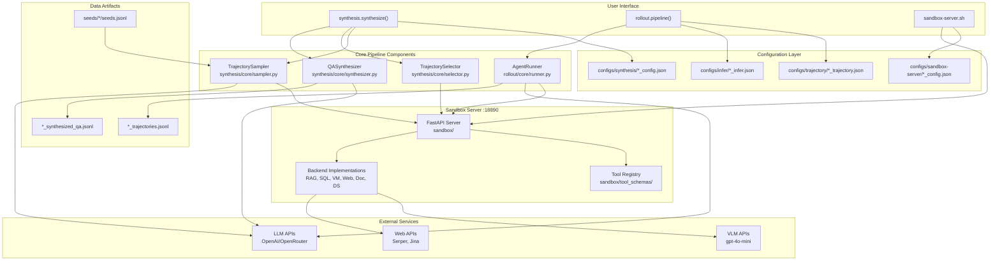
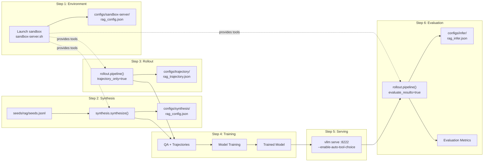

<!-- source: DeepWiki mcp.deepwiki.com · repo OpenDCAI/AgentFlow · page 1 Overview · fetched 2026-11-02 -->

# Overview

<details>
<summary>Relevant source files</summary>

The following files were used as context for generating this wiki page:

- [README.md](README.md)
- [README_zh.md](README_zh.md)
- [assets/intro.png](assets/intro.png)
- [assets/method.png](assets/method.png)
- [assets/wechat.jpg](assets/wechat.jpg)
- [assets/wechatshow.png](assets/wechatshow.png)

</details>


AgentFlow is a unified framework for synthesizing high-quality training and evaluation data for AI agents across heterogeneous environments. This document provides an overview of the framework's architecture, core components, and operational workflow.

**Scope**: This page covers the high-level architecture and key concepts of the AgentFlow system. For detailed setup instructions, see [Installation and Setup](#1.1). For a complete working example, see [Quick Start Tutorial](#1.2). For in-depth explanations of individual subsystems, refer to [Core Concepts](#2), [Sandbox Server](#3), and [Data Synthesis Pipeline](#4).

**Sources**: [README.md:18-46]()

## What is AgentFlow?

AgentFlow is the first unified agent data synthesis framework that generates training data and trajectories for AI agents operating in diverse environments. Unlike traditional approaches that require separate infrastructure for each agent type, AgentFlow provides a single, extensible platform that supports:

- 📚 **RAG Agents** - Retrieval-augmented generation with vector search
- 🖼️ **MM-Doc Agents** - Multimodal document understanding with VLMs
- 🔍 **Deep Research Agents** - Web search and browsing
- 🖱️ **GUI Agents** - Desktop automation via VM interaction
- 🟰 **Text2SQL Agents** - Natural language to SQL query conversion
- 📊 **Data Analysis Agents** - Python-based data science workflows
- 🤖 **Embodied Agents** - Physical environment interaction

The framework enables developers to synthesize agent training data with just a few lines of code, abstracting away the complexity of managing different execution environments, tool schemas, and data generation pipelines.

**Sources**: [README.md:20-46]()

## Key Features

### Unified Data Synthesis Paradigm

AgentFlow implements a **three-stage pipeline** that works consistently across all agent types:

1. **Trajectory Sampling**: An LLM-driven agent explores a sandbox environment starting from seed inputs, building a branching trajectory tree through iterative tool execution
2. **Trajectory Selection**: Trajectories are scored by depth, information richness, and tool diversity, then filtered to select high-quality paths
3. **QA Synthesis**: For each selected trajectory, multi-hop question-answer pairs are generated with built-in quality validation

This pipeline is implemented in the `synthesis` module and can be invoked via `synthesis.synthesize()` for the complete workflow.

**Sources**: [README.md:71-84]()

### All-in-One Sandbox Architecture

The sandbox server (launched via `sandbox-server.sh`) provides a unified execution environment that abstracts tool invocation across different backends:

- **Port**: `18890` (default)
- **Protocol**: HTTP/REST API
- **Session Management**: Stateful sessions for VM, database, and document resources
- **Tool Registry**: Centralized schema definitions in `sandbox/tool_schemas/`

Each agent type uses the same sandbox server with different tool configurations, enabling code reuse and consistent interfaces.

**Sources**: [README.md:55-59](), [README.md:107-112]()

### Agentic Model Consolidation

AgentFlow explores two strategies for building unified multi-domain models:

1. **Data-level consolidation** (`Agent-datamix`): Mix trajectories from all domains during joint training
2. **Parameter-level consolidation** (`Agent-RegMeanpp`): Train specialist models separately, then merge parameters using regularized averaging

According to benchmark results, data-level consolidation outperforms parameter-level merging (64.08% vs 60.19% on GAIA validation set).

**Sources**: [README.md:60-63](), [README.md:200-206]()

## System Architecture



**AgentFlow System Architecture**: This diagram shows the complete system architecture with actual code entities. The framework is organized into four layers: user-facing APIs, configuration files, core pipeline components, and the sandbox execution environment. All agent types interact with the same infrastructure, differing only in their configuration and tool selection.

**Sources**: [README.md:103-159](), High-level diagrams provided

## Configuration-Driven Design

AgentFlow uses a strict separation of configuration by operational purpose:

| Purpose | Directory | Example File | Used By |
|---------|-----------|--------------|---------|
| Sandbox Server Setup | `configs/sandbox-server/` | `web_config.json` | `sandbox-server.sh` |
| QA Synthesis | `configs/synthesis/` | `rag_config.json` | `synthesis.synthesize()` |
| Trajectory Generation | `configs/trajectory/` | `doc_trajectory.json` | `rollout.pipeline()` |
| Model Inference | `configs/infer/` | `web_infer.json` | `rollout.pipeline()` |

Within each category, configurations share common parameter semantics while allowing modality-specific customization. For example, all synthesis configs include `max_depth`, `branching_factor`, and `sampling_tips` parameters, but differ in their `available_tools` and `resource_types` settings.

Environment variables (e.g., `OPENAI_API_KEY`, `RAG_EMBEDDING_MODEL_PATH`) are used for credentials and machine-specific paths, referenced in configs using `${VAR_NAME}` syntax.

**Sources**: [README.md:151-159](), Configuration system diagram from high-level overview

## End-to-End Workflow



**Complete Workflow Pipeline**: This diagram shows the six-step process from environment setup to evaluation, with actual command-line tools and functions. The `rollout.pipeline()` function operates in two modes (trajectory generation vs. inference) distinguished only by configuration parameters.

**Sources**: [README.md:103-149](), End-to-end workflow diagram from high-level overview

## Tool Schema and Backend System

AgentFlow's modularity comes from its tool schema abstraction layer. Each agent type defines:

1. **Tool Schemas**: JSON specifications in `sandbox/tool_schemas/` defining tool names, descriptions, and parameters
2. **Backend Implementation**: Resource handlers that execute tool calls (e.g., `RAGBackend`, `VMBackend`, `DatabaseBackend`)
3. **Configuration**: Sandbox server configs specifying which tools to expose and their initialization parameters

The `get_tool_schemas()` and `get_tools_by_resource()` functions in `sandbox/tool_schemas/__init__.py` provide the registry interface. Tools are exposed via FastAPI endpoints at `http://localhost:18890`.

**Sources**: High-level tool schema diagram, [README.md:27-30]()

## Code Entry Points

The primary entry points for using AgentFlow are:

### Data Synthesis
```python
from synthesis import synthesize
synthesize(config_path="configs/synthesis/web_config.json")
```

This function orchestrates the three-stage pipeline: sampling trajectories via `TrajectorySampler`, selecting high-quality paths via `TrajectorySelector`, and generating QA pairs via `QASynthesizer`.

### Trajectory Rollout
```python
from rollout import pipeline
pipeline(config_path="configs/trajectory/web_trajectory.json")
```

When `trajectory_only=true` in config, this generates trajectories on benchmark data. The `AgentRunner` class in `rollout/core/runner.py` handles multi-turn agent execution.

### Model Inference
```python
from rollout import pipeline
pipeline(config_path="configs/infer/web_infer.json")
```

When `evaluate_results=true` in config, this runs inference with LLM-as-judge evaluation using the metrics specified in the configuration.

**Sources**: [README.md:115-149]()

## Data Outputs

AgentFlow produces several categories of data artifacts:

1. **Synthesized QA Pairs**: JSON Lines files containing question-answer pairs with grounding trajectories
2. **Agent Trajectories**: Complete execution traces including tool calls, observations, and reasoning steps
3. **Training Datasets**: Combined QA and trajectory data formatted for model training
4. **Benchmarks**: Human-annotated evaluation sets like BrowseComp-V3 and MMLongBench-Doc

These outputs enable both training new agent models and evaluating their capabilities across diverse tasks.

**Sources**: [README.md:161-197]()

## Model Family

The AgentFlow project has produced several pre-trained models demonstrating the framework's effectiveness:

| Agent Type | Model | Performance Highlights |
|------------|-------|----------------------|
| RAG | RAGShaper 6.5k | 50.3% EM / 62.0% F1 (avg across benchmarks) |
| MM-Doc | DocDancer (Qwen3-30B) | 54.4% acc on MMLongBench-Doc |
| Deep Research | DeepResearch Agent | 64.08% acc on GAIA |
| Multi-domain | Agent-datamix | Best overall consolidation (64.08% GAIA) |
| Multi-domain | Agent-RegMeanpp | Parameter merging baseline (60.19% GAIA) |

All models are available on HuggingFace under the OpenDCAI organization.

**Sources**: [README.md:161-181](), [README.md:200-267]()

## Next Steps

- For installation instructions, see [Installation and Setup](#1.1)
- For a hands-on walkthrough, see [Quick Start Tutorial](#1.2)
- To understand the core methodology, see [Three-Stage Data Synthesis Pipeline](#2.1)
- To learn about individual agent types, see [Agent Types and Modalities](#2.2)
- For detailed configuration reference, see [Configuration Reference](#8)

---

