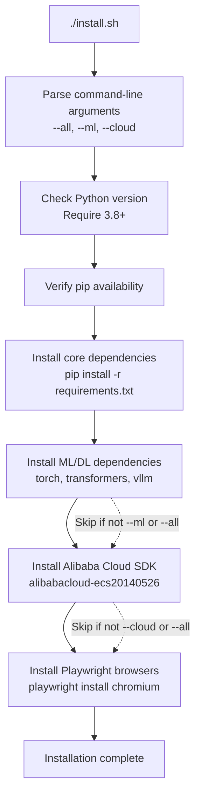
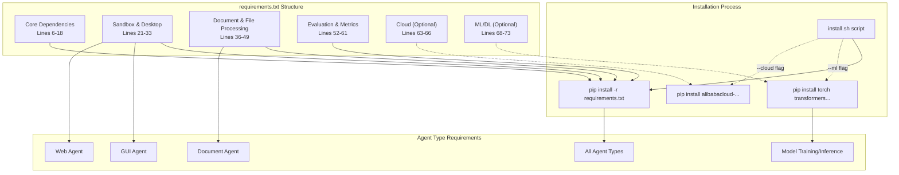
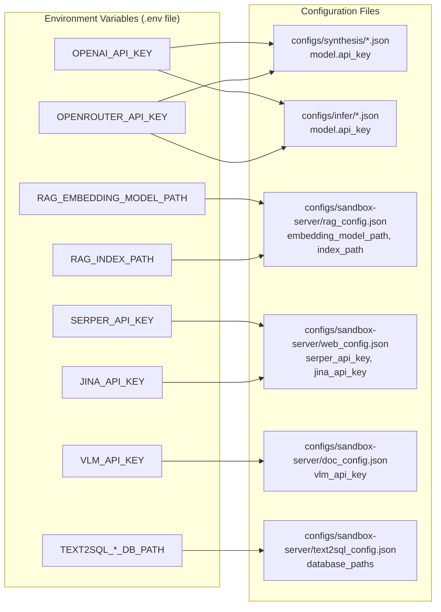

<!-- source: DeepWiki mcp.deepwiki.com · repo OpenDCAI/AgentFlow · page 1.1 Installation and Setup · fetched 2026-11-02 -->

# Installation and Setup

<details>
<summary>Relevant source files</summary>

The following files were used as context for generating this wiki page:

- [.gitignore](.gitignore)
- [install.sh](install.sh)
- [requirements.txt](requirements.txt)

</details>


This page guides you through installing AgentFlow and its dependencies, configuring the development environment, and verifying the installation. It covers both automated and manual installation methods, dependency management, and environment variable configuration.

For information about running your first workflow after installation, see [Quick Start Tutorial](#1.2). For details on configuring the sandbox server after installation, see [Server Configuration](#3.1).

---

## Prerequisites

AgentFlow requires Python 3.8 or higher and pip for package management. The framework has been tested on Linux and macOS systems.

**Required System Components:**
- Python 3.8+ (with pip)
- Git (for cloning the repository)
- Sufficient disk space for model files and databases (~10GB recommended)
- Network access for API calls and package downloads

**Optional System Components:**
- Docker (required only for GUI agent with VM backend)
- CUDA-compatible GPU (optional, for local model inference)

**Verify Python Installation:**
```bash
python3 --version  # Should show 3.8 or higher
python3 -m pip --version
```

**Sources:** [install.sh:9-28]()

---

## Installation Methods

### Method 1: Automated Installation Script

The `install.sh` script provides one-click installation with support for optional dependency groups.

#### Installation Flow Diagram



**Sources:** [install.sh:1-111]()

#### Basic Installation (Core Dependencies Only)

```bash
git clone https://github.com/OpenDCAI/AgentFlow.git
cd AgentFlow
./install.sh
```

This installs all core dependencies from [requirements.txt:1-78]() including:
- FastAPI and Pydantic for server components
- OpenAI SDK for LLM API access
- Playwright for web automation
- Document processing libraries (PyPDF2, pdfplumber, etc.)
- Evaluation metrics libraries (pandas, scipy, etc.)

**Sources:** [install.sh:70-74]()

#### Install with ML/DL Dependencies

For local model inference or training:

```bash
./install.sh --ml
```

This additionally installs:
- `torch>=2.6.0`
- `transformers>=4.51.1`
- `accelerate>=1.5.1`
- `torchvision`
- `vllm>=0.10.0` (commented in requirements.txt, installed by script)

**Sources:** [install.sh:76-85](), [requirements.txt:68-73]()

#### Install All Dependencies

```bash
./install.sh --all
```

This installs core, ML/DL, and Alibaba Cloud dependencies.

**Sources:** [install.sh:51-53]()

### Method 2: Manual Installation

If you prefer manual control or need to customize the installation:

```bash
# 1. Clone repository
git clone https://github.com/OpenDCAI/AgentFlow.git
cd AgentFlow

# 2. Create virtual environment (recommended)
python3 -m venv venv
source venv/bin/activate  # On Windows: venv\Scripts\activate

# 3. Install core dependencies
pip install -r requirements.txt

# 4. (Optional) Install ML/DL dependencies
pip install "torch>=2.6.0" "transformers>=4.51.1" "accelerate>=1.5.1" torchvision

# 5. Install Playwright browsers
playwright install chromium
```

**Sources:** [install.sh:73](), [requirements.txt:1-78]()

---

## Dependency Categories

The following table maps dependency groups to their purposes and corresponding agent types:

| Category | Key Packages | Required For | requirements.txt Lines |
|----------|-------------|--------------|----------------------|
| **Core** | `requests`, `fastapi`, `pydantic`, `openai`, `httpx` | All components | [requirements.txt:6-18]() |
| **Sandbox & Desktop** | `playwright`, `PyAutoGUI`, `docker`, `opencv-python` | GUI Agent, Web Agent | [requirements.txt:21-33]() |
| **Document Processing** | `pypdf`, `PyPDF2`, `pdfplumber`, `PyMuPDF`, `python-docx` | Document Agent | [requirements.txt:36-49]() |
| **Evaluation** | `pandas`, `scipy`, `rapidfuzz`, `imagehash` | All agents (metrics) | [requirements.txt:52-61]() |
| **ML/DL (Optional)** | `torch`, `transformers`, `vllm`, `accelerate` | Model training/inference | [requirements.txt:68-73]() |
| **Cloud (Optional)** | `alibabacloud-ecs20140526` | Alibaba Cloud deployments | [requirements.txt:63-66]() |

### Dependency Resolution Diagram



**Sources:** [requirements.txt:1-78](), [install.sh:70-96]()

---

## Environment Configuration

AgentFlow uses environment variables for API keys, model paths, and database locations. These variables are referenced in configuration files using `${VARIABLE_NAME}` syntax.

### Required Environment Variables

Create a `.env` file in the project root (this file is gitignored per [.gitignore:43-46]()):

```bash
# LLM API Keys
OPENAI_API_KEY=sk-...
OPENROUTER_API_KEY=sk-...

# Web Search APIs (for Web Agent)
SERPER_API_KEY=...
JINA_API_KEY=...

# Vision Language Model API (for Document Agent)
VLM_API_KEY=...
```

### Optional Environment Variables

```bash
# RAG Agent - Embedding Model and Index Paths
RAG_EMBEDDING_MODEL_PATH=/path/to/embedding_model
RAG_INDEX_PATH=/path/to/faiss_index

# Text2SQL Agent - Database Paths
TEXT2SQL_FINANCE_DB_PATH=/path/to/finance.db
TEXT2SQL_RETAIL_DB_PATH=/path/to/retail.db
TEXT2SQL_HEALTHCARE_DB_PATH=/path/to/healthcare.db
TEXT2SQL_EDUCATION_DB_PATH=/path/to/education.db
TEXT2SQL_ECOMMERCE_DB_PATH=/path/to/ecommerce.db
TEXT2SQL_SPORTS_DB_PATH=/path/to/sports.db
TEXT2SQL_ENTERTAINMENT_DB_PATH=/path/to/entertainment.db

# vLLM Server Configuration (for model deployment)
VLLM_API_BASE=http://localhost:8222/v1
VLLM_API_KEY=EMPTY
```

### Environment Variable to Configuration Mapping



**Sources:** Configuration schema references from Diagram 4 in high-level system architecture

### Loading Environment Variables

AgentFlow automatically loads `.env` files using the `python-dotenv` package ([requirements.txt:17]()):

```python
# Automatically loaded by configuration modules
from dotenv import load_dotenv
load_dotenv()
```

Configuration files reference these variables using placeholder syntax:
```json
{
  "model": {
    "api_key": "${OPENAI_API_KEY}"
  }
}
```

**Sources:** [requirements.txt:17](), [.gitignore:43-46]()

---

## Agent-Specific Setup Requirements

Different agent types require additional setup beyond core installation:

### RAG Agent

**Additional Requirements:**
- Embedding model (e.g., `intfloat/e5-base-v2`)
- Faiss index for vector search
- Knowledge base documents

**Setup:**
```bash
# Download embedding model
mkdir -p embeddingmodel  # This directory is gitignored
# Place your embedding model files here

# Set environment variables
export RAG_EMBEDDING_MODEL_PATH=/path/to/embeddingmodel
export RAG_INDEX_PATH=/path/to/faiss_index
```

**Sources:** [.gitignore:1-2](), RAG Agent documentation from Diagram 3

### Document Agent

**Additional Requirements:**
- Vision Language Model API access (e.g., GPT-4o-mini)
- PDF processing libraries (already in core dependencies)

**Setup:**
```bash
export VLM_API_KEY=your_vlm_api_key
```

**Sources:** [requirements.txt:36-49]()

### Web Agent

**Additional Requirements:**
- Serper API key (for Google search)
- Jina API key (for web scraping)
- Playwright browsers

**Setup:**
```bash
export SERPER_API_KEY=your_serper_key
export JINA_API_KEY=your_jina_key
playwright install chromium  # Already done by install.sh
```

**Sources:** [install.sh:100-101](), [requirements.txt:21]()

### GUI Agent

**Additional Requirements:**
- Docker installed and running
- Ubuntu desktop VM image (Docker container)

**Setup:**
```bash
# Verify Docker is running
docker ps

# The VM image will be pulled automatically when starting the sandbox server
```

**Sources:** [requirements.txt:33](), Diagram 3 GUI Agent section

### Text2SQL Agent

**Additional Requirements:**
- SQLite database files (7 domain-specific databases)

**Setup:**
```bash
# Create sql directory (gitignored)
mkdir -p sql

# Place your .db files in sql/ directory
# Set environment variables for each database
export TEXT2SQL_FINANCE_DB_PATH=./sql/finance.db
export TEXT2SQL_RETAIL_DB_PATH=./sql/retail.db
# ... (additional databases)
```

**Sources:** [.gitignore:92-93]()

### Data Science Agent

**Additional Requirements:**
- Python scientific stack (already in core dependencies)

**Setup:**
No additional setup required. Dependencies include:
- `pandas`
- `numpy`
- `scipy`
- `scikit-image`

**Sources:** [requirements.txt:52-60]()

---

## Post-Installation Verification

### Verify Core Installation

Check that all core packages are installed:

```bash
python3 -c "import fastapi, openai, playwright, pandas; print('Core packages OK')"
```

### Verify Optional ML/DL Installation

If you installed ML dependencies:

```bash
python3 -c "import torch, transformers, accelerate; print(f'PyTorch {torch.__version__}, Transformers {transformers.__version__}')"
```

### Test Sandbox Server Startup

The sandbox server is the core execution environment for all agents. Test basic startup:

```bash
# This command will be covered in detail in section 3.1
python3 -m sandbox.server --help
```

You should see help text describing server options including `--config`, `--port`, and `--host` flags.

### Verify Playwright Installation

```bash
playwright --version
python3 -c "from playwright.sync_api import sync_playwright; print('Playwright OK')"
```

### Directory Structure Verification

After installation, verify the expected directory structure:

```
AgentFlow/
├── configs/               # Configuration files
│   ├── sandbox-server/    # Sandbox server configs
│   ├── synthesis/         # Data synthesis configs
│   ├── trajectory/        # Trajectory rollout configs
│   └── infer/             # Inference configs
├── sandbox/               # Sandbox server implementation
│   ├── tool_schemas/      # Tool schema definitions
│   └── server.py          # FastAPI server
├── synthesis/             # Data synthesis pipeline
├── rollout/               # Trajectory rollout and inference
├── seeds/                 # Seed data for synthesis
├── requirements.txt       # Core dependencies
├── install.sh             # Installation script
└── .env                   # Environment variables (create this)
```

**Sources:** [.gitignore:1-93](), Diagram 2 from high-level system architecture

---

## Common Installation Issues

### Issue: Playwright Browser Installation Fails

**Symptom:**
```
[WARN] Playwright browser install failed
```

**Solution:**
```bash
# Install browsers manually
python3 -m playwright install chromium

# On Linux, you may need system dependencies
python3 -m playwright install-deps chromium
```

**Sources:** [install.sh:100-101]()

### Issue: PyAutoGUI ImportError on Linux

**Symptom:**
```
ImportError: No module named 'Xlib'
```

**Solution:**
```bash
# Install system dependencies
sudo apt-get install python3-xlib  # Ubuntu/Debian
# or
pip install python3-xlib==0.15
```

**Sources:** [requirements.txt:24]()

### Issue: PDF Processing Errors

**Symptom:**
```
ImportError: cannot import name 'Image' from 'PIL'
```

**Solution:**
```bash
# Reinstall Pillow with correct version
pip install --force-reinstall Pillow==10.1.0
```

**Sources:** [requirements.txt:25]()

### Issue: Large Model Files Fill Disk

**Symptom:** Disk space exhausted during model download

**Solution:**
The `.gitignore` file excludes large model files. Store models outside the repository:

```bash
# Model files are automatically gitignored
# Store in a separate location and reference via environment variables
mkdir ~/agentflow-models
export RAG_EMBEDDING_MODEL_PATH=~/agentflow-models/embedding
```

**Sources:** [.gitignore:1-2](), [.gitignore:70-77]()

---

## Installation Verification Checklist

Use this checklist to ensure a complete installation:

- [ ] Python 3.8+ installed and accessible
- [ ] Core dependencies installed (`pip list | grep fastapi`)
- [ ] Playwright browsers installed (`playwright --version`)
- [ ] `.env` file created with required API keys
- [ ] Environment variables loadable (`python -c "from dotenv import load_dotenv; load_dotenv()"`)
- [ ] Agent-specific requirements met (e.g., Docker for GUI agent)
- [ ] No errors when importing core packages
- [ ] Sandbox server help text displays correctly

---

## Next Steps

After completing installation:

1. **Configure the Sandbox Server**: See [Server Configuration](#3.1) for details on setting up the sandbox server for your chosen agent type.

2. **Run the Quick Start Tutorial**: Follow [Quick Start Tutorial](#1.2) for a complete end-to-end example using the Web Agent.

3. **Explore Agent Examples**: Review [Agent Examples](#6) for detailed workflows for each agent type.

4. **Understand Core Concepts**: Read [Core Concepts](#2) to understand the three-stage pipeline and tool abstraction system.

**Sources:** Overall AgentFlow documentation structure from TOC and high-level diagrams

---

