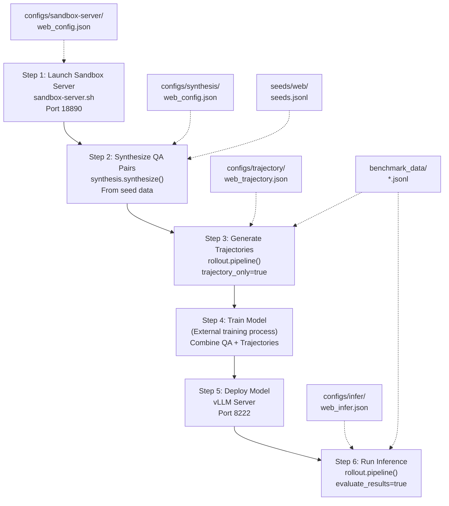
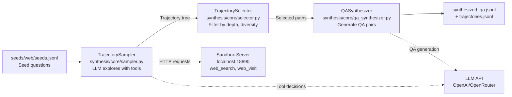
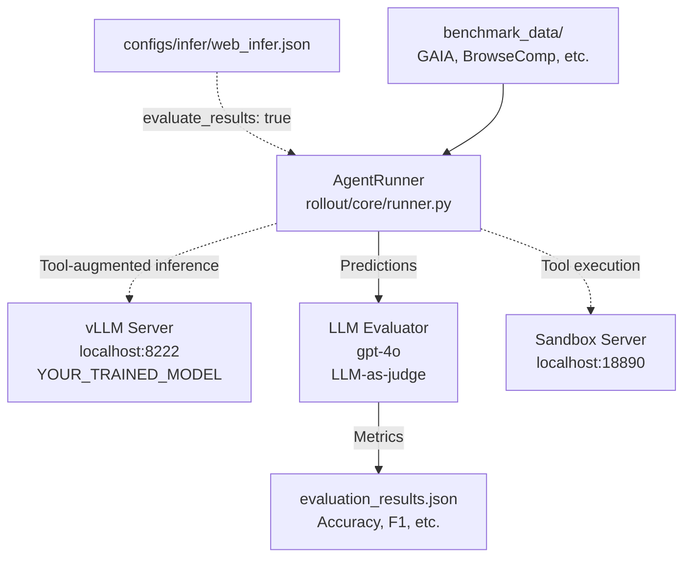
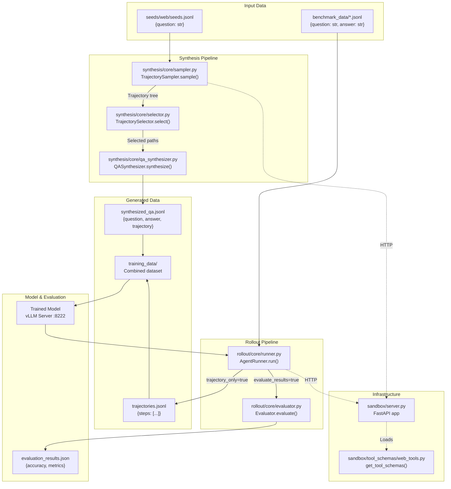

<!-- source: DeepWiki mcp.deepwiki.com · repo OpenDCAI/AgentFlow · page 1.2 Quick Start Tutorial · fetched 2026-11-02 -->

# Quick Start Tutorial

<details>
<summary>Relevant source files</summary>

The following files were used as context for generating this wiki page:

- [README.md](README.md)
- [README_zh.md](README_zh.md)
- [assets/intro.png](assets/intro.png)
- [assets/method.png](assets/method.png)
- [assets/wechat.jpg](assets/wechat.jpg)
- [assets/wechatshow.png](assets/wechatshow.png)
- [configs/infer/web_infer.json](configs/infer/web_infer.json)
- [examples/WebAgent.md](examples/WebAgent.md)

</details>


This tutorial provides a complete end-to-end walkthrough of AgentFlow using the **WebAgent (Deep Research)** as an example. You will learn how to synthesize training data, train a model, and run inference on benchmarks.

**Scope**: This guide covers the basic workflow from sandbox setup to model evaluation. For installation instructions, see [Installation and Setup](#1.1). For detailed WebAgent-specific features and advanced configurations, see [Web Agent](#6.3). For comprehensive configuration reference, see [Configuration Reference](#8).

---

## Prerequisites

Before starting this tutorial, ensure you have:

1. **Completed installation** (see [Installation and Setup](#1.1))
2. **API keys** configured as environment variables:
   - `OPENAI_API_KEY` or `OPENROUTER_API_KEY` (for LLM calls)
   - `SERPER_API_KEY` (for web search)
   - `JINA_API_KEY` (for web content extraction)
3. **Python environment** activated with AgentFlow dependencies installed

**Sources:** [README.md:85-101]()

---

## Workflow Overview

The AgentFlow pipeline consists of six sequential steps:



**Sources:** [README.md:103-149](), Diagram 2 from high-level architecture

---

## Step 1: Launch Sandbox Server

The sandbox server provides a unified tool execution environment. For WebAgent, it exposes `web_search` and `web_visit` tools via a FastAPI HTTP server.

### Command

```bash
./sandbox-server.sh \
    --config configs/sandbox-server/web_config.json \
    --port 18890 \
    --host 0.0.0.0
```

### What Happens

1. The script reads [configs/sandbox-server/web_config.json]()
2. Initializes `WebBackend` with Serper and Jina API clients
3. Registers tool schemas from [sandbox/tool_schemas/web_tools.py]()
4. Starts FastAPI server at `http://localhost:18890`

### Configuration Parameters

| Parameter | Description | Example Value |
|-----------|-------------|---------------|
| `server.url` | Base URL for sandbox | `"http://localhost"` |
| `server.port` | Port number | `18890` |
| `session_ttl` | Session timeout (seconds) | `3600` |
| `resource_types` | Enabled resource types | `["web"]` |
| `SERPER_API_KEY` | Web search API key | `"${SERPER_API_KEY}"` |
| `JINA_API_KEY` | Content extraction API key | `"${JINA_API_KEY}"` |

### Verification

Test the server is running:

```bash
curl http://localhost:18890/health
# Expected: {"status": "ok"}
```

**Sources:** [README.md:107-113](), [configs/sandbox-server/](), [sandbox/tool_schemas/web_tools.py]()

---

## Step 2: Synthesize QA Pairs

The synthesis stage generates multi-hop question-answer pairs by having an LLM explore the sandbox environment starting from seed inputs.

### Command

```python
from synthesis import synthesize

synthesize(config_path="configs/synthesis/web_config.json")
```

### What Happens

The `synthesize()` function executes the three-stage pipeline:



### Key Configuration Parameters

| Parameter | Description | Default Value |
|-----------|-------------|---------------|
| `model_name` | LLM for trajectory sampling | `"gpt-4o-2024-11-20"` |
| `max_depth` | Maximum trajectory depth | `10` |
| `branching_factor` | Exploration branches per step | `3` |
| `min_depth` | Minimum depth for selection | `3` |
| `num_parallel_workers` | Concurrent workers | `5` |
| `output_dir` | Directory for outputs | `"outputs/web_synthesis"` |

### Example Output

**synthesized_qa.jsonl:**
```json
{
  "question": "What year was the company founded that now owns the social media platform where the most-followed sports team posts?",
  "answer": "2004",
  "trajectory": [...],
  "metadata": {...}
}
```

**Sources:** [README.md:77-83](), [README.md:115-121](), [synthesis/core/](), Diagram 5 from high-level architecture

---

## Step 3: Generate Trajectories

The rollout stage executes the agent on benchmark datasets to generate training trajectories without evaluation.

### Command

```python
from rollout import pipeline

pipeline(config_path="configs/trajectory/web_trajectory.json")
```

### What Happens

1. `AgentRunner` from [rollout/core/runner.py]() loads benchmark data
2. For each question, runs multi-turn conversation with tool execution
3. Records complete trajectories (observations, actions, tool calls)
4. Saves to trajectory files without computing metrics

### Configuration Differences from Synthesis

| Parameter | Synthesis Config | Trajectory Config |
|-----------|------------------|-------------------|
| Purpose | Generate new QA pairs | Generate trajectories from existing QA |
| Input | `seeds.jsonl` | Benchmark datasets |
| `trajectory_only` | `false` | `true` |
| `evaluate_results` | N/A | `false` |

### Example Trajectory Structure

```json
{
  "question": "What is the capital of the country where the Eiffel Tower is located?",
  "steps": [
    {
      "thought": "I need to search for information about the Eiffel Tower",
      "tool_name": "web_search",
      "tool_input": {"query": ["Eiffel Tower location"]},
      "observation": "The Eiffel Tower is located in Paris, France..."
    },
    {
      "thought": "Now I know it's in France, I need the capital",
      "tool_name": "web_search", 
      "tool_input": {"query": ["capital of France"]},
      "observation": "Paris is the capital and most populous city of France..."
    }
  ],
  "answer": "Paris"
}
```

**Sources:** [README.md:123-129](), [rollout/core/runner.py](), [configs/trajectory/]()

---

## Step 4: Train and Deploy Model

After generating both QA pairs (Step 2) and trajectories (Step 3), combine them into a training dataset and train your model. AgentFlow does not prescribe a specific training framework.

### Data Preparation

Combine outputs from Steps 2 and 3:

```bash
# Concatenate all synthesized data
cat outputs/web_synthesis/synthesized_qa.jsonl \
    outputs/web_trajectory/trajectories.jsonl \
    > training_data/web_agent_combined.jsonl
```

### Training

Use your preferred training framework (e.g., transformers, DeepSpeed). The key is formatting data to teach tool-use patterns.

### Model Deployment with vLLM

Once trained, deploy the model with tool-calling support:

```bash
vllm serve \
    --model YOUR_TRAINED_MODEL \
    --served-model-name webagent \
    --tensor-parallel-size 8 \
    --enable-auto-tool-choice \
    --tool-call-parser hermes \
    --port 8222
```

### Critical Parameters

| Parameter | Purpose |
|-----------|---------|
| `--enable-auto-tool-choice` | Enables tool calling functionality |
| `--tool-call-parser hermes` | Specifies tool format parser |
| `--port 8222` | Inference endpoint port |

**Sources:** [README.md:131-141]()

---

## Step 5: Run Inference and Evaluation

The final step evaluates your trained model on benchmark datasets using LLM-as-judge.

### Command

```python
from rollout import pipeline

pipeline(config_path="configs/infer/web_infer.json")
```

### Configuration for Inference



### Key Configuration Parameters

| Parameter | Description | Example Value |
|-----------|-------------|---------------|
| `evaluate_results` | Enable evaluation | `true` |
| `evaluation_metric` | Metric to compute | `"accuracy"` |
| `evaluator_model` | LLM judge model | `"gpt-4o-2024-11-20"` |
| `model_endpoint` | Inference endpoint | `"http://localhost:8222/v1"` |
| `benchmark_path` | Test dataset path | `"benchmark_data/gaia_validation.jsonl"` |

### Example Evaluation Output

```json
{
  "accuracy": 0.6408,
  "num_samples": 165,
  "num_correct": 106,
  "avg_steps": 4.2,
  "per_question_results": [...]
}
```

**Sources:** [README.md:143-149](), [configs/infer/](), [rollout/core/runner.py]()

---

## Understanding Data Flow

This diagram shows how data flows through the system and which code entities handle each transformation:



**Sources:** Diagram 1, 2, and 5 from high-level architecture

---

## Next Steps

After completing this tutorial, you can:

1. **Explore other agent types**: Try [RAG Agent](#6.1), [Document Agent](#6.2), [Text2SQL Agent](#6.4), etc.
2. **Customize configurations**: See [Synthesis Config Schema](#8.2), [Inference Config Schema](#8.4)
3. **Add new tools**: Learn how to extend the framework in [Extending Tool Schemas](#9.3)
4. **Train consolidated models**: Explore [Agentic Model Consolidation](#2.4) strategies
5. **Deep dive into components**: 
   - [Three-Stage Data Synthesis Pipeline](#2.1)
   - [Sandbox Server](#3)
   - [Rollout and Inference](#5)

**Sources:** Table of contents structure

---

