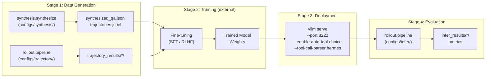
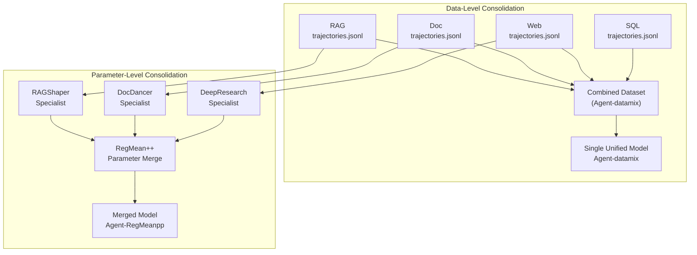
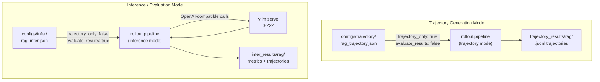

<!-- source: DeepWiki mcp.deepwiki.com · repo OpenDCAI/AgentFlow · page 10 Model Training and Deployment · fetched 2026-11-02 -->

# Model Training and Deployment

<details>
<summary>Relevant source files</summary>

The following files were used as context for generating this wiki page:

- [README.md](README.md)
- [README_zh.md](README_zh.md)
- [assets/intro.png](assets/intro.png)
- [assets/method.png](assets/method.png)
- [assets/wechat.jpg](assets/wechat.jpg)
- [assets/wechatshow.png](assets/wechatshow.png)
- [configs/infer/rag_infer.json](configs/infer/rag_infer.json)
- [configs/trajectory/rag_trajectory.json](configs/trajectory/rag_trajectory.json)
- [examples/RAGAgent.md](examples/RAGAgent.md)
- [seeds/rag/seeds.jsonl](seeds/rag/seeds.jsonl)

</details>


This page covers how synthesized data is assembled for training, how trained models are deployed using vLLM, and the available pre-trained models in the AgentFlow model family. The actual training loop is external to this repository — AgentFlow provides the data generation pipeline and the deployment and evaluation infrastructure that surrounds it.

For generating the raw data that feeds into training, see [Data Synthesis Pipeline](#4) and [Rollout and Inference](#5). For evaluation benchmark details, see [Benchmarks](#7).

---

## End-to-End Workflow

The path from raw data to a running evaluated model involves four distinct stages. AgentFlow owns stages 1, 3, and 4; stage 2 uses any standard fine-tuning framework.

**Figure: Training and Deployment Lifecycle**



Sources: [README.md:131-149](), [configs/trajectory/rag_trajectory.json:1-39](), [configs/infer/rag_infer.json:1-46]()

---

## 10.1 Preparing Training Data

### Output Files from the Synthesis Pipeline

Running `synthesis.synthesize` (with a config from `configs/synthesis/`) produces a pair of output files per agent domain:

| File | Content | Used For |
|---|---|---|
| `synthesized_qa.jsonl` | Multi-hop QA pairs with ground-truth answers | Supervised fine-tuning question/answer pairs |
| `trajectories.jsonl` | Full agent trajectories (tool calls + observations) | Trajectory-level SFT / imitation learning |

Running `rollout.pipeline` with a trajectory config (e.g. `configs/trajectory/rag_trajectory.json`) writes trajectory rollouts to the directory specified by `output_dir`. For the RAG example this is `trajectory_results/rag/`.

The key flag that distinguishes a trajectory-generation run from an evaluation run is `trajectory_only: true` in the config.

```json
// configs/trajectory/rag_trajectory.json (key fields)
{
  "output_dir": "trajectory_results/rag",
  "save_results": true,
  "save_trajectories": true,
  "trajectory_only": true,
  "evaluate_results": false
}
```

Sources: [configs/trajectory/rag_trajectory.json:32-38]()

### Data-Level vs. Parameter-Level Consolidation

AgentFlow supports two strategies for building a multi-domain capable model from domain-specific datasets.

**Figure: Consolidation Strategy Paths**



Sources: [README.md:62-63](), [README.md:202-205]()

**Benchmark comparison (Qwen3-30B-A3B-Think base):**

| Strategy | Method | GAIA Acc. | BC Acc. | BC-zh Acc. | MMLongBench-Doc | DocBench |
|---|---|---|---|---|---|---|
| Data-level | Data Mixing | **64.08** | **28.00** | **34.00** | 63.59 | **83.29** |
| Parameter-level | RegMean++ | 60.19 | 22.50 | 28.00 | **64.66** | 80.76 |

Data-level mixing outperforms parameter-level merging on most web and document benchmarks, while RegMean++ shows stronger RAG-specific results (see [README.md:202-205]()).

Sources: [README.md:199-205]()

---

## 10.2 Model Deployment with vLLM

Trained models must be served through vLLM with specific flags to support the tool-call protocol expected by `rollout.pipeline`.

### Required vLLM Flags

```bash
vllm serve \
    --model YOUR_TRAINED_MODEL \
    --served-model-name webagent \
    --tensor-parallel-size 8 \
    --enable-auto-tool-choice \
    --tool-call-parser hermes \
    --port 8222
```

| Flag | Purpose |
|---|---|
| `--enable-auto-tool-choice` | Enables automatic tool-call decision-making by the model |
| `--tool-call-parser hermes` | Parses tool calls using the Hermes format expected by the agent framework |
| `--tensor-parallel-size 8` | Distributes model shards across 8 GPUs; adjust to available hardware |
| `--port 8222` | The default port referenced by inference configs |
| `--served-model-name` | The `model_name` value to reference in the inference config |

Sources: [README.md:133-141]()

### Pointing an Inference Config at vLLM

Once vLLM is running, update the inference config to reference it. Below is the structure for `configs/infer/rag_infer.json`:

```
model_name    →  value of --served-model-name in vllm serve
base_url      →  http://<host>:8222/v1
api_key       →  empty string or any token (vLLM does not validate by default)
```

The config also specifies a separate evaluator model (an LLM-as-judge) for scoring agent responses:

| Config Field | Role |
|---|---|
| `model_name` | The deployed agent model (served by vLLM) |
| `base_url` | OpenAI-compatible vLLM endpoint URL |
| `evaluator_model_name` | LLM used to judge response correctness |
| `evaluator_base_url` | Endpoint for the evaluator model |
| `evaluate_results` | Must be `true` for evaluation mode |
| `evaluation_metric` | e.g. `"f1_score"` |

Sources: [configs/infer/rag_infer.json:1-46]()

### Running Inference

After vLLM is up and the inference config is updated, run:

```python
from rollout import pipeline

pipeline(config_path="configs/infer/rag_infer.json")
```

Results are written to the directory specified by `output_dir` in the config (e.g. `infer_results/rag/`).

**Figure: rollout.pipeline Modes Mapped to Config Fields**



Sources: [configs/trajectory/rag_trajectory.json:26-38](), [configs/infer/rag_infer.json:28-44](), [README.md:143-149]()

---

## 10.3 Model Family and Pre-trained Models

The AgentFlow project has released a family of fine-tuned models on HuggingFace, all based on **Qwen3-30B-A3B-Think** unless otherwise noted.

### Available Models

| Agent Domain | Model Name | HuggingFace ID | Consolidation |
|---|---|---|---|
| RAG | RAGShaper | `OpenDCAI/AgentFlow-Qwen3-30B-A3B-Think-RAGShaper` | Domain-specific |
| MM-Doc | DocDancer | `OpenDCAI/AgentFlow-Qwen3-30B-A3B-Think-DocDancer` | Domain-specific |
| Deep Research (Web) | DeepResearch Agent | `OpenDCAI/AgentFlow-Qwen3-30B-A3B-Think-Web` | Domain-specific |
| General (data mix) | Agent-datamix | `OpenDCAI/AgentFlow-Qwen3-30B-A3B-Think-DataMix` | Data-level |
| General (RegMean++) | Agent-RegMeanpp | `OpenDCAI/AgentFlow-Qwen3-30B-A3B-Think-RegMeanpp` | Parameter-level |

DocDancer is also available as a smaller variant: `Qwen3-4B (ft)`, which achieves 48.4% on MMLongBench-Doc vs. 54.4% for the 30B variant.

Sources: [README.md:172-181]()

### Model Capability Summary

**RAGShaper** (trained on 6.5k examples):

| Benchmark | EM | F1 |
|---|---|---|
| Bamboogle | 60.0 | 72.6 |
| PopQA | 38.9 | 49.6 |
| NQ | 41.3 | 54.8 |
| AmbigQA | 61.1 | 71.1 |
| **Average** | **50.3** | **62.0** |

Compared to prior best (HL-Data 4.5k) at Avg EM 42.3 / F1 58.0.

**DocDancer** (Qwen3-30B-A3B-Think):

| Benchmark | Acc / F1 | LasJ |
|---|---|---|
| MMLongBench-Doc | 54.4 / 53.9 | 65.3 |
| DocBench | — | 81.2 |

Sources: [README.md:209-256]()

### Associated Datasets

The following synthesized training datasets are also published on HuggingFace:

| Agent Domain | Dataset |
|---|---|
| MM-Doc | `OpenDCAI/AgentFlow-Qwen3-30B-A3B-Think-DocDancer` |
| RAG | `OpenDCAI/AgentFlow-Qwen3-30B-A3B-Think-RAGShaper` |
| Deep Research | `OpenDCAI/AgentFlow-Qwen3-30B-A3B-Think-Web` |

Sources: [README.md:182-188]()

### Associated Papers

| Model | Paper |
|---|---|
| DocDancer | *DocDancer: Towards Agentic Document-Grounded Information Seeking* (arXiv 2601.05163) |
| RAGShaper | *RAGShaper: Eliciting Sophisticated Agentic RAG Skills via Automated Data Synthesis* (arXiv 2601.08699) |
| Agent-datamix / Agent-RegMeanpp | *Exploring Information Seeking Agent Consolidation* (arXiv 2602.00585) |

Sources: [README.md:164-169]()

---

