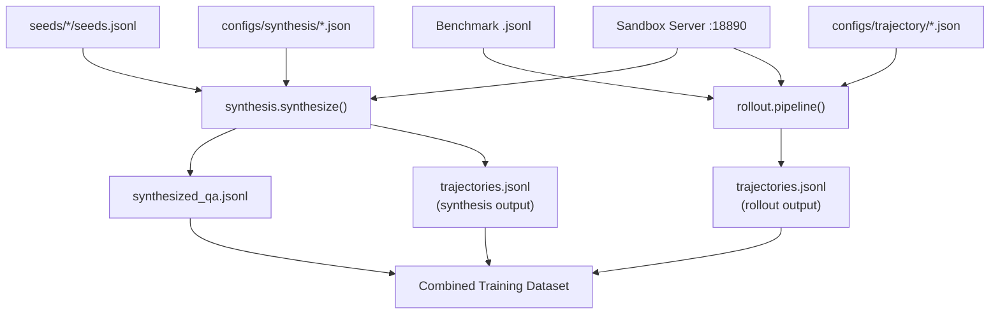
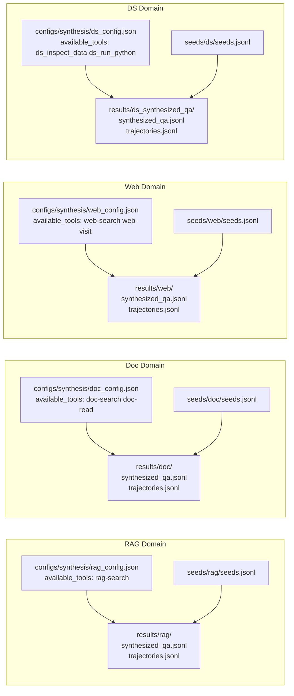
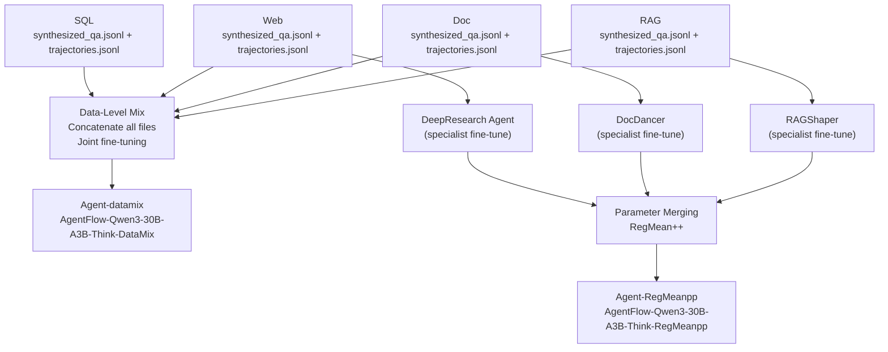

<!-- source: DeepWiki mcp.deepwiki.com · repo OpenDCAI/AgentFlow · page 10.1 Preparing Training Data · fetched 2026-11-02 -->

# Preparing Training Data

<details>
<summary>Relevant source files</summary>

The following files were used as context for generating this wiki page:

- [README.md](README.md)
- [README_zh.md](README_zh.md)
- [assets/intro.png](assets/intro.png)
- [assets/method.png](assets/method.png)
- [assets/wechat.jpg](assets/wechat.jpg)
- [assets/wechatshow.png](assets/wechatshow.png)
- [configs/synthesis/doc_ds_config.json](configs/synthesis/doc_ds_config.json)
- [configs/synthesis/ds_config.json](configs/synthesis/ds_config.json)
- [sandbox/tool_schemas/ds_tools.py](sandbox/tool_schemas/ds_tools.py)
- [synthesis/pipeline.py](synthesis/pipeline.py)

</details>


This page covers how to collect, format, and combine the output files produced by AgentFlow's synthesis and rollout pipelines into datasets ready for model training. It focuses on the data files themselves and how to assemble them — including single-domain and multi-domain strategies.

For details on running the synthesis pipeline, see [Data Synthesis Pipeline](#4). For the rollout pipeline, see [Rollout and Inference](#5). For deploying a trained model, see [Model Deployment with vLLM](#10.2).

---

## Overview

AgentFlow generates training data through two independent processes that each produce output files on disk:

1. **Synthesis pipeline** (`synthesis.synthesize`) — produces `synthesized_qa.jsonl` (QA pairs) and `trajectories.jsonl` (agent trajectories) from seed data.
2. **Rollout pipeline** (`rollout.pipeline` with a trajectory config) — produces `trajectories.jsonl` from benchmark data by running the agent against real questions.

Both file types are used as training signal. QA pairs train the model to produce correct answers; trajectories train it on the correct multi-turn tool-use patterns.

The actual model training step happens outside the AgentFlow codebase — AgentFlow's role is strictly data production. The README describes the workflow as [README.md:131-141]():

```
Step 3: Synthesize trajectories with rollout.pipeline
Step 4: After training the model, serve it with vLLM
```

---

## Data Sources

**Diagram: How pipeline runs map to output files**



Sources: [README.md:115-129](), [synthesis/pipeline.py:59-65]()

---

### Synthesis Pipeline Output

The `SynthesisPipeline` class in [synthesis/pipeline.py:39-64]() initializes two output file paths:

- `self.qa_file_path` → `synthesized_qa.jsonl`
- `self.traj_file_path` → `trajectories.jsonl`

For the DS modality, the output directory is hardcoded to `results/ds_synthesized_qa/` [synthesis/pipeline.py:44-47](). Other modality synthesis configs specify `output_dir` in their respective config files (e.g., `"output_dir": "results"` in [configs/synthesis/ds_config.json:51]()).

The pipeline uses three components in sequence to produce these files:

| Component | Class | Role |
|---|---|---|
| Sampling | `TrajectorySampler` | LLM explores sandbox, builds trajectory tree |
| Selection | `TrajectorySelector` | Scores and filters trajectories by depth and diversity |
| Synthesis | `QASynthesizer` | Generates `(question, answer)` pairs from selected trajectories |

Sources: [synthesis/pipeline.py:91-93]()

---

### Rollout Pipeline Output

Running `rollout.pipeline` with a trajectory config (e.g., `configs/trajectory/web_trajectory.json`) executes the agent against benchmark questions and records the resulting turns. This is distinct from the synthesis pipeline: there are no seeds, and no QA synthesis step. The output is trajectories only.

Trajectory configs share these key flags [README.md:107-112]():

| Parameter | Value | Effect |
|---|---|---|
| `trajectory_only` | `true` | Skip evaluation, save trajectories |
| `evaluate_results` | `false` | Do not score answers |

The same `rollout.pipeline` function is used for inference evaluation, but with `evaluate_results: true` instead.

Sources: [README.md:123-129]()

---

## Output File Formats

Both output files use newline-delimited JSON (JSONL): one record per line.

### `synthesized_qa.jsonl`

Each record contains a synthesized QA pair grounded in a trajectory. The `QASynthesizer` component is responsible for generating these. Based on the synthesis config examples in [configs/synthesis/ds_config.json:34-47](), each record contains at minimum:

| Field | Description |
|---|---|
| `question` | Multi-hop factoid question grounded in observed tool outputs |
| `answer` | Expected answer, often a specific value or structured response |

QA examples in configs illustrate the intended format [configs/synthesis/ds_config.json:34-47]():

```json
{
  "question": "Join orders.csv with products.csv on product_id. What is the total revenue...",
  "answer": "10734"
}
```

### `trajectories.jsonl`

Each record is a complete agent trajectory: a sequence of (user message, assistant tool call, tool observation) turns. Trajectories come from both the synthesis pipeline and the rollout pipeline. Both converge on the same file format, which is used for supervised fine-tuning of the tool-use behavior.

Sources: [synthesis/pipeline.py:59-65](), [configs/synthesis/ds_config.json:34-47]()

---

## Single-Domain Datasets

Running the synthesis pipeline once for a given modality produces one domain's dataset. The modality is determined by the `available_tools` and `seeds_file` in the synthesis config.

**Diagram: Code entities per modality dataset**



Sources: [configs/synthesis/ds_config.json:14](), [configs/synthesis/doc_ds_config.json:24-30](), [README.md:153-158]()

---

## Multi-Domain Consolidation

AgentFlow supports two strategies for building a single model that handles multiple agent domains.

### Strategy 1: Data-Level Mixing (Agent-datamix)

Concatenate `synthesized_qa.jsonl` and `trajectories.jsonl` from all domains into one training dataset and train a single model jointly.

This is the simpler approach and produces better overall performance on web/doc tasks. The resulting model is `Agent-datamix`.

### Strategy 2: Parameter-Level Merging (Agent-RegMeanpp)

Train a specialist model per domain (e.g., `RAGShaper` on RAG data, `DocDancer` on doc data, `DeepResearch Agent` on web data), then merge the model parameters using regularized averaging (RegMean++).

**Diagram: Two consolidation paths**



Sources: [README.md:62](), [README.md:174-181](), [README.md:202-205]()

### Performance Comparison

Based on benchmark results from [README.md:202-205]():

| Strategy | Model | GAIA (Acc.) | BC (Acc.) | HotPotQA (EM/F1) | AmbigQA (EM/F1) |
|---|---|---|---|---|---|
| Data-level mixing | Agent-datamix | **64.08** | **28.00** | 38.00 / 42.53 | 49.50 / 58.84 |
| Parameter merging | Agent-RegMeanpp | 60.19 | 22.50 | 45.50 / 58.27 | 58.80 / 69.36 |

Data-level mixing outperforms parameter merging on web benchmarks; parameter merging shows stronger performance on some RAG benchmarks.

---

## Checklist: Preparing Training Data

The following steps summarize the complete data preparation workflow before handing off to a training job:

1. **Launch sandbox** for each modality with the appropriate config from `configs/sandbox-server/`.
2. **Run synthesis** (`synthesis.synthesize`) with each `configs/synthesis/*.json`. Collects `synthesized_qa.jsonl` and `trajectories.jsonl` per domain.
3. **Run rollout** (`rollout.pipeline`) with each `configs/trajectory/*.json`. Adds more `trajectories.jsonl` entries from benchmark data.
4. **Combine files**: either concatenate across domains (data-level mixing) or keep separate (for specialist training before parameter merging).
5. **Pass to training**: feed the resulting JSONL files to your fine-tuning framework. AgentFlow does not include a training script — the data files are the deliverable.

Sources: [README.md:107-141](), [synthesis/pipeline.py:39-65]()

---

