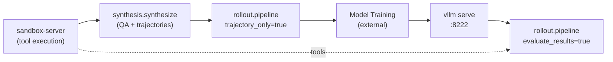
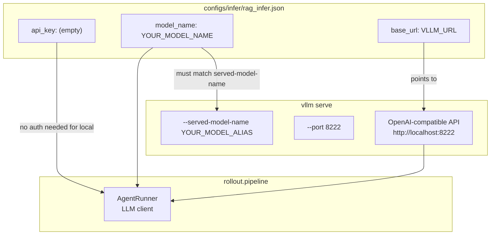
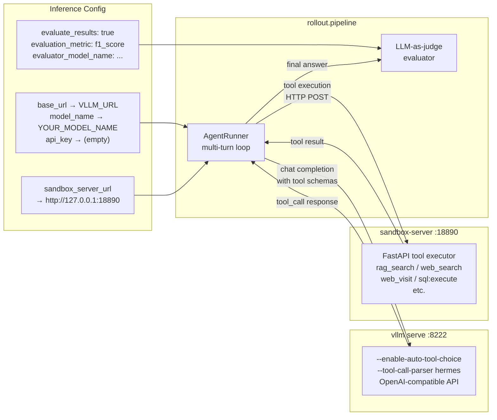

<!-- source: DeepWiki mcp.deepwiki.com · repo OpenDCAI/AgentFlow · page 10.2 Model Deployment with vLLM · fetched 2026-11-02 -->

# Model Deployment with vLLM

<details>
<summary>Relevant source files</summary>

The following files were used as context for generating this wiki page:

- [configs/infer/rag_infer.json](configs/infer/rag_infer.json)
- [configs/infer/web_infer.json](configs/infer/web_infer.json)
- [configs/trajectory/rag_trajectory.json](configs/trajectory/rag_trajectory.json)
- [examples/RAGAgent.md](examples/RAGAgent.md)
- [examples/WebAgent.md](examples/WebAgent.md)
- [seeds/rag/seeds.jsonl](seeds/rag/seeds.jsonl)

</details>


This page covers how to deploy a trained AgentFlow model using vLLM so that it can serve tool-augmented inference through an OpenAI-compatible API. It explains the required vLLM flags, how to connect the deployed server to the rollout inference pipeline, and how inference configuration files are structured for this purpose.

For information about preparing the training data that produces the model being deployed here, see [Preparing Training Data](#10.1). For an overview of pre-built models that can be deployed without custom training, see [Model Family and Pre-trained Models](#10.3). For a complete end-to-end walkthrough including deployment, see the per-agent example guides in [Agent Examples](#6).

---

## Where Deployment Fits in the Workflow

Model deployment occurs at **Step 5** of the AgentFlow pipeline — after training data has been synthesized (Steps 2–3) and a model has been trained (Step 4). The deployed vLLM server is the inference target consumed by the rollout pipeline during evaluation (Step 6).

**Diagram: End-to-End Pipeline Position of vLLM**



Sources: [examples/RAGAgent.md:114-148](), [examples/WebAgent.md:72-108]()

---

## Launching the vLLM Server

Both the RAG and Web agent example guides document the same deployment pattern. The command below applies to any AgentFlow-trained model.

```bash
vllm serve \
    --model YOUR_TRAINED_MODEL \
    --served-model-name YOUR_MODEL_ALIAS \
    --tensor-parallel-size 8 \
    --enable-auto-tool-choice \
    --tool-call-parser hermes \
    --port 8222
```

After startup, the server exposes an OpenAI-compatible HTTP API at `http://localhost:8222`.

### Parameter Reference

| Parameter | Description |
|---|---|
| `--model` | Path to the trained model directory or HuggingFace model ID |
| `--served-model-name` | The model name exposed via the API; this must match `model_name` in the inference config |
| `--tensor-parallel-size` | Number of GPUs to split the model across; set to match your hardware |
| `--enable-auto-tool-choice` | Required — enables tool call generation in the model output |
| `--tool-call-parser` | Instructs vLLM how to parse tool call syntax; AgentFlow models use `hermes` format |
| `--port` | Port the HTTP server listens on; `8222` is the convention used across all examples |

Sources: [examples/RAGAgent.md:348-361](), [examples/WebAgent.md:386-413]()

---

## Why `--enable-auto-tool-choice` and `--tool-call-parser hermes` Are Required

AgentFlow models are trained to produce tool calls interleaved with reasoning text. Without `--enable-auto-tool-choice`, vLLM will not parse tool call tokens from the model output. Without `--tool-call-parser hermes`, the extracted tool call format will not match the schema the rollout pipeline expects.

The `hermes` parser corresponds to the NousResearch Hermes tool call format, which is the format AgentFlow training data is structured around. Any model trained on AgentFlow trajectories must be served with this parser.

Sources: [examples/WebAgent.md:400-413](), [examples/RAGAgent.md:348-361]()

---

## Connecting the Inference Config to vLLM

Once vLLM is running, the inference config file must be updated to point the rollout pipeline at the deployed server. The two relevant fields are `base_url` and `model_name`.

**Diagram: Inference Config → vLLM → rollout.pipeline**



Sources: [configs/infer/rag_infer.json:1-46](), [configs/infer/web_infer.json:1-49]()

### Inference Config Fields for vLLM

The following fields in any `configs/infer/*.json` file control the connection to vLLM:

| Field | Example Value | Purpose |
|---|---|---|
| `model_name` | `"ragagent"` | Must match `--served-model-name` in vLLM |
| `api_key` | `""` | Leave empty for local deployments |
| `base_url` | `"http://localhost:8222/v1"` | Base URL of the vLLM OpenAI-compatible endpoint |

These three fields replace the OpenRouter/OpenAI values used during data synthesis and trajectory rollout. No other changes to the inference config are needed when switching from a cloud LLM to a locally deployed vLLM instance.

Sources: [configs/infer/rag_infer.json:4-7](), [configs/infer/web_infer.json:4-6]()

---

## Running Inference Against the Deployed Model

After updating the inference config, invoke `rollout.pipeline` as you would for any evaluation run:

```python
from rollout import pipeline

pipeline(config_path="configs/infer/rag_infer.json")
```

The rollout pipeline will use the `base_url` and `model_name` from the config to send chat completion requests to the vLLM server. Tool calls returned by the model are executed against the sandbox server (`sandbox_server_url`) and responses are injected back into the conversation. See [Model Inference](#5.2) for full details on the inference pipeline behavior and [Evaluation System](#5.3) for documentation on evaluation metrics.

Sources: [configs/infer/rag_infer.json:1-46](), [examples/RAGAgent.md:364-406]()

---

## Full Config/Server Relationship Diagram

The following diagram shows how `configs/infer/rag_infer.json` and `configs/infer/web_infer.json` map to the two running servers during inference.

**Diagram: Dual-Server Inference Architecture**



Sources: [configs/infer/rag_infer.json:1-46](), [configs/infer/web_infer.json:1-49](), [examples/RAGAgent.md:344-406](), [examples/WebAgent.md:385-462]()

---

## Per-Agent Deployment Examples

The vLLM command is the same across agent types; only `--model`, `--served-model-name`, and `--tensor-parallel-size` differ.

| Agent Type | Example `--served-model-name` | Inference Config |
|---|---|---|
| RAG | `ragagent` | `configs/infer/rag_infer.json` |
| Web (Deep Research) | `webagent` | `configs/infer/web_infer.json` |
| Document | `docalent` | `configs/infer/doc_infer.json` |
| Text2SQL | `sqlagent` | `configs/infer/text2sql_infer.json` |
| Data Science | `dsagent` | `configs/infer/ds_infer.json` |

All deployments use `--tool-call-parser hermes` and `--enable-auto-tool-choice` regardless of agent type.

Sources: [examples/RAGAgent.md:344-362](), [examples/WebAgent.md:385-413]()

---

## Summary of Required Steps

1. Train a model using synthesized QA pairs and trajectories (see [Preparing Training Data](#10.1)).
2. Start vLLM with `--enable-auto-tool-choice --tool-call-parser hermes --port 8222`.
3. Set `base_url` in the inference config to the vLLM endpoint URL (e.g., `http://localhost:8222/v1`).
4. Set `model_name` in the inference config to match the value passed to `--served-model-name`.
5. Leave `api_key` empty for local deployments.
6. Ensure the sandbox server is running at the address specified by `sandbox_server_url`.
7. Run `rollout.pipeline` with the inference config.

Sources: [examples/RAGAgent.md:344-406](), [examples/WebAgent.md:385-462](), [configs/infer/rag_infer.json:1-46](), [configs/infer/web_infer.json:1-49]()

---

