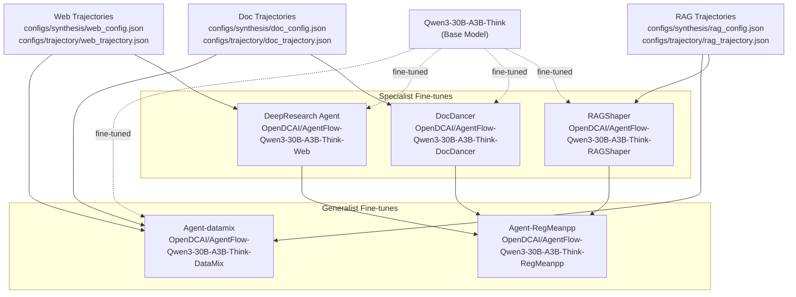
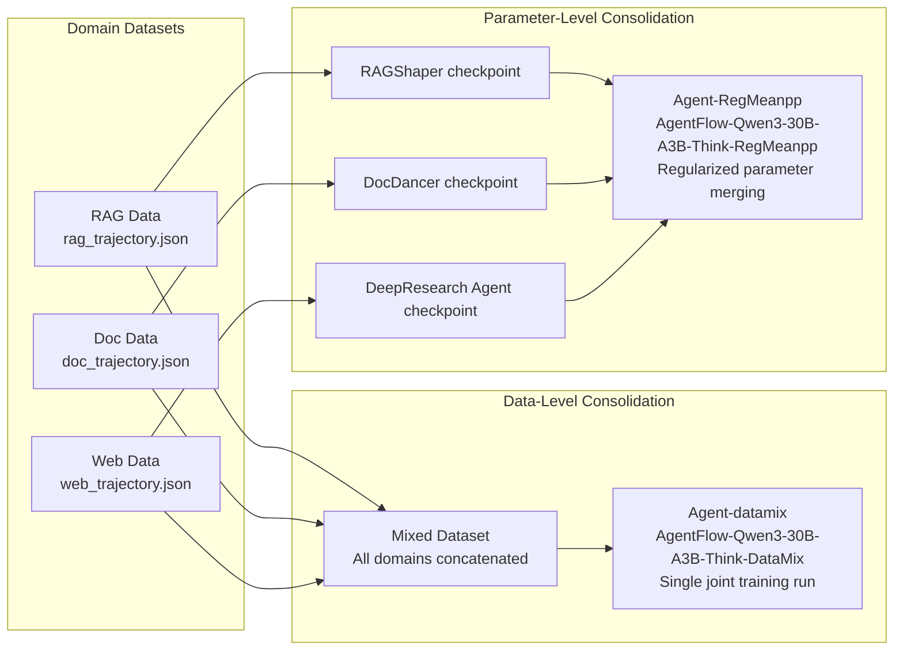
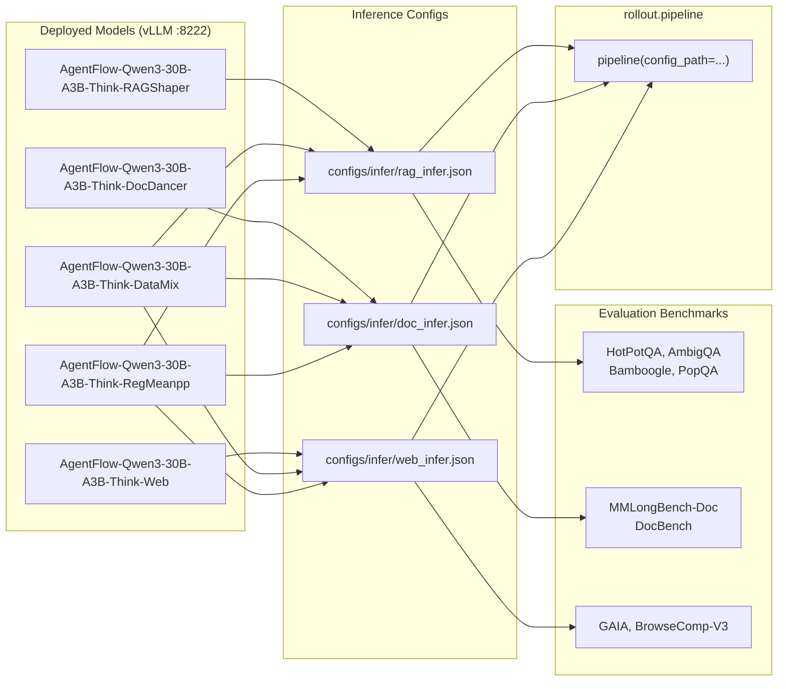

<!-- source: DeepWiki mcp.deepwiki.com · repo OpenDCAI/AgentFlow · page 10.3 Model Family and Pre-trained Models · fetched 2026-11-02 -->

# Model Family and Pre-trained Models

Relevant source files

The following files were used as context for generating this wiki page:

- [README.md](README.md)
- [README_zh.md](README_zh.md)
- [assets/intro.png](assets/intro.png)
- [assets/method.png](assets/method.png)
- [assets/wechat.jpg](assets/wechat.jpg)
- [assets/wechatshow.png](assets/wechatshow.png)

This page documents the pre-trained models released as part of the AgentFlow project, including their training origins, benchmark performance, and HuggingFace identifiers. It covers the five publicly available checkpoints: **RAGShaper**, **DocDancer**, **DeepResearch Agent**, **Agent-datamix**, and **Agent-RegMeanpp**.

For guidance on deploying these models with vLLM, see [Model Deployment with vLLM](#10.2). For preparing training data to produce your own fine-tunes, see [Preparing Training Data](#10.1). For understanding the two consolidation strategies that produced Agent-datamix and Agent-RegMeanpp, see [Agentic Model Consolidation](#2.4).

---

## Overview

All released models share the same base architecture: **Qwen3-30B-A3B** in thinking (chain-of-thought) mode. Each checkpoint diverges at the fine-tuning stage, trained on domain-specific or mixed trajectories generated by AgentFlow's three-stage synthesis pipeline.

The family divides into two groups:

| Group | Models | Training Strategy |
|---|---|---|
| **Specialist** | RAGShaper, DocDancer, DeepResearch Agent | Single-domain trajectories |
| **Generalist** | Agent-datamix, Agent-RegMeanpp | Multi-domain consolidation |

Sources: [README.md:172-180]()

---

## Model Taxonomy and Training Origins

**Model Family and Training Data**

Sources: [README.md:172-180](), [README.md:200-205]()

---

## Specialist Models

### RAGShaper

**RAGShaper** is trained on agentic RAG trajectories synthesized from multi-hop question answering seeds. The agent uses the `rag-search` tool backed by an E5 + Faiss retrieval index, as configured via `configs/sandbox-server/rag_config.json`.

Two training-set sizes are published:

| Model Variant | Training Size | Avg EM | Avg F1 |
|---|---|---|---|
| RAGShaper 4.5k | 4,500 examples | 48.8 | 59.8 |
| RAGShaper 6.5k | 6,500 examples | **50.3** | **62.0** |

Detailed RAG benchmark results (Bamboogle, PopQA, NQ, AmbigQA):

| Model | Bamboogle EM | Bamboogle F1 | PopQA EM | PopQA F1 | NQ EM | NQ F1 | AmbigQA EM | AmbigQA F1 |
|---|---|---|---|---|---|---|---|---|
| IR-COT | 16.0 | 27.9 | 32.4 | 39.9 | 19.3 | 35.5 | 24.5 | 40.6 |
| Search-o1 | 30.4 | 39.9 | 47.0 | 50.0 | 30.3 | 40.7 | 42.5 | 53.4 |
| Search-R1 | 30.4 | 43.2 | 41.3 | 46.4 | 36.0 | 45.0 | 49.2 | 60.4 |
| HL-Data 4.5k | 50.4 | 67.5 | 35.2 | 48.3 | 31.5 | 47.4 | 52.1 | 69.0 |
| **RAGShaper 4.5k** | 58.5 | 70.3 | 37.4 | 47.8 | 38.3 | 50.0 | **61.3** | **71.4** |
| **RAGShaper 6.5k** | **60.0** | **72.6** | 38.9 | 49.6 | **41.3** | **54.8** | 61.1 | 71.1 |

**Reference paper:** RAGShaper: Eliciting Sophisticated Agentic RAG Skills via Automated Data Synthesis (arXiv:2601.08699)

**HuggingFace ID:** `OpenDCAI/AgentFlow-Qwen3-30B-A3B-Think-RAGShaper`

Sources: [README.md:207-222]()

---

### DocDancer

**DocDancer** is trained on multimodal document agent trajectories. The agent navigates long documents using the `doc-search` and `doc-read` tools, which internally invoke a VLM (`gpt-4o-mini`) for visual page understanding, as configured via `configs/sandbox-server/doc_config.json`.

Two checkpoint sizes are released, using Qwen3 at different parameter counts:

| Model | Base | MMLongBench-Doc (acc) | F1 | LasJ | DocBench LasJ |
|---|---|---|---|---|---|
| DocDancer | Qwen3-4B (ft) | 48.4 | 49.2 | 59.4 | 79.8 |
| DocDancer | Qwen3-30B-A3B (ft) | **54.4** | **53.9** | **65.3** | **81.2** |
| Human Baseline | — | 65.8 | 66.0 | — | 81.2 |

Selected baselines for context:

| Method | Model | MMLongBench-Doc | DocBench LasJ |
|---|---|---|---|
| Tesseract (OCR) | Gemini-2.0-Flash | 39.6 | — |
| RAGAnything | GPT-4o-mini | 42.8 | 63.4 |
| MDocAgent | GPT-4o | 42.0 | — |
| DocLens | Claude-4-Sonnet | — | 63.3 |

**Reference paper:** DocDancer: Towards Agentic Document-Grounded Information Seeking (arXiv:2601.05163)

**HuggingFace ID:** `OpenDCAI/AgentFlow-Qwen3-30B-A3B-Think-DocDancer`

Sources: [README.md:234-256]()

---

### DeepResearch Agent

**DeepResearch Agent** is trained on deep web research trajectories. The agent uses `web-search` (via Serper API) and `web-visit` (via Jina API) tools, as configured via `configs/sandbox-server/web_config.json`. It is evaluated on the GAIA benchmark and BrowseComp-V3 (BC / BC-zh).

Benchmark performance as a standalone specialist:

| Benchmark | Accuracy |
|---|---|
| GAIA | Reported as part of consolidation comparison |
| BrowseComp (BC) | Reported as part of consolidation comparison |
| BrowseComp-zh (BC-zh) | Reported as part of consolidation comparison |

Performance figures for DeepResearch as a standalone model are most visible in the consolidation comparison table (see [Generalist Models](#generalist-models) below).

**HuggingFace ID:** `OpenDCAI/AgentFlow-Qwen3-30B-A3B-Think-Web`

Sources: [README.md:172-180]()

---

## Generalist Models

These models are trained to operate across RAG, document, and web agent domains simultaneously, using two distinct consolidation strategies. The goal is a single checkpoint that performs competitively across all domains without requiring domain-specific specialization.

### Consolidation Strategy Diagram

**Training Strategies for Generalist Models**

Sources: [README.md:200-205](), [README.md:172-180]()

---

### Agent-datamix

**Agent-datamix** uses data-level consolidation: all domain-specific trajectories (RAG, Doc, Web) are mixed into a single training corpus and the model is trained jointly. No specialist models are required as intermediaries.

**HuggingFace ID:** `OpenDCAI/AgentFlow-Qwen3-30B-A3B-Think-DataMix`

---

### Agent-RegMeanpp

**Agent-RegMeanpp** uses parameter-level consolidation: RAGShaper, DocDancer, and DeepResearch Agent are each trained independently, then their weight matrices are merged using a regularized mean (RegMean++) algorithm. This approach does not require re-training from scratch but requires all specialist checkpoints to be available.

**HuggingFace ID:** `OpenDCAI/AgentFlow-Qwen3-30B-A3B-Think-RegMeanpp`

---

## Generalist Benchmark Comparison

Both consolidation strategies are evaluated on the same benchmark suite using the Qwen3-30B-A3B-Think base. Results show that data-level consolidation (Agent-datamix) outperforms parameter-level consolidation (Agent-RegMeanpp) on Web tasks, while RegMeanpp performs better on RAG tasks.

| Level | Strategy | GAIA (Acc.) | BC (Acc.) | BC-zh (Acc.) | MMBD (Acc.) | DocB (Acc.) | HotPotQA (EM/F1) | AmbigQA (EM/F1) | Bamboogle (EM/F1) |
|---|---|---|---|---|---|---|---|---|---|
| **Data-level** | Data Mixing | **64.08** | **28.00** | **34.00** | 63.59 | **83.29** | 38.00 / 42.53 | 49.50 / 58.84 | 53.10 / 60.20 |
| **Parameter-level** | RegMean++ | 60.19 | 22.50 | 28.00 | **64.66** | 80.76 | **45.50 / 58.27** | **58.80 / 69.36** | **52.80 / 66.48** |

**Benchmark abbreviations:**
- `GAIA` — GAIA web agent benchmark
- `BC` — BrowseComp-V3
- `BC-zh` — BrowseComp-V3 (Chinese)
- `MMBD` — MMLongBench-Doc
- `DocB` — DocBench

Sources: [README.md:200-205]()

---

## Model–Inference Config Mapping

Each pre-trained model has a corresponding inference configuration in `configs/infer/`. These configs specify the evaluation benchmark, the vLLM endpoint, and the scoring metric. Passing a config to `rollout.pipeline` runs inference against the deployed model.

**Model to Inference Config and Benchmark**

Sources: [README.md:143-149](), [README.md:153-158]()

---

## Published Datasets

Each specialist model has a corresponding training dataset also published on HuggingFace:

| Model | Dataset HuggingFace ID |
|---|---|
| DocDancer | `OpenDCAI/AgentFlow-Qwen3-30B-A3B-Think-DocDancer` |
| RAGShaper | `OpenDCAI/AgentFlow-Qwen3-30B-A3B-Think-RAGShaper` |
| DeepResearch Agent | `OpenDCAI/AgentFlow-Qwen3-30B-A3B-Think-Web` |

Generalist models (Agent-datamix, Agent-RegMeanpp) do not have separate dataset releases; their training data is derived from the combination of the above three specialist datasets.

Sources: [README.md:182-188]()

---

## Associated Papers

| Paper | arXiv | Corresponding Model |
|---|---|---|
| RAGShaper: Eliciting Sophisticated Agentic RAG Skills via Automated Data Synthesis | 2601.08699 | RAGShaper |
| DocDancer: Towards Agentic Document-Grounded Information Seeking | 2601.05163 | DocDancer |
| Exploring Information Seeking Agent Consolidation | 2602.00585 | Agent-datamix, Agent-RegMeanpp |
| BrowseComp-V3: A Visual, Vertical, and Verifiable Benchmark | 2602.12876 | DeepResearch Agent (evaluation) |

Sources: [README.md:162-171]()