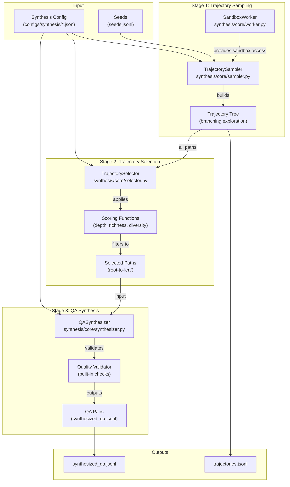
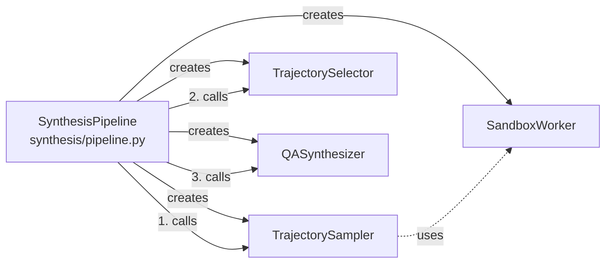
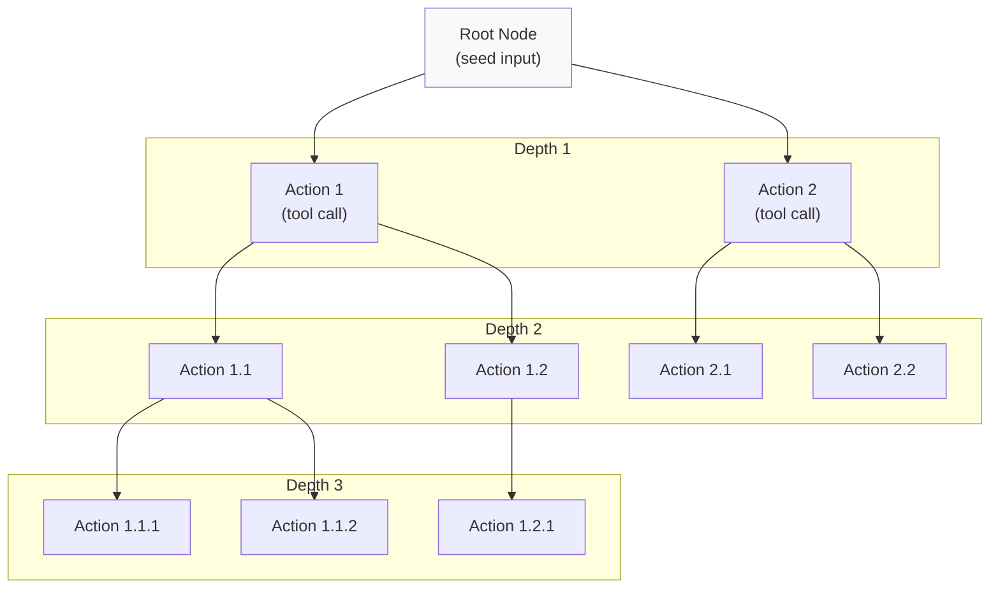
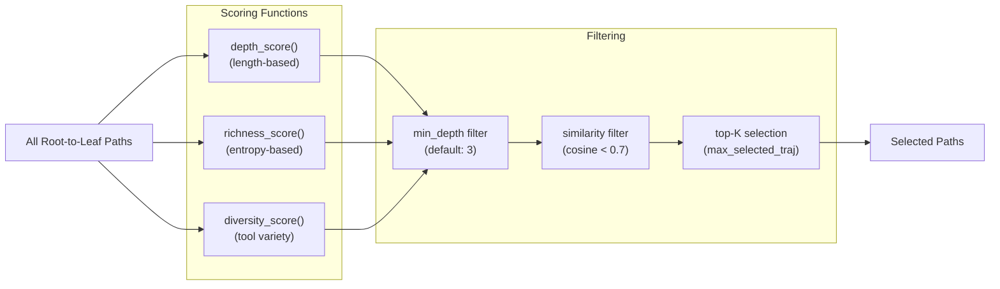
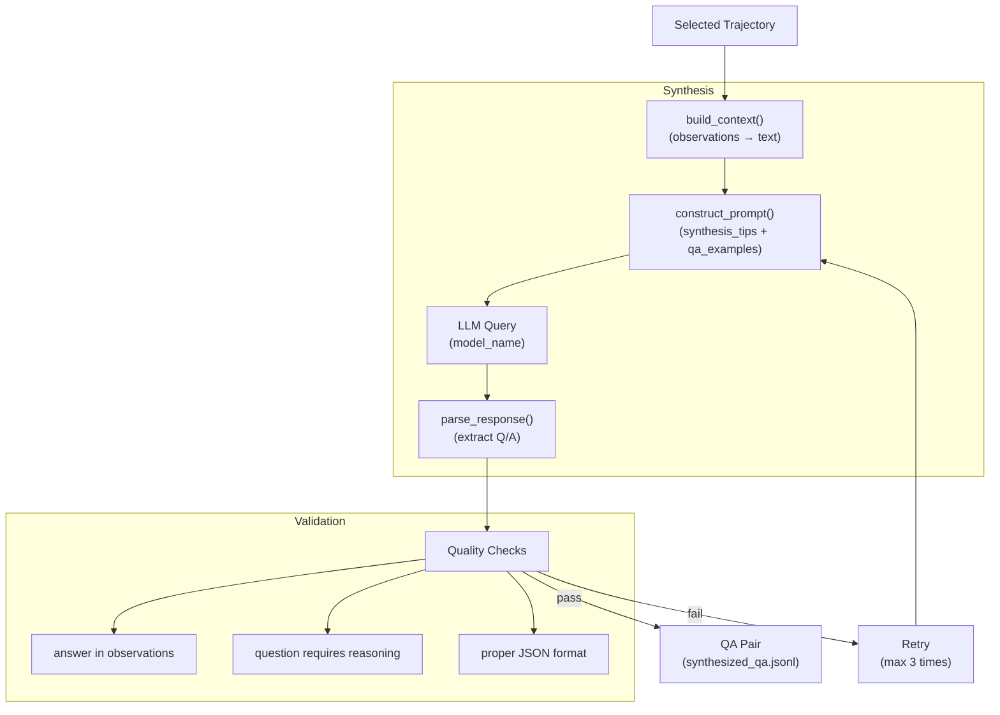
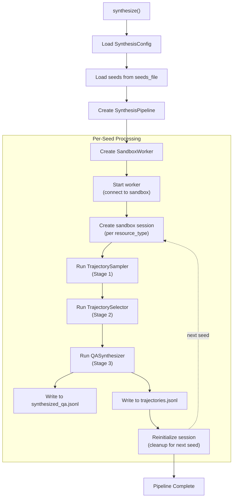

<!-- source: DeepWiki mcp.deepwiki.com · repo OpenDCAI/AgentFlow · page 2.1 Three-Stage Data Synthesis Pipeline · fetched 2026-11-02 -->

# Three-Stage Data Synthesis Pipeline

<details>
<summary>Relevant source files</summary>

The following files were used as context for generating this wiki page:

- [README.md](README.md)
- [README_zh.md](README_zh.md)
- [assets/intro.png](assets/intro.png)
- [assets/method.png](assets/method.png)
- [assets/wechat.jpg](assets/wechat.jpg)
- [assets/wechatshow.png](assets/wechatshow.png)
- [configs/synthesis/doc_ds_config.json](configs/synthesis/doc_ds_config.json)
- [configs/synthesis/ds_config.json](configs/synthesis/ds_config.json)
- [sandbox/tool_schemas/ds_tools.py](sandbox/tool_schemas/ds_tools.py)
- [synthesis/pipeline.py](synthesis/pipeline.py)

</details>


The three-stage data synthesis pipeline is AgentFlow's core methodology for generating high-quality training data from agent trajectories. This page describes the architectural design, implementation, and execution flow of the three sequential stages: Trajectory Sampling, Trajectory Selection, and QA Synthesis. For information about specific agent types that use this pipeline, see [Agent Types and Modalities](#2.2). For configuration details, see [Synthesis Configuration](#4.1).

## Overview

The pipeline transforms seed inputs into synthetic QA pairs by having an LLM-driven agent explore a sandbox environment, capturing its interaction trajectories, filtering them for quality, and generating grounded question-answer pairs. This approach is modality-agnostic and works across all supported agent types (RAG, Document, Web, SQL, Data Science, GUI).



**Sources:** [README.md:77-84](), [synthesis/pipeline.py:39-230]()

## Architecture and Components

The pipeline is implemented by the `SynthesisPipeline` class, which orchestrates three core components:

| Component | Class | Purpose | Location |
|-----------|-------|---------|----------|
| **Worker** | `SandboxWorker` | Manages sandbox connection and tool execution | [synthesis/core/worker.py]() |
| **Sampler** | `TrajectorySampler` | Explores environment and builds trajectory tree | [synthesis/core/sampler.py]() |
| **Selector** | `TrajectorySelector` | Scores and filters trajectories for quality | [synthesis/core/selector.py]() |
| **Synthesizer** | `QASynthesizer` | Generates QA pairs from selected trajectories | [synthesis/core/synthesizer.py]() |

The pipeline coordinator (`SynthesisPipeline`) processes seeds sequentially and manages the flow between stages:



**Sources:** [synthesis/pipeline.py:39-119](), [synthesis/core/__init__.py:1-7]()

## Stage 1: Trajectory Sampling

Trajectory sampling is the exploration phase where an LLM-driven agent iteratively interacts with the sandbox environment, building a branching tree of action sequences.

### Sampling Algorithm

The `TrajectorySampler` implements a breadth-first exploration strategy with concurrent expansion:

1. **Initialize** with seed input as the root node
2. **Expand** each frontier node by generating `branching_factor` action proposals
3. **Execute** proposed actions via `SandboxWorker.execute_action()`
4. **Record** observations and add child nodes to the tree
5. **Continue** until reaching `max_depth` or all paths terminate



**Key Configuration Parameters:**

| Parameter | Default | Description |
|-----------|---------|-------------|
| `max_depth` | 20 | Maximum trajectory depth |
| `branching_factor` | 2 | Number of actions to propose per node |
| `depth_threshold` | 2 | Minimum depth before allowing termination |

**Sources:** [synthesis/core/sampler.py](), [configs/synthesis/rag_config.json:6-8](), [README.md:79]()

### Action Proposal and Deduplication

At each node, the sampler:

1. **Constructs prompt** with trajectory history and available tools
2. **Queries LLM** for `branching_factor` distinct action proposals
3. **Deduplicates** semantically similar actions
4. **Validates** action format and parameter types
5. **Executes** each valid action through the sandbox

The `sampling_tips` configuration parameter guides the LLM's exploration strategy:

```json
{
  "sampling_tips": [
    "Your data lives under the provided seed_path; start with ds_inspect_data.",
    "Prefer ds_run_python for any non-trivial computation.",
    "When reading CSVs, use filenames like users.csv (avoid embedding seed_path)."
  ]
}
```

**Sources:** [synthesis/core/sampler.py](), [configs/synthesis/ds_config.json:16-22]()

### Trajectory Tree Structure

Each node in the trajectory tree contains:

- **State**: Current execution context
- **Action**: Tool call with parameters
- **Observation**: Tool execution result
- **Parent**: Reference to parent node
- **Children**: List of child nodes
- **Depth**: Distance from root

The tree is serialized to `trajectories.jsonl` for later analysis and debugging:

```json
{
  "source_id": "src_0001_a1b2c3d4",
  "seed": "Analyze customer purchase patterns",
  "trajectory": [
    {"action": "ds_inspect_data", "result": "Found 3 CSV files..."},
    {"action": "ds_read_csv", "params": {"csv_file": "orders.csv"}, "result": "..."},
    {"action": "ds_run_python", "params": {"code": "..."}, "result": "..."}
  ],
  "depth": 3,
  "terminal": true
}
```

**Sources:** [synthesis/pipeline.py:176-189](), [synthesis/core/sampler.py]()

## Stage 2: Trajectory Selection

After sampling, the trajectory tree contains many paths of varying quality. The selection stage filters for high-value trajectories suitable for QA synthesis.

### Selection Criteria

The `TrajectorySelector` evaluates each root-to-leaf path using three metrics:

1. **Depth Score**: Prefers longer trajectories indicating multi-hop reasoning
2. **Information Richness**: Measures diversity and informativeness of observations
3. **Tool Diversity**: Rewards usage of multiple distinct tools



**Sources:** [synthesis/core/selector.py](), [README.md:81]()

### Selection Algorithm

The selection process follows these steps:

1. **Extract all root-to-leaf paths** from the trajectory tree
2. **Filter by minimum depth** (configurable via `min_depth`)
3. **Compute composite score** as weighted sum of depth, richness, diversity
4. **Remove similar paths** using cosine similarity on action sequences
5. **Select top-K paths** (configurable via `max_selected_traj`)

**Configuration Parameters:**

| Parameter | Default | Description |
|-----------|---------|-------------|
| `min_depth` | 3 | Minimum trajectory length to consider |
| `max_selected_traj` | 3 | Maximum trajectories to select per seed |
| `path_similarity_threshold` | 0.7 | Cosine similarity threshold for deduplication |

**Sources:** [synthesis/core/selector.py](), [configs/synthesis/rag_config.json:10-12]()

### Path Similarity Detection

To avoid redundant trajectories, the selector computes pairwise similarity between action sequences using:

1. **Action embedding**: Convert each action to vector representation
2. **Sequence aggregation**: Average embeddings along the path
3. **Cosine similarity**: Measure angle between path vectors
4. **Threshold filtering**: Discard paths with similarity > threshold

This ensures selected trajectories explore distinct regions of the action space.

**Sources:** [synthesis/core/selector.py]()

## Stage 3: QA Synthesis

The final stage generates question-answer pairs grounded in the observations collected during trajectory execution.

### Synthesis Process

The `QASynthesizer` processes each selected trajectory:

1. **Construct context** from trajectory observations
2. **Generate question** requiring multi-hop reasoning across observations
3. **Extract answer** directly from the observation data
4. **Validate QA pair** using quality checks
5. **Retry** if validation fails (up to `max_retries`)



**Sources:** [synthesis/core/synthesizer.py](), [README.md:83]()

### Synthesis Guidance

The synthesis process is guided by configuration parameters:

**`synthesis_tips`**: Constraints for question generation
```json
{
  "synthesis_tips": [
    "Create questions requiring multi-hop reasoning.",
    "Ensure answers are grounded in computed results.",
    "Avoid questions based on data previews or 'head()' calls."
  ]
}
```

**`qa_examples`**: Few-shot examples to guide the LLM
```json
{
  "qa_examples": [
    {
      "question": "Join orders.csv with products.csv. What is the total revenue?",
      "answer": "10734"
    }
  ]
}
```

**Sources:** [configs/synthesis/ds_config.json:24-46](), [synthesis/core/synthesizer.py]()

### Quality Validation

Built-in validation checks ensure QA pair quality:

1. **Answer grounding**: Answer must be derivable from observations
2. **Multi-hop reasoning**: Question requires information from multiple steps
3. **Format compliance**: Proper JSON structure with required fields
4. **Answer specificity**: Factoid answers, not vague or ambiguous
5. **Question complexity**: Not answerable from single observation alone

Failed pairs are logged for debugging, and synthesis retries with adjusted prompts.

**Sources:** [synthesis/core/synthesizer.py]()

### Output Format

Each synthesized QA pair is written to `synthesized_qa.jsonl`:

```json
{
  "source_id": "src_0001_a1b2c3d4",
  "question": "After clustering users by order patterns, which cluster has the highest mean revenue?",
  "answer": "cluster=1, size=2",
  "trajectory": [...],
  "seed": "Analyze customer purchase patterns"
}
```

**Sources:** [synthesis/pipeline.py:191-204]()

## Pipeline Execution

### Entry Points

The pipeline can be executed via two interfaces:

**1. Python API:**
```python
from synthesis import synthesize

synthesize(config_path="configs/synthesis/web_config.json")
```

**2. Command Line:**
```bash
python -m synthesis.pipeline --config configs/synthesis/web_config.json
```

**Sources:** [synthesis/__init__.py:1-9](), [synthesis/pipeline.py:13-30](), [README.md:115-121]()

### Execution Flow



**Sources:** [synthesis/pipeline.py:66-156](), [synthesis/__init__.py:11-61]()

### Session Management

For stateful resources (VM, SQL, Document), the pipeline reinitializes sandbox sessions between seeds to ensure isolation:

1. **Initial session creation** (per `resource_types`)
2. **Trajectory sampling** in isolated environment
3. **Session reinitialization** after seed processing
4. **Cleanup** when pipeline completes

This prevents cross-contamination between seeds that might share resources (e.g., same database).

**Sources:** [synthesis/pipeline.py:111-136]()

## Configuration Reference

The three-stage pipeline is configured via JSON files in `configs/synthesis/`. Key parameters:

### Sampling Parameters

| Parameter | Type | Description | Example |
|-----------|------|-------------|---------|
| `max_depth` | int | Maximum trajectory depth | 20 |
| `branching_factor` | int | Actions per node | 2 |
| `depth_threshold` | int | Min depth before termination | 2 |
| `sampling_tips` | array | LLM guidance for exploration | See below |

### Selection Parameters

| Parameter | Type | Description | Example |
|-----------|------|-------------|---------|
| `min_depth` | int | Minimum trajectory length | 3 |
| `max_selected_traj` | int | Max trajectories per seed | 3 |
| `path_similarity_threshold` | float | Deduplication threshold | 0.7 |

### Synthesis Parameters

| Parameter | Type | Description | Example |
|-----------|------|-------------|---------|
| `synthesis_tips` | array | QA generation constraints | See below |
| `qa_examples` | array | Few-shot examples | See below |
| `number_of_seed` | int/null | Limit number of seeds | null (all) |

### Infrastructure Parameters

| Parameter | Type | Description | Example |
|-----------|------|-------------|---------|
| `model_name` | string | LLM model identifier | `"openai/gpt-oss-120b"` |
| `sandbox_server_url` | string | Sandbox HTTP endpoint | `"http://127.0.0.1:18890"` |
| `available_tools` | array | Tools for this agent type | `["ds_inspect_data", ...]` |
| `resource_types` | array | Sandbox resource types | `["rag", "text2sql"]` |
| `seeds_file` | string | Path to seed data | `"seeds/ds/seeds.jsonl"` |

For complete configuration schema and examples, see [Synthesis Config Schema](#8.2).

**Sources:** [configs/synthesis/ds_config.json](), [configs/synthesis/rag_config.json](), [synthesis/core/config.py]()

---

