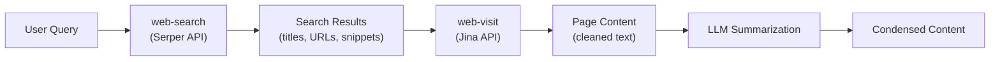
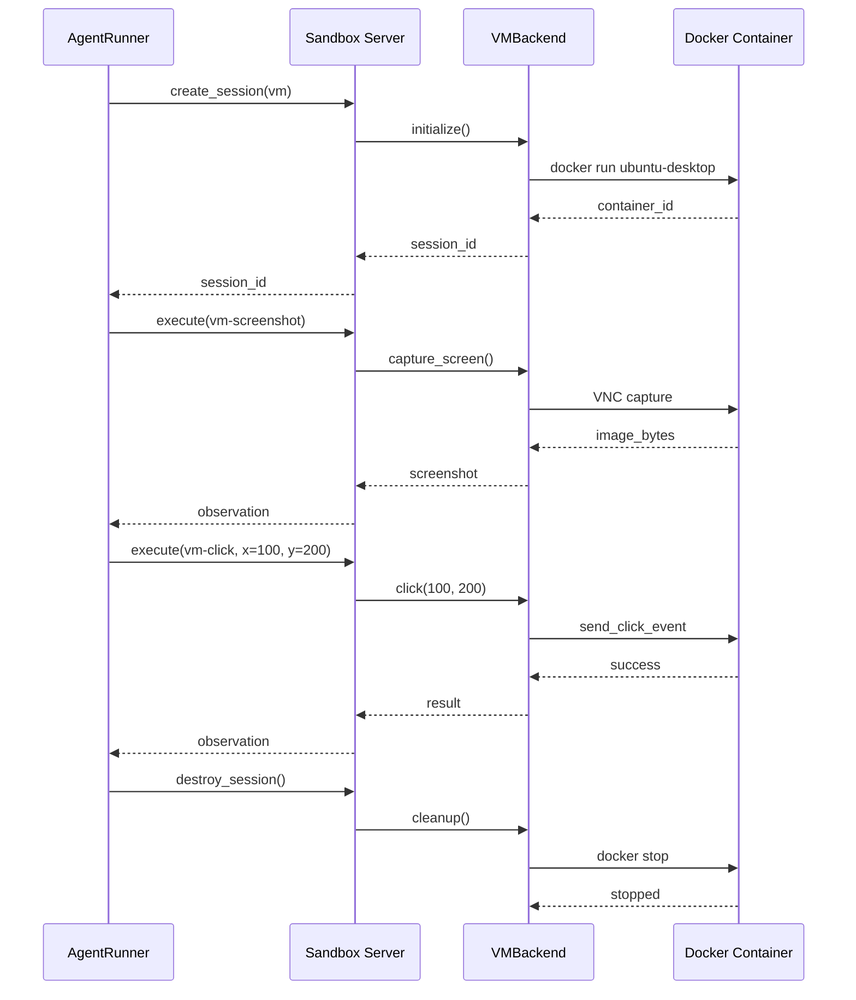
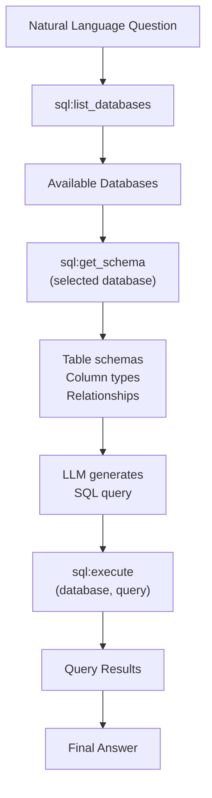
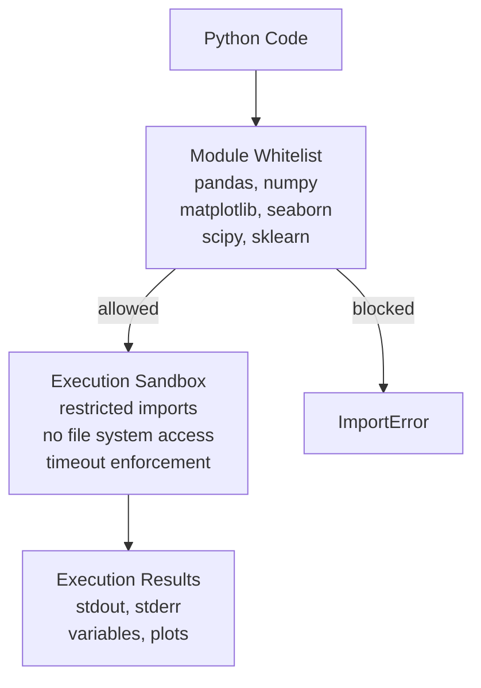

<!-- source: DeepWiki mcp.deepwiki.com · repo OpenDCAI/AgentFlow · page 2.2 Agent Types and Modalities · fetched 2026-11-02 -->

# Agent Types and Modalities

<details>
<summary>Relevant source files</summary>

The following files were used as context for generating this wiki page:

- [README.md](README.md)
- [README_zh.md](README_zh.md)
- [assets/intro.png](assets/intro.png)
- [assets/method.png](assets/method.png)
- [assets/wechat.jpg](assets/wechat.jpg)
- [assets/wechatshow.png](assets/wechatshow.png)

</details>


This page provides a comprehensive overview of the seven agent types supported by AgentFlow, their unique characteristics, tool ecosystems, backend implementations, and use cases. Each agent type represents a distinct modality of interaction, from document understanding to web browsing to database querying.

For information about the unified three-stage data synthesis pipeline that applies to all agent types, see [Three-Stage Data Synthesis Pipeline](#2.1). For details on how tool schemas abstract these interactions, see [Tool Schemas and Abstraction Layer](#2.3). For practical examples of implementing each agent type, see [Agent Examples](#6).

## Overview of Supported Agent Types

AgentFlow supports seven distinct agent modalities, each designed for specific task domains:

| Agent Type | Primary Tools | Backend | Key Use Case | Example Config |
|------------|--------------|---------|--------------|----------------|
| **RAG** | `rag-search` | E5 + Faiss | Information retrieval with vector search | `configs/sandbox-server/rag_config.json` |
| **MM-Doc** | `doc-search`, `doc-read` | VLM (gpt-4o-mini) | Multimodal document understanding | `configs/sandbox-server/doc_config.json` |
| **Deep Research (Web)** | `web-search`, `web-visit` | Serper API + Jina API | Web search and browsing | `configs/sandbox-server/web_config.json` |
| **GUI** | `vm-screenshot`, `vm-click`, `vm-type`, etc. | Docker VM (Ubuntu Desktop) | Desktop automation | `configs/sandbox-server/vm_config.json` |
| **Text2SQL** | `sql:list_databases`, `sql:get_schema`, `sql:execute` | SQLite databases | Natural language to SQL | `configs/sandbox-server/text2sql_config.json` |
| **Data Analysis** | `ds_inspect_data`, `ds_read_csv`, `ds_run_python` | Python sandbox (pandas, numpy) | Data science workflows | `configs/sandbox-server/ds_config.json` |
| **Embodied** | Custom action spaces | Simulation environment | Robot manipulation | Configuration varies |

**Sources:** [README.md:22-38](), [README.md:157-181]()

## Agent Type Architecture

The following diagram illustrates how different agent types connect to their respective tool schemas and backend implementations:

```mermaid
graph TB
    subgraph "Core Pipeline (Modality-Agnostic)"
        Pipeline["Three-Stage Pipeline<br/>TrajectorySampler → TrajectorySelector → QASynthesizer"]
    end
    
    subgraph "RAG Agent"
        RAGTools["Tool: rag-search"]
        RAGBackend["RAGBackend<br/>E5 embeddings<br/>Faiss index"]
        RAGConfig["rag_config.json"]
        RAGBench["Benchmarks:<br/>HotPotQA, AmbigQA<br/>Bamboogle, PopQA"]
    end
    
    subgraph "Document Agent"
        DocTools["Tools:<br/>doc-search<br/>doc-read"]
        DocBackend["DocumentBackend<br/>VLM: gpt-4o-mini<br/>PDF parsing"]
        DocConfig["doc_config.json"]
        DocBench["Benchmarks:<br/>MMLongBench-Doc<br/>DocBench"]
    end
    
    subgraph "Web Agent"
        WebTools["Tools:<br/>web-search<br/>web-visit"]
        WebBackend["WebBackend<br/>Serper API<br/>Jina API<br/>LLM summarization"]
        WebConfig["web_config.json"]
        WebBench["Benchmarks:<br/>GAIA, BrowseComp-V3<br/>BC-zh"]
    end
    
    subgraph "GUI Agent"
        GUITools["Tools:<br/>vm-screenshot<br/>vm-click, vm-type<br/>vm-key, vm-scroll"]
        GUIBackend["VMBackend<br/>Docker containers<br/>noVNC server"]
        GUIConfig["vm_config.json"]
    end
    
    subgraph "SQL Agent"
        SQLTools["Tools:<br/>sql:list_databases<br/>sql:get_schema<br/>sql:execute"]
        SQLBackend["DatabaseBackend<br/>SQLite engines<br/>7 domains"]
        SQLConfig["text2sql_config.json"]
    end
    
    subgraph "DS Agent"
        DSTools["Tools:<br/>ds_inspect_data<br/>ds_read_csv<br/>ds_run_python"]
        DSBackend["DSBackend<br/>Python exec sandbox<br/>pandas, numpy<br/>security whitelist"]
        DSConfig["ds_config.json"]
    end
    
    Pipeline -->|configures| RAGTools
    Pipeline -->|configures| DocTools
    Pipeline -->|configures| WebTools
    Pipeline -->|configures| GUITools
    Pipeline -->|configures| SQLTools
    Pipeline -->|configures| DSTools
    
    RAGConfig -->|defines| RAGTools
    RAGTools -->|executed by| RAGBackend
    
    DocConfig -->|defines| DocTools
    DocTools -->|executed by| DocBackend
    
    WebConfig -->|defines| WebTools
    WebTools -->|executed by| WebBackend
    
    GUIConfig -->|defines| GUITools
    GUITools -->|executed by| GUIBackend
    
    SQLConfig -->|defines| SQLTools
    SQLTools -->|executed by| SQLBackend
    
    DSConfig -->|defines| DSTools
    DSTools -->|executed by| DSBackend
```



**Sources:** [README.md:22-38](), Diagram 3 from provided diagrams

## RAG Agent

The RAG (Retrieval-Augmented Generation) agent performs information retrieval using vector search over a knowledge corpus. It represents the simplest agent modality with a single tool.

### Tool Schema

- **`rag-search`**: Searches a vector index using semantic similarity
  - Parameters: `query` (string)
  - Returns: List of relevant text chunks with metadata

### Backend Implementation

The `RAGBackend` uses:
- **E5 embeddings**: Specified via `RAG_EMBEDDING_MODEL_PATH` environment variable
- **Faiss index**: Vector index loaded from `RAG_INDEX_PATH`
- **Dense retrieval**: Semantic search over embedded documents

### Configuration

Sandbox server configuration at [configs/sandbox-server/rag_config.json]():
```json
{
    "server": {
        "url": "http://localhost",
        "port": 18890
    },
    "resource_type": "rag",
    "rag": {
        "embedding_model_path": "${RAG_EMBEDDING_MODEL_PATH}",
        "index_path": "${RAG_INDEX_PATH}"
    }
}
```

### Benchmarks and Performance

| Benchmark | Metric | RAGShaper 6.5k Performance |
|-----------|--------|----------------------------|
| Bamboogle | EM / F1 | 60.0 / 72.6 |
| PopQA | EM / F1 | 38.9 / 49.6 |
| NQ | EM / F1 | 41.3 / 54.8 |
| AmbigQA | EM / F1 | 61.1 / 71.1 |

**Sources:** [README.md:157-168](), [README.md:207-223](), [configs/sandbox-server/rag_config.json]()

## Document Agent (MM-Doc)

The Document agent handles multimodal document understanding tasks, navigating through multi-page PDFs containing text, tables, charts, and images.

### Tool Schemas

- **`doc-search`**: Searches for relevant pages in a document
  - Parameters: `query` (string), `document_id` (string)
  - Returns: Page numbers and relevance scores

- **`doc-read`**: Reads specific pages using VLM
  - Parameters: `document_id` (string), `page_numbers` (list of integers)
  - Returns: Multimodal content extraction (text, tables, images)

### Backend Implementation

The `DocumentBackend` leverages:
- **VLM integration**: Uses `gpt-4o-mini` (configurable via `VLM_API_KEY`)
- **PDF parsing**: Extracts page images and text
- **Multimodal understanding**: Processes heterogeneous content types

### Configuration

Document agent synthesis configuration emphasizes:
- Multi-hop reasoning across pages
- Cross-modal information extraction
- Navigation strategies for long documents

### Benchmarks and Performance

| Benchmark | Metric | DocDancer (Qwen3-30B) Performance |
|-----------|--------|-----------------------------------|
| MMLongBench-Doc | Accuracy | 54.4 |
| MMLongBench-Doc | F1 | 53.9 |
| LasJ | Score | 65.3 |
| DocBench | LasJ | 81.2 |

Human baseline on MMLongBench-Doc: 65.8% accuracy

**Sources:** [README.md:234-257](), [configs/sandbox-server/doc_config.json]()

## Web Agent (Deep Research)

The Web agent performs deep research through web search and browsing, combining search APIs with content extraction for multi-hop web reasoning.

### Tool Schemas

- **`web-search`**: Performs web search queries
  - Parameters: `query` (string), `num_results` (integer)
  - Returns: Search results with titles, URLs, snippets

- **`web-visit`**: Visits and extracts content from URLs
  - Parameters: `url` (string)
  - Returns: Cleaned page content, extracted text

### Backend Implementation

The `WebBackend` integrates:
- **Serper API**: For web search (requires `SERPER_API_KEY`)
- **Jina API**: For content extraction (requires `JINA_API_KEY`)
- **LLM summarization**: Condenses long web pages

### Tool Execution Flow



### Benchmarks and Performance

| Benchmark | Description | Agent-datamix Performance |
|-----------|-------------|---------------------------|
| GAIA | General AI Assistant | 64.08% |
| BrowseComp-V3 | Multimodal browsing | 28.00% |
| BC-zh | Chinese browsing | 34.00% |

**Sources:** [README.md:15-21](), [README.md:199-206](), [configs/sandbox-server/web_config.json](), [sandbox/tool_schemas/web_tools.py]()

## GUI Agent

The GUI agent interacts with graphical user interfaces through desktop automation, executing actions like clicking, typing, and scrolling on a virtual Ubuntu desktop.

### Tool Schemas

The GUI agent provides 15 tools for desktop interaction:

| Tool | Purpose | Key Parameters |
|------|---------|----------------|
| `vm-screenshot` | Capture current screen | None |
| `vm-click` | Click at coordinates | `x`, `y`, `button` (left/right) |
| `vm-double-click` | Double-click | `x`, `y` |
| `vm-type` | Type text | `text` |
| `vm-key` | Press key combination | `key` (e.g., "ctrl+c") |
| `vm-scroll` | Scroll direction | `direction` (up/down), `clicks` |
| `vm-drag` | Drag and drop | `start_x`, `start_y`, `end_x`, `end_y` |
| `vm-move` | Move mouse | `x`, `y` |

### Backend Implementation

The `VMBackend` manages:
- **Docker containers**: Runs Ubuntu Desktop in isolated containers
- **noVNC server**: Provides VNC access for automation
- **Session management**: Creates and destroys VM instances
- **State persistence**: Maintains VM state across interactions

### Session Lifecycle



### Configuration

VM configuration requires Docker setup and specifies:
- Container image
- VNC port and display settings
- Resource limits
- Session timeout (TTL)

**Sources:** [README.md:401-413](), [configs/sandbox-server/vm_config.json](), [sandbox/tool_schemas/vm_tools.py]()

## Text2SQL Agent

The Text2SQL agent converts natural language questions into SQL queries, executing them against multiple database domains.

### Tool Schemas

- **`sql:list_databases`**: Lists available databases
  - Returns: Database names and descriptions

- **`sql:get_schema`**: Retrieves schema for a database
  - Parameters: `database_name` (string)
  - Returns: Table schemas with columns and types

- **`sql:execute`**: Executes a SQL query
  - Parameters: `database_name` (string), `query` (string)
  - Returns: Query results as table

### Backend Implementation

The `DatabaseBackend` manages:
- **SQLite engines**: One per database domain
- **Multiple databases**: 7 distinct domains (e.g., sakila, chinook)
- **Schema caching**: Efficient schema retrieval
- **Query execution**: Safe SQL execution with timeouts

### Database Domains

AgentFlow includes databases across domains:
- **sakila**: Film rental data (actors, films, rentals)
- **chinook**: Music store (customers, invoices, tracks)
- **northwind**: Sales data
- **world**: Geographic information
- And 3 additional domains

### Example Query Workflow



### Configuration

SQL backend configuration maps environment variables to database paths:
```
TEXT2SQL_SAKILA_DB_PATH=/path/to/sakila.db
TEXT2SQL_CHINOOK_DB_PATH=/path/to/chinook.db
```

**Sources:** [README.md:290-400](), [configs/sandbox-server/text2sql_config.json](), [sandbox/tool_schemas/sql_tools.py]()

## Data Science Agent

The Data Science agent performs data analysis tasks using Python, pandas, and visualization libraries in a sandboxed environment.

### Tool Schemas

- **`ds_inspect_data`**: Inspects dataset properties
  - Parameters: `dataset_path` (string)
  - Returns: Shape, columns, data types, basic statistics

- **`ds_read_csv`**: Reads CSV file
  - Parameters: `file_path` (string), `nrows` (optional integer)
  - Returns: DataFrame preview

- **`ds_run_python`**: Executes Python code
  - Parameters: `code` (string)
  - Returns: Execution results, prints, variables

### Backend Implementation

The `DSBackend` provides:
- **Python sandbox**: Isolated execution environment
- **Library support**: pandas, numpy, matplotlib, seaborn
- **Security whitelist**: Restricted module imports
- **Memory limits**: Prevents resource exhaustion
- **Output capture**: Redirects stdout/stderr

### Security Model



### Supported Analysis Types

- Exploratory Data Analysis (EDA)
- Feature engineering
- Statistical analysis
- Machine learning model training
- Data visualization
- Hypothesis testing

### Example Use Case

From [README.md:268-288]():
```
Question: Which feature has the highest importance in predicting 
'time / retired' according to the Random Forest model?

Answer: laps
```

This requires:
1. `ds_read_csv` to load race results
2. `ds_run_python` to train Random Forest
3. `ds_run_python` to extract feature importances

**Sources:** [README.md:268-289](), [configs/sandbox-server/ds_config.json](), [sandbox/tool_schemas/ds_tools.py]()

## Embodied Agent

The Embodied agent controls simulated robots for manipulation tasks in physics-based environments.

### Characteristics

- **Custom action spaces**: Defined per simulation environment
- **State observations**: Robot joint positions, object locations
- **Continuous control**: Fine-grained motor commands
- **Visual feedback**: Camera observations from simulation

### Example Tasks

From [README.md:414-437]():
- Place objects on target surfaces
- Open/close laptop lids
- Arrange items in containers
- Multi-step manipulation sequences

### Configuration

Embodied agent configuration varies by simulation environment and is not included in the standard sandbox server configs. Custom integration required for specific robotics platforms.

**Sources:** [README.md:414-437]()

## Cross-Modal Capabilities and Model Consolidation

AgentFlow enables training unified models that operate across multiple agent modalities through two consolidation strategies:

### Data-Level Consolidation (Agent-datamix)

Mix trajectories from all agent types during training:
```
Training Data = RAG trajectories + Doc trajectories + Web trajectories + SQL trajectories + ...
```

Performance (Qwen3-30B-A3B-Think):
- GAIA (Web): 64.08%
- BrowseComp-V3 (Web): 28.00%
- MMLongBench-Doc (Doc): 63.59%
- DocBench (Doc): 83.29%
- HotPotQA (RAG): 38.00% EM / 42.53% F1

### Parameter-Level Consolidation (Agent-RegMeanpp)

Train specialist models separately, then merge parameters:
1. Train RAGShaper on RAG data
2. Train DocDancer on document data
3. Train WebAgent on web data
4. Merge using regularized parameter averaging

Performance is generally lower than data-level mixing (60.19% vs 64.08% on GAIA), suggesting joint training is more effective.

**Sources:** [README.md:199-206](), [README.md:32-35]()

## Configuration Patterns Across Agent Types

All agent types follow consistent configuration patterns:

| Configuration Type | Purpose | Common Parameters |
|-------------------|---------|-------------------|
| Sandbox Server | Backend setup | `server.url`, `server.port`, `resource_type`, backend-specific paths |
| Synthesis | Data generation | `max_depth`, `branching_factor`, `sampling_tips`, `synthesis_tips` |
| Trajectory | Trajectory rollout | `trajectory_only: true`, `evaluate_results: false` |
| Inference | Model evaluation | `evaluate_results: true`, `evaluation_metric`, `evaluator_model` |

### Common Configuration Parameters

Synthesis configs for all agent types share:
- `max_depth`: Maximum trajectory depth (e.g., 5-7)
- `branching_factor`: Exploration width (e.g., 2-4)
- `sampling_tips`: LLM instructions for exploration
- `synthesis_tips`: LLM instructions for QA generation
- `llm_model`: Model for trajectory sampling
- `synthesis_model`: Model for QA synthesis

**Sources:** [README.md:151-159](), Diagram 4 from provided diagrams

## Tool Schema Registry

All tool schemas are registered in a central registry accessible via:

```python
from sandbox.tool_schemas import get_tool_schemas, get_tools_by_resource

# Get all RAG tools
rag_tools = get_tools_by_resource("rag")

# Get all VM tools
vm_tools = get_tools_by_resource("vm")

# Get specific tool by name pattern
search_tools = get_tool_schemas(name_pattern=".*search.*")
```

Tool schemas are defined in:
- [sandbox/tool_schemas/rag_tools.py]()
- [sandbox/tool_schemas/doc_tools.py]()
- [sandbox/tool_schemas/web_tools.py]()
- [sandbox/tool_schemas/vm_tools.py]()
- [sandbox/tool_schemas/sql_tools.py]()
- [sandbox/tool_schemas/ds_tools.py]()

Each schema includes:
- Tool name
- Description
- Parameter specifications (name, type, required/optional)
- Return value format

**Sources:** [sandbox/tool_schemas/__init__.py](), Diagram 6 from provided diagrams

## Summary

AgentFlow's seven agent types demonstrate the framework's versatility across diverse interaction modalities. The key design principle is **modality-agnostic pipeline with modality-specific tools**: the same three-stage synthesis pipeline applies to all agent types, while tool schemas and backend implementations provide the necessary specialization. This architecture enables rapid development of new agent types by simply defining new tool schemas and implementing corresponding backends, without modifying core synthesis logic.

**Sources:** [README.md:18-46](), [README.md:50-68]()

---

