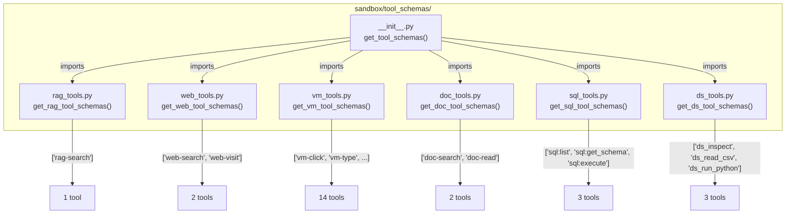
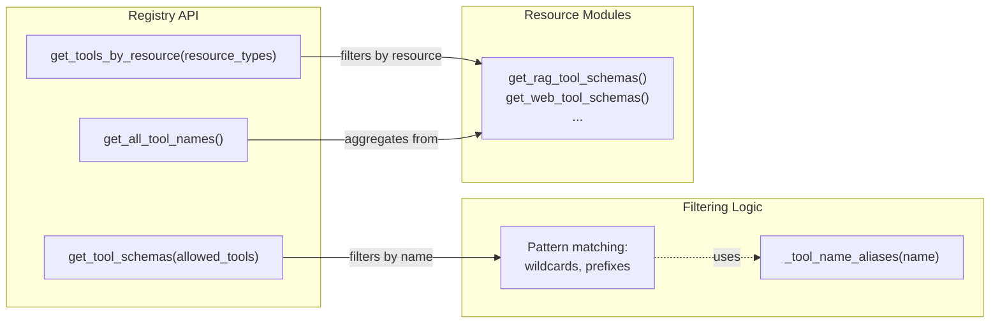
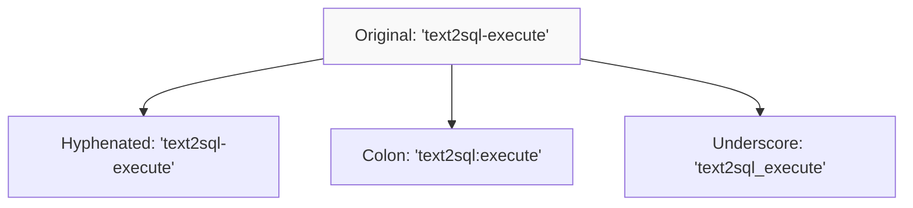
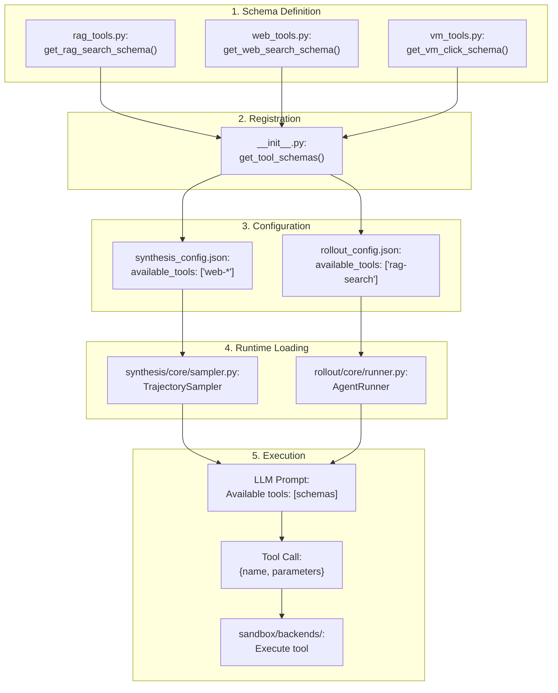
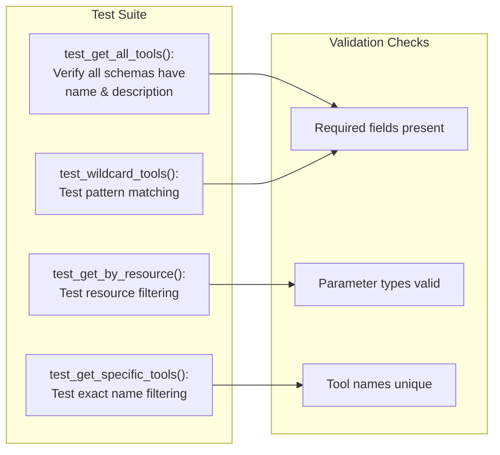

<!-- source: DeepWiki mcp.deepwiki.com · repo OpenDCAI/AgentFlow · page 2.3 Tool Schemas and Abstraction Layer · fetched 2026-11-02 -->

# Tool Schemas and Abstraction Layer

<details>
<summary>Relevant source files</summary>

The following files were used as context for generating this wiki page:

- [README.md](README.md)
- [README_zh.md](README_zh.md)
- [assets/intro.png](assets/intro.png)
- [assets/method.png](assets/method.png)
- [assets/wechat.jpg](assets/wechat.jpg)
- [assets/wechatshow.png](assets/wechatshow.png)
- [rollout/core/runner.py](rollout/core/runner.py)
- [sandbox/tests/test_tool_schemas.py](sandbox/tests/test_tool_schemas.py)
- [sandbox/tool_schemas/__init__.py](sandbox/tool_schemas/__init__.py)
- [sandbox/tool_schemas/doc_tools.py](sandbox/tool_schemas/doc_tools.py)
- [sandbox/tool_schemas/rag_tools.py](sandbox/tool_schemas/rag_tools.py)
- [sandbox/tool_schemas/sql_tools.py](sandbox/tool_schemas/sql_tools.py)
- [sandbox/tool_schemas/vm_tools.py](sandbox/tool_schemas/vm_tools.py)
- [sandbox/tool_schemas/web_tools.py](sandbox/tool_schemas/web_tools.py)
- [synthesis/core/sampler.py](synthesis/core/sampler.py)

</details>


## Overview

The tool schema system provides a **unified abstraction layer** that enables consistent agent interaction across heterogeneous environments (RAG, Web, VM, SQL, Document, Data Science). Tool schemas are JSON-like dictionaries that define the interface for each tool — including its name, description, and parameters — without coupling to the underlying implementation. This separation allows the same agent reasoning code to work across all domains by simply swapping the available tool set.

This page covers tool schema definitions, the registry system, and how schemas flow through the execution pipeline. For information about the actual tool execution backends, see [Backend Resources](#3.2). For how schemas are used during data synthesis, see [Trajectory Sampling](#4.3).

## Tool Schema Format

Each tool schema is a dictionary with the following structure:

| Field | Type | Description |
|-------|------|-------------|
| `name` | `str` | Tool identifier (e.g., `"web-search"`, `"vm-click"`) |
| `description` | `str` | Natural language description of tool functionality |
| `parameters` | `List[Dict]` | Parameter specifications, each with `name`, `type`, `description`, and `required` |

### Parameter Specification

Each parameter dictionary contains:

| Field | Type | Description |
|-------|------|-------------|
| `name` | `str` | Parameter identifier |
| `type` | `str` | Data type: `"string"`, `"integer"`, `"number"`, `"boolean"`, `"array"`, `"object"` |
| `description` | `str` | Natural language parameter description |
| `required` | `bool` | Whether parameter is mandatory |
| `array_type` | `str` | *(Optional)* Element type for array parameters |

**Example Tool Schema:**

```python
{
    "name": "web-search",
    "description": "Perform batched web searches and return top results for each query.",
    "parameters": [
        {
            "name": "query",
            "type": "array",
            "array_type": "string",
            "description": "Array of query strings. Include multiple complementary search queries in a single call.",
            "required": True
        },
        {
            "name": "num_results",
            "type": "integer",
            "description": "Number of results to return per query (default: 5)",
            "required": False
        }
    ]
}
```

**Sources:** [sandbox/tool_schemas/web_tools.py:24-47](), [sandbox/tool_schemas/__init__.py:1-7]()

---

## Resource-Based Tool Organization

Tool schemas are organized into **resource modules** by domain, each exposing a `get_<resource>_tool_schemas()` function that returns a list of schema dictionaries.



### Resource Type Mapping

| Resource Type | Module | Tool Count | Example Tools |
|--------------|--------|------------|---------------|
| `rag` | `rag_tools.py` | 1 | `rag-search` |
| `web` | `web_tools.py` | 2 | `web-search`, `web-visit` |
| `vm` | `vm_tools.py` | 14 | `vm-click`, `vm-type`, `vm-scroll`, `vm-screenshot` |
| `doc` | `doc_tools.py` | 2 | `doc-search`, `doc-read` |
| `sql` | `sql_tools.py` | 3 | `text2sql-list_databases`, `text2sql-get_schema`, `text2sql-execute` |
| `ds` | `ds_tools.py` | 3 | `ds_inspect_data`, `ds_read_csv`, `ds_run_python` |

**Sources:** [sandbox/tool_schemas/__init__.py:10-15](), [sandbox/tool_schemas/vm_tools.py:15-37](), [sandbox/tool_schemas/web_tools.py:11-21]()

---

## Tool Registry System

The central registry in [sandbox/tool_schemas/__init__.py]() provides functions for accessing and filtering tool schemas.

### Registry Functions



#### `get_tool_schemas(allowed_tools)`

Returns all tool schemas, optionally filtered by tool names.

**Parameters:**
- `allowed_tools` (`Optional[List[str]]`): List of tool name patterns. If `None`, returns all tools.

**Filtering Patterns:**
- **Exact name**: `"vm-click"` → matches only `vm-click`
- **Wildcard**: `"vm-*"` → matches all VM tools
- **Prefix**: `"text2sql"` → matches all SQL tools
- **Aliases**: `"vm_click"` → also matches `vm-click` (see Tool Name Aliasing)

**Example:**
```python
from sandbox.tool_schemas import get_tool_schemas

# Get all tools
all_tools = get_tool_schemas()

# Get specific tools
web_tools = get_tool_schemas(["web-search", "web-visit"])

# Use wildcard
vm_tools = get_tool_schemas(["vm-*"])
```

#### `get_all_tool_names()`

Returns a list of all available tool names across all resource types.

```python
from sandbox.tool_schemas import get_all_tool_names

names = get_all_tool_names()
# Returns: ["rag-search", "web-search", "web-visit", "vm-click", ...]
```

#### `get_tools_by_resource(resource_types)`

Filters tools by resource type.

**Parameters:**
- `resource_types` (`List[str]`): Resource identifiers (`"rag"`, `"web"`, `"vm"`, `"doc"`, `"sql"`, `"ds"`)

**Example:**
```python
from sandbox.tool_schemas import get_tools_by_resource

# Get only web and RAG tools
schemas = get_tools_by_resource(["web", "rag"])
```

**Sources:** [sandbox/tool_schemas/__init__.py:34-73](), [sandbox/tool_schemas/__init__.py:76-86](), [sandbox/tool_schemas/__init__.py:89-117]()

---

## Tool Name Aliasing

The registry supports **flexible tool name matching** to accommodate different naming conventions (hyphens, underscores, colons).

### Aliasing Rules

The `_tool_name_aliases(name)` function generates equivalent name variants:



**Supported Transformations:**
- Hyphens (`-`) ↔ Colons (`:`) ↔ Underscores (`_`)

**Example:**
```python
# All of these match the same tool
get_tool_schemas(["text2sql-execute"])
get_tool_schemas(["text2sql:execute"])
get_tool_schemas(["text2sql_execute"])
```

This aliasing is applied during filtering in `get_tool_schemas()` and `get_tools_by_resource()`, ensuring consistent tool access regardless of naming convention used in configuration files.

**Sources:** [sandbox/tool_schemas/__init__.py:18-31](), [sandbox/tool_schemas/__init__.py:50-52]()

---

## Schema Definition Flow

The following diagram illustrates how tool schemas flow from definition to agent execution:



### Integration Points

#### In Synthesis Pipeline

The `TrajectorySampler` loads tool schemas to construct prompts for trajectory exploration:

1. Read `available_tools` from synthesis config
2. Call `get_tool_schemas(allowed_tools)` to filter schemas
3. Convert schemas to prompt format
4. Include in system message for LLM

#### In Rollout Pipeline

The `AgentRunner` uses schemas for model inference:

1. Initialize with `RolloutConfig`
2. Load tool schemas via `get_tool_schemas()`
3. Convert to OpenAI function calling format using `convert_tool_schema_to_openai()`
4. Pass to LLM during multi-turn conversation
5. Execute tool calls via `Sandbox` client

**Key Code Locations:**
- Schema loading: [rollout/core/runner.py:59-70]()
- Schema conversion: [rollout/core/utils.py]() (`convert_tool_schema_to_openai()`)
- Tool execution: [rollout/core/runner.py]() (`_execute_tool_call()`)

**Sources:** [rollout/core/runner.py:37-57](), [rollout/core/runner.py:59-90]()

---

## Example Tool Schema Implementations

### RAG Tool

**Schema:**
```python
{
    "name": "rag-search",
    "description": "Search the pre-built RAG index for the most relevant text chunks.",
    "parameters": [
        {
            "name": "query",
            "type": "string",
            "description": "Search query string",
            "required": True
        },
        {
            "name": "top_k",
            "type": "integer",
            "description": "Number of results to return (default: 5)",
            "required": False
        }
    ]
}
```

**Sources:** [sandbox/tool_schemas/rag_tools.py:23-43]()

### VM Tool

**Schema:**
```python
{
    "name": "vm-click",
    "description": "Click at the given (x, y) coordinate. Returns accessibility_tree.",
    "parameters": [
        {
            "name": "x",
            "type": "integer",
            "description": "X coordinate",
            "required": True
        },
        {
            "name": "y",
            "type": "integer",
            "description": "Y coordinate",
            "required": True
        },
        {
            "name": "button",
            "type": "string",
            "description": "Mouse button: left/right/middle (default: left)",
            "required": False
        }
    ]
}
```

**Sources:** [sandbox/tool_schemas/vm_tools.py:40-55]()

### SQL Tool (Dynamic Registration)

SQL tools use a registration pattern to track dynamically available tools:

```python
_REGISTERED_SQL_TOOLS: List[Dict[str, Any]] = []

def register_sql_tool(schema: Dict[str, Any]) -> Dict[str, Any]:
    _REGISTERED_SQL_TOOLS.append(schema)
    return schema

def get_list_databases_schema() -> Dict[str, Any]:
    return register_sql_tool({
        "name": "text2sql-list_databases",
        "description": "List all available databases that can be queried.",
        "parameters": []
    })
```

This pattern allows backends to register tools at import time.

**Sources:** [sandbox/tool_schemas/sql_tools.py:12-29]()

---

## Schema Validation and Testing

The tool schema system includes automated tests to ensure schema consistency:



**Test Examples:**

```python
def test_get_all_tools():
    """Verify all schemas have required fields"""
    schemas = get_tool_schemas()
    assert len(schemas) > 0
    assert all("name" in s for s in schemas)
    assert all("description" in s for s in schemas)

def test_wildcard_tools():
    """Test wildcard pattern matching"""
    schemas = get_tool_schemas(["vm-*"])
    assert len(schemas) > 0
    assert all(s["name"].startswith("vm-") for s in schemas)
```

**Sources:** [sandbox/tests/test_tool_schemas.py:17-33](), [sandbox/tests/test_tool_schemas.py:35-41]()

---

## Design Principles

The tool schema system follows these architectural principles:

1. **Separation of Concerns**: Schema definitions (interface) are decoupled from backend implementations (execution)
2. **Declarative Configuration**: Tools are defined as pure data structures (JSON-serializable dictionaries)
3. **Resource Modularity**: Each domain (RAG, Web, VM, etc.) maintains its own schema module
4. **Flexible Filtering**: Support for exact matches, wildcards, prefixes, and resource-based selection
5. **Name Normalization**: Aliasing system handles different naming conventions transparently

This design enables:
- **Agent Portability**: Same agent code works across all domains
- **Easy Extension**: Add new tools by creating schema dictionaries
- **Configuration-Driven**: Switch tool sets without code changes
- **Testability**: Schemas can be validated independently of backends

**Sources:** [sandbox/tool_schemas/__init__.py:1-117](), [README.md:53-58]()

---

