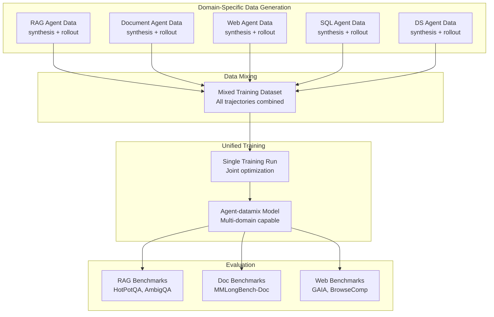
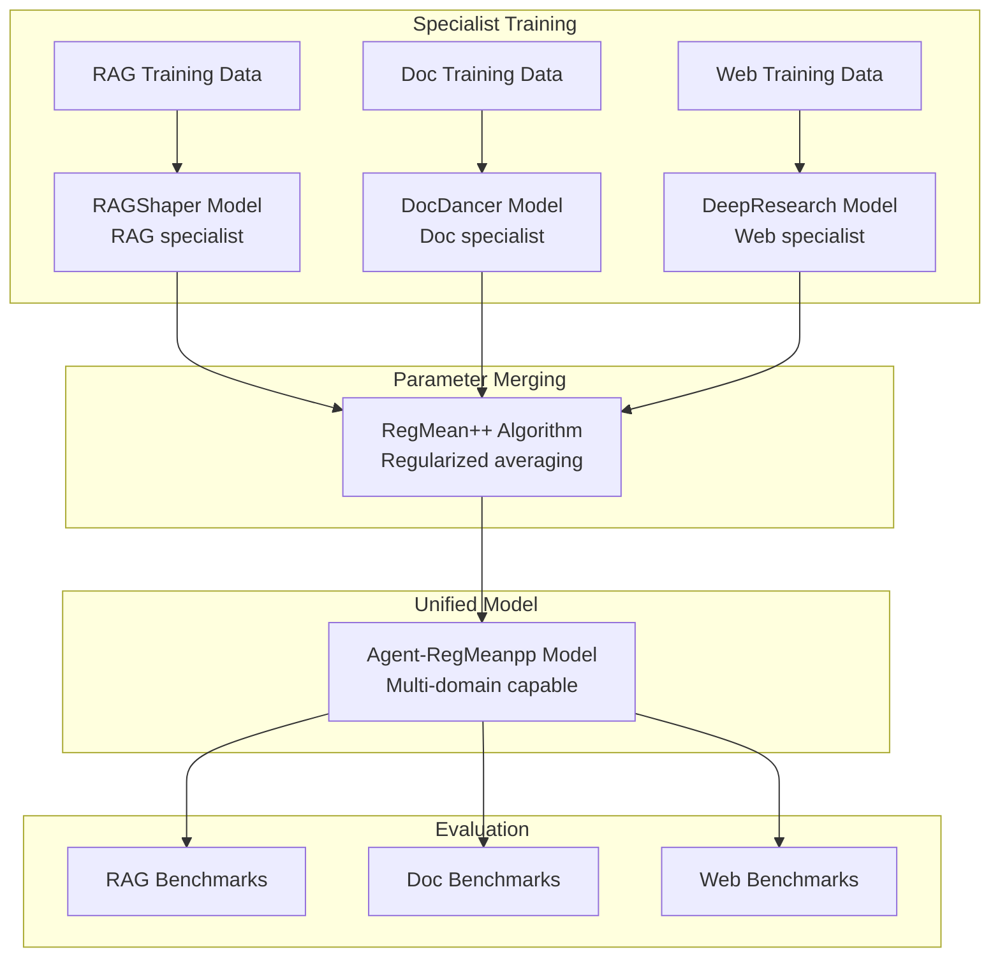
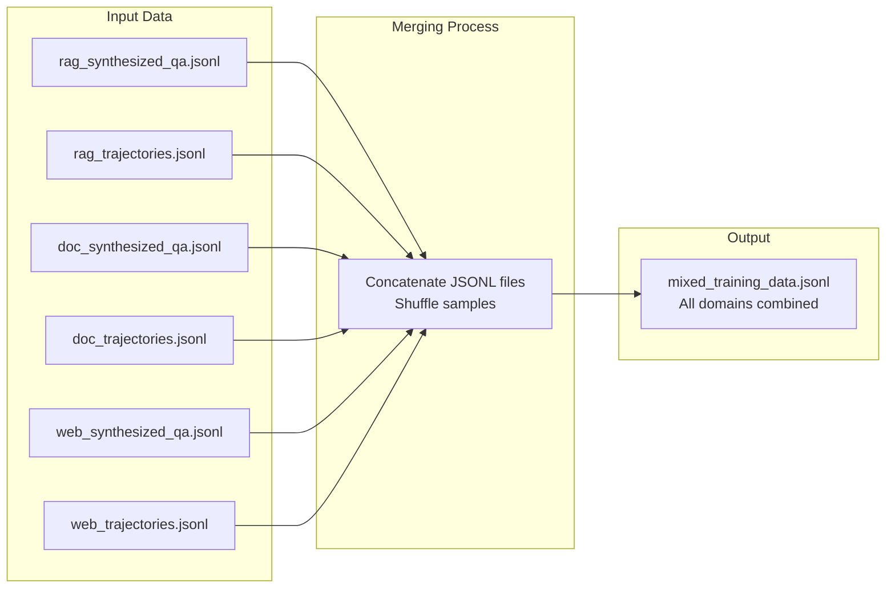
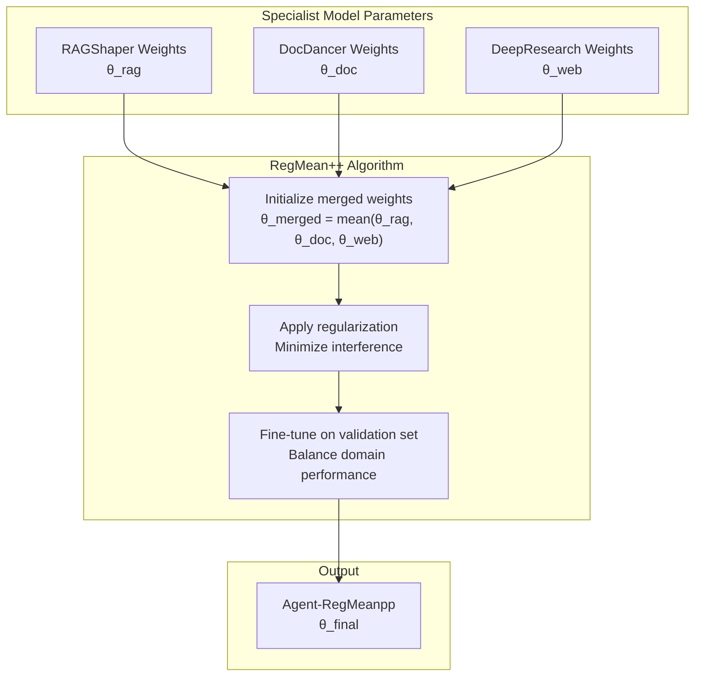
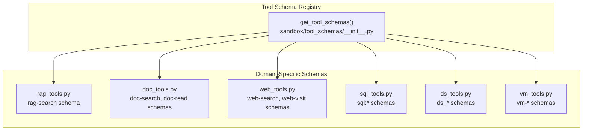

<!-- source: DeepWiki mcp.deepwiki.com · repo OpenDCAI/AgentFlow · page 2.4 Agentic Model Consolidation · fetched 2026-11-02 -->

# Agentic Model Consolidation

<details>
<summary>Relevant source files</summary>

The following files were used as context for generating this wiki page:

- [README.md](README.md)
- [README_zh.md](README_zh.md)
- [assets/intro.png](assets/intro.png)
- [assets/method.png](assets/method.png)
- [assets/wechat.jpg](assets/wechat.jpg)
- [assets/wechatshow.png](assets/wechatshow.png)

</details>


Agentic Model Consolidation is the process of training unified foundation models that can operate across multiple agent domains (RAG, Document, Web, GUI, Text2SQL, Data Science, etc.) rather than maintaining separate specialist models for each domain. AgentFlow explores two distinct consolidation strategies: **data-level consolidation** (mixing trajectories during training) and **parameter-level consolidation** (merging trained specialist models).

For information about the three-stage data synthesis pipeline that generates the training data for these models, see [Three-Stage Data Synthesis Pipeline](#2.1). For details on the individual agent types that contribute data, see [Agent Types and Modalities](#2.2). For information about deploying and using consolidated models, see [Model Deployment with vLLM](#10.2).

---

## Overview and Motivation

Traditional approaches to multi-domain agentic systems require maintaining separate fine-tuned models for each domain (e.g., a RAG specialist, a document specialist, a web browsing specialist). This creates deployment complexity, increases inference costs, and prevents knowledge transfer between domains. Agentic Model Consolidation addresses these challenges by creating single models capable of handling diverse agent tasks.

**Sources:** [README.md:60-62](), [README.md:202-205]()

---

## Consolidation Strategies

### Data-Level Consolidation (Agent-datamix)



Data-level consolidation trains a single model on a mixed dataset containing trajectories from all agent domains. During training, the model learns to handle diverse tool schemas, reasoning patterns, and environment interactions in a unified parameter space.

**Key characteristics:**
- Trajectories from all domains are merged into a single training dataset
- One training run produces a multi-domain model
- Knowledge transfer occurs naturally during joint optimization
- The model learns to adapt its behavior based on available tools and task context

**Sources:** [README.md:62](), [README.md:179](), [README.md:204]()

---

### Parameter-Level Consolidation (Agent-RegMeanpp)



Parameter-level consolidation first trains specialist models independently on domain-specific data, then merges their parameters using regularized mean averaging. This approach preserves specialized knowledge while attempting to combine capabilities.

**Key characteristics:**
- Multiple independent training runs produce specialist models
- Parameter merging occurs post-training using RegMean++ algorithm
- Each specialist maintains domain-specific optimization
- Final model attempts to balance all domain capabilities

**Sources:** [README.md:180](), [README.md:205]()

---

## Training Data Sources

Both consolidation strategies rely on data generated through AgentFlow's synthesis and rollout pipelines. The data sources include:

| Agent Type | Synthesis Path | Rollout Path | Output Format |
|------------|---------------|--------------|---------------|
| RAG | `configs/synthesis/rag_config.json` | `configs/trajectory/rag_trajectory.json` | QA pairs + trajectories |
| Document | `configs/synthesis/doc_config.json` | `configs/trajectory/doc_trajectory.json` | QA pairs + trajectories |
| Web | `configs/synthesis/web_config.json` | `configs/trajectory/web_trajectory.json` | QA pairs + trajectories |
| Text2SQL | `configs/synthesis/text2sql_config.json` | - | QA pairs + trajectories |
| Data Science | `configs/synthesis/ds_config.json` | - | QA pairs + trajectories |

Each agent type generates:
1. **Synthesized QA pairs**: Multi-hop questions with factoid answers derived from trajectory observations
2. **Trajectory data**: Complete agent execution traces including tool calls, observations, and reasoning steps

**Sources:** [README.md:154-158](), [configs/synthesis/](), [configs/trajectory/]()

---

## Performance Comparison

Based on the Qwen3-30B-A3B-Think base model, empirical evaluation demonstrates clear performance differences between consolidation strategies:

### Benchmark Results

| Strategy | Type | GAIA (Acc.) | BC (Acc.) | BC-zh (Acc.) | MMBD (Acc.) | DocB (Acc.) | HotPotQA (EM/F1) | AmbigQA (EM/F1) | Bamboogle (EM/F1) |
|----------|------|-------------|-----------|--------------|-------------|-------------|------------------|-----------------|-------------------|
| **Data Mixing** | Data-level | **64.08** | **28.00** | **34.00** | 63.59 | **83.29** | 38.00 / 42.53 | 49.50 / 58.84 | 53.10 / 60.20 |
| **RegMean++** | Parameter-level | 60.19 | 22.50 | 28.00 | 64.66 | 80.76 | 45.50 / 58.27 | 58.80 / 69.36 | 52.80 / 66.48 |

**Key findings:**
- Data-level consolidation (Agent-datamix) achieves **64.08%** on GAIA vs **60.19%** for parameter-level (Agent-RegMeanpp)
- Web browsing tasks (GAIA, BC, BC-zh) show stronger performance with data-level mixing
- Document tasks show more balanced performance between strategies
- Joint training on mixed trajectories is more effective than post-hoc parameter fusion

**Sources:** [README.md:202-205]()

---

## Implementation: Data-Level Consolidation

### Step 1: Generate Domain-Specific Data

Run synthesis and rollout for each agent type:

```bash
# RAG agent data
python -m synthesis.synthesize --config configs/synthesis/rag_config.json
python -m rollout.pipeline --config configs/trajectory/rag_trajectory.json

# Document agent data
python -m synthesis.synthesize --config configs/synthesis/doc_config.json
python -m rollout.pipeline --config configs/trajectory/doc_trajectory.json

# Web agent data
python -m synthesis.synthesize --config configs/synthesis/web_config.json
python -m rollout.pipeline --config configs/trajectory/web_trajectory.json
```

**Sources:** [README.md:115-129]()

---

### Step 2: Merge Training Data

Combine all generated trajectories and QA pairs into a unified dataset:



Each trajectory record contains:
- `task`: The original question/instruction
- `trajectory`: List of tool calls and observations
- `answer`: Ground truth answer
- `domain`: Source agent type (rag, doc, web, etc.)
- `available_tools`: Tool schema list for this domain

**Sources:** [README.md:202-205]()

---

### Step 3: Train Unified Model

The training process uses the merged dataset with all tool schemas:

```python
# Pseudocode illustrating training configuration
training_config = {
    "data_path": "mixed_training_data.jsonl",
    "model": "Qwen3-30B-A3B-Think",
    "available_tools": [
        # All tool schemas from all domains
        "rag-search",           # RAG domain
        "doc-search", "doc-read",  # Document domain
        "web-search", "web-visit",  # Web domain
        "sql:list_databases", "sql:get_schema", "sql:execute",  # SQL domain
        # ... etc
    ],
    "enable_tool_choice": true,
    "train_batch_size": 128,
    "epochs": 3
}
```

The model learns to:
1. Identify which tools are available for a given task
2. Select appropriate tools based on task requirements
3. Chain tool calls to accomplish multi-step reasoning
4. Adapt behavior across different domains

**Sources:** [README.md:134-141](), [sandbox/tool_schemas/]()

---

## Implementation: Parameter-Level Consolidation

### Step 1: Train Specialist Models

Train separate models for each domain using domain-specific data:

```bash
# Train RAG specialist
python train.py \
    --data rag_training_data.jsonl \
    --model Qwen3-30B-A3B-Think \
    --tools rag-search \
    --output RAGShaper

# Train Document specialist  
python train.py \
    --data doc_training_data.jsonl \
    --model Qwen3-30B-A3B-Think \
    --tools doc-search,doc-read \
    --output DocDancer

# Train Web specialist
python train.py \
    --data web_training_data.jsonl \
    --model Qwen3-30B-A3B-Think \
    --tools web-search,web-visit \
    --output DeepResearch
```

**Sources:** [README.md:174-180]()

---

### Step 2: Parameter Merging with RegMean++



The RegMean++ algorithm:
1. Computes element-wise mean of specialist model parameters
2. Applies regularization to minimize catastrophic forgetting
3. Optionally fine-tunes on a small mixed validation set to balance capabilities

**Sources:** [README.md:180](), [README.md:205]()

---

## Configuration Example: Data-Level Consolidation

The synthesis configurations for different domains share common structure but specify domain-specific tools and resources:

### RAG Synthesis Config (`configs/synthesis/rag_config.json`)
```json
{
    "sandbox_url": "http://localhost:18890",
    "resource_type": "rag",
    "available_tools": ["rag-search"],
    "sampler_model": "gpt-4o-mini",
    "max_depth": 5,
    "branching_factor": 3,
    "qa_generator_model": "gpt-4o-mini"
}
```

### Document Synthesis Config (`configs/synthesis/doc_config.json`)
```json
{
    "sandbox_url": "http://localhost:18890",
    "resource_type": "doc",
    "available_tools": ["doc-search", "doc-read"],
    "sampler_model": "gpt-4o-mini",
    "max_depth": 6,
    "branching_factor": 3,
    "qa_generator_model": "gpt-4o-mini"
}
```

### Web Synthesis Config (`configs/synthesis/web_config.json`)
```json
{
    "sandbox_url": "http://localhost:18890",
    "resource_type": "web",
    "available_tools": ["web-search", "web-visit"],
    "sampler_model": "gpt-4o-mini",
    "max_depth": 5,
    "branching_factor": 2,
    "qa_generator_model": "gpt-4o-mini"
}
```

When creating a consolidated dataset, trajectories from all these configurations are merged while preserving their `available_tools` metadata, allowing the model to learn tool selection based on task context.

**Sources:** [configs/synthesis/rag_config.json](), [configs/synthesis/doc_config.json](), [configs/synthesis/web_config.json]()

---

## Model Deployment

Both consolidated models can be deployed using vLLM with tool-augmented inference:

```bash
# Deploy Agent-datamix
vllm serve \
    --model OpenDCAI/AgentFlow-Qwen3-30B-A3B-Think-DataMix \
    --served-model-name agent-datamix \
    --tensor-parallel-size 8 \
    --enable-auto-tool-choice \
    --tool-call-parser hermes \
    --port 8222

# Deploy Agent-RegMeanpp
vllm serve \
    --model OpenDCAI/AgentFlow-Qwen3-30B-A3B-Think-RegMeanpp \
    --served-model-name agent-regmeanpp \
    --tensor-parallel-size 8 \
    --enable-auto-tool-choice \
    --tool-call-parser hermes \
    --port 8223
```

The deployed models support dynamic tool schemas - they can handle any subset of tools they were trained on:

```python
# Example inference with different tool configurations
import openai

client = openai.OpenAI(base_url="http://localhost:8222/v1")

# RAG task with rag-search tool
response = client.chat.completions.create(
    model="agent-datamix",
    messages=[{"role": "user", "content": "What is the capital of France?"}],
    tools=[{"type": "function", "function": RAG_SEARCH_SCHEMA}]
)

# Document task with doc-search and doc-read tools
response = client.chat.completions.create(
    model="agent-datamix",
    messages=[{"role": "user", "content": "Analyze this PDF document..."}],
    tools=[
        {"type": "function", "function": DOC_SEARCH_SCHEMA},
        {"type": "function", "function": DOC_READ_SCHEMA}
    ]
)
```

**Sources:** [README.md:134-141]()

---

## Choosing a Consolidation Strategy

### Use Data-Level Consolidation When:

- **Starting from scratch**: No existing specialist models
- **Maximizing cross-domain performance**: Web browsing and general tasks benefit most
- **Enabling knowledge transfer**: Want the model to share reasoning patterns across domains
- **Computational resources available**: Can afford one large training run on mixed data

### Use Parameter-Level Consolidation When:

- **Specialist models already exist**: Have pre-trained domain experts to combine
- **Preserving specialist capabilities**: Want to maintain domain-specific optimizations
- **Limited training compute**: Can train specialists separately on different machines
- **Experimentation flexibility**: Can easily swap in/out different specialist models

### Performance Trade-offs

Based on benchmark results, data-level consolidation generally outperforms parameter-level merging:
- **Web tasks advantage**: +3.89% on GAIA, +5.5% on BC, +6.0% on BC-zh
- **Document tasks**: Mixed results, with slight advantages varying by benchmark
- **RAG tasks**: Parameter-level shows strength on some metrics (e.g., Bamboogle F1)

**Sources:** [README.md:202-205]()

---

## Advanced Topics

### Tool Schema Compatibility

For consolidation to work effectively, tool schemas across domains must be properly structured. AgentFlow uses a unified tool schema format registered in the sandbox server:



All tools follow the same structural format, ensuring the consolidated model can handle any tool it encounters during inference.

**Sources:** [sandbox/tool_schemas/__init__.py](), [sandbox/tool_schemas/rag_tools.py](), [sandbox/tool_schemas/doc_tools.py](), [sandbox/tool_schemas/web_tools.py]()

---

### Scaling to Additional Domains

To add a new domain to an existing consolidated model:

1. **Generate domain-specific data** using synthesis and rollout pipelines
2. **Re-train data-level model** with expanded dataset including new domain
3. **For parameter-level**: Train new specialist, then re-merge all specialists

The modular architecture makes adding new agent types straightforward - simply implement the tool schemas and backend, then follow the standard consolidation workflow.

**Sources:** [README.md:57-58]()

---

## Related Model Family

AgentFlow provides pre-trained models for both consolidation strategies and individual specialists:

| Model Type | HuggingFace Path | Description |
|------------|------------------|-------------|
| Data-level | `OpenDCAI/AgentFlow-Qwen3-30B-A3B-Think-DataMix` | Multi-domain via trajectory mixing |
| Parameter-level | `OpenDCAI/AgentFlow-Qwen3-30B-A3B-Think-RegMeanpp` | Multi-domain via parameter merging |
| RAG Specialist | `OpenDCAI/AgentFlow-Qwen3-30B-A3B-Think-RAGShaper` | RAG-only specialist |
| Doc Specialist | `OpenDCAI/AgentFlow-Qwen3-30B-A3B-Think-DocDancer` | Document-only specialist |
| Web Specialist | `OpenDCAI/AgentFlow-Qwen3-30B-A3B-Think-Web` | Web browsing specialist |

**Sources:** [README.md:174-180]()

---

