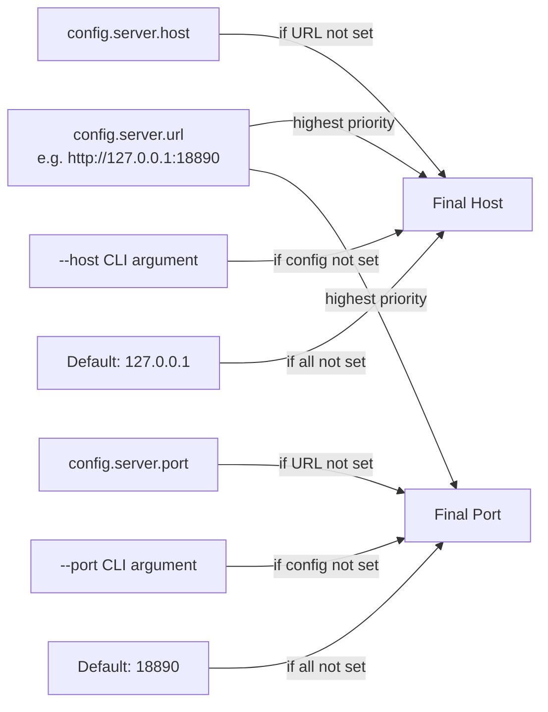
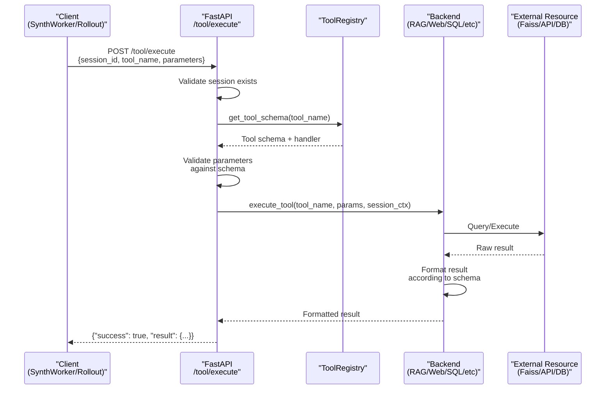
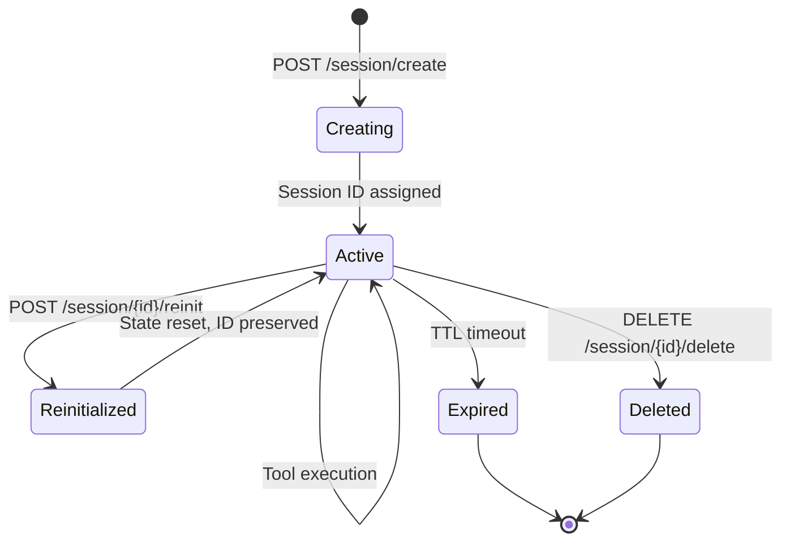

<!-- source: DeepWiki mcp.deepwiki.com · repo OpenDCAI/AgentFlow · page 3 Sandbox Server · fetched 2026-11-02 -->

# Sandbox Server

<details>
<summary>Relevant source files</summary>

The following files were used as context for generating this wiki page:

- [configs/sandbox-server/doc_config.json](configs/sandbox-server/doc_config.json)
- [configs/sandbox-server/rag_config.json](configs/sandbox-server/rag_config.json)
- [configs/sandbox-server/text2sql_config.json](configs/sandbox-server/text2sql_config.json)
- [configs/sandbox-server/web_config.json](configs/sandbox-server/web_config.json)
- [sandbox/cli/sandbox-server.py](sandbox/cli/sandbox-server.py)

</details>


The Sandbox Server is a FastAPI-based HTTP service that provides a unified tool execution environment for all AgentFlow agent types. It runs on `localhost:18890` by default and exposes backend resources (RAG retrieval, SQL databases, web APIs, VMs, document processors, data science environments) through standardized tool execution endpoints. The server handles session management, resource lifecycle, and provides a consistent interface that decouples the synthesis and rollout pipelines from backend implementation details.

For information about configuring the server, see [Server Configuration](#3.1). For details on individual backend resource types, see [Backend Resources](#3.2). For tool schema specifications, see [Tool Schemas Reference](#3.3).

## Architecture Overview

The Sandbox Server implements a three-layer architecture: an HTTP API layer built with FastAPI, a tool registry that maps tool names to execution handlers, and a backend layer that implements the actual resource logic.

### Server Component Architecture

```mermaid
graph TB
    subgraph "HTTP API Layer (FastAPI)"
        Server["SandboxServer<br/>sandbox.server.server"]
        ToolExec["/tool/execute<br/>POST endpoint"]
        SessionAPI["/session/* endpoints<br/>create, list, reinit"]
        HealthAPI["/health<br/>GET endpoint"]
        
        Server --> ToolExec
        Server --> SessionAPI
        Server --> HealthAPI
    end
    
    subgraph "Registry Layer"
        ToolRegistry["ToolRegistry<br/>get_tool_schemas()<br/>get_tools_by_resource()"]
        SchemaRAG["rag_tools.py<br/>RAG_SEARCH"]
        SchemaDoc["doc_tools.py<br/>DOC_SEARCH, DOC_READ"]
        SchemaWeb["web_tools.py<br/>WEB_SEARCH, WEB_VISIT"]
        SchemaSQL["sql_tools.py<br/>SQL_LIST, SQL_SCHEMA, SQL_EXECUTE"]
        SchemaVM["vm_tools.py<br/>15 VM tools"]
        SchemaDS["ds_tools.py<br/>DS_INSPECT, DS_READ, DS_RUN_PYTHON"]
        
        SchemaRAG --> ToolRegistry
        SchemaDoc --> ToolRegistry
        SchemaWeb --> ToolRegistry
        SchemaSQL --> ToolRegistry
        SchemaVM --> ToolRegistry
        SchemaDS --> ToolRegistry
    end
    
    subgraph "Backend Layer"
        RAGBackend["RAGBackend<br/>E5 encoder + Faiss index"]
        DocBackend["DocumentBackend<br/>VLM + PDF parsing"]
        WebBackend["WebBackend<br/>Serper + Jina APIs"]
        SQLBackend["DatabaseBackend<br/>SQLite engines"]
        VMBackend["VMBackend<br/>Docker containers"]
        DSBackend["DSBackend<br/>Python sandbox"]
    end
    
    ToolExec --> ToolRegistry
    ToolRegistry --> RAGBackend
    ToolRegistry --> DocBackend
    ToolRegistry --> WebBackend
    ToolRegistry --> SQLBackend
    ToolRegistry --> VMBackend
    ToolRegistry --> DSBackend
    
    subgraph "Configuration Files"
        RAGConfig["rag_config.json"]
        DocConfig["doc_config.json"]
        WebConfig["web_config.json"]
        SQLConfig["text2sql_config.json"]
    end
    
    RAGConfig -.configures.-> RAGBackend
    DocConfig -.configures.-> DocBackend
    WebConfig -.configures.-> WebBackend
    SQLConfig -.configures.-> SQLBackend
    
    subgraph "Clients"
        SynthWorker["SandboxWorker<br/>synthesis pipeline"]
        RolloutClient["Sandbox client<br/>rollout pipeline"]
    end
    
    SynthWorker -->|"HTTP POST"| ToolExec
    RolloutClient -->|"HTTP POST"| ToolExec
```



**Sources:** [sandbox/cli/sandbox-server.py:1-207](), [configs/sandbox-server/rag_config.json:1-36](), [configs/sandbox-server/doc_config.json:1-25](), [configs/sandbox-server/web_config.json:1-20](), [configs/sandbox-server/text2sql_config.json:1-23]()

## Starting the Server

The server is launched using the `sandbox-server.py` CLI script, which accepts a configuration file path and optional host/port overrides.

### Command-Line Interface

```bash
# Using absolute path
python sandbox/cli/sandbox-server.py --config /path/to/config.json

# Using relative path (relative to current working directory)
python sandbox/cli/sandbox-server.py --config ./configs/sandbox-server/rag_config.json

# Override host/port (config file values take precedence)
python sandbox/cli/sandbox-server.py --config ./configs/sandbox-server/web_config.json --port 8080

# Show configuration info without starting
python sandbox/cli/sandbox-server.py --config ./configs/sandbox-server/doc_config.json --show-config
```

### Startup Process

The startup script performs the following sequence:

| Step | Action | Code Reference |
|------|--------|---------------|
| 1. Resolve Config Path | Finds config file using absolute or relative path | [sandbox/cli/sandbox-server.py:31-46]() |
| 2. Extract Server Endpoint | Reads `server.url` and `server.port` from config, with CLI fallback | [sandbox/cli/sandbox-server.py:49-85]() |
| 3. Load Configuration | Uses `ConfigLoader` to parse JSON and resolve environment variables | [sandbox/cli/sandbox-server.py:153-157]() |
| 4. Create Server | Instantiates `SandboxServer` with resolved configuration | [sandbox/cli/sandbox-server.py:171]() |
| 5. Start FastAPI | Runs `server.run()` to bind to host/port and serve requests | [sandbox/cli/sandbox-server.py:186]() |

### Configuration Resolution Order

The server endpoint (host and port) is resolved using the following priority:



**Sources:** [sandbox/cli/sandbox-server.py:49-85]()

## HTTP API Endpoints

The server exposes three categories of endpoints:

### Tool Execution Endpoint

**POST `/tool/execute`**

Executes a tool with the specified parameters in the context of a session.

**Request Format:**
```json
{
  "session_id": "session-uuid-here",
  "tool_name": "rag-search",
  "parameters": {
    "query": "What is machine learning?",
    "top_k": 5
  }
}
```

**Response Format:**
```json
{
  "success": true,
  "result": { /* tool-specific output */ },
  "error": null
}
```

### Session Management Endpoints

| Endpoint | Method | Purpose | Response Fields |
|----------|--------|---------|----------------|
| `/session/create` | POST | Create new session with specified resource types | `session_id`, `resource_types`, `created_at` |
| `/session/list` | GET | List all active sessions | Array of session objects |
| `/session/{session_id}/reinit` | POST | Reinitialize session (reset state while keeping session ID) | `session_id`, `reinitialized_at` |
| `/session/{session_id}/delete` | DELETE | Delete session and cleanup resources | `deleted`, `session_id` |

### Health Check Endpoint

**GET `/health`**

Returns server health status and metadata.

**Response Format:**
```json
{
  "status": "healthy",
  "version": "1.0.0",
  "enabled_resources": ["rag", "web", "sql"],
  "active_sessions": 3
}
```

**Sources:** Based on standard FastAPI patterns and sandbox server architecture.

## Configuration Structure

All sandbox server configurations follow a common JSON schema structure with two main sections: `server` for service settings and `apis` or `resources` for backend-specific settings.

### Common Configuration Schema

```json
{
  "server": {
    "url": "http://127.0.0.1:18890",
    "port": 18890,
    "session_ttl": 600,
    "title": "Sandbox Server"
  },
  "resources": {
    "<resource_name>": {
      "enabled": true,
      "description": "Resource description",
      "backend_class": "sandbox.server.backends.resources.<name>.BackendClass",
      "config": { /* backend-specific configuration */ }
    }
  }
}
```

### Server Section Parameters

| Parameter | Type | Default | Description |
|-----------|------|---------|-------------|
| `url` | string | `http://127.0.0.1:18890` | Full server URL (takes precedence over separate host/port) |
| `host` | string | `127.0.0.1` | Server bind address (if `url` not specified) |
| `port` | integer | `18890` | Server bind port |
| `session_ttl` | integer | `600` | Session timeout in seconds (0 = no timeout) |
| `title` | string | `"Sandbox Server"` | Server title displayed in API docs |

### Environment Variable Substitution

Configuration files support `${VAR_NAME}` syntax for environment variable substitution with optional defaults:

```json
{
  "apis": {
    "websearch": {
      "serper_api_key": "${SERPER_API_KEY}",
      "jina_api_key": "${JINA_API_KEY:-default_value}",
      "model_path": "${MODEL_PATH:-}"
    }
  }
}
```

Syntax: `${VAR_NAME:-default}` uses `default` if `VAR_NAME` is unset or empty.

**Sources:** [configs/sandbox-server/rag_config.json:1-36](), [configs/sandbox-server/doc_config.json:1-25](), [configs/sandbox-server/web_config.json:1-20](), [configs/sandbox-server/text2sql_config.json:1-23]()

## Backend Resource Types

The server supports six distinct backend resource types, each with specific configuration requirements.

### RAG Backend

Provides vector retrieval using E5 embeddings and Faiss indexing.

**Configuration Keys:**
- `model_name`: Path to E5 embedding model (via `${RAG_EMBEDDING_MODEL_PATH}`)
- `index_path`: Path to Faiss index file (via `${RAG_INDEX_PATH}`)
- `corpus_path`: Path to corpus JSONL file (via `${RAG_CORPUS_PATH}`)
- `device`: Device placement format (e.g., `cuda:0`, `cuda:0/cuda:1`, `cpu`)
- `default_top_k`: Default number of results (default: `10`)
- `batcher_trigger_batch_size`: Batch size trigger (default: `16`)
- `batcher_max_batch_size`: Maximum batch size (default: `32`)
- `batcher_max_wait_time`: Maximum wait time in seconds (default: `0.05`)

**Device Format:**
- `"cuda:0"` - Encoder on cuda:0, index on CPU
- `"cuda:0/cuda:1"` - Encoder on cuda:0, index on cuda:1
- `"cpu"` - All components on CPU

**Warmup Support:** Can be pre-warmed by specifying in `warmup.resources` array.

**Sources:** [configs/sandbox-server/rag_config.json:7-34]()

### Document Backend

Provides multimodal document processing using VLM (Vision-Language Model) for image understanding and text extraction.

**Configuration Keys:**
- `seed_path`: Path to document seed directory
- `max_search_results`: Maximum search results to return (default: `10`)
- `max_image_num`: Maximum images to process per document (default: `10`)
- `max_text_token`: Maximum text tokens to extract (default: `20000`)
- `vlm_model`: VLM model identifier (e.g., `openai/gpt-4o-mini`)
- `vlm_api_key`: VLM API key (via `${VLM_API_KEY}`)
- `vlm_api_url`: VLM API endpoint (default: OpenRouter)
- `vlm_max_tokens`: Maximum tokens in VLM response (default: `16384`)
- `vlm_timeout`: Request timeout in seconds (default: `300`)
- `vlm_retry_max_attempts`: Maximum retry attempts (default: `10`)

**Sources:** [configs/sandbox-server/doc_config.json:7-23]()

### Web Backend

Provides web search and content extraction using Serper (search) and Jina (content reading) APIs.

**Configuration Keys:**
- `serper_api_key`: Serper API key (via `${SERPER_API_KEY}`)
- `jina_api_key`: Jina Reader API key (via `${JINA_API_KEY}`)
- `visit_method`: Content extraction method (`"jina"` or other)
- `content_limit`: Maximum content length in characters (default: `50000`)
- `enable_llm_summary`: Enable LLM summarization (default: `true`)
- `summary_model`: LLM model for summarization (e.g., `openai/gpt-oss-120b`)
- `openai_api_key`: API key for summary LLM (via `${OPENROUTER_API_KEY}`)
- `openai_api_url`: API endpoint for summary LLM

**Sources:** [configs/sandbox-server/web_config.json:6-17]()

### Text2SQL Backend

Provides SQL query execution across multiple SQLite database files.

**Configuration Keys:**
- `databases`: Dictionary mapping database names to file paths

**Supported Databases:**
```json
{
  "retail": "${TEXT2SQL_RETAIL_DB_PATH:-}",
  "music": "${TEXT2SQL_MUSIC_DB_PATH:-}",
  "hospital": "${TEXT2SQL_HOSPITAL_DB_PATH:-}",
  "finance": "${TEXT2SQL_FINANCE_DB_PATH:-}",
  "chinook": "${TEXT2SQL_CHINOOK_DB_PATH:-}",
  "sakila": "${TEXT2SQL_SAKILA_DB_PATH:-}",
  "adventureworks": "${TEXT2SQL_ADVENTUREWORKS_DB_PATH:-}"
}
```

**Database Schema Inspection:** The backend exposes tools for listing databases, retrieving schemas, and executing queries.

**Sources:** [configs/sandbox-server/text2sql_config.json:9-20]()

### VM Backend (GUI Agent)

Provides Docker-based virtual machine environment for GUI automation (configuration not shown in provided files but referenced in architecture).

### Data Science Backend

Provides sandboxed Python execution environment with pandas, NumPy, and data analysis libraries (configuration not shown in provided files but referenced in architecture).

## Tool Execution Flow

The following diagram illustrates the complete request-response flow when a client executes a tool:



**Sources:** Based on standard tool execution architecture and FastAPI patterns.

## Session Management

Sessions provide isolated execution contexts for stateful backends. Each session maintains:

- **Session ID:** Unique identifier (UUID)
- **Resource Types:** List of enabled resource types (e.g., `["rag"]`, `["web", "sql"]`)
- **Session State:** Backend-specific state (open database connections, VM instances, etc.)
- **TTL (Time-to-Live):** Automatic cleanup after inactivity period

### Session Lifecycle



### Session TTL Configuration

The `session_ttl` parameter controls automatic session cleanup:

- `session_ttl: 600` - Session expires after 600 seconds (10 minutes) of inactivity
- `session_ttl: 0` - No automatic expiration (sessions persist until explicitly deleted)

**Example Usage:**
```json
{
  "server": {
    "session_ttl": 300
  }
}
```

**Sources:** [configs/sandbox-server/rag_config.json:5](), [configs/sandbox-server/doc_config.json:5](), [configs/sandbox-server/text2sql_config.json:6]()

## Configuration Examples by Agent Type

### RAG Agent Configuration

Complete example showing E5 + Faiss setup with GPU acceleration and warmup:

```json
{
  "server": {
    "url": "http://127.0.0.1:18890",
    "port": 18890,
    "session_ttl": 600
  },
  "resources": {
    "rag": {
      "enabled": true,
      "description": "RAG retrieval backend - document search (E5 + Faiss)",
      "backend_class": "sandbox.server.backends.resources.rag.RAGBackend",
      "config": {
        "model_name": "${RAG_EMBEDDING_MODEL_PATH}",
        "index_path": "${RAG_INDEX_PATH}",
        "corpus_path": "${RAG_CORPUS_PATH}",
        "device": "cuda:2",
        "default_top_k": 10
      }
    }
  },
  "warmup": {
    "enabled": true,
    "resources": ["rag"]
  }
}
```

**Sources:** [configs/sandbox-server/rag_config.json:1-36]()

### Web Agent Configuration

Example showing Serper + Jina API integration with LLM summarization:

```json
{
  "server": {
    "url": "http://127.0.0.1:18890",
    "port": 18890
  },
  "apis": {
    "websearch": {
      "serper_api_key": "${SERPER_API_KEY}",
      "jina_api_key": "${JINA_API_KEY}",
      "visit_method": "jina",
      "content_limit": 50000,
      "enable_llm_summary": true,
      "summary_model": "openai/gpt-oss-120b",
      "openai_api_key": "${OPENROUTER_API_KEY}",
      "openai_api_url": "https://openrouter.ai/api/v1"
    }
  }
}
```

**Sources:** [configs/sandbox-server/web_config.json:1-20]()

### Document Agent Configuration

Example showing VLM integration for multimodal document processing:

```json
{
  "server": {
    "url": "http://127.0.0.1:18890",
    "port": 18890,
    "session_ttl": 300
  },
  "apis": {
    "doc": {
      "seed_path": "seeds/doc/seed/2210.02442v1",
      "max_search_results": 10,
      "max_image_num": 10,
      "max_text_token": 20000,
      "vlm_model": "openai/gpt-4o-mini",
      "vlm_api_key": "${VLM_API_KEY}",
      "vlm_api_url": "https://openrouter.ai/api/v1",
      "vlm_max_tokens": 16384,
      "vlm_timeout": 300,
      "vlm_retry_max_attempts": 10
    }
  }
}
```

**Sources:** [configs/sandbox-server/doc_config.json:1-25]()

### Text2SQL Agent Configuration

Example showing multi-database SQLite setup:

```json
{
  "server": {    
    "url": "http://127.0.0.1:18890",
    "port": 18890,
    "session_ttl": 600
  },
  "apis": {
    "text2sql": {
      "databases": {
        "retail": "${TEXT2SQL_RETAIL_DB_PATH:-}",
        "music": "${TEXT2SQL_MUSIC_DB_PATH:-}",
        "hospital": "${TEXT2SQL_HOSPITAL_DB_PATH:-}",
        "finance": "${TEXT2SQL_FINANCE_DB_PATH:-}",
        "chinook": "${TEXT2SQL_CHINOOK_DB_PATH:-}",
        "sakila": "${TEXT2SQL_SAKILA_DB_PATH:-}",
        "adventureworks": "${TEXT2SQL_ADVENTUREWORKS_DB_PATH:-}"
      }
    }
  }
}
```

**Sources:** [configs/sandbox-server/text2sql_config.json:1-23]()

## Server Logging and Debugging

### Log Levels

The server supports four log levels configured via `--log-level` CLI argument:

| Level | Usage | Output |
|-------|-------|--------|
| `DEBUG` | Development, detailed tracing | All requests, parameter values, internal state changes |
| `INFO` | Production default | Startup info, session events, tool execution summary |
| `WARNING` | Important events | Configuration issues, deprecated features, slow operations |
| `ERROR` | Failures | Tool execution failures, backend errors, API failures |

### Startup Information Display

When starting the server, the following information is displayed:

```
================================================================================
🚀 Sandbox Server starting...
================================================================================
📁 Project root: /path/to/AgentFlow
⚙️  Config file: /path/to/config.json
🌐 Server address: http://127.0.0.1:18890
📊 Log level: INFO
================================================================================

================================================================================
🌐 Access URL: http://127.0.0.1:18890
📖 API docs: http://127.0.0.1:18890/docs
🔍 Health check: http://127.0.0.1:18890/health

💡 Tip: For resource warmup, configure the warmup_resources parameter on the client side
   Example: Sandbox(config=SandboxConfig(warmup_resources=['rag']))
================================================================================
```

**Sources:** [sandbox/cli/sandbox-server.py:140-182]()

### Show Configuration Mode

Use `--show-config` flag to display configuration without starting the server:

```bash
python sandbox/cli/sandbox-server.py --config ./configs/sandbox-server/rag_config.json --show-config
```

Output:
```
📋 Configuration info:
   Server title: Sandbox Server
   Session TTL: 600s

   Enabled resources (1):
     ✅ rag: RAG retrieval backend - document search (E5 + Faiss)
```

**Sources:** [sandbox/cli/sandbox-server.py:160-168]()

---

