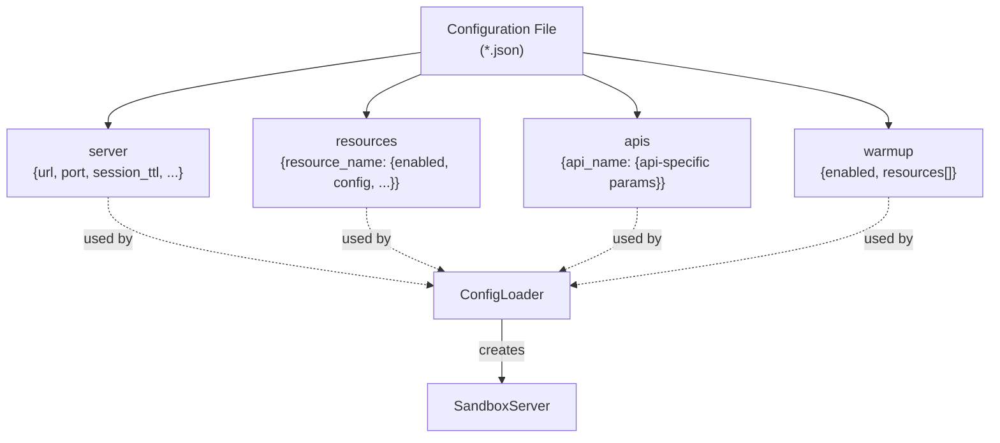
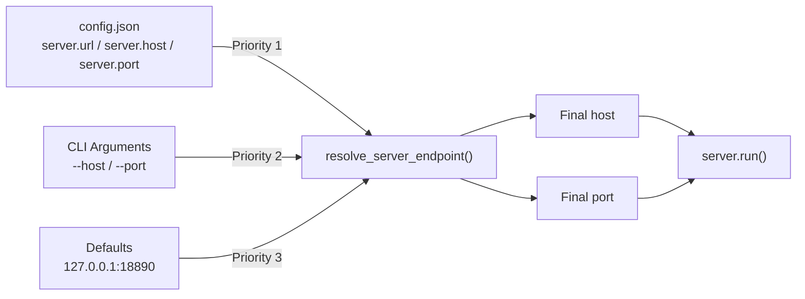
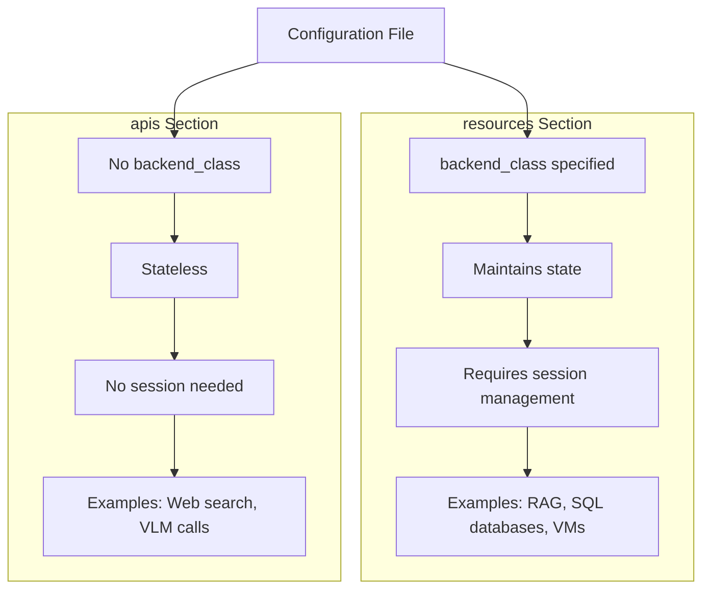
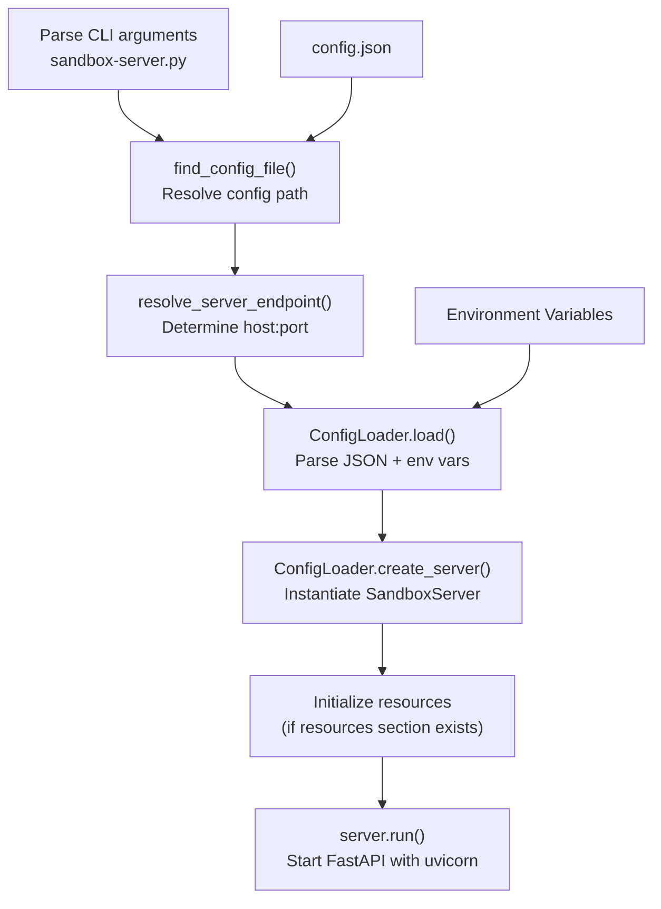
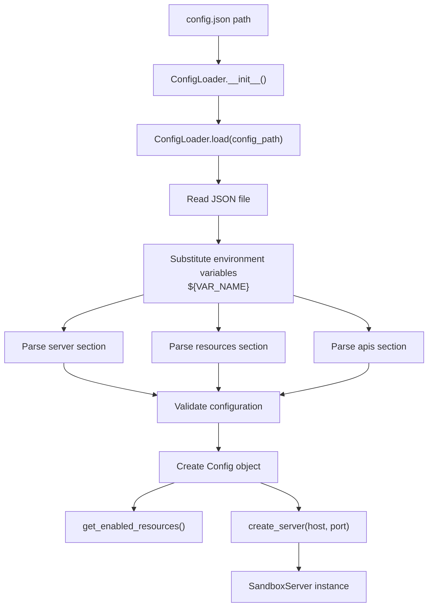

<!-- source: DeepWiki mcp.deepwiki.com · repo OpenDCAI/AgentFlow · page 3.1 Server Configuration · fetched 2026-11-02 -->

# Server Configuration

<details>
<summary>Relevant source files</summary>

The following files were used as context for generating this wiki page:

- [configs/sandbox-server/doc_config.json](configs/sandbox-server/doc_config.json)
- [configs/sandbox-server/rag_config.json](configs/sandbox-server/rag_config.json)
- [configs/sandbox-server/text2sql_config.json](configs/sandbox-server/text2sql_config.json)
- [configs/sandbox-server/web_config.json](configs/sandbox-server/web_config.json)
- [sandbox/cli/sandbox-server.py](sandbox/cli/sandbox-server.py)

</details>


This page documents the configuration parameters and structure for the AgentFlow Sandbox Server. It covers the JSON configuration file format, server section parameters, resource/API configuration, environment variable substitution, and how configurations are loaded at startup.

For information about specific backend resource types and their configuration parameters, see [Backend Resources](#3.2). For details on tool schemas exposed by the server, see [Tool Schemas Reference](#3.3). For session lifecycle management, see [Session Management](#3.4).

---

## Configuration File Structure

Sandbox server configurations are stored as JSON files in the `configs/sandbox-server/` directory. Each configuration file defines a complete server setup for a specific agent type or use case.

### Top-Level Sections



**Configuration Section Summary:**

| Section | Required | Purpose |
|---------|----------|---------|
| `server` | Yes | Defines server network settings and global parameters |
| `resources` | No | Configures stateful backend resources (e.g., RAG, SQL databases) |
| `apis` | No | Configures stateless API integrations (e.g., web search, VLM) |
| `warmup` | No | Specifies resources to pre-initialize on server startup |

**Sources:** [configs/sandbox-server/rag_config.json:1-35](), [configs/sandbox-server/doc_config.json:1-23](), [configs/sandbox-server/web_config.json:1-18](), [configs/sandbox-server/text2sql_config.json:1-22]()

---

## Server Section Parameters

The `server` section defines core network and operational parameters for the sandbox server instance.

### Parameter Reference

| Parameter | Type | Required | Default | Description |
|-----------|------|----------|---------|-------------|
| `url` | string | No | `http://127.0.0.1:18890` | Full server URL including protocol, host, and port |
| `host` | string | No | extracted from `url` | Server bind address (alternative to `url`) |
| `port` | integer | No | `18890` | Server listen port |
| `session_ttl` | integer | No | N/A | Session time-to-live in seconds; sessions expire after this period of inactivity |
| `title` | string | No | Auto-generated | Server title displayed in API documentation |

### Parameter Resolution Priority

The server address is resolved using the following priority (highest to lowest):

1. `server.url` in configuration file (hostname and port extracted)
2. `server.host` and `server.port` in configuration file
3. CLI arguments `--host` and `--port`
4. Default values: `host=127.0.0.1`, `port=18890`



**Sources:** [sandbox/cli/sandbox-server.py:49-85](), [configs/sandbox-server/rag_config.json:2-6]()

### Example Configurations

**Minimal configuration (defaults):**
```json
{
  "server": {
    "url": "http://127.0.0.1:18890"
  }
}
```

**Configuration with session management:**
```json
{
  "server": {
    "url": "http://127.0.0.1:18890",
    "port": 18890,
    "session_ttl": 600
  }
}
```

**Sources:** [configs/sandbox-server/text2sql_config.json:3-7](), [configs/sandbox-server/doc_config.json:2-6]()

---

## Resources vs APIs Configuration

The configuration file supports two distinct patterns for defining backend capabilities: `resources` and `apis`. Understanding when to use each is critical for proper server setup.

### Resources Section

The `resources` section defines **stateful backends** that manage persistent state across multiple requests and require session management. Resources are instantiated once and shared across sessions.

**Structure:**
```json
{
  "resources": {
    "resource_name": {
      "enabled": true,
      "description": "Human-readable description",
      "backend_class": "fully.qualified.BackendClass",
      "config": {
        "resource_specific_param1": "value1",
        "resource_specific_param2": "value2"
      }
    }
  }
}
```

**Example (RAG Backend):**
```json
{
  "resources": {
    "rag": {
      "enabled": true,
      "description": "RAG retrieval backend - document search (E5 + Faiss)",
      "backend_class": "sandbox.server.backends.resources.rag.RAGBackend",
      "config": {
        "model_name": "${RAG_EMBEDDING_MODEL_PATH}",
        "index_path": "${RAG_INDEX_PATH}",
        "corpus_path": "${RAG_CORPUS_PATH}",
        "device": "cuda:2",
        "default_top_k": 10
      }
    }
  }
}
```

**Sources:** [configs/sandbox-server/rag_config.json:7-29]()

### APIs Section

The `apis` section defines **stateless API integrations** that do not maintain session state. API configurations are typically consumed directly by tool implementations.

**Structure:**
```json
{
  "apis": {
    "api_name": {
      "param1": "value1",
      "param2": "value2"
    }
  }
}
```

**Example (Web Search API):**
```json
{
  "apis": {
    "websearch": {
      "serper_api_key": "${SERPER_API_KEY}",
      "jina_api_key": "${JINA_API_KEY}",
      "visit_method": "jina",
      "content_limit": 50000,
      "enable_llm_summary": true,
      "summary_model": "openai/gpt-oss-120b"
    }
  }
}
```

**Sources:** [configs/sandbox-server/web_config.json:6-17]()

**Example (Document VLM API):**
```json
{
  "apis": {
    "doc": {
      "seed_path": "seeds/doc/seed/2210.02442v1",
      "max_search_results": 10,
      "vlm_model": "openai/gpt-4o-mini",
      "vlm_api_key": "${VLM_API_KEY}",
      "vlm_api_url": "https://openrouter.ai/api/v1"
    }
  }
}
```

**Sources:** [configs/sandbox-server/doc_config.json:7-22]()

### Comparison



| Aspect | `resources` | `apis` |
|--------|-------------|--------|
| State | Stateful | Stateless |
| Backend Class | Required (`backend_class` field) | Not used |
| Session Management | Yes | No |
| Initialization | Instantiated on server start | Configuration only |
| Examples | RAG, SQL, VM | Web search, VLM, Jina |

**Sources:** [configs/sandbox-server/rag_config.json:7-29](), [configs/sandbox-server/web_config.json:6-17](), [configs/sandbox-server/text2sql_config.json:8-21]()

---

## Environment Variable Substitution

Configuration files support environment variable substitution using the syntax `${VAR_NAME}` or `${VAR_NAME:-default_value}`. This enables separation of sensitive credentials and machine-specific paths from configuration files.

### Substitution Syntax

| Syntax | Behavior | Example |
|--------|----------|---------|
| `${VAR_NAME}` | Replace with environment variable value; error if not set | `"${SERPER_API_KEY}"` |
| `${VAR_NAME:-}` | Replace with environment variable value; empty string if not set | `"${TEXT2SQL_RETAIL_DB_PATH:-}"` |
| `${VAR_NAME:-default}` | Replace with environment variable value; use `default` if not set | `"${PORT:-18890}"` |

### Common Environment Variables

**API Keys:**
```json
{
  "apis": {
    "websearch": {
      "serper_api_key": "${SERPER_API_KEY}",
      "jina_api_key": "${JINA_API_KEY}",
      "openai_api_key": "${OPENROUTER_API_KEY}"
    }
  }
}
```

**Resource Paths:**
```json
{
  "resources": {
    "rag": {
      "config": {
        "model_name": "${RAG_EMBEDDING_MODEL_PATH}",
        "index_path": "${RAG_INDEX_PATH}",
        "corpus_path": "${RAG_CORPUS_PATH}"
      }
    }
  }
}
```

**Database Paths:**
```json
{
  "apis": {
    "text2sql": {
      "databases": {
        "retail": "${TEXT2SQL_RETAIL_DB_PATH:-}",
        "music": "${TEXT2SQL_MUSIC_DB_PATH:-}",
        "hospital": "${TEXT2SQL_HOSPITAL_DB_PATH:-}"
      }
    }
  }
}
```

**Sources:** [configs/sandbox-server/web_config.json:8-15](), [configs/sandbox-server/rag_config.json:20-22](), [configs/sandbox-server/text2sql_config.json:10-19]()

### Configuration Example with Comments

Configuration files often include `_comment_*` fields to document expected environment variables:

```json
{
  "resources": {
    "rag": {
      "config": {
        "_comment_required": "Provide local RAG resource paths via environment variables: RAG_EMBEDDING_MODEL_PATH / RAG_INDEX_PATH / RAG_CORPUS_PATH",
        "model_name": "${RAG_EMBEDDING_MODEL_PATH}",
        "index_path": "${RAG_INDEX_PATH}",
        "corpus_path": "${RAG_CORPUS_PATH}"
      }
    }
  }
}
```

For a complete list of environment variables used across all configurations, see [Environment Variables](#8.5).

**Sources:** [configs/sandbox-server/rag_config.json:19-22](), [configs/sandbox-server/doc_config.json:9-10](), [configs/sandbox-server/text2sql_config.json:10]()

---

## Starting the Server

The sandbox server is started using the `sandbox-server.py` CLI script located at [sandbox/cli/sandbox-server.py]().

### Command-Line Usage

```bash
# Basic usage with config file
python sandbox/cli/sandbox-server.py --config configs/sandbox-server/rag_config.json

# Override port
python sandbox/cli/sandbox-server.py --config configs/sandbox-server/web_config.json --port 8080

# Specify host and port
python sandbox/cli/sandbox-server.py --config configs/sandbox-server/doc_config.json --host 0.0.0.0 --port 9000

# Show configuration without starting
python sandbox/cli/sandbox-server.py --config configs/sandbox-server/rag_config.json --show-config

# Enable debug logging
python sandbox/cli/sandbox-server.py --config configs/sandbox-server/text2sql_config.json --log-level DEBUG
```

### CLI Arguments

| Argument | Required | Description |
|----------|----------|-------------|
| `--config`, `-c` | Yes | Path to configuration file (absolute or relative to current directory) |
| `--host` | No | Server bind address (overrides config file) |
| `--port`, `-p` | No | Server listen port (overrides config file) |
| `--log-level` | No | Logging level: DEBUG, INFO, WARNING, ERROR (default: INFO) |
| `--show-config` | No | Display configuration and exit without starting server |

**Sources:** [sandbox/cli/sandbox-server.py:88-129]()

### Startup Process



**Startup sequence:**

1. **Parse CLI arguments** - [sandbox/cli/sandbox-server.py:131-138]()
2. **Find configuration file** - [sandbox/cli/sandbox-server.py:31-46]()
3. **Resolve server endpoint** - [sandbox/cli/sandbox-server.py:49-85]()
4. **Load configuration** - [sandbox/cli/sandbox-server.py:156-157]()
5. **Create server instance** - [sandbox/cli/sandbox-server.py:171]()
6. **Start server** - [sandbox/cli/sandbox-server.py:186]()

**Sources:** [sandbox/cli/sandbox-server.py:88-207]()

---

## Warmup Configuration

The optional `warmup` section controls which resources are pre-initialized during server startup. Warmup is useful for resources with expensive initialization (e.g., loading large embedding models).

### Warmup Structure

```json
{
  "warmup": {
    "enabled": true,
    "resources": ["rag", "sql"]
  }
}
```

| Parameter | Type | Required | Description |
|-----------|------|----------|-------------|
| `enabled` | boolean | No | Whether to perform warmup on startup (default: false) |
| `resources` | array[string] | No | List of resource names to initialize (must match keys in `resources` section) |

### Example Configuration

```json
{
  "server": {
    "url": "http://127.0.0.1:18890",
    "port": 18890
  },
  "resources": {
    "rag": {
      "enabled": true,
      "backend_class": "sandbox.server.backends.resources.rag.RAGBackend",
      "config": {
        "model_name": "${RAG_EMBEDDING_MODEL_PATH}",
        "index_path": "${RAG_INDEX_PATH}"
      }
    }
  },
  "warmup": {
    "enabled": true,
    "resources": ["rag"]
  }
}
```

**Notes:**
- Warmup initialization occurs on the **server side** during startup
- Client-side warmup can also be triggered via `SandboxConfig(warmup_resources=['rag'])`
- Server startup displays: "💡 Tip: For resource warmup, configure the warmup_resources parameter on the client side"

**Sources:** [configs/sandbox-server/rag_config.json:31-34](), [sandbox/cli/sandbox-server.py:179-180]()

---

## Configuration Loading Process

The configuration loading process involves multiple steps to parse, validate, and instantiate server components.



### Key Components

| Component | Location | Responsibility |
|-----------|----------|----------------|
| `ConfigLoader` | `sandbox.server.config_loader` | Loads and parses configuration files |
| `Config` | `sandbox.server.config_loader` | Configuration data object |
| `resolve_server_endpoint()` | [sandbox/cli/sandbox-server.py:49-85]() | Resolves final host:port |
| `get_enabled_resources()` | `ConfigLoader` | Returns resources where `enabled=true` |
| `create_server()` | `ConfigLoader` | Instantiates `SandboxServer` |

**Sources:** [sandbox/cli/sandbox-server.py:153-171]()

---

## Complete Configuration Examples

### RAG Agent Configuration

```json
{
  "server": {
    "url": "http://127.0.0.1:18890",
    "port": 18890,
    "session_ttl": 600
  },
  "resources": {
    "rag": {
      "enabled": true,
      "description": "RAG retrieval backend - document search (E5 + Faiss)",
      "backend_class": "sandbox.server.backends.resources.rag.RAGBackend",
      "config": {
        "model_name": "${RAG_EMBEDDING_MODEL_PATH}",
        "index_path": "${RAG_INDEX_PATH}",
        "corpus_path": "${RAG_CORPUS_PATH}",
        "device": "cuda:2",
        "default_top_k": 10,
        "batcher_trigger_batch_size": 16,
        "batcher_max_batch_size": 32,
        "batcher_max_wait_time": 0.05
      }
    }
  },
  "warmup": {
    "enabled": true,
    "resources": ["rag"]
  }
}
```

**Sources:** [configs/sandbox-server/rag_config.json:1-35]()

### Web Agent Configuration

```json
{
  "server": {
    "url": "http://127.0.0.1:18890",
    "port": 18890
  },
  "apis": {
    "websearch": {
      "serper_api_key": "${SERPER_API_KEY}",
      "jina_api_key": "${JINA_API_KEY}",
      "visit_method": "jina",
      "content_limit": 50000,
      "enable_llm_summary": true,
      "summary_model": "openai/gpt-oss-120b",
      "openai_api_key": "${OPENROUTER_API_KEY}",
      "openai_api_url": "https://openrouter.ai/api/v1"
    }
  }
}
```

**Sources:** [configs/sandbox-server/web_config.json:1-18]()

### Text2SQL Agent Configuration

```json
{
  "server": {    
    "url": "http://127.0.0.1:18890",
    "port": 18890,
    "session_ttl": 600
  },
  "apis": {
    "text2sql": {
      "databases": {
        "retail": "${TEXT2SQL_RETAIL_DB_PATH:-}",
        "music": "${TEXT2SQL_MUSIC_DB_PATH:-}",
        "hospital": "${TEXT2SQL_HOSPITAL_DB_PATH:-}",
        "finance": "${TEXT2SQL_FINANCE_DB_PATH:-}",
        "chinook": "${TEXT2SQL_CHINOOK_DB_PATH:-}",
        "sakila": "${TEXT2SQL_SAKILA_DB_PATH:-}",
        "adventureworks": "${TEXT2SQL_ADVENTUREWORKS_DB_PATH:-}"
      }
    }
  }
}
```

**Sources:** [configs/sandbox-server/text2sql_config.json:1-22]()

### Document Agent Configuration

```json
{
  "server": {
    "url": "http://127.0.0.1:18890",
    "port": 18890,
    "session_ttl": 300
  },
  "apis": {
    "doc": {
      "seed_path": "seeds/doc/seed/2210.02442v1",
      "max_search_results": 10,
      "max_image_num": 10,
      "max_text_token": 20000,
      "vlm_model": "openai/gpt-4o-mini",
      "vlm_api_key": "${VLM_API_KEY}",
      "vlm_api_url": "https://openrouter.ai/api/v1",
      "vlm_max_tokens": 16384,
      "vlm_timeout": 300,
      "vlm_retry_max_attempts": 10
    }
  }
}
```

**Sources:** [configs/sandbox-server/doc_config.json:1-23]()

---

