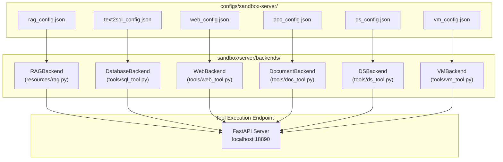
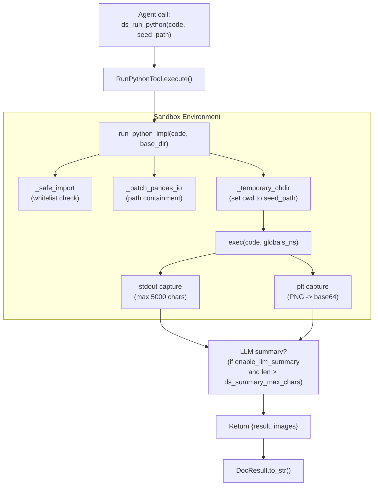

<!-- source: DeepWiki mcp.deepwiki.com · repo OpenDCAI/AgentFlow · page 3.2 Backend Resources · fetched 2026-11-02 -->

# Backend Resources

<details>
<summary>Relevant source files</summary>

The following files were used as context for generating this wiki page:

- [configs/infer/ds_infer.json](configs/infer/ds_infer.json)
- [configs/sandbox-server/doc_config.json](configs/sandbox-server/doc_config.json)
- [configs/sandbox-server/ds_config.json](configs/sandbox-server/ds_config.json)
- [configs/sandbox-server/rag_config.json](configs/sandbox-server/rag_config.json)
- [configs/sandbox-server/text2sql_config.json](configs/sandbox-server/text2sql_config.json)
- [configs/sandbox-server/web_config.json](configs/sandbox-server/web_config.json)
- [configs/trajectory/ds_trajectory.json](configs/trajectory/ds_trajectory.json)
- [examples/DSAgent.md](examples/DSAgent.md)
- [sandbox/result_formatter.py](sandbox/result_formatter.py)
- [sandbox/server/backends/tools/ds_tool.py](sandbox/server/backends/tools/ds_tool.py)

</details>


This page documents the six backend resource types supported by the AgentFlow sandbox server, covering their configuration parameters, implementation components, and operational behavior. Each backend encapsulates a distinct execution environment — from vector search and SQL query execution to sandboxed Python and web APIs.

For server-level parameters (port, session TTL, URL), see [Server Configuration](#3.1). For the tool schema definitions exposed by each backend, see [Tool Schemas Reference](#3.3). For session lifecycle management, see [Session Management](#3.4).

---

## Backend Types Overview

The sandbox server supports six backend resource types, each registered under a distinct key in the config file and providing a set of named tools to agents.

**Backend-to-Config Key Mapping**

| Backend | Config File | Config Key | Tool Prefix | Config Style |
|---|---|---|---|---|
| RAG | `rag_config.json` | `resources.rag` | `rag:` | `resources` block |
| Text2SQL | `text2sql_config.json` | `apis.text2sql` | `text2sql:` | `apis` block |
| Web | `web_config.json` | `apis.websearch` | `web:` | `apis` block |
| Document | `doc_config.json` | `apis.doc` | `doc:` | `apis` block |
| Data Science | `ds_config.json` | `apis.ds` | `ds_` | `apis` block |
| VM/GUI | `vm_config.json` | `apis.vm` | `vm-` | `apis` block |

> Note: The RAG backend uses a `resources` block and declares an explicit `backend_class`, while the remaining backends use an `apis` block. This distinction affects how the server initializes them.

**Backend Architecture Overview**



Sources: [configs/sandbox-server/rag_config.json:1-35](), [configs/sandbox-server/text2sql_config.json:1-22](), [configs/sandbox-server/web_config.json:1-18](), [configs/sandbox-server/doc_config.json:1-23](), [configs/sandbox-server/ds_config.json:1-20]()

---

## RAG Backend

The RAG backend provides dense vector retrieval using an E5 embedding model and a Faiss index. It is the only backend that uses the `resources` config block and explicitly declares `backend_class`.

### Configuration

```json
{
  "resources": {
    "rag": {
      "enabled": true,
      "backend_class": "sandbox.server.backends.resources.rag.RAGBackend",
      "config": {
        "model_name": "${RAG_EMBEDDING_MODEL_PATH}",
        "index_path": "${RAG_INDEX_PATH}",
        "corpus_path": "${RAG_CORPUS_PATH}",
        "device": "cuda:2",
        "default_top_k": 10,
        "batcher_trigger_batch_size": 16,
        "batcher_max_batch_size": 32,
        "batcher_max_wait_time": 0.05
      }
    }
  },
  "warmup": {
    "enabled": true,
    "resources": ["rag"]
  }
}
```

**RAG Configuration Parameters**

| Parameter | Type | Description |
|---|---|---|
| `model_name` | string | Path to the E5 embedding model (env var `RAG_EMBEDDING_MODEL_PATH`) |
| `index_path` | string | Path to the Faiss index file (env var `RAG_INDEX_PATH`) |
| `corpus_path` | string | Path to the document corpus (env var `RAG_CORPUS_PATH`) |
| `device` | string | Device placement. Formats: `cuda:0`, `cuda:0/cuda:1`, `cpu`. Encoder goes to first device, index to second. |
| `default_top_k` | int | Number of passages to retrieve per query |
| `batcher_trigger_batch_size` | int | Minimum batch size to trigger a batched encode |
| `batcher_max_batch_size` | int | Maximum items per encode batch |
| `batcher_max_wait_time` | float | Seconds to wait before flushing an incomplete batch |

The optional `warmup` block causes the server to pre-load and exercise the backend at startup, preventing cold-start latency on the first query.

**Exposed tool:** `rag:search` — accepts a query string, returns top-k passages formatted by `RAGSearchResult` in [sandbox/result_formatter.py:422-472]().

Sources: [configs/sandbox-server/rag_config.json:1-35](), [sandbox/result_formatter.py:422-472]()

---

## Text2SQL Backend

The Text2SQL backend serves SQLite databases and provides three tools for database discovery, schema inspection, and query execution.

### Configuration

```json
{
  "apis": {
    "text2sql": {
      "databases": {
        "retail":        "${TEXT2SQL_RETAIL_DB_PATH:-}",
        "music":         "${TEXT2SQL_MUSIC_DB_PATH:-}",
        "hospital":      "${TEXT2SQL_HOSPITAL_DB_PATH:-}",
        "finance":       "${TEXT2SQL_FINANCE_DB_PATH:-}",
        "chinook":       "${TEXT2SQL_CHINOOK_DB_PATH:-}",
        "sakila":        "${TEXT2SQL_SAKILA_DB_PATH:-}",
        "adventureworks":"${TEXT2SQL_ADVENTUREWORKS_DB_PATH:-}"
      }
    }
  }
}
```

**Text2SQL Configuration Parameters**

| Parameter | Type | Description |
|---|---|---|
| `databases` | object | Map of logical database names to SQLite file paths. Paths provided via environment variables; defaults to empty string if unset (`:-`). |

**Pre-defined database domains:** retail, music, hospital, finance, chinook, sakila, adventureworks.

**Exposed tools:**

| Tool | Description |
|---|---|
| `text2sql:list_databases` | Lists all registered database names |
| `text2sql:get_schema` | Returns table/column/foreign-key schema for a given database |
| `text2sql:execute` | Executes a SQL query and returns rows (truncated at 100 rows) |

Result formatting is handled by `SQLResult` in [sandbox/result_formatter.py:578-695](), which formats each of the three tool responses differently: a comma-separated list for `list_databases`, a structured table description for `get_schema`, and a pipe-delimited table for `execute`.

Sources: [configs/sandbox-server/text2sql_config.json:1-22](), [sandbox/result_formatter.py:578-695]()

---

## Web Backend

The Web backend wraps two external APIs — Serper for search and Jina for page fetching — with an optional LLM summarization pass over retrieved content.

### Configuration

```json
{
  "apis": {
    "websearch": {
      "serper_api_key": "${SERPER_API_KEY}",
      "jina_api_key": "${JINA_API_KEY}",
      "visit_method": "jina",
      "content_limit": 50000,
      "enable_llm_summary": true,
      "summary_model": "openai/gpt-oss-120b",
      "openai_api_key": "${OPENROUTER_API_KEY}",
      "openai_api_url": "https://openrouter.ai/api/v1"
    }
  }
}
```

**Web Configuration Parameters**

| Parameter | Type | Description |
|---|---|---|
| `serper_api_key` | string | API key for Serper search (env var `SERPER_API_KEY`) |
| `jina_api_key` | string | API key for Jina Reader (env var `JINA_API_KEY`) |
| `visit_method` | string | Method for fetching page content. Currently `"jina"` |
| `content_limit` | int | Maximum characters of raw content to process before summarization |
| `enable_llm_summary` | bool | Whether to compress fetched content using an LLM before returning |
| `summary_model` | string | Model name for LLM summarization (OpenRouter-compatible name) |
| `openai_api_key` | string | API key for the summarization model (env var `OPENROUTER_API_KEY`) |
| `openai_api_url` | string | Base URL for the OpenAI-compatible summarization API |

**Exposed tools:**

| Tool | Description |
|---|---|
| `web:search` | Queries Serper and returns formatted search results |
| `web:visit` | Fetches URL content via Jina, optionally summarized |

Result formatting: `WebSearchResult` ([sandbox/result_formatter.py:366-415]()) and `VisitResult` ([sandbox/result_formatter.py:479-538]()).

Sources: [configs/sandbox-server/web_config.json:1-18](), [sandbox/result_formatter.py:366-538]()

---

## Document Backend

The Document backend provides search and reading capabilities over structured documents (PDF/multimodal). It uses a VLM (Vision Language Model) to read document pages and answer queries about them.

### Configuration

```json
{
  "apis": {
    "doc": {
      "seed_path": "seeds/doc/seed/2210.02442v1",
      "max_search_results": 10,
      "max_image_num": 10,
      "max_text_token": 20000,
      "vlm_model": "openai/gpt-4o-mini",
      "vlm_api_key": "${VLM_API_KEY}",
      "vlm_api_url": "https://openrouter.ai/api/v1",
      "vlm_max_tokens": 16384,
      "vlm_timeout": 300,
      "vlm_retry_max_attempts": 10
    }
  }
}
```

**Document Configuration Parameters**

| Parameter | Type | Description |
|---|---|---|
| `seed_path` | string | Path to the document directory used during synthesis |
| `max_search_results` | int | Maximum number of pages/chunks returned per `doc:search` call |
| `max_image_num` | int | Maximum number of page images forwarded to the VLM per call |
| `max_text_token` | int | Maximum text tokens extracted from a document page |
| `vlm_model` | string | VLM model identifier (OpenRouter format) |
| `vlm_api_key` | string | API key for the VLM endpoint (env var `VLM_API_KEY`) |
| `vlm_api_url` | string | Base URL for the VLM API |
| `vlm_max_tokens` | int | Max tokens the VLM may generate per response |
| `vlm_timeout` | int | Seconds before a VLM request times out |
| `vlm_retry_max_attempts` | int | Number of retry attempts on VLM failure |

**Exposed tools:**

| Tool | Description |
|---|---|
| `doc:search` | Retrieves the most relevant document sections for a query |
| `doc:read` | Reads a specific page/section using the VLM |

`doc_config.json` also includes `session_ttl: 300`, indicating document sessions are stateful and expire after 5 minutes of inactivity.

Result formatting is handled by `DocResult` ([sandbox/result_formatter.py:545-571]()).

Sources: [configs/sandbox-server/doc_config.json:1-23](), [sandbox/result_formatter.py:545-571]()

---

## Data Science (DS) Backend

The DS backend provides a sandboxed Python execution environment for CSV-based data analysis. It is the most complex backend in terms of security controls.

### Configuration

```json
{
  "apis": {
    "ds": {
      "ds_max_csv": 100,
      "ds_summary_max_chars": 12000,
      "enable_llm_summary": true,
      "summary_model": "openai/gpt-oss-120b",
      "openai_api_key": "${OPENAI_API_KEY}",
      "openai_api_url": "${OPENAI_API_URL}",
      "llm_summary_temperature": 0.3,
      "llm_summary_max_tokens": 2000,
      "content_limit": 50000
    }
  }
}
```

**DS Configuration Parameters**

| Parameter | Type | Description |
|---|---|---|
| `ds_max_csv` | int | Max number of CSV files scanned by `ds_inspect_data` |
| `ds_summary_max_chars` | int | Max characters of raw inspection output before truncation |
| `enable_llm_summary` | bool | If true and output exceeds `ds_summary_max_chars`, compress with LLM |
| `summary_model` | string | Model used for LLM summarization |
| `openai_api_key` | string | API key for the summarization model (env var `OPENAI_API_KEY`) |
| `openai_api_url` | string | Base URL for the OpenAI-compatible API (env var `OPENAI_API_URL`) |
| `llm_summary_temperature` | float | Temperature for LLM summarization (default `0.3`) |
| `llm_summary_max_tokens` | int | Max tokens in LLM summary response (default `2000`) |
| `content_limit` | int | Character limit applied to content before passing to LLM |

### Tool Classes

Three tool classes are defined in [sandbox/server/backends/tools/ds_tool.py]():

| Class | Tool Name | `resource_type` |
|---|---|---|
| `InspectDataTool` | `ds_inspect_data` | `ds` |
| `ReadCsvTool` | `ds_read_csv` | `ds` |
| `RunPythonTool` | `ds_run_python` | `ds` |

### Python Sandbox Security

The `RunPythonTool` executes arbitrary Python using `exec()` inside a restricted namespace. Two mechanisms enforce isolation:

1. **Import whitelist** — `_safe_import` ([sandbox/server/backends/tools/ds_tool.py:235-239]()) blocks any module not in `ALLOWED_MODULES` ([sandbox/server/backends/tools/ds_tool.py:222-233]()). Permitted modules include `pandas`, `numpy`, `scipy`, `sklearn`, `matplotlib`, `seaborn`, and standard library modules.

2. **Path containment** — `_resolve_csv_path` ([sandbox/server/backends/tools/ds_tool.py:67-82]()) resolves file paths relative to the session's `seed_path` and raises `ValueError` if the resolved path escapes the base directory. `_patch_pandas_io` ([sandbox/server/backends/tools/ds_tool.py:242-263]()) monkey-patches `pd.read_csv` to apply this check transparently.

Additional controls inside `run_python_impl` ([sandbox/server/backends/tools/ds_tool.py:276-417]()):
- `stdout` is capped at 5,000 characters before returning.
- `matplotlib` figures are captured to PNG and returned as base64.
- `plt.close('all')` is called both before and after execution to prevent figure state leakage between calls.
- A temporary working directory is set via `_temporary_chdir` ([sandbox/server/backends/tools/ds_tool.py:266-273]()).

**DS Backend Data Flow**



Sources: [sandbox/server/backends/tools/ds_tool.py:1-603](), [configs/sandbox-server/ds_config.json:1-20]()

---

## VM/GUI Backend

The VM backend enables GUI interaction through a Docker-based Ubuntu desktop. It is used by the GUI agent type. Configuration is provided in `configs/sandbox-server/vm_config.json`.

**Exposed tools** (tool name prefix `vm-`):

| Tool | Action |
|---|---|
| `vm-screenshot` | Captures current desktop state as an image |
| `vm-click` | Sends a mouse click at specified coordinates |
| `vm-type` | Types a string into the focused element |
| `vm-key` | Sends a key combination |
| `vm-scroll` | Scrolls in a specified direction |

The VM backend is stateful — each session corresponds to an isolated Docker container. Session TTL and reinitialization are critical for this backend; see [Session Management](#3.4) for details.

Result formatting is handled by `VMResult` ([sandbox/result_formatter.py:291-307]()), which extracts only the `accessibility_tree` field from the raw response, discarding screenshot binary data that is not suitable for text-based agents.

Sources: [sandbox/result_formatter.py:291-307]()

---

## Result Formatting

Every backend routes its tool output through a `ToolResult` subclass before the response is returned to the caller. The `ResultFormatter` factory ([sandbox/result_formatter.py:702-861]()) dispatches to the correct class based on the `tool` and `resource_type` fields in the response metadata.

**ResultFormatter Dispatch Logic**

```mermaid
flowchart TD
  Start["ResultFormatter.format(response)"] --> E1{"tool == 'web:search'\nand resource_type != 'rag'?"}
  E1 -->|yes| WebSearchResult
  E1 -->|no| E2{"tool == 'web:visit'?"}
  E2 -->|yes| VisitResult
  E2 -->|no| E3{"tool == 'rag:search'?"}
  E3 -->|yes| RAGSearchResult
  E3 -->|no| E4{"tool starts with\n'text2sql:' or 'sql:'?"}
  E4 -->|yes| SQLResult
  E4 -->|no| E5{"tool starts with\n'doc:' or 'ds:' or\n'doc_' or 'ds_'?"}
  E5 -->|yes| DocResult
  E5 -->|no| E6["Lookup FORMATTER_MAP\nby resource_type or\ntool prefix"]
  E6 --> E7{"Found?"}
  E7 -->|yes| "Matched class\n(BashResult, VMResult, etc.)"]
  E7 -->|no| ValueError["raise ValueError\n(unregistered tool type)"]
```

**ToolResult Subclasses by Backend**

| Backend | `ToolResult` subclass | Key output field |
|---|---|---|
| RAG | `RAGSearchResult` | `data.context` |
| Web search | `WebSearchResult` | `data.result` |
| Web visit | `VisitResult` | `data.result` |
| SQL | `SQLResult` | `data.result` (nested, varies by tool) |
| Document / DS | `DocResult` | `data.result` |
| VM | `VMResult` | `data.accessibility_tree` |
| Bash | `BashResult` | `data.stdout` |
| Code | `CodeExecutionResult` | `data.stdout` |

Custom formatters can be registered at runtime using `ResultFormatter.register_formatter(tool_type, FormatterClass)` ([sandbox/result_formatter.py:839-860]()).

Sources: [sandbox/result_formatter.py:700-861]()

---

## Environment Variables Summary

All sensitive credentials and machine-specific paths are injected via environment variables using `${VAR_NAME}` substitution. The complete set used across backend configs:

| Variable | Used By |
|---|---|
| `RAG_EMBEDDING_MODEL_PATH` | RAG backend — embedding model path |
| `RAG_INDEX_PATH` | RAG backend — Faiss index path |
| `RAG_CORPUS_PATH` | RAG backend — document corpus path |
| `TEXT2SQL_RETAIL_DB_PATH` | SQL backend — retail SQLite path |
| `TEXT2SQL_MUSIC_DB_PATH` | SQL backend — music SQLite path |
| `TEXT2SQL_HOSPITAL_DB_PATH` | SQL backend — hospital SQLite path |
| `TEXT2SQL_FINANCE_DB_PATH` | SQL backend — finance SQLite path |
| `TEXT2SQL_CHINOOK_DB_PATH` | SQL backend — chinook SQLite path |
| `TEXT2SQL_SAKILA_DB_PATH` | SQL backend — sakila SQLite path |
| `TEXT2SQL_ADVENTUREWORKS_DB_PATH` | SQL backend — adventureworks SQLite path |
| `SERPER_API_KEY` | Web backend — Serper search API |
| `JINA_API_KEY` | Web backend — Jina fetch API |
| `OPENROUTER_API_KEY` | Web, DS backends — LLM summarization |
| `VLM_API_KEY` | Document backend — VLM API |
| `OPENAI_API_KEY` | DS backend — LLM summarization |
| `OPENAI_API_URL` | DS backend — LLM API base URL |

For the full reference including synthesis and inference configs, see [Environment Variables](#8.5).

Sources: [configs/sandbox-server/rag_config.json:19-22](), [configs/sandbox-server/text2sql_config.json:12-18](), [configs/sandbox-server/web_config.json:8-9](), [configs/sandbox-server/doc_config.json:17](), [configs/sandbox-server/ds_config.json:13-14]()

---

